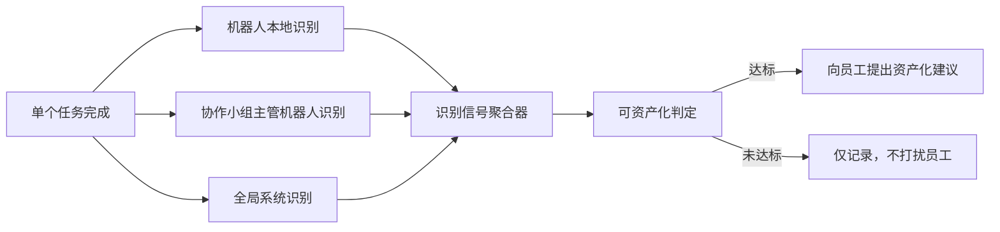

# 可资产化内容识别策略

## 1. 目标

在员工端资产管理持续完善的同时，我们需要明确：

1. **谁来识别可资产化内容**
2. **识别的对象是什么**
3. **识别的方法是什么**
4. **判定为“值得进入资产整理”的标准是什么**

这套识别策略必须服务于一个结果：

**任务完成后，只有当系统具备足够理由认为某项内容值得沉淀时，才向员工提出资产化建议。**

---

## 2. 识别主体分层

建议把识别主体拆成 3 层，而不是只靠一个全局系统。

## 2.1 全局系统识别器

职责：

- 站在平台/系统视角，对所有机器人和协作小组的任务结果、使用行为、复用轨迹做通用模式识别

适合识别的内容：

1. 高频重复任务
2. 高成功率稳定输出
3. 重复的工具调用链
4. 重复的输入输出结构
5. 被多个机器人或多人复用的内容模式

特点：

- 视野广
- 更适合发现“跨场景通用模式”
- 对单个任务上下文理解较弱

## 2.2 单个机器人识别器

职责：

- 站在当前机器人自己的工作轨迹中，识别该机器人最近形成的稳定做法和可复用产物

适合识别的内容：

1. 某机器人反复执行的某类任务步骤
2. 某机器人稳定生成的某类输出模版
3. 某机器人常用的一组提示方式
4. 某机器人依赖的一组知识材料

特点：

- 上下文最完整
- 能捕捉“这个机器人最近学会了什么”
- 更适合发现局部高价值资产

## 2.3 协作小组主管机器人识别器

职责：

- 站在协作小组的协作过程里，识别小组层面沉淀出的共识流程、协作文档模版、复盘模版、群体知识和共用能力

适合识别的内容：

1. 小组反复使用的协作流程
2. 小组产出的标准纪要/复盘模版
3. 小组共识化的知识集合
4. 多成员共同参与验证过的工作做法

特点：

- 不只是看单个机器人，而是看“群体工作模式”
- 最适合发现“可共享到小组/企业”的资产

---

## 3. 三类识别主体如何协同

建议不是三套孤立引擎，而是一套统一识别框架，三个视角提供不同信号。

协同原则：

1. **机器人识别器**提供最细粒度上下文信号
2. **协作小组主管机器人**提供团队复用和共创信号
3. **全局系统识别器**提供跨任务、跨对象、跨时间的稳定性信号

最终不是谁单独拍板，而是聚合后统一判定。

---

## 4. 识别对象：系统到底在找什么

识别对象不是“任何文本”，而是以下 4 种候选模式。

## 4.1 输出模式

系统观察：

1. 某类输出结构是否稳定
2. 是否存在固定栏目或固定表达骨架
3. 是否只有少量变量变化

适合识别出的资产类型：

- `template`
- `capability`

## 4.2 步骤模式

系统观察：

1. 某类任务是否反复走相同步骤
2. 工具调用是否稳定重复
3. 步骤之间的输入输出关系是否清晰

适合识别出的资产类型：

- `workflow`
- `capability`

## 4.3 指令模式

系统观察：

1. 员工或机器人是否反复使用相似提示策略
2. 同类任务中是否存在高成功率提示片段
3. 提示逻辑是否能脱离一次性上下文独立存在

适合识别出的资产类型：

- `prompt`
- `agent`

## 4.4 知识模式

系统观察：

1. 哪些资料被反复引用
2. 哪些知识集合持续支撑高质量结果
3. 哪些知识内容在小组内多次复用

适合识别出的资产类型：

- `knowledge`
- `capability`

---

## 5. 识别方法

建议把识别方法拆成 5 类信号，而不是直接做黑盒判断。

## 5.1 重复度信号

核心问题：

- 这个内容/做法是否重复出现过

观察方式：

1. 同类任务重复次数
2. 相同结构的输出重复次数
3. 相同步骤链重复次数
4. 相同提示策略重复次数

判断价值：

- 没有重复，就通常不值得资产化

## 5.2 稳定性信号

核心问题：

- 这个内容/做法是否稳定有效

观察方式：

1. 输出结构稳定度
2. 成功率
3. 失败波动幅度
4. 是否频繁需要人工大改

判断价值：

- 不稳定的内容不应直接提议沉淀

## 5.3 复用性信号

核心问题：

- 这个内容是否能被再次使用

观察方式：

1. 是否跨任务复用
2. 是否跨机器人复用
3. 是否跨成员复用
4. 是否跨协作小组复用

判断价值：

- 复用半径越大，越值得沉淀

## 5.4 独立性信号

核心问题：

- 这个对象能否脱离当前一次任务单独存在

观察方式：

1. 是否依赖一次性上下文
2. 是否依赖特定人名/客户名/文件名
3. 是否能抽象成稳定输入输出结构

判断价值：

- 如果离不开单次上下文，它更像记录，不像资产

## 5.5 反馈性信号

核心问题：

- 用户和系统是否对它产生了正向反馈

观察方式：

1. 任务结束后的员工反馈
2. 应用后的成功反馈
3. 小组协作中的复用评价
4. 企业审核意见

判断价值：

- 没有正向反馈，资产化建议应更保守

---

## 6. 最小判定标准：什么时候可以认为“可资产化”

建议不要只看单一信号，而是满足一个最小组合。

## 6.1 基础门槛

满足以下全部条件，才进入候选：

1. 有明确任务边界
2. 可以抽象成一个相对独立对象
3. 不包含明显敏感信息泄露风险
4. 至少被识别为一种候选资产类型

## 6.2 推荐门槛

满足以下任意组合之一，可以向员工提出建议：

### 组合 A：重复 + 稳定

1. 重复次数达到阈值
2. 稳定性达到阈值

### 组合 B：重复 + 复用

1. 重复次数达到阈值
2. 已在多个对象中使用

### 组合 C：稳定 + 正反馈

1. 输出/流程稳定
2. 员工或小组反馈较好

### 组合 D：团队共识化

1. 由协作小组多次共用
2. 小组主管机器人识别为共识做法

---

## 7. 建议的识别阈值

这些阈值不要写死在产品文案里，但实现上要有默认值。

## 7.1 Prompt / Template

建议门槛：

1. 重复出现次数 >= 3
2. 结构相似度 >= 0.75
3. 最近成功率 >= 0.8

## 7.2 Workflow

建议门槛：

1. 稳定步骤数 >= 3
2. 重复执行次数 >= 3
3. 步骤顺序稳定度 >= 0.8

## 7.3 Knowledge

建议门槛：

1. 被引用次数 >= 3
2. 引用结果为正向的比例 >= 0.7
3. 知识范围可清晰归纳

## 7.4 Agent / Capability

建议门槛：

1. 至少在一个完整任务类型中稳定发挥作用
2. 最近使用成功率 >= 0.8
3. 具备可被业务语言概括的一句话描述

---

## 8. 当前仓库里已经有什么雏形

目前仓库里已经有几块接近这个方向的雏形，但还不是完整识别链路。

## 8.1 `skill-lifecycle.extract`

当前存在 `skill-lifecycle.extract`，见 `src/gateway/server-methods/skill-lifecycle.ts:59`。  
但它目前更像“从当前上下文生成一个可保存预览”，不是完整模式识别引擎。

## 8.2 `pattern-detection.ts`

前端已有模式识别 hint 模型，见 `ui/src/ui/controllers/pattern-detection.ts:1`。  
其中已经定义了几个很有代表性的识别信号：

1. `repeated_task`
2. `stable_prompt`
3. `fixed_workflow`
4. `repeated_toolchain`
5. `stable_io`

并且已经有基础阈值模型：

1. 最少重复次数
2. 最低置信度
3. 最少信号数

这说明识别框架的方向是对的，但当前还没有完整落到真实任务闭环上。

## 8.3 `skill-auto-classify.ts`

已有自动分类建议控制器，见 `ui/src/ui/controllers/skill-auto-classify.ts:1`。  
这适合放在“已经识别出候选之后”的分类增强阶段，而不是前置识别本身。

---

## 9. 推荐的实际落地方式

如果要结合当前员工端继续推进，建议按以下顺序落地。

## 9.1 第一阶段：任务完成后单次识别

任务完成时，先做轻量识别：

1. 是否存在稳定输出
2. 是否存在明显步骤模式
3. 是否存在明显模版化结果
4. 是否存在知识复用迹象

如果置信度不足，不提示用户。

## 9.2 第二阶段：机器人本地短周期累计识别

针对单个机器人，统计最近 N 次同类任务：

1. 输出相似度
2. 步骤重复度
3. 成功率
4. 用户反馈

当累计达标，再提高建议强度。

## 9.3 第三阶段：协作小组共识识别

让主管机器人持续看小组协作：

1. 哪类模版在小组里被多次共用
2. 哪类复盘结构反复出现
3. 哪类知识说明被多人引用

这一步的意义是发现更适合“共享给小组/提交企业”的资产。

## 9.4 第四阶段：全局系统做最终加权判定

最终由系统聚合三类信号：

1. 机器人本地信号
2. 协作小组主管机器人信号
3. 全局跨任务统计信号

只有达到统一判定标准，才给员工资产化建议。

---

## 10. 一句话结论

可资产化内容不是“写过的内容”，而是：

**在任务中被重复验证、结果稳定、具备复用价值、能被抽象成独立对象的工作模式。**

而识别这类内容，最合理的机制是：

**单个机器人看本地稳定做法，协作小组主管机器人看团队共识做法，全局系统看跨任务与跨对象复用模式，三者信号聚合后再决定是否向员工提出资产化建议。**
