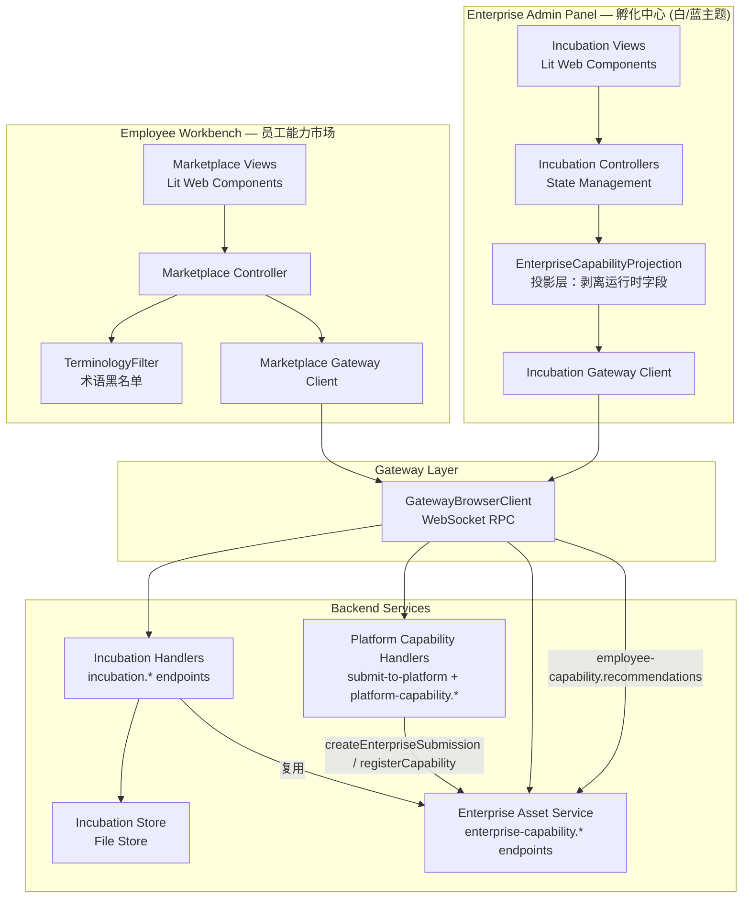
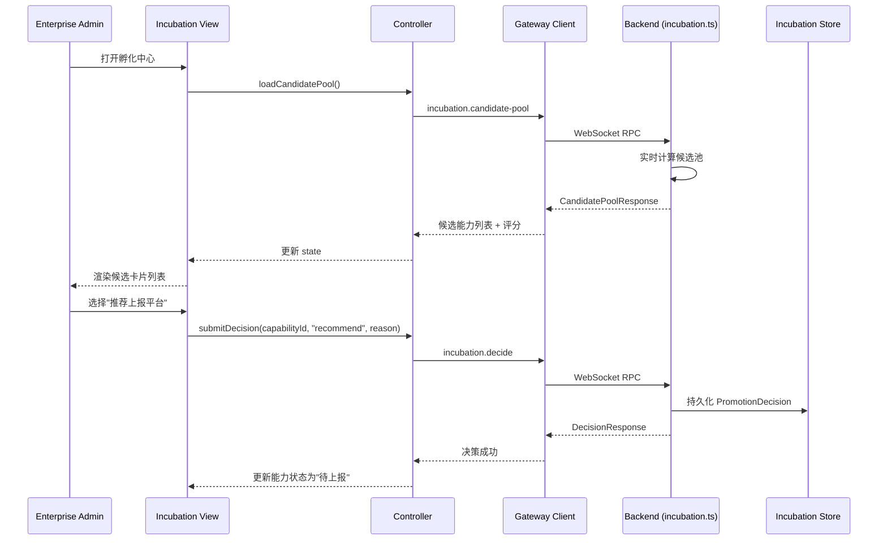
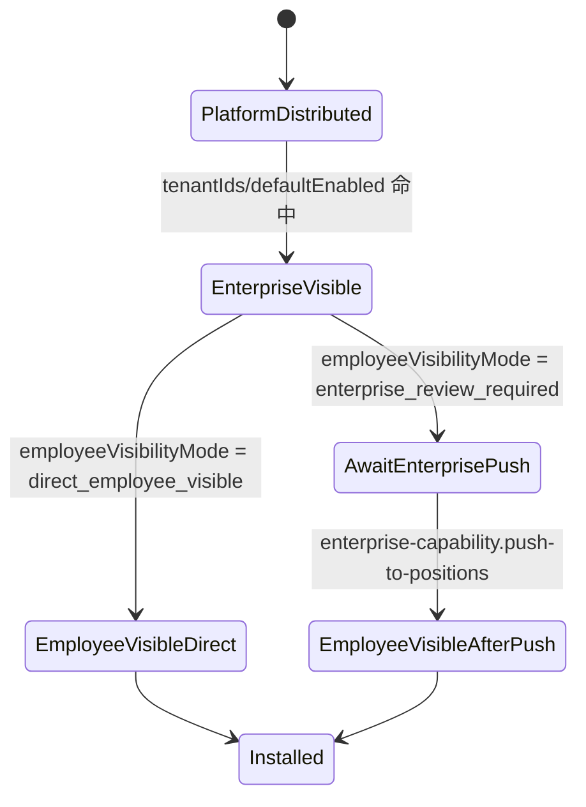

# 技术设计文档：能力生命周期闭环（Capability Lifecycle Closure）

## Overview

能力生命周期闭环系统补全从"企业资产沉淀"到"平台标准化"再到"员工能力市场"的完整循环路径。本模块包含三个子系统：

1. **孵化中心（Incubation Center）**：企业管理员侧的能力孵化管理，包含候选池实时检测、多维评分、晋升决策、效果追踪
2. **平台上行通道（Platform Upstream Channel）**：企业向平台上报优质能力的正式通道，含手动上报与提案审批
3. **员工能力市场（Employee Capability Marketplace）**：嵌入 Robot_Capability_Tab 的平台标准能力发现与安装入口

**核心设计原则：**

1. **实时按需计算**：候选池在管理员打开页面时实时计算，不依赖后台定时任务
2. **EnterpriseCapabilityProjection 复用**：管理员端复用已有投影层剥离运行时字段
3. **术语黑名单严格执行**：员工端复用 `terminology-filter.ts`，禁止暴露运行时术语
4. **File Store 持久化**：所有新增数据（决策记录、上报记录、效果追踪）使用 JSON 文件存储，与 `capability-governance-store.ts` 同构
5. **Gateway RPC 通信**：前后端通过 WebSocket RPC 通信，复用 `GatewayBrowserClient` 模式
6. **端点复用优先**：`enterprise-capability.promote-to-standard`、`enterprise-capability.certify`、`employee-capability.recommendations`、`employee-capability.install-to-robot` 均为已有端点

**技术栈约束：**

- 前端：Lit（Web Components）+ TypeScript
- 后端：Gateway RPC handlers（TypeScript）
- 数据：File Store（JSON 文件，原子写入）
- 通信：GatewayBrowserClient WebSocket RPC

## Architecture

### 系统架构图



### 数据流



### 模块目录结构

```
src/gateway/
├── incubation-store.ts              # 孵化数据 File Store（决策、效果追踪）
├── server-methods/
│   └── incubation.ts                # incubation.* RPC handlers
│
│   平台上行改由脱敏提交通路承载（enterprise-capability.submit-to-platform
│   + platform-capability.*），孵化中心的上报追踪读 enterprise-capability.platform-submissions。

ui/src/ui/controllers/enterprise-incubation/
├── candidate-pool.ts                # 候选池状态管理
├── incubation-score.ts              # 孵化评分计算（纯函数）
├── promotion-decision.ts            # 晋升决策状态管理
├── effect-tracking.ts               # 效果追踪状态管理
├── upstream-report.ts               # 上报追踪状态展示（状态标签 / 颜色）
├── marketplace.ts                   # 员工能力市场状态管理
└── index.ts                         # 控制器导出

ui/src/ui/views/enterprise-incubation/
├── candidate-pool-section.ts        # 候选池概览 + 统计卡片
├── candidate-card.ts                # 候选能力卡片（含雷达图，「推荐上报平台」按钮走脱敏提交通路）
├── decision-panel.ts                # 晋升决策面板
├── decision-history.ts              # 决策历史列表
├── effect-tracking-panel.ts         # 效果追踪面板
├── upstream-report-list.ts          # 上报记录追踪列表（读 enterprise-capability.platform-submissions）
├── marketplace-section.ts           # 员工能力市场（嵌入 robot-capability-tab）
├── marketplace-card.ts              # 能力市场卡片
└── shared/
    └── styles.css.ts                # 共享样式常量
```

> **架构收口修订（2026-07）**：初版的 `upstream.*` 旁路（`upstream.submit/report-list/proposal-status/supplement` + `incubation-store` upload-report）已删除；孤立视图 `upstream-report-form.ts` / `proposal-timeline.ts` / `incubation-center-page.ts` 与控制器 `proposal-status.ts` 一并移除。平台上行统一走脱敏提交通路（见 requirements.md「架构收口修订」）。`enterprise-capability.certify` / `promote-to-standard` 现会把「企业认证 / 企业标准」授予持久化到治理注册表条目（`manualMaturityGrant`）。

## Components and Interfaces

### 1. Incubation Store（孵化数据存储层）

与 `capability-governance-store.ts` 同构的 JSON 文件存储，提供原子写入保证。

```typescript
// src/gateway/incubation-store.ts

import fs from "node:fs";
import path from "node:path";
import { CONFIG_DIR } from "../utils.js";

const INCUBATION_DIR = path.join(CONFIG_DIR, "incubation");
const DECISIONS_FILE = path.join(INCUBATION_DIR, "decisions.json");
const UPLOAD_REPORTS_FILE = path.join(INCUBATION_DIR, "upload-reports.json");
const EFFECT_TRACKING_FILE = path.join(INCUBATION_DIR, "effect-tracking.json");

// --- 原子写入 ---

function atomicWriteJson(filePath: string, data: unknown): void {
  const dir = path.dirname(filePath);
  if (!fs.existsSync(dir)) {
    fs.mkdirSync(dir, { recursive: true });
  }
  const tmpPath = `${filePath}.${Date.now()}.tmp`;
  fs.writeFileSync(tmpPath, JSON.stringify(data, null, 2), "utf-8");
  fs.renameSync(tmpPath, filePath);
}

function readJsonFile<T>(filePath: string, fallback: T): T {
  try {
    if (!fs.existsSync(filePath)) return fallback;
    return JSON.parse(fs.readFileSync(filePath, "utf-8")) as T;
  } catch {
    return fallback;
  }
}

// --- Promotion Decision ---

export type PromotionDecisionRecord = {
  decisionId: string;
  capabilityId: string;
  decidedAt: number;
  decidedBy: string;
  result: "recommend_upload" | "continue_incubation" | "not_suitable";
  reason: string;
  scoreSnapshot: IncubationScoreSnapshot;
};

export type IncubationScoreSnapshot = {
  reuseBreath: number; // 复用广度 0-100
  effectStability: number; // 效果稳定性 0-100
  businessCoverage: number; // 业务覆盖度 0-100
  employeeSatisfaction: number | null; // 员工满意度 0-100，null 表示数据不足
  compositeScore: number; // 综合分
};

export function listDecisions(capabilityId?: string): PromotionDecisionRecord[] {
  const all = readJsonFile<PromotionDecisionRecord[]>(DECISIONS_FILE, []);
  return capabilityId ? all.filter((d) => d.capabilityId === capabilityId) : all;
}

export function saveDecision(decision: PromotionDecisionRecord): void {
  const decisions = listDecisions();
  decisions.push(decision);
  atomicWriteJson(DECISIONS_FILE, decisions);
}

// --- Upload Report ---

export type UploadReportRecord = {
  reportId: string;
  capabilityId: string;
  uploadedAt: number;
  uploadedBy: string;
  formContent: UploadFormContent;
  scoreSnapshot: IncubationScoreSnapshot;
  proposalStatus: ProposalStatus;
  statusHistory: ProposalStatusChange[];
};

export type UploadFormContent = {
  name: string;
  description: string;
  applicableScenario: string;
  targetEnterpriseType: string;
  recommendReason: string;
};

export type ProposalStatus =
  | "pending" // 待审批
  | "reviewing" // 审批中
  | "approved" // 已通过
  | "rejected" // 已拒绝
  | "supplement"; // 需补充材料

export type ProposalStatusChange = {
  status: ProposalStatus;
  changedAt: number;
  operator: string;
  note: string;
};

export function listUploadReports(capabilityId?: string): UploadReportRecord[] {
  const all = readJsonFile<UploadReportRecord[]>(UPLOAD_REPORTS_FILE, []);
  return capabilityId ? all.filter((r) => r.capabilityId === capabilityId) : all;
}

export function getUploadReport(reportId: string): UploadReportRecord | null {
  return listUploadReports().find((r) => r.reportId === reportId) ?? null;
}

export function saveUploadReport(report: UploadReportRecord): void {
  const reports = listUploadReports();
  const idx = reports.findIndex((r) => r.reportId === report.reportId);
  if (idx >= 0) {
    reports[idx] = report;
  } else {
    reports.push(report);
  }
  atomicWriteJson(UPLOAD_REPORTS_FILE, reports);
}

export function hasActiveUpload(capabilityId: string): boolean {
  return listUploadReports(capabilityId).some(
    (r) => r.proposalStatus === "pending" || r.proposalStatus === "reviewing",
  );
}

// --- Effect Tracking ---

export type EffectTrackingRecord = {
  capabilityId: string;
  promotionTimestamp: number;
  dailyCallSnapshots: { date: string; count: number }[];
  dailyDepartmentSnapshots: { date: string; count: number }[];
  dailySuccessRateSnapshots: { date: string; rate: number }[];
};

export function getEffectTracking(capabilityId: string): EffectTrackingRecord | null {
  const all = readJsonFile<EffectTrackingRecord[]>(EFFECT_TRACKING_FILE, []);
  return all.find((r) => r.capabilityId === capabilityId) ?? null;
}

export function saveEffectTracking(record: EffectTrackingRecord): void {
  const all = readJsonFile<EffectTrackingRecord[]>(EFFECT_TRACKING_FILE, []);
  const idx = all.findIndex((r) => r.capabilityId === record.capabilityId);
  if (idx >= 0) {
    all[idx] = record;
  } else {
    all.push(record);
  }
  atomicWriteJson(EFFECT_TRACKING_FILE, all);
}
```

### 2. Incubation RPC Handlers（Gateway 端点处理器）

```typescript
// src/gateway/server-methods/incubation.ts

import type { GatewayRequestHandlers } from "./types.js";
import {
  listDecisions,
  saveDecision,
  listUploadReports,
  saveUploadReport,
  hasActiveUpload,
  getEffectTracking,
  saveEffectTracking,
  type PromotionDecisionRecord,
  type UploadReportRecord,
} from "../incubation-store.js";

export const incubationHandlers: GatewayRequestHandlers = {
  /** 实时计算候选池 */
  "incubation.candidate-pool": async ({ client, params, respond }) => {
    // 筛选条件：maturity >= "企业认证"、月调用 >= 100、覆盖部门 >= 2、成功率 >= 80%
    // 支持 domainFilter 参数按领域筛选
    // 默认按近 30 天调用次数降序
  },

  /** 获取单个能力的孵化评分 */
  "incubation.score": async ({ client, params, respond }) => {
    // 计算四维度评分 + 综合分
    // 处理数据不足维度的权重重分配
  },

  /** 提交晋升决策 */
  "incubation.decide": async ({ client, params, respond }) => {
    // 验证 reason 长度 10-500
    // 持久化 PromotionDecision
    // 若为 "recommend_upload" 则标记能力为"待上报"
  },

  /** 获取效果追踪数据 */
  "incubation.effect-tracking": async ({ client, params, respond }) => {
    // 返回晋升前后对比数据
    // 计算是否触发"效果下降"警告
  },
};
```

> 平台上行的提交/审批/补充材料由脱敏提交通路承载（`enterprise-capability.submit-to-platform`
> 与 `platform-capability.*`），孵化中心通过 `enterprise-capability.platform-submissions`
> 读取真实提交状态。原 `upstream.proposal-status` / `upstream.supplement` 已删除。

### 3. Incubation Score Calculator（评分计算器 — 纯函数）

```typescript
// ui/src/ui/controllers/enterprise-incubation/incubation-score.ts

export type ScoreInput = {
  /** 使用机器人数 */
  robotCount: number;
  /** 使用员工数 */
  employeeCount: number;
  /** 近 30 天成功率 (0-1) */
  successRate30d: number;
  /** 成功率波动幅度 (标准差) */
  successRateStdDev: number;
  /** 覆盖部门数 */
  departmentCount: number;
  /** 覆盖角色数 */
  roleCount: number;
  /** 员工主动安装率 (0-1)，null 表示无数据 */
  installRate: number | null;
  /** 持续使用天数 */
  continuousUsageDays: number | null;
};

export type ScoreDimension = {
  value: number; // 0-100
  available: boolean; // 是否有足够数据
};

export type IncubationScore = {
  reuseBreath: ScoreDimension;
  effectStability: ScoreDimension;
  businessCoverage: ScoreDimension;
  employeeSatisfaction: ScoreDimension;
  compositeScore: number;
};

const WEIGHTS = {
  reuseBreath: 0.3,
  effectStability: 0.3,
  businessCoverage: 0.2,
  employeeSatisfaction: 0.2,
} as const;

/**
 * 计算复用广度分数 (0-100)
 * 基于使用机器人数与使用员工数加权计算
 */
export function calcReuseBreath(robotCount: number, employeeCount: number): number {
  const robotScore = Math.min(100, robotCount * 10);
  const employeeScore = Math.min(100, employeeCount * 5);
  return Math.round(robotScore * 0.4 + employeeScore * 0.6);
}

/**
 * 计算效果稳定性分数 (0-100)
 * 基于近 30 天成功率与成功率波动幅度计算
 */
export function calcEffectStability(successRate: number, stdDev: number): number {
  const rateScore = Math.min(100, successRate * 100);
  const stabilityPenalty = Math.min(50, stdDev * 200);
  return Math.round(Math.max(0, rateScore - stabilityPenalty));
}

/**
 * 计算业务覆盖度分数 (0-100)
 * 基于覆盖部门数与覆盖角色数计算
 */
export function calcBusinessCoverage(departmentCount: number, roleCount: number): number {
  const deptScore = Math.min(100, departmentCount * 20);
  const roleScore = Math.min(100, roleCount * 15);
  return Math.round(deptScore * 0.6 + roleScore * 0.4);
}

/**
 * 计算员工满意度分数 (0-100)
 * 基于员工主动安装率与持续使用天数计算
 */
export function calcEmployeeSatisfaction(
  installRate: number | null,
  continuousUsageDays: number | null,
): ScoreDimension {
  if (installRate === null && continuousUsageDays === null) {
    return { value: 0, available: false };
  }
  const installScore = installRate !== null ? Math.min(100, installRate * 100) : 50;
  const usageScore = continuousUsageDays !== null ? Math.min(100, continuousUsageDays * 3) : 50;
  return { value: Math.round(installScore * 0.5 + usageScore * 0.5), available: true };
}

/**
 * 计算综合分（加权平均）
 * 当某维度数据不足时，排除该维度并重新分配权重
 */
export function calcCompositeScore(dimensions: Record<string, ScoreDimension>): number {
  const entries = Object.entries(WEIGHTS);
  const available = entries.filter(([key]) => dimensions[key]?.available !== false);
  if (available.length === 0) return 0;
  const totalWeight = available.reduce((sum, [, w]) => sum + w, 0);
  const weightedSum = available.reduce(
    (sum, [key, w]) => sum + (dimensions[key]?.value ?? 0) * (w / totalWeight),
    0,
  );
  return Math.round(weightedSum);
}

/**
 * 完整评分计算入口
 */
export function calculateIncubationScore(input: ScoreInput): IncubationScore {
  const reuseBreath: ScoreDimension = {
    value: calcReuseBreath(input.robotCount, input.employeeCount),
    available: true,
  };
  const effectStability: ScoreDimension = {
    value: calcEffectStability(input.successRate30d, input.successRateStdDev),
    available: true,
  };
  const businessCoverage: ScoreDimension = {
    value: calcBusinessCoverage(input.departmentCount, input.roleCount),
    available: true,
  };
  const employeeSatisfaction = calcEmployeeSatisfaction(
    input.installRate,
    input.continuousUsageDays,
  );

  const dimensions = { reuseBreath, effectStability, businessCoverage, employeeSatisfaction };
  const compositeScore = calcCompositeScore(dimensions);

  return { reuseBreath, effectStability, businessCoverage, employeeSatisfaction, compositeScore };
}
```

### 4. Candidate Pool Filter（候选池筛选 — 纯函数）

```typescript
// ui/src/ui/controllers/enterprise-incubation/candidate-pool.ts

import type { GatewayBrowserClient } from "../../gateway.ts";
import type {
  CapabilityDomain,
  CapabilityMaturity,
} from "../../capability/enterprise-capability/types.ts";

export type CandidateCapability = {
  capabilityId: string;
  name: string;
  maturity: CapabilityMaturity;
  calls30d: number;
  departmentCount: number;
  successRate: number;
  domain: CapabilityDomain;
  score: IncubationScore | null;
};

export type CandidatePoolState = {
  client: GatewayBrowserClient | null;
  connected: boolean;
  loading: boolean;
  error: string | null;
  candidates: CandidateCapability[];
  domainFilter: CapabilityDomain | null;
  sortBy: "calls30d" | "compositeScore";
};

const MATURITY_ORDER: CapabilityMaturity[] = [
  "初步形成",
  "稳定使用",
  "多人复用",
  "企业认证",
  "企业标准",
  "核心资产",
];

const CANDIDATE_MATURITY_THRESHOLD = "企业认证";
const CANDIDATE_CALLS_THRESHOLD = 100;
const CANDIDATE_DEPT_THRESHOLD = 2;
const CANDIDATE_SUCCESS_RATE_THRESHOLD = 0.8;

/**
 * 判断能力是否满足候选池条件
 */
export function isCandidateEligible(capability: {
  maturity: CapabilityMaturity;
  calls30d: number;
  departmentCount: number;
  successRate: number;
}): boolean {
  const maturityIdx = MATURITY_ORDER.indexOf(capability.maturity);
  const thresholdIdx = MATURITY_ORDER.indexOf(CANDIDATE_MATURITY_THRESHOLD);
  return (
    maturityIdx >= thresholdIdx &&
    capability.calls30d >= CANDIDATE_CALLS_THRESHOLD &&
    capability.departmentCount >= CANDIDATE_DEPT_THRESHOLD &&
    capability.successRate >= CANDIDATE_SUCCESS_RATE_THRESHOLD
  );
}

/**
 * 按领域筛选候选能力
 */
export function filterByDomain(
  candidates: CandidateCapability[],
  domain: CapabilityDomain | null,
): CandidateCapability[] {
  if (!domain) return candidates;
  return candidates.filter((c) => c.domain === domain);
}

/**
 * 排序候选能力列表
 */
export function sortCandidates(
  candidates: CandidateCapability[],
  sortBy: "calls30d" | "compositeScore",
): CandidateCapability[] {
  return [...candidates].sort((a, b) => {
    if (sortBy === "compositeScore") {
      return (b.score?.compositeScore ?? 0) - (a.score?.compositeScore ?? 0);
    }
    return b.calls30d - a.calls30d;
  });
}
```

### 5. Effect Tracking Calculator（效果追踪计算 — 纯函数）

```typescript
// ui/src/ui/controllers/enterprise-incubation/effect-tracking.ts

export type EffectComparison = {
  before30dAvgCalls: number;
  after30dAvgCalls: number;
  before30dDeptCount: number;
  after30dDeptCount: number;
  before30dSuccessRate: number;
  after30dSuccessRate: number;
  callsDeclineRate: number;
  deptDeclineRate: number;
  hasDeclineWarning: boolean;
  trackingDaysAfter: number;
  isTrackingComplete: boolean;
};

const DECLINE_THRESHOLD = 0.2; // 20%

/**
 * 计算效果下降率
 * 返回负数表示下降，正数表示增长
 */
export function calcDeclineRate(before: number, after: number): number {
  if (before === 0) return 0;
  return (after - before) / before;
}

/**
 * 判断是否触发效果下降警告
 * 当调用量或覆盖部门数下降超过 20% 时触发
 */
export function hasEffectDeclineWarning(
  callsDeclineRate: number,
  deptDeclineRate: number,
): boolean {
  return callsDeclineRate < -DECLINE_THRESHOLD || deptDeclineRate < -DECLINE_THRESHOLD;
}
```

### 6. Marketplace Controller（员工能力市场控制器）

```typescript
// ui/src/ui/controllers/enterprise-incubation/marketplace.ts

import type { GatewayBrowserClient } from "../../gateway.ts";
import { normalizeRecommendationList, type SkillRecommendation } from "../skill-recommendations.ts";
import { TERMINOLOGY_BLACKLIST_PATTERN } from "../../capability/employee-capability/terminology-filter.ts";

export type MarketplaceCapability = {
  skillId: string;
  name: string;
  description: string;
  scenarioTags: string[]; // 最多 3 个
  certified: boolean;
  installed: boolean;
};

export type MarketplaceState = {
  client: GatewayBrowserClient | null;
  connected: boolean;
  loading: boolean;
  error: string | null;
  agentId: string | null;
  capabilities: MarketplaceCapability[];
  tagFilter: string | null;
  searchQuery: string;
  installingSkillId: string | null;
  installSuccess: string | null; // skillId of last successful install
};

/** 运行时字段黑名单（投影时剥离） */
const RUNTIME_FIELDS_TO_STRIP = [
  "prompt",
  "workflowJson",
  "toolchain",
  "modelRouting",
  "provider",
  "memoryStrategy",
  "executionPolicy",
  "routingHints",
  "modelPreferences",
] as const;

/** 企业层枚举字段（安装时不暴露） */
const ENTERPRISE_FIELDS_TO_STRIP = [
  "AssetLifecycle",
  "ApplicableScope",
  "CapabilityDomain",
  "assetLifecycle",
  "applicableScope",
  "capabilityDomain",
] as const;

/**
 * 投影：从推荐列表响应中剥离运行时字段和企业层枚举
 */
export function projectToMarketplace(raw: SkillRecommendation[]): MarketplaceCapability[] {
  return raw.map((rec) => ({
    skillId: rec.skillId,
    name: rec.name,
    description: rec.summary,
    scenarioTags: rec.tags.slice(0, 3),
    certified: rec.source === "shared",
    installed: false,
  }));
}

/**
 * 验证文本不包含黑名单术语
 */
export function isTerminologyClean(text: string): boolean {
  return !TERMINOLOGY_BLACKLIST_PATTERN.test(text);
}

/**
 * 按使用场景标签筛选
 */
export function filterByTag(
  capabilities: MarketplaceCapability[],
  tag: string | null,
): MarketplaceCapability[] {
  if (!tag) return capabilities;
  return capabilities.filter((c) => c.scenarioTags.includes(tag));
}

/**
 * 按名称关键词搜索（最少 1 个字符）
 */
export function searchByName(
  capabilities: MarketplaceCapability[],
  query: string,
): MarketplaceCapability[] {
  const trimmed = query.trim();
  if (trimmed.length < 1) return capabilities;
  const lower = trimmed.toLowerCase();
  return capabilities.filter((c) => c.name.toLowerCase().includes(lower));
}

/**
 * 标记已安装能力
 */
export function markInstalled(
  capabilities: MarketplaceCapability[],
  installedSkillIds: Set<string>,
): MarketplaceCapability[] {
  return capabilities.map((c) => ({
    ...c,
    installed: installedSkillIds.has(c.skillId),
  }));
}
```

### 7. Upstream Report Controller（上报记录控制器）

```typescript
// ui/src/ui/controllers/enterprise-incubation/upstream-report.ts

import type { GatewayBrowserClient } from "../../gateway.ts";

export type UploadFormData = {
  name: string;
  description: string;
  applicableScenario: string; // 50-1000 字符
  targetEnterpriseType: string;
  recommendReason: string;
};

export type ProposalStatusDisplay = {
  status: ProposalStatus;
  label: string;
  color: "gray" | "blue" | "green" | "red" | "orange";
};

export type ProposalStatus = "pending" | "reviewing" | "approved" | "rejected" | "supplement";

/**
 * 提案状态到颜色编码的映射
 */
export function getProposalStatusDisplay(status: ProposalStatus): ProposalStatusDisplay {
  const map: Record<ProposalStatus, ProposalStatusDisplay> = {
    pending: { status: "pending", label: "待审批", color: "gray" },
    reviewing: { status: "reviewing", label: "审批中", color: "blue" },
    approved: { status: "approved", label: "已通过", color: "green" },
    rejected: { status: "rejected", label: "已拒绝", color: "red" },
    supplement: { status: "supplement", label: "需补充材料", color: "orange" },
  };
  return map[status];
}

/**
 * 验证上报表单
 */
export function validateUploadForm(form: UploadFormData): string[] {
  const errors: string[] = [];
  if (!form.name.trim()) errors.push("能力名称不能为空");
  if (!form.description.trim()) errors.push("能力说明不能为空");
  if (form.applicableScenario.length < 50 || form.applicableScenario.length > 1000) {
    errors.push("适用场景描述需要 50-1000 字符");
  }
  if (!form.targetEnterpriseType.trim()) errors.push("预期受益企业类型不能为空");
  if (!form.recommendReason.trim()) errors.push("推荐理由不能为空");
  return errors;
}
```

### 8. Platform-to-Employee Visibility Mode（平台到员工端可见性模式）

平台端分发到企业后，当前系统已具备两段式链路：

1. 平台治理中心通过 `capabilities.governance.updateDistribution` 配置租户分发范围
2. 企业管理员通过 `enterprise-capability.push-to-positions` 将能力二次推送到岗位，再由员工端消费

为了支持“平台推送后员工直接可见”和“平台推送后企业筛选再下发”两种业务模式，需要在分发策略中显式引入员工可见性模式，而不是依赖隐式约定。

```typescript
export type EmployeeVisibilityMode = "enterprise_review_required" | "direct_employee_visible";

export type CapabilityDistributionPolicyV2 = {
  capabilityId: string;
  scope: {
    tenantIds?: string[];
    channelIds?: string[];
    agentIds?: string[];
  };
  defaultEnabled: boolean;
  employeeVisibilityMode: EmployeeVisibilityMode;
  updatedAt: string;
  updatedBy?: string;
};
```

设计语义：

- `enterprise_review_required`
  - 平台分发命中企业租户后，能力进入企业侧资产可见范围
  - 员工端默认不可见
  - 只有企业管理员执行岗位推送后，员工端才可见
- `direct_employee_visible`
  - 平台分发命中企业租户后，能力既对企业管理员可见，也对员工市场直接可见
  - 企业管理员无需额外执行岗位推送
  - 员工可直接从 `employee-capability.recommendations` 发现并安装

数据来源拆分：

1. **Platform Tenant Recommendations**
   - 数据源：平台 registry entry
   - 命中条件：
     - 当前员工属于被分发命中的企业租户
     - `distribution.defaultEnabled === true` 或 `tenantIds` 显式包含当前租户
     - `distribution.employeeVisibilityMode === "direct_employee_visible"`
   - 呈现语义：平台直达

2. **Position Recommendations**
   - 数据源：seat access policy
   - 命中条件：
     - 当前员工绑定岗位
     - 岗位存在 capability execute grant
   - 呈现语义：企业推送

员工推荐接口最终聚合逻辑：

```typescript
type RecommendationSource = "platform_direct" | "position_market" | "personal_shared";

type AggregatedRecommendation = {
  capability: CapabilitySummary;
  reason: string;
  source: RecommendationSource;
};

function dedupeRecommendations(items: AggregatedRecommendation[]): AggregatedRecommendation[] {
  const seen = new Set<string>();
  const result: AggregatedRecommendation[] = [];
  for (const item of items) {
    if (seen.has(item.capability.id)) continue;
    seen.add(item.capability.id);
    result.push(item);
  }
  return result;
}
```

去重优先级建议：

1. `position_market`
2. `platform_direct`
3. `personal_shared`

原因：

- 企业已明确二次推送时，岗位语义比平台默认分发更强
- 平台直达仍强于个人共享推荐
- 员工不应看到同一能力的重复卡片

状态流转：



## Data Models

### 孵化中心核心类型

```typescript
// 候选池请求/响应
export type CandidatePoolRequest = {
  domainFilter?: CapabilityDomain;
  sortBy?: "calls30d" | "compositeScore";
};

export type CandidatePoolResponse = {
  candidates: CandidateCapability[];
  stats: {
    totalCandidates: number;
    newThisMonth: number;
    recommendedCount: number;
    platformApprovedCount: number;
  };
};

// 孵化评分请求/响应
export type IncubationScoreRequest = {
  capabilityId: string;
};

export type IncubationScoreResponse = {
  capabilityId: string;
  score: IncubationScore;
};

// 晋升决策请求/响应
export type DecisionRequest = {
  capabilityId: string;
  result: "recommend_upload" | "continue_incubation" | "not_suitable";
  reason: string; // 10-500 字符
};

export type DecisionResponse = {
  decisionId: string;
  succeeded: boolean;
  error?: string;
};

// 效果追踪请求/响应
export type EffectTrackingRequest = {
  capabilityId: string;
};

export type EffectTrackingResponse = {
  capabilityId: string;
  comparison: EffectComparison;
  dailyTrend: { date: string; calls: number }[];
  promotionDate: string;
};

// 提案状态查询请求/响应
export type ProposalStatusRequest = {
  reportId: string;
};

export type ProposalStatusResponse = {
  reportId: string;
  currentStatus: ProposalStatus;
  statusHistory: ProposalStatusChange[];
  rejectionReason?: string;
  supplementRequest?: string;
};

// 补充材料提交请求/响应
export type SupplementRequest = {
  reportId: string;
  content: string;
};

export type SupplementResponse = {
  succeeded: boolean;
  newStatus: ProposalStatus;
};
```

### 分发策略与员工直达可见模型

```typescript
export type EmployeeVisibilityMode = "enterprise_review_required" | "direct_employee_visible";

export type CapabilityDistributionScopeV2 = {
  tenantIds?: string[];
  channelIds?: string[];
  agentIds?: string[];
};

export type CapabilityDistributionPolicyV2 = {
  capabilityId: string;
  scope: CapabilityDistributionScopeV2;
  defaultEnabled: boolean;
  employeeVisibilityMode: EmployeeVisibilityMode;
  updatedAt: string;
  updatedBy?: string;
};

export type PlatformTenantRecommendation = {
  capabilityId: string;
  tenantId: string;
  employeeVisibilityMode: EmployeeVisibilityMode;
  source: "platform_direct";
};
```

### 员工市场聚合推荐来源

```typescript
export type EmployeeMarketplaceRecommendation = {
  capability: MarketplaceCapability;
  reason: string;
  source: "platform_direct" | "position_market" | "personal_shared";
  sourceLabel: "平台直达" | "企业推送" | "共享推荐";
};
```

### RPC 端点定义

```typescript
// 新增端点
export const INCUBATION_ENDPOINTS = {
  candidatePool: "incubation.candidate-pool",
  score: "incubation.score",
  decide: "incubation.decide",
  effectTracking: "incubation.effect-tracking",
} as const;

// 平台上行（脱敏提交通路）+ 孵化中心上报追踪读取端点
export const UPSTREAM_ENDPOINTS = {
  sanitizationPreview: "enterprise-capability.sanitization-preview",
  sanitizationConfirm: "enterprise-capability.sanitization-confirm",
  submitToPlatform: "enterprise-capability.submit-to-platform",
  platformSubmissions: "enterprise-capability.platform-submissions",
  platformReviewList: "platform-capability.enterprise-submissions",
  platformReview: "platform-capability.review-enterprise-submission",
  platformPublish: "platform-capability.publish-enterprise-capability",
} as const;

// 复用已有端点
export const REUSED_ENDPOINTS = {
  promoteToStandard: "enterprise-capability.promote-to-standard",
  certify: "enterprise-capability.certify",
  employeeCapabilityRecommendations: "employee-capability.recommendations",
  employeeCapabilityInstallToRobot: "employee-capability.install-to-robot",
} as const;
```

### 提案状态颜色映射

| 状态       | 中文标签   | 颜色编码          | 文字标签（无障碍） |
| ---------- | ---------- | ----------------- | ------------------ |
| pending    | 待审批     | 灰色 (gray-500)   | "待审批"           |
| reviewing  | 审批中     | 蓝色 (blue-500)   | "审批中"           |
| approved   | 已通过     | 绿色 (green-500)  | "已通过"           |
| rejected   | 已拒绝     | 红色 (red-500)    | "已拒绝"           |
| supplement | 需补充材料 | 橙色 (orange-500) | "需补充材料"       |

### 员工能力市场投影规则

从 `employee-capability.recommendations` 返回的聚合推荐数据经过以下投影处理后才渲染至 UI：

| 原始字段                            | 投影后               | 说明                             |
| ----------------------------------- | -------------------- | -------------------------------- |
| skillId                             | skillId              | 保留                             |
| name                                | name                 | 保留                             |
| summary                             | description          | 重命名为"一句话描述"             |
| tags                                | scenarioTags (max 3) | 截取前 3 个作为使用场景标签      |
| source                              | certified            | "shared" → true（平台认证）      |
| sourceLabel                         | sourceLabel          | 标记为平台直达/企业推送/共享推荐 |
| prompt, workflowJson, toolchain...  | ❌ 剥离              | 运行时字段不透传                 |
| AssetLifecycle, CapabilityDomain... | ❌ 剥离              | 企业层枚举不暴露                 |

## Error Handling

### 错误分类与处理策略

| 错误类型               | 处理方式                      | 用户反馈                           |
| ---------------------- | ----------------------------- | ---------------------------------- |
| 候选池计算超时（>10s） | 展示错误提示 + 重试按钮       | "数据加载超时，请重试"             |
| 候选池为空             | 展示空状态 + 候选条件说明     | "当前无满足晋升候选条件的能力"     |
| 决策理由长度不合规     | 前端拦截 + 提示               | "决策理由需要 10-500 个字符"       |
| 重复上报               | 拒绝操作 + 提示               | "当前已有审批进行中，无法重复上报" |
| 上报提交失败           | 保留表单内容 + 错误提示       | "上报提交失败，请重试"             |
| 安装失败               | 保留安装按钮可点击 + 错误提示 | "安装未成功，请稍后重试"           |
| File Store 读取失败    | 展示错误提示 + 重试入口       | "数据加载失败，请重试"             |
| File Store 写入失败    | 回滚操作 + 错误提示           | "操作失败，请重试"                 |
| 效果追踪数据不足 30 天 | 展示已有数据 + 标注           | "追踪中，数据将在 N 天后完整"      |

### 加载状态处理

- 数据加载 200ms 内完成：不展示加载态
- 数据加载超过 200ms：展示骨架屏
- 数据加载超过 10s：展示超时错误 + 重试入口

### Gateway 连接错误

复用 `GatewayBrowserClient` 的重连机制（指数退避，最大 15s），孵化中心 Gateway Client 不需要额外的连接管理逻辑。

## Correctness Properties

_A property is a characteristic or behavior that should hold true across all valid executions of a system—essentially, a formal statement about what the system should do. Properties serve as the bridge between human-readable specifications and machine-verifiable correctness guarantees._

### Property 1: 候选池筛选正确性

_For any_ 能力资产集合和候选池计算结果，结果集中的每一个能力必须同时满足以下四个条件：Capability_Maturity 在 MATURITY_ORDER 中的索引 >= "企业认证" 的索引、近 30 天调用次数 >= 100、覆盖部门数 >= 2、成功率 >= 80%。同时，原始集合中满足所有四个条件的能力不应被遗漏。

**Validates: Requirements 1.2, 1.7**

### Property 2: 孵化评分维度边界与加权平均

_For any_ 有效的 ScoreInput（robotCount >= 0, employeeCount >= 0, successRate30d ∈ [0,1], departmentCount >= 0, roleCount >= 0），计算得到的每个维度分数必须在 [0, 100] 范围内，且综合分等于各可用维度按权重（复用广度 30%、效果稳定性 30%、业务覆盖度 20%、员工满意度 20%）加权平均的结果（四舍五入取整）。

**Validates: Requirements 2.1, 2.2, 2.3**

### Property 3: 缺失维度权重重分配

_For any_ 四维度评分中存在 N 个（0 < N < 4）维度标记为"数据不足"的情况，综合分计算应排除这些维度，剩余维度的权重应按比例放大使总权重为 1.0。具体地：若原始权重为 w_i，可用维度集合为 A，则每个可用维度的实际权重为 w_i / Σ(w_j for j in A)。

**Validates: Requirements 2.6**

### Property 4: 决策理由长度验证

_For any_ 晋升决策操作（无论决策结果为"推荐上报平台"、"继续孵化"还是"不适合晋升"），当 reason 字符串长度 < 10 或 > 500 时操作应被拒绝；当长度在 [10, 500] 范围内时操作不应因长度原因被拒绝。

**Validates: Requirements 3.2, 3.3, 3.4**

### Property 5: 持久化记录完整性（Round-Trip）

_For any_ PromotionDecisionRecord 写入 File Store 后再读取，读取结果应与写入数据在所有字段上相等（decisionId、capabilityId、decidedAt、decidedBy、result、reason、scoreSnapshot）。同样适用于 UploadReportRecord 和 EffectTrackingRecord。

**Validates: Requirements 10.1, 10.2, 10.3, 3.5, 5.5**

### Property 6: 排序不变量

_For any_ 候选能力列表按"近 30 天调用次数降序"排列时，列表中每个元素的 calls30d 值应 >= 其后续元素的 calls30d 值。按"综合分降序"排列时同理。决策历史记录按时间倒序排列时，每条记录的 decidedAt 应 >= 其后续记录的 decidedAt。审批时间线按时间正序排列时，每条记录的 changedAt 应 <= 其后续记录的 changedAt。

**Validates: Requirements 1.8, 2.5, 3.6, 6.8**

### Property 7: 效果下降警告阈值

_For any_ 晋升前后对比数据，当晋升后 30 天平均调用量相比晋升前 30 天平均调用量下降超过 20%（即 (after - before) / before < -0.2），或覆盖部门数下降超过 20% 时，hasEffectDeclineWarning 应为 true；否则应为 false。

**Validates: Requirements 4.4**

### Property 8: 重复上报拒绝

_For any_ 能力 ID，若该能力已存在 proposalStatus 为 "pending" 或 "reviewing" 的上报记录，则新的上报操作应被拒绝。若不存在此类记录，则上报操作不应因重复原因被拒绝。

**Validates: Requirements 5.7**

### Property 9: 提案状态颜色映射双射

_For any_ 有效的 ProposalStatus 枚举值，getProposalStatusDisplay 应返回唯一确定的 (label, color) 组合，且不同 status 值映射到不同的 color 值。每个返回结果必须同时包含 color 和 label（无障碍合规：不仅依赖颜色传达信息）。

**Validates: Requirements 6.3, 13.6**

### Property 10: 员工能力市场筛选正确性

_For any_ 能力列表和标签筛选条件，筛选结果中的每个能力必须包含指定标签。_For any_ 能力列表和搜索关键词（长度 >= 1），搜索结果中的每个能力名称必须包含该关键词（不区分大小写）。两种筛选可组合使用时，结果应同时满足两个条件。

**Validates: Requirements 7.4, 7.5**

### Property 11: 已安装能力状态标记

_For any_ 能力列表和已安装 skillId 集合，经过 markInstalled 处理后，当且仅当能力的 skillId 存在于已安装集合中时，其 installed 字段为 true。

**Validates: Requirements 7.8**

### Property 12: 术语黑名单执行

_For any_ 经过员工能力市场投影处理后的 MarketplaceCapability 对象，其 name、description、scenarioTags 中的每个字符串都不应匹配 TERMINOLOGY_BLACKLIST_PATTERN（包含 workflow、schema、toolchain、dependency、provider、model、routing、prompt、memory strategy、execution policy、capability governance、registry、asset lifecycle 等术语）。

**Validates: Requirements 7.9, 12.1, 12.2**

### Property 13: 员工市场投影正确性

_For any_ 从 employee-capability.recommendations 返回的原始响应对象（可能包含运行时字段），经过 projectToMarketplace 投影后的结果对象不应包含 RUNTIME_FIELDS_TO_STRIP 和 ENTERPRISE_FIELDS_TO_STRIP 中列出的任何字段。投影应保留 skillId、name、summary（映射为 description）、tags（截取前 3 个）。

**Validates: Requirements 12.3, 12.4, 8.5**

### Property 14: 原子写入安全性

_For any_ 对 File Store 的写入操作，若写入过程中发生中断（模拟 writeFileSync 抛出异常），原始文件内容应保持不变（不出现部分写入的损坏数据）。这通过"写入临时文件后 rename"的原子操作模式保证。

**Validates: Requirements 10.4**

### Property 15: 候选池领域筛选

_For any_ 候选能力列表和指定的 CapabilityDomain 筛选值，filterByDomain 的结果中每个能力的 domain 字段必须等于指定值。当筛选值为 null 时，应返回完整列表。

**Validates: Requirements 1.7**

## Testing Strategy

### 测试框架

- **单元测试 + 属性测试**：Vitest + fast-check
- **组件测试**：Vitest + @open-wc/testing（Lit 组件测试）
- **集成测试**：Vitest + Mock Gateway

### 属性测试（Property-Based Testing）

**PBT 覆盖范围（纯函数逻辑）：**

1. **候选池筛选逻辑** — Property 1, 15
2. **评分计算** — Property 2, 3
3. **决策验证** — Property 4
4. **持久化 Round-Trip** — Property 5
5. **排序不变量** — Property 6
6. **效果下降阈值** — Property 7
7. **重复上报拒绝** — Property 8
8. **状态颜色映射** — Property 9
9. **市场筛选** — Property 10
10. **安装标记** — Property 11
11. **术语黑名单** — Property 12
12. **投影正确性** — Property 13
13. **原子写入** — Property 14

**配置要求：**

- 每个属性测试最少运行 100 次迭代
- 每个测试标注对应的设计文档属性编号
- 标签格式：`Feature: capability-lifecycle-closure, Property {number}: {property_text}`
- PBT 库：fast-check

### 单元测试 / 快照测试（展示逻辑）

以下展示逻辑使用单元测试，**不使用 PBT**：

1. 骨架屏加载状态渲染
2. 空状态提示文案
3. 雷达图数据格式化
4. 折线图数据点生成
5. 统计卡片数值格式化
6. 决策按钮样式映射（主要/次要/警告）
7. 安装成功提示 3 秒自动消失

### 集成测试

- Gateway RPC 调用链路（Mock WebSocket）
- 候选池计算 → 评分 → 决策 → 上报完整流程
- 上报 → 审批状态变更 → certify 调用链路
- 员工市场加载 → 筛选 → 安装完整流程
- File Store 并发写入安全性

### 测试文件组织

```
ui/src/ui/controllers/enterprise-incubation/__tests__/
├── candidate-pool.property.test.ts          # Property 1, 15
├── incubation-score.property.test.ts        # Property 2, 3
├── promotion-decision.property.test.ts      # Property 4, 5, 6
├── effect-tracking.property.test.ts         # Property 7
├── upstream-report.property.test.ts         # Property 8, 9
├── marketplace.property.test.ts             # Property 10, 11, 12, 13

src/gateway/__tests__/
├── incubation-store.property.test.ts        # Property 5, 14
```
