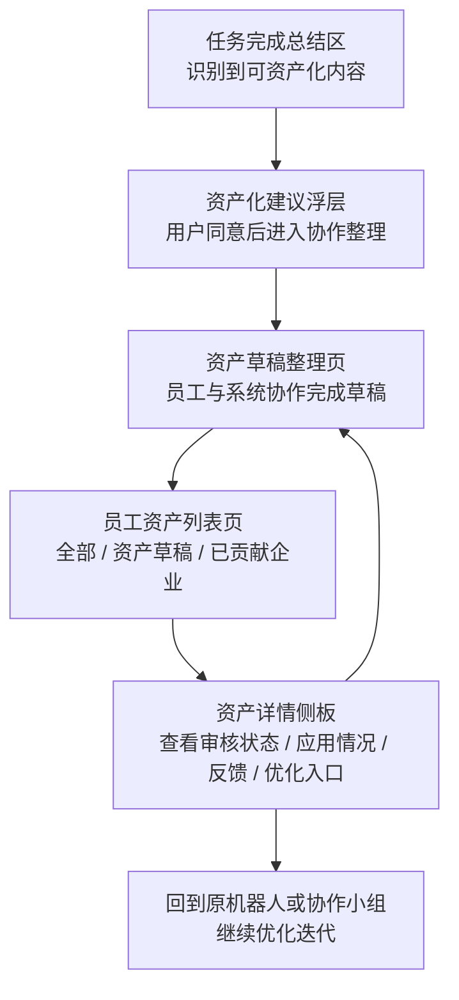
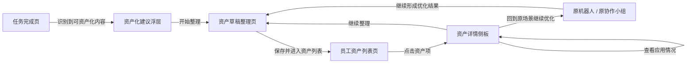

# 员工端资产管理原型图

## 1. 原型目标

本原型图只聚焦员工端“资产管理”功能，不展开企业端和平台端。  
目标是先把员工端这条链路画清楚：

1. 任务完成后如何触发资产化建议
2. 员工如何与系统协作形成资产草稿
3. 资产草稿进入资产列表后如何被持续管理
4. 员工如何从资产列表看到企业审核状态、资产应用情况和优化入口

本原型坚持以下原则：

1. 不做资产收件箱
2. 不做复杂后台表格
3. 不做血缘管理页面
4. 以“资产列表”作为员工端资产管理的核心页面
5. 所有后续动作都尽量从列表和详情侧板内完成

---

## 2. 页面结构总览

员工端资产管理建议收敛为 4 个核心界面。



四个核心界面分别是：

1. `任务完成后的资产化建议浮层`
2. `资产草稿整理页`
3. `员工资产列表页`
4. `资产详情侧板`

---

## 3. 原型 1：任务完成后的资产化建议浮层

### 3.1 使用时机

当机器人或协作小组的一次任务完成后，系统在做任务总结和用户反馈收集时，如果识别到可资产化内容，则显示此浮层。

如果没有识别到值得沉淀的内容，则不显示。

### 3.2 交互目标

不是让用户“直接存草稿”，而是：

1. 告诉用户刚才的某个做法/内容有资产化价值
2. 让用户理解为什么值得沉淀
3. 在获得用户同意的情况下，进入协作整理流程

### 3.3 低保真原型

```text
+----------------------------------------------------------------------------------+
| 任务已完成                                                                       |
| 本次已生成：客户周报总结、下周行动建议、风险提醒                                 |
+----------------------------------------------------------------------------------+
| 系统建议                                                                         |
| 这次“客户周报整理方式”较稳定，适合沉淀为可复用资产。                            |
|                                                                                  |
| 建议原因：                                                                       |
| - 本周已重复使用 3 次                                                            |
| - 输出结构稳定                                                                   |
| - 适合在销售例会前重复使用                                                       |
|                                                                                  |
| 建议资产类型：                                                                   |
| [ 模版 Template ]                                                                |
|                                                                                  |
| 你希望现在一起整理成资产草稿吗？                                                 |
|                                                                                  |
| [ 暂不处理 ]                                             [ 开始整理 ]            |
+----------------------------------------------------------------------------------+
```

### 3.4 设计说明

这里只做一件事：  
**把资产化建议显性化，并邀请用户协作整理。**

不在这个浮层里承载复杂编辑动作。

---

## 4. 原型 2：资产草稿整理页

### 4.1 使用时机

员工点击“开始整理”后进入。  
这是一个轻量协作整理页，不是复杂后台编辑器。

### 4.2 交互目标

1. 让系统先给出初步草稿
2. 员工补充或修正
3. 员工确认后将该资产纳入资产草稿列表

### 4.3 页面结构

```text
+----------------------------------------------------------------------------------+
| 资产草稿整理                                                                     |
| 来自：客户周报整理任务                                                           |
+----------------------------------------------------------------------------------+
| 左侧：系统建议                                                                   |
|----------------------------------------------------------------------------------|
| 资产类型                                                                         |
| [ 模版 Template ▼ ]                                                              |
|                                                                                  |
| 资产名称                                                                         |
| [ 销售客户周报模版                                    ]                          |
|                                                                                  |
| 一句话说明                                                                       |
| [ 用于在周会前快速整理客户进展、风险与行动项                  ]                  |
|                                                                                  |
| 适用场景                                                                         |
| [ 销售例会前周报整理                                      ]                      |
|                                                                                  |
| 输入说明                                                                         |
| [ 客户本周进展、风险、下周计划                              ]                    |
|                                                                                  |
| 输出说明                                                                         |
| [ 标准周报结构：进展 / 风险 / 行动项                        ]                    |
|                                                                                  |
| 当前建议补充                                                                     |
| - 建议补充“适合哪些销售场景”                                                     |
| - 建议补充“输出格式是否固定”                                                     |
|                                                                                  |
| [ 保存并进入资产列表 ]                                      [ 取消 ]            |
+----------------------------------------------------------------------------------+
| 右侧：本次任务参考                                                               |
|----------------------------------------------------------------------------------|
| - 本次任务总结                                                                   |
| - 本次生成结果预览                                                               |
| - 用户刚刚的反馈                                                                 |
+----------------------------------------------------------------------------------+
```

### 4.4 设计说明

这页的核心不是“编辑器能力强”，而是：

1. 系统给初稿
2. 员工快速确认
3. 进入管理视野

所以字段要少、动作要轻。

---

## 5. 原型 3：员工资产列表页

### 5.1 这是员工端资产管理的主页面

这个页面是整个功能的核心。  
员工后续所有资产管理动作，原则上都从这里发起。

### 5.2 页面结构

```text
+------------------------------------------------------------------------------------------------+
| 我的资产                                                                                        |
| 看见新沉淀的资产草稿、已贡献企业的资产，以及它们的应用和反馈                                   |
+------------------------------------------------------------------------------------------------+
| [ 全部 ] [ 资产草稿 ] [ 已贡献企业 ]                                         搜索框 [     ]   |
+------------------------------------------------------------------------------------------------+
| 概览卡片                                                                                        |
| [资产草稿 3]   [审核中 2]   [已纳入企业资产 5]   [建议优化 2]                                  |
+------------------------------------------------------------------------------------------------+
| 资产列表                                                                                        |
|------------------------------------------------------------------------------------------------|
| [模版] 销售客户周报模版                                                                         |
| 用于在周会前快速整理客户进展、风险与行动项                                                      |
| 状态：待完善   来源：客户周报整理任务   最近更新：今天 14:32                                    |
| 应用：尚未被应用   反馈：待继续整理                                                             |
| 操作：[继续整理] [提交企业]                                                                     |
|------------------------------------------------------------------------------------------------|
| [能力] 客户跟进摘要                                                                             |
| 自动生成客户跟进摘要与下一步建议                                                                |
| 状态：审核中   来源：客户跟进机器人最近一次交付   最近更新：昨天 18:10                          |
| 应用：已在 1 个机器人中应用   反馈：企业正在审核                                                |
| 操作：[查看审核反馈] [查看应用情况]                                                             |
|------------------------------------------------------------------------------------------------|
| [模版] 售后问题复盘模版                                                                         |
| 用于协作小组快速归纳问题、原因和后续动作                                                        |
| 状态：已纳入企业资产   来源：售后协作小组复盘                                                   |
| 应用：已在 2 个协作小组复用   反馈：近期应用稳定                                                |
| 操作：[查看应用情况] [回到原场景继续优化]                                                       |
|------------------------------------------------------------------------------------------------|
| [能力] 合同审阅意见整理                                                                         |
| 用于汇总审阅意见并形成结构化结论                                                                |
| 状态：已驳回                                                                                   |
| 应用：已在 1 个机器人中应用   反馈：企业建议补充适用范围                                        |
| 操作：[继续整理] [查看审核反馈] [回到原场景继续优化]                                            |
+------------------------------------------------------------------------------------------------+
```

### 5.3 设计说明

这个页面必须做到三件事：

1. 一眼知道有哪些新草稿
2. 一眼知道哪些资产已进入企业流程
3. 一眼知道哪些资产需要继续优化

所以列表项里必须直接展示：

1. 当前状态
2. 应用摘要
3. 反馈摘要
4. 下一步动作

---

## 6. 原型 4：资产详情侧板

### 6.1 使用时机

员工点击任一资产列表项后，在当前页面右侧展开详情。  
不建议频繁跳全新页面。

### 6.2 交互目标

让员工在一个侧板里看清：

1. 资产现在是什么状态
2. 当前整理到了什么程度
3. 企业审核给了什么反馈
4. 最近是否被应用、效果如何
5. 该去哪里继续优化

### 6.3 低保真原型

```text
+--------------------------------------------------------------+
| 资产详情                                                     |
| 销售客户周报模版                            [关闭]           |
+--------------------------------------------------------------+
| 基本信息                                                     |
| 类型：模版 Template                                          |
| 状态：待完善                                                 |
| 来源：客户周报整理任务                                       |
| 最近更新：今天 14:32                                         |
|                                                              |
| 一句话说明                                                   |
| 用于在周会前快速整理客户进展、风险与行动项                   |
+--------------------------------------------------------------+
| 当前整理结果                                                 |
| 适用场景：销售例会前周报整理                                 |
| 输入说明：客户本周进展、风险、下周计划                       |
| 输出说明：标准周报结构：进展 / 风险 / 行动项                 |
|                                                              |
| 仍待补充                                                     |
| - 补充适用团队范围                                           |
| - 补充输出格式约束                                           |
+--------------------------------------------------------------+
| 企业状态                                                     |
| 尚未提交企业                                                 |
+--------------------------------------------------------------+
| 应用与反馈                                                   |
| 当前应用：尚未被应用                                         |
| 最近反馈：待继续整理                                         |
+--------------------------------------------------------------+
| 操作                                                         |
| [继续整理] [提交企业] [回到原场景继续优化]                  |
+--------------------------------------------------------------+
```

### 6.4 审核中资产的详情态

```text
+--------------------------------------------------------------+
| 资产详情                                                     |
| 客户跟进摘要                                  [关闭]         |
+--------------------------------------------------------------+
| 基本信息                                                     |
| 类型：能力 Capability                                        |
| 状态：审核中                                                 |
| 来源：客户跟进机器人最近一次交付                             |
| 最近更新：昨天 18:10                                         |
+--------------------------------------------------------------+
| 企业状态                                                     |
| 企业正在审核                                                 |
| 已提交时间：昨天 17:45                                       |
| 当前进度：审核中                                             |
|                                                              |
| 当前企业反馈                                                 |
| - 正在核对适用范围                                           |
| - 正在确认描述完整度                                         |
+--------------------------------------------------------------+
| 应用与反馈                                                   |
| 当前应用：已在 1 个机器人中应用                              |
| 最近 7 天使用 12 次                                          |
| 最近反馈：应用稳定                                           |
+--------------------------------------------------------------+
| 操作                                                         |
| [查看应用情况] [回到原场景继续优化]                          |
+--------------------------------------------------------------+
```

### 6.5 已驳回资产的详情态

```text
+--------------------------------------------------------------+
| 资产详情                                                     |
| 合同审阅意见整理                              [关闭]         |
+--------------------------------------------------------------+
| 基本信息                                                     |
| 类型：能力 Capability                                        |
| 状态：已驳回                                                 |
| 来源：合同审阅机器人最近一次交付                             |
| 最近更新：前天 20:15                                         |
+--------------------------------------------------------------+
| 企业状态                                                     |
| 企业建议修改后再提交                                         |
| 驳回原因：                                                   |
| - 适用范围描述不清                                           |
| - 输出结果约束不完整                                         |
|                                                              |
| 建议补充项                                                   |
| - 明确适用于哪些合同类型                                     |
| - 补充结论输出格式说明                                       |
+--------------------------------------------------------------+
| 应用与反馈                                                   |
| 当前应用：已在 1 个机器人中应用                              |
| 最近反馈：建议优化                                           |
+--------------------------------------------------------------+
| 操作                                                         |
| [继续整理] [回到原场景继续优化]                              |
+--------------------------------------------------------------+
```

---

## 7. 原型 5：从列表回到原场景继续优化

### 7.1 交互目标

资产优化不应脱离原始上下文。  
所以员工端必须允许从资产列表直接回到：

1. 该资产诞生的机器人
2. 该资产最近主要应用的机器人
3. 该资产诞生或复用最多的协作小组

### 7.2 低保真原型

```text
+----------------------------------------------------------+
| 回到原场景继续优化                                       |
+----------------------------------------------------------+
| 这个资产最近主要在以下场景中形成和使用：                 |
|                                                          |
| 1. 销售跟进机器人                                         |
|    最近 7 天使用 12 次                                    |
|                                                          |
| 2. 华东销售协作小组                                       |
|    最近复用 4 次                                          |
|                                                          |
| 你希望回到哪个场景继续优化？                             |
|                                                          |
| [进入销售跟进机器人]   [进入华东销售协作小组]   [取消]   |
+----------------------------------------------------------+
```

### 7.3 设计说明

这一步的重点不是“导航”，而是“带着资产记忆回到现场”。  
进入后，系统应自动带上：

1. 当前资产名称
2. 当前资产说明
3. 当前需要优化的问题

例如：

- “你正在继续优化资产：客户跟进摘要”
- “企业建议你补充适用范围”
- “最近使用中发现摘要结构仍不稳定”

---

## 8. 页面之间的跳转关系



---

## 9. 员工端原型的设计结论

员工端资产管理原型不需要复杂，它的关键是：

1. **任务后自然触发**
   - 资产化建议发生在任务完成后的总结和反馈阶段
2. **草稿前有建议与协作**
   - 不是直接丢草稿，而是先征得员工同意并协作成稿
3. **列表是核心**
   - 草稿、审核状态、应用情况、反馈与优化入口，都围绕资产列表承接
4. **优化要回到原场景**
   - 资产不是在孤立后台里长大的，而是在真实机器人和协作小组上下文中继续优化

所以，员工端资产管理的最小原型可以概括为：

- 一个任务后建议浮层
- 一个轻量草稿整理页
- 一个以状态、应用、反馈为核心的资产列表页
- 一个详情侧板
- 一个回到原场景继续优化的入口

这条链路一旦画清楚，企业端和平台端就可以顺着员工端的“提交、审核、应用、反馈”自然承接下去。
