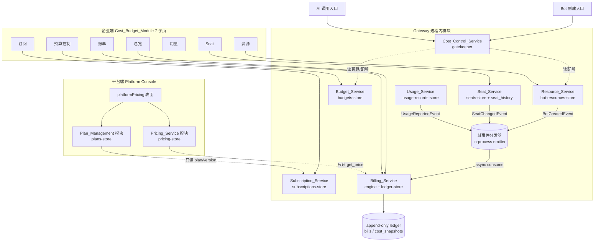
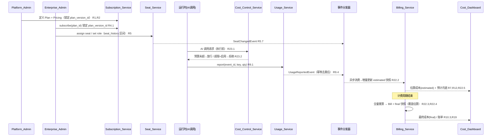
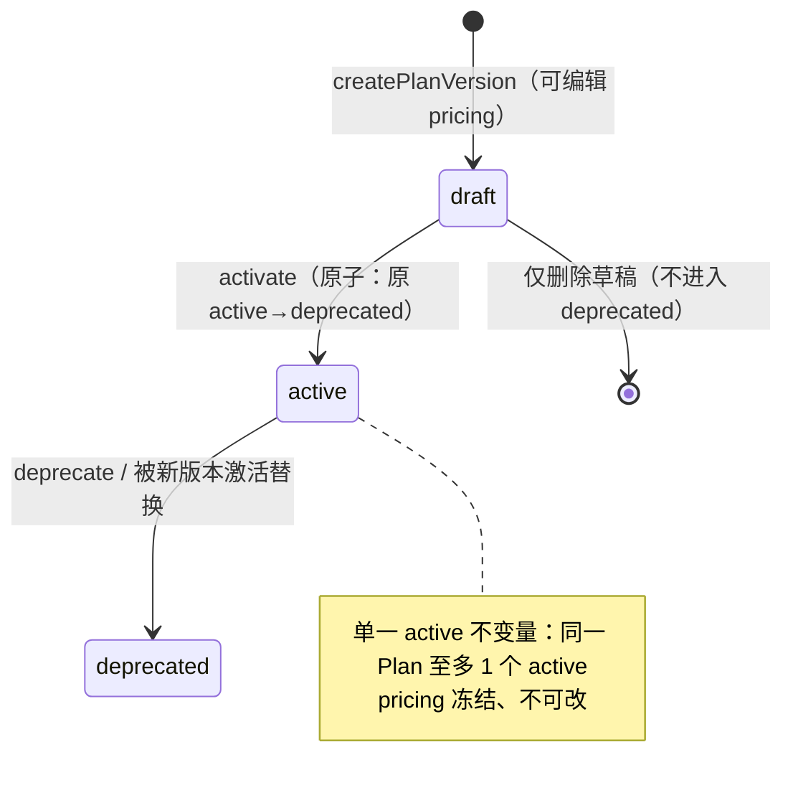

# Design Document

> 中文名：成本与预算（Cost & Budget Billing）— 双端 SaaS 计费系统技术设计
>
> 关联需求：`.kiro/specs/cost-budget-billing/requirements.md`（23 条需求 + 12 条属性）。本设计中每个关键决策均回溯到对应需求编号（如 `R4.1`、`R22.3`、`Property 1`）。

## Overview

本设计将企业端「成本与预算」从纯前端派生视图重建为**真实双端 SaaS 计费系统**，落地「平台端定义规则 + 企业端消费规则」架构（对标 Stripe 计费引擎 + Salesforce 订阅）。

工程实现遵循 OpenBot 既有约定，**不引入数据库、不引入外部消息队列**：

- **持久化**：复用 `enterprise-seat-assets-store.ts` 的「租户键控 JSON 文件 + `readJsonFile`/`writeJsonAtomic` + `randomUUID` + ISO 时间戳 + `version`」范式，落盘于 `CONFIG_DIR`（`~/.openbot`）。
- **RPC**：新增若干 `GatewayRequestHandlers` 处理组，注册进 `src/gateway/server-methods.ts` 的 `coreGatewayHandlers`，方法名遵循 `group.verb-object` 点分 kebab 命名。
- **计费内核**：纯函数模块（framework-free），可被属性测试（fast-check）覆盖。
- **事件**：新增**进程内**轻量域事件分发器（in-process emitter）作为通知层，并以**持久化事件日志（durable event log）**作为可靠性后盾，让 `UsageReportedEvent / SeatChangedEvent / BotCreatedEvent` 异步驱动 Billing；事件不丢、可重放，接口保留未来替换为外部队列的缝（seam）。
- **真相来源（Source of Truth）**：采用**轻量事件溯源（event-sourcing-lite）**——append-only 日志（usage events / seat events / subscription events / budget events + plan_versions）是唯一真相；可变的「头记录」（当前订阅状态、当前 Seat 角色、当前预算值）是从日志投影出的**缓存（projection）**；账单与快照是对日志的**确定性投影输出**。重算 = 重放，天然满足确定性（`Property 4`）与 estimated→final 收敛（`Property 11`）。
- **UI**：企业端重建 `enterpriseUsage` 表面为 7 子页；平台端新增「套餐与定价管理」表面；双端均通过 `ui/src/ui/capability/cost-budget-billing/` 的强类型 RPC 客户端通信。

**「逻辑服务」即进程内模块**：需求中的 Subscription / Seat / Usage / Billing / Budget / Resource / CostControl 服务在本阶段实现为 **gateway 内的独立模块（store + handler 组 + 引擎函数）**，彼此通过明确的数据契约与域事件解耦，而非独立部署的微服务。这样既满足 `R16`「区分关注点 + 实现无关」，又为将来抽取为独立服务预留清晰接缝（每个模块单一 store 文件 + 单一 handler 组 + 事件边界）。

非目标（本期不做）：真实支付/扣费（Payment/Wallet 仅预留事件位）、跨周期发票合并、外部计费对账。

## Architecture

### 分层与模块边界

```
平台端（Platform Console，规则定义方，价格唯一真相）
  ├── Plan_Management      （套餐：plan + plan_version 版本化）        R1, R11.3
  └── Pricing_Service      （定价：plan_pricing；企业只读）            R2, R3
            │  下发只读规则（锁定 plan_version_id）
            ▼
企业端（Enterprise Console，规则消费方，只「分配 + 控制」）
  ├── Subscription_Service （订阅生命周期，仅 plan_id/plan_version_id/状态）  R4, R17
  ├── Seat_Service         （席位 + seat_history 时间区间，独立于订阅）       R5
  ├── Resource_Service     （Bot 资源 + 配额）                               R20
  ├── Budget_Service       （预算 + 超额提醒 + 历史）                         R6
  └── Cost_Control_Service （执行前闸口：拦截 AI 调用 / Bot 创建）            R8, R23
            │  产生运行时用量
            ▼
运行时闭环
  ├── Usage_Service        （用量采集，event_id 幂等，发事件）               R9
  ├── Billing_Service      （成本引擎：估算/结算，账单，快照，可追溯）        R10, R11, R22
  └── 域事件分发器          （UsageReported / SeatChanged / BotCreated）       R16.3
```

### 组件图（Mermaid）



### 闭环时序图（Mermaid）



### 真相来源与一致性模型（Source of Truth）

> 针对评审「事件驱动 + 状态存储混合态未定义真相来源」的收敛决策。

**结论：采用轻量事件溯源（event-sourcing-lite，方案 A）。**

- **唯一真相 = append-only 事件日志**：`usage_events`（=UsageRecord，已 `event_id` 幂等）、`seat_events`（seat_history 区间）、`subscription_events`（订阅状态变更）、`budget_events`（预算变更）、`plan_versions`（不可变定价版本）。这些日志只追加、不可改删（`R11`）。
- **可变「头记录」= 投影缓存**：`Subscription.status`、`Seat.currentRole`、`Budget`（当前值）等是从日志投影出的便捷缓存，**不参与重算**；任何时刻可由日志重建。若头记录与日志冲突，以日志为准。
- **账单/快照 = 确定性投影输出**：`settleCycle` 是纯投影函数 `events → {bill, snapshot}`。estimated 与 final 走同一函数，仅触发时机与标记不同，故二者必然收敛（`Property 11`）。
- **不做「状态快照推导」**：禁止从「当前头记录」直接推导历史账单（会因头记录被后续变更覆盖而失真）。历史账单一律由「该周期内的事件 + 锁定的 `plan_version_id`」重放得出，保证可复算（`R3.3/R11.4`）。

这条决策同时收敛了「seat_history 与 usage_record 时间对齐」「事件丢失恢复」「重放一致性」三类风险：时间对齐由各事件自带 `occurredAt` 在重放时统一裁剪到周期窗口（见一致性守卫）；恢复由持久事件日志 + 重放保证；重放一致性由纯函数 `settleCycle` 保证。

### 一致性守卫（Read-Model Consistency Guard）

> 针对评审「billing 前需保证 seat 区间闭合 / usage 落在周期内」。

在 `settleCycle` 入口前置纯函数 `assertCycleConsistency(input)`（位于 `engine.ts`，可单测/PBT），对投影出的周期切片做不变量校验并**规范化**而非写补丁：

- Seat 区间在周期窗口内**闭合**：每个 Seat 在周期内各区间首尾相接、无重叠、无空洞；开放区间（`endTime=null`）按周期末或「下一区间起点」裁剪；占比和归一为 1（`Property 10`）。
- Usage 事件 `occurredAt` 落在 `[cycleStart, cycleEnd)`：越界事件不计入该周期（计入其归属周期）。
- 不一致（区间重叠/缺订阅版本）→ 返回结构化诊断，handler 据此返回 `errorShape`，**绝不**在 billing 层写隐式补丁。

### 版本生命周期与控制平面（Version Lifecycle & Control Plane）

> 针对平台定价控制平面：PlanVersion 从「指针模型」升级为「状态机模型」（R24–R27 / Property 13–16）。

**状态机（单向不可逆）：**



- **合法流转仅 `draft→active`、`active→deprecated`**；`assertValidTransition(from, to)` 纯函数集中校验，拒绝 `draft→deprecated`、`deprecated→active`、`deprecated→draft`、向 draft 回退、自反流转（Property 13）。`deprecated` 为**终态**，恢复定价须新建 draft 再激活。
- **pricing 不可变 / status 可变但审计**：`pricing` 仅 draft 态可编辑，一经激活冻结（Property 16）；`status` 每次流转写一条 append-only `PlanVersionStatusChangeEvent`（**完整字段** `{ from, to, requestId, changedByUserId, occurredAt }`——记录「状态变化」而非仅「结果」，支撑审计/重放/并发排查）。区分「物理不可变（pricing）」与「逻辑状态可变但可追溯（status）」。
- **单一 active 不变量 + Plan 级原子锁**：激活在 `withLock(planId)` 内执行「读该 Plan 全部版本 → `reduceVersionStatuses` 归约 → 整体写回 → append 事件」，**禁止版本级局部更新**；`requestId` 在 store 层基于已存在同 `requestId` 事件做幂等短路（纯函数 `reduceVersionStatuses` 不含 requestId 语义，幂等在 store 层兜底）。并发激活经 Plan 级锁串行化，完成后仍单一 active（R25 / Property 14）。
- **计费路径只认 version**：engine 入口 `assertBillingInputs` 断言 `subscription.plan_version_id` 与 `version.pricing` 均存在，并断言锁定版本快照可用（即使该版本已 deprecated 也按其快照计费）；防御性拒绝任何以 `plan_id` 充当计费依据的输入（R26.5/26.6、R27.4 / Property 15）。
- **`subscribe(planId)` 收敛**：仅 UI 便捷路径接受 `planId`（解析为当前 active 版本并标 `resolvedFromPlanId=true`）；API/内部标准路径要求显式 `plan_version_id`，并校验 `status=active`。
- **gate 携带版本**：`Cost_Control` 闸口输入扩展 `pricingSnapshotVersionId`，为未来版本级控制/灰度预留（R23 增强）。
- **无运行时回退**：旧数据仅由**一次性迁移脚本**修复（status 归一化、订阅补绑创建时点版本）；运行时若遇缺 `plan_version_id` 的订阅进入计费，抛 `DataIntegrityError` 拒绝，**绝不**隐式回退到当前 active（防止旧订阅被错误绑定新价格，R27.1-27.3）。
- **定价 diff 后端计算**：`comparePlanVersions(fromVersion, toVersion)` 纯函数产出 `PricingDiff`（新增/删除/调价项），供平台 UI 展示「激活前后改了什么」，避免 UI 自行 diff 不一致。

## Data Models

所有新类型集中定义在 `src/gateway/billing/types.ts`（gateway 端权威），UI 端在 `ui/src/ui/capability/cost-budget-billing/endpoints.ts` 维持镜像类型（与 `agent-runtime-store` 的「类型镜像」约定一致）。金额统一用**整数分（cents / minor units）**存储与计算，展示层再除以 100，避免浮点误差（见 Design Decisions）。

### 平台端实体（价格唯一真相，企业不可写）

```ts
// src/gateway/billing/types.ts
export type BillingCycle = "monthly"; // 本期仅 monthly，预留扩展
export type SeatRole = "viewer" | "creator" | "admin"; // 与企业端角色一致
export type PricingType = "seat" | "usage" | "extra";

export type Plan = {
  id: string; // plan_id
  name: string;
  billingCycle: BillingCycle;
  basePriceCents: number; // base_price（整数分）
  currentVersionId: string; // 指向最新 PlanVersion           R1.2,R11.3
  seatQuota: Partial<Record<SeatRole, number>>; // 各角色席位配额  R5.5
  botQuota: number; // Bot 配额                        R20
  status: "active" | "archived";
  createdAt: string;
  updatedAt: string;
};

// 套餐版本（不可变；订阅锁定某一版本以复算历史账单）  R3.2,R3.3,R11.3,R22
export type PlanVersionStatus = "draft" | "active" | "deprecated"; // 状态机（R24）

export type PlanVersion = {
  id: string; // plan_version_id
  planId: string;
  version: number; // 单调递增（= versionNumber，供 UI 展示 v1/v2/v3 与排序）
  status: PlanVersionStatus; // draft→active→deprecated，单向不可逆（R24）
  snapshot: {
    // 该版本的完整定价快照（pricing 不可变；仅 draft 态可编辑）  R24.3,Property 16
    basePriceCents: number;
    seatQuota: Partial<Record<SeatRole, number>>;
    botQuota: number;
    pricing: PlanPricing[];
  };
  createdAt: string;
  createdByUserId: string;
  activatedAt?: string;
  deprecatedAt?: string;
};

// 版本状态变更审计（append-only，status 可变但被追溯，R24.4 / Property 16）
export type PlanVersionStatusChangeEvent = {
  id: string;
  planId: string;
  planVersionId: string;
  fromStatus: PlanVersionStatus | null;
  toStatus: PlanVersionStatus;
  requestId: string; // 幂等键（R25.3）
  changedByUserId: string;
  occurredAt: string;
};

export type PlanPricing = {
  id: string;
  planId: string;
  planVersionId: string; // 归属版本
  type: PricingType; // seat | usage | extra
  key: string; // viewer|creator|ai_token|...     R2.2
  priceCents: number; // 单价（整数分；usage 可为「每单位分」）
};
```

`Plan_Management`/`Pricing_Service` 的写操作只对 `Platform_Admin` 暴露（`ADMIN_SCOPE`），企业端任何写入被拒（`R2.6/R2.7/R14.5`）。Plan 更新 = **追加新 `PlanVersion`**（旧版本不可变，`R1.2/R11.3`），`Plan.currentVersionId` 前移。

### 企业端实体（按 `enterpriseId` 隔离）

```ts
export type SubscriptionStatus = "active" | "suspended" | "expired" | "canceled";

export type Subscription = {
  id: string;
  enterpriseId: string;
  planId: string;
  planVersionId: string; // 锁定版本，账单复算依据          R4.1,R3.3
  startTime: string;
  endTime: string | null;
  status: SubscriptionStatus;
  pendingChange?: {
    // 下一周期生效的套餐变更          R17.4
    targetPlanId: string;
    targetPlanVersionId: string;
    effectiveAt: string;
  };
  createdAt: string;
};
// 订阅状态变更走 append-only 历史（见 SubscriptionEvent）        R4.7,R11.2

export type Seat = {
  id: string;
  enterpriseId: string;
  userId: string;
  currentRole: SeatRole;
  botQuota: number; // 该席位可分配 Bot 配额            R5.3
  createdAt: string;
};

// 时间区间模型，支持按比例计费 Proration                        R5.1,R5.2,R10.2,Property 10
export type SeatHistoryInterval = {
  id: string;
  seatId: string;
  enterpriseId: string;
  role: SeatRole;
  startTime: string;
  endTime: string | null; // null = 当前生效区间
};

export type Budget = {
  id: string;
  enterpriseId: string;
  monthlyLimitCents: number;
  alertThreshold: number; // 0..1，默认 0.8                  R6.2
  controls: {
    // 成本控制开关                    R8,R23
    limitAiCalls: boolean;
    limitBotCreation: boolean;
    autoDowngrade: boolean;
  };
  updatedAt: string;
};
// Budget 变更 append-only（见 BudgetEvent）                      R6.7,R11

export type UsageRecord = {
  id: string;
  enterpriseId: string;
  userId: string;
  eventId: string; // 幂等键，(enterpriseId,eventId) 唯一  R9.2,R9.3,Property 9
  key: string; // 计量类型：ai_token|task|...
  quantity: number;
  occurredAt: string;
  ingestedAt: string;
};

export type BotResource = {
  id: string;
  enterpriseId: string;
  ownerUserId: string;
  createdAt: string;
  deletedAt: string | null; // 软删，保留历史
};
```

### 账单与快照（append-only 账本）

```ts
export type BillItemType = PricingType; // seat|usage|extra
export type BillItem = {
  type: BillItemType;
  key: string; // 角色 / 计量类型
  detail: string; // 可解释明细（用户、区间、数量）  R19.2,R21
  amountCents: number;
};

export type Bill = {
  id: string;
  enterpriseId: string;
  cycleStart: string;
  cycleEnd: string;
  planVersionId: string;
  items: BillItem[];
  seatCostCents: number;
  usageCostCents: number;
  extraCostCents: number;
  totalCostCents: number; // = seat+usage+extra              R10.1,Property 8
  generatedAt: string;
};

export type SnapshotType = "estimated" | "final"; // R22.5
export type CostSnapshot = {
  id: string;
  enterpriseId: string;
  date: string; // YYYY-MM-DD
  snapshotType: SnapshotType; // estimated 实时 / final 结算      R22
  seatCostCents: number;
  usageCostCents: number;
  totalCostCents: number;
  missingPriceKeys: string[]; // 缺失价格可见，非静默计 0        R9.8,Property 2
  createdAt: string;
};
```

### 域事件

```ts
// src/gateway/billing/events.ts
export type UsageReportedEvent = {
  type: "usage.reported";
  enterpriseId: string;
  userId: string; // 按用户归因（R9.1/R18/R21）：事件日志须忠实携带 user_id
  eventId: string;
  key: string;
  quantity: number;
  occurredAt: string;
  agentId?: string | null; // 岗位 × 机器人归因（可选）
  orgSeatId?: string | null; // 组织岗位级归因（可选）
};
export type SeatChangedEvent = {
  type: "seat.changed";
  enterpriseId: string;
  seatId: string;
  fromRole: SeatRole | null;
  toRole: SeatRole;
  effectiveAt: string;
};
export type BotCreatedEvent = {
  type: "bot.changed";
  enterpriseId: string;
  botId: string;
  ownerUserId: string;
  action: "created" | "deleted";
};
export type BillingDomainEvent = UsageReportedEvent | SeatChangedEvent | BotCreatedEvent;
```

### 新增 store 文件（镜像 `enterprise-seat-assets-store.ts`）

| Store 文件 (`src/gateway/billing/`) | 落盘路径 (`CONFIG_DIR/`)             | 写语义                                                  | 关键需求          |
| ----------------------------------- | ------------------------------------ | ------------------------------------------------------- | ----------------- |
| `plans-store.ts`                    | `openbot-billing-plans.json`         | plan upsert；version **append-only**                    | R1, R11.3         |
| `pricing-store.ts`                  | （并入 plans 的 version snapshot）   | 随 PlanVersion 不可变                                   | R2, R3            |
| `subscriptions-store.ts`            | `openbot-billing-subscriptions.json` | 订阅 upsert；状态变更 append                            | R4, R17, R11.2    |
| `seats-store.ts`                    | `openbot-billing-seats.json`         | seat upsert；`seat_history` **append-only**             | R5, R11.2         |
| `budgets-store.ts`                  | `openbot-billing-budgets.json`       | budget upsert；变更 append                              | R6, R11           |
| `bot-resources-store.ts`            | `openbot-billing-resources.json`     | 软删保留历史                                            | R20               |
| `usage-records-store.ts`            | `openbot-billing-usage.json`         | **append-only**，`(enterpriseId,eventId)` 去重          | R9, Property 9    |
| `event-log-store.ts`                | `openbot-billing-events.json`        | **append-only**，单调 `seq`，状态机 pending/done/failed | R16.3, 事件可靠性 |
| `ledger-store.ts`                   | `openbot-billing-ledger.json`        | Bills + Snapshots **纯追加，禁改禁删**                  | R10, R11, R22     |

每个 store 提供 `load*/save*/list*By Tenant/get*` 函数，所有读写以 `enterpriseId` 为第一过滤维度（`R13.1`），并用 `canonicalizeTenantId` 规范化。

### 共享 append-only 账本助手

```ts
// src/gateway/billing/append-only-ledger.ts
// 唯一插入路径；既有记录字段不可变，尝试改/删抛错（R11.5,Property 5）
export function appendLedgerRecord<T extends { id: string }>(collection: T[], record: T): T[] {
  if (collection.some((r) => r.id === record.id)) {
    throw new LedgerImmutabilityError(record.id); // 拒绝覆盖
  }
  return [...collection, record];
}
export class LedgerImmutabilityError extends Error {}
```

账本类 store（usage/ledger/seat_history/plan_version/状态历史）只经此助手写入；常规可变实体（plan 头、subscription 头、budget 头、seat 头）走普通 upsert，但其**变更历史**进账本。

## Components and Interfaces

### 核心计费引擎（纯函数，framework-free）

位置：`src/gateway/billing/engine.ts`（**不 import gateway/IO/lit**，纯输入→输出，确保确定性与可 PBT，`R10.5/Property 4`）。

```ts
// 价格查询：从锁定的 plan_version snapshot 取价（R2.3/R2.4/Property 2）
export function getPrice(
  version: PlanVersion,
  type: PricingType,
  key: string,
): { priceCents: number } | { missing: true };

// Seat 成本：按 seat_history 区间占周期比例 × seat/{role} 价（R10.2/Property 10）
export function computeSeatCost(args: {
  version: PlanVersion;
  intervals: SeatHistoryInterval[];
  cycleStart: number;
  cycleEnd: number;
}): { seatCostCents: number; items: BillItem[]; missingPriceKeys: string[] };

// Usage 成本：Σ quantity × usage/{key} 单价（R9.5）
export function computeUsageCost(args: { version: PlanVersion; records: UsageRecord[] }): {
  usageCostCents: number;
  items: BillItem[];
  missingPriceKeys: string[];
};

// 超额：用量/席位超配额部分按 extra/{key}（R9.7/R20.4/Property 7）
export function computeExtraCost(args: {
  version: PlanVersion;
  usageByKey: Record<string, number>;
  seatCountByRole: Record<SeatRole, number>;
  botCount: number;
}): { extraCostCents: number; items: BillItem[] };

// 单一入口：total = seat + usage + extra（R10.1/Property 1）
export function computeTotalCost(parts: {
  seatCostCents: number;
  usageCostCents: number;
  extraCostCents: number;
}): number;

// 预测月底：默认线性（累计/已过天数×周期天数），可选加权移动平均（R7.2/R12/Property 11 间接）
export function predictMonthEndCost(args: {
  accruedCents: number;
  elapsedDays: number;
  totalDays: number;
  dailySeries?: number[];
  mode?: "linear" | "wma";
}): { predictedCents: number } | { insufficientData: true }; // elapsedDays==0 → 不足以预测（R12.3）

// 预算检查边界（R6.5/R6.6/Property 3）
export function checkBudget(args: {
  totalCostCents: number;
  monthlyLimitCents: number;
  alertThreshold: number;
}): { level: "ok" | "alert" | "exceeded" };
```

**全量结算入口**（被周期结算与「按需重算」复用，保证 estimated 收敛 final，`Property 11`）：

```ts
export function settleCycle(input: SettleInput): {
  bill: Bill;
  snapshot: CostSnapshot; // snapshotType 由调用方标记 estimated|final
};
```

**舍入策略**：所有乘法（数量×单价、区间占比×席位价）在 cents 域用 `Math.round` 收敛到整数分；明细项各自取整后求和即为分量合计，避免「分项和≠总额」（保证 `Property 8`）。占比计算用毫秒区间比，最后一区间用「周期总额 − 前序区间和」回填以保证各区间占比和恰为 1（`Property 10`）。

## RPC 接口

新增处理组文件置于 `src/gateway/server-methods/`，统一注册进 `src/gateway/server-methods.ts` 的 `coreGatewayHandlers`（**只注册一次，不放进 `usage.ts`**）。每个方法在 `src/gateway/method-scopes.ts` 的 `METHOD_SCOPE_GROUPS` 归类。
| 方法 | Scope | 主要参数 | 响应 | 需求 |
| --------------------------- | ---------------------- | ------------------------------------------------------- | ------------------------------------------------------------------------------------ | -------------------- |
| `platform-plans.create` | ADMIN | name, billingCycle, basePriceCents, seatQuota, botQuota | `{ planId }` | R1.1,R1.4,R1.5 |
| `platform-plans.update` | ADMIN | planId, patch | `{ planVersionId }`（追加版本） | R1.2,R11.3 |
| `platform-plans.list` | READ | — | `{ plans }` | R1.3 |
| `platform-pricing.set` | ADMIN | planId, type, key, priceCents | `{ pricingId }` | R2.1,R2.5 |
| `platform-pricing.list` | READ | planId | `{ pricing }`（企业端只读视图同源） | R2.7,R3.1 |
| `platform-pricing.create-version` | ADMIN | planId, pricing[] | `{ planVersionId }`（**draft**） | R24.1,R24.6,R2.5 |
| `platform-pricing.activate` | ADMIN | planId, versionId, requestId | `{ planVersion }`（原 active→deprecated，幂等） | R24.2,R25.1-R25.4 |
| `platform-pricing.deprecate` | ADMIN | planId, versionId | `{ planVersion }` | R24.2,R25.5 |
| `platform-pricing.list-versions` | READ | planId | `{ versions }`（含 status） | R24.1,R3.1 |
| `subscriptions.subscribe` | WRITE | planVersionId（标准）\| planId（UI，解析 active 标 resolvedFromPlanId） | `{ subscription }`（锁定 active version） | R4.1,R4.3,R4.4,R26.2,R26.3 |
| `subscriptions.get` | READ | — | `{ subscription, planVersion, pricingSnapshot }` | R3.1,R7.4,R17.1,R26 |
| `subscriptions.change-plan` | WRITE | targetPlanId, effective: "now"\|"next" | `{ subscription }` | R17.2-R17.5 |
| `subscriptions.history` | READ | — | `{ events }` | R4.7,R11.2 |
| `seats.assign` | WRITE | userId, role, botQuota | `{ seat }` | R5.1,R5.4,R5.5 |
| `seats.set-role` | WRITE | seatId, role | `{ seat, interval }` | R5.2 |
| `seats.list` | READ | — | `{ seats, intervals }` | R5,R21 |
| `budget.set` | WRITE + `usage:budget` | monthlyLimitCents, alertThreshold?, controls? | `{ budget }` | R6.1-R6.4,R6.8,R14.2 |
| `budget.get` | READ | — | `{ budget, history }` | R6.7 |
| `usage-ingest.report` | WRITE | eventId, key, quantity, userId, occurredAt | `{ recorded: bool, deduped: bool }` | R9.1-R9.4 |
| `billing.dashboard` | READ | dateRange? | `{ accrued, seatCost, usageCost, extraCost, predicted, budgetStatus, snapshotType, computedAt, stale }` | R7,R12,R22.5 |
| `billing.analytics` | READ | window, groupBy | `{ byUser, byKey, series }` | R18 |
| `billing.list-bills` | READ | — | `{ bills }`（倒序） | R19.1,R19.4 |
| `billing.get-bill` | READ | billId | `{ bill, items }` | R19.2,R19.5 |
| `billing.export-bill` | READ | billId, format | `{ download }` | R19.3 |
| `billing.settle` | ADMIN | enterpriseId, cycle | `{ bill }`（生成 final） | R10.3,R22.3 |
| `resources.summary` | READ | — | `{ usedBots, quota, perUser }` | R20.1,R20.2 |
| `resources.set-user-limit` | WRITE | userId, limit | `{ ok }` | R20.3,R20.5 |
| `resources.create-bot` | WRITE（经 gatekeeper） | ownerUserId | `{ bot }` / 拒绝 | R20.4,R23 |
| `cost-control.check` | READ | action: "ai"\|"bot" | `{ allowed, reason? }` | R23.1,R23.2 |

**控制面写限流**：高风险/高频写（`usage-ingest.report` 除外，见下）一般不入 `CONTROL_PLANE_WRITE_METHODS`（该集合限 config/update）。`usage-ingest.report` 可能高频，由 Usage_Service 自身做去重，不走控制面限流；平台 plan/pricing 写为低频 ADMIN，无需额外限流。

**双重权限闸**（`R14`）：`budget.set` / `cost-control` 变更除 `WRITE_SCOPE` 外，还需在 handler 内校验调用者在该租户的成员权限含 `usage:budget`（经 `EnterpriseScope` 解析 membership → permission），缺失则拒绝（`R14.3`）。平台 plan/pricing 写仅 `Platform_Admin`（`R14.1/R14.5`）。

## 异步与事件设计

### 进程内事件分发器（持久 + 至少一次投递）

> 针对评审「计费系统不能丢事件」。fire-and-forget 仅作通知加速层，可靠性由持久事件日志 + 重放保证。

```ts
// src/gateway/billing/event-bus.ts
type DurableEvent = BillingDomainEvent & { seq: number; status: "pending" | "done" | "failed" };
type Handler = (e: DurableEvent) => void | Promise<void>;

class BillingEventBus {
  private handlers = new Set<Handler>();
  on(h: Handler): () => void {
    this.handlers.add(h);
    return () => this.handlers.delete(h);
  }
  // 发布 = 先持久化到 event log（append-only），再尝试投递（at-least-once）
  async publish(e: BillingDomainEvent): Promise<void> {
    const durable = appendEventLog(e); // 落盘 status="pending"，单调 seq
    await this.deliver(durable);
  }
  private async deliver(e: DurableEvent): Promise<void> {
    for (const h of this.handlers) {
      try {
        await h(e);
        markEventStatus(e.seq, "done");
      } catch {
        markEventStatus(e.seq, "failed"); // 不丢：留在日志待重放
      }
    }
  }
  // 启动 / dashboard 读 / settle 前调用：重放未完成事件（幂等消费）
  async replayPending(): Promise<void> {
    for (const e of listEvents({ status: ["pending", "failed"] })) await this.deliver(e);
  }
}
export const billingEventBus = new BillingEventBus();
```

- **持久化优先**：`publish` 先把事件 append 到 `event-log-store.ts`（`openbot-billing-events.json`，append-only，单调 `seq`），再投递。进程崩溃或 consumer 抛错时事件仍在日志，`replayPending()` 可恢复。
- **幂等消费**：consumer 对同一 `seq`/`event_id` 重复处理结果一致（重算当日 estimated 快照是幂等覆盖、非累加），故「至少一次」投递安全（延续 `Property 9` 思想）。
- **重放触发点**：`billing.dashboard` 读取前与 `billing.settle` 入口前调用 `replayPending()`，确保看板/账单读到的投影已纳入全部已记录事件，消除「estimated 丢失→看板不一致」。
- **发布方**：`Usage_Service.report()` 去重后 `await publish(UsageReportedEvent)`（`R9.4`）；`Seat_Service` assign/set-role 后 `publish(SeatChangedEvent)`（`R5.7`）；`Resource_Service` create/delete bot 后 `publish(BotCreatedEvent)`。业务日志与事件日志均 append-only，按「先写业务事件、后发通知」顺序，失败可重放对齐。
- **约束**：成本累计**只**经事件→投影，Usage→Billing **无同步计算 API 调用**（`R16.3`）。

### 周期结算（无 gateway cron 假设）

gateway 不假定常驻定时器。采用两条互补路径，最终一致：

1. **按需重算（lazy-on-read）**：`billing.dashboard` 读取时，若当前周期无最新 estimated 快照或已落后，则即时调用 `settleCycle(..., "estimated")` 重算（确定性，`R10.5`），保证看板实时（`R7`、贯穿性「实时刷新」）。
2. **显式结算（settle）**：`billing.settle`（ADMIN，可由运维/上层调度触发）在周期结束后以**完整数据全量重算**生成 `final` Bill + `final` 快照，append 入账本，**不覆盖**既有 estimated 记录（`R22.3/R22.4/R22.6`）。`final` 为该周期权威账单值。

收敛保证：相同输入下 estimated 累计结果与 final 全量结果一致（`Property 11`），因为二者复用同一 `settleCycle` 纯函数，仅 `snapshotType` 标记不同。

## UI 设计

### 企业端 Cost_Budget_Module 重建（7 子页）

- **路由**：扩展 `ui/src/ui/navigation.ts` 中 `pathForTab` 的 `enterpriseUsage` 分支，镜像 `enterpriseUsageManagement` 的子路由方式，生成：`/usage/overview`、`/usage/subscription`、`/usage/seats`、`/usage/resources`、`/usage/analytics`、`/usage/billing`、`/usage/control`；URL 叶子解析回 `enterpriseUsage` + 子页。`enterpriseUsage` 仍是单一 Tab（不污染 `ENTERPRISE_SURFACE_TABS` 数量），子页用 `routeContextFromPath` 解析。
- **表面**：保留 `enterprise-surfaces-core.ts` 的 `case "enterpriseUsage"`，**重写** `views/enterprise-usage-surface.ts` 主体；按子页拆分为 `views/cost-budget/{overview,subscription,seats,resources,analytics,billing,control}.ts`。删除静态「预算控制工作区」占位，接真实 `budget.*`/`billing.*` RPC（`R15.6`）。
- **read-model 切换**（`R15.1/R15.2`）：在 `semantic/enterprise-read-model.ts` 中，成本/预算字段不再来自 `deriveBudgetLimit()` 与 `state.usageResult.totals`，改由新 billing 状态切片（来自 `billing.dashboard` / `budget.get` / `subscriptions.get`）提供。`deriveBudgetLimit` 及其在 `meshAgents/meshGroups` 的派生 budget 字段标记为 deprecated（机巢治理表面若仍依赖，先保留只读派生，后续单独迁移；本规格不改机巢逻辑）。
- **空状态**（`R15.3/R7.5`）：无订阅 → 引导订阅；有预算无订阅 → 仍展示已配置预算（`R15.4`）；周期内无数据 → 金额 0 空态而非加载失败。
- **贯穿交互**：每个子页顶部统一展示「预计月底费用」（`R21.2`）；费用可点击逐层钻取 总额→Seat/Usage/Extra→用户（`R21.1`）；估算值明确标 `estimated` 角标，并展示 `computedAt` 时间与 `stale` 标识（估算来自异步事件投影，可能短暂滞后；UI 显示「截至 hh:mm 估算」避免数字跳变引发误解）。
- **控制闸口接入点**（`R23.3`）：AI 调用与 Bot 创建的实际执行入口（gateway 侧 `resources.create-bot` 及 AI 调用处）在执行前调用 Cost_Control_Service；UI 仅展示开关与拒绝原因。前端不是控制点本身——强制点在 gateway。

### 平台端「套餐与定价管理」表面

- 新增目录 `ui/src/ui/ports/platform/pricing/{page,adapter,view-model}.ts`。
- 接线：`navigation.ts` 增 `platformPricing`（`Tab`/`CONSOLE_TABS`/`TAB_PATHS`/`PORT_BY_TAB`）；`views/platform-surfaces.ts` switch 增 case + `PLATFORM_SURFACE_HEADERS` 条目；`platform-shell.ts` `isPlatformSurface` 放行；`ports/platform/render-actions.ts` 增 `surfaceActions.pricing`。
- 功能：套餐列表/创建/更新（追加版本）、定价矩阵编辑（seat/usage/extra × key）。最接近的现有范式 = `platform/system-settings/page.ts` 的创建租户表单 + `platform/models/` 的增改删。

### 强类型 RPC 客户端

新增 `ui/src/ui/capability/cost-budget-billing/`：

- `endpoints.ts`：`export const COST_BUDGET_ENDPOINTS = { subscribe: "subscriptions.subscribe", setBudget: "budget.set", dashboard: "billing.dashboard", ... } as const;` + 每方法 Request/Response 类型（镜像 gateway `types.ts`）。
- `gateway-client.ts`：`createCostBudgetGateway(client: GatewayBrowserClient)` 返回 `{ async subscribe(req){ return client.request<Resp>(ENDPOINTS.subscribe, req) }, ... }`。
- `index.ts` 再导出。完全镜像 `enterprise-capability-usage-management/` 范式。

### i18n

在 `ui/src/i18n/locales/en.ts` 与 `zh-CN.ts` **同时**新增：`nav.items.platformPricing`、`tabs.platformPricing`、`subtitles.platformPricing`；`enterpriseUsage` 复用现有 Tab 文案；新增 `costBudget` 子页命名空间（overview/subscription/seats/resources/analytics/billing/control 文案）。i18n-keys 测试强制双语对齐。

## 迁移与兼容（R15）

- **与现状共存**：`usage.cost`/`sessions.usage`（global、READ_SCOPE）保持不变；它们不再作为「成本与预算」的成本来源，但其他页面（个人 Usage Tab、platform models）继续使用。成本与预算改读 `billing.*`。
- **`enterprise.plan` 字符串映射**：平台 `PlatformAuthEnterprise.plan`（自由字符串）与新 `Plan` 实体的映射：新增订阅时按 `plan_id` 关联；过渡期若企业仅有旧 `plan` 字符串而无 `Subscription`，则视为「未订阅」空态（`R15.3`），引导其在订阅页创建 `Subscription`。不破坏 platform-auth store（只读引用，不改其结构）。
- **`deriveBudgetLimit` 退役**：以持久化 `Budget` 取代启发式（`R15.1`）；保留函数但不再驱动成本与预算视图。
- **不动「能力应用管理」**：`enterprise-usage.*`（capability governance）handler 组、store、UI 完全不改（`R15.5`）；新计费用 `subscriptions.*/seats.*/budget.*/billing.*/usage-ingest.*/platform-*` 全新命名空间，零重叠。

## 租户隔离与权限（R13, R14）

- **EnterpriseScope 解析器**（复用 `enterprise-capability.ts` 范式）：`client.user`（email）→ `findUserByEmail` → `findMembershipByUserId` → `enterpriseId`，再 `canonicalizeTenantId`。所有 billing store 读写以该 `enterpriseId` 为强制过滤键（`R13.1`）。
- **Store 层强制租户参数**（针对评审「权限与隔离分离实现」的纵深防御）：所有 store 查询/写入函数签名第一参数即 `enterpriseId`（如 `listUsageRecords(enterpriseId, ...)`、`appendBill(enterpriseId, ...)`），**不提供任何「无租户」全表查询**。即使 handler 漏校验，store 也无法跨租户读写，杜绝越权读到他租数据。
- **越权访问**（`R13.3`）：请求携带/推导出的 `enterpriseId` 与目标记录不符 → `respond(false,…, errorShape(...))` 同时返回拒绝与描述性错误；该拒绝不中断会话对自身合法数据的后续响应。
- **权限双闸**（`R14`）：operator scope（READ/WRITE/ADMIN）+ 租户成员权限（`usage:budget` 用于预算/控制写）。平台定价写仅 `Platform_Admin`；企业端无任何 Plan/Pricing 写入口（`R14.5`）。

## Error Handling

- 校验失败（缺字段、负数 `basePrice`/`monthlyLimit`/`botQuota`、`alertThreshold` 越界、`plan_id`/`seat` 不存在、重复订阅）→ `errorShape(ErrorCodes.INVALID_REQUEST, msg)`（`R1.4/1.5, R2.5, R4.3/4.4, R5.4/5.5, R6.3/6.4, R17.5, R20.5`）。
- 缺失价格不静默：成本结果带 `missingPriceKeys`，看板可见（`R9.8/Property 2`）；即使标记步骤失败仍继续计算。
- 账本不可变违例 → `LedgerImmutabilityError` → `errorShape`（`R11.5`）。
- 事件消费错误隔离，不影响主写路径；store 落盘失败 best-effort warn（与既有 store 同语义）。
- 控制闸口拒绝带原因（预算超限/配额已满）（`R23.4`）。

## Correctness Properties

下列属性对应需求文档的 12 条 Property，均落在**纯函数**层（`src/gateway/billing/engine.ts`、`append-only-ledger.ts`、`dedupeUsage`、`evaluateGate` 等），可被 fast-check 属性测试覆盖。展示逻辑不在此列（用单元/快照测试）。

### Property 1: 成本求和不变量

`computeTotalCost` 计算的 `total_cost` 恒等于 `seat + usage + extra`，与三分量拆分/累加顺序无关。被测模块：`computeTotalCost`。**Validates: Requirements 10.1, 10.2, 9.2, 9.4**

### Property 2: 价格查询确定性与缺失处理

`getPrice` 命中返回该价；未命中返回错误且不返回隐式默认价或 0；相同输入连续调用同结果。被测模块：`getPrice`。**Validates: Requirements 2.3, 2.4, 9.8**

### Property 3: 预算检查边界

`checkBudget`：`total ≥ limit×threshold` 触发提醒、`<` 不触发、`> limit` 触发超限，恰等于阈值判定为触发。被测模块：`checkBudget`。**Validates: Requirements 6.5, 6.6**

### Property 4: 计算确定性（可重现）

固定输入两次调用 `settleCycle` 返回完全相同的 seat/usage/extra/total。被测模块：`settleCycle`。**Validates: Requirements 10.5, 3.3**

### Property 5: Append-only 追溯性不变量

`appendLedgerRecord` 只追加：记录数单调不减、既有记录字段不变、改/删被拒。被测模块：`appendLedgerRecord`。**Validates: Requirements 11.1, 11.2, 11.3, 11.5**

### Property 6: 租户隔离

以 A 身份查询返回集合与 B 数据无交集；越权访问 B 被拒。被测模块：store 过滤纯函数。**Validates: Requirements 13.1, 13.2, 13.3**

### Property 7: 配额与超额计算

配额内对应 `extra` 分量为 0；超额按 `get_price(plan,"extra",key)` 计入且随超出量单调不减。被测模块：`computeExtraCost`。**Validates: Requirements 5.5, 9.4, 8.2, 20.4**

### Property 8: 账单明细求和一致性

所有 BillItem 金额之和等于账单总额；按 type 聚合等于 seat/usage/extra 分量。被测模块：`settleCycle` 明细聚合。**Validates: Requirements 10.3, 19.5**

### Property 9: 用量采集幂等性

同一 `(enterpriseId, event_id)` 多次上报只记一次，计费不因重复增加。被测模块：`dedupeUsage`。**Validates: Requirements 9.1, 9.2, 9.3, 9.6**

### Property 10: Seat 角色变更按比例计费（Proration）

`seat_cost` 等于各角色生效区间占比 × `seat/{role}` 价之和；无变更等同全周期单价；各区间占比和为 1。被测模块：`computeSeatCost`。**Validates: Requirements 5.2, 5.7, 10.2, 17.3**

### Property 11: 估算成本与最终成本收敛

全部事件处理后 estimated 累计收敛到 final 全量结果；二者历史并存且分别标记 `estimated`/`final`。被测模块：`settleCycle`。**Validates: Requirements 22.1, 22.2, 22.3, 22.4, 22.6**

### Property 12: 成本控制闸口拦截不变量

当且仅当「控制启用 ∧ 预算超限」时执行前拒绝受控请求；未启用则放行；被拒请求不产生新计费。被测模块：`evaluateGate`。**Validates: Requirements 23.1, 23.2, 23.5, 23.6, 8.5**

### Property 13: 系统级跨模块一致性（端到端不变量）

对任意事件序列（usage/seat/subscription events），经「事件日志 → 投影 → 引擎 → 账本」全链路后：`Σ BillItem.amount == Bill.totalCostCents == 当期 final 快照 totalCostCents`；重放同一事件日志得到完全相同的账本输出（事件日志是唯一真相）；事件以「至少一次」重复投递不改变最终投影。被测模块：`projectFromEvents`（事件→投影纯函数）+ `settleCycle` 组合。**Validates: Requirements 10.1, 10.3, 11.4, 16.3, 22.1**

### Property 14: 版本状态机合法流转

状态流转当且仅当属于 `{draft→active, active→deprecated}` 时被接受；其余组合（自反、`draft→deprecated`、`deprecated→active`、`deprecated→draft`、向 draft 回退）被拒绝；`deprecated` 为终态；序列从 draft 起最多 `draft→active→deprecated`，不可逆。被测模块：`assertValidTransition`（纯函数）。**Validates: Requirements 24.1, 24.2, 25.7**

### Property 15: 单一 active 不变量（含并发与幂等）

对一个 Plan 上任意顺序/并发的创建草稿/激活/废弃序列（经 Plan 级串行锁），完成后 `status=active` 版本数 ≤ 1；激活原子地（整体读-归约-写回）将原 active 降级 deprecated；相同 `requestId` 重复激活幂等。被测模块：版本状态归约纯函数 `reduceVersionStatuses` + store 级 `withLock(planId)` + requestId 幂等短路。**Validates: Requirements 25.1, 25.2, 25.3, 25.4, 25.5**

### Property 16: 版本锁定计费不可变性

已绑定 `plan_version_id` 的订阅，其历史账单复算结果与该 Plan 后续 active 版本切换/废弃无关（即使锁定版本已 deprecated）；计费仅经 `plan_version_id` 读快照；以 `plan_id` 充当计费依据的输入被拒。被测模块：`settleCycle` + engine 入口守卫 `assertBillingInputs`。**Validates: Requirements 26.4, 26.5, 26.6, 26.7, 27.5**

### Property 17: 版本定价快照不可变

PlanVersion 的 `pricing` 创建后不变；仅 draft 态可编辑 pricing；对非 draft 版本改 pricing 被拒；每次合法 status 流转产生一条完整字段（from/to/requestId）的 append-only `PlanVersionStatusChangeEvent`。被测模块：`append-only-ledger` + 版本编辑守卫。**Validates: Requirements 24.3, 24.4, 24.5, 24.6**

## Testing Strategy

### 纯函数属性测试（fast-check，`// @vitest-environment node`）

引擎模块 `src/gateway/billing/engine.ts` framework-free，逐条覆盖 12 条属性：

| Property                 | 测试文件（建议）                      | 被测纯函数                                                       |
| ------------------------ | ------------------------------------- | ---------------------------------------------------------------- |
| P1 求和不变量            | `engine.total.property.test.ts`       | `computeTotalCost`                                               |
| P2 价格查询/缺失         | `engine.getprice.property.test.ts`    | `getPrice`                                                       |
| P3 预算边界              | `engine.budget.property.test.ts`      | `checkBudget`                                                    |
| P4 计算确定性            | `engine.determinism.property.test.ts` | `settleCycle`                                                    |
| P5 append-only 不变量    | `ledger.append.property.test.ts`      | `appendLedgerRecord`                                             |
| P6 租户隔离              | `scope.isolation.property.test.ts`    | store 过滤器（纯版本）                                           |
| P7 配额/超额             | `engine.extra.property.test.ts`       | `computeExtraCost`                                               |
| P8 账单明细求和          | `engine.billitems.property.test.ts`   | `settleCycle` 明细聚合                                           |
| P9 用量幂等              | `usage.idempotency.property.test.ts`  | 去重纯函数 `dedupeUsage`                                         |
| P10 Proration            | `engine.proration.property.test.ts`   | `computeSeatCost`                                                |
| P11 estimated→final 收敛 | `engine.convergence.property.test.ts` | `settleCycle`（两标记同结果）                                    |
| P12 控制闸口拦截         | `control.gatekeeper.property.test.ts` | `evaluateGate` 纯函数                                            |
| P13 系统级端到端一致性   | `billing.system.property.test.ts`     | `projectFromEvents` + `settleCycle`（事件→投影→账本 + 重放幂等） |

### Gateway handler 单测（Vitest）

镜像 `enterprise-usage.test.ts`：`vi.mock("../../utils.js", () => ({...actual, CONFIG_DIR: tmpDir}))` → `await import` → `invoke(method, params, userEmail)` 捕获 `respond`，覆盖订阅/Seat/预算/用量/账单/控制各 handler 的成功与拒绝路径，及租户隔离越权拒绝。

### UI 浏览器测试（`@vitest-environment jsdom` + lit render）

镜像 `enterprise-surfaces.browser.test.ts`：构造 billing read-model 切片 fixture，断言 7 子页 DOM、空态、估算角标、钻取入口；平台 pricing 表面镜像 `platform-capabilities-shell.browser.test.ts`。

展示逻辑（金额格式化、空态文案、布局）用单元/快照测试，**不**用 PBT（与需求 PBT 范围一致）。

## Design Decisions / Tradeoffs

1. **JSON 文件 append-only 账本（now）vs 数据库（later）**：沿用仓库既有 JSON store 范式，零新依赖、与 `enterprise-seat-assets-store` 一致；代价是大规模用量下文件膨胀。决策：用量与账本分文件、按租户切分；引擎与 store 解耦，未来可整体替换为 DB 而不动 handler/引擎接口（满足 `R16.3` 实现无关）。
2. **进程内事件总线 vs 外部队列**：当前 gateway 单进程，进程内 emitter 足够且零依赖；但计费不能丢事件，故采用「**持久事件日志 + 至少一次投递 + 重放**」而非 fire-and-forget。接口 `billingEventBus.publish/replayPending` 抽象保留未来替换为 NATS/Redis 的缝（`R16.3`）。
3. **estimated/final 双轨 + 同一纯函数**：看板用 lazy 估算保实时、账单用显式 settle 保权威，二者复用 `settleCycle` 保证收敛与确定性，避免「看板与账单不一致」（`R22`）。
4. **整数分计金额**：全程 cents 整数 + 末位回填，规避浮点误差，保证「分项和 = 总额」「区间占比和 = 1」（`Property 8/10`）。
5. **价格版本锁定**：订阅锁 `plan_version_id`，历史账单按锁定版本复算，平台改价不影响存量订阅锁定值（`R3.2/R3.3/R11.3`）。
6. **无 gateway cron**：以 lazy-on-read + 显式 settle 替代常驻定时器，避免对 gateway 运行模型做新假设；周期边界由 `billing.settle` 显式驱动（可被外部调度调用）。
7. **Seat 独立于 Subscription**：Seat_Service 单独 store/handler/事件，承载高频变更，避免污染低频订阅服务（呼应需求评审第 3 项）。
8. **真相来源 = 事件日志（event-sourcing-lite）**：append-only 事件日志是唯一真相，头记录是投影缓存，账单/快照是确定性投影输出；禁止从头记录推导历史账单。收敛了「混合态真相来源不明」「重放不一致」「时间对齐」三类风险。代价是读路径需投影；以「头记录缓存 + lazy 重放」平衡性能。
9. **一致性守卫前置**：`assertCycleConsistency` 在结算前校验 Seat 区间闭合与 Usage 时间归属，不一致即报错而非在 billing 层写补丁，避免脏数据进入计费。
10. **Store 强制租户参数**：所有 store 函数首参 `enterpriseId`、无「无租户查询」，作为权限校验之外的纵深防御，杜绝越权读他租数据。
11. **估算时效可见**：`billing.dashboard` 返回 `computedAt`/`stale`，UI 标「截至 hh:mm 估算」，避免异步投影滞后造成的数字跳变误解。

## Requirements Coverage

| 需求                      | 设计承载                                                                        |
| ------------------------- | ------------------------------------------------------------------------------- |
| R1 套餐管理               | `Plan`/`PlanVersion`、`platform-plans.*`、plans-store（version append-only）    |
| R2 定价配置（企业不可改） | `PlanPricing`、`platform-pricing.*`(ADMIN)、企业端仅 `*.list`(READ)             |
| R3 规则下发               | `subscriptions.get` 只读 planView/pricingView，`plan_version_id` 锁定           |
| R4 订阅                   | `Subscription`、`subscriptions.subscribe`、状态历史 append                      |
| R5 Seat 管理              | `Seat_Service`、`Seat`/`SeatHistoryInterval`、`seats.*`、`SeatChangedEvent`     |
| R6 预算管理               | `Budget`、`budget.set/get`、变更 append、`usage:budget` 闸                      |
| R7 实时看板               | `billing.dashboard`、lazy 估算、预测、日期范围                                  |
| R8 成本控制               | `Cost_Control_Service`、`Budget.controls`、`cost-control.check`                 |
| R9 用量采集计费           | `Usage_Service`、`UsageRecord.eventId` 去重、`UsageReportedEvent`、缺价可见     |
| R10 成本计算/账单         | 引擎 `computeTotalCost`/`settleCycle`、`Bill`、`CostSnapshot`                   |
| R11 可追溯 append-only    | `append-only-ledger.ts`、`LedgerImmutabilityError`、各历史表                    |
| R12 可预测                | `predictMonthEndCost`（含 elapsed=0 占位）                                      |
| R13 租户隔离              | EnterpriseScope 解析 + 每记录 `enterpriseId` 过滤 + 越权拒绝                    |
| R14 权限模型              | operator scope + `usage:budget` 双闸；平台写仅 Admin                            |
| R15 迁移                  | 退役 `deriveBudgetLimit`、改源 `billing.*`、不动 `enterprise-usage.*`、空态引导 |
| R16 微服务方向            | 进程内模块按 Subscription/Seat/Usage/Billing 分关注点 + 事件解耦                |
| R17 套餐升级切换          | `subscriptions.change-plan`、`pendingChange`、Proration                         |
| R18 用量分析              | `billing.analytics`(byUser/byKey/series/window)                                 |
| R19 账单明细              | `billing.list-bills/get-bill/export-bill`、明细求和一致                         |
| R20 资源配额              | `Resource_Service`、`resources.*`、`BotResource`、配额校验                      |
| R21 成本归因钻取          | `BillItem.detail`、顶部预测、可追溯 source                                      |
| R22 计费触发模式          | estimated/final 双轨、`billing.settle`、`snapshotType`                          |
| R23 控制闸口              | gateway 侧执行前 gatekeeper、`evaluateGate` 纯函数                              |
