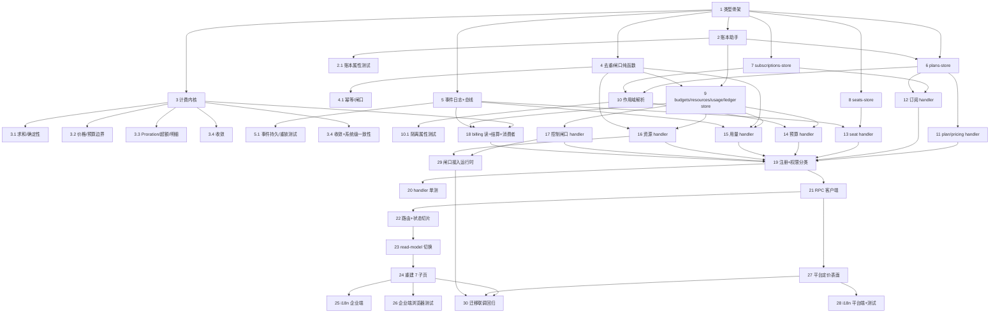

# Implementation Plan

> 关联：`requirements.md`（23 需求 + 12 属性）、`design.md`。

## Overview

将企业端「成本与预算」重建为双端 SaaS 计费系统。实现顺序：先纯函数内核（可立即属性测试），再持久化 store 与进程内事件总线，再 RPC handler 与注册，再企业端 7 子页 UI，最后平台端定价 UI 与迁移联调。每个任务仅触碰代码与测试，按 `design.md` 指定文件路径落地。`[P]` 标记的子任务可与同组其他 `[P]` 任务并行。

## Tasks

### Phase 0：类型与计费内核（纯函数，先行可测）

- [x] 1. 建立 billing 类型与目录骨架
  - 新建 `src/gateway/billing/types.ts`，定义 `Plan`、`PlanVersion`、`PlanPricing`、`Subscription`、`Seat`、`SeatHistoryInterval`、`Budget`、`UsageRecord`、`BotResource`、`Bill`、`BillItem`、`CostSnapshot`、域事件类型（`UsageReportedEvent`/`SeatChangedEvent`/`BotCreatedEvent`/`BillingDomainEvent`）与枚举（`BillingCycle`/`SeatRole`/`PricingType`/`SubscriptionStatus`/`SnapshotType`）
  - 金额字段统一 `*Cents: number`（整数分）
  - _Requirements: R1, R2, R4, R5, R6, R9, R10, R20, R22_

- [x] 2. 实现 append-only 账本助手
  - 新建 `src/gateway/billing/append-only-ledger.ts`：`appendLedgerRecord<T>(collection, record)` 仅插入、重复 id 抛 `LedgerImmutabilityError`；额外提供 `assertAppendOnly(prev, next)` 防御性校验
  - _Requirements: R11.1, R11.2, R11.3, R11.5_

- [x] 2.1 [P] append-only 不变量属性测试
  - 新建 `src/gateway/billing/append-only-ledger.property.test.ts`（`// @vitest-environment node` + fast-check）：记录数单调不减、既有字段不变、改/删被拒
  - _Properties: Property 5_

- [x] 3. 实现计费内核纯函数
  - 新建 `src/gateway/billing/engine.ts`：`getPrice`、`computeSeatCost`（按 seat_history 区间占比 + 末区间回填使占比和=1）、`computeUsageCost`、`computeExtraCost`、`computeTotalCost`、`predictMonthEndCost`（linear + 可选 wma + elapsed=0 占位）、`checkBudget`、`settleCycle`
  - 新增 `assertCycleConsistency(input)`（Seat 区间在周期内闭合/无重叠、Usage `occurredAt` 落在周期窗口；不一致返回结构化诊断，不写补丁）
  - 新增 `projectFromEvents(events, enterpriseId)`（事件日志→周期投影切片，作为唯一真相的纯投影函数）
  - 全程 cents 整数 + `Math.round`，分项取整后求和=总额；不 import 任何 IO/gateway/lit
  - _Requirements: R2.3, R2.4, R6.5, R6.6, R7.2, R9.5, R9.7, R9.8, R10.1, R10.2, R10.5, R11.4, R12, R17.3, R20.4_

- [x] 3.1 [P] 求和与确定性属性测试
  - 新建 `src/gateway/billing/engine.total.property.test.ts`（Property 1 + 4 合并）
  - _Properties: Property 1, Property 4_

- [x] 3.2 [P] 价格查询与预算边界属性测试
  - 新建 `src/gateway/billing/engine.pricing-budget.property.test.ts`
  - _Properties: Property 2, Property 3_

- [x] 3.3 [P] Proration、超额、账单明细求和属性测试
  - 新建 `src/gateway/billing/engine.proration-extra.property.test.ts`
  - _Properties: Property 7, Property 8, Property 10_

- [x] 3.4 [P] estimated→final 收敛与系统级一致性属性测试
  - 新建 `src/gateway/billing/billing.system.property.test.ts`：`projectFromEvents` + `settleCycle` 全链路——`Σ BillItem == Bill.total == final 快照 total`，重放同一事件日志结果一致，重复投递（at-least-once）不改变投影；estimated 与 final 金额一致仅标记不同
  - _Properties: Property 11, Property 13_

- [x] 4. 实现用量去重与控制闸口纯函数
  - 新建 `src/gateway/billing/control.ts`：`dedupeUsage(existing, incoming)`（按 `(enterpriseId,eventId)` 去重）与 `evaluateGate({action, budgetLevel, controls})`（仅「启用∧超限」→拒绝）
  - _Requirements: R9.1, R9.2, R9.3, R9.6, R8.2, R8.5, R23.1, R23.2, R23.5, R23.6_

- [x] 4.1 [P] 幂等与闸口属性测试
  - 新建 `src/gateway/billing/control.property.test.ts`
  - _Properties: Property 9, Property 12_

### Phase 1：持久化 store 与事件总线

- [x] 5. 持久事件日志 store + 进程内事件分发器
  - 新建 `src/gateway/billing/event-log-store.ts`（落盘 `CONFIG_DIR/openbot-billing-events.json`，append-only，单调 `seq`，事件状态 pending/done/failed；`appendEventLog`/`markEventStatus`/`listEvents`）
  - 新建 `src/gateway/billing/event-bus.ts`：`BillingEventBus.publish`（先持久化再投递，at-least-once）、`deliver`（失败标 failed 不丢）、`replayPending`（重放未完成事件，幂等消费）+ 单例 `billingEventBus`
  - _Requirements: R16.3, R9.4, R5.7_

- [x] 5.1 [P] 事件持久与重放测试
  - 新建 `event-bus.test.ts`：发布即落盘、consumer 抛错事件不丢、`replayPending` 重放且幂等（重复投递不改变投影）
  - _Requirements: R16.3_

- [x] 6. 平台 plan/pricing store（版本 append-only）
  - 新建 `src/gateway/billing/plans-store.ts`（落盘 `CONFIG_DIR/openbot-billing-plans.json`）：`createPlan`、`updatePlan`（追加新 `PlanVersion`）、`listPlans`、`getPlan`、`getPlanVersion`、`getCurrentPlanVersion`；版本 append-only 含 pricing snapshot
  - _Requirements: R1.1, R1.2, R1.3, R2.1, R2.2, R3.2, R11.3_

- [x] 7. 订阅 store（状态历史 append-only）
  - 新建 `src/gateway/billing/subscriptions-store.ts`（`openbot-billing-subscriptions.json`）：`createSubscription`、`transitionSubscriptionStatus`、`setPendingChange`、`getActiveSubscription`、`listSubscriptionEvents`；含 `planVersionId`/`pendingChange`，状态变更 append；首参 `enterpriseId` 隔离
  - _Requirements: R4.1, R4.7, R11.2, R17.4_

- [x] 8. Seat store + seat_history（区间 append-only）
  - 新建 `src/gateway/billing/seats-store.ts`（`openbot-billing-seats.json`）：`assignSeat`、`setSeatRole`（关闭旧区间+追加新区间）、`setSeatBotQuota`、`listSeats`、`listSeatIntervals`、`countSeatsByRole`；独立于订阅 store
  - _Requirements: R5.1, R5.2, R5.3, R11.2_

- [x] 9. 预算、资源、用量、账本 store
  - 新建 `budgets-store.ts`（变更 append，默认阈值 0.8）、`bot-resources-store.ts`（软删保留 + 用户上限）、`usage-records-store.ts`（经 `dedupeUsage` append-only）、`ledger-store.ts`（Bills+Snapshots 经 `appendLedgerRecord`，estimated/final 并存）
  - **所有 store 函数首参为 `enterpriseId`，不提供「无租户」全表查询**（纵深防御）
  - _Requirements: R6.1, R6.7, R9.1, R9.3, R10.3, R10.4, R11.1, R13.1, R20_

- [x] 10. 租户作用域解析器
  - 新建 `src/gateway/billing/scope.ts`：`resolveBillingScope(client)`（email→membership→enterpriseId + canonicalize）、`isScopeAuthorizedForTenant`、`scopeHasPermission`、`USAGE_BUDGET_PERMISSION`（enterprise-admin 持有）
  - _Requirements: R13.1, R13.2, R13.3, R14.2, R14.3_

- [x] 10.1 [P] 租户隔离属性测试
  - 新建 `src/gateway/billing/scope.isolation.property.test.ts`：两租户数据集合无交集、越权访问被拒、权限闸
  - _Properties: Property 6_

### Phase 2：RPC handler 组与注册

- [x] 11. 平台端 plan/pricing handler（ADMIN）
  - 新建 `src/gateway/server-methods/platform-plans.ts`（含 `platformPlansHandlers` + `platformPricingHandlers`）：`platform-plans.create/update/list`、`platform-pricing.set/list`；校验缺字段/负数 `basePrice`/负价 → `errorShape`
  - _Requirements: R1.1, R1.4, R1.5, R1.6, R2.1, R2.5, R2.6, R2.7, R14.1, R14.5_

- [x] 12. 订阅 handler（含规则下发与套餐切换）
  - 新建 `src/gateway/server-methods/subscriptions.ts`：`subscribe`、`get`（返回只读 planView/pricingView + availablePlans，锁定 version）、`change-plan`（now/next）、`history`；重复订阅/未知 plan → 拒绝；写后发 `subscription.changed` 事件
  - _Requirements: R3.1, R3.3, R4.1, R4.3, R4.4, R4.5, R4.6, R17.1, R17.2, R17.3, R17.4, R17.5_

- [x] 13. Seat handler
  - 新建 `src/gateway/server-methods/seats.ts`：`assign`、`set-role`、`list`；负 Bot 配额、超角色配额 → 拒绝；写后 `publish(SeatChangedEvent)`
  - _Requirements: R5.1, R5.2, R5.4, R5.5, R5.6, R5.7_

- [x] 14. 预算 handler（双权限闸）
  - 新建 `src/gateway/server-methods/budget.ts`：`set`（WRITE + `usage:budget`）、`get`；负 limit、阈值越界 → 拒绝；默认 `alertThreshold=0.8`
  - _Requirements: R6.1, R6.2, R6.3, R6.4, R6.7, R6.8, R14.2, R14.3, R14.4_

- [x] 15. 用量采集 handler + 事件发布
  - 新建 `src/gateway/server-methods/usage-ingest.ts`：`report`（经 `dedupeUsage` 写入，返回 `{recorded, deduped}`，首次写入后 `await billingEventBus.publish(UsageReportedEvent)` 持久化后投递）
  - _Requirements: R9.1, R9.2, R9.3, R9.4_

- [x] 16. 资源 handler（经闸口创建 Bot）
  - 新建 `src/gateway/server-methods/resources.ts`：`summary`、`set-user-limit`（负数拒绝）、`create-bot`（执行前过 `evaluateGate` + 企业/用户配额校验，超限拒绝带原因；成功 `publish(BotChangedEvent)`）
  - _Requirements: R20.1, R20.2, R20.3, R20.4, R20.5, R23.2, R23.4_

- [x] 17. 成本控制闸口 handler
  - 新建 `src/gateway/server-methods/cost-control.ts`：`check`（action ai|bot → `{allowed, reason?, budgetLevel}`，复用 `evaluateGate` + `computeBudgetStatus`）
  - _Requirements: R8.1, R8.3, R8.4, R8.5, R23.1, R23.3, R23.5, R23.6_

- [x] 18. Billing 读 + 结算 handler，事件消费者
  - 新建 `src/gateway/server-methods/billing.ts`：`dashboard`（入口先 `replayPending()`，再经 `computeCurrentCycleCost`(estimated) + 预测 + 预算状态，返回 `computedAt`/`stale`/空态）、`analytics`、`list-bills`、`get-bill`、`export-bill`、`settle`（入口先 `replayPending()`，全量重算生成 final，append 账本不覆盖）
  - 模块加载即 `billingEventBus.on(consumer)`：消费事件→对应租户重算当日 estimated 快照（幂等覆盖）append；账单/快照均按 store 投影（事件日志驱动消费）
  - 新增 `src/gateway/billing/runtime.ts`（`computeCurrentCycleCost`/`computeBudgetStatus`/`resolveCycleWindow` IO 编排，组合纯引擎 + store）
  - _Requirements: R7.1-R7.7, R10.3, R10.4, R11.4, R12, R16.3, R18, R19, R22.2, R22.3, R22.4, R22.6_

- [x] 19. 注册 handler 组与权限分类
  - 在 `src/gateway/server-methods.ts` 的 `coreGatewayHandlers` import + 展开全部新 handler 组（**仅此一处**，不放进 `usage.ts`）
  - 在 `src/gateway/method-scopes.ts` 的 `METHOD_SCOPE_GROUPS` 归类：平台 plan/pricing 写 + `billing.settle`→ADMIN；企业 subscribe/seats/budget/usage-ingest/resources 写→WRITE；全部 `*.list/get/dashboard/analytics/history/check`→READ
  - _Requirements: R14.1, R14.2, R14.5, R16.1_

- [x] 20. [P] Gateway handler 单元测试
  - 新建 `src/gateway/server-methods/billing.test.ts`，镜像 `enterprise-usage.test.ts`（`vi.mock("../../utils.js",{CONFIG_DIR:tmpDir})` + mock `resolveBillingScope` + `await import` + `invoke`）：覆盖成功/校验拒绝/权限拒绝/幂等去重/闸口拒绝/闭环（21 用例）
  - 新增 `src/gateway/server-methods/billing-helpers.ts`（参数校验 + 租户/权限闸复用）
  - _Requirements: R1, R2, R4, R5, R6, R9, R13.3, R20, R23_

### Phase 3：企业端 UI 重建（7 子页）

- [x] 21. 强类型 RPC 客户端
  - 新建 `ui/src/ui/capability/cost-budget-billing/{endpoints.ts,gateway-client.ts,index.ts}`：`COST_BUDGET_ENDPOINTS` 常量 + Request/Response 镜像类型 + `createCostBudgetGateway(client)`，镜像 `enterprise-capability-usage-management/` 范式
  - _Requirements: R16.2_

- [x] 22. 路由与状态切片
  - 在 `ui/src/ui/navigation.ts` 新增 `COST_BUDGET_SUB_ROUTES`/`CostBudgetSubRoute`（overview|subscription|seats|resources|analytics|billing|control）；`enterpriseUsage` 路由 `usage/*` 已映射到该 Tab；子页由 surface 内 `resolveSubRoute` 从 URL 解析
  - _Requirements: R7.7, R21.1_

- [x] 23. read-model 切换（退役启发式）
  - 在 `ui/src/ui/ports/enterprise/semantic/enterprise-read-model.ts` 将 `deriveBudgetLimit` 标记 `@deprecated`（成本与预算视图改由 `billing.*` RPC 切片提供，不再用启发式；机巢派生字段暂留，后续单独迁移）
  - _Requirements: R15.1, R15.2_

- [x] 24. 重建成本与预算表面与 7 子页
  - 保留 `enterprise-surfaces-core.ts` 的 `case "enterpriseUsage"`，重写 `views/enterprise-usage-surface.ts` 主体挂载 `views/cost-budget/cost-budget-page.ts`（7 子页 + 顶部预测条 + 估算角标含 `computedAt`/`stale` + 空态引导）
  - 删除静态「预算控制工作区」占位，改接真实 `billing.*`/`subscriptions.*`/`seats.*`/`budget.*`/`resources.*` RPC（经 `createCostBudgetGateway`）
  - _Requirements: R7, R15.3, R15.4, R15.6, R17, R18, R19, R20, R21, R22.5_

- [x] 25. i18n（企业端）
  - 在 `ui/src/i18n/locales/en.ts` 与 `zh-CN.ts` 新增 `costBudget` 命名空间（title/overview/subscription/seats/resources/analytics/billing/control + 预测/估算/空态文案），双语对齐
  - _Requirements: R15_

- [x] 26. [P] 企业端浏览器测试
  - 新建 `views/cost-budget/cost-budget-page.browser.test.ts`（`@vitest-environment jsdom` + lit render + mock client）：断言 7 子页 Tab、预测条、无订阅/无预算空态、估算角标、账单展示（5 用例）；更新 `enterprise-surfaces.browser.test.ts` 的 enterpriseUsage 用例为新 UI
  - _Requirements: R7, R15.3, R18, R19, R21_

### Phase 4：平台端定价 UI 与迁移联调

- [x] 27. 平台「套餐与定价管理」表面
  - 新建 `ui/src/ui/ports/platform/pricing/page.ts`（`renderPlatformPricingSurface`）：套餐列表 + 创建表单（基础价/Bot 配额/席位价/用量价，元→分换算）
  - 接线：`navigation.ts` 增 `platformPricing`（Tab 联合/`PLATFORM_SURFACE_TABS`/`TAB_PATHS`/`PORT_BY_TAB`/前缀路由/`titleForTab`）；`shared/surface.ts` 增 `PlatformSurfaceTab` + `client`；`views/platform-surfaces.ts` switch + `PLATFORM_SURFACE_HEADERS`；`platform-shell.ts` `isPlatformSurface` + 透传 client；`port-state.ts` 增 `client`
  - _Requirements: R1, R2, R3, R14.1, R14.5_

- [x] 28. i18n（平台端）+ [P] 平台表面测试
  - `en.ts`/`zh-CN.ts` 增 `nav.items.platformPricing`/`tabs.platformPricing`/`subtitles.platformPricing`，双语对齐
  - 新建 `ui/src/ui/ports/platform/pricing/page.browser.test.ts`（无 client 提示/套餐列表/空态，3 用例）
  - _Requirements: R1, R2_

- [x] 29. 控制闸口接入运行时入口
  - 新建 `src/gateway/billing/enforce.ts`（`enforceCostControl` 唯一可复用强制点）；`resources.create-bot` 与 `cost-control.check` 改为复用该入口，确保执行前拦截不被绕过
  - _Requirements: R8.1, R23.1, R23.2, R23.3_

- [x] 30. 迁移联调与回归
  - 校验 `enterprise-usage.*`（能力应用管理）零改动；`usage.cost`/`sessions.usage` 未改、仍服务其他页面但不再驱动成本与预算；无 Subscription 时成本与预算页空态引导
  - 跑 `pnpm tsgo`（billing/UI 新文件零错误）、billing 测试 53 项 + UI 测试 86 项全过
  - _Requirements: R15.2, R15.3, R15.5, R16_

### Phase 5：平台定价控制平面（版本生命周期）

- [x] 31. PlanVersion 状态机模型与纯函数守卫
  - `types.ts`：`PlanVersion` 增 `status: "draft"|"active"|"deprecated"`、`versionNumber`（= `version`，UI 展示/排序）、`activatedAt?`、`deprecatedAt?`；新增 `PlanVersionStatusChangeEvent`（完整字段 `{ id, planId, versionId, from, to, requestId, changedByUserId, occurredAt }`）与 `PlanVersionStatus`、`PricingDiff`
  - 新增 `src/gateway/billing/version-lifecycle.ts`（framework-free）：`assertValidTransition(from,to)`（仅 `draft→active`、`active→deprecated`；拒绝其余/自反/逆向；`deprecated` 终态）、`reduceVersionStatuses(versions, op)`（激活原子降级原 active，整体读-归约-写回）、`comparePlanVersions(from,to): PricingDiff`
  - _Requirements: R24.1, R24.2, R24.3, R25.1, R25.2, R25.7_

- [x] 31.1 [P] 状态机、单一 active、diff 属性测试
  - 新建 `version-lifecycle.property.test.ts`：合法流转（含 deprecated 终态拒绝）、单一 active（乱序/并发序列）、`reduceVersionStatuses` 幂等性、`comparePlanVersions` 对称/正确
  - _Properties: Property 14, Property 15_

- [x] 32. plans-store 生命周期方法 + Plan 级原子锁
  - `plans-store.ts`：`createPlanVersion(planId, pricing)`→draft（不动 currentVersionId）、`activatePlanVersion(planId,versionId,requestId)`、`deprecatePlanVersion`、`listPlanVersions(planId)`
  - **激活/废弃在 `withLock(planId)` 内执行「读全部版本 → reduceVersionStatuses → 整体写回 → append `PlanVersionStatusChangeEvent`」，禁止版本级局部更新**；`requestId` 幂等短路（已存在同 requestId 事件→返回首次结果）；写 `activatedAt`/`deprecatedAt`
  - 仅 draft 态允许编辑 pricing；非 draft 改 pricing 抛错（R24.5/R24.6）
  - _Requirements: R24.4, R24.5, R24.6, R25.1, R25.2, R25.3, R25.4, R25.5, R25.6, R25.8_

- [x] 32.1 [P] 版本快照不可变 + 幂等激活测试
  - 新建 `plans-store.lifecycle.test.ts`：draft 可编辑、active/deprecated pricing 不可改、status 变更产生完整字段 append-only 事件、激活降级原 active、相同 requestId 重复激活幂等
  - _Properties: Property 16, Property 17_

- [x] 33. 订阅版本级约束 + 计费路径守卫（无运行时回退）
  - `subscriptions-store`/`subscribe` handler：标准路径要求 `planVersionId` 且校验 `status=active`（draft/deprecated 拒绝）；UI 路径 `planId` 解析当前 active 并标 `resolvedFromPlanId=true`
  - `subscriptions.get` 返回 `{ subscription, planVersion, pricingSnapshot }`
  - **运行时遇缺 `planVersionId` 的订阅进入计费 → 抛 `DataIntegrityError` 拒绝，不隐式回退**（R27.3）
  - engine 入口 `assertBillingInputs`：断言 `plan_version_id` 与 `version.pricing` 存在 + 锁定版本快照可用（deprecated 仍按快照计费）；拒绝以 `plan_id` 充当计费依据（R26.5/26.6/26.7/R27.4）
  - _Requirements: R26.1, R26.2, R26.3, R26.4, R26.5, R26.6, R26.7, R27.3, R27.4_

- [x] 33.1 [P] 版本锁定计费不可变性测试
  - 新建 `engine.version-lock.property.test.ts`：订阅锁定版本后，Plan active 切换/废弃不改变其历史账单（含锁定版本已 deprecated）；planId 充当计费依据被拒
  - _Properties: Property 16_

- [x] 34. 平台版本 RPC（ADMIN）+ 权限分类
  - `platform-plans.ts`：新增 `platform-pricing.create-version`（draft）、`platform-pricing.activate`（requestId 幂等）、`platform-pricing.deprecate`、`platform-pricing.list-versions`、`platform-pricing.diff`（后端 `comparePlanVersions`）；校验价格非负/必填/key 合法/非法流转
  - `method-scopes.ts`：写方法→ADMIN，`list-versions`/`diff`→READ
  - _Requirements: R24.1, R24.2, R25.3, R25.9, R14.1_

- [x] 35. [P] 平台版本 RPC handler 单测
  - 扩展 `billing.test.ts`：create-version→draft、activate 切换单一 active、重复 requestId 幂等、draft 不可订阅、deprecated 不可订阅、非法流转拒绝、diff 正确
  - _Requirements: R24, R25, R26.2_

- [x] 36. 平台 UI：版本管理
  - `ports/platform/pricing/page.ts`：套餐展开→版本列表（status 徽标 + active 标识 + `vN` 版本号）+ 建草稿 + 编辑 draft 定价 + 激活按钮 + **激活前展示后端 diff（与当前 active 对比）+ 影响提示（「不影响已有订阅，仅影响新订阅」）+ 二次确认**
  - _Requirements: R24, R25, R7（UI 一致性）_

- [x] 37. 企业 UI：展示绑定版本
  - 企业端订阅子页展示 `planVersion`（`vN` + status）与只读 `pricingSnapshot`；标注 `resolvedFromPlanId`（若适用）
  - _Requirements: R26.3, R3.1_

- [x] 38. i18n（版本生命周期）
  - `en.ts`/`zh-CN.ts` 新增 `costBudget`/`platformPricing` 下版本/草稿/激活/废弃/diff/影响提示文案，双语对齐
  - _Requirements: R24, R25_

- [x] 39. [P] UI 浏览器测试
  - 平台版本管理（列表/草稿/激活/diff/影响提示）+ 企业版本展示浏览器测试
  - _Requirements: R24, R25, R26.3_

- [x] 40. 一次性迁移脚本 + 兼容回归
  - 新建迁移核心 `src/gateway/billing/version-migration.ts`（纯函数：`normalizePlanVersionStatuses`/`bindSubscriptionVersions`/`migrateVersionLifecycle`）+ CLI 脚本 `scripts/migrate-billing-version-lifecycle.ts`（`--dry-run`）：旧 PlanVersion status 归一化（currentVersionId→active，余→deprecated）、旧订阅补绑创建时点版本（无法判定→当前 active + `migratedBinding=true`）
  - 验证：激活新版本后既有订阅历史账单不变（`engine.version-lock` + `version-migration.test` 7 用例）；运行时缺 planVersionId 抛 DataIntegrityError（非回退）；billing 子集 58 项通过、Phase 5 文件 `pnpm tsgo` 零错误
  - _Requirements: R27.1, R27.2, R27.3, R27.5, R15.5_

## Task Dependency Graph

```json
{
  "waves": [
    { "wave": 1, "tasks": ["1"], "rationale": "类型与目录骨架，所有后续任务的基础" },
    {
      "wave": 2,
      "tasks": ["2", "3", "4", "5"],
      "rationale": "依赖类型的纯函数内核（账本助手/计费引擎+投影+一致性守卫/去重闸口）与持久事件日志+总线，互不依赖可并行"
    },
    {
      "wave": 3,
      "tasks": ["2.1", "3.1", "3.2", "3.3", "3.4", "4.1", "5.1", "6", "7", "8"],
      "rationale": "纯函数属性测试（含系统级一致性）、事件持久/重放测试，与平台/订阅/Seat store（依赖类型与账本助手/事件总线）"
    },
    {
      "wave": 4,
      "tasks": ["9", "10"],
      "rationale": "预算/资源/用量/账本 store（依赖账本助手与去重）与作用域解析（依赖 plans/subscriptions store）"
    },
    {
      "wave": 5,
      "tasks": ["10.1", "11", "12", "13", "14", "15", "16", "17", "18"],
      "rationale": "隔离属性测试与全部 RPC handler 组，依赖对应 store/引擎/事件总线，彼此独立可并行"
    },
    {
      "wave": 6,
      "tasks": ["19"],
      "rationale": "集中注册 handler 组并在 method-scopes 分类，依赖全部 handler 存在"
    },
    {
      "wave": 7,
      "tasks": ["20", "21"],
      "rationale": "handler 单测与企业端 RPC 客户端，依赖注册完成"
    },
    {
      "wave": 8,
      "tasks": ["22", "27"],
      "rationale": "企业端路由/状态切片与平台端定价表面，依赖 RPC 客户端"
    },
    { "wave": 9, "tasks": ["23", "28"], "rationale": "企业端 read-model 切换与平台端 i18n/测试" },
    { "wave": 10, "tasks": ["24"], "rationale": "重建企业端 7 子页表面，依赖 read-model 切换" },
    {
      "wave": 11,
      "tasks": ["25", "26", "29"],
      "rationale": "企业端 i18n、浏览器测试与运行时闸口接入，依赖子页与闸口 handler"
    },
    { "wave": 12, "tasks": ["30"], "rationale": "迁移联调与全量回归，最后执行" },
    {
      "wave": 13,
      "tasks": ["31"],
      "rationale": "Phase 5：PlanVersion 状态机模型与纯函数守卫，版本生命周期基础"
    },
    {
      "wave": 14,
      "tasks": ["31.1", "32", "33"],
      "rationale": "状态机属性测试、plans-store 生命周期方法、订阅版本级约束 + engine 守卫（依赖 31）"
    },
    {
      "wave": 15,
      "tasks": ["32.1", "33.1", "34"],
      "rationale": "快照不可变测试、版本锁定计费测试、平台版本 RPC（依赖 32/33）"
    },
    {
      "wave": 16,
      "tasks": ["35", "36", "37"],
      "rationale": "版本 RPC 单测、平台版本管理 UI、企业版本展示 UI（依赖 34）"
    },
    { "wave": 17, "tasks": ["38", "39"], "rationale": "i18n 与 UI 浏览器测试（依赖 36/37）" },
    { "wave": 18, "tasks": ["40"], "rationale": "Phase 5 兼容与回归，最后执行" }
  ]
}
```



## Notes

- **测试框架**：Vitest；属性测试用 fast-check（根 `node_modules` 已可用），`// @vitest-environment node`，`fc.assert(fc.property(...), { numRuns: 100 })`。
- **验证命令**：纯函数与 store 改动后跑 `pnpm tsgo` + 对应 `pnpm test` 子集；UI 改动跑 `pnpm test:ui` 子集；提交前 `pnpm check`。低内存环境用 `OPENBOT_TEST_PROFILE=low OPENBOT_TEST_SERIAL_GATEWAY=1 pnpm test`。
- **不可触碰**：`enterprise-usage.*`（能力应用管理）handler/store/UI 全程零改动（R15.5）；`usage.cost`/`sessions.usage` 保留供其他页面（R15.2）。
- **真相来源**：append-only 事件日志（usage/seat/subscription/budget events + plan_versions）是唯一真相；头记录是投影缓存；账单/快照是 `settleCycle` 对事件的确定性投影输出；历史账单一律重放得出，禁止从头记录推导。
- **事件可靠性**：事件先持久化再投递（at-least-once），consumer 失败留 `failed` 待 `replayPending` 重放；消费幂等（重算快照是覆盖非累加）。计费不丢事件。
- **金额**：全程整数分（cents），展示层除 100；禁止浮点累加导致「分项和≠总额」。
- **append-only**：Bills/Snapshots/seat_history/plan_version/状态历史/预算历史/事件日志只经追加路径，改/删被拒（R11）。
- **租户纵深防御**：store 函数首参 `enterpriseId`，无「无租户查询」；handler 层 EnterpriseScope 校验 + store 层强制租户，双层兜底。
- **权限双闸**：平台 plan/pricing 写仅 ADMIN；企业预算/控制写需 WRITE + 成员 `usage:budget`。
- **一致性守卫**：`settleCycle` 前置 `assertCycleConsistency`（Seat 区间闭合、Usage 落周期内），不一致报错不写补丁。
- **并行**：`[P]` 子任务（属性测试、单测、浏览器测试）可在其依赖的实现任务完成后并行推进。
