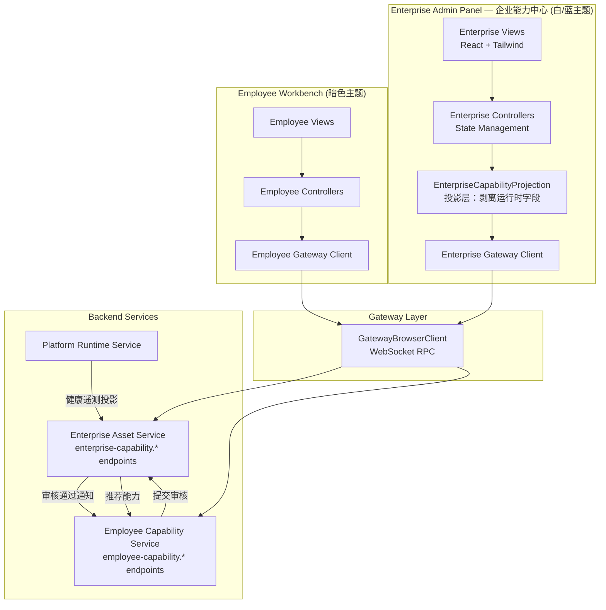
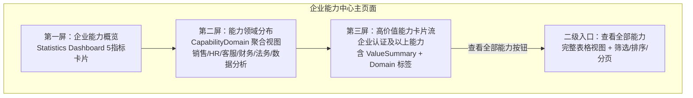
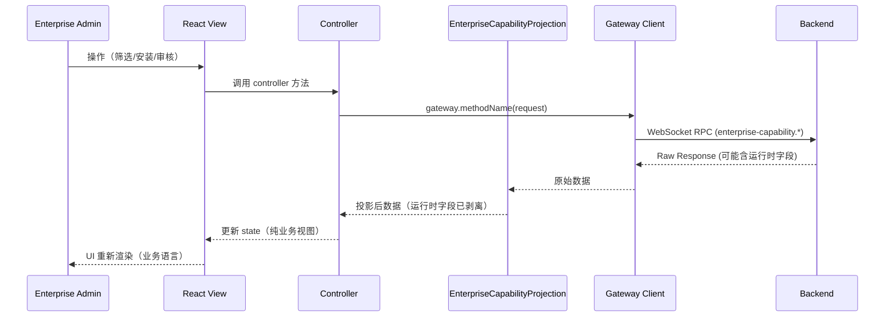

# 技术设计文档：企业能力中心（Enterprise Capability Asset Library）

## Overview

企业能力中心是面向企业管理员的 AI 能力资产管理模块，作为员工端能力沉淀体系（skill-lifecycle-asset-system）的管理侧对等物。本模块遵循与员工端相同的架构模式：Types → Endpoints → Gateway Client → Controllers → Views，但使用独立的 `enterprise-capability.*` RPC 命名空间。

**UI 展示名**：企业能力中心
**内部模块名**：`enterprise-capability-asset-library`

**核心设计原则：**

1. **EnterpriseCapabilityProjection（企业能力投影）**：核心架构原则——统一投影层剥离所有运行时字段（prompt、workflow json、toolchain、model routing、provider、memory strategy、execution policy、routing hints、model preferences），确保企业端仅暴露业务能力视图。所有从后端到企业前端的数据流必须经过此投影层。
2. **业务能力视图**：仅暴露业务语言信息，严格过滤运行时技术细节
3. **数据来源约束**：能力资产唯一来源为员工提交审核流程，不可由平台直接创建
4. **三层分离**：企业资产层与员工能力层、平台运行时层严格隔离
5. **模式复用**：复用 GatewayBrowserClient RPC 通信模式，保持代码风格一致

**与员工端的集成点：**

- 员工通过 `employee-capability.submit-to-enterprise` 提交 → 企业端创建审核任务
- 企业审核通过并发布（需指定 ApplicableScope + CapabilityDomain）→ 更新员工端 `CapabilityShareVisibility` 为 "已进入企业资产库"
- 企业推荐能力 → 通过 `employee-capability.recommendations` 流向员工端
- 员工自主安装 → 通过 `employee-capability.install-to-robot` 建立关联

## Architecture

### 系统架构图



### 主页面三屏布局架构



### 模块目录结构

```
ui/src/ui/capability/enterprise-capability/
├── types.ts                    # 企业资产层类型定义
├── projection.ts               # EnterpriseCapabilityProjection 投影层实现
├── endpoints.ts                # enterprise-capability.* RPC 端点定义
├── gateway-client.ts           # 企业端 Gateway 客户端封装
├── mock-backend.ts             # 开发阶段 Mock 后端
└── index.ts                    # 模块导出

ui/src/ui/controllers/enterprise-asset-library/
├── asset-list.ts               # 资产列表状态管理
├── asset-detail.ts             # 资产详情状态管理
├── review-queue.ts             # 审核队列状态管理
├── install-management.ts       # 安装管理状态管理
├── contribution-records.ts     # 贡献记录状态管理
├── contribution-performance.ts # 贡献绩效状态管理
├── statistics.ts               # 统计仪表盘状态管理
├── domain-distribution.ts      # 能力领域分布状态管理
└── index.ts                    # 控制器导出

ui/src/ui/views/enterprise-asset-library/
├── EnterpriseCapabilityCenterPage.tsx  # 主页面布局（三屏）
├── CapabilityOverviewSection.tsx       # 第一屏：企业能力概览
├── StatisticsDashboard.tsx             # 统计仪表盘卡片
├── DomainDistributionSection.tsx       # 第二屏：能力领域分布
├── DomainCard.tsx                      # 领域聚合卡片
├── HighValueCapabilitySection.tsx      # 第三屏：高价值能力卡片流
├── HighValueCapabilityCard.tsx         # 高价值能力卡片
├── ValueSummaryDisplay.tsx             # EnterpriseCapabilityValueSummary 业务语言展示
├── CredibilityIndicatorsDisplay.tsx    # 可信度指标展示
├── AllCapabilitiesPage.tsx             # "查看全部能力"表格视图
├── QuickEntrySidebar.tsx               # 快捷入口侧边栏
├── AssetFilterBar.tsx                  # 筛选栏（5个下拉）
├── AssetTable.tsx                      # 资产表格
├── AssetTableRow.tsx                   # 表格行
├── AssetDetailPage.tsx                 # 资产详情页
├── ReviewQueuePage.tsx                 # 审核队列页
├── InstallManagementPage.tsx           # 安装管理页
├── ContributionRecordsPage.tsx         # 贡献记录页
├── ContributionPerformancePage.tsx     # 贡献绩效页
├── InstallToRobotDialog.tsx            # 安装到机器人对话框
├── MaturityIndicator.tsx               # 成熟度圆点指示器（1-6点）
├── HealthBadge.tsx                     # 健康状态徽章（业务效果语言）
├── MiniTrendChart.tsx                  # 迷你趋势折线图
└── Pagination.tsx                      # 分页控件
```

### 数据流（含投影层）



## Components and Interfaces

### 1. EnterpriseCapabilityProjection（投影层）

核心架构组件，确保所有数据经过投影后不含运行时字段。

```typescript
// enterprise-capability/projection.ts

/** 运行时字段黑名单 */
const RUNTIME_FIELDS = [
  "prompt",
  "workflowJson",
  "toolchain",
  "modelRouting",
  "provider",
  "memoryStrategy",
  "executionPolicy",
  "routingHints",
  "modelPreferences",
] as const;

export type RuntimeField = (typeof RUNTIME_FIELDS)[number];

/**
 * 投影函数：从任意对象中递归剥离所有运行时字段
 * 保证：对任意输入，输出字段集合 ∩ RUNTIME_FIELDS = ∅
 */
export function projectToEnterpriseView<T extends Record<string, unknown>>(
  raw: T,
): Omit<T, RuntimeField>;

/** 验证投影结果是否干净（用于属性测试断言） */
export function isProjectionClean(obj: Record<string, unknown>): boolean;
```

### 2. Enterprise Gateway Client

遵循员工端 `createEmployeeCapabilityGateway` 的模式，为每个 RPC 端点提供类型安全的方法封装。

```typescript
// enterprise-capability/gateway-client.ts
export function createEnterpriseCapabilityGateway(client: GatewayBrowserClient) {
  return {
    list(req: AssetListRequest): Promise<AssetListResponse> { ... },
    detail(req: AssetDetailRequest): Promise<AssetDetailResponse> { ... },
    review(req: ReviewRequest): Promise<ReviewResponse> { ... },
    installToRobots(req: InstallToRobotsRequest): Promise<InstallToRobotsResponse> { ... },
    stats(req: StatsRequest): Promise<StatsResponse> { ... },
    contributionRecords(req: ContributionRecordsRequest): Promise<ContributionRecordsResponse> { ... },
    installManagement(req: InstallManagementRequest): Promise<InstallManagementResponse> { ... },
    contributionPerformance(req: ContributionPerformanceRequest): Promise<ContributionPerformanceResponse> { ... },
    uninstall(req: UninstallRequest): Promise<UninstallResponse> { ... },
    certify(req: CertifyRequest): Promise<CertifyResponse> { ... },
    promoteToStandard(req: PromoteToStandardRequest): Promise<PromoteToStandardResponse> { ... },
    updateHealthStatus(req: UpdateHealthStatusRequest): Promise<UpdateHealthStatusResponse> { ... },
    reviewQueue(req: ReviewQueueRequest): Promise<ReviewQueueResponse> { ... },
    domainDistribution(req: DomainDistributionRequest): Promise<DomainDistributionResponse> { ... },
  };
}

export type EnterpriseCapabilityGateway = ReturnType<typeof createEnterpriseCapabilityGateway>;
```

### 3. Controllers（状态管理）

遵循员工端 `my-accumulation.ts` 的模式：纯函数 + 可变 state 对象 + async 方法。

**AssetListController** 核心接口：

```typescript
export type AssetListState = {
  gateway: EnterpriseCapabilityGateway | null;
  loading: boolean;
  error: string | null;
  items: EnterpriseAssetListItem[];
  pagination: PaginationState;
  filters: AssetListFilters;
  sidebarEntry: SidebarEntry;
  sorting: AssetSortConfig;
};

export function createInitialAssetListState(): AssetListState;
export async function loadAssetList(state: AssetListState): Promise<void>;
export function updateFilter(state: AssetListState, key: string, value: unknown): void;
export function resetFilters(state: AssetListState): void;
export function changePage(state: AssetListState, page: number): void;
export function changePageSize(state: AssetListState, size: 10 | 20 | 50): void;
```

**DomainDistributionController** 核心接口：

```typescript
export type DomainDistributionState = {
  gateway: EnterpriseCapabilityGateway | null;
  loading: boolean;
  error: string | null;
  domains: DomainAggregation[];
};

export type DomainAggregation = {
  domain: CapabilityDomain;
  capabilityCount: number;
  representativeNames: string[]; // 最多3个
  coverageRate: number;
};

export function createInitialDomainDistributionState(): DomainDistributionState;
export async function loadDomainDistribution(state: DomainDistributionState): Promise<void>;
```

### 4. Views（React 组件）

所有视图组件使用 React + TypeScript + Tailwind CSS，遵循企业管理后台白/蓝主题。

**关键组件职责：**

| 组件                             | 职责                                                                      |
| -------------------------------- | ------------------------------------------------------------------------- |
| `EnterpriseCapabilityCenterPage` | 主页面三屏布局编排：概览、领域分布、高价值卡片流                          |
| `CapabilityOverviewSection`      | 第一屏：标题 + 统计仪表盘                                                 |
| `StatisticsDashboard`            | 5 个统计卡片，含加载态、错误态、环比变化                                  |
| `DomainDistributionSection`      | 第二屏：按 CapabilityDomain 聚合的领域卡片网格                            |
| `DomainCard`                     | 单个领域卡片：领域名、能力数量、代表性能力名称、覆盖率                    |
| `HighValueCapabilitySection`     | 第三屏：高价值能力卡片流 + "查看全部能力"入口                             |
| `HighValueCapabilityCard`        | 单张高价值卡片：名称、ValueSummary、Domain标签、CredibilityIndicators摘要 |
| `ValueSummaryDisplay`            | EnterpriseCapabilityValueSummary 业务语言格式化展示                       |
| `CredibilityIndicatorsDisplay`   | 可信度指标展示（已验证部门 + 生产运行天数）                               |
| `AllCapabilitiesPage`            | "查看全部能力"完整表格视图：侧边栏 + 筛选栏 + 表格 + 分页                 |
| `QuickEntrySidebar`              | 左侧 3 个快捷入口，控制主内容区筛选                                       |
| `AssetFilterBar`                 | 搜索框 + 5 个下拉筛选器 + "只看我可安装"开关 + 重置按钮                   |
| `AssetTable`                     | 分页表格，8 列数据展示（含能力领域列）                                    |
| `InstallToRobotDialog`           | 机器人多选器，最多 20 个，标记已安装                                      |

## Data Models

### 企业资产层核心类型

```typescript
// types.ts

/** 能力资产生命周期 */
export type AssetLifecycle =
  | "submitted" // 已提交（待审核）
  | "reviewing" // 审核中
  | "approved" // 已通过
  | "published" // 已发布
  | "deprecated" // 即将下线
  | "retired"; // 已下线

/** 能力领域（业务领域分组） */
export type CapabilityDomain = "销售" | "HR" | "客服" | "财务" | "法务" | "数据分析";

/** 能力成熟度（6级） */
export type CapabilityMaturity =
  | "初步形成" // 等级1
  | "稳定使用" // 等级2
  | "多人复用" // 等级3
  | "企业认证" // 等级4（需管理员主动授予）
  | "企业标准" // 等级5（需管理员主动授予，前提为已达企业认证）
  | "核心资产"; // 等级6

/** 能力健康状态（业务效果语言，非工程术语） */
export type EnterpriseHealthStatus =
  | "效果稳定"
  | "偶尔结果不理想"
  | "建议重新整理"
  | "已不适合继续推广";

/** 企业能力价值摘要（必须以业务语言展示） */
export type EnterpriseCapabilityValueSummary = {
  monthlyExecutions: number; // 本月调用次数 → "本月已被调用 N 次"
  departmentCoverageCount: number; // 覆盖部门数 → "已覆盖 N 个部门"
  reuseGrowthRate30d: number; // 近30天复用增长率 → "近 30 天复用增长 +N%"
};

/** 可信度指标 */
export type CredibilityIndicators = {
  verifiedDepartments: string[]; // 已验证使用部门列表
  productionUsageDays: number; // 生产环境使用天数
};

/** 适用对象范围 */
export type ApplicableScope =
  | { kind: "enterprise" }
  | { kind: "department"; id: string; name: string }
  | { kind: "group"; id: string; name: string }
  | { kind: "role"; id: string; name: string };

/** 企业复用数据 */
export type EnterpriseReuseData = {
  robotCount: number;
  employeeCount: number;
  departmentCount: number;
  trend30Days: number[]; // 近30天每日使用量
  growthPercentage: number; // 环比增长百分比
};

/** 贡献记录 */
export type ContributionRecord = {
  id: string;
  employeeId: string;
  employeeName: string;
  timestamp: number;
  type: "初始提交" | "内容修改" | "场景补充";
  summary: string; // ≤200字
};

/** 审核记录 */
export type ReviewRecord = {
  id: string;
  reviewerId: string;
  reviewerName: string;
  timestamp: number;
  result: "通过" | "拒绝" | "需修改";
  opinion: string;
};

/** 来源信息 */
export type SourceInfo = {
  employee: { id: string; name: string };
  robot: { id: string; name: string };
  task: { id: string; summary: string };
};

/** 企业能力资产（完整详情） */
export type EnterpriseCapabilityAsset = {
  id: string;
  name: string;
  description: string;
  usageScenarios: string[];
  applicableScope: ApplicableScope;
  domain: CapabilityDomain;
  maturity: CapabilityMaturity;
  healthStatus: EnterpriseHealthStatus;
  healthManualLock: boolean;
  healthNoTelemetry: boolean;
  lifecycle: AssetLifecycle;
  valueSummary: EnterpriseCapabilityValueSummary;
  credibilityIndicators: CredibilityIndicators;
  reuseData: EnterpriseReuseData;
  source: SourceInfo;
  contributionHistory: ContributionRecord[];
  reviewHistory: ReviewRecord[];
  avatar: string | null;
  createdAt: number;
  updatedAt: number;
};

/** 列表项（投影，仅含列表展示所需字段） */
export type EnterpriseAssetListItem = {
  id: string;
  name: string;
  description: string;
  usageScenarios: string[];
  applicableScope: ApplicableScope;
  domain: CapabilityDomain;
  maturity: CapabilityMaturity;
  healthStatus: EnterpriseHealthStatus;
  lifecycle: AssetLifecycle;
  valueSummary: EnterpriseCapabilityValueSummary;
  reuseData: EnterpriseReuseData;
  sourceEmployeeName: string;
  avatar: string | null;
};

/** 统计仪表盘数据 */
export type StatisticsDashboardData = {
  totalCapabilities: number;
  publishedCapabilities: number;
  coveredEmployees: number;
  coveredRobots: number;
  monthlyUsageCount: number;
  changes: {
    totalCapabilities: { value: number; type: "absolute" };
    publishedCapabilities: { value: number; type: "absolute" };
    coveredEmployees: { value: number; type: "percentage" };
    coveredRobots: { value: number; type: "absolute" };
    monthlyUsageCount: { value: number; type: "percentage" };
  };
  updatedAt: number;
};

/** 安装关系记录 */
export type InstallRelation = {
  id: string;
  capabilityId: string;
  capabilityName: string;
  robotId: string;
  robotName: string;
  installedAt: number;
  source: "管理员推送" | "员工自主安装";
  status: "正常运行" | "已暂停" | "待更新";
};

/** 贡献绩效数据 */
export type ContributionPerformanceItem = {
  employeeId: string;
  employeeName: string;
  department: string;
  totalContributions: number;
  approvedCount: number;
  approvalRate: number;
  averageMaturityLevel: number;
  totalReuseRobots: number;
  totalReuseEmployees: number;
  averageSuccessRate: number;
};

/** 分页状态 */
export type PaginationState = {
  currentPage: number;
  pageSize: 10 | 20 | 50;
  totalItems: number;
};

/** 筛选器状态（5个下拉 + 搜索 + 开关） */
export type AssetListFilters = {
  searchQuery: string;
  usageScenario: string | null;
  applicableTarget: string | null;
  domain: CapabilityDomain | null;
  maturity: CapabilityMaturity | null;
  healthStatus: EnterpriseHealthStatus | null;
  onlyInstallable: boolean;
};

/** 侧边栏入口 */
export type SidebarEntry = "my-installed" | "my-contributed" | "all";

/** 排序配置 */
export type AssetSortConfig = {
  field: "maturity" | "reuseValue" | "createdAt";
  direction: "asc" | "desc";
};

/** 审核队列项 */
export type ReviewQueueItem = {
  id: string;
  capabilityId: string;
  capabilityName: string;
  capabilitySummary: string;
  usageScenarios: string[];
  sourceEmployee: { id: string; name: string };
  sourceRobot: { id: string; name: string };
  sourceTaskSummary: string;
  usageCount: number;
  robotCount: number;
  lastUsedAt: number | null;
  submittedAt: number;
  status: "待审核" | "审核中";
};

/** 审核评估维度 */
export type ReviewAssessment = {
  security: {
    sensitiveInfo: boolean;
    dangerousOps: boolean;
    externalCalls: boolean;
    permissionRisk: boolean;
  };
  quality: {
    successRate30d: number;
    robotCount: number;
    employeeCount: number;
    namingCompliant: boolean;
  };
};

/** 审核通过时必须指定的额外信息 */
export type ReviewApprovalPayload = {
  applicableScope: ApplicableScope;
  domain: CapabilityDomain;
};

/** 能力领域分布聚合 */
export type DomainDistribution = {
  domain: CapabilityDomain;
  capabilityCount: number;
  representativeCapabilities: string[]; // 最多3个代表性能力名称
  coverageRate: number; // 领域覆盖率
};
```

### RPC 端点定义

```typescript
// endpoints.ts

export const ENTERPRISE_CAPABILITY_ENDPOINTS = {
  list: "enterprise-capability.list",
  detail: "enterprise-capability.detail",
  review: "enterprise-capability.review",
  reviewQueue: "enterprise-capability.review-queue",
  installToRobots: "enterprise-capability.install-to-robots",
  uninstall: "enterprise-capability.uninstall",
  stats: "enterprise-capability.stats",
  contributionRecords: "enterprise-capability.contribution-records",
  installManagement: "enterprise-capability.install-management",
  contributionPerformance: "enterprise-capability.contribution-performance",
  certify: "enterprise-capability.certify",
  promoteToStandard: "enterprise-capability.promote-to-standard",
  updateHealthStatus: "enterprise-capability.update-health-status",
  domainDistribution: "enterprise-capability.domain-distribution",
} as const;
```

### 与员工端类型的映射关系

| 员工端类型                  | 企业端类型                         | 映射说明                                                                                |
| --------------------------- | ---------------------------------- | --------------------------------------------------------------------------------------- |
| `CapabilityShareVisibility` | `AssetLifecycle`                   | "审核中" → submitted/reviewing, "已进入企业资产库" → published                          |
| `CapabilityMaturityLabel`   | `CapabilityMaturity`               | 员工端5级（无"企业标准"），企业端6级（增加"企业标准"）                                  |
| `CapabilityHealthLabel`     | `EnterpriseHealthStatus`           | "运行稳定" → "效果稳定", "偶尔异常" → "偶尔结果不理想", "需要重新整理" → "建议重新整理" |
| `SubmitToEnterpriseScope`   | `ApplicableScope`                  | 结构相同，企业端增加 name 字段                                                          |
| —                           | `CapabilityDomain`                 | 企业端独有，审核通过时由管理员指定                                                      |
| —                           | `EnterpriseCapabilityValueSummary` | 企业端独有，业务语言展示                                                                |
| —                           | `CredibilityIndicators`            | 企业端独有，可信度证据                                                                  |

## Correctness Properties

_A property is a characteristic or behavior that should hold true across all valid executions of a system—essentially, a formal statement about what the system should do. Properties serve as the bridge between human-readable specifications and machine-verifiable correctness guarantees._

属性测试范围严格遵循需求 22 的界定：PBT 覆盖生命周期状态机不变量、审核流程约束、投影层正确性、适用范围可见性规则、安装约束验证、成熟度状态机转换。展示逻辑（文本截断、标签溢出、增长指标格式、ValueSummary 格式化）使用单元/快照测试。

### Property 1: EnterpriseCapabilityProjection 投影正确性

_For any_ raw API response object containing any subset of runtime fields (prompt, workflow json, toolchain, model routing, provider, memory strategy, execution policy, routing hints, model preferences) — including nested occurrences — the output of `projectToEnterpriseView()` SHALL have an empty intersection between its field set and the runtime field set. This must hold for inputs with all runtime fields present, partial runtime fields, no runtime fields, and runtime fields nested within sub-objects.

**Validates: Requirements 12.1, 12.6, 12.7, 21.1, 21.2**

### Property 2: Lifecycle source completeness guard

_For any_ `EnterpriseCapabilityAsset` attempting to transition to `published` lifecycle state, the transition SHALL be rejected if any of `source.employee`, `source.robot`, `source.task` is empty/null, or if `contributionHistory` is an empty array. Conversely, if all source fields are present and `contributionHistory` is non-empty, the transition SHALL NOT be rejected on source completeness grounds.

**Validates: Requirements 1.2, 1.3**

### Property 3: Source immutability invariant

_For any_ `EnterpriseCapabilityAsset` with existing `source` fields and `contributionHistory` entries, any attempt to modify or delete `source.employee`, `source.robot`, `source.task`, or any existing `contributionHistory` entry SHALL be rejected; only appending new contribution records is permitted.

**Validates: Requirements 1.6**

### Property 4: Review flow — opinion minimum length

_For any_ review action with result "拒绝" or "需修改", the operation SHALL be rejected if the opinion text length is less than 10 characters. For result "通过", no minimum opinion length is required.

**Validates: Requirements 14.5**

### Property 5: Review flow — duplicate submission rejection

_For any_ capability that already has a review task in "待审核" or "审核中" status, a new submission attempt for the same capability SHALL be rejected.

**Validates: Requirements 14.9**

### Property 6: Review flow — approval requires scope and domain

_For any_ review approval action, the operation SHALL be rejected if either `ApplicableScope` or `CapabilityDomain` is not specified. Both must be provided for the approval to succeed.

**Validates: Requirements 14.4, 19.2**

### Property 7: Scope-based visibility

_For any_ published capability with `ApplicableScope` and any employee, the capability SHALL be visible to the employee if and only if: scope is `enterprise` (visible to all), or scope is `department` and employee belongs to that department, or scope is `group` and employee belongs to that group, or scope is `role` and employee has that role.

**Validates: Requirements 8.1, 8.9**

### Property 8: Install constraint validation

_For any_ install operation, the following constraints SHALL all hold: (a) the capability's `AssetLifecycle` must be `published` — any other lifecycle state causes rejection; (b) the capability's `healthStatus` must not be "已不适合继续推广" — this status causes rejection; (c) the target entity must be a robot (identified by robot ID) — attempts to install to non-robot targets (employee, department, group) SHALL be rejected.

**Validates: Requirements 8.2, 8.3, 8.12, 6.4**

### Property 9: Maturity state machine — level calculation

_For any_ set of capability metrics (usage count, user count, reuse rate, success rate, adoption rate), the computed `CapabilityMaturity` SHALL equal the highest level (1-6) whose threshold conditions are ALL satisfied by the metrics, and SHALL never exceed the level supported by the data. The ordering is: 初步形成(1) < 稳定使用(2) < 多人复用(3) < 企业认证(4) < 企业标准(5) < 核心资产(6).

**Validates: Requirements 5.1, 5.2, 5.4**

### Property 10: Maturity state machine — promotion guards

_For any_ `EnterpriseCapabilityAsset`: (a) marking as "企业认证" SHALL be rejected if the auto-calculated maturity is below "稳定使用"; (b) marking as "企业标准" SHALL be rejected if the current maturity is below "企业认证". These guards ensure manual promotions cannot skip prerequisite levels.

**Validates: Requirements 5.8, 5.9, 5.10**

### Property 11: Maturity-based default sorting

_For any_ list of `EnterpriseAssetListItem`, the default sort order SHALL be: primary key = maturity level descending (核心资产 > 企业标准 > 企业认证 > 多人复用 > 稳定使用 > 初步形成), secondary key = reuse value score descending within the same maturity level.

**Validates: Requirements 5.5**

### Property 12: Filter AND semantics

_For any_ combination of active filters (keyword search, usage scenario, applicable target, domain, maturity, health status, "only installable" toggle) applied to any list of `EnterpriseAssetListItem`, every item in the result set SHALL satisfy ALL active filter conditions simultaneously, and no item satisfying all conditions SHALL be excluded.

**Validates: Requirements 3.1, 3.2, 3.6**

### Property 13: Filter reset idempotence

_For any_ `AssetListFilters` state, applying the reset operation SHALL produce a state identical to `createInitialAssetListState().filters` — all dropdowns at null/"全部", search empty, domain null, toggle off.

**Validates: Requirements 3.4**

### Property 14: Pagination slice correctness

_For any_ total item count `N`, page size `S` ∈ {10, 20, 50}, and page number `P`, the returned slice SHALL contain exactly `min(S, N - (P-1)*S)` items starting at index `(P-1)*S`. If a page size change causes `P` to exceed `ceil(N/S)`, the system SHALL auto-correct to `P = ceil(N/S)`.

**Validates: Requirements 3.6, 17.2, 17.4**

### Property 15: Health manual lock prevents auto-override

_For any_ `EnterpriseCapabilityAsset` where `healthManualLock` is true, subsequent automatic health status updates from telemetry SHALL NOT change the `healthStatus` value until the lock is explicitly released.

**Validates: Requirements 6.6**

### Property 16: Health telemetry-to-status mapping

_For any_ health telemetry data with a success rate and failure pattern within a 24-hour window, the mapped `EnterpriseHealthStatus` SHALL follow: success rate ≥ 95% with no consecutive failures → "效果稳定"; 70%–94% or intermittent failures (< 3 consecutive) → "偶尔结果不理想"; 50%–69% or known improvable pattern → "建议重新整理"; < 50% or critical dependency unavailable → "已不适合继续推广".

**Validates: Requirements 6.3**

### Property 17: Ordering invariants

_For any_ list of timestamped records: contribution records SHALL be ordered by submission time ascending (正序), review history by time descending (倒序), install records by install time descending, review queue by submission time ascending (先进先审).

**Validates: Requirements 1.5, 10.1, 13.5, 13.7, 13.8, 14.1**

## Error Handling

### 错误分类与处理策略

| 错误类型               | 处理方式                                  | 用户反馈                                       |
| ---------------------- | ----------------------------------------- | ---------------------------------------------- |
| 网络超时（>10s）       | 展示错误提示 + 重试按钮                   | "数据加载超时，请重试"                         |
| 统计数据加载失败       | 展示缓存数据 + 时间戳；无缓存则展示占位   | "数据更新时间：YYYY-MM-DD HH:mm"               |
| 安装部分失败           | 展示成功/失败摘要 + 失败列表              | "成功安装 N 个，失败 M 个"                     |
| 卸载失败               | 保留原关系不变 + 错误提示                 | "卸载未成功，请稍后重试"                       |
| 审核操作失败           | 保留当前状态 + 错误提示                   | "操作失败：{错误信息}"                         |
| 溯源信息不完整         | 阻止发布 + 展示缺失字段                   | "以下溯源字段缺失：{字段列表}"                 |
| 重复提交审核           | 拒绝操作 + 提示                           | "当前已有审核任务进行中"                       |
| 认证前置条件不满足     | 拒绝操作 + 提示原因                       | "能力尚未达到稳定使用等级，无法标记为企业认证" |
| 企业标准前置条件不满足 | 拒绝操作 + 提示原因                       | "能力尚未达到企业认证等级，无法标记为企业标准" |
| 审核意见过短           | 拒绝操作 + 提示                           | "审核意见至少需要 10 个字符"                   |
| 审核通过缺少领域       | 拒绝操作 + 提示                           | "请指定能力领域（CapabilityDomain）后再通过"   |
| 投影层泄露检测         | 开发阶段 console.error + 生产阶段静默过滤 | 不向用户展示                                   |

### 加载状态处理

- 数据加载 200ms 内完成：不展示加载态
- 数据加载超过 200ms：展示骨架屏/加载动画
- 数据加载超过 10s：展示超时错误 + 重试入口

### Gateway 连接错误

复用 `GatewayBrowserClient` 的重连机制（指数退避，最大 15s），企业端 Gateway Client 不需要额外的连接管理逻辑。

## Testing Strategy

### 测试框架

- **单元测试 + 属性测试**：Vitest + [fast-check](https://github.com/dubzzz/fast-check)
- **组件测试**：Vitest + React Testing Library
- **集成测试**：Vitest + Mock Gateway

### 属性测试（Property-Based Testing）— 对齐需求 22

本模块的 PBT 范围严格遵循需求 22 的界定：

**PBT 覆盖范围（核心逻辑不变量）：**

1. **生命周期状态机不变量** — Property 2, 3（溯源完整性、不可变性）
2. **审核流程约束** — Property 4, 5, 6（意见长度、重复提交、通过需指定 scope+domain）
3. **投影层正确性（EnterpriseCapabilityProjection）** — Property 1（运行时字段剥离）
4. **适用范围可见性规则** — Property 7（scope-based visibility）
5. **安装约束验证** — Property 8（lifecycle + health + target type）
6. **成熟度状态机转换** — Property 9, 10, 11（计算、晋升守卫、排序）

**辅助 PBT 覆盖：**

7. **筛选逻辑** — Property 12, 13（AND 语义、重置幂等）
8. **分页逻辑** — Property 14（切片正确性）
9. **健康状态映射** — Property 15, 16（手动锁、遥测映射）
10. **排序不变量** — Property 17（时间序）

**配置要求：**

- 每个属性测试最少运行 100 次迭代
- 每个测试标注对应的设计文档属性编号
- 标签格式：`Feature: enterprise-capability-asset-library, Property {number}: {property_text}`

**PBT 库选择：** `fast-check`（项目已有 Vitest 基础设施，fast-check 与 Vitest 集成良好）

### 单元测试 / 快照测试（展示逻辑）— 对齐需求 22

以下展示逻辑使用单元测试或快照测试，**不使用 PBT**：

1. **文本截断显示** — 名称 30 字符截断、描述 50 字符截断
2. **标签溢出显示** — 最多 3 个标签 + "+N" 折叠
3. **增长指标显示格式** — 正增长绿色↑、负增长红色↓、零增长"持平"
4. **EnterpriseCapabilityValueSummary 业务语言格式化** — "本月已被调用 N 次"、"已覆盖 N 个部门"、"近 30 天复用增长 +N%"
5. **成熟度圆点映射** — 6 级对应 1-6 个圆点
6. **健康状态颜色映射** — 效果稳定→绿、偶尔结果不理想→黄、建议重新整理→橙、已不适合继续推广→灰
7. **生命周期标签映射** — submitted→待审核、reviewing→审核中 等

### 集成测试

- Gateway RPC 调用链路（Mock WebSocket）
- 员工提交 → 企业审核（含 domain 指定）→ 发布完整流程
- 安装双路径（管理员推送 + 员工自主安装）
- 健康状态自动更新触发
- 投影层端到端验证（含嵌套运行时字段场景）

### 测试文件组织

```
ui/src/ui/capability/enterprise-capability/__tests__/
├── projection.property.test.ts         # Property 1: 投影层属性测试（CI 必须通过）

ui/src/ui/controllers/enterprise-asset-library/__tests__/
├── lifecycle-state-machine.property.test.ts   # Property 2, 3: 生命周期不变量
├── review-flow.property.test.ts               # Property 4, 5, 6: 审核流程约束
├── scope-visibility.property.test.ts          # Property 7: 可见性规则
├── install-constraints.property.test.ts       # Property 8: 安装约束
├── maturity-state-machine.property.test.ts    # Property 9, 10, 11: 成熟度状态机
├── filter-logic.property.test.ts              # Property 12, 13: 筛选逻辑
├── pagination.property.test.ts                # Property 14: 分页逻辑
├── health-mapping.property.test.ts            # Property 15, 16: 健康状态
├── ordering.property.test.ts                  # Property 17: 排序不变量
├── asset-list.test.ts                         # 列表控制器单元测试
└── domain-distribution.test.ts                # 领域分布单元测试

ui/src/ui/views/enterprise-asset-library/__tests__/
├── ValueSummaryDisplay.test.tsx               # 业务语言格式化快照测试
├── MaturityIndicator.test.tsx                 # 圆点映射单元测试
├── HealthBadge.test.tsx                       # 颜色映射单元测试
├── AssetTable.test.tsx                        # 表格组件测试（含截断、溢出）
├── StatisticsDashboard.test.tsx               # 仪表盘组件测试（含增长指标格式）
├── DomainDistributionSection.test.tsx         # 领域分布组件测试
├── HighValueCapabilityCard.test.tsx           # 高价值卡片组件测试
├── CredibilityIndicatorsDisplay.test.tsx      # 可信度指标展示测试
├── AssetFilterBar.test.tsx                    # 筛选栏组件测试
└── InstallToRobotDialog.test.tsx              # 安装对话框组件测试
```
