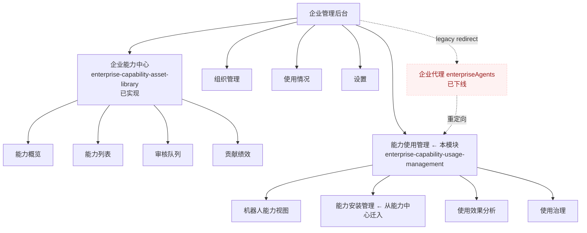
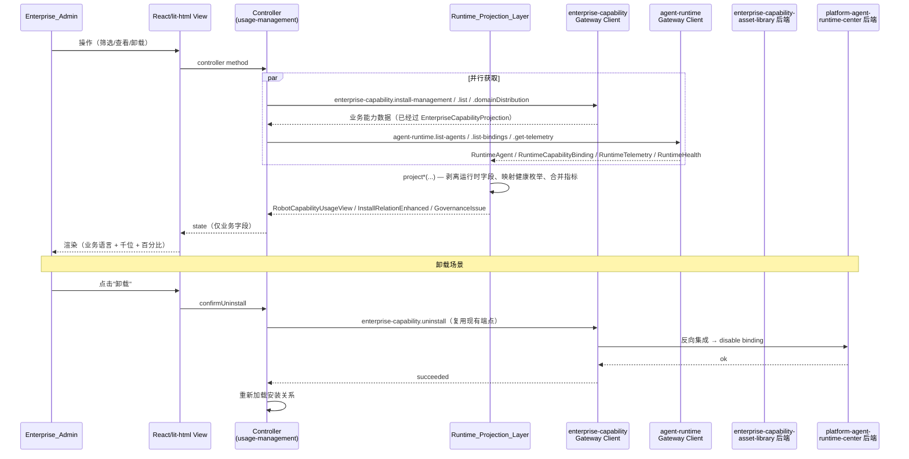
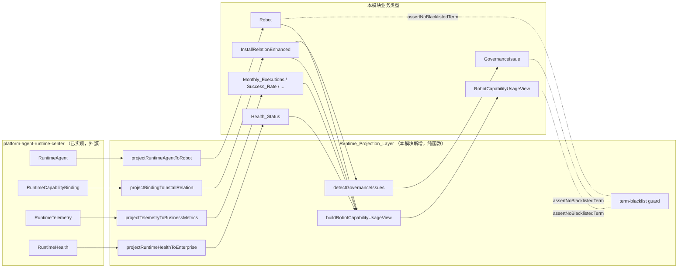

# 技术设计文档：能力使用管理（Enterprise Capability Usage Management）

## Overview

「能力使用管理」是企业端面向 **Enterprise_Admin** 的能力使用治理主入口，对原「企业代理（enterpriseAgents）」模块的**语义重构**：以"机器人（Robot）"和"能力（Capability）"作为企业端唯一的核心对象，用业务语言表达"能力如何被使用"。本模块不引入新的运行时层，也不重复实现能力资产管理或平台代理治理，而是充当**企业端业务可解释表达层**——通过 `Runtime_Projection_Layer` 把 `platform-agent-runtime-center` 暴露的运行时数据投影成业务语言对象后再渲染。

**UI 展示名**：能力使用管理
**内部模块名**：`enterprise-capability-usage-management`
**路由 tab**：`enterpriseUsageManagement`
**路径前缀**：`/enterprise/{tenantId}/usage-management`

**核心架构原则：**

1. **三端语义边界**：员工端讲"机器人"、企业端（本模块）讲"能力使用"、平台端讲"代理（Agent / Runtime）"——本模块严禁出现 Agent / runtime / template / cpu 等运行时术语。
2. **单向投影消费**：`Runtime_Projection_Layer` 从 `platform-agent-runtime-center` 单向消费运行时数据，不直接读写其存储；本模块亦不修改 `enterprise-capability-asset-library` 的资产数据。
3. **资产复用，不另起炉灶**：UI 组件、CSS Token、分页控件、健康徽章、迷你趋势图等全部复用 `enterprise-capability-asset-library` 已落地的实现，仅做参数化扩展，不引入 NestJS / Ant Design / Recharts / PostgreSQL 等新栈。
4. **路由 + 权限 + 文案三同步迁移**：`enterpriseAgents` tab、`/agents/*` 路径、`agent:view` / `agent:create` 权限、相关 i18n key 必须在同一发布周期内迁移到新模块，并提供至少一个发布周期的兼容窗口（`normalizeLegacyTab` + 服务端权限等价处理 + 路由 301）。
5. **构建期术语守卫**：复用 `runtime-canonical/terminology-guard.ts` 的扫描思路，在本模块视图与 i18n key 上加上专属黑名单扫描，CI 失败即阻断合入。

**与三端的关系（必须背诵的边界）：**

| 关系                                           | 本模块的姿态                                                                                                                       |
| ---------------------------------------------- | ---------------------------------------------------------------------------------------------------------------------------------- |
| `platform-agent-runtime-center` 平台端         | 单向消费 RuntimeAgent / RuntimeCapabilityBinding / RuntimeTelemetry / RuntimeHealth；通过反向集成调用 binding 失效逻辑（不直写）   |
| `enterprise-capability-asset-library` 能力中心 | 单向消费能力名称、领域、来源、健康；接管原"能力安装管理"页面（迁出）；不修改资产数据                                               |
| `capability-governance-runtime` 平台治理       | 平台层治理（proposal / promote / revoke / L0–L3）由其负责；本模块「使用治理」仅做企业端业务语言表达，问题对象、检测器、UI 完全独立 |
| `skill-lifecycle-asset-system` 员工端          | 不在员工端暴露入口；卸载发生时通过现有员工通知机制告知                                                                             |

## Architecture

### 模块在企业端的位置



### 数据流（端到端）



### 模块文件布局

```
ui/src/ui/views/enterprise-capability-usage-management/
├── usage-management-page.ts                # 总外框（Tabs + 子路由分发）
├── robot-capability-view-page.ts           # 子页 1：机器人能力视图
├── robot-capability-table.ts               # 主表格（行 / 列 / 排序）
├── robot-detail-panel.ts                   # 机器人详情抽屉/面板
├── install-management-dual-view-page.ts    # 子页 2：能力安装管理双视角
├── install-relation-row.ts                 # 双视角共用的安装关系行
├── usage-analytics-page.ts                 # 子页 3：使用效果分析
├── usage-analytics-kpi-cards.ts            # KPI 卡片（含环比箭头）
├── usage-trend-chart.ts                    # 30/7/90 天趋势图
├── top-capabilities-table.ts               # Top 能力排行
├── usage-governance-page.ts                # 子页 4：使用治理
├── governance-tab-low-efficiency.ts        # 低效能力 Tab
├── governance-tab-zombie.ts                # 未使用能力 Tab
├── governance-tab-conflict.ts              # 冲突能力 Tab
├── governance-threshold-panel.ts           # 阈值配置面板
├── governance-action-dialogs.ts            # 卸载 / 转移 / acknowledge 对话框
├── shared/
│   ├── kpi-card.ts                         # 复用 ValueSummaryCard 风格的薄包装
│   ├── empty-state.ts                      # 业务语言空状态文案
│   ├── filter-bar.ts                       # 复用 asset-filter-bar 的容器组件
│   ├── format.ts                           # 千位分隔 / 百分比 / 空值降级
│   └── styles.css.ts                       # 仅本模块的 Tailwind class 组合
└── __tests__/
    ├── *.test.ts                           # 组件渲染单元测试
    └── visual-regression.browser.test.ts   # 复用现有 VRT 框架

ui/src/ui/ports/enterprise/
├── render-actions.ts                       # 移除 enterpriseAgents 块，新增 usageManagement
├── render-model.ts                         # 同步替换字段
├── view-types.ts                           # surfaceActions 类型替换
└── views/
    ├── enterprise-surfaces.ts              # 删除 renderEnterpriseAgentsSupplyConsole；新增 renderUsageManagementSurface
    └── enterprise-shell.ts                 # 删除 enterpriseAgents 子标题分支；新增 enterpriseUsageManagement 分支

ui/src/ui/capability/runtime-projection/             ← 新建
├── types.ts                                # 业务对象：Robot, CapabilityUsage, HealthStatus, GovernanceIssue ...
├── projection.ts                           # 纯函数投影：runtime → enterprise business types
├── term-blacklist.ts                       # 术语黑名单常量与扫描器
├── governance-detector.ts                  # 低效 / 僵尸 / 冲突检测器（业务语言版）
├── format.ts                               # 业务格式化（千位、百分比、Health 文本）
├── index.ts
└── __tests__/
    ├── projection.property.test.ts
    ├── governance-detector.property.test.ts
    └── term-blacklist.node.test.ts

ui/src/ui/capability/enterprise-capability/
├── endpoints.ts                            # 扩展：新增 enterprise-usage.* 端点常量
├── gateway-client.ts                       # 扩展：listRobotCapabilityViews / installManagement(扩展) / analytics / governance
└── types.ts                                # 扩展：新增 RobotCapabilityUsageView / InstallRelationEnhanced / GovernanceIssue

ui/src/ui/controllers/enterprise-capability-usage-management/   ← 新建
├── robot-capability-view.ts                # 子页 1 controller
├── install-management-dual-view.ts         # 子页 2 controller（含 viewMode 切换）
├── usage-analytics.ts                      # 子页 3 controller
├── usage-governance.ts                     # 子页 4 controller（含阈值配置）
├── permissions.ts                          # canAccessUsageManagement / canManageInstall
├── route-redirect.ts                       # legacy URL → new URL 解析器
├── index.ts
└── __tests__/
    └── *.property.test.ts

scripts/
└── enterprise-usage-terminology-lint.ts    ← 新增构建期术语扫描脚本（CI gate）
```

### Runtime_Projection_Layer 的位置与职责

`Runtime_Projection_Layer` 落在 `ui/src/ui/capability/runtime-projection/`，是平台运行时数据流入企业端的**唯一通道**。它是一组**纯函数**——不持有状态、不发起网络调用、不向运行时层写回数据。

它消费的运行时类型来自 `ui/src/ui/capability/runtime-canonical/types.ts`（已实现）：`RuntimeAgent`、`RuntimeCapabilityBinding`、`RuntimeTelemetry`、`RuntimeHealth`。

它输出的业务类型见本设计文档 [Data Models](#data-models) 章节。



## Components and Interfaces

### 1. Runtime_Projection_Layer（核心）

`ui/src/ui/capability/runtime-projection/projection.ts`：

```typescript
import type {
  RuntimeAgent,
  RuntimeCapabilityBinding,
  RuntimeTelemetry,
  RuntimeHealth,
} from "../runtime-canonical/types.ts";
import type {
  Robot,
  InstallRelationEnhanced,
  HealthStatus,
  RobotCapabilityUsageView,
} from "./types.ts";
import { assertNoBlacklistedTerm } from "./term-blacklist.ts";

/** 健康枚举映射（完备 + 降级，对应 Property 2）。 */
export function projectRuntimeHealthToEnterprise(
  raw: RuntimeHealth | string | null | undefined,
): HealthStatus | "暂无数据" {
  switch (raw) {
    case "healthy":
      return "效果稳定";
    case "degraded":
      return "偶尔不理想";
    case "unhealthy":
      return "建议优化";
    case "unavailable":
      return "已停用";
    default:
      return "暂无数据"; // 未知 / undefined / null 全部降级
  }
}

/** RuntimeAgent → Robot：仅保留业务字段。 */
export function projectRuntimeAgentToRobot(agent: RuntimeAgent): Robot {
  return {
    robotId: agent.runtimeAgentId, // id 字段类型一致（需求 9.7）
    robotName: agent.name,
    healthStatus: projectRuntimeHealthToEnterprise(agent.health),
    lastActiveAt: agent.lastActiveAt,
  };
}

/** RuntimeCapabilityBinding → InstallRelationEnhanced。 */
export function projectBindingToInstallRelation(
  binding: RuntimeCapabilityBinding,
  ctx: ProjectionContext,
): InstallRelationEnhanced {
  // 来源：bindingType ∈ { tenant-installed, platform-default } → "员工沉淀" / "企业发布"
  // 状态：bindingState + healthStatus → "正常" / "待优化"
  // ...
}

/** 主聚合函数：把（RuntimeAgent + bindings + telemetry + health）合成一行业务视图。 */
export function buildRobotCapabilityUsageView(input: {
  agent: RuntimeAgent;
  bindings: readonly RuntimeCapabilityBinding[];
  telemetry: readonly RuntimeTelemetry[];
  capabilityNames: ReadonlyMap<string, string>; // 来自 enterprise-capability-asset-library
  monthlyEmployeeCoverage: ReadonlyMap<string, number>;
}): RobotCapabilityUsageView;

/** 业务指标投影：成功率（百分比 0–1）、本月调用量、覆盖员工数。 */
export function projectTelemetryToBusinessMetrics(telemetry: readonly RuntimeTelemetry[]): {
  monthlyExecutions: number;
  successRate: number;
};

/** 安全网：在生产构建中，所有渲染前必须经过的最后一道扫描。 */
export function assertViewIsBusinessClean(view: RobotCapabilityUsageView): void;
```

**关键约束（落实 Property 1 + Property 3）：**

- 投影函数的输入类型只接受 `Runtime*` 类型；输出类型只产出业务类型。
- 输出类型 **TS 编译期** 上不存在 `runtimeVersion` / `cpu` / `memory` / `nodeId` / `templateId` / `provider` / `modelRouting` / `workflowJson` / `toolchain` 字段——通过 nominal/branded 类型 + `Omit<>` 强制。
- 任何 `string` 字段（`robotName`、`description` 等）在生产构建中必须经过 `assertNoBlacklistedTerm()` 扫描；命中黑名单时降级为"暂无数据"，并记 warn 日志。

### 2. Term_Blacklist 扫描器

`ui/src/ui/capability/runtime-projection/term-blacklist.ts`：

```typescript
/** 企业端禁止出现的运行时与平台术语集合（不区分大小写）。 */
export const TERM_BLACKLIST = [
  "runtime",
  "agent",
  "template",
  "cpu",
  "memory",
  "node",
  "presence",
  "qps",
  "tps",
  "latency",
  "p95",
  "p99",
  "provider",
  "model routing",
  "workflow json",
  "toolchain",
] as const;

const BLACKLIST_PATTERN = new RegExp(`\\b(${TERM_BLACKLIST.map(escapeRegExp).join("|")})\\b`, "i");

/** 扫描任意字符串。命中返回首个命中项，未命中返回 null。 */
export function scanText(text: string): string | null;

/** 扫描 DOM 子树（用于运行期属性测试）。 */
export function scanNode(root: Node): string | null;

/** 在投影边界使用：命中即抛出（开发模式）/ 降级（生产模式）。 */
export function assertNoBlacklistedTerm(
  text: string,
  opts: { mode: "throw" | "downgrade" },
): string;
```

**构建期 lint：**

`scripts/enterprise-usage-terminology-lint.ts`（新增 CI 步骤）：

1. 扫描 `ui/src/ui/views/enterprise-capability-usage-management/**/*.{ts,tsx}` 的字符串字面量。
2. 扫描 `ui/src/i18n/locales/*.ts` 中所有以 `enterpriseUsage.*` / `enterprise-usage-*` / `tabs.enterpriseUsageManagement` / `subtitles.enterpriseUsageManagement` / `nav.items.enterpriseUsageManagement` 等本模块前缀开头的 i18n key 的值。
3. 命中黑名单 → `process.exit(1)`；CI 在 `pnpm check` 之后串行执行该脚本。
4. 与 `scripts/employee-capability-terminology-lint.ts` 模式一致，复用相同的命令行接口与异常退出码。

### 3. Routing & Navigation 修改

`ui/src/ui/navigation.ts` 的所有改动集中在以下点：

```typescript
// 1) 新增 tab 名常量
export const ENTERPRISE_SURFACE_TABS = [
  "enterpriseOverview",
  "enterpriseOrganization",
  "enterpriseUsageManagement", // ← 新增（替代 enterpriseAgents 的导航位）
  "enterpriseCapabilityCenter",
  "enterpriseMesh",
  "enterpriseUsage",
  "enterpriseSettings",
] as const;

// 2) 兼容窗口期：保留 enterpriseAgents 在 Tab 联合类型中（标记 LEGACY）
type Tab =
  | /* ... */
  | "enterpriseUsageManagement"
  | /* legacy, kept for ≥ 1 release: */ "enterpriseAgents"
  | /* ... */;

// 3) buildEnterpriseTabPath 添加 enterpriseUsageManagement 分支
case "enterpriseUsageManagement":
  return tenantId
    ? `${ENTERPRISE_ROOT_PATH}/${enc(tenantId)}/usage-management/robots`
    : `${ENTERPRISE_ROOT_PATH}/usage-management`;

// 4) 子路由（在 appendContextToTabPath 中支持）
const USAGE_MANAGEMENT_SUB_ROUTES = ["robots", "installs", "analytics", "governance"] as const;
type UsageManagementSubRoute = (typeof USAGE_MANAGEMENT_SUB_ROUTES)[number];

// 5) Legacy redirect map（落实 Requirement 1.5 + Property 7）
const LEGACY_AGENTS_REDIRECTS: ReadonlyArray<{
  pattern: RegExp;
  target: (m: RegExpMatchArray) => string;
}> = [
  { pattern: /^\/enterprise\/([^/]+)\/agents\/templates\/?$/, target: (m) =>
      `/enterprise/${m[1]}/usage-management/installs` },
  { pattern: /^\/enterprise\/([^/]+)\/agents(?:\/.*)?$/, target: (m) =>
      `/enterprise/${m[1]}/usage-management/robots` },
  { pattern: /^\/enterprise\/agents\/?$/, target: () => `/enterprise/usage-management` },
];

// 6) 兼容垫片：normalizeLegacyTab 把 enterpriseAgents 规范化为 enterpriseUsageManagement
export function normalizeLegacyTab(tab: Tab): Tab {
  if (tab === "enterpriseAgents") return "enterpriseUsageManagement";
  return tab;
}
```

**`/enterprise/{tenantId}/usage-management` 默认子页落点（Property 10）：**

入口分发器解析到该路径（无子路径）时，**单跳**重定向至 `/enterprise/{tenantId}/usage-management/robots`；解析到任意 `/usage-management/{robots|installs|analytics|governance}` 时，原样返回（不再重定向）。重定向解析器幂等：将解析后路径再次喂入解析器返回相同结果。

### 4. 权限模型迁移

`ui/src/ui/ports/enterprise/views/enterprise-surfaces.ts` 中的 `ACCESS_PERMISSION_CATALOG` 与 `ACCESS_ROLE_PERMISSIONS` 修改：

```typescript
// 之前
{ id: "agent:view",   module: "企业代理", label: "查看代理" }
{ id: "agent:create", module: "企业代理", label: "创建代理" }

// 之后
{ id: "usage:view",            module: "能力使用管理", label: "查看能力使用",       highRisk: false }
{ id: "usage:install-manage",  module: "能力使用管理", label: "管理能力安装",       highRisk: false }
{ id: "usage:governance",      module: "能力使用管理", label: "处理使用治理问题",   highRisk: false }

// 角色映射
ACCESS_ROLE_PERMISSIONS = {
  viewer:   ["member:view", "usage:view", "mesh:view"],
  operator: ["member:view", "member:edit", "usage:view", "usage:install-manage", "mesh:view"],
  admin:    ACCESS_PERMISSION_CATALOG.map(e => e.id),
};
```

**兼容窗口（Requirement 2.8 + Property 9）：**

`ui/src/ui/controllers/enterprise-capability-usage-management/permissions.ts`：

```typescript
const LEGACY_PERMISSION_EQUIVALENCE: Record<string, string> = {
  "agent:view": "usage:view",
  "agent:create": "usage:install-manage",
};

export function canAccessUsageManagement(user: { permissions: readonly string[] }): boolean {
  return user.permissions.some(
    (p) => p === "usage:view" || LEGACY_PERMISSION_EQUIVALENCE[p] === "usage:view",
  );
}

export function canManageInstall(user: { permissions: readonly string[] }): boolean {
  return user.permissions.some(
    (p) =>
      p === "usage:install-manage" || LEGACY_PERMISSION_EQUIVALENCE[p] === "usage:install-manage",
  );
}

export function canHandleGovernance(user: { permissions: readonly string[] }): boolean {
  return user.permissions.includes("usage:governance");
}
```

兼容映射保留至少 1 个发布周期；UI 端 `ACCESS_PERMISSION_CATALOG` 不再展示 `agent:view / agent:create`，但服务端校验仍然识别并按等价处理。

### 5. 子页 1：机器人能力视图（Robot_Capability_View）

**路径**：`/enterprise/{tenantId}/usage-management/robots`（默认子页）
**主要文件**：`views/enterprise-capability-usage-management/robot-capability-view-page.ts`、`robot-capability-table.ts`、`robot-detail-panel.ts`
**Controller**：`controllers/enterprise-capability-usage-management/robot-capability-view.ts`

| 区域     | 职责                                                                                        | 复用                                                                                                                            |
| -------- | ------------------------------------------------------------------------------------------- | ------------------------------------------------------------------------------------------------------------------------------- |
| KPI 卡片 | 机器人总数、本月总调用量、覆盖员工总数、平均成功率（4 个）                                  | `views/enterprise-asset-library/value-summary-card.ts` 的样式 + 新薄包装 `shared/kpi-card.ts`                                   |
| 筛选栏   | 名称关键词、健康状态下拉、调用量区间                                                        | 复用 `views/enterprise-asset-library/asset-filter-bar.ts` 的容器与下拉控件                                                      |
| 主表格   | 机器人名称 / 已安装能力数 / 本月调用量 / 覆盖员工数 / 成功率 / 健康状态 / Top 3 能力 / 操作 | 表格行布局沿用 `asset-table.ts` 的 grid + `enterprise-foundation.css` 的 token；`HealthBadge` 直接复用并限制只渲染本模块 4 文本 |
| 分页     | 10 / 20 / 50 切换                                                                           | `views/enterprise-asset-library/pagination.ts`                                                                                  |
| 详情面板 | 基础信息、能力列表、近 30 天调用趋势                                                        | `views/enterprise-asset-library/mini-trend-chart.ts`                                                                            |

**Controller state 形态（与 `controllers/enterprise-asset-library/asset-list.ts` 同构）：**

```typescript
export type RobotCapabilityViewState = {
  gateway: EnterpriseCapabilityGateway | null;
  loading: boolean;
  error: string | null;
  items: RobotCapabilityUsageView[];
  pagination: PaginationState;
  filters: {
    nameQuery: string;
    healthStatus: HealthStatus | null;
    monthlyExecutionsRange: "全部" | "<100" | "100-1000" | ">1000";
  };
  sorting: {
    field: "monthlyExecutions" | "capabilityCount" | "employeeCoverage" | "successRate";
    direction: "asc" | "desc";
  };
  detail: { open: boolean; robotId: string | null; data: RobotDetail | null; loading: boolean };
};
```

**详情面板禁止字段（Requirement 4.8）**：runtime version、CPU、内存、节点 ID、Agent ID、template ID、provider、model routing。在 TS 类型层面 `RobotDetail` 不存在这些字段；术语黑名单扫描覆盖最终渲染输出。

### 6. 子页 2：能力安装管理双视角（Install_Management_Dual_View）

**路径**：`/enterprise/{tenantId}/usage-management/installs?view={robot|capability}`
**Controller**：`controllers/enterprise-capability-usage-management/install-management-dual-view.ts`

> 该页面**接管**原 `enterprise-capability-asset-library` 的「能力安装管理」入口（Requirement 3）。后端复用现有 `enterprise-capability.install-management` RPC 与 `install-management.ts` controller 数据获取逻辑——本模块仅在视图层扩展为双视角，不重复实现存取。

```typescript
export type InstallManagementDualViewState = {
  gateway: EnterpriseCapabilityGateway | null;
  loading: boolean;
  error: string | null;
  /** 数据集：在视角切换时**保持不变**，仅展示分组维度变化（Property 5）。 */
  items: InstallRelationEnhanced[];
  pagination: PaginationState;
  filters: SharedFilters; // 两个 Tab 共享
  /** 视角通过 URL 查询参数 ?view= 持久化。 */
  viewMode: "byRobot" | "byCapability";
  summary: { totalRelations: number; coveredRobots: number; coveredCapabilities: number };
  pendingUninstallId: string | null;
  uninstalling: boolean;
  uninstallError: string | null;
};
```

**视角切换的渲染策略（落实 Property 5）：**

- `groupByRobot(items)` 与 `groupByCapability(items)` 都是 `InstallRelationEnhanced[] -> Map<string, InstallRelationEnhanced[]>` 的纯函数。
- 两个分组函数对同一 `items` 输入返回**等价**的 `(capabilityId × robotId)` 关系对集合（属性测试在 PBT 中验证）。
- 切 Tab 不重新拉数据；仅切换 controller 的 `viewMode`，由视图重新分组渲染。

**禁止字段（Requirement 5.10）**：`runtime binding ID`、`binding type`、`load strategy`、`routing priority` 在 `InstallRelationEnhanced` 类型中**不存在**——投影时已剥离。

### 7. 子页 3：使用效果分析（Usage_Analytics）

**路径**：`/enterprise/{tenantId}/usage-management/analytics`

| 区域       | 内容                                                               | 复用                                                                                       |
| ---------- | ------------------------------------------------------------------ | ------------------------------------------------------------------------------------------ |
| KPI 卡片   | 本月总调用量、覆盖机器人数、覆盖员工数、平均成功率（4 个，含环比） | `kpi-card.ts` + `value-summary-card.ts`                                                    |
| 30 天趋势  | 调用量按日折线，时间窗口可切 7 / 30 / 90 天                        | `mini-trend-chart.ts` 升级为标准 `usage-trend-chart.ts`（仅扩展尺寸 / 时间窗口切换 props） |
| 复用增长   | 当日累计被安装到不同机器人的能力数                                 | 同上                                                                                       |
| Top 排行   | 能力名称 / 本月调用量 / 成功率 / 覆盖机器人数（最多 Top 20）       | 仍是表格组件，复用 `asset-table.ts` 的 grid                                                |
| 跨模块跳转 | Top 行点击 → `/enterprise/{tenantId}/capabilities/{capabilityId}`  | 直接调用 `pathForTab("enterpriseCapabilityCenter", ...)`                                   |

**禁止指标（Requirement 6.9）**：QPS / p95 latency / error rate / token consumption / CPU / memory。投影层不产出这些字段；构建期 lint 守门。

### 8. 子页 4：使用治理（Usage_Governance）

**路径**：`/enterprise/{tenantId}/usage-management/governance`
**核心模块**：`capability/runtime-projection/governance-detector.ts`

```typescript
export type GovernanceConfig = {
  lowEfficiency: { minExecutions: number; maxSuccessRate: number }; // 默认 50, 0.7
  zombie: { minInstallDays: number }; // 默认 30
  conflict: { minSimilarity: number }; // 默认 0.8
};

export const DEFAULT_GOVERNANCE_CONFIG: GovernanceConfig;

/** 纯函数：相同输入恒定返回相同输出（Property 6）。 */
export function detectGovernanceIssues(
  relations: readonly InstallRelationEnhanced[],
  capabilities: ReadonlyArray<{
    capabilityId: string;
    domain: string;
    description: string;
  }>,
  config: GovernanceConfig = DEFAULT_GOVERNANCE_CONFIG,
  now: number,
): GovernanceIssue[];
```

**边界规则（落实 Property 6）：**

- **低效能力**：`executions30d > config.lowEfficiency.minExecutions && successRate < config.lowEfficiency.maxSuccessRate` —— 严格小于，等于阈值不上榜。等于 50 调用 + 70% 成功率 → **不触发**。
- **僵尸能力**：`executions30d === 0 && installDays > config.zombie.minInstallDays` —— 严格大于。
- **冲突能力**：同一 `robotId` 下 `domain` 相同 + 描述余弦相似度 `>= config.conflict.minSimilarity`。

**与平台治理的边界（Requirement 7.9）**：本模块**不**展示 `runtime overcommit` / `orphaned agent` / `version drift` / `fallback chain broken`——这些归 `platform-agent-runtime-center` 的 Governance & Policy 标签页。本模块跳转入口标签为"前往平台代理资产治理中心查看技术详情"。

**Acknowledge 行为**：`acknowledgedIssues: Set<string>` 仅存在于 controller 内存中，**不持久化**——下次进入页面重新计算（Requirement 7.8）。

### 9. RPC 端点契约

#### 9.1 复用既有 `enterprise-capability.*` 端点（不修改契约）

| 端点                                        | 用途                                       | 来源                                        |
| ------------------------------------------- | ------------------------------------------ | ------------------------------------------- |
| `enterprise-capability.list`                | 子页 3 的 Top 能力数据来源（按调用量排序） | 已存在；本模块仅消费                        |
| `enterprise-capability.detail`              | 跨页跳转能力详情（不在本模块内嵌）         | 已存在；本模块仅作链接目标                  |
| `enterprise-capability.install-management`  | 子页 2 安装关系列表                        | 已存在；扩展返回字段（详见 9.2）            |
| `enterprise-capability.uninstall`           | 子页 2 / 子页 4 卸载操作                   | **直接复用**（Requirement 5.8 / 7.7 / 9.3） |
| `enterprise-capability.domain-distribution` | 跨页跳转能力中心                           | 已存在                                      |

`enterprise-capability.install-management` 响应需扩展（向后兼容）：

```typescript
// 之前
type InstallRelation = {
  id: string;
  capabilityId: string;
  capabilityName: string;
  robotId: string;
  robotName: string;
  installedAt: number;
  source: "管理员推送" | "员工自主安装";
  status: "正常运行" | "已暂停" | "待更新";
};

// 之后（追加可选字段，落实子页 2 的"双视角增强"）
type InstallRelationEnhanced = InstallRelation & {
  /** 业务来源（投影自 BindingType；旧字段 source 仅做向后兼容）。 */
  businessSource: "员工沉淀" | "企业发布";
  /** 30 日调用统计（投影自 BindingInvocationMetrics）。 */
  usageStats: { executions30d: number; successRate: number };
  /** 业务状态（投影自 BindingState + RuntimeHealth）。 */
  status: "正常" | "待优化" | "已停用";
};
```

#### 9.2 新增 `enterprise-usage.*` 端点

```typescript
export const ENTERPRISE_USAGE_ENDPOINTS = {
  listRobotCapabilityViews: "enterprise-usage.list-robot-capability-views",
  getRobotDetail: "enterprise-usage.get-robot-detail",
  getAnalytics: "enterprise-usage.get-analytics",
  detectGovernance: "enterprise-usage.detect-governance",
  acknowledgeGovernance: "enterprise-usage.acknowledge-governance",
  updateGovernanceConfig: "enterprise-usage.update-governance-config",
} as const;

// listRobotCapabilityViews —— 子页 1 主表格
type ListRobotCapabilityViewsRequest = {
  filters: { nameQuery: string; healthStatus: HealthStatus | null; monthlyExecutionsRange: string };
  sorting: { field: string; direction: "asc" | "desc" };
  pagination: PaginationInput;
};
type ListRobotCapabilityViewsResponse = {
  items: RobotCapabilityUsageView[];
  pagination: PaginationState;
  kpis: {
    totalRobots: number;
    totalMonthlyExecutions: number;
    totalEmployeeCoverage: number;
    averageSuccessRate: number;
  };
};

// getRobotDetail —— 子页 1 详情面板
type GetRobotDetailRequest = { robotId: string };
type GetRobotDetailResponse = {
  basic: { robotId: string; robotName: string; healthStatus: HealthStatus; lastActiveAt: number };
  capabilities: Array<{
    capabilityId: string;
    capabilityName: string;
    monthlyExecutions: number;
    successRate: number;
  }>;
  trend30d: { dailyExecutions: number[]; dates: string[] };
  topCapabilities: string[];
};

// getAnalytics —— 子页 3
type GetAnalyticsRequest = { window: 7 | 30 | 90 };
type GetAnalyticsResponse = {
  kpis: {
    /* 4 项 + 各自环比 */
  };
  trendExecutions: { dates: string[]; values: number[] };
  trendCapabilityReuse: { dates: string[]; values: number[] };
  topCapabilities: Array<{
    capabilityId: string;
    capabilityName: string;
    monthlyExecutions: number;
    successRate: number;
    coveredRobots: number;
  }>;
};

// detectGovernance —— 子页 4
type DetectGovernanceRequest = { config: GovernanceConfig };
type DetectGovernanceResponse = {
  lowEfficiency: GovernanceIssue[];
  zombie: GovernanceIssue[];
  conflict: GovernanceIssue[];
};

// acknowledgeGovernance —— 子页 4 acknowledge（仅在会话内有效，不持久化）
type AcknowledgeGovernanceRequest = { issueId: string };
type AcknowledgeGovernanceResponse = { acknowledged: true };

// updateGovernanceConfig —— 子页 4 阈值面板
type UpdateGovernanceConfigRequest = { config: Partial<GovernanceConfig> };
type UpdateGovernanceConfigResponse = { config: GovernanceConfig };
```

> 后端实现层面，`enterprise-usage.*` 在 mock-backend 中通过组合调用 `agent-runtime.*`（拿运行时数据） + `enterprise-capability.*`（拿能力名称、领域、来源），再经 `Runtime_Projection_Layer` 投影后返回。本设计不规定后端持久化方案——继续沿用 `~/.openclaw` JSON 文件，由 mock-backend 与未来真实后端各自实现。

#### 9.3 Gateway Client 扩展

`ui/src/ui/capability/enterprise-capability/gateway-client.ts` 在原 `createEnterpriseCapabilityGateway()` 之上新增配套函数：

```typescript
export function createEnterpriseUsageGateway(client: GatewayBrowserClient) {
  return {
    listRobotCapabilityViews(req): Promise<ListRobotCapabilityViewsResponse> { ... },
    getRobotDetail(req): Promise<GetRobotDetailResponse> { ... },
    getAnalytics(req): Promise<GetAnalyticsResponse> { ... },
    detectGovernance(req): Promise<DetectGovernanceResponse> { ... },
    acknowledgeGovernance(req): Promise<AcknowledgeGovernanceResponse> { ... },
    updateGovernanceConfig(req): Promise<UpdateGovernanceConfigResponse> { ... },
  };
}

export type EnterpriseUsageGateway = ReturnType<typeof createEnterpriseUsageGateway>;
```

### 10. 旧模块下线（Migration & Cleanup）

旧「企业代理」模块的所有代码痕迹必须在同一发布周期内清理（Requirement 13）：

| 项目                                                                                                                                                                                       | 操作                                                                           | 兼容窗口          |
| ------------------------------------------------------------------------------------------------------------------------------------------------------------------------------------------ | ------------------------------------------------------------------------------ | ----------------- |
| `enterpriseAgents` 在 `ENTERPRISE_SURFACE_TABS` 中的位置                                                                                                                                   | 替换为 `enterpriseUsageManagement`                                             | —                 |
| `enterpriseAgents` 在 `Tab` 类型联合中的位置                                                                                                                                               | 保留并标注 `@deprecated`                                                       | ≥ 1 个发布周期    |
| `buildEnterpriseTabPath` 的 `enterpriseAgents` 分支                                                                                                                                        | 保留但内部映射到 `/usage-management/robots`                                    | ≥ 1 个发布周期    |
| `LEGACY_AGENTS_REDIRECTS` 的解析层                                                                                                                                                         | 新增（路由解析阶段把 `/agents/*` → `/usage-management/...`）                   | 永久              |
| `pathForTab("enterpriseAgents", ...)` 调用点                                                                                                                                               | 批量替换为 `pathForTab("enterpriseUsageManagement", ...)` 并指向 `robots` 子页 | 立即（一次性 PR） |
| `renderEnterpriseAgentsSupplyConsole` 函数及引用                                                                                                                                           | 删除                                                                           | 立即              |
| `enterprise-shell.ts` 中 `enterpriseAgents` 子标题分支                                                                                                                                     | 替换为 `enterpriseUsageManagement` 分支（4 个子页对应 4 组标题/副标题）        | 立即              |
| `render-actions.ts` 中 `enterpriseAgents` 块                                                                                                                                               | 替换为 `usageManagement` 块（onRefresh / onUninstall / onAcknowledge ...）     | 立即              |
| `render-model.ts` / `view-types.ts` 中字段引用                                                                                                                                             | 同步替换                                                                       | 立即              |
| `enterprise-surfaces.browser.test.ts`、`port-shells.browser.test.ts` 中的 `enterpriseAgents` fixture                                                                                       | 替换为 `enterpriseUsageManagement` 等价 fixture                                | 立即              |
| i18n key：`tabs.enterpriseAgents` / `subtitles.enterpriseAgents` / `nav.items.enterpriseAgents`                                                                                            | 兼容窗口期内保留；窗口期结束后删除                                             | ≥ 1 个发布周期    |
| 新增 i18n key：`tabs.enterpriseUsageManagement` / `subtitles.enterpriseUsageManagement` / `nav.items.enterpriseUsageManagement` / `enterpriseUsage.{robots,installs,analytics,governance}` | 立即添加                                                                       | —                 |
| 权限项 `agent:view` / `agent:create`                                                                                                                                                       | UI 端从 `ACCESS_PERMISSION_CATALOG` 移除；服务端等价处理                       | ≥ 1 个发布周期    |
| `Quick_Entry_Sidebar` 中"能力安装管理"                                                                                                                                                     | 移除（Requirement 3.4）                                                        | 立即              |
| 「企业能力中心」头部"能力安装管理"按钮                                                                                                                                                     | 重定向至 `/usage-management/installs`（保留按钮兼容外链）                      | ≥ 1 个发布周期    |
| `/enterprise/{tenantId}/capabilities/install-management` 路径                                                                                                                              | 路由解析层 301 至 `/enterprise/{tenantId}/usage-management/installs`           | 永久              |

### 11. UI 与样式约束

- 技术栈：React + TypeScript + Tailwind CSS + lit-html（与 `enterprise-capability-asset-library` 完全一致；不引入 Ant Design / Recharts / NestJS）。
- 主题：白色背景 + 蓝色主色调；复用 `enterprise-foundation.css` 与 `enterprise-components.css` 的 CSS Token。
- 子页结构：`[Page Header] / [KPI 区]?` / `[筛选区]?` / `[主内容区]` / `[Pagination]?`，与「企业能力中心」一致。
- 响应式：≥ 1280 px 完整列；< 1280 px 表格水平滚动；交互最小点击区 32 × 32 px；徽章除颜色外提供文字。

## Data Models

### 业务核心类型（`runtime-projection/types.ts` 新增）

```typescript
/** 健康状态——企业端唯一允许的 4 个文本（外加渲染期降级值"暂无数据"）。 */
export type HealthStatus = "效果稳定" | "偶尔不理想" | "建议优化" | "已停用";
export const HEALTH_STATUSES: readonly HealthStatus[] = [
  "效果稳定",
  "偶尔不理想",
  "建议优化",
  "已停用",
] as const;

/** 机器人——企业端业务对象。`robotId` 与 `RuntimeAgent.runtimeAgentId` 同值不同名。 */
export type Robot = {
  robotId: string;
  robotName: string;
  healthStatus: HealthStatus | "暂无数据";
  lastActiveAt: number;
};

/** 安装关系（增强）——双视角共用的数据结构。 */
export type InstallRelationEnhanced = {
  id: string; // 等价于 binding.bindingId（不暴露）
  capabilityId: string;
  capabilityName: string;
  robotId: string;
  robotName: string;
  installedAt: number;
  source: "员工沉淀" | "企业发布";
  usageStats: { executions30d: number; successRate: number /* 0-1 */ };
  status: "正常" | "待优化" | "已停用";
};

/** 子页 1 主表格行。 */
export type RobotCapabilityUsageView = {
  robotId: string;
  robotName: string;
  capabilityCount: number; // 已安装能力数（去重，且 status ∈ {正常, 待优化}）
  monthlyExecutions: number; // 本月调用量
  employeeCoverage: number; // 覆盖员工数（30 天去重）
  successRate: number; // 0-1
  healthStatus: HealthStatus | "暂无数据";
  topCapabilities: string[]; // Top 3 能力名称
};

/** 治理问题——三类问题的统一对象。 */
export type GovernanceIssue = {
  issueId: string; // 由 (type + capabilityId + robotId) 派生（确定性）
  type: "低效能力" | "未使用能力" | "冲突能力";
  capabilityId: string;
  robotId: string;
  description: string; // 业务语言；产生前经过术语扫描
  suggestion: "卸载" | "重新整理能力" | "转移到其他机器人";
  evidence: {
    // 证据数据（数值，非业务语言风险）
    executions30d?: number;
    successRate?: number;
    installDays?: number;
    similarity?: number;
    conflictWith?: string[];
  };
  detectedAt: number;
};
```

### 投影层禁止字段（编译期 + 运行期双重保证）

`InstallRelationEnhanced` / `Robot` / `RobotCapabilityUsageView` / `GovernanceIssue` 的 TypeScript 类型**不存在**以下字段（Property 3 落实点）：

```
runtimeAgentId  runtimeVersion  resourceUsage
bindingId  bindingType  bindingState  loadStrategy  routingPriority
fallbackBindingId  policy  hotReloadable
cpu  memory  nodeId  presence
templateId  provider  modelRouting  workflowJson  toolchain
qps  tps  latency  p95  p99
```

`Runtime_Projection_Layer` 的实现以 `Pick<>`/`Omit<>` 显式构造输出对象（不使用 `...spread`），从根上避免新字段被无意带入。

### 与平台运行时类型的映射表

| 业务对象 / 字段                              | 平台来源                                                          | 投影函数                                                                           |
| -------------------------------------------- | ----------------------------------------------------------------- | ---------------------------------------------------------------------------------- |
| `Robot.robotId`                              | `RuntimeAgent.runtimeAgentId`                                     | `projectRuntimeAgentToRobot`                                                       |
| `Robot.robotName`                            | `RuntimeAgent.name`                                               | 同上                                                                               |
| `Robot.healthStatus`                         | `RuntimeAgent.health`                                             | `projectRuntimeHealthToEnterprise`                                                 |
| `InstallRelationEnhanced.id`                 | `RuntimeCapabilityBinding.bindingId`（不展示）                    | `projectBindingToInstallRelation`                                                  |
| `InstallRelationEnhanced.source`             | `RuntimeCapabilityBinding.bindingType`                            | `tenant-installed → 员工沉淀`、`platform-default → 企业发布`                       |
| `InstallRelationEnhanced.status`             | `RuntimeCapabilityBinding.bindingState` + `healthStatus`          | `active+healthy/degraded → 正常`、`active+unhealthy → 待优化`、`disabled → 已停用` |
| `InstallRelationEnhanced.usageStats`         | `RuntimeCapabilityBinding.invocationMetrics` / `RuntimeTelemetry` | `projectTelemetryToBusinessMetrics`                                                |
| `RobotCapabilityUsageView.monthlyExecutions` | 多个 `RuntimeTelemetry.calls7d` 聚合                              | `aggregateMonthlyExecutions`                                                       |
| `RobotCapabilityUsageView.successRate`       | `RuntimeTelemetry.successRate7d` 加权                             | 同上                                                                               |
| `RobotCapabilityUsageView.employeeCoverage`  | `enterprise-capability.install-management` 派生统计               | 不来自 runtime（来自能力中心数据）                                                 |

## Correctness Properties

_A property is a characteristic or behavior that should hold true across all valid executions of a system—essentially, a formal statement about what the system should do. Properties serve as the bridge between human-readable specifications and machine-verifiable correctness guarantees._

属性测试范围严格遵循 requirements.md 的边界：术语黑名单守卫、投影正确性、安装数不变量、双视角一致性、治理检测器边界、路由幂等、格式化、权限兼容、默认子页落点。**展示逻辑**（千位、百分比、空状态文案）使用单元/快照测试。

### Property 1: 术语黑名单守卫（核心架构红线）

_For any_ rendered output produced by any view component under `ui/src/ui/views/enterprise-capability-usage-management/**`—including KPI cards, table cells, badges, tooltips, error messages, dialogs, empty-state placeholders, chart legends—the rendered text content SHALL NOT contain any token from the runtime/platform term blacklist (case-insensitive): `runtime`, `agent`, `template`, `cpu`, `memory`, `node`, `presence`, `qps`, `tps`, `latency`, `p95`, `p99`, `provider`, `model routing`, `workflow json`, `toolchain`. This must hold for arbitrary input data including malformed payloads (where the projection layer must downgrade to "暂无数据").

**Validates: Requirements 8.1, 8.5, 8.6**

### Property 2: Runtime_Projection_Layer 健康状态映射完备性

_For any_ `RuntimeHealth` enum value from `platform-agent-runtime-center` (`healthy`, `degraded`, `unhealthy`, `unavailable`), the projection function `projectRuntimeHealthToEnterprise` SHALL return exactly one value from `{ "效果稳定", "偶尔不理想", "建议优化", "已停用" }`. For any unknown / undefined / null input, it SHALL return the special placeholder `"暂无数据"` (which is itself not a valid `HealthStatus` enum value but a render-only fallback).

**Validates: Requirements 8.2, 8.5, 10.5**

### Property 3: Runtime_Projection_Layer 字段纯净性

_For any_ raw `RuntimeAgent` / `RuntimeCapabilityBinding` / `RuntimeTelemetry` object from `platform-agent-runtime-center`—including objects with arbitrary nested runtime fields such as `cpu`, `memory`, `nodeId`, `runtimeVersion`, `templateId`, `provider`, `modelRouting`, `workflowJson`, `toolchain`—the output of `buildRobotCapabilityUsageView()` and `projectBindingToInstallRelation()` SHALL have an empty intersection between its field set and the runtime field blacklist at any depth. This must hold for inputs with all runtime fields, partial runtime fields, no runtime fields, and runtime fields nested within sub-objects.

**Validates: Requirements 8.1, 8.2, 9.1**

### Property 4: 已安装能力数 = 去重活跃能力关系数

_For any_ `robotId` and the corresponding set of `InstallRelationEnhanced` records, the displayed `Installed_Capability_Count` for that robot SHALL equal the count of distinct `capabilityId` values where `status ∈ {"正常", "待优化"}` (excluding `"已停用"`). Adding a duplicate relation (same `capabilityId`) SHALL NOT increase the count.

**Validates: Requirements 4.4, 5.5, 5.6**

### Property 5: 双视角数据一致性

_For any_ active filter set in `Install_Management_Dual_View`, the union of `(capabilityId, robotId)` pairs displayed under Tab `按机器人` SHALL be set-equal to the union of `(capabilityId, robotId)` pairs displayed under Tab `按能力`. Switching tabs SHALL preserve filters and SHALL NOT trigger a new data fetch; only the grouping dimension changes.

**Validates: Requirements 5.5, 5.7**

### Property 6: 治理检测器幂等性与边界

_For any_ stable input set of `InstallRelationEnhanced` records and configured thresholds, calling `detectGovernanceIssues()` twice in succession SHALL return the same set of `GovernanceIssue` records (deterministic, including stable `issueId`). Furthermore: a relation with values exactly at the threshold (e.g., `executions30d === 50` and `successRate === 0.70` for low-efficiency) SHALL NOT be flagged (boundaries are exclusive on the failure side); a relation strictly inside the failure region SHALL be flagged.

**Validates: Requirements 7.3, 7.4, 7.5, 7.6**

### Property 7: 路由重定向幂等

_For any_ legacy URL matching `/enterprise/{tenantId}/agents/*` pattern, applying the redirect resolver once SHALL produce a target URL under `/enterprise/{tenantId}/usage-management/*`. Applying the redirect resolver to that target URL SHALL be a no-op (idempotent). The resolver SHALL NOT loop nor produce a chain of redirects longer than one hop.

**Validates: Requirements 1.5, 3.5**

### Property 8: 成功率与调用量格式化

_For any_ numeric `successRate` ∈ [0, 1] and `monthlyExecutions` ∈ ℕ, the formatted display string for `successRate` SHALL match the regex `^\d{1,3}\.\d%$` (one decimal place, ending with `%`), and for `monthlyExecutions` SHALL match the regex `^[\d,]+$` (comma-separated integer with no decimal). For input outside the valid domain (negative, NaN, undefined), the formatter SHALL return `"暂无数据"`.

**Validates: Requirements 8.3, 8.4**

### Property 9: 权限迁移兼容性

_For any_ user holding the legacy permission `agent:view`, the access check `canAccessUsageManagement(user)` SHALL return `true` (treating it equivalent to `usage:view`). For any user holding `agent:create`, `canManageInstall(user)` SHALL return `true` (treating it equivalent to `usage:install-manage`). This compatibility SHALL hold throughout the legacy compatibility window.

**Validates: Requirements 2.7**

### Property 10: 默认子页落点

_For any_ navigation to `/enterprise/{tenantId}/usage-management` (no sub-path), the resolved final route SHALL be `/enterprise/{tenantId}/usage-management/robots`. For any direct navigation to `/enterprise/{tenantId}/usage-management/{robots|installs|analytics|governance}`, the resolved final route SHALL match the input exactly (no further redirect).

**Validates: Requirements 1.3, 1.2**

## Error Handling

| 错误类型                              | 处理                                                                                                | 用户反馈                                 |
| ------------------------------------- | --------------------------------------------------------------------------------------------------- | ---------------------------------------- |
| `enterprise-usage.*` RPC 超时（>10s） | 保留上次成功数据，受影响区域顶部展示错误提示 + 重试入口（不整页崩溃，Requirement 12.6）             | "数据加载超时，请重试"                   |
| 平台投影层数据缺失（telemetry 为空）  | 投影层降级为"暂无数据"占位，趋势 / 调用量 / 成功率不渲染（Requirement 10.6）                        | KPI 区"暂无使用数据"，行内"暂无数据"     |
| 未知 RuntimeHealth 枚举值             | `projectRuntimeHealthToEnterprise` 返回 `"暂无数据"`；记 warn 日志（Requirement 10.5 + Property 2） | "暂无数据"                               |
| 卸载失败                              | 保留原安装关系不变；对话框中展示错误（Requirement 5.9）                                             | "卸载未成功，请稍后重试"                 |
| 阈值面板提交失败                      | 保留旧阈值，提示错误                                                                                | "阈值更新失败，请重试"                   |
| 无 `usage:view` 权限                  | 拒绝渲染任意子页，展示统一无权限提示（Requirement 2.7）                                             | "无权访问能力使用管理，请联系企业管理员" |
| 术语黑名单运行期命中                  | 开发模式：`assertNoBlacklistedTerm` 抛出 → 测试失败；生产模式：降级为"暂无数据"并 warn 日志         | "暂无数据"                               |
| Gateway 断连                          | 复用 `GatewayBrowserClient` 指数退避重连（最大 15 秒），断连期间顶部横幅                            | "连接已断开，正在重试…"                  |
| 投影层异常抛出                        | 控制器层 try/catch；记错误状态，UI 顶部展示重试入口；不污染其它区域                                 | "加载失败，请重试"                       |

加载状态：< 200 ms 不显示加载态；> 200 ms 显示骨架屏；> 10 s 显示重试。

## Testing Strategy

### 测试框架

- **单元 + 属性测试**：Vitest + [fast-check](https://github.com/dubzzz/fast-check)（与 `enterprise-capability-asset-library` 一致）
- **组件测试**：Vitest + lit-html / DOM
- **VRT**：复用 `views/enterprise-asset-library/__tests__/visual-regression.browser.test.ts` 的设施

### 属性测试（PBT）—— 与 10 条 Correctness Properties 一一对应

| Property | 测试文件                                                                                                                                                        | 输入生成                                                                                                     | 断言                                                                                                              |
| -------- | --------------------------------------------------------------------------------------------------------------------------------------------------------------- | ------------------------------------------------------------------------------------------------------------ | ----------------------------------------------------------------------------------------------------------------- |
| 1        | `ui/src/ui/views/enterprise-capability-usage-management/__tests__/term-blacklist.property.test.ts` + `runtime-projection/__tests__/term-blacklist.node.test.ts` | 任意 `RuntimeAgent` / `RuntimeCapabilityBinding` / `RuntimeTelemetry`（含运行时字段值刻意嵌入业务相关字段）  | 渲染后的 DOM 文本经 `scanNode` 不命中黑名单                                                                       |
| 2        | `runtime-projection/__tests__/projection.property.test.ts`                                                                                                      | `fc.constantFrom("healthy", "degraded", "unhealthy", "unavailable", "unknown", null, undefined)`             | 4 个枚举值返回对应 4 个中文；其余返回 `"暂无数据"`                                                                |
| 3        | 同上                                                                                                                                                            | `fc.record(...)` 生成含/不含运行时字段的对象（包括嵌套）                                                     | `isProjectionClean(buildRobotCapabilityUsageView(input)) === true`；`projectBindingToInstallRelation(input)` 同理 |
| 4        | `controllers/enterprise-capability-usage-management/__tests__/install-count.property.test.ts`                                                                   | `fc.array(fc.record(installRelationArb))`                                                                    | `capabilityCount === unique(items.filter(s ∈ {正常, 待优化}).map(r => r.capabilityId)).length`；插入重复关系不变  |
| 5        | `controllers/enterprise-capability-usage-management/__tests__/dual-view.property.test.ts`                                                                       | `fc.array(installRelationArb)` + 任意筛选条件                                                                | `pairsByRobot(items, filters) === pairsByCapability(items, filters)`（`Set<(capabilityId, robotId)>` 相等）       |
| 6        | `runtime-projection/__tests__/governance-detector.property.test.ts`                                                                                             | `fc.array(installRelationArb)` × `fc.record(thresholdsArb)`                                                  | `detect(input) === detect(input)`（深相等）；阈值边界（恰好 50, 0.70）样本不上榜；严格越界样本上榜                |
| 7        | `controllers/enterprise-capability-usage-management/__tests__/route-redirect.property.test.ts`                                                                  | `fc.tuple(tenantIdArb, fc.constantFrom("", "/", "/my-agents", "/team-agents", "/templates", "/foo/bar"))`    | `resolve(legacy) ∈ usage-management/*`；`resolve(resolve(legacy)) === resolve(legacy)`                            |
| 8        | `runtime-projection/__tests__/format.property.test.ts`                                                                                                          | `fc.double({ min: 0, max: 1, noNaN: true })` × `fc.nat()` × 异常输入（NaN / -1 / undefined）                 | 正则匹配；异常输入返回"暂无数据"                                                                                  |
| 9        | `controllers/enterprise-capability-usage-management/__tests__/permissions.property.test.ts`                                                                     | `fc.subarray(["agent:view", "agent:create", "usage:view", "usage:install-manage", "usage:governance", ...])` | `canAccessUsageManagement` / `canManageInstall` 在等价权限下返回 `true`                                           |
| 10       | `controllers/enterprise-capability-usage-management/__tests__/default-subroute.property.test.ts`                                                                | `fc.tuple(tenantIdArb, fc.constantFrom("", "/", "/robots", "/installs", "/analytics", "/governance"))`       | 子路径为空 → 落到 `/robots`；明确子路径 → 原样返回                                                                |

**配置**：每个属性测试 `numRuns` 默认 100；`fast-check` 的失败缩放（shrink）保留默认；测试标签格式 `Feature: enterprise-capability-usage-management, Property {N}: {一句话描述}`。

### 单元测试 / 快照测试（展示逻辑，不使用 PBT）

1. **业务格式化** — `format.ts` 的 `formatSuccessRate(0.965) === "96.5%"`、`formatExecutions(1284) === "1,284"`、`formatExecutions(NaN) === "暂无数据"`
2. **健康徽章** — `HealthBadge` 4 个文本各自的颜色 / 类名快照
3. **空状态文案** — 4 个子页各自的 empty state 文案
4. **KPI 环比箭头** — 正/负/零的箭头 + 颜色映射
5. **Top 能力折叠** — 超出 3 个的 `+N` 折叠
6. **健康状态降级** — 未知值显示"暂无数据"
7. **i18n key 完整性** — 中英对照各 `tabs / subtitles / nav.items / enterpriseUsage.{robots,installs,analytics,governance}` 4×2 = 8 条都存在
8. **VRT 视觉回归** — 4 个子页各自一份截图，沿用 `views/enterprise-asset-library/__tests__/visual-regression.browser.test.ts` 的 fixture/断言模式

### 集成测试

1. **路由迁移** — 解析 `/enterprise/T1/agents`、`/enterprise/T1/agents/my-agents`、`/enterprise/T1/agents/team-agents`、`/enterprise/T1/agents/templates`、`/enterprise/T1/capabilities/install-management` → 期望目标
2. **跨模块跳转** — Top 能力点击 → `/enterprise/T1/capabilities/{capabilityId}`
3. **Tab 状态分发** — `tab === "enterpriseAgents"` 入参经 `normalizeLegacyTab` → 渲染 `enterpriseUsageManagement` surface
4. **卸载链路** — UI 卸载 → `enterprise-capability.uninstall` mock → 列表重载
5. **投影端到端** — 注入 `RuntimeAgent` + 含运行时字段的 telemetry → 完成页面渲染 → DOM 扫描无黑名单术语

### 测试文件组织

```
ui/src/ui/capability/runtime-projection/__tests__/
├── projection.property.test.ts          # Property 2, 3, 8
├── governance-detector.property.test.ts # Property 6
└── term-blacklist.node.test.ts          # Property 1（pure-text 子集）

ui/src/ui/controllers/enterprise-capability-usage-management/__tests__/
├── install-count.property.test.ts       # Property 4
├── dual-view.property.test.ts           # Property 5
├── route-redirect.property.test.ts      # Property 7
├── default-subroute.property.test.ts    # Property 10
├── permissions.property.test.ts         # Property 9
├── robot-capability-view.test.ts        # 单元（loading/error/筛选/排序）
├── install-management-dual-view.test.ts # 单元（viewMode 切换、卸载流程）
├── usage-analytics.test.ts              # 单元（窗口切换、跨页跳转）
└── usage-governance.test.ts             # 单元（阈值面板、acknowledge）

ui/src/ui/views/enterprise-capability-usage-management/__tests__/
├── term-blacklist.property.test.ts      # Property 1（DOM 端到端版本）
├── format.test.ts                       # 展示格式化
├── empty-states.test.ts                 # 各子页空状态文案
├── i18n-keys.test.ts                    # i18n 完整性
└── visual-regression.browser.test.ts    # 4 个子页 VRT
```

### CI Gate

1. `pnpm tsgo`（类型检查）— 必过
2. `pnpm check`（lint）— 必过
3. `pnpm test`（含 PBT，每属性 100 runs）— 必过
4. `bun scripts/enterprise-usage-terminology-lint.ts`（构建期术语扫描）— 必过

任何一项失败都会阻止合并。
