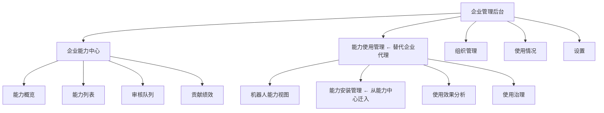

# Requirements Document

> 中文名：能力使用管理（Enterprise Capability Usage Management）

## Introduction

本模块是对企业端「企业代理（enterpriseAgents）」模块的**语义重构**——不是简单改名，而是从产品定位上彻底替换：原模块把"平台运行时概念（Agent）"误下沉到企业端，导致语义断层、用户无法理解、与能力体系割裂；新模块以"机器人（Robot）"和"能力（Capability）"为唯一企业端核心对象，用业务语言表达"能力如何被使用"。

**三端语义边界（必须强制遵守）：**

- 员工端：机器人（Robot）— 使用 AI
- 企业端（本模块）：能力使用（Capability Usage）— 管理"能力如何被机器人使用"
- 平台端：代理（Agent / Runtime）— 运行"怎么执行"

**模块裁决：**

- ❌ 不保留"企业代理"作为独立模块（路由 tab `enterpriseAgents` 必须下线）
- ✅ 新建「能力使用管理」（路由 tab `enterpriseUsageManagement`）替代之
- ✅ 原「能力安装管理」从「企业能力中心」迁出，迁入本模块作为子页之一，并升级为双视角

**子模块组成（4 个子页）：**

1. **机器人能力视图**（核心替代页，对应原"企业代理"主体页面）
2. **能力安装管理**（从「企业能力中心」迁入并升级为机器人/能力双视角）
3. **使用效果分析**（新增 KPI / 趋势 / Top 排行）
4. **使用治理**（新增低效能力 / 僵尸能力 / 冲突能力检测）

**实施分阶段（信息性，非验收边界）：**

- Phase 1（1 周）：路由替换 + 机器人能力视图 + 旧模块清理
- Phase 2（2 周）：能力安装管理双视角升级（迁入）
- Phase 3（2 周）：使用效果分析
- Phase 4（2 周）：使用治理

**关联 specs（边界必须明确）：**

- `enterprise-capability-asset-library`（企业能力中心，已实现）— 本模块依赖其能力数据；本模块不重复实现能力资产管理
- `platform-agent-runtime-center`（平台代理资产治理中心）— 企业端下沉的运行时数据归此处；本模块通过 RuntimeProjection 单向消费其投影结果
- `capability-governance-runtime`（能力治理运行时，平台侧）— 平台层治理；本模块的"使用治理"仅做企业端业务可解释表达，不重复实现平台侧检测器

**信息架构（重构后企业端整体导航）：**



## Glossary

### 核心对象（企业端唯一允许的核心对象）

- **Capability_Usage_Management（能力使用管理）**：本模块的 UI 展示名与代码 tab 名的业务对照；企业端能力使用治理主入口；模块代码标识符为 `enterprise-capability-usage-management`，路由 tab 名为 `enterpriseUsageManagement`
- **Robot（机器人）**：企业端唯一展示的能力载体业务对象；在数据库与平台端实质上对应一个 Agent，但企业端必须以"机器人"称呼，禁止暴露 Agent 字样
- **Capability（能力）**：员工沉淀、企业审核、安装到机器人的业务能力对象；定义在 `enterprise-capability-asset-library` 中，本模块仅消费其投影
- **Robot_Capability_Relation（安装关系）**：能力被安装到机器人的关联记录；等价于平台端 `RuntimeCapabilityBinding` 经投影后的企业语言表达
- **Enterprise_Admin（企业管理员）**：本模块功能的操作主体角色

### 业务化指标（禁止使用工程术语，所有指标必须以业务语言展示）

- **Installed_Capability_Count（已安装能力数）**：某机器人当前处于"已安装且未停用"状态的能力数量；指标层面替换原"代理能力"
- **Monthly_Executions（本月调用量）**：某机器人/能力在自然月内的成功 + 失败调用次数总和；展示文案为"本月调用 N 次"，禁止展示为 QPS / TPS
- **Employee_Coverage（覆盖员工数）**：在最近 30 天内通过该机器人或该能力发起过至少一次会话的去重员工数量；展示文案为"覆盖 N 名员工"
- **Success_Rate（成功率）**：最近 30 天调用中成功结束的调用次数 / 总调用次数，以百分比展示（保留 1 位小数）；不展示 latency / error rate / p95 等工程指标
- **Health_Status（健康状态）**：业务效果语言枚举，仅四个取值——`效果稳定 | 偶尔不理想 | 建议优化 | 已停用`；与平台端 `RuntimeHealth` 通过投影层映射，企业端不允许直接出现 `healthy / degraded / unhealthy / unavailable` 等原始枚举
- **Top_Capabilities（Top 能力）**：在某机器人下按本月调用量降序排列的能力名称列表，展示前 3 个

### 治理类术语（仅出现在「使用治理」子页）

- **Low_Efficiency_Capability（低效能力）**：在最近 30 天内调用次数 ≥ 阈值（默认 50）但成功率 < 70% 的能力安装关系
- **Zombie_Capability（僵尸能力）**：在最近 30 天内调用次数为 0 且安装时长 ≥ 阈值（默认 30 天）的能力安装关系
- **Conflict_Capability（冲突能力）**：同一机器人下存在 2 个及以上能力，其业务领域（CapabilityDomain）相同且能力描述相似度 ≥ 阈值（默认 0.8）
- **Governance_Issue（治理问题）**：上述三类问题的统一问题对象，含 `type / capabilityId / robotId / description / suggestion` 等字段；问题类型 = `低效能力 | 未使用能力 | 冲突能力`

### 系统术语

- **Runtime_Projection_Layer（运行时投影层）**：将平台端 `platform-agent-runtime-center` 暴露的运行时数据（Agent / Binding / Telemetry / Health）映射为企业端业务语言对象的纯函数层；本模块的所有数据必须经过该层处理后再渲染
- **Term_Blacklist（术语黑名单）**：企业端禁止出现的运行时与平台术语集合，包含但不限于 `runtime / agent / template / cpu / memory / node / presence / qps / latency / p95 / model routing / provider`
- **Legacy_Enterprise_Agents（旧企业代理模块）**：路由 tab `enterpriseAgents`、路径前缀 `/enterprise/{tenantId}/agents`、渲染函数 `renderEnterpriseAgentsSupplyConsole`、文案键 `enterpriseAgents`、权限项 `agent:view / agent:create`、子页"我的代理 / 团队代理 / 分配模板"的统称
- **Robot_Capability_View（机器人能力视图）**：本模块第 1 个子页，以机器人为主索引展示能力使用情况
- **Install_Management_Dual_View（能力安装管理双视角）**：本模块第 2 个子页，提供"按机器人 / 按能力"两个视角切换
- **Usage_Analytics（使用效果分析）**：本模块第 3 个子页，KPI + 趋势 + Top 排行
- **Usage_Governance（使用治理）**：本模块第 4 个子页，治理问题分类 Tabs

### 数据模型契约（TypeScript 类型，作为本模块对外契约）

```ts
// 机器人能力视图行
type RobotCapabilityUsageView = {
  robotId: string;
  robotName: string;
  capabilityCount: number; // 已安装能力数
  monthlyExecutions: number; // 本月调用量
  employeeCoverage: number; // 覆盖员工数
  successRate: number; // 成功率（0-1）
  healthStatus: "效果稳定" | "偶尔不理想" | "建议优化" | "已停用";
  topCapabilities: string[]; // Top 3 能力名称
};

// 能力安装管理（双视角增强后的安装关系）
type InstallRelationEnhanced = {
  capabilityId: string;
  capabilityName: string;
  robotId: string;
  robotName: string;
  source: "员工沉淀" | "企业发布";
  usageStats: { executions30d: number; successRate: number };
  status: "正常" | "待优化";
};

// 治理问题
type GovernanceIssue = {
  type: "低效能力" | "未使用能力" | "冲突能力";
  capabilityId: string;
  robotId: string;
  description: string;
  suggestion: string;
};
```

## Requirements

### Requirement 1: 路由与导航重构（旧模块下线 + 新模块上线）

**User Story:** 作为企业管理员，我希望企业端导航中不再出现"企业代理"，而是出现"能力使用管理"作为唯一的能力使用治理入口，以便建立"机器人 + 能力"的统一心智。

#### Acceptance Criteria

1. THE Capability_Usage_Management SHALL 在企业端导航中以"能力使用管理"作为一级 tab 名展示，对应代码 tab 标识符为 `enterpriseUsageManagement`，路径前缀为 `/enterprise/{tenantId}/usage-management`
2. THE Capability_Usage_Management SHALL 提供 4 个子页路由：`/enterprise/{tenantId}/usage-management/robots`（机器人能力视图，默认子页）、`/enterprise/{tenantId}/usage-management/installs`（能力安装管理）、`/enterprise/{tenantId}/usage-management/analytics`（使用效果分析）、`/enterprise/{tenantId}/usage-management/governance`（使用治理）
3. WHEN 企业管理员访问 `/enterprise/{tenantId}/usage-management`（无子路径）, THE Capability_Usage_Management SHALL 重定向至 `/enterprise/{tenantId}/usage-management/robots` 子页
4. THE Capability_Usage_Management SHALL 移除导航中的 `enterpriseAgents` tab，且企业端任意页面渲染输出中不得包含 i18n key `tabs.enterpriseAgents`、`subtitles.enterpriseAgents`、`nav.items.enterpriseAgents`
5. WHEN 企业管理员或外部链接访问任意以 `/enterprise/{tenantId}/agents` 开头的路径（含 `/agents`、`/agents/my-agents`、`/agents/team-agents`、`/agents/templates`）, THE Capability_Usage_Management SHALL 在 HTTP 路由解析或客户端路由解析阶段将其重定向至对应的新模块路径——`/agents` 与 `/agents/my-agents` 重定向至 `/enterprise/{tenantId}/usage-management/robots`，`/agents/templates` 重定向至 `/enterprise/{tenantId}/usage-management/installs`，其余子路径重定向至 `/enterprise/{tenantId}/usage-management/robots`
6. THE Capability_Usage_Management SHALL 不再渲染原 `renderEnterpriseAgentsSupplyConsole` 函数对应的 UI；该渲染函数及其引用 SHALL 在企业端 surface 渲染分发表中被移除
7. WHEN 企业端任意 surface 渲染分发收到 `tab === "enterpriseAgents"` 的入参, THE Capability_Usage_Management SHALL 将其规范化为 `tab === "enterpriseUsageManagement"` 后再分发渲染
8. THE Capability_Usage_Management SHALL 在企业端 i18n 字典中提供以下条目（中英对照）：`tabs.enterpriseUsageManagement`（"能力使用管理" / "Capability Usage Management"）、`subtitles.enterpriseUsageManagement`、`nav.items.enterpriseUsageManagement`，以及 4 个子页文案 `enterpriseUsage.robots / installs / analytics / governance`

### Requirement 2: 旧权限项迁移与清理

**User Story:** 作为企业管理员，我希望旧的"企业代理"权限项被替换为业务语义对应的新权限项，以便权限模型与新的"能力使用"概念一致。

#### Acceptance Criteria

1. THE Capability_Usage_Management SHALL 从 `ACCESS_PERMISSION_CATALOG` 权限目录中移除旧权限项 `agent:view`（module: "企业代理"）和 `agent:create`（module: "企业代理"）
2. THE Capability_Usage_Management SHALL 新增以下权限项至 `ACCESS_PERMISSION_CATALOG`：`usage:view`（module: "能力使用管理"，label: "查看能力使用"）、`usage:install-manage`（module: "能力使用管理"，label: "管理能力安装"）、`usage:governance`（module: "能力使用管理"，label: "处理使用治理问题"，highRisk: false）
3. THE Capability_Usage_Management SHALL 在角色默认权限映射 `ACCESS_ROLE_PERMISSIONS` 中按以下规则迁移：原拥有 `agent:view` 的角色（viewer / operator）改为获得 `usage:view`；原拥有 `agent:create` 的角色（operator）改为获得 `usage:install-manage`；admin 角色保持获得全部权限
4. WHEN 企业管理员持有 `usage:view` 权限, THE Capability_Usage_Management SHALL 允许其访问 `/enterprise/{tenantId}/usage-management/*` 下的所有只读视图（机器人能力视图、安装管理列表、使用效果分析、使用治理问题查看）
5. WHEN 企业管理员持有 `usage:install-manage` 权限, THE Capability_Usage_Management SHALL 允许其在能力安装管理页执行卸载操作
6. WHEN 企业管理员持有 `usage:governance` 权限, THE Capability_Usage_Management SHALL 允许其在使用治理页执行问题确认（acknowledge）与建议操作执行
7. IF 企业管理员未持有 `usage:view` 权限, THEN THE Capability_Usage_Management SHALL 拒绝访问任意子页并展示无权限提示
8. THE Capability_Usage_Management SHALL 在权限迁移过程中保留对旧权限项 `agent:view / agent:create` 的兼容映射至少 1 个发布周期：服务端校验时如发现请求方仍持有旧权限，自动按"agent:view → usage:view"、"agent:create → usage:install-manage"等价处理，但 UI 端不再展示旧权限项

### Requirement 3: 能力安装管理从能力中心迁出

**User Story:** 作为企业管理员，我希望"能力安装管理"从「企业能力中心」迁入「能力使用管理」，以便管理员在思考"机器人怎么用能力"时不需要切换模块。

#### Acceptance Criteria

1. THE Capability_Usage_Management SHALL 接管原本属于 `enterprise-capability-asset-library` 的"能力安装管理"页面：UI 入口从「企业能力中心」头部按钮、Quick_Entry_Sidebar、`/enterprise/{tenantId}/capabilities/install-management` 路径中移除，新入口位于 `/enterprise/{tenantId}/usage-management/installs`
2. THE Capability_Usage_Management SHALL 复用现有的 `enterprise-capability.install-management` RPC 端点与 `install-management.ts` controller，不重复实现安装关系的存取逻辑；本模块仅在数据投影、视角切换、UI 渲染层重构
3. WHEN 企业管理员从「企业能力中心」头部点击"能力安装管理"按钮（旧入口）, THE Capability_Usage_Management SHALL 在迁移过渡期内（≥ 1 个发布周期）将该按钮重定向至 `/enterprise/{tenantId}/usage-management/installs`，而非展示 404
4. THE Capability_Usage_Management SHALL 在「企业能力中心」的 Quick_Entry_Sidebar 中移除"能力安装管理"快捷入口，仅保留"我的安装能力"和"我贡献的能力"两项
5. WHEN 外部链接（包括邮件通知、文档链接）使用旧路径 `/enterprise/{tenantId}/capabilities/install-management` 访问, THE Capability_Usage_Management SHALL 通过路由解析层将其 301 重定向至 `/enterprise/{tenantId}/usage-management/installs`
6. THE Capability_Usage_Management SHALL 与 `enterprise-capability-asset-library` 维持单向数据依赖：本模块从能力中心读取能力名称、状态、来源等元数据，但不修改能力中心的资产数据

### Requirement 4: 机器人能力视图（核心子页）

**User Story:** 作为企业管理员，我希望以"机器人"为主索引看到企业内每个机器人的能力使用情况，以便用业务语言判断"哪个机器人在做什么、做得怎么样"。

#### Acceptance Criteria

1. THE Robot_Capability_View SHALL 作为 `/enterprise/{tenantId}/usage-management/robots` 默认渲染页，页面标题为"机器人能力视图"，副标题为"按机器人查看能力使用情况"
2. THE Robot_Capability_View SHALL 在页面顶部展示 4 个 KPI 卡片：机器人总数、本月总调用量、覆盖员工总数、平均成功率；KPI 卡片的视觉规范（圆角、间距、字号层级、颜色 token）必须与「企业能力中心」`StatisticsDashboard` 保持一致
3. THE Robot_Capability_View SHALL 在 KPI 卡片下方提供筛选栏，包含：机器人名称关键词搜索（最少 1 字符触发，500 ms 内更新结果）、健康状态下拉（默认"全部状态"，可选"效果稳定 / 偶尔不理想 / 建议优化 / 已停用"）、调用量区间筛选（默认"全部"）
4. THE Robot_Capability_View SHALL 以分页表格形式展示机器人列表，列依次为：机器人名称、已安装能力数、本月调用量、覆盖员工数、成功率、健康状态、Top 3 能力（标签形式，超出折叠为 +N）、操作（"查看详情"链接）
5. THE Robot_Capability_View SHALL 默认按本月调用量降序排列，支持点击列头按"已安装能力数 / 本月调用量 / 覆盖员工数 / 成功率"切换排序
6. THE Robot_Capability_View SHALL 每页默认展示 10 条机器人记录，支持切换为 20、50 条每页，分页控件复用「企业能力中心」`Pagination` 组件
7. WHEN 企业管理员点击某行的"查看详情", THE Robot_Capability_View SHALL 展示该机器人的详情面板，包含 3 个分区：基础信息（机器人名称、健康状态徽章、最近活跃时间）、能力列表（该机器人所安装的全部能力，附每条能力的本月调用量与成功率）、使用统计（近 30 天调用趋势迷你折线图、覆盖员工数、Top 3 能力）
8. THE Robot_Capability_View SHALL 在机器人详情面板的"基础信息"分区中不展示以下任何字段：runtime version、CPU 使用率、内存使用率、节点 ID、Agent ID、template ID、provider、model routing
9. WHEN 机器人列表数据加载超过 200 ms 未返回, THE Robot_Capability_View SHALL 展示骨架屏；超过 10 秒未返回 SHALL 展示加载失败提示并提供重试按钮
10. IF 当前筛选条件下无任何机器人匹配, THEN THE Robot_Capability_View SHALL 展示空状态提示，文案为"当前筛选条件下没有匹配的机器人"

### Requirement 5: 能力安装管理双视角

**User Story:** 作为企业管理员，我希望同时支持"按机器人查看安装的能力"和"按能力查看被哪些机器人使用"两个视角，以便覆盖"机器人维度"和"能力维度"两类管理场景。

#### Acceptance Criteria

1. THE Install_Management_Dual_View SHALL 作为 `/enterprise/{tenantId}/usage-management/installs` 子页渲染，页面标题为"能力安装管理"
2. THE Install_Management_Dual_View SHALL 在页面顶部提供 Tabs 切换控件，包含两个标签：`按机器人`（默认选中）、`按能力`；当前激活 Tab 状态须通过 URL 查询参数 `?view=robot` 或 `?view=capability` 持久化，刷新页面后保持不变
3. WHILE Tab 为`按机器人`, THE Install_Management_Dual_View SHALL 渲染机器人分组列表，每个分组以机器人名称为表头，下方表格列依次为：能力名称、来源（员工沉淀 / 企业发布）、本月调用量、成功率、状态（正常 / 待优化）、操作（卸载）
4. WHILE Tab 为`按能力`, THE Install_Management_Dual_View SHALL 渲染能力分组列表，每个分组以能力名称为表头，下方表格列依次为：机器人名称、来源、本月调用量、成功率、状态、操作（卸载）
5. THE Install_Management_Dual_View SHALL 在两个视角下复用相同的安装关系数据集 `InstallRelationEnhanced`，仅在视图层做分组维度切换；后端不重复请求两次数据
6. THE Install_Management_Dual_View SHALL 在页面顶部 KPI 区域展示 3 个统计：总安装关系数、覆盖机器人数、覆盖能力数；统计值随筛选结果实时更新
7. THE Install_Management_Dual_View SHALL 提供筛选栏：能力名称关键词、机器人名称关键词、来源筛选（默认"全部"，可选"员工沉淀 / 企业发布"）、状态筛选（默认"全部"，可选"正常 / 待优化"）；筛选条件在两个 Tab 视角间共享
8. WHEN 企业管理员对某条安装关系点击"卸载", THE Install_Management_Dual_View SHALL 展示二次确认对话框，包含目标机器人名称、能力名称、当前状态、安装来源；确认后通过现有 `enterprise-capability.uninstall` RPC 端点执行卸载
9. IF 卸载操作失败, THEN THE Install_Management_Dual_View SHALL 保留原有安装关系不变，并在对话框中展示错误提示
10. THE Install_Management_Dual_View SHALL 不在任何视图下展示以下字段：runtime binding ID、binding type、load strategy、routing priority；这些字段仅在平台端 `platform-agent-runtime-center` 可见

### Requirement 6: 使用效果分析

**User Story:** 作为企业管理员，我希望从全局视角看到企业能力使用的整体效果与趋势，以便评估能力沉淀战略的业务回报。

#### Acceptance Criteria

1. THE Usage_Analytics SHALL 作为 `/enterprise/{tenantId}/usage-management/analytics` 子页渲染，页面标题为"使用效果分析"
2. THE Usage_Analytics SHALL 在页面顶部展示 4 个 KPI 卡片：本月总调用量、覆盖机器人数、覆盖员工数、平均成功率；每个 KPI 同时展示较上月环比变化（绝对值或百分比）
3. THE Usage_Analytics SHALL 对正增长 KPI 使用向上箭头 + 绿色，负增长使用向下箭头 + 红色，零变化展示"持平"且不带颜色
4. THE Usage_Analytics SHALL 提供"30 天调用趋势"折线图，X 轴为日期（最近 30 天），Y 轴为每日调用量；图表组件须支持切换时间窗口为最近 7 天 / 30 天 / 90 天
5. THE Usage_Analytics SHALL 提供"能力复用增长"趋势图，X 轴为日期（最近 30 天），Y 轴为当日累计被安装到不同机器人的能力数；同样支持 7 / 30 / 90 天切换
6. THE Usage_Analytics SHALL 提供"Top 能力排行"表格，列依次为：能力名称、本月调用量、成功率、覆盖机器人数；默认按调用量降序，最多展示 Top 20
7. WHEN 企业管理员点击 Top 能力排行中的某行, THE Usage_Analytics SHALL 跳转至该能力在「企业能力中心」的详情页（`/enterprise/{tenantId}/capabilities/{capabilityId}`），而不在本模块内重复实现能力详情
8. WHILE Usage_Analytics 数据正在加载, THE Usage_Analytics SHALL 在 KPI 卡片与图表区域分别展示骨架屏，加载超过 10 秒展示重试入口
9. THE Usage_Analytics SHALL 在所有图表与 KPI 中不展示以下指标：QPS、p95 latency、error rate、token consumption、CPU、memory；这些指标仅出现在平台端
10. IF Usage_Analytics 在筛选时间窗口内无任何调用数据, THEN THE Usage_Analytics SHALL 在 KPI 与图表位置展示"暂无使用数据"占位状态

### Requirement 7: 使用治理（低效能力 / 僵尸能力 / 冲突能力）

**User Story:** 作为企业管理员，我希望能够快速识别并处理低效、未使用、冲突的能力安装关系，以便持续清理企业能力使用结构。

#### Acceptance Criteria

1. THE Usage_Governance SHALL 作为 `/enterprise/{tenantId}/usage-management/governance` 子页渲染，页面标题为"使用治理"
2. THE Usage_Governance SHALL 在页面顶部提供 Tabs 切换控件，包含三个标签：`低效能力`（默认选中）、`未使用能力`、`冲突能力`；每个标签上同时展示该类问题数量徽章
3. WHILE Tab 为`低效能力`, THE Usage_Governance SHALL 展示满足以下条件的安装关系列表：最近 30 天调用次数 ≥ 50 且 成功率 < 70%；表格列：能力名称、机器人名称、调用量、成功率、问题描述、建议操作（"重新整理能力 / 卸载"）
4. WHILE Tab 为`未使用能力`, THE Usage_Governance SHALL 展示满足以下条件的安装关系列表：最近 30 天调用次数 = 0 且 安装时长 ≥ 30 天；表格列：能力名称、机器人名称、安装时长、最后调用时间、问题描述、建议操作（"卸载 / 转移到其他机器人"）
5. WHILE Tab 为`冲突能力`, THE Usage_Governance SHALL 展示满足以下条件的能力组：同一机器人下存在 ≥ 2 个能力且业务领域（CapabilityDomain）相同且能力描述余弦相似度 ≥ 0.8；展示形式为"机器人 → 冲突能力组"嵌套列表
6. THE Usage_Governance SHALL 允许企业管理员通过阈值配置面板调整每类问题的检测阈值（低效成功率阈值默认 70%、低效调用量阈值默认 50、僵尸天数阈值默认 30、冲突相似度阈值默认 0.8），调整后立即重新计算问题列表
7. WHEN 企业管理员点击某条问题的"建议操作"按钮, THE Usage_Governance SHALL 根据建议类型执行对应动作：`卸载` → 触发 `enterprise-capability.uninstall`；`重新整理能力` → 跳转至能力详情页；`转移到其他机器人` → 展示机器人选择对话框
8. THE Usage_Governance SHALL 支持企业管理员对单条问题执行 acknowledge（"暂不处理"），acknowledged 的问题在当前会话中不再展示，但下次进入页面时仍会重新计算
9. THE Usage_Governance SHALL 不展示以下平台层治理类型：runtime overcommit、orphaned agent、version drift、fallback chain broken；这些治理问题归属于平台端 `platform-agent-runtime-center` 的"Governance & Policy"标签页
10. IF 当前 Tab 下无任何治理问题, THEN THE Usage_Governance SHALL 展示空状态提示，文案分别为"暂无低效能力 / 暂无未使用能力 / 暂无冲突能力"

### Requirement 8: 术语黑名单与业务化表达约束

**User Story:** 作为产品架构师，我希望企业端任意页面渲染输出中都不出现运行时与平台术语，以便企业管理员只看到业务可解释信息，建立"机器人 + 能力"的统一心智。

#### Acceptance Criteria

1. THE Capability_Usage_Management SHALL 在所有面向企业管理员的渲染输出中（包括但不限于 KPI 文案、表格列名、表格单元格、徽章、提示语、错误信息、空状态文案、对话框、详情面板、图表 tooltip）不包含以下术语黑名单中的任何词汇（不区分大小写）：`runtime`、`agent`、`template`、`cpu`、`memory`、`node`、`presence`、`qps`、`tps`、`latency`、`p95`、`p99`、`provider`、`model routing`、`workflow json`、`toolchain`
2. THE Capability_Usage_Management SHALL 通过 `Runtime_Projection_Layer` 将平台端运行时数据映射为业务语言对象后再渲染：`Agent → Robot`、`RuntimeHealth → Health_Status`、`session count → Monthly_Executions`、`success rate → Success_Rate`（百分比）、`RuntimeCapabilityBinding → Robot_Capability_Relation`
3. THE Capability_Usage_Management SHALL 在所有展示成功率的位置使用百分比格式（如"96.5%"），不展示原始小数（如"0.965"）
4. THE Capability_Usage_Management SHALL 在所有展示调用量的位置使用千位分隔符整数格式（如"1,284"），不展示科学计数法、不展示带小数的频率单位（如"21.4 QPS"）
5. THE Capability_Usage_Management SHALL 在健康状态展示中只允许出现以下四个文本之一：`效果稳定`、`偶尔不理想`、`建议优化`、`已停用`；任何其他健康相关原始枚举字符串视为违规
6. WHERE 一条数据缺少业务语言映射（例如平台端返回了未知的健康枚举值）, THE Capability_Usage_Management SHALL 在 `Runtime_Projection_Layer` 中将其降级展示为"暂无数据"，不暴露原始值
7. THE Capability_Usage_Management SHALL 提供构建期术语扫描脚本，扫描 `ui/src/ui/views/enterprise-capability-usage-management/**/*` 与 `ui/src/i18n/locales/*.ts` 中本模块相关的 i18n key，发现术语黑名单命中时构建失败
8. THE Capability_Usage_Management SHALL 在企业端命名规范中要求所有新增组件、文件名、CSS 类名、i18n key 使用以下前缀之一：`enterprise-usage-*`、`enterprise-robot-*`、`enterprise-install-*`、`enterprise-governance-*`；禁止使用 `platform-*`、`agent-*`、`runtime-*`

### Requirement 9: 与平台端及其他 specs 的边界

**User Story:** 作为开发者，我需要明确本模块与 `platform-agent-runtime-center` / `capability-governance-runtime` / `enterprise-capability-asset-library` 三个相关 spec 的职责边界，以便实现时不重复也不遗漏。

#### Acceptance Criteria

1. THE Capability_Usage_Management SHALL 通过 `Runtime_Projection_Layer` 单向消费 `platform-agent-runtime-center` 的运行时数据：消费的数据包括 `RuntimeAgent`（投影为 Robot 业务对象）、`RuntimeCapabilityBinding`（投影为 Robot_Capability_Relation）、`RuntimeTelemetry`（投影为 Monthly_Executions / Success_Rate）、`RuntimeHealth`（投影为 Health_Status）；本模块不直接读取或写入平台运行时存储
2. THE Capability_Usage_Management SHALL NOT 在企业端实现任何 Agent 创建、删除、生命周期变更、binding 修改逻辑；这些能力归属于平台端 `platform-agent-runtime-center`
3. WHEN 企业管理员在「能力安装管理」执行卸载, THE Capability_Usage_Management SHALL 通过 `enterprise-capability.uninstall` RPC 端点触发卸载请求；后端通过反向集成调用 `platform-agent-runtime-center` 的 binding 失效逻辑，由平台端真正执行 disable 操作
4. THE Capability_Usage_Management SHALL 与 `enterprise-capability-asset-library` 维持单向依赖：消费能力名称、能力描述、能力领域、能力来源、能力健康状态等元数据；不重复实现能力资产管理 / 审核 / 贡献绩效 / 能力领域分布等功能
5. THE Capability_Usage_Management SHALL 与 `capability-governance-runtime` 维持职责分离：`capability-governance-runtime` 处理平台层治理（proposal、approve / reject / promote / revoke、L0–L3 admission gate），本模块「使用治理」仅处理企业端业务可解释表达（低效 / 僵尸 / 冲突）；两者治理对象、检测器、UI 呈现、操作动作均不重叠
6. THE Capability_Usage_Management SHALL 在涉及跨模块跳转时使用以下规则：跳转至能力详情 → `/enterprise/{tenantId}/capabilities/{capabilityId}`；跳转至机器人能力视图详情 → `/enterprise/{tenantId}/usage-management/robots`；跳转至平台端代理治理（仅企业管理员有权限时） → 在新标签打开 `/platform/agents`，且按钮文案为"前往平台代理资产治理中心查看技术详情"
7. THE Capability_Usage_Management SHALL 在所有跨模块数据流中保持类型契约：`Robot.id === RuntimeAgent.id`、`Capability.id === EnterpriseCapabilityAsset.id`；id 字段类型一致以确保跨模块跳转可解析

### Requirement 10: 数据链路对接与回流

**User Story:** 作为企业管理员，我希望员工沉淀能力到企业、企业发布、安装到机器人、平台运行时执行的整条链路在本模块统一可见，以便我能从一个入口看到能力的完整生命周期表现。

#### Acceptance Criteria

1. THE Capability_Usage_Management SHALL 实现以下数据链路：员工贡献能力 → 企业审核发布（由 `enterprise-capability-asset-library` 处理）→ 安装到机器人（由本模块「能力安装管理」处理）→ 平台 Agent 运行时执行（由 `platform-agent-runtime-center` 处理）→ 回流调用量与成功率（由 `Runtime_Projection_Layer` 投影回本模块各子页）
2. WHEN 平台端 `platform-agent-runtime-center` 的 `RuntimeTelemetry` 发生更新, THE Runtime_Projection_Layer SHALL 在 60 秒内将相关投影数据反映到本模块的「机器人能力视图」「使用效果分析」「使用治理」三个子页
3. WHEN 平台端 binding 状态变更（active ↔ disabled）, THE Runtime_Projection_Layer SHALL 同步更新「能力安装管理」中对应安装关系的展示状态
4. THE Capability_Usage_Management SHALL 在「机器人能力视图」详情面板中展示每个能力安装关系的来源标签（员工沉淀 / 企业发布），来源信息从 `enterprise-capability-asset-library` 的 `Source_Employee` 与 `InstallRelation.source` 字段映射而来
5. IF 投影层在数据回流过程中无法解析平台端返回的某个枚举值或字段, THEN THE Runtime_Projection_Layer SHALL 不抛出错误，而是降级展示为"暂无数据"占位，且通过日志告警机制通知开发者排查
6. THE Capability_Usage_Management SHALL 在所有展示页面中允许平台端数据缺失时仍可正常渲染：缺失 `RuntimeTelemetry` → 调用量与成功率展示为"暂无数据"；缺失 `RuntimeHealth` → 健康状态展示为"暂无数据"；缺失 `RuntimeCapabilityBinding` → 安装关系列表展示空状态提示

### Requirement 11: UI 设计统一性

**User Story:** 作为前端开发者，我需要本模块的 UI 与「企业能力中心」保持一致的设计语言，以便企业端整体观感统一。

#### Acceptance Criteria

1. THE Capability_Usage_Management SHALL 使用与「企业能力中心」相同的技术栈：React + TypeScript + Tailwind CSS（lit-html 作为 surface 渲染层，与现有企业端实现保持一致）
2. THE Capability_Usage_Management SHALL 采用白色背景 + 蓝色主色调的企业管理后台浅色主题，复用 `enterprise-foundation.css` 与 `enterprise-components.css` 中已有的 CSS Token
3. THE Capability_Usage_Management SHALL 在所有 4 个子页中使用统一的页面结构：`[Page Header]` / `[KPI 区]`（可选）/ `[筛选区]`（可选）/ `[主内容区]`（表格 / 卡片 / 图表）/ `[Pagination]`（可选）
4. THE Capability_Usage_Management SHALL 复用「企业能力中心」已有组件：`Pagination`（分页控件）、`HealthBadge`（健康状态徽章，但限制其只渲染本模块允许的四个文本）、`MiniTrendChart`（迷你趋势图）、`ValueSummaryCard` 风格的 KPI 卡片
5. THE Capability_Usage_Management SHALL 确保所有同类组件（KPI 卡片、表格行、按钮、徽章、Tab 切换）使用相同的圆角半径、间距比例、字体层级（不超过 4 级）、颜色 Token
6. WHILE 视口宽度 ≥ 1280 px, THE Capability_Usage_Management SHALL 完整展示所有表格列且无水平滚动条
7. WHILE 视口宽度 < 1280 px, THE Capability_Usage_Management SHALL 对表格区域提供水平滚动条
8. THE Capability_Usage_Management SHALL 确保所有交互元素的最小点击区域 ≥ 32 × 32 像素，且健康状态徽章除颜色外同时提供文字标签（无障碍合规）

### Requirement 12: 分页、加载与错误处理

**User Story:** 作为企业管理员，我希望本模块在数据规模增长后仍能流畅浏览，并且在加载失败时有明确的错误反馈和重试入口。

#### Acceptance Criteria

1. THE Capability_Usage_Management SHALL 在「机器人能力视图」「能力安装管理」两个含表格的子页底部展示分页控件，包含：总记录数文本、页码导航、每页条数选择器（10 / 20 / 50 条，默认 10 条）
2. WHEN 页码或每页条数变更, THE Capability_Usage_Management SHALL 在 5 秒内重新加载对应页数据，且保持当前筛选条件、Tab 视角、排序状态不变
3. WHILE 数据加载中, THE Capability_Usage_Management SHALL 在 200 毫秒后展示骨架屏或加载动画，避免空白页面
4. IF 数据加载超过 10 秒未返回, THEN THE Capability_Usage_Management SHALL 展示加载失败提示并提供重试操作入口
5. WHEN 每页条数增大导致当前页码超出总页数, THE Capability_Usage_Management SHALL 自动跳转至最后一页并加载该页数据
6. IF 任意 RPC 端点返回错误, THEN THE Capability_Usage_Management SHALL 保留上次成功加载的数据展示，并在受影响区域顶部展示错误提示与重试入口；不应整页崩溃
7. WHILE 后端 Gateway 断连, THE Capability_Usage_Management SHALL 复用 `GatewayBrowserClient` 的重连机制（指数退避，最大 15 秒），并在断连期间展示离线提示横幅

### Requirement 13: 旧测试与代码清理

**User Story:** 作为开发者，我需要确保旧"企业代理"模块的所有代码痕迹被清理，以避免遗留代码与新模块产生语义冲突。

#### Acceptance Criteria

1. THE Capability_Usage_Management SHALL 在落地完成后从代码库中移除以下文件或函数：`renderEnterpriseAgentsSupplyConsole` 函数（位于 `ui/src/ui/ports/enterprise/views/enterprise-surfaces.ts`）及其所有引用、`enterprise-shell.ts` 中针对 `enterpriseAgents` 分支的预览块、企业端"我的代理 / 团队代理 / 分配模板"三个子页面相关代码
2. THE Capability_Usage_Management SHALL 移除现有测试文件中针对 `tab === "enterpriseAgents"` 的测试用例（如 `port-shells.browser.test.ts`、`enterprise-surfaces.browser.test.ts` 中的相关 fixture），并替换为针对 `tab === "enterpriseUsageManagement"` 的等价测试用例
3. THE Capability_Usage_Management SHALL 将现有所有指向 `enterpriseAgents` tab 的内部链接（在 `ui/src/ui/ports/platform/view-models/builders.ts`、`enterprise-surfaces.ts` 等文件中）批量替换为对应的新模块链接：原 `pathForTab("enterpriseAgents", basePath, { tenantId })` 改为 `pathForTab("enterpriseUsageManagement", basePath, { tenantId })`，且子路径默认指向 `/usage-management/robots`
4. THE Capability_Usage_Management SHALL 在 `ui/src/ui/navigation.ts` 中保留 `enterpriseAgents` 类型定义至兼容窗口期结束（≥ 1 个发布周期），并在该窗口期内通过 `normalizeLegacyTab` 工具函数将其规范化为 `enterpriseUsageManagement`；窗口期结束后从类型定义中删除
5. THE Capability_Usage_Management SHALL 不在新代码中引入对旧 i18n key（`tabs.enterpriseAgents`、`subtitles.enterpriseAgents`、`nav.items.enterpriseAgents`）的引用；这些 key 在兼容窗口期结束后从 i18n 字典中删除

### Requirement 14: 与员工端的交互

**User Story:** 作为企业管理员，我希望本模块对员工端的可见性与员工端的能力使用形成闭环，以便员工与企业管理员都能看到完整的能力使用图景。

#### Acceptance Criteria

1. THE Capability_Usage_Management SHALL NOT 在员工端任何 UI 中暴露本模块的功能入口；本模块仅向 Enterprise_Admin 角色开放
2. WHEN 企业管理员通过本模块「能力安装管理」执行卸载, THE Capability_Usage_Management SHALL 在卸载完成后通过现有员工通知机制告知该能力涉及的员工（如该机器人由该员工拥有）；通知文案使用业务语言"机器人 X 上的能力 Y 已被企业管理员卸载"
3. WHEN 企业管理员通过本模块「使用治理」对僵尸能力执行"卸载"建议, THE Capability_Usage_Management SHALL 走与需求 14.2 相同的通知路径
4. THE Capability_Usage_Management SHALL 不影响员工端「我的能力」「能力推荐」「机器人配置」三个子模块的现有逻辑

## 正确性属性（Correctness Properties）

> _A property is a characteristic or behavior that should hold true across all valid executions of a system—essentially, a formal statement about what the system should do._

属性测试范围严格限定为：术语黑名单守卫（核心架构红线）、投影层正确性、安装数计算不变量、双视角数据一致性、治理检测器边界条件、路由重定向幂等。展示逻辑（千位分隔、百分比格式、空状态文案）使用单元/快照测试，不使用 PBT。

### Property 1：术语黑名单守卫（核心架构红线）

_For any_ rendered output produced by any view component under `ui/src/ui/views/enterprise-capability-usage-management/**` —— including KPI cards, table cells, badges, tooltips, error messages, dialogs, empty-state placeholders, chart legends —— the rendered text content SHALL NOT contain any token from the runtime/platform term blacklist (case-insensitive): `runtime`, `agent`, `template`, `cpu`, `memory`, `node`, `presence`, `qps`, `tps`, `latency`, `p95`, `p99`, `provider`, `model routing`, `workflow json`, `toolchain`. This must hold for arbitrary input data including malformed payloads (where the projection layer must downgrade to "暂无数据").

**Validates: Requirements 8.1, 8.5, 8.6**

### Property 2：Runtime_Projection_Layer 健康状态映射完备性

_For any_ `RuntimeHealth` enum value from `platform-agent-runtime-center` (`healthy`, `degraded`, `unhealthy`, `unavailable`), the projection function `projectRuntimeHealthToEnterprise` SHALL return exactly one value from `{ "效果稳定", "偶尔不理想", "建议优化", "已停用" }`. For any unknown / undefined / null input, it SHALL return the special placeholder `"暂无数据"` (which is itself not a valid Health_Status enum value but a render-only fallback).

**Validates: Requirements 8.2, 8.5, 10.5**

### Property 3：Runtime_Projection_Layer 字段纯净性

_For any_ raw `RuntimeAgent` / `RuntimeCapabilityBinding` / `RuntimeTelemetry` object from `platform-agent-runtime-center` —— including objects with arbitrary nested runtime fields such as `cpu`, `memory`, `nodeId`, `runtimeVersion`, `templateId`, `provider`, `modelRouting`, `workflowJson`, `toolchain` —— the output of `projectToRobotCapabilityUsageView()` SHALL have an empty intersection between its field set and the runtime field blacklist. This must hold for inputs with all runtime fields, partial runtime fields, no runtime fields, and runtime fields nested within sub-objects.

**Validates: Requirements 8.1, 8.2, 9.1**

### Property 4：已安装能力数 = 去重能力关系数

_For any_ `robotId` and the corresponding set of `Robot_Capability_Relation` records, the displayed `Installed_Capability_Count` for that robot SHALL equal the count of distinct `capabilityId` values in the relations where `state ∈ {"正常", "待优化"}` (i.e., excluding any "已停用" or "已卸载" state). Adding a duplicate relation (same `capabilityId`) SHALL NOT increase the count.

**Validates: Requirements 4.4, 5.5, 5.6**

### Property 5：双视角数据一致性

_For any_ active filter set in `Install_Management_Dual_View`, the union of (capability, robot) pairs displayed under Tab `按机器人` SHALL be identical (set-equal) to the union of (capability, robot) pairs displayed under Tab `按能力`. Switching tabs SHALL preserve filters and SHALL NOT change the underlying data set; only the grouping dimension changes.

**Validates: Requirements 5.5, 5.7**

### Property 6：治理检测器幂等性与边界

_For any_ stable input set of `Robot_Capability_Relation` records and configured thresholds, calling `detectGovernanceIssues()` twice in succession SHALL return the same set of `Governance_Issue` records (deterministic). Furthermore: a relation with exactly threshold values (e.g., `executions30d === 50` and `successRate === 0.70` for low-efficiency) SHALL NOT be flagged (boundaries are exclusive on the failure side); a relation strictly inside the failure region SHALL be flagged.

**Validates: Requirements 7.3, 7.4, 7.5, 7.6**

### Property 7：路由重定向幂等

_For any_ legacy URL matching `/enterprise/{tenantId}/agents/*` pattern, applying the redirect resolver once SHALL produce a target URL under `/enterprise/{tenantId}/usage-management/*`. Applying the redirect resolver to that target URL SHALL be a no-op (idempotent). The resolver SHALL NOT loop or produce a chain of redirects longer than one hop.

**Validates: Requirements 1.5, 3.5**

### Property 8：成功率与调用量格式化

_For any_ numeric `successRate` ∈ [0, 1] and `monthlyExecutions` ∈ ℕ, the formatted display string for `successRate` SHALL match the regex `^\d{1,3}\.\d%$` (one decimal place, ending with `%`), and for `monthlyExecutions` SHALL match the regex `^[\d,]+$` (comma-separated integer with no decimal). For input outside the valid domain (negative, NaN, undefined), the formatter SHALL return `"暂无数据"`.

**Validates: Requirements 8.3, 8.4**

### Property 9：权限迁移兼容性

_For any_ user holding the legacy permission `agent:view`, the access check `canAccessUsageManagement(user)` SHALL return `true` (treating it equivalent to `usage:view`). For any user holding `agent:create`, `canManageInstall(user)` SHALL return `true` (treating it equivalent to `usage:install-manage`). This compatibility SHALL hold throughout the legacy compatibility window.

**Validates: Requirements 2.7**

### Property 10：默认子页落点

_For any_ navigation to `/enterprise/{tenantId}/usage-management` (no sub-path), the resolved final route SHALL be `/enterprise/{tenantId}/usage-management/robots`. For any direct navigation to `/enterprise/{tenantId}/usage-management/{robots|installs|analytics|governance}`, the resolved final route SHALL match the input exactly (no further redirect).

**Validates: Requirements 1.3, 1.2**
