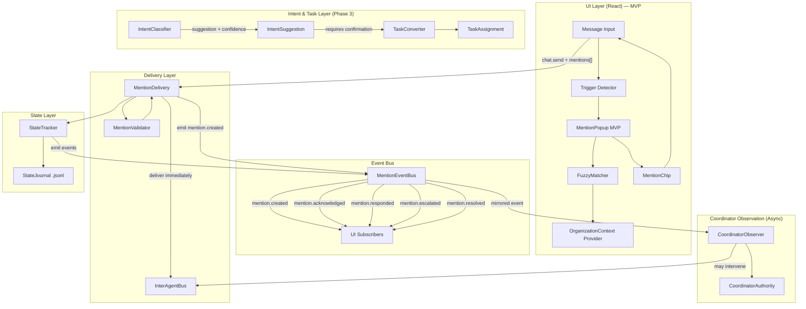
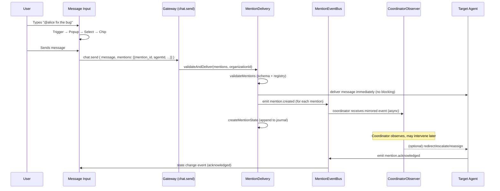
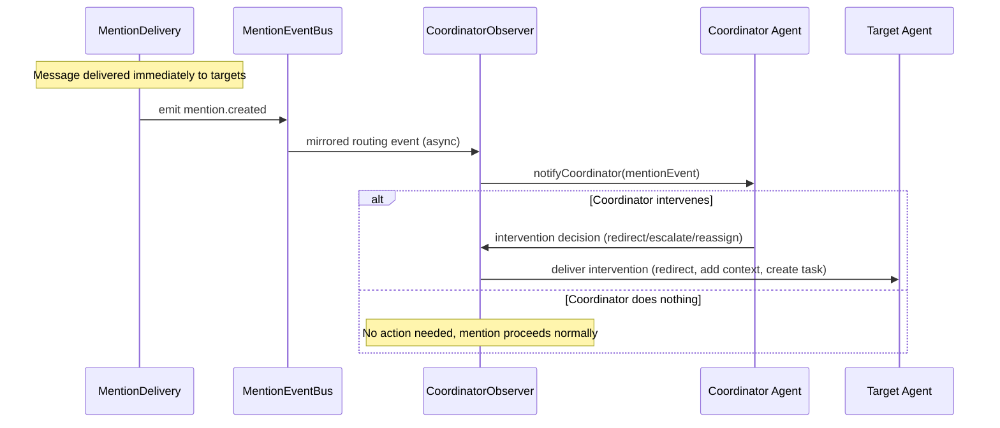

# Design Document: Group Mention System

## Overview

The Group Mention System implements an Organization Communication Protocol that enables structured "@" mentions within collaboration groups. It operates across three layers:

1. **Mention UI** — React components for trigger detection, candidate popup (MVP-simplified), chip rendering, and accessibility.
2. **Mention Runtime** — Server-side metadata encoding, event-driven delivery, append-only state journal, and intent suggestion (never auto-execution).
3. **Organization Routing** — Asynchronous coordinator observation (non-blocking), permission enforcement derived from existing context, and confirmation-required task pipeline.

### Key Architecture Principles

| Principle                       | Description                                                                              |
| ------------------------------- | ---------------------------------------------------------------------------------------- |
| **Immediate delivery**          | Messages flow immediately; coordinator observes asynchronously, never gatekeeps          |
| **Intent as suggestion**        | IntentClassifier returns `{ intent, confidence }` — never auto-executes                  |
| **Confirmation-required tasks** | Mention ≠ Task; task creation requires coordinator/user confirmation                     |
| **Event-driven**                | Mention lifecycle communicated via event bus, not polling                                |
| **Append-only journal**         | State persisted as `.jsonl` append-only log, not full JSON rewrite                       |
| **No prompt injection**         | Real-time mention state delivered via MentionContext events, not system prompts          |
| **Simplified MVP**              | No collaboration frequency ranking, no capability tags in popup, no current task display |

### Design Decisions

| Decision                                                       | Rationale                                                                          |
| -------------------------------------------------------------- | ---------------------------------------------------------------------------------- |
| Embed mentions in `chat.send` payload rather than separate RPC | Atomic message+mention delivery; no partial state                                  |
| UUID-based `mention_id` anchors                                | Stable identity across text transformations, edits, translations                   |
| Coordinator observes async (non-blocking)                      | Messages never blocked; coordinator can intervene/escalate/reassign after delivery |
| Append-only `.jsonl` journal for mention state                 | Prevents IO storms, multi-process write conflicts, and crash data loss             |
| Event bus for mention lifecycle                                | UI subscribes to events; no polling; real-time updates without prompt pollution    |
| Intent suggestion with confidence score                        | Prevents "chat pollution of task system"; human/coordinator confirmation required  |
| Authority derived from RuntimeOrganizationContext              | No separate RBAC policy file for MVP; uses existing permissions                    |
| Fuzzy matching with pinyin support                             | Supports mixed Latin/Chinese display names common in this codebase                 |

## Architecture



### Message Flow: Send with Mention (Revised)



### Coordinator Observation Flow (Async, Non-Blocking)



## Components and Interfaces

### UI Layer Components (MVP-Simplified)

#### MentionTriggerDetector

Monitors the Message Input for "@" characters and manages popup lifecycle.

```typescript
type MentionTriggerState = {
  active: boolean;
  query: string;
  caretPosition: { top: number; left: number };
  triggerOffset: number; // character offset of "@" in input
};

interface MentionTriggerDetector {
  /** Called on every input change to detect/update trigger state */
  onInputChange(text: string, cursorPosition: number): MentionTriggerState | null;
  /** Returns true if "@" is in a valid trigger position (not inside code block) */
  isValidTriggerPosition(text: string, offset: number): boolean;
  /** Dismiss the trigger (Escape, click outside, backspace over "@") */
  dismiss(): void;
}
```

#### MentionPopup (MVP)

Displays filtered candidates with minimal organizational context.

**MVP fields shown per candidate:**

- `displayName`
- `roleName` (when available)
- Online/offline presence indicator
- Coordinator badge (🧠)
- Bot badge

**Removed from MVP** (deferred to Phase 4):

- Collaboration frequency ranking
- Project participation ranking
- Capability tags
- Current task display

```typescript
type MentionCandidate = {
  agentId: string;
  displayName: string;
  roleName?: string;
  online: boolean;
  isCoordinator: boolean;
  isBot: boolean;
};

type MentionPopupProps = {
  candidates: MentionCandidate[];
  query: string;
  highlightIndex: number;
  position: { top: number; left: number; direction: "above" | "below" };
  onSelect: (candidate: MentionCandidate) => void;
  onDismiss: () => void;
  onHighlightChange: (index: number) => void;
};
```

#### MentionChip

Non-editable inline element representing a completed mention.

```typescript
type MentionChipData = {
  mention_id: string;
  agentId: string;
  displayName: string;
  isAll: boolean;
};

type MentionChipProps = {
  data: MentionChipData;
  onRemove: (mention_id: string) => void;
};
```

#### FuzzyMatcher (MVP)

Ranks candidates against the query. MVP tie-breaking: online status > alphabetical.

```typescript
type MatchResult = {
  candidate: MentionCandidate;
  score: number;
  matchType: "prefix" | "substring" | "subsequence";
  matchedField: "displayName" | "roleName" | "agentId";
};

interface FuzzyMatcher {
  /** Filter and rank candidates against query */
  match(candidates: MentionCandidate[], query: string): MatchResult[];
  /** Case-insensitive Latin + pinyin-aware Chinese matching */
  isSubsequenceMatch(text: string, query: string): boolean;
}
```

**Ranking algorithm (MVP):**

1. Exact prefix match (score: 100)
2. Substring match (score: 80)
3. Subsequence match (score: 60)
4. Tie-breaking: online status > alphabetical

### Event Bus

#### MentionEventBus

Event-driven architecture for mention lifecycle. UI subscribes to events, never polls.

```typescript
type MentionEventType =
  | "mention.created"
  | "mention.acknowledged"
  | "mention.responded"
  | "mention.resolved"
  | "mention.escalated";

type MentionEvent = {
  type: MentionEventType;
  mention_id: string;
  source_agent_id: string;
  target_agent_id: string;
  organization_id: string;
  timestamp: string; // ISO 8601
  payload?: Record<string, unknown>;
};

interface MentionEventBus {
  /** Emit a mention lifecycle event */
  emit(event: MentionEvent): void;
  /** Subscribe to mention events (returns unsubscribe function) */
  subscribe(
    filter: { type?: MentionEventType; target_agent_id?: string; organization_id?: string },
    handler: (event: MentionEvent) => void,
  ): () => void;
}
```

### Delivery Layer

#### MentionDelivery

Handles the delivery flow: validate → deliver immediately → emit events → state tracking begins.

```typescript
interface MentionDelivery {
  /** Validate and deliver mentions immediately (non-blocking) */
  deliver(params: {
    message: string;
    mentions: MentionMetadata[];
    sourceAgentId: string;
    organizationId: string;
    messageId: string;
    context: RuntimeOrganizationContext;
  }): Promise<DeliveryResult>;
}

type DeliveryResult = {
  delivered: Array<{ mention_id: string; agentId: string; status: "delivered" | "skipped" }>;
  errors: Array<{ mention_id: string; agentId: string; reason: string }>;
};
```

#### MentionValidator

Validates the `mentions` array in `chat.send` payload before delivery.

```typescript
interface MentionValidator {
  /** Validate mention entries against schema and organization registry */
  validate(
    mentions: MentionMetadata[],
    organizationId: string,
    context: RuntimeOrganizationContext,
  ): ValidationResult;
}

type ValidationResult = {
  valid: MentionMetadata[];
  invalid: Array<{ mention: MentionMetadata; reason: string }>;
};
```

### Coordinator Observation Layer (Async)

#### CoordinatorObserver

Observes mention events asynchronously. Can intervene after delivery but never blocks it.

```typescript
type InterventionDecision = {
  action: "none" | "redirect" | "escalate" | "reassign" | "create_task";
  targetAgentId?: string;
  reason?: string;
  taskTitle?: string;
};

interface CoordinatorObserver {
  /** Receive mirrored mention event (async, non-blocking) */
  onMentionEvent(event: MentionEvent): void;

  /** Coordinator decides whether to intervene (called async after delivery) */
  evaluateIntervention(params: {
    event: MentionEvent;
    intentSuggestion?: IntentSuggestion;
    coordinatorAuthority: CoordinatorAuthority;
  }): Promise<InterventionDecision>;
}
```

### Intent Layer (Phase 3)

#### IntentClassifier

Returns suggestions with confidence — never auto-executes.

```typescript
type MentionIntent =
  | "attention"
  | "task_assignment"
  | "approval_request"
  | "review_request"
  | "notification"
  | "handoff";

type IntentSuggestion = {
  intent: MentionIntent;
  confidence: number; // 0.0 - 1.0
  reasoning?: string;
};

interface IntentClassifier {
  /** Classify intent for a mention — returns suggestion, never executes */
  classify(params: {
    message: string;
    mention: MentionMetadata;
    organizationContext: RuntimeOrganizationContext;
  }): IntentSuggestion;
}
```

**Intent classification rules:**

- Low confidence (< 0.6) → default to `"attention"`, never suggest action
- High confidence (≥ 0.6) → suggest intent, still requires confirmation
- NEVER auto-create TaskAssignment from mention

#### TaskConverter (Phase 3)

Converts mention to task ONLY after confirmation.

```typescript
interface TaskConverter {
  /** Convert mention to task — REQUIRES prior confirmation */
  convert(params: {
    mention_id: string;
    intentSuggestion: IntentSuggestion;
    confirmedBy: "coordinator" | "user";
    organizationId: string;
    title: string;
    ownerAgentId: string;
    createdByAgentId: string;
  }): Promise<TaskAssignment>;
}
```

**Pipeline:**

```
Mention → Intent Suggestion → Coordinator/User Confirmation → Task Creation
```

### State Layer

#### StateTracker

Manages MentionState lifecycle via append-only journal.

```typescript
interface StateTracker {
  /** Create initial MentionState record on delivery (appends to journal) */
  create(params: {
    mention_id: string;
    source_message_id: string;
    source_agent_id: string;
    target_agent_id: string;
    organizationId: string;
  }): Promise<MentionState>;

  /** Transition state (acknowledge, respond, resolve) — appends event to journal */
  transition(
    mention_id: string,
    update: Partial<Pick<MentionState, "acknowledged" | "responded" | "resolved">>,
  ): Promise<MentionState>;

  /** Query states by replaying journal */
  query(params: {
    organizationId: string;
    source_agent_id?: string;
    target_agent_id?: string;
    acknowledged?: boolean;
  }): Promise<MentionState[]>;

  /** Check for unacknowledged mentions past timeout for escalation */
  checkEscalation(organizationId: string, timeoutMs?: number): Promise<MentionState[]>;
}
```

### MentionAuthority (MVP-Simplified)

Permission policy derived from existing `RuntimeOrganizationContext.permissions`. No separate RBAC policy file.

```typescript
interface MentionAuthority {
  /** Evaluate whether a sender can mention a target — derived from existing permissions */
  canMention(params: {
    senderIdentity: RuntimeIdentity;
    targetAgentId: string;
    organizationContext: RuntimeOrganizationContext;
  }): { allowed: boolean; reason?: string };
}
```

**MVP rules (derived from `RuntimeOrganizationContext`):**

- `@all` → configurable (default: everyone)
- `@coordinator` → open to all group members
- `@system` → admin only (checked via `permissions` array)

## Data Models

### MentionMetadata

Embedded in the `chat.send` request payload within the `mentions` array.

```typescript
type MentionMetadata = {
  mention_id: string; // UUID, stable anchor
  agentId: string; // target agent ID or "__all__" for broadcast
  displayName: string; // display name at time of mention
  offset: number; // character offset in plain-text message
  length: number; // character length of "@displayName" in plain text
};
```

Note: `intent` is NOT part of MentionMetadata. Intent is classified server-side as a suggestion.

### MentionContext

Delivered to mentioned agents via event bus (NOT injected into system prompts).

```typescript
type MentionContext = {
  isMentioned: boolean;
  mentionType: "direct" | "broadcast";
  mentionSourceAgentId?: string;
  coordinatorVisible: boolean;
  requiresAck?: boolean;
  priority?: "low" | "normal" | "high";
  mentionIds: string[]; // all mention_ids targeting this agent in the message
};
```

### MentionState

Reconstructed by replaying the append-only journal.

```typescript
type MentionState = {
  mention_id: string;
  source_message_id: string;
  source_agent_id: string;
  target_agent_id: string;
  organization_id: string;
  acknowledged: boolean;
  responded: boolean;
  resolved: boolean;
  created_at: string; // ISO 8601
  updated_at: string; // ISO 8601
  acknowledged_at?: string;
  responded_at?: string;
  resolved_at?: string;
};
```

### MentionEvent (Event Bus)

```typescript
type MentionEvent = {
  type: MentionEventType;
  mention_id: string;
  source_agent_id: string;
  target_agent_id: string;
  organization_id: string;
  timestamp: string;
  payload?: Record<string, unknown>;
};
```

### Stored Message Representation

Messages with mentions use internal anchors for stable identity:

```typescript
// Plain-text form (for display and offset calculation):
// "Hey @Alice please review this @Bob"

// Internal stored form (preserves mention identity):
// "Hey <mention id=\"uuid-1\">@Alice</mention> please review this <mention id=\"uuid-2\">@Bob</mention>"

// Payload sent via chat.send:
type ChatSendWithMentions = {
  sessionKey: string;
  message: string; // plain-text form with "@displayName"
  mentions: MentionMetadata[];
  deliver?: boolean;
  idempotencyKey: string;
  attachments?: Array<{ type?: string; mimeType?: string; fileName?: string; content?: unknown }>;
};
```

## Storage Design

### Append-Only Journal Pattern (`.jsonl`)

MentionState is persisted as an append-only journal — one JSON line per event. This prevents IO storms from high-frequency rewrites, multi-process write conflicts, and data loss on crash during rewrite.

**Path:**

```
.openbot/collaboration/groups/{organizationId}/memory/mentions.jsonl
```

**Journal entry format (one JSON object per line):**

```jsonl
{"type":"mention.created","mention_id":"uuid-1","source_message_id":"msg-123","source_agent_id":"user-1","target_agent_id":"agent-alice","organization_id":"team-alpha","timestamp":"2025-01-15T10:00:00.000Z"}
{"type":"mention.acknowledged","mention_id":"uuid-1","timestamp":"2025-01-15T10:01:30.000Z"}
{"type":"mention.responded","mention_id":"uuid-1","timestamp":"2025-01-15T10:05:00.000Z"}
{"type":"mention.resolved","mention_id":"uuid-1","timestamp":"2025-01-15T10:10:00.000Z"}
```

**Read behavior:** Replay journal to reconstruct current state for each `mention_id`.

**Write behavior:** Append new event line (single `fs.appendFile` call — atomic on most filesystems for small writes).

**Future:** Mark as SQLite migration point for Phase 4 when volume warrants it.

Storage functions follow the existing dual-path pattern (workspace + managed):

- Workspace path: `resolveOrganizationMemoryDir(params)` + `/mentions.jsonl`
- Managed path: `resolveManagedOrganizationMemoryDir(organizationId)` + `/mentions.jsonl`

### MentionAuthority (MVP)

No separate policy file. Authority rules derived from `RuntimeOrganizationContext.permissions`:

- `@all` → default: everyone (configurable via organization profile `mentionAllRestricted` flag)
- `@system` → requires `"admin"` in permissions array

## Integration Points

### Existing Organization Runtime Integration

| Existing Module                 | Integration                                                                              |
| ------------------------------- | ---------------------------------------------------------------------------------------- |
| `RuntimeOrganizationContext`    | Source of `members[]` for candidate list; provides `coordinator`, `self`, `organization` |
| `CoordinatorAuthority`          | Determines if coordinator exists; coordinator observes async                             |
| `InterAgentBus.sendAgentTask()` | Used ONLY after confirmation when mention converts to task (Phase 3)                     |
| `TaskAssignment`                | Linked from MentionState via `linked_task_id` ONLY after confirmed conversion            |
| `PresenceState`                 | Provides online/offline status for MentionPopup candidates                               |

**REMOVED integration:** `buildRuntimeOrganizationSection()` is NOT extended with mention state. Real-time mention state is delivered via event-driven MentionContext, not stuffed into system prompts. This prevents token explosion, context jitter, memory pollution, and high-frequency prompt changes.

### chat.send Extension

The `chat.send` handler is extended to accept an optional `mentions` field:

```typescript
type ChatSendParams = {
  sessionKey: string;
  message: string;
  thinking?: string;
  deliver?: boolean;
  attachments?: Array<{ type?: string; mimeType?: string; fileName?: string; content?: unknown }>;
  mentions?: MentionMetadata[]; // NEW
  timeoutMs?: number;
  idempotencyKey: string;
};
```

Processing pipeline (non-blocking):

1. Validate `mentions` array schema
2. Resolve each `agentId` against organization registry
3. **Deliver message immediately** (no waiting)
4. Emit `mention.created` events
5. Coordinator receives mirrored event (async observation)
6. Create MentionState journal entries

### Mention Acknowledge API

```typescript
// "mention.acknowledge" RPC
type MentionAcknowledgeParams = {
  mention_id: string;
  organizationId: string;
};

type MentionAcknowledgeResult = {
  success: boolean;
  state: MentionState;
};
```

## Correctness Properties

_A property is a characteristic or behavior that should hold true across all valid executions of a system — essentially, a formal statement about what the system should do. Properties serve as the bridge between human-readable specifications and machine-verifiable correctness guarantees._

### Property Reflection

After analyzing all acceptance criteria, the following consolidations were made:

- Requirements 1.2 + 1.3 → combined into Property 1 (trigger position validity)
- Requirements 2.1 + 2.5 → combined into Property 2 (fuzzy matcher match criteria)
- Requirements 6.2 + 6.3 + 8.3 → combined into Property 5 (offset and uniqueness)
- Requirements 6.4 + 6.6 → combined into Property 6 (serialization round-trip)
- Requirements 7.1-7.6 → combined into Property 7 (MentionContext construction)
- Requirements 15.1-15.3 → combined into Property 9 (state lifecycle)
- Requirements 15.4 + 15.6 → combined into Property 10 (query) + Property 11 (escalation)
- Requirements 12.1-12.4 → combined into Property 13 (popup positioning)

### Property 1: Trigger position validity

_For any_ message text and any position of an "@" character, the trigger detector SHALL return `true` if and only if the "@" is at the start of the text, after a whitespace character, or in the middle of non-code text — and SHALL return `false` when the "@" is inside a code block (` ``` `) or inline code span (`` ` ``).

**Validates: Requirements 1.2, 1.3**

### Property 2: Fuzzy matcher results satisfy match criteria

_For any_ list of MentionCandidates and any non-empty query string, every candidate returned by the FuzzyMatcher SHALL have a case-insensitive subsequence match in at least one of: `displayName`, `roleName`, or `agentId`. For Latin characters the match SHALL be case-insensitive.

**Validates: Requirements 2.1, 2.5**

### Property 3: Fuzzy matcher result ordering

_For any_ list of MentionCandidates and any query that produces multiple matches, the returned results SHALL be ordered such that all prefix matches appear before all substring-only matches, which appear before all subsequence-only matches. Within the same match tier, online candidates appear before offline, then alphabetical.

**Validates: Requirements 2.2**

### Property 4: Self-exclusion from candidate list

_For any_ RuntimeOrganizationContext, the candidate list derived for the MentionPopup SHALL never contain an entry whose `agentId` equals `self.agentId`.

**Validates: Requirements 3.5**

### Property 5: Mention metadata offset and uniqueness

_For any_ message containing N mention chips (N ≥ 1), the serialized `mentions` array SHALL contain exactly N entries, each with a unique UUID `mention_id`, and for each entry, `message.substring(offset, offset + length)` SHALL equal `"@" + displayName` in the plain-text message representation. When the same member is mentioned M times, there SHALL be M entries with M distinct `mention_id` values and M distinct `offset` values.

**Validates: Requirements 6.2, 6.3, 8.3**

### Property 6: Mention serialization round-trip

_For any_ valid `MentionMetadata[]` array, serializing to the internal anchor format (`<mention id="...">@displayName</mention>`) and parsing back SHALL produce an array where each entry has the same `mention_id` and `displayName` as the original. Additionally, JSON serialization and deserialization of the `mentions` array SHALL produce a deep-equal result.

**Validates: Requirements 6.4, 6.6**

### Property 7: MentionContext construction correctness

_For any_ message with a valid `mentions` array processed by the delivery layer:

- Each `agentId` that is an active organization member SHALL receive a `MentionContext` with `isMentioned: true` and `mentionType: "direct"`.
- When `agentId` is `"__all__"`, all active members SHALL receive `MentionContext` with `mentionType: "broadcast"`.
- `coordinatorVisible` SHALL be `true` when a coordinator exists in the organization.
- When `agentId` does not correspond to an active member, no `MentionContext` SHALL be constructed for that agent and no error SHALL be raised.

**Validates: Requirements 7.1, 7.2, 7.3, 7.4, 7.6**

### Property 8: Multiple mentions independence

_For any_ message containing K mention chips (K ≥ 2), removing any single chip from the message SHALL leave all other chips' `mention_id` values unchanged.

**Validates: Requirements 8.2**

### Property 9: MentionState lifecycle transitions are monotonic

_For any_ delivered mention, the StateTracker SHALL create a `MentionState` with `acknowledged: false`, `responded: false`, `resolved: false`. State transitions SHALL be monotonic — once a field transitions to `true`, it SHALL never revert to `false`. When acknowledged, `acknowledged_at` SHALL be set. When responded, `responded_at` SHALL be set.

**Validates: Requirements 15.1, 15.2, 15.3**

### Property 10: MentionState query correctness

_For any_ set of MentionState records in an organization, querying by `source_agent_id` SHALL return exactly the subset where `source_agent_id` matches, and querying by `target_agent_id` SHALL return exactly the subset where `target_agent_id` matches. Filtering by `acknowledged: false` SHALL return only unacknowledged records.

**Validates: Requirements 15.4**

### Property 11: Escalation timeout detection

_For any_ set of MentionState records, the escalation check SHALL return exactly those records where `acknowledged` is `false` AND `created_at` is older than the configured timeout period (default: 5 minutes).

**Validates: Requirements 15.6**

### Property 12: Intent classifier returns valid suggestion with confidence

_For any_ message and mention processed by the IntentClassifier, the result SHALL be a valid `IntentSuggestion` with `intent` being one of the valid `MentionIntent` enum values and `confidence` in the range [0.0, 1.0]. When confidence is below 0.6, the intent SHALL be `"attention"`. The classifier SHALL NEVER auto-create a TaskAssignment.

**Validates: Requirements 16.1, 16.5**

### Property 13: Popup positioning within viewport

_For any_ viewport dimensions and caret position, the MentionPopup positioning algorithm SHALL produce coordinates where the popup rectangle is fully contained within the viewport boundaries. When insufficient space exists below the caret, the popup SHALL appear above; otherwise below.

**Validates: Requirements 12.1, 12.3**

### Property 14: Mention authority enforcement (MVP)

_For any_ sender identity and target mention, the MentionAuthority SHALL:

- Allow `@all` for all members when default policy is active.
- Allow `@coordinator` for all group members.
- Allow `@system` only for members with admin permission in their `permissions` array.
- When a mention violates policy, block it and never deliver.

**Validates: Requirements 17.1, 17.2**

### Property 15: Coordinator observation is non-blocking

_For any_ mention delivery in an organization with a coordinator, the message SHALL be delivered to the target agent immediately without waiting for coordinator response. The coordinator SHALL receive a mirrored event asynchronously. Delivery latency SHALL NOT depend on coordinator availability.

**Validates: Requirements 14.1, 14.2**

### Property 16: Append-only journal integrity

_For any_ sequence of mention events appended to the journal, replaying the journal SHALL reconstruct the correct current state for each `mention_id`. Appending a new event SHALL NOT modify any existing journal entries.

**Validates: Requirements 15.1**

## Error Handling

| Error Scenario                                 | Handling Strategy                                                                   |
| ---------------------------------------------- | ----------------------------------------------------------------------------------- |
| Invalid `mentions` array schema in `chat.send` | Return `INVALID_REQUEST` error; do not process message                              |
| `agentId` not found in organization registry   | Skip MentionContext delivery for that agent; retain in stored metadata; log warning |
| `agentId` has status "suspended"               | Queue mention with `"pending"` state; deliver on reactivation                       |
| Mention blocked by authority policy            | Prevent send at UI layer; if bypassed, log and drop at runtime                      |
| Journal file read failure                      | Log error; reconstruct from available entries; continue delivery                    |
| Journal append failure                         | Log error; retry once; continue message delivery without state tracking             |
| Duplicate `mention_id` in payload              | Reject with `INVALID_REQUEST` — each mention_id must be unique                      |
| Offset/length out of bounds                    | Reject with `INVALID_REQUEST` — offsets must reference valid positions              |
| Organization context unavailable               | Disable mention features in UI; send message without mention processing             |
| Intent classification failure                  | Default to `"attention"` intent with confidence 0.0; log error                      |
| Coordinator unavailable for observation        | Continue normally; mention delivered; coordinator catches up on reconnect           |

## Testing Strategy

### Property-Based Tests (Vitest + fast-check)

The property-based testing library is **fast-check** (already available in the ecosystem via Vitest). Each property test runs a minimum of **100 iterations**.

Tag format: `Feature: group-mention-system, Property {N}: {title}`

**Target modules for PBT:**

- `MentionTriggerDetector.isValidTriggerPosition` — Property 1 (pure function)
- `FuzzyMatcher` — Properties 2, 3 (pure function, large input space)
- `MentionCandidate` derivation — Property 4 (self-exclusion)
- `MentionSerializer` offset/uniqueness logic — Properties 5, 6, 8 (data transformation)
- `MentionDelivery` context construction — Property 7 (deterministic logic)
- `StateTracker` transitions and queries — Properties 9, 10, 11 (state machine)
- `IntentClassifier` — Property 12 (classification logic with confidence)
- Popup positioning algorithm — Property 13 (geometric calculation)
- `MentionAuthority.canMention` — Property 14 (permission evaluation)
- `CoordinatorObserver` non-blocking — Property 15 (async observation)
- Journal replay — Property 16 (append-only integrity)

### Unit Tests (Example-Based)

- Trigger activation at specific positions (start, middle, after whitespace)
- Escape/click-outside/backspace dismissal
- ArrowDown/ArrowUp wrapping at boundaries
- Enter/Tab/click selection inserts chip
- @all entry visibility and encoding
- ARIA roles and attributes
- Coordinator badge and bot badge rendering
- Self-mention indicator in received messages
- State indicator icons (⏳, ✅, 📌)
- Event bus subscription/unsubscription
- Journal append and replay
- Mention delivery with missing coordinator (no blocking)

### Integration Tests

- End-to-end `chat.send` with mentions payload through gateway
- Organization registry resolution with active/removed/suspended members
- Coordinator async observation (receives event after delivery)
- Journal append/replay cycle with concurrent writes
- Presence change reflection in open popup via event subscription
- State change event emission to sender UI

### Edge Case Coverage

- Empty message with only mention chips
- Message with 50+ mentions
- Same member mentioned multiple times
- "@" inside code blocks (fenced and inline)
- Unicode/emoji in display names
- Very long display names affecting offset calculations
- Concurrent journal appends from multiple processes
- Organization with no coordinator (direct delivery only)
- Intent classifier with ambiguous messages (should default to "attention")
