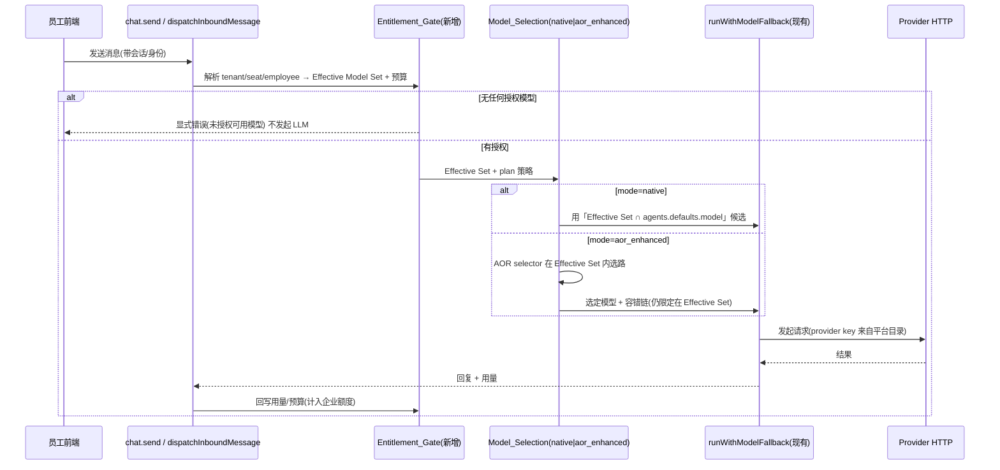

# Design Document

> 中文名：模型调用链 Entitlement 改造（Model Call-Chain Entitlement）— 平台→套餐→企业→员工 的大模型授权与收敛设计
>
> 状态：**草案（待专家团队审核）**。本文先讲清「现状 + 需求背景 + 问题」，再给出技术方案与接缝；需求条目（`R*`）与属性（`Property *`）为初稿，审核通过后再拆 `requirements.md` / `tasks.md`。
>
> 关联：`.kiro/specs/cost-budget-billing/`（套餐/订阅/预算）、`.kiro/specs/platform-agent-runtime-center/`、`.kiro/specs/platform-admin-login-isolation/`（会话域）。
>
> 证据约定：本文所有「现状」结论均带 `path:line` 代码证据，便于审核者就地核对。

## Overview

> 本节即「背景与目标」。

### 1.1 业务诉求

当前希望把「调用大模型」的路径**规范统一**为一条自上而下的授权链：

```
平台（统一配置大模型；模型引用真源，key 收敛为目标态见 §6.4/P4）
   │  按「套餐 / Plan」分发
   ▼
企业（获得本企业可用的模型集合 + 额度）
   │  按「席位 / 授权」再分发
   ▼
员工（个人用户，仅能用被授权的模型，用量计入企业额度）
```

### 1.2 两个并行目标

- **目标 A：收敛冗余**。消除「同一把 key 多来源互相覆盖」「两套模型选择体系并行」「模型配置只有全局一层」三类冗余（见 §3）。
- **目标 B：落地分层授权**。新增「平台→套餐→企业→员工」的**模型 entitlement（授权）层**，并在**运行时模型解析处真正强制**，使员工可用模型 = 企业被分发 ∩ 企业授权给该员工。

### 1.3 非目标（本期不做）

- 不做真实支付/扣费（沿用 cost-budget-billing 的 Payment/Wallet 预留位）。
- 不替换底层推理执行与容错引擎（继续复用原生 `runWithModelFallback`）。
- 不引入数据库 / 外部消息队列（沿用「租户键控 JSON 文件 + 进程内事件」范式）。
- 不在本期实现 AOR 的全部策略接入（先打通接缝，`native` 默认可回退；见 §6）。

## 1.5 评审结论与阶段切口（专家反馈采纳）

> 本节为专家团队评审后对原草案的**切口调整**。结论：方向成立，但从「全栈一起改」收敛为一条更稳的主线——**运行时授权强制优先、资产建模保守、AOR 后接、凭证收敛延后**。以下调整对本文其余章节具有最高优先级，若与早期草案描述冲突，以本节为准。

**保留为主线（评审认可）**

- 平台模型目录是唯一控制面真源；企业/员工不直接持有 provider key，只持有「可见模型引用 / entitlement」。
- 运行时必须有 **Entitlement Gate**，且放在**真正覆盖实时聊天链**的位置（`src/auto-reply/reply/agent-runner-execution.ts:200`，即 `runWithModelFallback` 之前），而非仅 UI / snapshot。
- AOR 只在**已授权集合内选路**，不做授权（`Entitlement 决定能不能用，AOR 决定在能用里选哪个`）。`plan → aorExecution` 绑定已存在（`src/gateway/models/platform-models-aor-projection.ts:19-44`）。

**三处不照搬（高风险，已调整）**

1. **不把 `model` 硬塞进现有 `EnterpriseManagedAssetType`**。现有 seat assets 带强「可交接资产」语义（handover freeze/rebound、connector reauthorization、memory transfer class；`src/gateway/enterprise-seat-assets-governance.ts:65-116 / 166-233`），与「模型调用许可」不是同一语义层。**第一版另建并行授权层**：`EnterpriseModelEntitlement` + `SeatModelGrant` + `EffectiveModelSet`；是否统一成「资产」概念留到最后再议。
2. **不先做 key 单源化 hard cutover**。当前 key 解析链很深且被多路径依赖（`src/agents/model-auth.ts:38-210`：provider config / auth profiles / env / inline / synthetic）。**拆两步**：先统一「模型引用真源」（运行时只认平台目录中的 `modelRef` 集合），**不**先统一 credential source；第一阶段只加**冲突审计 / doctor 检测**，先观测再 cutover。
3. **不复用现有 allowlist 语义做 gate**。现实现里 explicit candidate / explicit fallback **绕过** allowlist（`src/agents/model-fallback.ts:66-96 / 317-319`）。**Entitlement Gate 必须是 hard deny**：`EffectiveModelSet` 是硬边界，primary、fallback、AOR 选出的候选**全部**必须落在集合内，任何 explicit candidate 都不能越过。

**落地优先级（路线图，详见 §8.1）**

- **P1（必做）**：运行时强制 —— `resolveEffectiveModelSet(...)` + employee chat 主链 hard enforcement（不碰 AOR、不碰 key cutover）。
- **P2**：`planVersionId → 模型绑定`（旁路映射表）+ 企业/seat grant 存储。
- **P3**：`aor_enhanced` 下接 AOR（gate 之后、集合之内）。
- **P4（最后）**：key 单源化 hard cutover；seat asset 与 model entitlement 是否统一建模。

## 2. 现状（As-Is，带证据）

### 2.1 员工→大模型 的实时调用链

| 步骤        | 位置                                                                                                            | 说明                                                          |
| ----------- | --------------------------------------------------------------------------------------------------------------- | ------------------------------------------------------------- |
| 聊天入口    | `src/gateway/server-methods/chat.ts:2041`（`chat.send`）                                                        | 接收前端消息                                                  |
| 派发        | `src/gateway/server-methods/chat.ts:1821 / 2505`（`dispatchInboundMessage`）                                    | 启动 agent 运行                                               |
| 执行器      | `src/auto-reply/reply/agent-runner-execution.ts`                                                                | 调用模型容错                                                  |
| 选模型/容错 | `src/agents/model-fallback.ts:252`（`resolveFallbackCandidates`）、`runWithModelFallback`                       | **只读全局 `cfg.agents.defaults.model`（primary+fallbacks）** |
| 凭证解析    | `src/agents/model-auth.ts:38/210/417`（`resolveProviderConfig`/`resolveApiKeyForProvider`/`getApiKeyForModel`） | 解析 provider key/baseUrl                                     |
| 执行        | `runEmbeddedPiAgent` → pi-ai 适配器（`openai-completions`/`anthropic-messages`）                                | 发出 LLM HTTP                                                 |

**关键事实（已核对）**：`resolveFallbackCandidates`（model-fallback.ts:252）从全局 `cfg.agents?.defaults?.model` 解析候选，链路中**没有任何对 tenant / plan / seat / entitlement 的引用**。即：**员工能用哪个模型，完全由全局配置决定，与「企业是否授权」无关**。

### 2.2 模型配置来源与 key 解析优先级

- Schema：`models.providers.*`（`src/config/zod-schema.core.ts:257`）、`agents.defaults.model`（`src/config/zod-schema.agents.ts:8`、`src/config/model-input.ts`）。**全局单层**，所有企业/员工共享。
- Key 优先级（`src/agents/model-auth.ts:210`）：`profileId → aws override → auth-profiles → 环境变量(resolveEnvApiKey) → 内联 apiKey(resolveUsableCustomProviderApiKey:70) → ollama 合成`；另有 `~/.openbot/secrets.json`（`src/secrets/resolve.ts`、`zod-schema.core.ts:149`）。
- 候选过滤锚点：`buildConfiguredAllowlistKeys`（model-fallback.ts）存在一个**全局模型 allowlist**概念，但**非租户维度**。

### 2.3 计费 / 套餐 / 席位（已存在，但与模型解耦）

- 计费域：`src/gateway/billing/types.ts:55-170`（plan / subscription / budget），`.kiro/specs/cost-budget-billing/`。**账单维度，不下发「可用模型」**。
- 席位资产：`src/gateway/enterprise-seat-assets-store.ts`，可托管资产 `EnterpriseManagedAssetType = "agent" | "space" | "memory" | "connector" | "capability"`（约 line 108）——**不含 `model`**。即企业当前**无法把「模型」作为资产授权给员工**。
- 平台模型管理：`src/gateway/models/platform-models-config.ts`（开关 `gateway.platform.models.mode = "native" | "aor_enhanced"`，默认 `native`）、`src/gateway/server-methods/models-management.ts:76`。**只读投影/状态面，非运行时强制**。

### 2.4 AOR（Agent Orchestration Runtime）现状

- SDK：`packages/aor-sdk-node`（client/bench/coding-evaluator/workspace-objective）；策略（`cheapest/best_quality/balanced/bandit`）实现在 `@openbot/aor-core`（本仓库消费）。
- 接入状态：`src/**` 中**无 AorClient/createDefaultClient 使用**——**未接入实时聊天链路**。
- 已有接缝：`src/gateway/models/platform-models-aor-projection.ts` 的 `buildPolicyBindings` 把每个 plan 映射为 `aorExecution = { taskTypeId, selectorStrategy, evaluatorMode }`（**「套餐携带 AOR 执行策略」的数据结构已存在，但运行时未强制**）。

## 3. 问题陈述（冗余与缺口）

### 3.1 三类冗余（目标 A）

1. **Key 多来源覆盖**：同一 provider 的 key 可来自 env / 内联 apiKey / secrets.json,且有隐式优先级（model-auth.ts:210）。实测曾出现同一 DeepSeek 三套 key 互相覆盖、运行时取到失效 key 的故障。
2. **两套模型选择体系并行**：实时链路用原生 `runWithModelFallback`（native）；另有 AOR 的选择策略（§2.4）。AOR 未接入实时链路 → 平行、职责重叠。
3. **配置只有全局一层**：无平台/企业/员工的分发与收敛层,无法表达「不同企业看到不同模型」。

### 3.2 三段缺口（目标 B，运行时完全不存在）

- **缺口①（平台→企业）**：缺少「plan → 企业可用模型集合 + 额度」的 entitlement 下发（运行时）。
- **缺口②（企业→员工）**：`EnterpriseManagedAssetType` 无 `model`,企业无法对员工做模型维度授权。
- **缺口③（运行时强制）**：`resolveFallbackCandidates` 不消费调用方 tenant/seat entitlement,授权无处落地。

## Architecture

> 本节即「方案总览（To-Be）」。

引入一个**模型 Entitlement 层**作为「计费/套餐」与「运行时模型解析」之间的桥,并在运行时解析前插入**租户授权闸口（Entitlement Gate）**;AOR 作为可选的「选模型/评估」层接在闸口之后（`aor_enhanced` 模式）。

```
平台模型目录(Platform Model Catalog, 模型引用真源 modelRef; key 收敛为目标态/P4)
        │  plan_version 绑定「模型集合 + 额度 + (可选)AOR策略」(旁路映射表)
        ▼
企业模型 Entitlement(Enterprise Model Entitlement, 由订阅的 plan_version 投影; 独立 store)
        │  企业把 entitlement 内模型授权给 seat/employee(独立 SeatModelGrant, 不扩展 seat assets)
        ▼
员工有效模型集合(Effective Model Set = 企业Entitlement ∩ 席位授权)
        │  运行时闸口注入
        ▼
模型解析(resolveFallbackCandidates 之前/之内按 Effective Set 过滤候选)
        │  native: 直接用过滤后的 agents.defaults.model
        │  aor_enhanced: 交 AOR selector 在 Effective Set 内按 plan 策略选路
        ▼
runWithModelFallback(执行 + 容错, 复用现有)  →  用量回写计费/预算
```

### 4.1 分层与模块边界

```
平台端 Platform Console
  ├── Model_Catalog_Service   平台统一配置 provider/model(模型引用真源; key 见下)  缺口①上游
  └── PlanVersionModelBinding plan_version → {模型集合, 额度, AOR策略}(旁路映射表)   复用 plan_version
            │ 订阅锁定 plan_version → 投影
            ▼
企业端 Enterprise Console
  ├── Enterprise_Model_Entitlement  企业可用模型集合 + 额度(独立 store)          缺口①
  └── Seat_Model_Grant              企业把 entitlement 内模型授权给 seat/employee  缺口②(独立 SeatModelGrantStore, 不扩展 seat assets)
            │ 产生「员工有效模型集合」
            ▼
运行时 Gateway
  ├── Entitlement_Gate        解析调用方身份 → 计算 Effective Model Set      缺口③(hard deny)
  ├── Model_Selection         native: 过滤候选 / aor_enhanced: AOR selector  收敛冗余②
  └── runWithModelFallback    执行 + 容错(不变)                              复用
```

### 4.2 运行时时序（Mermaid）



## Data Models

> 提案，沿用「租户键控 JSON + version + ISO 时间戳」范式。落盘于 `CONFIG_DIR`（`~/.openbot`）。

> 落盘于 `CONFIG_DIR`（`~/.openbot`）;复用 `cost-budget-billing` 的 plan_version 锁定与事件溯源思路。

### 5.1 平台模型目录（模型引用真源）

> 口径统一（评审采纳）：平台目录是**模型引用（modelRef）的唯一真源**；`credentialRef` 是**目标态**字段——运行时 key 收敛到它发生在 **P4**（见 §6.4）。P1/P2 阶段运行时仍按现有 `model-auth.ts` 链解析 key，目录只约束「能引用哪些 modelId」。

```ts
type PlatformModelCatalogEntry = {
  modelId: string; // 如 "api-proxy-deepseek/deepseek-chat"，运行时模型引用真源
  provider: string; // baseUrl/api 等沿用 models.providers schema
  displayName: string;
  // 目标态(P4)：运行时 key 收敛到该引用；P1/P2 暂不强制，仍走 model-auth.ts 现有链
  credentialRef?: string; // → 平台密钥库条目（P4 启用）
  status: "active" | "deprecated";
};
```

### 5.2 plan_version → 模型绑定（旁路映射表，不污染 billing core）

> 评审采纳：**不**在 `billing/types.ts` 的 `PlanVersion`（`src/gateway/billing/types.ts:74-93`，含 `snapshot.seatQuota/botQuota/pricing`）里塞模型策略字段；新建**旁路映射表** `PlanVersionModelBindingStore`，键为已锁定的 `planVersionId`。好处：billing 不必感知模型运行细节；entitlement 稳定依赖已锁定版本；模型策略频繁变化也不会炸开 billing 类型。

```ts
// PlanVersionModelBindingStore：key = planVersionId
type PlanVersionModelBinding = {
  planVersionId: string; // 锁定版本（与计费一致，src/gateway/billing/types.ts:74）
  allowedModelIds: string[]; // 该套餐版本可用模型集合（modelRef，指向平台目录）
  modelQuota?: {
    /* 可选：模型维度额度；最终归集口径见 §10 开放问题 */
  };
  aorExecution?: {
    // 已存在于投影：platform-models-aor-projection.ts:19-44
    taskTypeId: string;
    selectorStrategy: "cheapest" | "best_quality" | "balanced" | "bandit";
    evaluatorMode: string;
  };
};
```

### 5.3 企业模型 Entitlement（独立并行存储，缺口①）

> 评审采纳：独立 `EnterpriseModelEntitlementStore`，由当前订阅锁定的 `planVersionId` 投影而来；**不**复用 seat assets 结构。

```ts
type EnterpriseModelEntitlement = {
  tenantId: string;
  planVersionId: string; // 来自当前订阅（已锁定版本）
  allowedModelIds: string[]; // = PlanVersionModelBinding.allowedModelIds 投影
  budgetRef?: string; // 关联企业预算（口径见 §10）
  updatedAt: string;
};
```

### 5.4 席位/员工模型授权（独立并行存储，缺口②）

> 评审采纳：**不扩展 `EnterpriseManagedAssetType`、不复用 handover-heavy 的 seat asset 结构**（理由见 §1.5-不照搬-1）。第一版建独立 `SeatModelGrantStore`。

```ts
// SeatModelGrantStore：企业把其 entitlement 中的哪些模型授权给某 seat / employee
type SeatModelGrant = {
  tenantId: string;
  seatId: string;
  employeeId?: string; // 解析自 employeeAccess.currentSeat / membership 上下文
  grantedModelIds: string[]; // 必须 ⊆ EnterpriseModelEntitlement.allowedModelIds
  status: "active" | "revoked";
  updatedAt: string;
};
```

- 轻量审计：`model.granted` / `model.revoked`（**独立**审计，不混入 `EnterpriseAssetAuditEventType`）。
- 后续若验证确需统一为「资产」概念，再收编（§1.5-P4），不在第一版做。

### 5.5 员工有效模型集合（运行时派生，不落盘）

```
EffectiveModelSet(employee) =
  EnterpriseModelEntitlement(tenant).allowedModelIds
  ∩ SeatModelGrant(seat/employee).grantedModelIds
  ∩ PlatformModelCatalog(status="active")   // 平台目录为最终上界
```

- 由独立函数 `resolveEffectiveModelSet({ tenantId, employeeId, seatId })` 计算，返回 `{ allowedModelIds, reason, source, budgetRef? }`（见 §6.1）。

## Components and Interfaces

> 本节即「运行时改造（接缝，缺口③ + 收敛②）」。

### 6.1 Entitlement Gate（新增，hard deny）

- **落点（评审采纳）**：在 `src/auto-reply/reply/agent-runner-execution.ts:200` 调用 `runWithModelFallback` **之前**插入 gate。**不只改 `resolveFallbackCandidates`**——因为 `runWithModelFallback` 还被 CLI / cron / followup / commands 复用；第一版（P1）**只覆盖「带 employee session 的 gateway chat」**。**P5（见 §6.5）将覆盖范围扩展到 followup / 协作小组多 bot 回合 / 外部渠道入站的 employee 归属会话**（按 bot 归属席位解析身份），由开关 `gateway.platform.models.entitlement.scope` 控制，默认仍为 `employee-chat`（行为不变）。
- **接口**：新增独立函数
  ```ts
  resolveEffectiveModelSet(input: { tenantId: string; employeeId: string; seatId: string }):
    { allowedModelIds: string[]; reason: string; source: "entitlement" | "grant" | "catalog"; budgetRef?: string };
  ```
  身份来源复用会话域机制（`src/gateway/platform-auth/session-context.ts` 的 tenant/employee；员工端上下文 `employeeAccess.currentSeat`，`ui/src/ui/ports/employee/render-model.ts:3148-3167`）。
- **hard deny（关键，评审采纳）**：**不复用** `buildConfiguredAllowlistKeys` 的宽松语义（现实现里 explicit candidate/fallback 绕过 allowlist，`src/agents/model-fallback.ts:66-96 / 317-319`）。新建**强过滤层**，规则：`EffectiveModelSet` 是硬边界；primary 必须在内、fallback 必须在内、AOR 选出的候选必须在内；**任何 explicit candidate 都不能越过**。
- **两种状态须区分（评审采纳）**：
  - **entitlement 未配置 / 未迁移**（该租户尚无 `EnterpriseModelEntitlement` 记录）：按**迁移期灰度开关**放行（回退到当前全局行为），属过渡态，见 §8。
  - **entitlement 已解析但结果为空**（有记录，但 `EffectiveModelSet = ∅`）：**hard deny** —— 返回显式错误（如 `MODEL_ENTITLEMENT_EMPTY`），**不发起 LLM**、**不静默回退**到全局默认模型。
  - 判定依据是「是否存在已解析的 entitlement」，而非简单看集合是否为空。

### 6.2 两种模式（保证可回退,收敛②）

- `native`（默认):闸口过滤后,直接用 `Effective ∩ agents.defaults.model` 走原生 `runWithModelFallback`。行为与现状最接近,仅多了授权过滤。
- `aor_enhanced`:闸口产出 `EffectiveModelSet` 后,交 AOR selector 按 `PlanModelBinding.aorExecution.selectorStrategy` 在集合内选路;容错链仍限定在 `EffectiveModelSet` 内。`gateway.platform.models.mode` 已存在（platform-models-config.ts）。

### 6.3 AOR 的明确职责边界

- AOR **不做授权**（授权属 Entitlement 层）。
- AOR **做选路 + 评估**:在「已授权候选集合」内按套餐策略选模型,evaluator/bandit 回写评分与用量到计费与投影（`platform-models-aor-projection.ts` 已有 bandit/路由解释投影）。
- 接入方式（二选一,审核决策点）:
  - (a) **进程内**:gateway 直接调用 `@openbot/aor-core` selector（无网络跳转,推荐）。
  - (b) **SDK/RPC**:经 `packages/aor-sdk-node` 的 client → 网关 RPC（复用 `agent.modelFallbacks` → 原生 fallback）。

### 6.4 模型引用真源 与 凭证收敛（拆两步，评审采纳）

> 评审采纳：**不**把「key 单源化 hard cutover」作为第一阶段任务（当前 key 解析链很深且多路径依赖，`src/agents/model-auth.ts:38-210`，过早 cutover 会把「授权问题」与「凭证来源问题」耦合放大、易打断现网/开发链路）。拆成两步：

- **第一步（先做，P1 内）：统一「模型引用真源」**。运行时只认平台目录中的 `modelRef` 集合（`EffectiveModelSet` 即由其约束），**不**先动 credential source。同时**只加观测**：`openclaw doctor` 增加「多源 key 冲突 / 同一 modelId 多来源」检测与告警（不删除任何 fallback）。
- **第二步（最后，P4）：凭证来源收敛**。在 entitlement 闭环、观测数据充分后，再把运行时 provider key 收敛到平台目录 `credentialRef`，弱化 env / 内联 / secrets 多源覆盖；保留一次性导入接缝。

### 6.5 运行时覆盖范围扩展（P5，评审采纳）

> 背景：P1 闸口只覆盖「带 employee session 的 webchat 1:1 主回合」（`agent-runner-execution.ts`）。但 `runWithModelFallback` 还被 followup-runner（协作小组多 bot 回合）、cron、外部渠道入站、CLI 复用，这些路径**不过闸口**，导致「bot 可用目录外/未授权模型」。P5 在保持可回退的前提下把强制扩展到「所有归属于某企业席位的 bot 运行」。

- **统一身份解析**：新增 `resolveAgentRunEntitlementScope({ agentId, sessionKey, gatewayClientUser?, gatewayClientSessionDomain? })`：
  1. 若存在 employee 受信会话（webchat）→ 复用现有会话身份（最快路径，P1 行为不变）。
  2. 否则按 **bot 归属席位**解析：`agentId → EnterpriseSeatAssetsStore` 的 seat asset 绑定（`assetType="agent"`）→ `seatId / employeeId / tenantId`。解析不到归属席位 → 视为「非企业受管运行」→ 跳过（不阻断现状）。
- **覆盖落点**：
  - followup-runner（`followup-runner.ts`）：在 `run` 上透传 originating `gatewayClientUser/SessionDomain`，或按 `agentId` 解析归属席位，应用与主回合相同的 gate（allowlist + AOR 顺序）。
  - cron（`cron/isolated-agent/run.ts`）、外部渠道入站（无受信会话）：按 bot 归属席位解析后应用 gate。
  - CLI（`commands/agent.ts`）：默认仍跳过（运维/调试入口）。
- **安全开关**：新增配置 `gateway.platform.models.entitlement.scope`：
  - `employee-chat`（**默认**，= 现状）：仅 webchat 1:1 主回合受管。
  - `all-bot-runs`：扩展到 followup / 协作小组 / cron / 外部渠道（按归属席位）。
  - 与 `entitlement.enforce`（off/missing-allow/strict）正交：`scope` 决定「哪些运行受管」，`enforce` 决定「受管运行如何判定」。
- **两态纪律不变**：扩展后的路径同样区分 missing（灰度放行）与 resolved-empty（hard deny，`MODEL_ENTITLEMENT_EMPTY`）。
- **回退**：`scope=employee-chat` 即完全回到 P1 行为；任何归属解析失败一律放行（绝不因解析不到席位而误杀现网 bot）。

## 7. 影响面与改动清单（按模块）

| 模块      | 文件（锚点）                                                                                                                                                                                                        | 改动性质                                                           |
| --------- | ------------------------------------------------------------------------------------------------------------------------------------------------------------------------------------------------------------------- | ------------------------------------------------------------------ |
| 模型解析  | `src/agents/model-fallback.ts:252`（`resolveFallbackCandidates`）、`:66-96 / :317-319`                                                                                                                              | **新建 hard-deny 过滤层**（不复用 allowlist 宽松语义；缺口③）      |
| 执行器    | `src/auto-reply/reply/agent-runner-execution.ts:200`                                                                                                                                                                | `runWithModelFallback` 之前接 Entitlement Gate（仅 employee chat） |
| 授权存储  | 新增 `EnterpriseModelEntitlementStore` / `SeatModelGrantStore`（独立）                                                                                                                                              | **并行授权层**（不扩展 seat assets；缺口①②）                       |
| 计费/套餐 | 新增 `PlanVersionModelBindingStore`（旁路）；`src/gateway/billing/types.ts:74-93` 只读引用                                                                                                                          | plan_version→模型绑定，不污染 billing core                         |
| 凭证解析  | `src/agents/model-auth.ts:38-210`                                                                                                                                                                                   | **先观测（doctor 冲突检测），后 cutover**（P4）                    |
| 平台模型  | `src/gateway/models/platform-models-config.ts`、`models-management.ts`、`platform-models-aor-projection.ts:19-44`                                                                                                   | 模型引用真源 + plan→AOR 策略落地                                   |
| AOR       | `@openbot/aor-core`、`packages/aor-sdk-node`                                                                                                                                                                        | `aor_enhanced` 选路接入（P3，集合内）                              |
| 会话/身份 | `src/gateway/platform-auth/session-context.ts`                                                                                                                                                                      | 为 Gate 提供 tenant/employee 身份                                  |
| UI        | 平台：`ui/src/ui/ports/platform/render-model.ts:43-48`；企业：`ui/src/ui/ports/enterprise/render-model.ts:31-39`（授权操作面）；员工：`ui/src/ui/ports/employee/render-model.ts:3148-3167`（只读可用模型/拒绝原因） | 三端分工见 §8.2                                                    |

## 8. 兼容性、迁移与回退

- **迁移期灰度开关（仅对「entitlement 未配置/未迁移」生效）**：尚无 `EnterpriseModelEntitlement` 记录的租户按开关放行（回退当前全局行为），避免一次性断流；灰度完成后切「默认拒绝（未配置即拒绝）」。**注意**：该宽松仅适用于「未配置」态；「已解析但为空」恒为 hard deny（见 §6.1）。
- **回退**:`gateway.platform.models.mode=native` 且关闭 entitlement 强制 = 完全回到现状路径。
- **迁移**:第一阶段先统一「模型引用真源」并加冲突观测；企业按订阅自动获得 entitlement；员工席位默认可继承企业全集（可后续收紧）。凭证收敛延后到 P4。

### 8.1 落地路线图（评审采纳的阶段切口）

| 阶段        | 范围                                                                                                                                                                                                                 | 不做                                               |
| ----------- | -------------------------------------------------------------------------------------------------------------------------------------------------------------------------------------------------------------------- | -------------------------------------------------- |
| **P1 必做** | `resolveEffectiveModelSet(tenantId, employeeId, seatId)` + 在 `agent-runner-execution.ts:200` 前 hard-deny gate + 独立 `EnterpriseModelEntitlementStore`/`SeatModelGrantStore`；**仅 employee chat**；空集 hard fail | 不碰 AOR、不碰 key cutover、不动 seat asset 主结构 |
| **P2**      | `PlanVersionModelBindingStore`（旁路，键 `planVersionId`）+ 企业/seat grant 操作面接订阅                                                                                                                             | 不污染 billing core 类型                           |
| **P3**      | `aor_enhanced` 下接 AOR selector：`planVersionId → aorExecution`，**仅在 `EffectiveModelSet` 内**选路                                                                                                                | AOR 不做授权                                       |
| **P4 最后** | 凭证来源收敛（key 单源化 hard cutover）；评估 seat asset 与 model entitlement 是否统一建模                                                                                                                           | ——                                                 |

> P1 单独交付即有业务价值：员工调用模型时**真的会被企业/seat 授权拦住**。

### 8.2 三端分工（评审采纳）

- **平台端**（控制面，`ui/src/ui/ports/platform/render-model.ts:43-48`）：管平台模型目录、`planVersion → allowedModelIds`、是否启用 `native | aor_enhanced`；**不**直接管「某员工能否用某模型」。
- **企业端**（授权操作面主入口，`ui/src/ui/ports/enterprise/render-model.ts:31-39`）：管由订阅映射出的 entitlement、seat / employee grant。
- **员工端**（只读，`ui/src/ui/ports/employee/render-model.ts:3148-3167`）：只看当前 seat、当前可用模型、被拒绝原因；不暴露平台模型管理复杂度。未来在 `employeeAccess` 自然新增 `modelIds` / `modelEntitlementSummary`。

## 9. 需求条目（初稿，待审核后拆 requirements.md）

- 1.1 平台统一配置模型 provider/key/model，作为唯一控制面真源；运行时**先统一「模型引用真源」**（只认平台目录 modelRef），凭证收敛延后（P4）。
- 2.1 `planVersionId → 模型绑定` 经**旁路映射表**（可用模型集合 + 额度 + 可选 AOR 策略），不污染 billing core。
- 3.1 企业按订阅获得模型 entitlement（独立 `EnterpriseModelEntitlementStore`，锁定 planVersionId）。
- 4.1 企业将其 entitlement 中的模型授权给 seat/employee（独立 `SeatModelGrantStore` + 轻量审计；**不**扩展 `EnterpriseManagedAssetType`）。
- 5.1 运行时（仅 employee chat，`agent-runner-execution.ts:200` 前）按 `EffectiveModelSet` **hard-deny** 过滤：primary/fallback/AOR 候选**全部**须在集合内。
- 5.2 区分两态：**entitlement 未配置/未迁移** → 按灰度开关放行；**entitlement 已解析但为空** → 显式拒绝（`MODEL_ENTITLEMENT_EMPTY`），不静默回退到全局模型。
- 6.1 用量计入企业额度/预算（对接 cost-budget-billing 的 Usage/Billing；归集口径见 §10）。
- 7.1 `native`/`aor_enhanced` 双模式；`aor_enhanced` 下 AOR 仅在 `EffectiveModelSet` 内选路+评估（P3）。
- 8.1 第一阶段提供 `doctor` 冲突**观测**（多源 key 冲突、entitlement 缺失）+ 迁移/灰度开关；**不**先删 env/inline/secrets fallback。

## Correctness Properties

> 关键属性（供属性测试 fast-check）。

### Property 1: 调用模型受限于有效集合

运行时实际调用的模型 ∈ 员工有效模型集合（永真）。

**Validates: Requirements 5.1**

### Property 2: 包含链单调

员工有效模型集合 ⊆ 企业 entitlement ⊆ plan_version 绑定 ⊆ 平台目录。

**Validates: Requirements 2.1, 3.1, 4.1**

### Property 3: 已解析空授权零出网

entitlement **已解析但 EffectiveModelSet 为空** ⇒ 不发起任何 LLM HTTP（「未配置/未迁移」态不适用本属性，按灰度开关）。

**Validates: Requirements 5.2**

### Property 4: 双模式候选一致

同一请求在 `native` 与 `aor_enhanced` 下，候选集合相同（仅选路策略不同）。

**Validates: Requirements 7.1**

### Property 5: modelRef 解析唯一可追溯（P1/P2）

运行时解析出的 `modelRef`（modelId）唯一，且可追溯到平台模型目录中一条 `active` 条目；不在目录内的 modelRef 不可被解析使用。

**Validates: Requirements 1.1**

### Property 6: credential 解析唯一可追溯（P4）

> 仅在 P4（凭证收敛）启用后成立；P1/P2/P3 阶段不作为验收属性。

key 解析结果对同一 `modelId` 唯一，且可追溯到平台目录条目的 `credentialRef`。

**Validates: Requirements 1.1**

### Property 7: explicit fallback 不能越过有效集合（hard deny）

任何 explicit candidate / explicit fallback 若不在 `EffectiveModelSet` 内，必须被剔除，不得借现有 allowlist 宽松语义绕过。

**Validates: Requirements 5.1**

## Error Handling

- **entitlement 未配置 / 未迁移**（无 `EnterpriseModelEntitlement` 记录）：按迁移期灰度开关放行（过渡态），不视为错误；灰度完成后转为「未配置即拒绝」。
- **entitlement 已解析但 EffectiveModelSet 为空**：在 Entitlement Gate 处显式返回错误（如 `MODEL_ENTITLEMENT_EMPTY`），**不发起任何 LLM HTTP**，前端给出「当前无可用模型，请联系企业管理员授权」的可读提示，而非静默回退到全局模型（对应 Property 3）。
- **请求模型不在有效集合**：候选过滤后该模型被剔除；若过滤后无任何候选 → 同上显式拒绝，不降级到未授权模型。
- **平台目录 key 解析失败 / 失效**：沿用现有 `runWithModelFallback` 的 `FailoverError`（model-fallback.ts）；但容错链仍**限定在 EffectiveModelSet 内**，不会借容错跳到未授权 provider。
- **额度超限**：交由 cost-budget-billing 的 Cost_Control 闸口（`R8/R23`）在调用前拦截；本设计只负责把「调用方/模型/用量」上下文透传给计费域。
- **审计与可见性**：两种状态都必须**显式且可审计**——「未配置/未迁移→放行」需记审计与 doctor 可见；「已解析为空→拒绝」需带 `reason`。不得出现「看似成功实则用了未授权模型」的隐式路径。

## Testing Strategy

- **属性测试（fast-check）**：覆盖 P1–P5，尤其 P1（实际调用模型 ∈ 有效集合）与 P2（包含链单调）作为硬不变量。
- **单元测试**：
  - `resolveFallbackCandidates` 注入 entitlement 过滤后的候选裁剪（含「请求模型被剔除」「集合为空」分支）。
  - 席位/员工模型授权与撤销（`SeatModelGrant`）+ 轻量审计事件（`model.granted` / `model.revoked`，独立于 seat asset 审计）。
  - planVersionId → 企业 entitlement 投影的确定性（同输入同输出）。
  - **hard-deny 过滤**：构造「explicit fallback 含未授权模型」用例，断言其被剔除（Property 6）。
- **集成测试**：`native` 与 `aor_enhanced` 两模式下，相同请求的候选集合一致、仅选路不同（P4）；entitlement 为空时不产生出网请求（P3，可用 mock provider 断言零调用）。
- **回归**：`platform-auth` / `enterprise-seat-assets` / `cost-budget-billing` 既有用例保持通过；新增「员工有效模型集合」端到端用例（员工登录 → 仅能用被授权模型）。
- **迁移演练**：空 entitlement 两种默认策略各跑一遍，确认无隐式越权路径。

## 10. 待审核者决策的开放问题（Open Questions）

1. **AOR 接入方式**:进程内 `@openbot/aor-core`（推荐,§6.3a）vs SDK/RPC（§6.3b）?
2. **席位授权粒度**:模型授权挂在「席位」还是「员工」?是否允许「企业全集继承」作为默认?
3. **额度归集口径**:模型用量预算与 cost-budget-billing 的 budget 是同一实体还是新维度?
4. **迁移期默认策略**:空 entitlement = 不限制（平滑）还是默认拒绝（安全优先）?
5. **key 单源化激进程度**:本期是否直接废弃 env / 内联 / secrets,还是先「单一优先级 + doctor 告警」?
6. **会话身份充分性**:`session-context.ts` 现有 tenant/employee 信息是否足以在 Gate 处稳定识别调用方?

## 11. 参考（代码锚点）

- 实时链路:`src/gateway/server-methods/chat.ts:2041`、`src/auto-reply/reply/agent-runner-execution.ts`、`src/agents/model-fallback.ts:252`、`src/agents/model-auth.ts:38/210/417`
- 配置:`src/config/zod-schema.core.ts:257`、`src/config/zod-schema.agents.ts:8`、`src/config/model-input.ts`
- 席位/计费:`src/gateway/enterprise-seat-assets-store.ts`、`src/gateway/billing/types.ts:55-170`
- 平台模型/AOR:`src/gateway/models/platform-models-config.ts`、`src/gateway/models/platform-models-aor-projection.ts`、`src/gateway/server-methods/models-management.ts:76`、`packages/aor-sdk-node/`、`@openbot/aor-core`
- 会话域:`src/gateway/platform-auth/session-context.ts`
