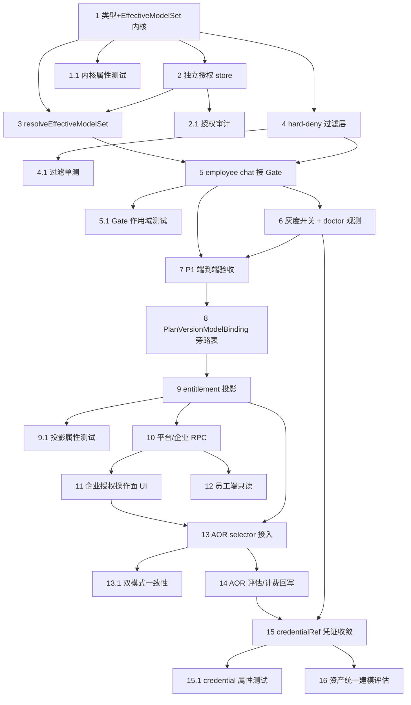

# Implementation Plan

> 关联：`.kiro/specs/model-entitlement-chain/design.md`（需求 1.1–8.1 + Property 1–7）。
>
> 实施顺序遵循专家评审采纳的阶段切口（design §1.5 / §8.1）：**P1 运行时 hard-deny 强制（仅 employee chat）→ P2 套餐绑定 + 授权操作面 → P3 aor_enhanced 接 AOR → P4 凭证收敛 + 资产统一评估**。
>
> 约定：`[P]` 标记的子任务可与同组其他 `[P]` 并行；每个任务仅触碰代码与测试，按 design 指定文件路径落地；新增 store 沿用「租户键控 JSON + `readJsonFile`/`writeJsonAtomic` + `randomUUID` + ISO 时间戳 + `version`」范式。

## Agents

- kiro-daibai · role: owner · scope: 员工端 AI 模型授权、可见会话 usage 安全归属与个人设置可视化 · paths: CHANGELOG.md, .kiro/specs/model-entitlement-chain/tasks.md, src/gateway/employee-session-visibility-policy.ts, src/gateway/employee-session-visibility-policy.test.ts, src/gateway/employee-workbench-scope.ts, src/gateway/employee-workbench-scope.test.ts, src/gateway/protocol/schema/sessions.ts, src/gateway/server-methods/usage.sessions-usage.test.ts, src/gateway/server-methods/usage.ts, src/shared/usage-types.ts, ui/src/ui/capability/model-authorization/\*\*, ui/src/ui/views/employee-model-access-section.ts, ui/src/ui/views/employee-model-access-section.browser.test.ts, ui/src/ui/views/employee-model-access.ts, ui/src/ui/views/employee-model-access.browser.test.ts · since: 2026-07-30

## Overview

核心目标：让员工实时聊天调用大模型时，**真的被企业/seat 授权拦住**。P1 单独交付即有业务价值——不碰 AOR、不碰 key cutover、不动 seat asset 主结构，仅新增并行授权层 + 运行时 hard-deny 闸口。后续阶段逐步接入套餐绑定、AOR 选路、凭证收敛。

关键不变量（贯穿全程）：

- **hard deny**：运行时实际可用候选（primary/fallback/AOR 选出）∈ `EffectiveModelSet`，任何 explicit candidate 不得越过（Property 7）。
- **两态区分**：entitlement「未配置/未迁移」→ 灰度开关放行；「已解析但为空」→ 显式拒绝、零出网（Property 3）。

## Tasks

### Phase P1：运行时 hard-deny 强制（必做，仅 employee chat）

- [x] 1. 建立 entitlement 类型与 EffectiveModelSet 纯函数内核
  - 新建 `src/gateway/model-entitlement/types.ts`：定义 `EnterpriseModelEntitlement`、`SeatModelGrant`、`EffectiveModelSetResult { allowedModelIds: string[]; state: "missing" | "resolved"; reason: string; source: "entitlement" | "grant" | "catalog"; budgetRef？}`，以及 `PlatformModelCatalogEntry`（`modelId`/`provider`/`displayName`/`status`，`credentialRef?` 标注为 P4 目标态）
  - 新建 `src/gateway/model-entitlement/effective-set.ts`：纯函数 `computeEffectiveModelSet({ entitlement, grant, catalogActiveModelIds })` → 三者交集；**显式区分** `state="missing"`（无 entitlement 记录）与 `state="resolved"` 且 `allowedModelIds=[]`（已解析为空）
  - 不 import 任何 IO / gateway / lit（保持可属性测试）
  - _Requirements: 3.1, 4.1, 5.1, 5.2_

- [x] 1.1 [P] EffectiveModelSet 内核属性测试
  - 新建 `src/gateway/model-entitlement/effective-set.property.test.ts`（`// @vitest-environment node` + fast-check）：包含链单调（员工集 ⊆ 企业 entitlement ⊆ 平台目录）、missing 与 resolved-empty 可区分、交集幂等
  - _Properties: Property 2, Property 3_

- [x] 2. 独立授权层 store（不扩展 seat assets）
  - 新建 `src/gateway/model-entitlement/enterprise-model-entitlement-store.ts`：`EnterpriseModelEntitlementStore`（tenant 键控 JSON，落盘 `CONFIG_DIR/openbot-model-entitlement.json`；`getEntitlement`/`upsertEntitlement`/`listEntitlements`）
  - 新建 `src/gateway/model-entitlement/seat-model-grant-store.ts`：`SeatModelGrantStore`（落盘 `CONFIG_DIR/openbot-seat-model-grant.json`；`getGrant`/`grantModels`/`revokeModels`/`listGrantsForTenant`）
  - **不**修改 `src/gateway/enterprise-seat-assets-store.ts`、**不**新增 `EnterpriseManagedAssetType` 成员
  - _Requirements: 3.1, 4.1_

- [x] 2.1 [P] 独立授权审计
  - 新建 `src/gateway/model-entitlement/model-grant-audit.ts`：轻量 append-only 审计事件 `model.granted` / `model.revoked`（独立于 `EnterpriseAssetAuditEventType`）
  - _Requirements: 4.1_

- [x] 3. 运行时解析函数 resolveEffectiveModelSet
  - 新建 `src/gateway/model-entitlement/resolve-effective-model-set.ts`：`resolveEffectiveModelSet({ tenantId, employeeId, seatId })` → 读 `EnterpriseModelEntitlementStore` + `SeatModelGrantStore` + 平台目录 `status="active"` modelIds → 调 `computeEffectiveModelSet`
  - 身份解析复用 `src/gateway/platform-auth/session-context.ts`（tenant/employee）与员工席位上下文（`employeeAccess.currentSeat`，参考 `ui/src/ui/ports/employee/render-model.ts:3148-3167`）
  - 返回结构带 `state`（missing/resolved）供调用方区分放行 vs 拒绝
  - _Requirements: 5.1, 5.2_

- [x] 4. hard-deny 过滤层（不复用现有 allowlist 宽松语义）
  - 在 `src/agents/model-fallback.ts` 新增 `applyEntitlementHardDeny(candidates, effectiveModelIds)`：从候选中剔除所有不在 `effectiveModelIds` 内的项，**包含 explicit candidate / explicit fallback**（修正 `model-fallback.ts:66-96 / 317-319` 的绕过路径，但**不改动** `buildConfiguredAllowlistKeys` 既有配置级语义，二者并存）
  - hard-deny 在 `resolveFallbackCandidates` 产出候选**之后**统一应用
  - _Requirements: 5.1_

- [x] 4.1 [P] hard-deny 过滤单元测试
  - 新建 `src/agents/model-fallback.entitlement.test.ts`：构造「explicit fallback 含未授权模型」用例，断言其被剔除；primary 不在集合内时被剔除；集合外候选一律不出现
  - _Properties: Property 7_

- [x] 5. 在 employee chat 主链接入 Entitlement Gate
  - 在 `src/auto-reply/reply/agent-runner-execution.ts:200`（`runWithModelFallback` 调用之前）插入闸口：**仅当调用方为「带 employee session 的 gateway chat」时启用**；调用 `resolveEffectiveModelSet` → 用 `applyEntitlementHardDeny` 过滤候选
  - 作用域边界：无 employee session 的调用（CLI / cron / followup / commands）**跳过** gate，保持现状（避免误伤其它 runtime 入口）
  - `state="resolved"` 且过滤后无候选 → 抛显式错误 `MODEL_ENTITLEMENT_EMPTY`，**不发起 LLM**、**不静默回退**全局默认模型
  - `state="missing"` → 交由灰度开关（任务 6）决定放行/拒绝
  - _Requirements: 5.1, 5.2_

- [x] 5.1 [P] Gate 作用域与拒绝路径单元测试
  - 新建 `src/auto-reply/reply/agent-runner-execution.entitlement.test.ts`：employee chat 走 gate；非 employee 入口跳过；resolved-empty 抛 `MODEL_ENTITLEMENT_EMPTY` 且未调用 provider（mock 断言零调用）
  - _Properties: Property 1, Property 3_

- [x] 6. 迁移期灰度开关 + doctor 观测（先观测不删 fallback）
  - 配置 schema 增 `gateway.platform.models.entitlement.enforce`（枚举：`off` | `missing-allow` | `strict`，默认 `missing-allow`）：`missing-allow` 下「未配置 entitlement」放行、「已解析为空」仍 hard deny
  - `openclaw doctor` 增加只读体检：①同一 `modelId` 多来源 key 冲突（inline 字面 `apiKey` 与已设置的规范 env 候选并存，口径对齐 `model-auth.ts`；不再误用 `secrets.providers`）②租户 entitlement 缺失（按 active 订阅逐租户核查）；**仅告警，不删除任何 fallback**
  - _Requirements: 1.1, 8.1_

- [x] 7. P1 端到端验收测试
  - 新建 `src/gateway/model-entitlement/p1-employee-chat.integration.test.ts`（注：vitest 配置 exclude `*.e2e.test.ts`，故用 `.integration.test.ts`）：员工登录 → 仅能用被授权模型；请求未授权模型（含放进 explicit fallback）被拒；resolved-empty 时零出网；missing 时按开关放行
  - _Requirements: 5.1, 5.2_
  - _Properties: Property 1, Property 3, Property 7_

### P1 整改记录（专家复评闭环，2026-06）

> 专家首轮复评列出 4 个阻断项；以下为闭环结果（带 `path:line` 证据），P1 已据此达门。

- [x] 7.1 doctor 真正接入 CLI（不再停留在 helper）
  - `src/commands/doctor.ts:20` import、`:252` 调用 `runEntitlementDoctorChecks(cfg)`，命中的 issue 经 `note(..., "Model Entitlement")` 在 `openbot doctor` 输出可见。
  - _Requirements: 8.1_

- [x] 7.2 enforce 进入配置 type 体系（不再仅防御式读取）
  - `src/config/types.gateway.ts:439-450`：`GatewayPlatformModelsEntitlementEnforceMode` + `GatewayPlatformModelsEntitlementConfig` + `GatewayPlatformModelsConfig.entitlement?`。
  - `src/gateway/model-entitlement/entitlement-config.ts:23` 类型化读取 `cfg.gateway.platform.models.entitlement.enforce`（移除 `asRecord`）；`schema.help.ts` / `schema.labels.ts` 补元数据。
  - _Requirements: 8.1_

- [x] 7.3 entitlement_missing 改为 per-tenant（不再「store 全空才告警」）
  - `src/gateway/billing/subscriptions-store.ts` 新增只读 `listActiveSubscriptionTenantIds()`。
  - `src/gateway/model-entitlement/doctor-checks.ts:111-124`：枚举有 active 订阅的租户，逐个核查缺 entitlement 记录者，单独告警（带 `tenantId`）。
  - _Requirements: 8.1_

- [x] 7.4 seat / employee 双粒度授权（按设计实现，不降级 spec）
  - `src/gateway/model-entitlement/types.ts:43-53`：`SeatModelGrant` 增 `subjectType: "seat"|"employee"` + `subjectId`。
  - `seat-model-grant-store.ts:37-38` key=`tenant::subjectType::subjectId`；通用 `get/set/revokeModelGrant` + `grantEmployeeModels`/`getEmployeeModelGrant`，保留 `grantSeatModels` 兼容包装。
  - `resolve-effective-model-set.ts:70-76`：employee 级 grant 优先，无则回退 seat 级。
  - _Requirements: 4.1, 5.1_

- [x] 7.5 整改回归
  - 新增 `src/gateway/model-entitlement/doctor-checks.test.ts`（key 冲突 + per-tenant 缺失）；扩展 `p1-employee-chat.integration.test.ts`（employee 优先级、seat 回退、per-tenant doctor）。
  - 复跑：model-entitlement 全套 + fallback + gate **35 测试通过**；`pnpm build` 通过。
  - _Requirements: 8.1_

### Phase P2：套餐绑定（planVersion → 模型）+ 企业/seat 授权操作面

- [x] 8. PlanVersionModelBinding 旁路映射表（不污染 billing core）
  - 新建 `src/gateway/model-entitlement/plan-version-model-binding-store.ts`：`PlanVersionModelBindingStore`，键为 `planVersionId`（落盘 `CONFIG_DIR/openbot-plan-model-binding.json`）；字段 `allowedModelIds` / `modelQuota?` / `aorExecution?`
  - **不**修改 `src/gateway/billing/types.ts` 的 `PlanVersion`（仅按 `planVersionId` 只读引用，参考 `billing/types.ts:74-93`）
  - 单测 `plan-version-model-binding-store.test.ts`（5 测试通过）
  - _Requirements: 2.1_

- [x] 9. 企业 entitlement 由订阅投影
  - 新建 `src/gateway/model-entitlement/entitlement-projection.ts`：`computeEntitlementProjection`（纯函数，确定性；缺订阅→`shouldProject:false`，无 binding→resolved-empty）+ `refreshEnterpriseModelEntitlement`（读订阅 + binding，写 entitlement）
  - 集成测 `entitlement-projection.integration.test.ts`（3 测试通过）
  - _Requirements: 3.1_
  - _Properties: Property 2_

- [x] 9.1 [P] 投影确定性属性测试
  - 新建 `src/gateway/model-entitlement/entitlement-projection.property.test.ts`：同一 planVersionId + binding 输入投影结果一致；企业集 ⊆ planVersion 绑定（3 测试通过）
  - _Properties: Property 2_

- [x] 10. 平台/企业 RPC 处理组
  - 新建 `src/gateway/server-methods/model-entitlement-management.ts`：平台侧 `platform-model-binding.*`（set/get/list，维护 planVersion → allowedModelIds + modelQuota + aorExecution）；企业侧 `enterprise-model-grant.*`（grant/revoke/list，subjectType seat|employee）
  - 方法名遵循 `group.verb-object` 点分 kebab；注册进 `src/gateway/server-methods.ts`（imports + spread）
  - 企业侧授权方法校验 `grantedModelIds ⊆ EnterpriseModelEntitlement.allowedModelIds`（越权授权被拒）
  - 单测 `model-entitlement-management.test.ts`（7 测试通过）
  - _Requirements: 2.1, 3.1, 4.1_

- [x] 11. 企业端授权操作面 UI（主入口）
  - 新建 UI 模型授权 capability 模块 `ui/src/ui/capability/model-authorization/`：`types.ts`、`endpoints.ts`、`gateway-client.ts`、`view-model.ts`（`buildEnterpriseAuthorizationView`）、`client-singleton.ts`、`index.ts`
  - 新建 `ui/src/ui/views/model-authorization-panel.ts`（纯展示）+ `model-authorization-section.ts`（自包含 LitElement `<model-authorization-section>`，自行加载 entitlement/grants 并对 seat/employee 授予/撤销/新增主体）
  - **已真正挂载主表面**：在企业端访问控制（设置）「集成与密钥」区块挂载 `<model-authorization-section>`（`enterprise-access-control-surface.ts` 的 `renderIntegrationsSection`，传入 `props.client` + `currentTenantId`）
  - 测试：`view-model.test.ts`（7）、`model-authorization-panel.browser.test.ts`（4）、`model-authorization-section.browser.test.ts`（2，断言加载/勾选→grant）
  - _Requirements: 4.1_

- [x] 12. 员工端只读可用模型 + 拒绝原因
  - 网关侧 `src/gateway/server-methods/employee-model-access.ts`（`employee-model-access.summary`，server-side 解析受信 seat 上下文，无注入面）；注册进 `server-methods.ts`
  - UI 侧 `view-model.ts` 的 `buildEmployeeModelView`（两态：missing=未配置、resolved 空集=被拒）+ `employee-model-access.ts`（纯展示）+ `employee-model-access-section.ts`（自包含 LitElement `<employee-model-access-section>`）
  - **已真正挂载主表面**：在员工端个人设置页（`workbench-stage-module.ts` 的 `renderPersonalSettingsPage`）挂载 `<employee-model-access-section>`；客户端经 `setModelAuthorizationClient(state.client)`（`app-render.ts`，同 governance 单例范式）注入
  - 测试：`employee-model-access.test.ts`（3 后端）、`view-model.test.ts`（员工视图 3）、`employee-model-access.browser.test.ts`（3）、`employee-model-access-section.browser.test.ts`（2，断言加载/失败降级）
  - _Requirements: 5.2_

### P2 整改记录（专家复评闭环，2026-06）

> 专家复评指出：组件已写但未真正接入主表面（任务 11/12 未闭环），且员工摘要 RPC 命名漂移。以下为闭环结果。

- [x] 11.1 企业授权面板真正接入主表面
  - `ui/src/ui/ports/enterprise/views/enterprise-access-control-surface.ts`：side-effect import `<model-authorization-section>`，在 `renderIntegrationsSection` 末尾按 `props.client` 条件挂载（传 `enterpriseId=currentTenantId`）。
  - _Requirements: 4.1_

- [x] 12.1 员工只读视图真正接入主表面
  - `ui/src/ui/ports/employee/views/workbench-stage-module.ts`：side-effect import `<employee-model-access-section>`，在 `renderPersonalSettingsPage` 顶部作为首个设置卡片挂载。
  - `ui/src/ui/app-render.ts`：渲染员工工作台前 `setModelAuthorizationClient(state.client)` 注入网关客户端（单例范式，避免逐层透传 client）。
  - _Requirements: 5.2_

- [x] 12.2 员工摘要 RPC 命名收敛
  - 统一保留 `employee-model-access.summary`（后端 handler + 前端 `MODEL_AUTHORIZATION_ENDPOINTS.employeeSummary` 一致）；不存在 `employee-model-entitlement.summary` 平行路径。
  - _Requirements: 5.2_

### Phase P3：aor_enhanced 接 AOR（gate 之后，集合之内）

- [x] 13. AOR selector 接入（仅 aor_enhanced）
  - 新建 `src/gateway/model-entitlement/aor-selection.ts`：纯函数 `selectModelOrderWithinEffectiveSet`（进程内 `@openbot/aor-core` `rankModels`）——`aor_enhanced` + 套餐 `aorExecution` 时在 EffectiveModelSet **内**按策略重排候选；`native` / 无绑定时原序返回。**保集合重排**，不增删成员（Property 4），输出 ⊆ effective（Property 7）
  - `src/agents/model-fallback.ts` 新增 `applyPreferredModelOrder`（hard-deny 之后做保集合重排）+ `runWithModelFallback` 增 `preferredModelOrder?` 参数
  - `src/gateway/model-entitlement/employee-model-gate.ts` 增 `resolveEmployeeModelGate`（一次解析 allowlist + AOR 顺序；`resolveEmployeeEntitlementAllowlist` 保留为兼容包装）；`agent-runner-execution.ts` 的 gate 调用改用 `resolveEmployeeModelGate` 并把 `preferredModelOrder` 传入 `runWithModelFallback`
  - 选出的候选链仍经 `applyEntitlementHardDeny` 二次保证不越界
  - _Requirements: 7.1_
  - _Properties: Property 4, Property 7_

- [x] 13.1 [P] 双模式候选一致性测试
  - 新建 `src/gateway/model-entitlement/aor-selection.test.ts`（node + fast-check）：native 与 aor_enhanced 候选集合恒等（仅排序不同）；AOR 输出 ⊆ EffectiveModelSet；cheapest/best_quality 排序断言
  - `src/agents/model-fallback.aor-order.test.ts`：`applyPreferredModelOrder` 保集合重排属性
  - `src/gateway/model-entitlement/employee-model-gate.aor.test.ts`：gate 在 aor_enhanced + 套餐 aorExecution 下产出 preferredModelOrder；native / 无绑定 / 非 employee 不产出
  - _Properties: Property 4, Property 7_

- [x] 14. AOR 评估/bandit 回写 + 用量计费
  - 新建 `src/gateway/model-entitlement/aor-feedback.ts`：`recordAorRunFeedback` 把一次运行的完成反馈写入持久化 bandit 状态文件（`gateway.platform.models.aor.banditStatePath`）；`platform-models-aor-projection.ts` 的 `loadBanditArms` 读取同一文件，故 bandit 状态**无需改投影代码**即随回写反映到平台模型状态面
  - **路由解释写入链路（收口）**：`recordAorRoutingExplanation` 以 JSONL 追加写入 `gateway.platform.models.aor.auditLogPath`，字段形态与投影 `loadAuditExplanations` 读取格式严格对齐（runId/taskType/strategy/selection{model,reason,score}/evaluationScore/occurredAt）；`employee-model-gate.ts` 增 `aorRouting`（taskTypeId/strategy/auditLogPath + 各 modelId 选路解释，仅 enableRoutingExplanations + auditLogPath 时给出）；`agent-runner-execution.ts` 在运行成功后用实际选中模型写入。投影侧 `routingExplanations` 即随之反映
  - `employee-model-gate.ts` 增 `aorFeedback`（taskTypeId + banditStatePath，仅 enableBandit 时给出）；`agent-runner-execution.ts` 在 `runWithModelFallback` 成功后调 `recordAorRunFeedback`（用实际执行的 provider/model）
  - 用量计费：模型用量沿用既有 usage 事件计入 cost-budget-billing，**不**重复计费
  - 测试：`aor-feedback.test.ts`（7：bandit 写入/缺字段跳过/累积 + 路由解释写入/跳过/追加 + 经投影读回端到端）
  - _Requirements: 6.1, 7.1_

### Phase P4：凭证收敛 + 资产统一评估（最后）

- [x] 15. credentialRef 凭证收敛（hard cutover）
  - `src/agents/model-credential-source.ts`：`resolveModelCredentialsMode`（读 `gateway.platform.models.credentials.mode`，默认 `legacy`）+ 纯函数 `resolveProviderCredentialSource`（平台目录内联/SecretRef 单一权威凭证，确定性、可追溯到 `credentialRef`）
  - `src/agents/model-auth.ts` 的 `resolveApiKeyForProvider`：`catalog` 模式下在 `resolveEnvApiKey` **之前**插入目录凭证解析——内联凭证优先于 ambient env（消除遮蔽），仍排在显式 auth-profiles 之后；未配置目录凭证则回退 legacy 链（回退开关恒在）
  - 配置类型 `GatewayPlatformModelsCredentialsConfig`（types.gateway.ts）+ `schema.help.ts` / `schema.labels.ts` 元数据
  - 默认 `legacy`，**运行时行为零变化**；`catalog` 为显式 opt-in、可随时切回
  - 前置条件：任务 6 的 doctor 多源 key 冲突观测（已落地，作为切换前的观测依据）
  - _Requirements: 1.1_
  - _Properties: Property 6_

- [x] 15.1 [P] credential 单源可追溯属性测试
  - 新建 `src/agents/model-auth.credential-source.property.test.ts`：同一 provider+cfg 解析唯一确定（多次一致）、可追溯到 `credentialRef`；内联凭证不被 ambient env 遮蔽；默认 legacy；未配置目录凭证返回 null（6 测试）
  - _Properties: Property 6_

### P4 整改记录（专家复评闭环，2026-06）

> 专家复评指出任务 15 差最后半步：可追溯性未进运行时返回值、SecretRef 目录形态缺专项闭环证据、catalog 分支疑似重复。以下为闭环结果（带 `path` 证据）。

- [x] 15.2 credentialRef 贯通运行时主链返回值
  - `src/agents/model-auth.ts`：`ResolvedProviderAuth` 新增 `credentialRef?`；`resolveApiKeyForProvider` 的 catalog 分支显式带出 credentialRef（内联→`config:models.providers.<p>.apiKey`、env marker→`env:<label>`、SecretRef→`secret:<source>:<provider>:<id>`）。运行时「单一来源且可追溯」now有硬证据。
  - _Requirements: 1.1_
  - _Properties: Property 6_

- [x] 15.3 SecretRef 目录凭证形态闭环 + 专项测试
  - `src/agents/model-credential-source.ts` 新增 async `resolveCatalogProviderCredential`：覆盖**三种目录凭证形态**（SecretRef 对象/`$REF` 字符串 经 secrets runtime 解析、内联字面 key、env marker）；新增 `getRawProviderApiKeyInput`（model-auth.ts）读取未规范化的 apiKey 以识别 SecretRef。
  - catalog 分支改用该 async 解析（替换仅覆盖内联/marker 的同步版）。
  - 专项测试 `model-auth.credential-catalog.test.ts`：provider apiKey 配为 SecretRef（env source）+ 存在冲突 ambient env，断言 `resolveApiKeyForProvider` 稳定走平台目录 SecretRef 来源（非回退 env/legacy）且 credentialRef=`secret:env:default:<id>`；并补内联 catalog credentialRef 断言。
  - _Requirements: 1.1_
  - _Properties: Property 6_

- [x] 15.4 收口 catalog 分支
  - `resolveApiKeyForProvider` 仅保留**单一** catalog 分支（`grep -c` = 1），消除此前的重复判断歧义。
  - 复跑：model-auth 全套 52 测试通过；`pnpm build` 通过。
  - _Requirements: 1.1_

- [x] 16. 评估 seat asset 与 model entitlement 是否统一建模（决策项）
  - 输出评估文档 `.kiro/specs/model-entitlement-chain/seat-asset-unification-assessment.md`：方案对比 + handover/freeze/审计/运行时/回归风险代价分析
  - **结论：维持独立并行授权层（`SeatModelGrantStore`），不收编进 `EnterpriseManagedAssetType`**；附「重估触发条件」
  - _Requirements: 4.1_

### Phase P5：运行时覆盖范围扩展（followup / 协作小组 / 外部渠道）

> 设计：design §6.5。把 entitlement 强制从「仅 employee webchat 1:1」扩展到所有归属企业席位的 bot 运行。安全开关 `gateway.platform.models.entitlement.scope`（`employee-chat` 默认 = 现状；`all-bot-runs` = 扩展），归属解析失败一律放行（绝不误杀现网 bot）。

- [x] 17. scope 开关 + 统一身份解析
  - 配置 type `GatewayPlatformModelsEntitlementScope`（`employee-chat` | `all-bot-runs`，默认 `employee-chat`）+ zod schema（`zod-schema.ts:879`）+ `schema.help.ts`/`schema.labels.ts`；`entitlement-config.ts` 增 `resolveModelEntitlementScope`
  - 新建 `src/gateway/model-entitlement/resolve-agent-run-scope.ts`：`resolveAgentRunEntitlementScope({ agentId })` → `{ tenantId, seatId, employeeId? } | null`；按 `agentId → EnterpriseSeatAssetsStore` 的 active `assetType="agent"` 绑定解析（回退 `seat.defaultAgentAssetIds`）；解析不到/已撤销 → null（放行依据）
  - `employee-model-gate.ts` 重构为双身份源：优先 employee 受信会话；否则（scope=all-bot-runs）按 agentId 归属席位
  - _Requirements: 5.1, 8.1_

- [x] 17.1 [P] 归属解析单测
  - `resolve-agent-run-scope.test.ts`（4）：active 绑定解析；default agent 回退；已撤销不解析；未知/空 → null
  - _Properties: Property 1_

- [x] 18. followup-runner 接入闸口（协作小组多 bot 回合）
  - `FollowupRun.run` 增 `gatewayClientUser?` / `gatewayClientSessionDomain?`（`queue/types.ts`）；`get-reply-run.ts` 构建 run 时从 `ctx` 透传发起会话身份
  - `followup-runner.ts` 在 `runWithModelFallback` 前调 `resolveEmployeeModelGate({ agentId, gatewayClientUser, gatewayClientSessionDomain })`，传入 allowlist + preferredModelOrder
  - 仅当 `scope=all-bot-runs`（或发起为 employee 会话）时强制；默认 employee-chat 不影响现状
  - _Requirements: 5.1, 5.2_

- [x] 18.1 [P] followup / 归属 gate 测试
  - `employee-model-gate.all-bot-runs.test.ts`（4）：默认 employee-chat 不受管；all-bot-runs 仅授权模型进 allowlist；resolved-empty → `[]`（hard deny）；无归属 bot → 放行
  - _Properties: Property 1, Property 3, Property 7_

- [x] 19. cron / 外部渠道入站接入闸口（按归属席位）
  - `cron/isolated-agent/run.ts`：`runPrompt` 内按 `resolveEmployeeModelGate({ agentId })` 接入 gate（scope=all-bot-runs 生效）
  - 外部渠道入站：经主执行器 `agent-runner-execution.ts`，gate 调用补 `agentId`，scope=all-bot-runs 下按归属席位解析（无 employee 会话也覆盖）
  - 解析不到归属 → 放行（不误杀）
  - _Requirements: 5.1, 5.2_

- [x] 19.1 [P] cron/外部渠道 gate 测试
  - 由 `employee-model-gate.all-bot-runs.test.ts` 覆盖（按归属席位 hard-deny / 放行 / 无归属放行）；gate 为 cron 与外部渠道共用同一解析
  - _Properties: Property 1, Property 7_

- [x] 20. P5 验收 + 文档
  - gate 级双档对比测试已覆盖（`employee-chat` allowlist undefined vs `all-bot-runs` 强制）；scope 元数据进 `schema.help.ts`/`schema.labels.ts`（doctor/config 面可见当前档位）
  - 复跑：P5 相关 19 测试通过；`pnpm build` 通过、无 dynamic-import 警告
  - _Requirements: 5.1, 5.2, 8.1_

### Phase P6：平台「套餐⇄模型」统一配置面（数据层仍解耦）

> 设计 §5.2 / §8.2。billing 套餐与 plan-model 绑定**两个 store 保持解耦**，仅在平台端补一个统一操作面把二者藏在一个界面后：每个套餐勾选平台目录模型 → 一次保存写绑定并自动刷新存量订阅企业 entitlement；并提供"模型→套餐"反向视图（N:N）。

- [x] 21. 后端聚合 RPC + 写后自动刷新
  - `platform-model-binding.overview`（`model-entitlement-management.ts`）：聚合 `listPlans` + `listPlanVersionModelBindings` + `listConfiguredModelIds(cfg)` → `{ catalog, plans[{planId,name,status,currentVersionId,allowedModelIds,aorExecution?,modelQuota?}], reverseIndex }`
  - `platform-model-binding.set` 写绑定后调 `refreshEntitlementsForPlanVersion(planVersionId)` 刷新存量订阅企业 entitlement，返回 `refreshedTenantIds`
  - `session-domain.ts` 增 `platform-model-binding.overview` → platform 域守卫
  - 测试：`model-entitlement-management.test.ts` 增 overview 聚合 + 反向索引（9 测试通过）
  - _Requirements: 2.1, 3.1_

- [x] 22. 平台端统一配置面 UI
  - 新建 capability `ui/src/ui/capability/platform-model-binding/`（types/endpoints/gateway-client/view-model/index）：`buildPlatformModelBindingView`（正向矩阵 + 反向视图）、`toggleModelForPlan`（纯函数产出新 allowedModelIds）
  - 新建自包含组件 `ui/src/ui/views/platform-plan-model-binding-section.ts`：加载 overview → 每个套餐勾选目录模型（保存即 set + 自动刷新提示）+ 模型→套餐反向视图
  - 挂载到平台「套餐与定价管理」页（`ui/src/ui/ports/platform/pricing/page.ts`）
  - 测试：`platform-model-binding/__tests__/view-model.test.ts`（5）+ `platform-plan-model-binding-section.browser.test.ts`（2）
  - _Requirements: 2.1_

## 阶段交付门（Gate Criteria）

- **P1 完成判定**：员工端发消息只能用被授权模型；未授权模型（含 explicit fallback）被 hard deny；resolved-empty 零出网；非 employee 入口不受影响；doctor 能观测 key 冲突与 entitlement 缺失。
- **P2 完成判定**：平台维护 planVersion→模型绑定；企业按订阅自动获得 entitlement 并可对 seat/employee 授权；员工端可见可用模型与拒绝原因。
- **P3 完成判定**：`aor_enhanced` 下 AOR 在授权集合内选路，候选不越界；`native` 行为不变。
- **P4 完成判定**：运行时 key 单一来源且可追溯；seat/entitlement 建模归一决策落地。
- **P5 完成判定**：`scope=all-bot-runs` 下，followup / 协作小组多 bot / cron / 外部渠道入站的 bot 运行按归属席位受 entitlement 强制（未授权 hard deny、resolved-empty 零出网）；`scope=employee-chat`（默认）行为与 P1 完全一致；归属解析失败一律放行，不误杀现网 bot。
- **P6 完成判定**：平台端在套餐管理页可在每个套餐下勾选平台目录模型，一次保存写 plan-model 绑定并自动刷新存量订阅企业 entitlement；提供模型→套餐反向视图；billing 与 plan-model 两 store 仍解耦（仅 UI 合并）。

## Task Dependency Graph

```json
{
  "waves": [
    { "id": 0, "tasks": ["1"] },
    { "id": 1, "tasks": ["1.1", "2", "4"] },
    { "id": 2, "tasks": ["2.1", "3", "4.1"] },
    { "id": 3, "tasks": ["5"] },
    { "id": 4, "tasks": ["5.1", "6"] },
    { "id": 5, "tasks": ["7"] },
    { "id": 6, "tasks": ["8"] },
    { "id": 7, "tasks": ["9"] },
    { "id": 8, "tasks": ["9.1", "10"] },
    { "id": 9, "tasks": ["11", "12"] },
    { "id": 10, "tasks": ["13"] },
    { "id": 11, "tasks": ["13.1", "14"] },
    { "id": 12, "tasks": ["15"] },
    { "id": 13, "tasks": ["15.1", "16"] }
  ]
}
```



依赖要点：

- **P1 内部**：任务 1 是所有内核/存储/解析的根；任务 5（接 Gate）依赖 3（解析）+ 4（过滤）；任务 7（验收）依赖 5 + 6。
- **跨阶段**：P2 起点任务 8 依赖 P1 验收通过（T7）；P3 任务 13 依赖企业授权链（T11）与投影（T9）；P4 任务 15 依赖 AOR 回写（T14）与 doctor 观测数据（T6）。

## Notes

- **可立即并行**：所有 `[P]` 属性/单元测试任务可与同组实现并行编写；任务 1 完成后，2 / 4 可并行推进。
- **作用域纪律**：P1 严禁触碰 `src/agents/model-auth.ts` 的 key 解析改造、严禁修改 `enterprise-seat-assets-store.ts` 主结构、严禁改动 `buildConfiguredAllowlistKeys` 既有语义（仅新增并存的 hard-deny 层）。
- **两态不可混淆**：实现与测试中必须显式携带 `state: "missing" | "resolved"`；不得用「集合为空」单一条件同时表达「未配置」与「已解析为空」。
- **回退**：`gateway.platform.models.mode=native` + `entitlement.enforce=off` = 完全回到现状路径，作为各阶段的紧急回退开关。
- **测试范式**：纯函数（effective-set / projection）用 `// @vitest-environment node` + fast-check 属性测试；运行时 gate 用 mock provider 断言「零出网」。
- **不新增**：不引入数据库 / 外部队列 / 新依赖；store 复用既有 JSON 原子写范式。
- 运行 `pnpm test` / `pnpm check` 于改动后；涉及内存压力时用 `OPENBOT_TEST_PROFILE=low`。
