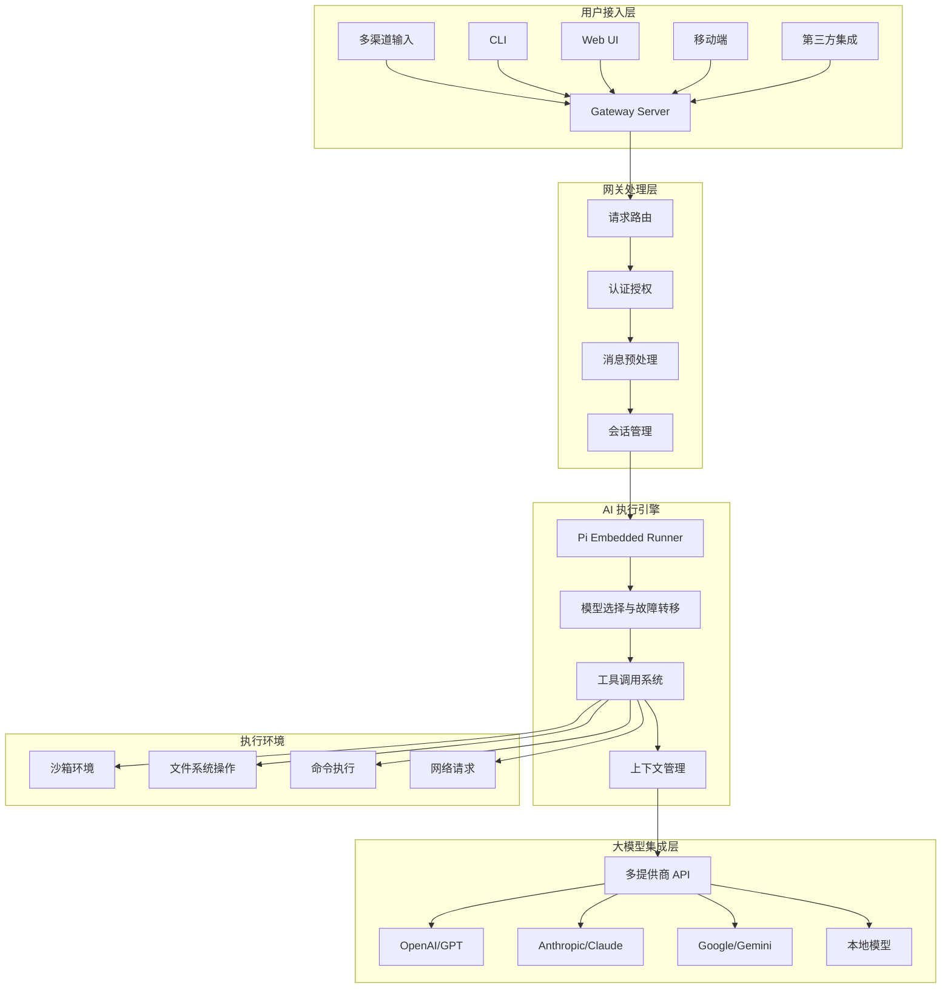
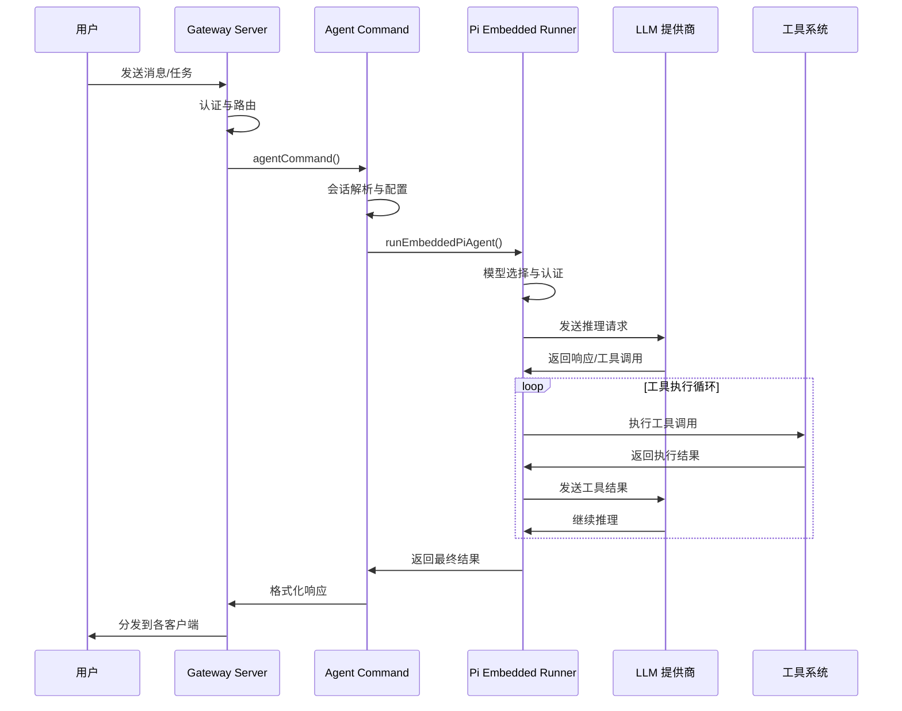

# OpenClaw 任务执行流程技术分析规格文档

## 概述

本文档深入分析 OpenClaw 项目的任务执行机制，重点关注用户需求理解、技能匹配、任务执行业务逻辑和大模型集成点。OpenClaw 是一个基于 @mariozechner/pi-coding-agent 的 AI 助手系统，通过多渠道网关架构实现统一的任务处理和执行流程。

## 系统架构概览

OpenClaw 采用分层架构设计，主要包含以下核心组件：

### 核心架构层次



## 主要执行流程

### 任务执行序列图



## 核心组件详细分析

### 1. 用户需求理解机制

#### 1.1 消息接入与预处理

**入口点**: `src/gateway/server-methods/chat.ts`

```typescript
// 消息预处理流程
function sanitizeChatSendMessageInput(message: string): string {
  // 1. 移除不允许的控制字符
  // 2. 标准化消息格式
  // 3. 安全性检查
}

// 消息路由决策
function resolveChatSendOriginatingRoute(params: {
  sessionKey?: string;
  agentId?: string;
  messageChannel?: string;
}): RouteInfo {
  // 根据会话密钥、代理ID和消息渠道确定路由
}
```

**关键特性**:

- **多渠道统一**: 支持 CLI、Web、移动端、第三方集成
- **消息标准化**: 统一不同渠道的消息格式
- **安全过滤**: 移除恶意控制字符和不安全内容
- **路由智能**: 基于上下文自动选择处理路径

#### 1.2 会话上下文管理

**核心文件**: `src/commands/agent.ts`

```typescript
// 会话解析逻辑
function resolveSession(params: {
  cfg: OpenBotConfig;
  to?: string;
  sessionId?: string;
  sessionKey?: string;
  agentId?: string;
}): SessionResolution {
  // 1. 解析会话标识符
  // 2. 加载历史上下文
  // 3. 确定代理配置
  // 4. 初始化会话状态
}

// 会话持久化
async function persistSessionEntry(params: PersistSessionEntryParams): Promise<void> {
  // 保存会话状态、技能快照、模型配置等
}
```

**上下文理解能力**:

- **会话连续性**: 维护跨消息的对话历史
- **技能继承**: 保持会话级别的技能配置
- **模型记忆**: 记住用户偏好的模型设置
- **工作空间绑定**: 关联特定的工作目录和文件

### 2. 技能匹配算法

#### 2.1 技能发现与加载

**核心实现**: `src/agents/skills.ts`

```typescript
// 技能快照构建
function buildWorkspaceSkillSnapshot(
  workspaceDir: string,
  options: {
    config: OpenBotConfig;
    eligibility: { remote: boolean };
    snapshotVersion: string;
    skillFilter?: SkillFilter;
  },
): SkillsSnapshot {
  // 1. 扫描工作空间技能文件
  // 2. 应用技能过滤器
  // 3. 构建技能索引
  // 4. 生成快照版本
}

// 技能状态管理
function buildWorkspaceSkillStatus(workspaceDir: string, config: OpenBotConfig): SkillStatus[] {
  // 检查技能可用性、版本兼容性、依赖关系
}
```

**技能匹配策略**:

- **自动发现**: 扫描工作空间中的技能定义文件
- **版本管理**: 支持技能版本控制和兼容性检查
- **依赖解析**: 自动解决技能间的依赖关系
- **动态加载**: 按需加载和卸载技能模块

#### 2.2 技能执行策略

**工具调用系统**: `src/agents/pi-tools.ts`

```typescript
// 工具定义适配器
class PiToolDefinitionAdapter {
  // 将 OpenClaw 工具转换为 Pi 兼容格式
  adaptTool(tool: OpenClawTool): PiTool {
    // 1. 转换工具签名
    // 2. 适配参数验证
    // 3. 包装执行逻辑
  }
}

// 工具执行策略
const CORE_TOOL_DEFINITIONS: CoreToolDefinition[] = [
  { id: "read", sectionId: "fs", profiles: ["coding"] },
  { id: "write", sectionId: "fs", profiles: ["coding"] },
  { id: "edit", sectionId: "fs", profiles: ["coding"] },
  { id: "exec", sectionId: "runtime", profiles: ["coding"] },
  { id: "web_search", sectionId: "web", profiles: [] },
];
```

### 3. 任务执行业务逻辑

#### 3.1 主执行引擎

**核心文件**: `src/agents/pi-embedded-runner/run.ts`

```typescript
async function runEmbeddedPiAgent(params: RunEmbeddedPiAgentParams): Promise<EmbeddedPiRunResult> {
  // 1. 工作空间解析
  const workspaceResolution = resolveRunWorkspaceDir({
    workspaceDir: params.workspaceDir,
    sessionKey: params.sessionKey,
    agentId: params.agentId,
    config: params.config,
  });

  // 2. 模型选择与认证
  const { model, authStorage, modelRegistry } = resolveModel(
    provider,
    modelId,
    agentDir,
    params.config,
  );

  // 3. 上下文窗口管理
  const ctxInfo = resolveContextWindowInfo({
    cfg: params.config,
    provider,
    modelId,
    modelContextWindow: model.contextWindow,
    defaultTokens: DEFAULT_CONTEXT_TOKENS,
  });

  // 4. 认证配置文件轮换
  const profileOrder = resolveAuthProfileOrder({
    cfg: params.config,
    store: authStore,
    provider,
    preferredProfile: preferredProfileId,
  });

  // 5. 执行重试循环
  while (runLoopIterations < MAX_RUN_LOOP_ITERATIONS) {
    const attempt = await runEmbeddedAttempt({
      // 执行参数配置
    });

    // 处理各种错误情况和重试逻辑
  }
}
```

#### 3.2 错误处理与故障转移

**故障转移机制**:

```typescript
// 模型故障转移
const fallbackResult = await runWithModelFallback({
  cfg,
  provider,
  model,
  runId,
  agentDir,
  fallbacksOverride: effectiveFallbacksOverride,
  run: (providerOverride, modelOverride, runOptions) => {
    // 执行具体的模型调用
  },
});

// 认证配置文件轮换
const advanceAuthProfile = async (): Promise<boolean> => {
  // 1. 检查下一个可用的认证配置
  // 2. 验证配置有效性
  // 3. 应用新的认证信息
  // 4. 重置相关状态
};
```

**错误分类与处理**:

- **上下文溢出**: 自动压缩或截断历史消息
- **认证失败**: 轮换到备用 API 密钥
- **速率限制**: 实施退避策略和冷却机制
- **模型不可用**: 故障转移到备用模型

### 4. 大模型集成点详解

#### 4.1 多提供商抽象层

**模型发现**: `src/agents/pi-model-discovery.ts`

```typescript
// 认证存储发现
export function discoverAuthStorage(agentDir: string): PiAuthStorage {
  const credentials = resolvePiCredentials(agentDir);
  const authPath = path.join(agentDir, "auth.json");
  return createAuthStorage(PiAuthStorageClass, authPath, credentials);
}

// 模型注册表发现
export function discoverModels(authStorage: PiAuthStorage, agentDir: string): PiModelRegistry {
  return new PiModelRegistryClass(authStorage, path.join(agentDir, "models.json"));
}
```

**支持的提供商**:

- **OpenAI**: GPT-4, GPT-3.5, GPT-4 Turbo
- **Anthropic**: Claude-3 Opus, Sonnet, Haiku
- **Google**: Gemini Pro, Gemini Ultra
- **GitHub Copilot**: 代码生成专用
- **本地模型**: Ollama, VLLM 等

#### 4.2 模型选择与配置

**模型配置**: `src/agents/models-config.ts`

```typescript
// 模型配置合并
function mergeModelsConfig(base: ModelsConfig, override: Partial<ModelsConfig>): ModelsConfig {
  // 1. 合并提供商配置
  // 2. 解析环境变量
  // 3. 应用默认值
  // 4. 验证配置完整性
}

// 提供商发现
async function discoverProviders(config: OpenBotConfig): Promise<ProviderConfig[]> {
  // 自动发现可用的模型提供商
}
```

#### 4.3 API 调用与响应处理

**流式响应处理**: `src/agents/pi-embedded-subscribe.ts`

```typescript
// 订阅嵌入式 Pi 会话
async function subscribeEmbeddedPiSession(params: {
  session: PiSession;
  onBlockReply?: (reply: BlockReply) => void;
  onToolResult?: (result: ToolResult) => void;
  onAgentEvent?: (event: AgentEvent) => void;
}): Promise<void> {
  // 1. 处理流式文本响应
  // 2. 解析工具调用请求
  // 3. 管理推理流程
  // 4. 处理错误和中断
}
```

**响应格式化**:

```typescript
// 构建嵌入式运行载荷
function buildEmbeddedRunPayloads(params: {
  assistantTexts: string[];
  toolMetas: ToolMeta[];
  lastAssistant?: AssistantMessage;
  config: OpenBotConfig;
  verboseLevel?: VerboseLevel;
}): ReplyPayload[] {
  // 格式化 AI 响应为统一的载荷格式
}
```

## 技术实现细节

### 工具调用系统

#### 工具定义与注册

```typescript
// 核心工具定义
const CORE_TOOL_DEFINITIONS: CoreToolDefinition[] = [
  {
    id: "read",
    sectionId: "fs",
    profiles: ["coding"],
    description: "读取文件内容",
    parameters: {
      path: { type: "string", required: true },
      startLine: { type: "number", required: false },
      endLine: { type: "number", required: false },
    },
  },
  {
    id: "write",
    sectionId: "fs",
    profiles: ["coding"],
    description: "写入文件内容",
    parameters: {
      path: { type: "string", required: true },
      content: { type: "string", required: true },
    },
  },
  {
    id: "exec",
    sectionId: "runtime",
    profiles: ["coding"],
    description: "执行系统命令",
    parameters: {
      command: { type: "string", required: true },
      cwd: { type: "string", required: false },
    },
  },
];
```

#### 工具执行策略

```typescript
// 工具执行包装器
class ToolExecutionWrapper {
  async executeTool(
    toolId: string,
    parameters: Record<string, any>,
    context: ExecutionContext,
  ): Promise<ToolResult> {
    // 1. 验证工具权限
    const hasPermission = await this.checkToolPermission(toolId, context);
    if (!hasPermission) {
      throw new Error(`Tool ${toolId} not permitted in current context`);
    }

    // 2. 参数验证
    const validatedParams = await this.validateParameters(toolId, parameters);

    // 3. 执行工具
    const result = await this.invokeToolHandler(toolId, validatedParams, context);

    // 4. 结果后处理
    return this.postProcessResult(result, context);
  }
}
```

### 上下文管理系统

#### 上下文窗口优化

```typescript
// 上下文窗口信息解析
function resolveContextWindowInfo(params: {
  cfg: OpenBotConfig;
  provider: string;
  modelId: string;
  modelContextWindow?: number;
  defaultTokens: number;
}): ContextWindowInfo {
  // 1. 获取模型原生上下文窗口大小
  const nativeWindow = params.modelContextWindow || DEFAULT_CONTEXT_WINDOW;

  // 2. 应用配置限制
  const configLimit = params.cfg.agents?.defaults?.contextTokens;
  const effectiveLimit = configLimit ? Math.min(nativeWindow, configLimit) : nativeWindow;

  // 3. 计算可用令牌数
  const reservedTokens = SYSTEM_PROMPT_TOKENS + OUTPUT_BUFFER_TOKENS;
  const availableTokens = Math.max(0, effectiveLimit - reservedTokens);

  return {
    tokens: availableTokens,
    source: configLimit ? "config" : "model",
    nativeWindow,
    effectiveLimit,
  };
}
```

#### 自动压缩机制

```typescript
// 上下文溢出处理
async function handleContextOverflow(params: {
  sessionFile: string;
  tokenBudget: number;
  messages: Message[];
}): Promise<CompactionResult> {
  // 1. 检测溢出类型
  const overflowType = detectOverflowType(params.messages, params.tokenBudget);

  switch (overflowType) {
    case "history_too_long":
      // 压缩历史消息
      return await compactMessageHistory(params);

    case "tool_result_oversized":
      // 截断工具结果
      return await truncateToolResults(params);

    case "single_message_oversized":
      // 分割大消息
      return await splitOversizedMessage(params);

    default:
      return { compacted: false, reason: "no_overflow_detected" };
  }
}
```

### 认证与安全系统

#### 多账户轮换机制

```typescript
// 认证配置文件管理
class AuthProfileManager {
  async rotateProfile(provider: string, currentProfileId?: string): Promise<AuthProfile | null> {
    // 1. 获取可用配置文件列表
    const availableProfiles = await this.getAvailableProfiles(provider);

    // 2. 过滤冷却中的配置文件
    const activeProfiles = availableProfiles.filter((profile) => !this.isInCooldown(profile.id));

    // 3. 选择下一个配置文件
    const nextProfile = this.selectNextProfile(activeProfiles, currentProfileId);

    // 4. 应用新配置
    if (nextProfile) {
      await this.applyProfile(nextProfile);
      return nextProfile;
    }

    return null;
  }

  private isInCooldown(profileId: string): boolean {
    const cooldownInfo = this.cooldownState.get(profileId);
    if (!cooldownInfo) return false;

    return Date.now() < cooldownInfo.expiresAt;
  }
}
```

#### 安全策略实施

```typescript
// 工具权限检查
function checkToolPermission(toolId: string, context: SecurityContext): boolean {
  // 1. 检查工具白名单
  const allowedTools = context.config.agents?.defaults?.allowedTools;
  if (allowedTools && !allowedTools.includes(toolId)) {
    return false;
  }

  // 2. 检查沙箱限制
  if (context.sandboxEnabled && !SANDBOX_SAFE_TOOLS.includes(toolId)) {
    return false;
  }

  // 3. 检查用户权限
  if (!context.senderIsOwner && OWNER_ONLY_TOOLS.includes(toolId)) {
    return false;
  }

  return true;
}
```

## 性能优化策略

### 并发处理

```typescript
// 会话车道管理
function resolveSessionLane(sessionKey: string): Lane {
  // 为每个会话分配独立的执行车道，避免并发冲突
  return sessionLanes.get(sessionKey) || createNewLane(sessionKey);
}

// 全局车道管理
function resolveGlobalLane(laneId?: string): Lane {
  // 管理全局资源访问，如模型 API 调用
  return globalLanes.get(laneId || "default") || createGlobalLane(laneId);
}
```

### 缓存策略

```typescript
// 模型响应缓存
class ModelResponseCache {
  async getCachedResponse(
    prompt: string,
    modelId: string,
    parameters: ModelParameters,
  ): Promise<CachedResponse | null> {
    const cacheKey = this.generateCacheKey(prompt, modelId, parameters);
    return await this.cache.get(cacheKey);
  }

  async setCachedResponse(
    prompt: string,
    modelId: string,
    parameters: ModelParameters,
    response: ModelResponse,
  ): Promise<void> {
    const cacheKey = this.generateCacheKey(prompt, modelId, parameters);
    await this.cache.set(cacheKey, response, { ttl: CACHE_TTL });
  }
}
```

## 监控与诊断

### 性能指标收集

```typescript
// 使用情况统计
function collectUsageMetrics(result: EmbeddedPiRunResult): UsageMetrics {
  return {
    durationMs: result.meta.durationMs,
    inputTokens: result.meta.agentMeta?.usage?.input || 0,
    outputTokens: result.meta.agentMeta?.usage?.output || 0,
    totalTokens: result.meta.agentMeta?.usage?.total || 0,
    provider: result.meta.agentMeta?.provider,
    model: result.meta.agentMeta?.model,
    compactionCount: result.meta.agentMeta?.compactionCount || 0,
  };
}
```

### 错误追踪

```typescript
// 故障转移决策日志
function createFailoverDecisionLogger(params: {
  stage: "prompt" | "assistant";
  runId: string;
  rawError?: string;
  failoverReason?: FailoverReason;
  provider: string;
  model: string;
  profileId?: string;
  fallbackConfigured: boolean;
}) {
  return (decision: string, metadata?: any) => {
    log.info(
      `[failover-decision] stage=${params.stage} runId=${params.runId} ` +
        `provider=${params.provider}/${params.model} profileId=${params.profileId} ` +
        `reason=${params.failoverReason} decision=${decision} ` +
        `fallbackConfigured=${params.fallbackConfigured} ` +
        `metadata=${JSON.stringify(metadata || {})}`,
    );
  };
}
```

这个技术分析规格文档详细阐述了 OpenClaw 的任务执行机制，涵盖了从用户输入到 AI 响应的完整流程，以及所有关键的技术实现细节和大模型集成点。
