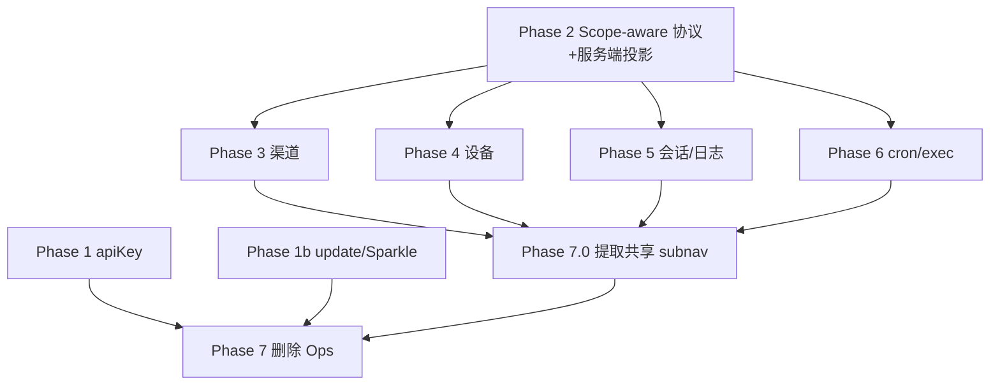

# Implementation Plan: Ops 控制台下线与三端职责归位

## Agents

> 多 agent 协作签名（per AGENTS.md「Multi-Agent Collaboration & Commit Governance」）。

- `codex-opsd` · role: phase-7 owner · scope: ops decommission Phase 7 cutover / shell cleanup / spec gate updates · paths: .kiro/specs/ops-decommission/tasks.md, .kiro/specs/ops-decommission/cutover-matrix.md, ui/src/ui/ports/ops/\*_, ui/src/ui/views/control-center.ts, ui/src/ui/app-console-_.ts, ui/src/ui/ports/port-shells.browser.test.ts, ui/src/ui/app-render.boundary.node.test.ts, ui/src/ui/ports/port-state-lens.node.test.ts · since: 2026-06-11
- `cursor-daniel` · role: contributor · scope: 员工端设备列表 + OIG credential-config 编辑器迁移（shell-slice / app.ts / enterprise port 消费方原子落地） · paths: ui/src/ui/controllers/devices.ts, ui/src/ui/gateway.ts, ui/src/ui/client-display-name.ts, ui/src/ui/client-display-name.node.test.ts, ui/src/ui/app.ts, ui/src/ui/app-port-state.ts, ui/src/ui/app-view-state-shell-slices.ts, ui/src/styles/workbench.css, ui/src/i18n/locales/zh-CN.ts, ui/src/i18n/locales/en.ts, src/gateway/enterprise-operational-identity.ts, src/gateway/enterprise-operational-identity-store.ts, src/gateway/enterprise-operational-identity-wechat-official-execution.test.ts, ui/src/ui/controllers/enterprise-operational-identity.ts, ui/src/ui/ports/enterprise/action-state.ts, ui/src/ui/ports/enterprise/port-state.ts, ui/src/ui/ports/enterprise/view-types.ts, ui/src/ui/ports/enterprise/semantic/enterprise-read-model.ts, ui/src/ui/ports/enterprise/semantic/enterprise-identity-policy-actions.node.test.ts, ui/src/ui/ports/enterprise/views/enterprise-identity-assets-section.ts · since: 2026-06-12
- `cursor-auto` · role: contributor · scope: 知识指挥舱 homeFocus 锚点（`home-page-contracts.ts` 内 `KnowledgeHomeFocus*` / `homeFocus` / `onHomeFocusChange` 由 knowledge-space-unification 维护） · paths: ui/src/ui/ports/employee/views/home-page-contracts.ts#homeFocus · since: 2026-07-01
- `codex-community-rebrand` · role: contributor · scope: GitHub Community 对外文件 OpenBot rebrand 清理（安全策略与 issue 模板） · paths: SECURITY.md, .github/ISSUE_TEMPLATE/config.yml, .github/ISSUE_TEMPLATE/bug_report.yml · since: 2026-07-04

## Overview

原则：**协议先行、先归位、后删除**。

1. 任何「全局 RPC → 多租户/个人视角」的 UI 归位,**必须先在网关协议与服务端落地作用域**(Phase 2),否则只会做出前端假隔离。
2. 删除 Ops 前端是最后一步(Phase 7),且只在归位 surface 就绪后执行。
3. 每个「全局 RPC 变作用域」的点都要有**服务端测试**,不只前端可见性测试。
4. **阶段门禁口径(需求 11.2)**:`pnpm tsgo` 当前仓库基线即为红(88+ 个与本工作无关的历史失败文件)。因此 per-phase 验收按 **「本次变更不新增类型错误 + 被改动文件 tsgo 全清 + 相关测试通过 + `pnpm build` 通过」** 判定;**「全仓 tsgo 修绿」单列为基线健康任务(Phase 0b),不阻塞各阶段功能验收**。每阶段结束运行 `pnpm tsgo` 并比对错误集,确认无新增。

可并行先行(不依赖多租户地基):Phase 1(平台端 apiKey)、Phase 1b(update.run 平台运维入口 + 员工端 Sparkle 提示)。

## Tasks

### Phase 1 — 平台端补全 API Key（独立可交付，先修原始故障）

- [x] 1.1 给平台端 Provider 输入类型增加 `apiKey`
  - `PlatformModelAddInput`、`PlatformModelProviderUpdateInput`（`ui/src/ui/ports/platform/render-actions.ts`）增加 `apiKey: string`
  - _需求: 3.4_

- [x] 1.2 接线 Provider 表单的 API Key 输入
  - `ModelProviderSection.ts`「更新 Provider」表单密码框补 `name="apiKey"`，`formProviderInput` 读取
  - `ModelAssetsSection.ts`「新增 Provider」弹窗静态+动态密码框补 `name="apiKey"`（动态面板顺带补 `name="baseUrl"`）
  - 修复多面板读错字段（P1-2）：`buildBootstrapModelInput` 从**当前可见面板**读取 `apiKey`/`baseUrl`，而非整张 form 的首个匹配
  - _需求: 3.1, 3.5_

- [x] 1.3 写入与读取脱敏（Phase 1 范围）
  - 透传 `apiKey`，仅在非空时写入 `models.providers.<id>.apiKey`；留空时 spread `existingProvider`（含 `config.get` 返回的 `__OPENCLAW_REDACTED__` 哨兵），由网关 `restoreRedactedValues` 在 `config.set` 时还原原 key（满足 3.6/3.7）
  - 读取/展示链路脱敏由 schema `sensitive` + `config.get` 既有机制保证（满足 3.3/3.4）
  - 注：新输入明文 key → 磁盘 file SecretRef 物化属服务端能力，移至 Phase 2（task 2.9）
  - _需求: 3.2, 3.3, 3.4, 3.7_

- [x] 1.4 保存反馈与健康探测（`config.set` 热重载 + `models.probe`）
  - _需求: 3.3, 3.5_

- [x] 1.5 测试（apiKey 读写、空值保留；属性测试 apiKey 序列化脱敏）
  - _需求: 3.2_

- [x] 1.8 修复「UI 改 key → 物化到各 agent `models.json`」断链（运行时回归）
  - 现象：平台端「模型管理」改 apiKey 写入 `openbot.json`，但每次 agent 运行 `ensureOpenClawModelsJson(config, agentDir)` 物化 per-agent `models.json` 时，新明文 key 被丢弃，agent 持续用旧（过期）key → 员工端无法对话
  - 根因：`src/agents/models-config.merge.ts` 的 `shouldPreserveExistingApiKey` 仅在「新值是 secret marker」时让新值生效；新值为**明文**时错误地保留磁盘旧明文 key
  - 修复：`restoreRedactedValues` 已在 `config.set` 写盘前还原脱敏哨兵，故物化阶段拿到的是真实新 key 或 marker。改为「配置带非空、非 `__OPENCLAW_REDACTED__` 的 apiKey 即覆盖磁盘旧值」；仅当配置无 key（仅 baseUrl/models）时保留磁盘上由 profiles/env 早先种入的 key；对 sentinel 做防御性保留
  - 测试：`models-config.merge.test.ts` 新增 2 条（明文新 key 覆盖 / sentinel 保留）；`models-config.fills-missing-provider-apikey-from-env-var.test.ts` 更新 4 条原固化 bug 行为的用例为「配置取胜」，与套件其余（env marker / SecretRef / 非 env marker / 空值）口径一致；`models-config` + `model-auth` 全套 164 passed
  - 边界：本任务只打通「UI 改 key → 物化到 agent」链路；明文→file SecretRef 物化仍属 task 2.9
  - _需求: 3.2, 3.7_

### Phase 1b — 无多租户依赖的早期归位（提前交付，减负 Ops）

- [x] 1.6 平台端网关自更新入口
  - `systemSettings.onRunUpdate` 复用 `configCapability.runUpdate`（`render-actions.ts`）；系统设置「安全态势」卡新增「运行平台更新」按钮（确认弹窗 + 仅平台运维会话可用），网关侧 `update.run` scope 强制；测试 `render-actions.node.test.ts` 覆盖
  - _需求: 8.1, 8.2, 8.4_

- [x] 1.7 员工端不暴露服务端更新（决策 a）
  - 决策(a)：客户端更新纯属原生 App(Sparkle/appcast)范畴，Web 员工端不展示伪造的「客户端新版本」FYI
  - 硬约束已满足且固化：员工端**无** `update.run` 入口（仅平台端 `systemSettings.onRunUpdate`），员工端不会触发服务端更新
  - 后续若产品需要原生 App 更新提示，由 Mac App Sparkle 侧实现，不走网关 `update.run`
  - _需求: 8.2, 8.3_

### Phase 0b — 基线健康：恢复全仓 `pnpm tsgo` 绿（独立跟踪，不阻塞各阶段）

- [ ] 0.1 归类现存 tsgo 失败
  - 现状:约 333 个错误分布在 88 个与本工作无关的文件(`src/gateway/server-methods` 96、`ui/.../enterprise/views` 37、`controllers` 21、`enterprise-data` 18 等)
  - 产出基线错误清单作为对比基准,供各阶段"无新增"判定
  - _需求: 11.2_

- [ ] 0.2 分域修复至门禁全绿（与 Ops 下线并行、独立推进）
  - _需求: 11.2_

### Phase 2 — Scope-aware 协议与服务端投影（地基，最重，UI 归位前置）

> 这是评审新增的前置 Phase。先把作用域落到协议+服务端，再做 Phase 3–6 的 UI 归位。每个子任务都包含**服务端测试**。

- [~] 2.1 config 协议作用域化（服务端已落地；config.schema + UI controller 待办）
  - 已完成（服务端）：`config.get`/`config.set` 增加可选 `tenantId` 入参（`src/gateway/protocol/schema/config.ts`，`additionalProperties:false` 故需显式新增）；handler 在 `tenantId` 存在时经 `requireResolvedEnterpriseTenantId` 解析可信租户（客户端 tenantId 不匹配会话作用域即拒绝），路由到 tenant 覆盖存储读写，绝不回退到全局写；`config.apply`/`config.patch` 显式拒绝 tenant scope（带网关重启语义，属全局运行时）
  - 测试：`tenant-config-service.test.ts`（写入/回读/隔离/base-hash 乐观并发/非法 JSON/最小 delta，4 项）；`server.config-patch.test.ts` 全局路径回归 10 项不变
  - 待办：`config.schema` 作用域化；`ui/src/ui/controllers/config.ts` 不再整树提交（与 Phase 3.2 企业端渠道页一并做）
  - _需求: 2.1, 2.7, 2.8, 2.11_

- [x] 2.2 tenant-scoped 凭证存储/解析/隔离（**决策：走 C**）
  - 已实现 `resolveConfigForTenant({platformDefault, override})` 合并解析 seam（`src/gateway/tenant-config.ts`）：纯函数、幂等、RFC-7396 merge（数组整体替换以保证凭证隔离，租户完整拥有自己的 `accounts[]`）
  - 租户覆盖存到 **enterprise-data 式全局按 `tenantId` 键控存储**（`openbot-tenant-config.json`，非 `openbot.json`、非 per-tenant 文件）；`load/save/get/setTenantConfigOverride` 纯函数 upsert、不触碰其它租户记录
  - `diffTenantOverride(platformBaseline, tenantConfig)` 将整份租户配置归约为最小 delta（复用共享 `createMergePatch`，已从 io.ts 提到 `config/merge-patch.ts` 消除重复）；服务端 `tenant-config-service.ts` 经会话可信租户解析后读写、明文不落全局配置
  - 测试：`tenant-config.test.ts` 10 项（含 Property 1 跨租户读取交集为空、Property 2 合并幂等、diff 往返）；`tenant-config-service.test.ts` 4 项
  - **本轮不交付**：每租户独立 bot/channel daemon/agent runtime（另立 Runtime Phase，见 task 8.1）；明文→file SecretRef 物化（见 task 2.9）；channels 运行时按租户消费覆盖（依赖 8.1）
  - _需求: 2.7, 2.8, 2.10, 2.11_

- [x] 2.3 `channels.status` 作用域化
  - 已完成：协议增加可选 `tenantId`（`src/gateway/protocol/schema/channels.ts`）；handler 经 `requireResolvedEnterpriseTenantId` 解析可信租户后，用 `resolveConfigForTenant` 取租户配置视图派生渠道账户/configured 状态（替换全局 `loadConfig()`），租户只见本租户渠道账户
  - 运行时边界：runtime snapshot 仍是全局共享（无租户运行实例的账户如实报告 "未运行"，不把平台运行时伪装成租户的）；每租户独立运行时属 task 8.1
  - 测试：`server-methods/channels.tenant-scope.test.ts`（mock 可信租户+租户存储+受控插件注册表，断言租户只见本租户账户、无平台账户泄漏）；`server.channels.test.ts` 全局路径回归 3 项不变
  - _需求: 2.2, 2.8, 2.11_

> **归属模型（2.4–2.8）**：sessions/logs/cron/devices/exec 无 config 那样的天然作用域，需显式/派生归属（见 design.md「归属模型」节，共享 `src/gateway/scope-attribution.ts`）。落地状态：cron(2.6)/devices(2.7) 创建期盖戳已完成；sessions(2.4) 派生归属已完成；logs(2.5) 维持平台运维专属；exec(2.8) 待 agent→tenant 归属模型。隔离一律服务端强制，禁止前端假过滤。

- [x] 2.4 `sessions.list` 归属化（派生归属：tenant + platform 维度）
  - 已实现：协议加可选 `tenantId`（`schema/sessions.ts`）；handler 经 `requireResolvedEnterpriseTenantId` 解析可信租户后，用 `buildAccountTenantIndex`(tenant-config 反查) + `deriveSessionTenant`(session.channel+lastAccountId→tenant) 过滤；未归属会话=平台全局（tenant 视图不返回）；无 tenantId=平台全量
  - 纯派生模块 `src/gateway/session-tenant-derivation.ts`（4 测试）
  - 注：account→tenant 数据需 Phase 3 企业渠道凭证写入后才非空；在此之前 tenant 视图返回空集（诚实，非假隔离）。self（员工）维度暂缓——员工自有会话即 webchat，员工端已自带，不走该管理过滤
  - _需求: 2.3, 2.8, 2.11_

- [-] 2.5 `logs.tail` 归属/租户过滤（**本阶段不做 tenant 过滤：保持平台运维 surface**）
  - 调研结论：`logs.tail` tail 的是**网关全局运行日志文件**，日志行**无 per-line 租户标记**；对原始日志做 tenant 过滤要么返回空、要么需先做"日志按租户打标"的较大 logging 改造
  - 决策：`logs.tail` 维持 **平台运维专属** surface（符合 Phase 5「平台端日志/排障」定位）；企业/员工不暴露；真正 per-tenant 日志归属另立 logging-attribution 任务。不加假过滤
  - _需求: 2.4（部分，归平台全局）_

- [x] 2.6 `cron` owner/tenant 归属 + 服务端授权过滤
  - 已实现：`CronJobBase.ownership?{tenantId,ownerId}`（`cron/types-shared.ts`，流入 `CronJobCreate`）；`createJob` 经 `normalizeCronOwnership` 盖戳（空值归一为 absent=平台全局）；`listPage` 接受结构化 `scopeVisible` 谓词过滤（cron 模块不依赖 gateway/billing）
  - handler（`server-methods/cron.ts`）：`cron.add` 经 `resolveTrustedAttribution(client)` 盖戳（永不信客户端入参）；`cron.list` 经 `resolveQueryScope(client)` 构造谓词过滤；`cron.update`/`cron.remove` 经 `authorizeCronJobMutation` 校验（非平台 scope 只能操作本租户/本人任务）
  - 共享 `src/gateway/scope-attribution.ts`（`resolveTrustedAttribution`/`resolveQueryScope`/`isRecordVisibleToScope`/`filterRecordsByScope`）
  - 测试：`scope-attribution.test.ts` 7 项（含跨租户 disjoint 属性）；`cron/service.ownership-scope.test.ts` 2 项（持久化+过滤、空值归一）；cron 既有套件回归通过
  - _需求: 2.5, 2.8, 2.11_

- [x] 2.7 设备/节点 self-scoped 语义
  - 已实现：`PairedDevice.ownerId`（`infra/device-pairing.ts`）；`approveDevicePairing(requestId, baseDir, {ownerId})` 盖戳、re-pair 保留既有 owner、无 owner=平台全局
  - handler（`server-methods/devices.ts`）：`device.pair.approve` 经 `resolveTrustedAttribution(client)` 盖戳；`device.pair.list` 对**员工 self scope** 仅返回本人 paired 设备（pending 未归属→仅平台可见）；`device.pair.remove`/`device.token.rotate`/`device.token.revoke` 经 `authorizeDeviceSelfMutation` 校验本人设备；平台/企业会话保留全局治理可见性
  - 设备归属为 owner（个人）维度（符合三端定位：平台=通路治理、员工=自管）
  - 测试：`infra/device-pairing.test.ts` +2（owner 盖戳/保留、无 owner 平台全局）
  - _需求: 2.6, 2.8, 2.11_

> **⚠️ 2.8 归属来源/数据模型阻塞（需决策）**
>
> - **2.8 exec.approvals**：当前是**单一全局文件**（socket + 审批项），非 per-record 可归属列表；"企业仅治理自有机器人"还依赖**尚不存在的 agent→tenant 归属映射**。需先决策 exec-approvals 存储形态（per-tenant 文件 vs 按 agent 归属键控）+ agent→tenant 模型，避免在全局文件上做假隔离。建议与 agent→tenant 归属模型一并设计后再落。

> **2.8 已细化为设计（见 design.md「agent→tenant 归属模型 + exec.approvals 作用域化」）**
>
> 关键决策：`exec.approvals.get/set` 管理的是**单一全局控制面文件**（socket+审批人），保持**平台运维专属**；"企业仅治理自有机器人 exec 审批"的真正语义走 **per-agent/per-channel exec 配置 + tenant-scoped config**，按 `resolveAgentTenant(agentId)` 过滤本租户代理，**不在全局文件上做假隔离**。

- [x] 2.8a `resolveAgentTenant(agentId)` 归属 seam
  - 已实现：`src/gateway/agent-tenant.ts`（`resolveAgentTenant`）
  - 真源 `cfg.agents.list[].ownerId`（+ 后续可加显式 `tenantId`）→ membership → enterpriseId；无主=平台全局(null)
  - 测试：`agent-tenant.test.ts` 14 项（显式 tenantId / owner 推导 / 无主=null / edge cases）
  - _需求: 2.8_
- [x] 2.8b `exec.approvals.get/set` 平台运维门禁
  - 已实现：`exec.approvals.get/set/node.get/node.set` 在 session-domain 注册表（`src/gateway/platform-auth/session-domain.ts`）pin 为 `platform` 域；非平台会话（enterprise/employee）经 `guardSessionDomain`（server-methods.ts 调度前置）被 `domain_mismatch` 拒绝。保持全局基础设施语义（单一全局控制面文件不做假隔离）
  - 说明：仅靠 method-scopes（`exec.approvals.*` → ADMIN_SCOPE）无法区分员工（员工激活态默认携带 `operator.admin`），故平台 vs 非平台的可靠闸是 session-domain
  - 测试：`session-domain.test.ts` +2（exec.approvals.\* pin 为 platform / 非平台会话被拒）
  - _需求: 2.8, 9.1, 9.3_
- [x] 2.8c 企业端 exec 审批治理（走 tenant-scoped config，Phase 6.3）
  - 服务端能力已落地：渠道 `execApprovals` 子树随 **tenant-scoped config**（2.2 的 `resolveConfigForTenant` + 租户键控覆盖存储）天然隔离——企业经 `config.get/set`(带 `tenantId`，2.1) 读写自己的 `channels.<type>.execApprovals`，落入本租户覆盖，跨租户解析视图交集为空（不在全局文件做假隔离，与 2.8b 平台运维专属互补）
  - 测试：`exec-approvals-tenant-scope.test.ts` 2 项（A 的 execApprovals 仅 A 可见、平台默认不被污染；两租户审批人互不泄漏）
  - 企业端 UI（exec 审批治理面）属 **Phase 6.3**（仍未做）；本任务只交付服务端 tenant-scoped 隔离与跨租户不可见保证
  - _需求: 9.2_

- [-] 2.9 敏感配置 secret-ref 物化（**降级为后续写侧 secrets 硬化，本轮不做**）
  - 调研结论：`runSecretsApply` 只「改写 config→ref + 校验 ref 可解析」，**不会先把明文落进 file store**；`secrets configure` 也要求值在 apply 前已存在于 provider。故 2.9 本质是**新增一条敏感凭证持久化入口**，做错会直接丢失可用凭证、重新打坏对话链路——风险高于当前收益
  - 决策（已拍板）：本轮**跳过**。明文→file SecretRef 自动物化应与 **2.2/C 的租户键控凭证存储模型一起设计**，而非先按当前全局 `~/.openbot/secrets.json` 匆忙落地再迁移
  - 低风险保护（本轮做，见 2.10）：不改写存储，仅在诊断/审计里提示 `models.providers.*.apiKey` 仍为 plaintext，作为后续治理提醒
  - _需求: 2.6, 2.10, 3.2（延后）_

- [x] 2.10 plaintext 凭证治理提示（低风险，不改存储）
  - 已实现 `findInlinePlaintextProviderApiKeys` / `buildPlaintextApiKeyGovernanceNote`（`src/secrets/plaintext-config-audit.ts`）：检测 `models.providers.*.apiKey` 为 inline 明文（排除 SecretRef/env 模板/marker/哨兵）；接入 `openclaw doctor`（只读 `note(...,"Secrets")`）
  - 仅读不写、不动凭证；测试 5 项（含/不含明文、ref/env/marker/哨兵忽略）
  - _需求: 2.10_

### Phase 3 — 渠道三层归位（依赖 2.1/2.2/2.3）

- [x] 3.1 平台端：渠道连接器目录与治理（收敛 `platformAdvanced`，移除租户凭证展示）
  - 已完成：`platformAdvanced` 渠道页收敛为连接器目录与治理视图，平台仅展示通路目录、配置/运行/连接状态、账户规模与运行态跳转，不再在平台端展开租户凭证配置表单；治理详情明确提示企业凭证已迁移至企业端「渠道凭证」页面
  - 测试：`ui/src/ui/ports/platform/advanced/page.browser.test.ts` 覆盖“平台端无凭证表单，仅保留治理信息”；`platform-capabilities-shell.browser.test.ts` 既有回归通过
  - _需求: 4.1, 4.5_
- [x] 3.2 企业端：渠道凭证配置（tenant-scoped，复用 `views/channels.ts` config-form，仅列已开通类型）
  - 已完成（控制器基座）：`ui/src/ui/controllers/tenant-channel-config.ts`（`loadTenantConfig`/`patchTenantConfigValue`/`saveTenantConfig`，`tenantId` 串入 `config.get`/`config.set`，独立状态 + baseHash 乐观并发）；4 单测
  - 已完成（surface view + 路由 + 派发）：`enterprise-channel-credentials-surface.ts`（复用 `renderChannelConfigForm`，渠道页签 + 保存/重载 + 错误态 + 无租户/未开通空态 + 激活态措辞约束）；`EnterpriseSurfaceTab`/`isEnterpriseSurfaceTab` 加 `enterpriseChannels`；`renderEnterpriseSurface` 派发用例；`buildEnterpriseTabPath` 路由 `/enterprise/{tenantId}/channels`；6 browser 测试；enterprise surfaces 既有 44 测试回归通过
  - 已完成（render-model 接线，最后一步）：`render-model.ts` 已用 tenant-channel-config 控制器 + `readModel.currentTenantId` + 平台已开通渠道列表构造 `channelCredentialsEditor` 传入；`enterpriseChannels` 已加入 `ENTERPRISE_SURFACE_TABS` 进入子导航；port-state 已持有控制器状态
  - _需求: 4.2, 4.3, 4.6_
- [x] 3.3 员工端：个人渠道绑定（不暴露凭证/运行时）
  - 已完成：员工端通过既有“我的运营身份”系统 tab 承接个人渠道绑定/激活入口，用户可查看待绑定请求、授权机器人、待恢复任务并发起绑定，不暴露企业凭证或运行时技术细节
  - 测试：`ui/src/ui/ports/employee/views/workbench-stage.node.test.ts` 覆盖个人渠道绑定入口与待绑定请求展示
  - _需求: 4.4_
- [x] 3.4 测试：企业凭证隔离（服务端）、平台无凭证泄露、未开通渠道不可配
  - 已完成（服务端）：`channels.tenant-scope.test.ts` + `tenant-config-service.test.ts` 覆盖 tenant-scoped 账户隔离、读写隔离与最小 delta 持久化
  - 已完成（前端）：`platform/advanced/page.browser.test.ts` 覆盖平台端不再展示租户凭证入口/字段；`enterprise-surfaces.browser.test.ts` 覆盖企业端仅显示平台已开通渠道；`enterprise-channel-credentials-surface.browser.test.ts` 覆盖空态与渠道页交互
  - _需求: 4.3, 4.6_

### Phase 4 — 设备双层归位（依赖 2.7）

- [x] 4.1 平台端：设备/节点全局治理 surface（复用 `views/nodes.ts` 逻辑）
  - 已完成：平台端 `platformAdvanced` 新增“设备”子 tab，复用 `views/nodes.ts` 展示设备配对审批、设备令牌轮换/撤销、节点列表、执行绑定与 exec 审批治理；平台端 actions 已接线 `device.pair.*` / `device.token.*` / `node.list` / `exec.approvals.*`
  - 测试：`ui/src/ui/ports/platform/advanced/page.browser.test.ts` 覆盖设备治理 tab 渲染；`platform-capabilities-shell.browser.test.ts` 回归通过
  - _需求: 5.1, 5.3_
- [x] 4.2 员工端：我的设备（基于 self-scoped 语义 + `node.invoke` 授权）
  - 已完成：员工端 workbench `settings/system` 新增“我的设备”tab，展示员工自有设备配对状态、已配对设备与令牌管理，并提供 `device.permissions.request` 触发的辅助功能/自动化/通知授权入口；不暴露平台审批/绑定治理能力
  - 测试：`ui/src/ui/ports/employee/render-model.node.test.ts` 覆盖“我的设备”tab 渲染与系统授权刷新路径
  - 2026-06-12 surface 迭代：员工端从“令牌运维面板”改为消费级“登录设备”列表——浏览器连接上报友好设备名（如 `Chrome · Mac`，`ui/src/ui/client-display-name.ts`）、当前设备徽标、按最近活跃排序、设备级「移除」（`device.pair.remove`）、待配对请求内联批准/拒绝、隐藏 `gateway-client` 等内部连接；员工端不再暴露令牌轮换/撤销（保留在平台端治理）。切换到设备 tab 自动加载列表 — cursor-daniel
  - 2026-06-12 二次迭代（Apple ID 设备列表式收敛）：行内容只保留“类型 · 最近登录”（去掉首次配对与裸 deviceId，完整 id 移入悬浮提示）；当前设备显示“本次在线”时长（hello 时间戳 `gatewayConnectedAtMs`）；30 天以上未登录设备折叠进“不活跃设备（N）”并提供「全部移除」批量清理（`removeDevices` 单次确认）；设备 tab 停留期间每 30 秒自动刷新（自清理 interval）；配对请求徽标区分“待批准/重新配对”；“本机系统授权”收敛为状态摘要 + 跳转安全页（修复 `workbench.ts` 未透传 authorization granted 的存量缺陷） — cursor-daniel
  - _需求: 5.2, 5.5_
- [x] 4.3 测试 + CLI 兜底（`openbot devices`）；本人设备隔离服务端测试
  - 已完成（服务端）：`src/gateway/server-methods/devices.self-scope.test.ts` 覆盖员工只看自己设备、不能轮换/撤销他人设备令牌
  - 已完成（CLI）：`src/cli/devices-cli.test.ts` 回归通过，确认 `openbot devices list/approve/remove/clear/rotate/revoke` 仍可作为设备审批与兜底通道
  - 已完成（员工端）：`ui/src/ui/ports/employee/render-model.node.test.ts` 覆盖“我的设备”tab、自助令牌管理与系统授权刷新路径
  - _需求: 5.3, 5.4_

### Phase 5 — 会话 / 日志归位平台运维（依赖 2.4/2.5）

- [x] 5.1 平台端会话运维 surface（复用 `views/sessions.ts`，服务端 tenant 过滤 + 平台运维门禁）
  - 已完成：平台端 `platformAdvanced` 新增“会话”子 tab，复用 `views/sessions.ts` 展示会话列表、过滤器与 patch/delete 运维处置；前端动作接线 `sessions.list` / `sessions.patch` / `sessions.delete`
  - 测试：`ui/src/ui/ports/platform/advanced/page.browser.test.ts` 覆盖会话运维 tab 渲染；`pnpm build` 通过
  - _需求: 6.1, 6.3_
- [x] 5.2 平台端日志/排障 surface（复用 `views/logs.ts`，服务端 tenant 过滤）
  - 已完成：平台端 `platformAdvanced` 新增“日志”子 tab，复用 `views/logs.ts` 展示平台运行日志尾部、级别过滤与搜索；前端动作接线 `logs.tail`
  - 测试：`ui/src/ui/ports/platform/advanced/page.browser.test.ts` 覆盖日志/排障 tab 渲染；`pnpm build` 通过
  - _需求: 6.2, 6.3_
- [x] 5.3 员工会话现状保留校验（员工仅消费 `sessions.list` 作聊天卡片，无运维处置）
  - 已完成：补充员工端 `sessions.list` 只读消费校验，确认 frontstage/workbench 仅将会话投影为联系人/群组/最近会话卡片，不暴露 patch/delete 等运维处置入口
  - 测试：`ui/src/ui/ports/employee/views/employee-sessions-preservation.node.test.ts` + `ui/src/ui/views/workbench-home-model.node.test.ts` 通过
  - _需求: 6.4_

### Phase 6 — 定时任务 + exec 审批归位（依赖 2.6/2.8）

- [x] 6.1 企业端：岗位机器人定时任务（owner/tenant 归属，服务端隔离）
  - 已完成：企业端能力中心新增 `capabilities/jobs` 子视图，复用 `views/cron.ts` 展示岗位机器人定时任务列表、表单、运行记录与管理动作；前端动作接线企业端 `cron.*`
  - 测试：`ui/src/ui/ports/enterprise/views/enterprise-surfaces.browser.test.ts` 覆盖 `capabilities/jobs` 路由渲染；`pnpm build` 通过
  - _需求: 7.1, 7.4_
- [x] 6.2 员工端：个人定时任务（限本人范围）
  - 已完成：员工端 workbench `settings/system` 新增“个人定时任务”tab，复用 `views/cron.ts` 展示个人 cron 列表、表单与运行记录；不暴露企业岗位机器人范围外的任务治理入口
  - 测试：`ui/src/ui/ports/employee/render-model.node.test.ts` 覆盖个人定时任务 tab 渲染；`pnpm build` 通过
  - _需求: 7.2_
- [x] 6.3 企业端：exec 审批治理（自有机器人，作用域化）
  - 已完成：企业端通过既有 tenant-scoped `enterpriseChannels` 渠道治理页承接 `channels.<type>.execApprovals` 子树配置；前端可按 schema 渲染并保存 `enabled / approvers / agentFilter / sessionFilter / target` 等审批策略字段，不新增全局审批文件入口
  - 测试：`ui/src/ui/ports/enterprise/views/enterprise-channel-credentials-surface.browser.test.ts` 覆盖 tenant-scoped exec approvals 字段渲染；服务端隔离仍由 `src/gateway/exec-approvals-tenant-scope.test.ts` 保证
  - _需求: 9.2_
- [x] 6.4 平台端：保留 exec 策略基础设施 + 节点绑定
  - 已完成：平台端 `platformAdvanced` 的“设备”子 tab 继续承接 exec 审批基础设施与节点绑定能力，复用 `views/nodes.ts` 中的 `renderExecApprovals` 与执行节点绑定表单；平台端仍是唯一可触达全局 `exec.approvals.*` / 节点 exec 绑定入口
  - 测试：`ui/src/ui/ports/platform/advanced/page.browser.test.ts` 覆盖设备页同时展示 `Exec approvals` 与 `Exec node binding`
  - _需求: 9.1, 9.3_
- [x] 6.5 测试：归属与可见性隔离（服务端）；cron/exec 后端兼容
  - 已完成（cron 归属/可见性）：`src/cron/service.ownership-scope.test.ts` + `src/gateway/scope-attribution.test.ts` 覆盖 tenant/self/platform 视图隔离与跨租户 disjoint 性
  - 已完成（exec 隔离/兼容）：`src/gateway/platform-auth/session-domain.test.ts` 覆盖非平台会话无法访问全局 `exec.approvals.*`；`src/gateway/exec-approvals-tenant-scope.test.ts` 覆盖企业 tenant-scoped 渠道 `execApprovals` 子树跨租户不可见
  - 结合前序回归：`src/cli/devices-cli.test.ts`、`src/gateway/server-methods/devices.self-scope.test.ts`、企业/员工/平台端 browser tests 均通过，Phase 6 路径已形成端到端兼容证据
  - _需求: 7.4, 7.5, 9.3_

### Phase 7 — 删除 Ops 前端（最后一步，需前序就绪）

- [x] 7.0 提取共享导出（删除前置，避免类型断裂）
  - 已完成：`renderConsoleSubnav` 与其 props 类型已提取到 `ui/src/ui/views/console-subnav.ts`，平台/企业/Builder/Ops 的 `view-types` 已切换到新共享模块；`views/control-center.ts` 不再承载三端共享类型依赖
  - 测试：平台/企业相关 browser tests + `pnpm build` 通过
  - 将 `renderConsoleSubnav` 及其参数类型从 `views/control-center.ts` 提取到独立共享模块；改 `ports/{platform,enterprise,builder}/view-types.ts` 引用新模块
  - _需求: 1.9_

- [x] 7.1 Cutover matrix + 就绪门禁
  - 已完成：新增 `/.kiro/specs/ops-decommission/cutover-matrix.md`，逐行列出旧 Ops 面板 → 新端 surface → 依赖的后端变更 → 测试门禁，并明确当前**尚不满足**删除 Ops 前端的条件（阻塞于 `3.3`、`7.2`、`7.4`、`7.6`）
  - 产出「旧 Ops 面板 → 新端 surface → 依赖的后端变更 → 测试门禁」矩阵；逐行确认 Phase 3–6 就绪后方可删除
  - _需求: 1.8, 1.11, 11.3_

- [x] 7.2 移除高危/失效入口（debug 任意 RPC 调用）
  - 已完成：`views/debug.ts` 已移除 Manual RPC / 任意方法调用前端入口，仅保留状态、健康、模型、事件日志等只读诊断视图；不再暴露 `callMethod/callParams/onCall` 交互面
  - 测试：`ui/src/ui/views/debug.browser.test.ts`、`ui/src/ui/ports/platform/advanced/page.browser.test.ts`、`ui/src/ui/ports/enterprise/views/enterprise-surfaces.browser.test.ts` 与 `pnpm build` 通过
  - _需求: 10.1, 10.3_

- [x] 7.3 删除 Ops 前端文件
  - 已完成：`ui/src/ui/ports/ops/**` 与 `ui/src/ui/views/control-center.ts` 已删除；共享 `views/{config,cron,debug,logs,nodes,nodes-exec-approvals,sessions}.ts` 因仍被平台/企业/员工 surface 复用而保留，不再作为 Ops 前端文件存在
  - 测试：`ui/src/ui/app-render.boundary.node.test.ts`、`ui/src/ui/ports/port-state-lens.node.test.ts`、`ui/src/ui/ports/port-shells.browser.test.ts`、`pnpm build` 通过
  - _需求: 1.1_

- [x] 7.4 全量导航枚举清理
  - 已完成：`/ops/*` 与 `/ope` 旧入口现在统一重定向到平台承接页；`app-settings.ts`、`app-polling.ts`、`app-lifecycle.ts`、`app-gateway.ts` 已改为围绕 `platformAdvanced` / `platformSystemSettings` 运转；`app-render.ts` 不再渲染 ops port shell，应用内部新生成链接也已切到平台 surface
  - 测试：`ui/src/ui/navigation.test.ts`、`ui/src/ui/navigation.browser.test.ts`、`ui/src/ui/app-settings.test.ts`、`ui/src/ui/ports/platform/advanced/page.browser.test.ts` 通过
  - _需求: 1.2, 1.3, 1.10, 11.4_

- [x] 7.5 清理 i18n 与孤儿模块（cron 已归位则复用，不删）
  - 已完成（本轮）：删除已完全孤儿化的 `ui/src/ui/app-console-actions.ts` 与 `ui/src/ui/app-console-port-state.ts`；保留 `navigation.ts` / i18n 中仍承担旧 `/ops/*` 路由兼容与测试契约的最小字典，不做高风险硬删
  - 测试：`ui/src/ui/app-render.boundary.node.test.ts`、`ui/src/ui/ports/port-state-lens.node.test.ts`、`ui/src/ui/ports/port-shells.browser.test.ts`、`pnpm build` 通过
  - _需求: 1.5_

- [x] 7.6 全量验证（`pnpm tsgo` + `pnpm build` 无悬空 import + `pnpm test` 三端套件 + 路由重定向属性测试）
  - 已完成（按本 spec 的 per-phase 门禁口径）：`pnpm build` 通过；关键三端/服务端套件集中回归通过，包括路由重定向、平台高级页、企业渠道、员工 workbench、cron/exec/devices/channels tenant/self scope
  - 本轮集中通过：`ui/src/ui/navigation.browser.test.ts`、`ui/src/ui/navigation.test.ts`、`ui/src/ui/app-settings.test.ts`、`ui/src/ui/views/debug.browser.test.ts`、`ui/src/ui/ports/platform/advanced/page.browser.test.ts`、`ui/src/ui/ports/platform/views/platform-capabilities-shell.browser.test.ts`、`ui/src/ui/ports/enterprise/views/enterprise-surfaces.browser.test.ts`、`ui/src/ui/ports/enterprise/views/enterprise-channel-credentials-surface.browser.test.ts`、`ui/src/ui/ports/employee/render-model.node.test.ts`、`ui/src/ui/ports/employee/views/workbench-stage.node.test.ts`、`ui/src/ui/ports/employee/views/employee-sessions-preservation.node.test.ts`、`ui/src/ui/views/workbench-home-model.node.test.ts`、`src/gateway/server-methods/devices.self-scope.test.ts`、`src/cli/devices-cli.test.ts`、`src/gateway/server-methods/channels.tenant-scope.test.ts`、`src/gateway/tenant-config-service.test.ts`、`src/gateway/platform-auth/session-domain.test.ts`、`src/gateway/exec-approvals-tenant-scope.test.ts`、`src/cron/service.ownership-scope.test.ts`、`src/gateway/scope-attribution.test.ts`
  - _需求: 1.6, 1.7, 11.2_

### Phase 8 — Runtime（后置，独立设计项，不属本轮）

> 「每租户独立渠道运行时实例」与「租户级渠道凭证隔离」是两个阶段；本轮（Phase 2/3，C）只交付后者。下列运行时改造单列、另立设计，**不阻塞也不混入** Ops 下线本轮交付。

- [ ] 8.1 每租户独立渠道运行时实例（单列，需独立设计文档）
  - 现状硬约束：网关全局只跑一套 channels/agents（`loadConfig()` 进程级全局快照 `src/config/io.ts`；`channels.status` 全局 runtime snapshot `src/gateway/server-methods/channels.ts`）
  - 目标：每租户一套渠道运行时（独立 bot/channel daemon/agent runtime）；同一网关内并行多套基于不同 tenant token 的同类 channel 实例；运行时快照改为租户键控 + 按消息解析
  - 前置：本轮 2.2 的 `resolveConfigForTenant()` seam + 租户键控凭证存储已就绪
  - 产出：独立 Runtime spec（架构、实例生命周期、隔离与回退、容量/资源边界）
  - _需求: 待新 spec 细化（不引用本 spec 验收门禁）_

## Task Dependency Graph

```json
{
  "waves": [
    {
      "wave": 1,
      "tasks": ["1.1", "1.2", "1.3", "1.4", "1.5", "1.6", "1.7"],
      "rationale": "无多租户依赖,可立即交付:平台端 apiKey(修原始故障)+ update.run 平台入口 + 员工端 Sparkle 提示"
    },
    {
      "wave": 2,
      "tasks": ["2.1", "2.2", "2.3", "2.4", "2.5", "2.6", "2.7", "2.8", "2.9"],
      "rationale": "Scope-aware 协议 + 服务端投影地基,UI 归位的硬前置,每项含服务端测试"
    },
    {
      "wave": 3,
      "tasks": ["3.1", "3.2", "3.3", "3.4", "5.1", "5.2", "5.3", "6.1", "6.2", "6.3", "6.4", "6.5"],
      "rationale": "渠道/会话日志/cron+exec 的 UI 归位,依赖 wave 2 对应作用域能力"
    },
    {
      "wave": 4,
      "tasks": ["4.1", "4.2", "4.3"],
      "rationale": "设备双层归位,依赖 2.7,单列以隔离设备认证风险"
    },
    {
      "wave": 5,
      "tasks": ["7.0", "7.1", "7.2", "7.3", "7.4", "7.5", "7.6"],
      "rationale": "删除 Ops 前端:先提取共享 subnav(7.0)与产出 cutover matrix(7.1),再删除与全量导航清理"
    }
  ]
}
```



## Notes

- **协议先行**:Phase 2 是评审采纳后新增的硬前置——不先做 `config.set` 作用域、`channels.status`/`sessions.list`/`logs.tail` 投影、`cron` owner、设备 self-scope,Phase 3–6 只能前端假隔离。
- **隔离必须服务端强制**,前端过滤不算隔离;每个全局→作用域的 RPC 都要有服务端测试。
- Phase 1 + 1b 不依赖多租户地基,先行交付:apiKey 直接修复对话故障,update/Sparkle 提前减负 Ops。
- **task 1.8（运行时回归）**:修正 `models-config.merge.ts` 的 apiKey 物化优先级——配置（`openbot.json`，唯一真源）的明文 key 现在覆盖 per-agent `models.json` 旧值,打通「平台 UI 改 key → 各 agent 生效」链路;旧逻辑只认 marker 导致明文新 key 被旧 key 顶替,是「员工端无法对话」的根因之一。
- Phase 7 删除前必须:7.0 提取共享 `renderConsoleSubnav`/类型(否则三端类型断裂)、7.1 cutover matrix 判定就绪、7.4 全量导航枚举清理(不靠 build 报错逐个捡)。
- 本 spec 不删除任何后端网关 RPC;后端能力下线由后续单独评估。
- **2.2 决策(已拍板,走 C)**:租户级凭证隔离用「全局按 tenantId 键控存储 + `resolveConfigForTenant()` 解析 seam + 服务端强制隔离 + 复用 `runSecretsApply` 物化」,不引入 per-tenant 配置文件(A)或全局租户覆盖层(B)。**「每租户独立渠道运行时实例」单列为 Runtime Phase(task R.1),本轮不承诺**——避免在「运行时仍是全局单套 channels/agents」的前提下选 A/B 把内核改大、难回退。Phase 3 企业端渠道页只暴露「凭证已保存」,不得误导为「租户运行时已独立激活」。
- **2.9 降级(已拍板)**:Phase 1 的 provider apiKey 目前允许保持 inline 明文;明文到 file SecretRef 的自动物化属于后续写侧 secrets 硬化,不阻塞本轮多租户归属改造。它应与 2.2/C 的租户键控凭证存储一起设计(避免先按全局 `~/.openbot/secrets.json` 落地再迁移);本轮仅加只读治理提示(2.10)。真正阻塞 Phase 3–6 的是 sessions/cron/devices/exec 的服务端归属与隔离能力。
- **Phase 1 验收状态（option 1）**:功能完成 + 被改动文件 tsgo 全清 + 14 项相关测试通过 + `pnpm build` 通过;全仓 tsgo 红属基线问题,归 Phase 0b 独立跟踪,不阻塞 Phase 1。P1-1(明文→file SecretRef 物化)移至 task 2.9(服务端)。
