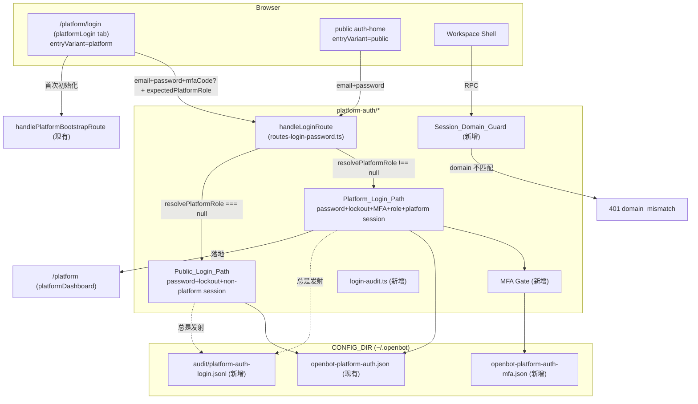

# 设计文档：平台管理员登录隔离（重新对齐版）

> 本文档于 2026-05-31 基于当前代码库**重新对齐**。旧版假设 `platform-auth.ts` 是 4439 行 monolith、存在 `/admin/login` 端点与 `_v1` legacy cookie、存在 `loadUser()` —— 这些均与现状不符。重写后所有路径/函数/类型均经代码核对（见 requirements.md「现状基线」）。

## Overview

> 概述

本设计在**现有** platform-auth 架构上增量加入三块真正缺失的能力——TOTP MFA、结构化登录审计、会话域隔离——并复用已落地的专用平台登录页（`/platform/login`）、角色感知登录分流（`handleLoginRoute`）与平台落地（`/platform`）。

核心设计立场：**最小侵入、复用为先、不重命名既有契约**。

- 不新建登录端点：在现有 `handleLoginRoute`（`src/gateway/platform-auth/routes-login-password.ts`）内插入 MFA 关卡与审计发射点。
- 不新建登录页路由：复用 `/platform/login`（`platformLogin` tab，`entryVariant: "platform"`），仅为其补充内联 MFA 注册/校验 UI。
- 不重命名 cookie：保留单 cookie `openbot_platform_session`；会话域隔离落在**会话记录字段 + RPC 守卫**，而非 cookie 物理拆分。
- 不硬编码 `~/.openclaw`：所有新文件走 `CONFIG_DIR`（`~/.openbot`）。

### 与旧设计的差异（删除项）

| 旧设计内容                                                           | 处置                  | 原因                                                                   |
| -------------------------------------------------------------------- | --------------------- | ---------------------------------------------------------------------- |
| `Legacy_Admin_Login_Alias`（`/admin/login` + 30 天 sunset + 410）    | **删除**              | 该端点从未存在；唯一登录路由是 `${routeBase}/login`                    |
| `__openbot_session_v1` legacy cookie 30 天迁移窗口                   | **删除**              | 该 cookie 从未存在                                                     |
| 双 cookie 拆分（`__openbot_platform_session` / `__openbot_session`） | **推迟**              | 现单 cookie 正常；域隔离改走会话记录 + RPC 守卫                        |
| `loadUser(userId)` join                                              | **改名落地**          | 实际入口是 `findUserByEmail(store, email)`；MFA 状态在其结果上派生附加 |
| `platform-auth.ts:1716` 等行号复用                                   | **作废**              | monolith 已拆解，函数已迁入 `platform-auth/*`                          |
| `/platform/auth/login` 新页面                                        | **作废**              | 已有 `/platform/login`                                                 |
| `~/.openclaw/...` 路径                                               | **改为 `~/.openbot`** | 当前规范配置目录                                                       |

## Architecture

> 架构



## Components and Interfaces

> 组件与接口

### 组件 1：MFA 关卡嵌入 `handleLoginRoute`（修改现有文件）

- **位置**：`src/gateway/platform-auth/routes-login-password.ts`
- **现状**：`handleLoginRoute` 已做 email 解析、password 校验、lockout、`expectedPlatformRole` 校验、`resolveSessionContext` 后调用 `createSessionAndReply`。
- **改动**：在「password 校验通过 + 角色校验通过」之后、`createSessionAndReply` 之前，对**平台角色账号**插入 MFA 关卡：
  1. `role := resolvePlatformRole(user)`；`role === null` → 现有公共路径，不变。
  2. `role !== null` → 进入 MFA 关卡（组件 3），按 `Platform_MFA_Setting` 与注册状态返回 `mfa_required_enroll_first` / `mfa_required` / `mfa_invalid` 或放行。
  3. 放行后 `createSessionAndReply`（需扩展为写入 `domain: "platform"`，见组件 5）。
  4. 所有出口（含早退）经组件 4 发射一条审计事件。
- **复用**：`resolvePlatformRole`、`recordFailedLogin`、`clearFailedLoginState`、`isUserLocked`、`resolveSessionContext`、`createSessionAndReply`（均在 `auth-helpers.ts`）。

### 组件 2：lockout 与 MFA 共享计数

- MFA 码校验失败 SHALL 调用现有 `recordFailedLogin(user)`，与密码错误共享 `loginFailedCount` 与 `DEFAULT_PASSWORD_LOCK_ATTEMPTS`（5）/ `DEFAULT_PASSWORD_LOCK_MS`（15 分钟）。无新增 lockout 状态。

### 组件 3：`Platform_MFA_Provider` + `MFA_Secret_Store`（新增）

- **新增文件**：
  - `src/gateway/platform-auth/mfa-totp.ts`：本地 TOTP（RFC 6238，HMAC-SHA1，`node:crypto`，无第三方依赖）。
    - `generateTotpSecret(): string`（base32）
    - `buildOtpAuthUrl(secret, email, issuer): string`
    - `verifyTotp(secret, code, now?): boolean`（允许 ±1 周期偏移）
    - `generateRecoveryCodes(count = 8): string[]`
  - `src/gateway/platform-auth/mfa-store.ts`：密钥存储 + Provider API。
    - 落盘 `CONFIG_DIR/openbot-platform-auth-mfa.json`，`0o600`。
    - `getMfaSecret(userId)`（内部）、`enrollMfa(userId)`、`verifyMfaCode(userId, code)`、`consumeRecoveryCode(userId, code)`、`revokeMfa(userId)`、`getMfaEnrollmentState(userId)`、`scanOrphans(validUserIds)`。
    - 复用 `store.ts` 的 `withStoreWriteLock` 写锁惯例（确认其可复用，否则在 mfa-store 内自带等价锁）。
- **`MfaSecretRecord`**：`{ userId, secret, algorithm: "SHA1", digits: 6, periodSeconds: 30, pending, recoveryCodes[], createdAt, verifiedAt?, revokedAt? }`。

### 组件 4：登录审计 writer（新增）

- **新增文件**：`src/gateway/platform-auth/login-audit.ts`
- **接口**：
  - `type PlatformLoginAuditEvent`（见数据模型）
  - `emitPlatformLoginAuditEvent(event): Promise<void>` — 追加 JSONL 到 `CONFIG_DIR/audit/platform-auth-login.jsonl`，首写建文件 `0o600`，失败仅 warning 不阻塞。
  - `generateRequestId(): string`（UUID v4）
- **接线**：`handleLoginRoute` 在返回前调用；`X-Request-Id` 响应头由 handler 设置。

### 组件 5：会话域隔离（修改会话记录 + 新增守卫）

- **会话记录扩展**：`src/gateway/platform-auth/store-types.ts` 的 `PlatformAuthSessionRecord` 增 `domain: SessionDomain`（可选以兼容旧记录读取，新签发必填）。
- **签发改动**：`createSessionAndReply`（`auth-helpers.ts`）增 `domain` 参数并写入会话记录；调用点（`routes-login-password.ts`、`routes-employee-register.ts`、bootstrap）传入对应域。
- **读取兜底**：解析旧会话（无 `domain`）时，依 `resolveSessionContext` 的 `sessionKind` 推导域（`platform-*` → platform，`enterprise-admin` → enterprise，否则 employee）。
- **守卫**：新增 `src/gateway/platform-auth/session-domain.ts`
  - `type SessionDomain = "platform" | "enterprise" | "employee"`
  - `createSessionDomainGuard(methodRegistry)` 返回中间件，比对方法 `requiredDomain` 与会话 `domain`，不匹配 → 401 `domain_mismatch`。
  - 在 `server-methods.ts` 分发链插入；方法注册表为现有方法默认 `"any"` 并在启动时列出。
- **不做**：cookie 不拆、不改名。

### 组件 6：UI — 内联 MFA 注册/校验（修改现有登录页）

- **位置**：`ui/src/ui/views/auth-home.ts`（`entryVariant: "platform"` 分支）+ 其控制器（`app-render.ts` 中 `platformLogin` 渲染处 / `ui/src/ui/controllers/platform-auth.ts`）。
- **改动**：
  - 处理新响应码 `mfa_required`（显示 OTP 输入）、`mfa_required_enroll_first`（显示内联注册面板：QR from `otpAuthUrl` + 恢复码 + OTP 输入）、`mfa_invalid`（错误提示）。
  - 注册校验成功后用首个 OTP 自动重试登录。
- **不做**：不新建 `/platform/auth/login` 页面或独立组件；复用现有 `renderModeFields` 的 `platform-*-login` 分支并扩展字段。

### 组件 7：MFA 设置开关 UI（修改系统设置）

- 在平台系统设置面板（`ui/src/ui/ports/platform/system-settings/page.ts`）增 `requireMfaForPlatformAdmins` 开关，绑定到平台配置写入端点；变更发配置审计事件。

### 组件 8：MFA 孤儿扫描接入启动

- 在 gateway 启动序列（store 加载后）调用 `mfa-store.scanOrphans(allUserIds)`，每孤儿发 `mfa_orphan_detected` 审计并删盘。

## Data Models

> 数据模型

### `PlatformAuthSessionRecord`（扩展现有）

```ts
type SessionDomain = "platform" | "enterprise" | "employee";

type PlatformAuthSessionRecord = {
  id: string;
  userId: string;
  createdAt: string;
  updatedAt: string;
  sessionIssuedAt: string;
  expiresAt: string;
  domain?: SessionDomain; // 新增：新签发必填；旧记录读取时推导兜底
};
```

### `MfaSecretRecord`（新增，独立文件）

```ts
type MfaSecretRecord = {
  userId: string; // FK→PlatformAuthUser.id，不可变
  secret: string; // base32 TOTP secret
  algorithm: "SHA1";
  digits: 6;
  periodSeconds: 30;
  pending: boolean; // enroll-start 与 enroll-verify 之间为 true
  recoveryCodes: string[]; // 单次使用，消费即移除
  createdAt: string;
  verifiedAt?: string;
  revokedAt?: string;
};
```

存于 `CONFIG_DIR/openbot-platform-auth-mfa.json`（`~/.openbot`），`0o600`。`PlatformAuthUser` **不**新增 MFA 字段；启用状态由 mfa-store 在读取时派生为 `{ enabled, enrolledAt?, pending?, secretRevokedAt? }` 附加到用户视图。

### `PlatformLoginAuditEvent`（新增）

```ts
type PlatformLoginAuditEvent = {
  ts: string;
  requestId: string; // UUID v4
  ip?: string;
  userAgent?: string;
  email: string;
  outcome:
    | "success"
    | "invalid_credentials"
    | "mfa_required"
    | "mfa_invalid"
    | "mfa_required_enroll_first"
    | "role_mismatch"
    | "account_suspended"
    | "account_locked"
    | "redirected"
    | "unexpected_error";
  sessionKind?:
    | "platform-super-admin"
    | "platform-admin"
    | "enterprise-admin"
    | "member"
    | "employee";
  domain?: SessionDomain;
  mfaUsed?: boolean;
  expectedRole?: "super-admin" | "admin" | null;
};
```

写 `CONFIG_DIR/audit/platform-auth-login.jsonl`，`0o600`。

## Correctness Properties

> 正确性属性

### Property 1: 公共路径永不签发平台会话

任意走 `Public_Login_Path` 的输入，若解析账号为平台级（`resolvePlatformRole !== null`），不签发会话（保持现有 `expectedPlatformRole` 行为）。**Validates: Requirements 2.1, 2.2, 2.3**（公共路径不签发平台会话）

### Property 2: 平台路径只签发平台会话

任意走 `Platform_Login_Path` 的成功签发，`domain === "platform"` 且 `sessionKind ∈ {platform-super-admin, platform-admin}`。**Validates: Requirements 2.2**（平台路径只签发平台会话）

### Property 3: MFA 关卡随开关单调

`Platform_MFA_Setting === true` 时平台成功登录必有 `mfaUsed === true`，否则返回 `mfa_required*` 且不签发；`=== false` 且无 `mfaCode` 时成功登录 `mfaUsed === false`；有 `mfaCode` 必校验。**Validates: Requirements 3.1, 3.2, 3.3, 3.4, 3.5, 3.6**（MFA 关卡随开关单调）

### Property 4: 审计完整且 requestId 关联

任意 `Login_Handler` 请求恰好追加一条审计事件，`X-Request-Id` 响应头等于事件 `requestId`。**Validates: Requirements 6.1, 6.6**（审计完整且 requestId 关联）

### Property 5: 审计不泄露秘密

任意事件 `e`，`JSON.stringify(e)` 不含密码、`mfaCode`、恢复码或会话令牌值。**Validates: Requirements 6.5**（审计不泄露秘密）

### Property 6: 会话与域按构造一致

任意会话记录 `s`，`s.domain` 与签发分支一致（平台→platform，公共→enterprise/employee），无产生不一致记录的执行路径。**Validates: Requirements 5.1**（会话与域按构造一致）

### Property 7: 域守卫拒绝不匹配会话

`requiredDomain: "platform"` 的方法对 `domain !== "platform"` 的会话返回 401 `domain_mismatch`；`"any"` 全放行。**Validates: Requirements 5.2, 5.3**（域守卫拒绝不匹配会话）

### Property 8: bootstrap 不经 MFA

`POST ${routeBase}/platform/bootstrap` 成功不做 MFA 校验、不记 MFA 注册；其后登录走标准 MFA 关卡。**Validates: Requirements 7.3**（bootstrap 不经 MFA）

### Property 9: lockout 密码/MFA 共享

任意账号，密码错与 MFA 码错都递增 `loginFailedCount`，达 `DEFAULT_PASSWORD_LOCK_ATTEMPTS` 即锁。**Validates: Requirements 2.6**（lockout 密码/MFA 共享）

### Property 10: 恢复码单次使用

成功解锁的恢复码在响应返回前从 `recoveryCodes` 移除，重放得 `mfa_invalid`。**Validates: Requirements 4.2**（恢复码单次使用）

### Property 11: MFA 孤儿扫描在启动时为全集

启动时 `mfa-secrets` 中 `userId` 不存在于用户库的记录全部删盘，每孤儿恰发一条 `mfa_orphan_detected`。**Validates: Requirements 4.4**（MFA 孤儿扫描在启动时为全集）

### Property 12: 平台登录落地无条件

任意平台会话成功登录后导航目标恰为 `/platform`（含 basePath），不受持久化 tab/query/hash 影响。**Validates: Requirements 8.1, 8.3**（平台登录落地无条件）

## Error Handling

> 错误处理

- **MFA 关卡错误**：`mfa_required` / `mfa_required_enroll_first` / `mfa_invalid` 均为预期业务错误，返回对应 HTTP 状态码并发审计事件；不抛异常、不签发会话。
- **MFA 码错误计入 lockout**：复用 `recordFailedLogin`，与密码错误共享计数，达阈值锁定账号。
- **审计写入失败**：尽力而为——记录 warning，绝不阻塞登录响应（需求 6.7）。
- **会话域不匹配**：返回 401 `domain_mismatch`，不泄露目标方法所需域的细节。
- **旧会话缺 `domain`**：读取时按 `sessionKind` 推导兜底，不拒绝（需求 5.4）。
- **MFA 删除部分失败**：用户删除与 MFA 密钥删除须同事务回滚，避免孤儿（需求 4.3）；启动孤儿扫描作为兜底（需求 4.4）。
- **未预期错误**：审计 `outcome: unexpected_error`，返回通用错误，不泄露内部细节。

## Testing Strategy

> 测试策略

### 单元测试

- `routes-login-password.test.ts`（扩展现有 `platform-auth.test.ts` 或新增）：分流矩阵 `{平台/非平台} × {mfaCode 有/无} × {开关 on/off} × {已注册/未注册}`，含 lockout 共享。
- `mfa-totp.test.ts`：±1 周期偏移、无效码、恢复码消费。
- `mfa-store.test.ts`：enroll → verify → active、pending 语义、revoke 后重注册、孤儿扫描。
- `login-audit.test.ts`：追加语义、`0o600`、无秘密泄露、并发写、`requestId` 关联。
- `session-domain.test.ts`：`requiredDomain × session.domain` 矩阵；旧记录推导兜底。
- `session-cookie`（现有 `buildCookieHeader`）：确认未回归（不改名、单 cookie）。

### 集成测试

- `src/gateway/platform-auth/login-isolation.integration.test.ts`：
  - Flow A：bootstrap → 平台超管登录（MFA off）→ `/platform` 落地。
  - Flow B：bootstrap → 开 MFA → 下次登录强制注册 → enroll-verify → 成功。
  - Flow C：租户管理员公共登录成功；同账号带平台 `expectedPlatformRole` → 角色不符。
  - Flow D：MFA 关闭 → 未注册管理员仅 email+password 登录。
- 断言 `CONFIG_DIR/audit/platform-auth-login.jsonl` 含期望事件、无秘密、`0o600`。

### 浏览器测试

- `auth-home.browser.test.ts`（扩展）：`entryVariant: "platform"` 下 `mfa_required_enroll_first` 渲染内联注册面板；OTP 字段按响应码 gating；成功后导航 `/platform`。

## 非目标

- SSO/OIDC/SAML、密码策略改革、WebAuthn、超出现有 lockout 的反爬。
- cookie 物理拆分 / 跨子域 cookie 域（推迟到独立规格）。
- 对每个现有 RPC 方法做 `requiredDomain` 全量注解（默认 `"any"`，后续逐步收紧）。
- legacy `/admin/login` 与 legacy cookie 兼容（不存在，永久剔除）。

## 现状基线引用

所有"现有"标注均经核对，详见 `requirements.md` 的「现状基线」表。关键复用点：

- `handleLoginRoute` — `src/gateway/platform-auth/routes-login-password.ts`
- `resolvePlatformRole` / `createSessionAndReply` / `recordFailedLogin` / `resolveSessionContext` — `src/gateway/platform-auth/auth-helpers.ts`
- `findUserByEmail` — `src/gateway/platform-auth/memberships.ts`
- `PlatformAuthSessionRecord` — `src/gateway/platform-auth/store-types.ts`
- cookie `openbot_platform_session` / `CONFIG_DIR` — `src/gateway/platform-auth/config.ts`、`src/utils.ts`
- 登录页 `/platform/login`（`platformLogin`）/ `entryVariant: "platform"` — `ui/src/ui/navigation.ts`、`ui/src/ui/views/auth-home.ts`
- 落地 `/platform`（`platformDashboard`）— `ui/src/ui/navigation.ts`
