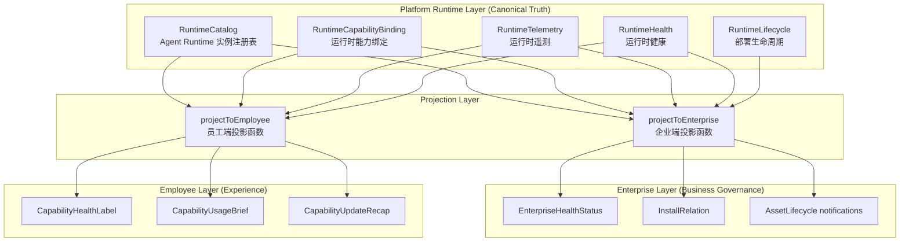
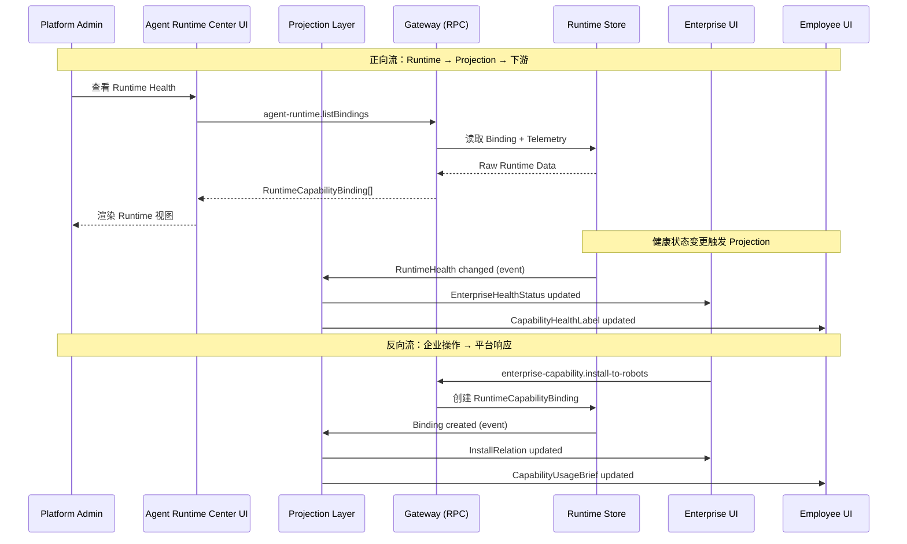

# 技术设计文档：Platform Agent Runtime Center

## Overview

本设计将平台端"代理资产"模块重构为 **Agent Runtime Center**，定位为三层架构中的 **Runtime Infrastructure Layer**。核心职责是维护 Runtime Canonical Model 并通过 Projection Architecture 向企业端和员工端提供一致的运行时状态投影。

### 设计原则

1. **Runtime Truth**：平台端是唯一的运行时真实数据源
2. **Projection-Only Downstream**：企业端和员工端只能消费投影，不能反向修改 Runtime 状态
3. **去业务化**：平台端不涉及任何业务价值、组织绩效概念
4. **Agent = Runtime Execution Container**：统一使用 Runtime 语言
5. **与 Capability Center 正交**：Agent Runtime Center 管 Agent 实例 + Binding；Capability Center 管 Capability 定义 + Governance

### 与现有代码的关系

- 重构 `ui/src/ui/ports/platform/agents/` 目录
- 复用 `PlatformPortReadModel` 中的 `agentDirectory`、`presenceCount` 等数据
- 新增 `RuntimeCapabilityBinding` 数据源（需后端支持）
- 与 `capability-governance-runtime` spec 的 Metrics_Store 集成获取遥测数据

## Architecture

### 三层 Projection Architecture



### 模块目录结构

```
ui/src/ui/ports/platform/agents/
├── page.ts                          # 主页面（重构：5 标签页）
├── adapter.ts                       # ViewModel 适配器
├── view-model.ts                    # ViewModel 类型导出
├── sections/
│   ├── RuntimeCatalogSection.ts     # 标签页 1：Runtime Catalog
│   ├── CapabilityBindingsSection.ts # 标签页 2：Capability Bindings
│   ├── RuntimeHealthSection.ts      # 标签页 3：Runtime Health
│   ├── DeploymentLifecycleSection.ts# 标签页 4：Deployment Lifecycle
│   └── GovernancePolicySection.ts   # 标签页 5：Governance & Policy
└── components/
    ├── RuntimeKpiCards.ts           # KPI 卡片组
    ├── AgentRuntimeRow.ts           # Agent 表格行
    ├── BindingRow.ts                # Binding 表格行
    ├── HealthIndicator.ts           # 健康指示器
    ├── LifecycleStateBadge.ts       # 生命周期状态徽章
    ├── BindingStateBadge.ts         # 绑定状态徽章
    ├── TelemetryMiniChart.ts        # 遥测迷你图
    └── GovernanceIssueCard.ts       # 治理问题卡片

ui/src/ui/capability/runtime-canonical/
├── types.ts                         # Runtime Canonical Model 类型定义
├── projection.ts                    # Projection 函数（核心）
├── projection.property.test.ts      # Projection 属性测试
├── health-calculator.ts             # RuntimeHealth 计算逻辑
├── governance-detector.ts           # 治理问题检测器
└── index.ts                         # 模块导出
```

### 数据流架构



## Components and Interfaces

### 1. Runtime Canonical Model 类型定义

```typescript
// ui/src/ui/capability/runtime-canonical/types.ts

// ─── Runtime Lifecycle ───

export type RuntimeLifecycle = "deployed" | "draining" | "suspended" | "deprecated" | "archived";

// ─── Runtime Health ───

export type RuntimeHealth = "healthy" | "degraded" | "unhealthy" | "unavailable";

// ─── Binding Types ───

export type BindingType = "tenant-installed" | "platform-default" | "dynamic-runtime" | "fallback";

export type LoadStrategy = "eager" | "lazy" | "on-demand";

export type BindingState = "active" | "warming" | "degraded" | "disabled";

// ─── Core Models ───

export type RuntimeAgent = {
  runtimeAgentId: string;
  name: string;
  runtimeVersion: string;
  lifecycle: RuntimeLifecycle;
  health: RuntimeHealth;
  tenantCoverage: string[];
  boundCapabilityCount: number;
  activeSessionCount: number;
  resourceUsage: {
    cpuPercent: number;
    memoryPercent: number;
    tokenBudgetUsedPercent: number;
  };
  deployedAt: number;
  lastActiveAt: number;
};

export type RuntimeCapabilityBinding = {
  bindingId: string;
  runtimeAgentId: string;
  capabilityId: string;
  capabilityVersion: string;
  bindingType: BindingType;
  routingPriority: number;
  loadStrategy: LoadStrategy;
  bindingState: BindingState;
  healthStatus: RuntimeHealth;
  invocationMetrics: {
    calls7d: number;
    successRate7d: number;
    avgLatencyMs: number;
    p95LatencyMs: number;
    errorCount7d: number;
    tokenConsumption7d: number;
  };
  policy: {
    sandbox: string;
    resourceQuota: string;
    hotReloadable: boolean;
  };
  fallbackBindingId: string | null;
  createdAt: number;
  updatedAt: number;
};

export type RuntimeTelemetry = {
  runtimeAgentId: string;
  capabilityId: string | null;
  calls7d: number;
  successRate7d: number;
  avgLatencyMs: number;
  p95LatencyMs: number;
  tokenConsumption7d: number;
  errorCount7d: number;
  queueDepth: number;
  memoryPressure: number;
  lastSampleAt: number;
};

// ─── Governance Issues ───

export type RuntimeGovernanceIssueCategory =
  | "zombie-binding"
  | "resource-overcommit"
  | "capability-conflict"
  | "sandbox-violation"
  | "version-drift"
  | "fallback-chain-broken"
  | "orphaned-agent";

export type RuntimeGovernanceIssue = {
  id: string;
  category: RuntimeGovernanceIssueCategory;
  severity: "critical" | "high" | "medium" | "low";
  runtimeAgentId: string | null;
  bindingId: string | null;
  description: string;
  impact: string;
  evidence: Record<string, unknown>;
  suggestedAction: string;
  detectedAt: number;
  acknowledgedBy: string | null;
  acknowledgedAt: number | null;
};

// ─── Lifecycle State Machine ───

export const RUNTIME_LIFECYCLE_TRANSITIONS: Record<RuntimeLifecycle, RuntimeLifecycle[]> = {
  deployed: ["draining", "deprecated"],
  draining: ["suspended"],
  suspended: ["deployed", "archived"],
  deprecated: ["archived"],
  archived: [],
};
```

### 2. Projection Layer（核心架构组件）

```typescript
// ui/src/ui/capability/runtime-canonical/projection.ts

import type {
  RuntimeHealth,
  RuntimeLifecycle,
  RuntimeCapabilityBinding,
  BindingType,
  BindingState,
} from "./types.ts";

// ─── Enterprise Projection ───

export type EnterpriseHealthProjection =
  | "效果稳定"
  | "偶尔结果不理想"
  | "建议重新整理"
  | "已不适合继续推广";

export type EnterpriseInstallRelationProjection = {
  capabilityId: string;
  capabilityName: string;
  robotId: string;
  robotName: string;
  installedAt: number;
  source: "管理员推送" | "员工自主安装";
  status: "正常运行" | "已暂停" | "待更新";
};

export type EnterpriseLifecycleNotification =
  | { kind: "deprecation-warning"; message: string }
  | { kind: "archived-notice"; message: string }
  | null;

// ─── Employee Projection ───

export type EmployeeHealthProjection = "运行稳定" | "偶尔异常" | "需要重新整理";

export type EmployeeUsageBriefProjection = {
  robots: Array<{ id: string; name: string }>;
  totalUsageCount: number;
  lastUsedAt: number | null;
};

// ─── Projection Functions (Pure, Testable) ───

export function projectHealthToEnterprise(health: RuntimeHealth): EnterpriseHealthProjection {
  switch (health) {
    case "healthy":
      return "效果稳定";
    case "degraded":
      return "偶尔结果不理想";
    case "unhealthy":
      return "建议重新整理";
    case "unavailable":
      return "已不适合继续推广";
  }
}

export function projectHealthToEmployee(health: RuntimeHealth): EmployeeHealthProjection | null {
  switch (health) {
    case "healthy":
      return "运行稳定";
    case "degraded":
      return "偶尔异常";
    case "unhealthy":
      return "需要重新整理";
    case "unavailable":
      return null; // 不展示，能力已不可用
  }
}

export function projectBindingToInstallRelation(
  binding: RuntimeCapabilityBinding,
  agentName: string,
  capabilityName: string,
): EnterpriseInstallRelationProjection {
  return {
    capabilityId: binding.capabilityId,
    capabilityName,
    robotId: binding.runtimeAgentId,
    robotName: agentName,
    installedAt: binding.createdAt,
    source: projectBindingTypeToSource(binding.bindingType),
    status: projectBindingStateToStatus(binding.bindingState),
  };
}

export function projectBindingTypeToSource(type: BindingType): "管理员推送" | "员工自主安装" {
  switch (type) {
    case "platform-default":
      return "管理员推送";
    case "tenant-installed":
      return "员工自主安装";
    case "dynamic-runtime":
      return "管理员推送";
    case "fallback":
      return "管理员推送";
  }
}

export function projectBindingStateToStatus(state: BindingState): "正常运行" | "已暂停" | "待更新" {
  switch (state) {
    case "active":
      return "正常运行";
    case "warming":
      return "待更新";
    case "degraded":
      return "正常运行"; // 仍在运行，只是降级
    case "disabled":
      return "已暂停";
  }
}

export function projectLifecycleToNotification(
  lifecycle: RuntimeLifecycle,
): EnterpriseLifecycleNotification {
  switch (lifecycle) {
    case "deprecated":
      return { kind: "deprecation-warning", message: "即将下线" };
    case "archived":
      return { kind: "archived-notice", message: "已下线" };
    default:
      return null;
  }
}

// ─── Projection Purity Guard ───

const RUNTIME_INTERNAL_FIELDS = [
  "bindingId",
  "routingPriority",
  "loadStrategy",
  "sandboxPolicy",
  "resourceQuota",
  "hotReloadable",
  "fallbackBindingId",
  "queueDepth",
  "memoryPressure",
  "runtimeVersion",
  "cpuPercent",
  "memoryPercent",
  "tokenBudgetUsedPercent",
] as const;

export function isProjectionClean(output: Record<string, unknown>): boolean {
  const keys = Object.keys(output);
  return RUNTIME_INTERNAL_FIELDS.every((field) => !keys.includes(field));
}
```

### 3. RuntimeHealth Calculator

```typescript
// ui/src/ui/capability/runtime-canonical/health-calculator.ts

import type { RuntimeHealth, RuntimeTelemetry } from "./types.ts";

export type HealthThresholds = {
  healthySuccessRate: number; // default: 0.95
  degradedSuccessRate: number; // default: 0.70
  unhealthySuccessRate: number; // default: 0.50
  latencyThresholdMs: number; // default: 5000
  consecutiveFailureThreshold: number; // default: 3
};

export const DEFAULT_HEALTH_THRESHOLDS: HealthThresholds = {
  healthySuccessRate: 0.95,
  degradedSuccessRate: 0.7,
  unhealthySuccessRate: 0.5,
  latencyThresholdMs: 5000,
  consecutiveFailureThreshold: 3,
};

export function calculateRuntimeHealth(
  telemetry: RuntimeTelemetry,
  thresholds?: Partial<HealthThresholds>,
): RuntimeHealth {
  const t = { ...DEFAULT_HEALTH_THRESHOLDS, ...thresholds };

  // unavailable: offline or critical dependency down
  if (telemetry.successRate7d < t.unhealthySuccessRate) {
    return "unavailable";
  }

  // unhealthy: low success rate or consecutive failures
  if (telemetry.successRate7d < t.degradedSuccessRate) {
    return "unhealthy";
  }

  // degraded: moderate issues
  if (
    telemetry.successRate7d < t.healthySuccessRate ||
    telemetry.avgLatencyMs > t.latencyThresholdMs
  ) {
    return "degraded";
  }

  return "healthy";
}
```

### 4. Governance Issue Detector

```typescript
// ui/src/ui/capability/runtime-canonical/governance-detector.ts

import type {
  RuntimeAgent,
  RuntimeCapabilityBinding,
  RuntimeGovernanceIssue,
  RuntimeGovernanceIssueCategory,
} from "./types.ts";

export type GovernanceDetectorConfig = {
  zombieBindingDays: number; // default: 30
  orphanedAgentDays: number; // default: 30
  resourceOvercommitThreshold: number; // default: 0.9 (90%)
};

export const DEFAULT_GOVERNANCE_CONFIG: GovernanceDetectorConfig = {
  zombieBindingDays: 30,
  orphanedAgentDays: 30,
  resourceOvercommitThreshold: 0.9,
};

export function detectGovernanceIssues(
  agents: RuntimeAgent[],
  bindings: RuntimeCapabilityBinding[],
  config?: Partial<GovernanceDetectorConfig>,
  now?: number,
): RuntimeGovernanceIssue[];

export function detectZombieBindings(
  bindings: RuntimeCapabilityBinding[],
  thresholdDays: number,
  now: number,
): RuntimeGovernanceIssue[];

export function detectOrphanedAgents(
  agents: RuntimeAgent[],
  bindings: RuntimeCapabilityBinding[],
  thresholdDays: number,
  now: number,
): RuntimeGovernanceIssue[];

export function detectVersionDrift(bindings: RuntimeCapabilityBinding[]): RuntimeGovernanceIssue[];

export function detectFallbackChainBroken(
  bindings: RuntimeCapabilityBinding[],
): RuntimeGovernanceIssue[];
```

### 5. Gateway RPC Endpoints

```typescript
// agent-runtime RPC 端点定义

export const AGENT_RUNTIME_ENDPOINTS = {
  // Runtime Catalog
  listAgents: "agent-runtime.list-agents",
  getAgent: "agent-runtime.get-agent",

  // Capability Bindings
  listBindings: "agent-runtime.list-bindings",
  getBinding: "agent-runtime.get-binding",
  createBinding: "agent-runtime.create-binding",
  updateBindingState: "agent-runtime.update-binding-state",
  updateBindingPriority: "agent-runtime.update-binding-priority",
  updateBindingStrategy: "agent-runtime.update-binding-strategy",
  deleteBinding: "agent-runtime.delete-binding",

  // Runtime Health
  listTelemetry: "agent-runtime.list-telemetry",
  getHealthSummary: "agent-runtime.get-health-summary",

  // Deployment Lifecycle
  updateLifecycle: "agent-runtime.update-lifecycle",
  getLifecycleHistory: "agent-runtime.get-lifecycle-history",

  // Governance
  listGovernanceIssues: "agent-runtime.list-governance-issues",
  acknowledgeIssue: "agent-runtime.acknowledge-issue",
  getGovernanceConfig: "agent-runtime.get-governance-config",
  updateGovernanceConfig: "agent-runtime.update-governance-config",

  // KPI
  getRuntimeKpi: "agent-runtime.get-runtime-kpi",
} as const;
```

### 6. Page 重构（标签页结构）

```typescript
// ui/src/ui/ports/platform/agents/page.ts (重构)

type AgentRuntimeTab =
  | "catalog" // Runtime Catalog
  | "bindings" // Capability Bindings
  | "health" // Runtime Health
  | "lifecycle" // Deployment Lifecycle
  | "governance"; // Governance & Policy

const AGENT_RUNTIME_TABS: Array<{ id: AgentRuntimeTab; label: string }> = [
  { id: "catalog", label: "Runtime Catalog" },
  { id: "bindings", label: "Capability Bindings" },
  { id: "health", label: "Runtime Health" },
  { id: "lifecycle", label: "Deployment Lifecycle" },
  { id: "governance", label: "Governance & Policy" },
];
```

## Data Models

### Runtime KPI 数据

```typescript
export type RuntimeKpiData = {
  totalAgents: number;
  agentsByLifecycle: Record<RuntimeLifecycle, number>;
  totalBindings: number;
  avgBindingsPerAgent: number;
  healthRate: number; // healthy 占比
  totalTenantCoverage: number;
  totalActiveSessions: number;
  bindingsByState: Record<BindingState, number>;
  bindingsByType: Record<BindingType, number>;
};
```

### 与现有 PlatformPortReadModel 的集成

```typescript
// 扩展现有 readModel，新增 Runtime 数据
export type PlatformPortReadModel = {
  // ... 现有字段保持不变 ...

  // 新增 Runtime Canonical 数据
  runtimeAgents?: RuntimeAgent[];
  runtimeBindings?: RuntimeCapabilityBinding[];
  runtimeTelemetry?: RuntimeTelemetry[];
  runtimeGovernanceIssues?: RuntimeGovernanceIssue[];
  runtimeKpi?: RuntimeKpiData;
};
```

## Correctness Properties

### Property 1: Projection 完备性

_For any_ `RuntimeHealth ∈ {healthy, degraded, unhealthy, unavailable}`，`projectHealthToEnterprise` 返回非 undefined 的 `EnterpriseHealthProjection` 值，且映射满足：healthy → "效果稳定"，degraded → "偶尔结果不理想"，unhealthy → "建议重新整理"，unavailable → "已不适合继续推广"。

**Validates: Requirements 7.1**

### Property 2: Projection 纯净性

_For any_ `RuntimeCapabilityBinding` 输入，`projectBindingToInstallRelation` 的输出对象中不包含 `RUNTIME_INTERNAL_FIELDS` 中的任何字段（bindingId、routingPriority、loadStrategy、sandboxPolicy、resourceQuota、hotReloadable、fallbackBindingId、queueDepth、memoryPressure）。

**Validates: Requirements 7.5**

### Property 3: Projection 幂等性

_For any_ `RuntimeCapabilityBinding` 值 `b`，`projectBindingToInstallRelation(b, name1, name2)` 调用两次返回 deep-equal 的结果。

**Validates: Requirements 7.4**

### Property 4: Health Calculator 单调性

_For any_ `RuntimeTelemetry` 值，若 `successRate7d` 从 x 增加到 y（x < y），则 `calculateRuntimeHealth` 的结果不会从更健康的状态变为更不健康的状态（healthy > degraded > unhealthy > unavailable）。

**Validates: Requirements 4.3**

### Property 5: Lifecycle 状态机合法性

_For any_ `RuntimeLifecycle` 值 `current` 和目标状态 `target`，状态转换合法当且仅当 `RUNTIME_LIFECYCLE_TRANSITIONS[current].includes(target)`。不合法的转换必须被拒绝。

**Validates: Requirements 5.1**

### Property 6: Lifecycle 与 AssetLifecycle 独立性

_For any_ `RuntimeLifecycle` 枚举值，其不等于 `AssetLifecycle` 的任何枚举值（submitted/reviewing/approved/published/deprecated/retired）。两个状态机的枚举集合交集为空（注：deprecated 虽然同名但语义不同，在实现中使用不同的类型系统确保不混用）。

**Validates: Requirements 5.6**

### Property 7: Governance 检测确定性

_For any_ `(agents, bindings)` 输入，`detectGovernanceIssues(agents, bindings, config, now)` 对相同输入返回相同的 issue 集合（确定性）。

**Validates: Requirements 6**

### Property 8: Zombie Binding 检测正确性

_For any_ `RuntimeCapabilityBinding` 值 `b`，若 `b.bindingState === "active"` 且 `b.invocationMetrics.calls7d === 0` 且 `(now - b.updatedAt) > zombieBindingDays * 86400000`，则 `detectZombieBindings` 必须为该 binding 生成一个 `zombie-binding` issue。

**Validates: Requirements 6.2**

### Property 9: Binding 创建来源映射

_For any_ 企业端"安装到机器人"操作产生的 `RuntimeCapabilityBinding`，其 `bindingType` 必须为 `tenant-installed`，`loadStrategy` 必须为 `lazy`，`bindingState` 必须为 `active`。

**Validates: Requirements 3.9**

### Property 10: 术语边界

_For any_ Agent Runtime Center 界面渲染输出的文本，不得包含以下业务术语：`企业价值`、`贡献绩效`、`部门覆盖`、`复用价值`、`业务场景`、`使用场景`、`适用对象`、`能力成熟度`、`机器人`、`我的能力`、`能力积累`。

**Validates: Requirements 9.1**

## Error Handling

| 错误类型            | 处理方式                   | 用户反馈                                   |
| ------------------- | -------------------------- | ------------------------------------------ |
| Telemetry 数据缺失  | 使用默认值，标记 "no data" | "暂无遥测数据"                             |
| Lifecycle 非法转换  | 拒绝操作                   | "不允许从 {current} 转换到 {target}"       |
| Binding 创建冲突    | 拒绝重复绑定               | "该 Capability 已绑定到此 Agent"           |
| Projection 传播失败 | 记录到重试队列             | 不向用户展示（后台重试）                   |
| Gateway 连接断开    | 展示本地缓存 + 离线标识    | "Runtime 数据为本地缓存，最后更新：{time}" |
| Governance 检测超时 | 展示上次结果               | "治理检测数据更新时间：{time}"             |

## Testing Strategy

### 属性测试（Property-Based Testing）

使用 `fast-check` 覆盖：

1. **Projection 正确性** — Property 1, 2, 3（完备性、纯净性、幂等性）
2. **Health Calculator** — Property 4（单调性）
3. **Lifecycle 状态机** — Property 5, 6（合法性、独立性）
4. **Governance 检测** — Property 7, 8（确定性、zombie 检测）
5. **Binding 创建** — Property 9（来源映射）

### 单元测试

1. Projection 函数的每个分支覆盖
2. Health Calculator 的阈值边界测试
3. Governance Detector 的每个问题类别
4. Lifecycle 状态机的每条合法/非法路径

### 集成测试

1. 企业端"安装到机器人" → 平台创建 Binding → Projection 回流企业端
2. RuntimeHealth 变更 → Projection → 员工端 CapabilityHealthLabel 更新
3. Capability Center 标记 retired → Agent Runtime Center 自动 disable bindings

### 测试文件组织

```
ui/src/ui/capability/runtime-canonical/__tests__/
├── projection.property.test.ts          # Property 1-3
├── health-calculator.property.test.ts   # Property 4
├── lifecycle-state-machine.property.test.ts # Property 5-6
├── governance-detector.property.test.ts # Property 7-8
├── binding-creation.property.test.ts    # Property 9
└── terminology-guard.test.ts            # Property 10
```

## Migration Plan

### Phase 1: Runtime Catalog + Capability Bindings + Runtime Health

1. 新增 `runtime-canonical/types.ts` 和 `projection.ts`
2. 重构 `agents/page.ts` 标签页结构（5 标签页）
3. Runtime Catalog 复用现有 `agentDirectory` 数据 + 扩展字段
4. Capability Bindings 需后端新增 `agent-runtime.list-bindings` 端点
5. Runtime Health 集成 `capability-governance-runtime` 的 Metrics_Store

### Phase 2: Deployment Lifecycle + Governance & Policy

1. 新增 Lifecycle 状态机和 UI
2. 新增 Governance Detector 和 Issue 展示
3. 实现 Projection 事件传播机制

### Phase 3: Runtime Intelligence

1. 动态能力编排（基于 RoutingPriority + LoadStrategy）
2. 热更新支持（基于 HotReloadable 标记）
3. Canary 发布（基于 BindingType=dynamic-runtime）
4. Agent Mesh 协同（多 Agent 间能力共享和路由）
