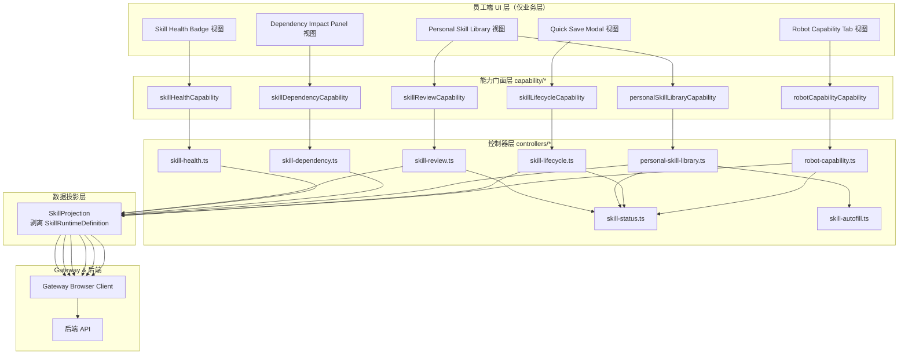
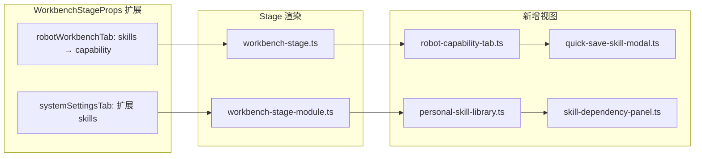
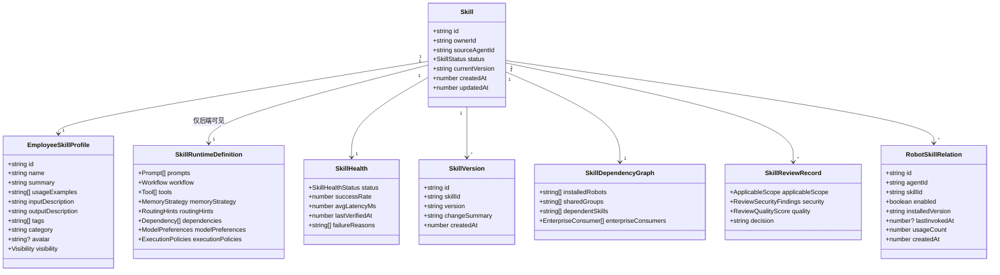
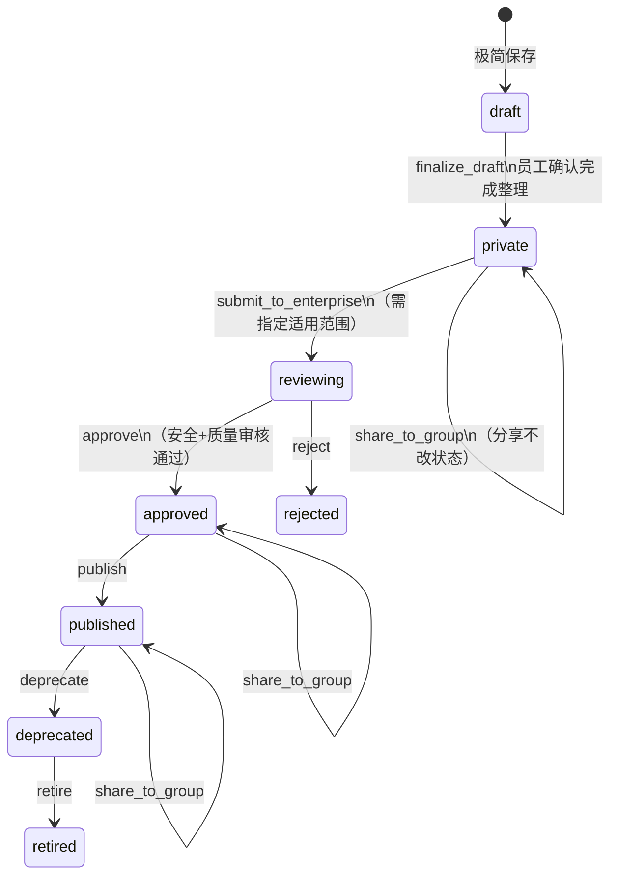

# 技术设计文档：员工端技能生命周期与资产积累系统

## 概述

本设计文档描述 OpenBot 员工端技能生命周期与资产积累系统的技术架构。系统在现有 Lit/TypeScript Web 组件架构基础上，扩展技能管理能力，遵循"控制器 → 能力门面 → 渲染模型 → 视图"的数据流模式。

核心设计理念：

- **双层隔离**：Skill 数据结构严格分为员工业务层（EmployeeSkillProfile）与系统运行层（SkillRuntimeDefinition），员工端 UI 与控制器仅读业务层；运行层仅在后端/适配层维护。
- **弱显性**：技能从机器人工作中自然涌现；员工端叙事是"机器人会做什么"，不是"插件管理"。
- **极简保存 + 草稿标准化**：员工只输入名称 + 一句话描述即可保存，技能默认进入 `draft`，由 Skill_Autofill 异步补全推荐字段，员工后续逐步完善。
- **渐进式阶段**：Phase 1（能力标签页 + 极简保存 + 资产库 + 双层模型 + 基础健康度）→ Phase 2（版本、完整分享、企业审核、依赖图）→ Phase 3（自动模式检测、推荐、标准化增强、健康度修复建议）。
- **术语隔离**：员工端严格执行黑名单（workflow/schema/toolchain/dependency/provider/model/routing/prompt/memory strategy/execution policy/capability governance/registry/asset lifecycle 等），全部替换为员工语言。

## 架构

### 整体架构图



**关键点**：`SkillProjection` 是硬性适配层，将后端返回的完整 Skill（含 SkillRuntimeDefinition）映射为 `EmployeeSkillView`，任何运行层字段必须在此剥离，保证 UI 渲染树绝不接触运行层字段（对应需求 4.4 / 4.5）。

### 集成到现有工作台架构



**设计决策**：

1. 沿用现有 `WorkbenchRobotWorkbenchTab = "skills"` 类型，但在 UI 层将该 tab 的文案、视觉与导航措辞改为"机器人能力 / 会做什么"；不改类型标识，避免影响已有路由/存储键。
2. 扩展 `WorkbenchSystemSettingsTab` 枚举增加 `"skills"` 选项用于"我的技能"页面。
3. `Quick Save Modal` 与 `Skill Dependency Panel` 作为独立模态组件，可从能力标签页、聊天界面、资产库详情页多处触发。

## 组件与接口

> 所有员工端控制器仅操作 `EmployeeSkillView`（业务层视图投影），绝不直接持有 `SkillRuntimeDefinition`。运行层仅在后端或投影前的数据适配模块中存在。

### 0. 共享类型：EmployeeSkillView（员工业务层投影）

```typescript
// ui/src/ui/capability/skills-lifecycle/types.ts

export type SkillStatus =
  | "draft"
  | "private"
  | "reviewing"
  | "approved"
  | "published"
  | "deprecated"
  | "retired"
  | "rejected";

export type SkillHealthStatus = "healthy" | "warning" | "broken";

export type ApplicableScope =
  | { kind: "enterprise" }
  | { kind: "department"; departmentId: string }
  | { kind: "group"; groupId: string }
  | { kind: "role"; roleId: string };

/**
 * 员工业务层（EmployeeSkillProfile）的 UI 投影，严格不含任何运行层字段。
 * 对应需求 4.2。
 */
export type EmployeeSkillView = {
  id: string;
  name: string;
  summary: string;
  usageExamples: string[];
  inputDescription: string;
  outputDescription: string;
  tags: string[];
  category: string;
  avatar: string | null;
  visibility: "private" | "shared" | "published";
  status: SkillStatus;
  sourceRobot: { id: string; name: string } | null;
  installedRobotCount: number;
  usageCount: number;
  lastUsedAt: number | null;
  createdAt: number;
  updatedAt: number;
  currentVersion: string | null; // 仅详情页使用，列表视图不读该字段
  health: SkillHealthSummary;
};

export type SkillHealthSummary = {
  status: SkillHealthStatus;
  successRate: number | null;
  avgLatencyMs: number | null;
  lastVerifiedAt: number | null;
  friendlyStatusLabel: string; // 员工语言："运行正常" / "偶尔出错" / "已失效"
};

export type SkillAutofillSuggestion = {
  category?: string;
  tags?: string[];
  inputDescription?: string;
  outputDescription?: string;
  usageExamples?: string[];
  avatar?: string;
  summaryRefinement?: string; // 对员工原填 summary 的精修建议，默认不覆盖
};
```

### 1. Robot Capability Controller（机器人能力控制器）

```typescript
// ui/src/ui/controllers/robot-capability.ts

export type RobotCapabilityItem = {
  relationId: string;
  skillId: string;
  name: string;
  summary: string;
  health: SkillHealthSummary;
  enabled: boolean;
  lastInvokedAt: number | null;
  usageCount: number;
  hasNewerVersion: boolean; // 仅在详情视图使用
  secondary: {
    installedVersion: string;
    latestVersion: string | null;
  };
};

export type RobotCapabilityState = {
  client: GatewayBrowserClient | null;
  connected: boolean;
  loading: boolean;
  error: string | null;
  agentId: string | null;
  items: RobotCapabilityItem[];
  busyRelationId: string | null;
  expandedSkillId: string | null; // 当前展开的能力详情
  messages: Record<string, SkillMessage>;
};

export async function loadRobotCapabilities(
  state: RobotCapabilityState,
  agentId: string,
): Promise<void>;

export async function toggleCapabilityEnabled(
  state: RobotCapabilityState,
  relationId: string,
  enabled: boolean,
): Promise<void>;

/** 需求 1.10 + 9.4/9.5：员工侧措辞为"切换到新版本"。 */
export async function switchCapabilityVersion(
  state: RobotCapabilityState,
  relationId: string,
  targetVersion: string,
): Promise<void>;

export async function removeCapability(
  state: RobotCapabilityState,
  relationId: string,
): Promise<void>;

export async function installSkillToRobot(
  state: RobotCapabilityState,
  skillId: string,
  agentId: string,
): Promise<void>;

export function expandCapability(state: RobotCapabilityState, skillId: string | null): void;
```

### 2. Skill Lifecycle Controller（生命周期控制器，极简保存 + Draft）

```typescript
// ui/src/ui/controllers/skill-lifecycle.ts

/**
 * 极简保存表单：员工只填两个字段（需求 2.2）。
 * 分享选项作为次级操作，不再与保存主动作耦合（需求 2.6）。
 */
export type QuickSaveFormData = {
  name: string;
  summary: string;
};

export type SaveSkillResult = {
  skillId: string;
  status: "draft"; // 极简保存后固定为 draft（需求 2.3）
  autofillJobId: string | null;
};

export type SkillLifecycleState = {
  client: GatewayBrowserClient | null;
  connected: boolean;
  modalOpen: boolean;
  modalBusy: boolean;
  modalError: string | null;
  form: QuickSaveFormData;
  sourceAgentId: string | null;
  sourceContextId: string | null;
  patternHint: {
    sampleTaskDescription: string;
    detectionStrength: "low" | "medium" | "high";
  } | null;
};

export async function openQuickSaveModal(
  state: SkillLifecycleState,
  params: {
    agentId: string;
    contextId: string;
    patternHint?: SkillLifecycleState["patternHint"];
  },
): Promise<void>;

export function closeQuickSaveModal(state: SkillLifecycleState): void;

export function updateQuickSaveForm(
  state: SkillLifecycleState,
  patch: Partial<QuickSaveFormData>,
): void;

/** 提交极简保存；内部完成：后端创建技能（draft）→ 建立 Robot_Skill_Relation → 触发 Skill_Autofill */
export async function submitQuickSave(state: SkillLifecycleState): Promise<SaveSkillResult | null>;
```

**员工端禁止出现运行层字段**：本控制器与模态输入只接受 `name` / `summary`。运行层的 prompts / workflow / tools 等完全在后端按源会话上下文封装，UI 层不传、不见、不编辑（需求 2.5 / 4.4 / 4.5）。

### 3. Personal Skill Library Controller（个人资产库控制器）

```typescript
// ui/src/ui/controllers/personal-skill-library.ts

export type PersonalSkillListItem = {
  id: string;
  name: string;
  summary: string;
  sourceRobotName: string | null;
  usageCount: number;
  lastUsedAt: number | null;
  status: SkillStatus;
  health: SkillHealthSummary;
  isDraft: boolean; // 便于列表视觉醒目标识草稿
};

export type PersonalSkillDetail = EmployeeSkillView & {
  installedRobots: Array<{ id: string; name: string }>;
  versions: SkillVersionEntry[];
  autofillSuggestion: SkillAutofillSuggestion | null;
  dependencySummary: SkillDependencySummary;
};

export type SkillVersionEntry = {
  version: string;
  createdAt: number;
  changeSummary: string;
};

export type PersonalSkillLibraryState = {
  client: GatewayBrowserClient | null;
  connected: boolean;
  loading: boolean;
  error: string | null;
  items: PersonalSkillListItem[];
  searchQuery: string;
  filterTag: string | null;
  filterCategory: string | null;
  filterStatus: SkillStatus | null;
  selectedSkillId: string | null;
  selectedDetail: PersonalSkillDetail | null;
  selectedDetailLoading: boolean;
  // 编辑态只允许修改业务层字段（需求 3.8）
  editDraft: Pick<
    EmployeeSkillView,
    | "name"
    | "summary"
    | "usageExamples"
    | "inputDescription"
    | "outputDescription"
    | "tags"
    | "category"
    | "avatar"
  > | null;
  editSaving: boolean;
  editError: string | null;
  // 编辑 / 删除前展示的影响面板（需求 3.10 / 8.2 / 8.3）
  impactPreview: {
    target: "edit" | "delete";
    graph: SkillDependencyGraphSnapshot;
  } | null;
};

export async function loadPersonalSkills(state: PersonalSkillLibraryState): Promise<void>;
export async function loadSkillDetail(
  state: PersonalSkillLibraryState,
  skillId: string,
): Promise<void>;
export function updateSearchQuery(state: PersonalSkillLibraryState, query: string): void;
export function updateFilterTag(state: PersonalSkillLibraryState, tag: string | null): void;
export function updateFilterCategory(
  state: PersonalSkillLibraryState,
  category: string | null,
): void;
export function updateFilterStatus(
  state: PersonalSkillLibraryState,
  status: SkillStatus | null,
): void;

/** 编辑前先拉依赖图摘要并展示（需求 8.2） */
export async function prepareEditImpact(
  state: PersonalSkillLibraryState,
  skillId: string,
): Promise<void>;

export async function saveSkillEdit(
  state: PersonalSkillLibraryState,
  skillId: string,
  changes: NonNullable<PersonalSkillLibraryState["editDraft"]>,
  changeSummary: string,
): Promise<void>;

/** 删除前强制展示依赖图 + 二次确认（需求 8.3） */
export async function prepareDeleteImpact(
  state: PersonalSkillLibraryState,
  skillId: string,
): Promise<void>;
export async function deleteSkill(state: PersonalSkillLibraryState, skillId: string): Promise<void>;

/** 接受 Skill_Autofill 推荐：可整批或逐项接受（需求 6.5 / 6.6） */
export async function acceptAutofill(
  state: PersonalSkillLibraryState,
  skillId: string,
  acceptFields: Array<keyof SkillAutofillSuggestion>,
  acceptSummaryRefinement: boolean,
): Promise<void>;

/** 员工确认完成整理：draft → private（需求 6.6） */
export async function finalizeDraft(
  state: PersonalSkillLibraryState,
  skillId: string,
): Promise<void>;

export async function shareSkillToGroup(
  state: PersonalSkillLibraryState,
  skillId: string,
  groupId: string,
): Promise<void>;

export async function submitSkillToEnterprise(
  state: PersonalSkillLibraryState,
  skillId: string,
  scope: ApplicableScope,
): Promise<void>;
```

### 4. Skill Status Controller（完整生命周期状态机）

```typescript
// ui/src/ui/controllers/skill-status.ts

export type SkillStatusTransition = {
  from: SkillStatus;
  to: SkillStatus;
  action:
    | "finalize_draft"
    | "share_to_group"
    | "submit_to_enterprise"
    | "approve"
    | "reject"
    | "publish"
    | "deprecate"
    | "retire";
};

/**
 * 合法状态流转（对应需求 10.10）。
 * 主路径：draft → private → reviewing → approved → published → deprecated → retired
 * 分支：reviewing → rejected
 */
export const VALID_TRANSITIONS: readonly SkillStatusTransition[] = [
  { from: "draft", to: "private", action: "finalize_draft" },
  { from: "private", to: "reviewing", action: "submit_to_enterprise" },
  { from: "reviewing", to: "approved", action: "approve" },
  { from: "reviewing", to: "rejected", action: "reject" },
  { from: "approved", to: "published", action: "publish" },
  { from: "published", to: "deprecated", action: "deprecate" },
  { from: "deprecated", to: "retired", action: "retire" },
];

export function isValidTransition(from: SkillStatus, to: SkillStatus): boolean;
export function getAvailableTransitions(currentStatus: SkillStatus): SkillStatusTransition[];

/** 草稿禁止直接提交企业审核（需求 10.11） */
export function assertCanSubmitToEnterprise(currentStatus: SkillStatus): void;

/** 分享到协作小组的合法前置状态：private / approved / published */
export function canShareToGroup(currentStatus: SkillStatus): boolean;
```

### 5. Skill Health Controller（健康度）

```typescript
// ui/src/ui/controllers/skill-health.ts

export type SkillHealthSample = {
  skillId: string;
  agentId: string;
  timestamp: number;
  outcome: "success" | "failure";
  latencyMs: number;
  failureReason?: string;
};

export type SkillHealthState = {
  client: GatewayBrowserClient | null;
  subscriptionByAgentId: Record<string, string>; // 订阅句柄
  bufferedSamples: SkillHealthSample[];
};

/** 机器人每次调用后自动回传样本（需求 4.11 / 7.3） */
export async function reportHealthSample(
  state: SkillHealthState,
  sample: SkillHealthSample,
): Promise<void>;

/** 计算 SkillHealthSummary（滑动窗口） */
export function computeHealthSummary(
  samples: SkillHealthSample[],
  windowMs: number,
  thresholds: { warningSuccessRate: number; brokenConsecutiveFailures: number },
): SkillHealthSummary;

export function toFriendlyLabel(status: SkillHealthStatus): string;
```

**员工语言映射**（需求 7.6 / 7.7）：

- `healthy` → "运行正常"
- `warning` → "偶尔出错"
- `broken` → "已失效"

### 6. Skill Dependency Controller（依赖图）

```typescript
// ui/src/ui/controllers/skill-dependency.ts

export type SkillDependencySummary = {
  installedRobotCount: number;
  sharedGroupCount: number;
  dependentSkillCount: number;
  enterpriseConsumerCount: number;
  hasAnyConsumer: boolean; // 需求 8.6：全空时可直接编辑/删除
};

export type SkillDependencyGraphSnapshot = SkillDependencySummary & {
  installedRobots: Array<{ id: string; name: string }>;
  sharedGroups: Array<{ id: string; name: string }>;
  dependentSkills: Array<{ id: string; name: string }>;
  enterpriseConsumers: Array<{
    kind: "department" | "group" | "role" | "enterprise";
    id: string | null;
    label: string;
  }>;
};

export type SkillDependencyState = {
  client: GatewayBrowserClient | null;
  summaryCache: Record<string, SkillDependencySummary>;
  graphCache: Record<string, SkillDependencyGraphSnapshot>;
  loadingSkillId: string | null;
};

export async function loadDependencySummary(
  state: SkillDependencyState,
  skillId: string,
): Promise<void>;
export async function loadDependencyGraph(
  state: SkillDependencyState,
  skillId: string,
): Promise<void>;
```

### 7. Skill Autofill Controller（草稿系统辅助标准化）

```typescript
// ui/src/ui/controllers/skill-autofill.ts

export type AutofillJobStatus = "pending" | "running" | "succeeded" | "empty" | "failed";

export type AutofillJobState = {
  jobId: string;
  skillId: string;
  status: AutofillJobStatus;
  suggestion: SkillAutofillSuggestion | null;
  updatedAt: number;
};

export type SkillAutofillState = {
  client: GatewayBrowserClient | null;
  jobsBySkillId: Record<string, AutofillJobState>;
};

/** 在极简保存完成后触发（需求 6.3） */
export async function startAutofill(state: SkillAutofillState, skillId: string): Promise<string>;

/** 拉取或订阅补全结果 */
export async function fetchAutofillResult(
  state: SkillAutofillState,
  skillId: string,
): Promise<AutofillJobState>;

/** 无法生成推荐时（需求 6.8）保持 draft 不变 */
export function isEmptyAutofill(job: AutofillJobState): boolean;
```

### 8. Skill Review Controller（企业审核）

```typescript
// ui/src/ui/controllers/skill-review.ts

export type ReviewSecurityFindings = {
  leaksSensitiveInfo: boolean;
  usesDangerousTools: boolean;
  hasExternalCalls: boolean;
  hasPermissionRisks: boolean;
  comments: string[];
};

export type ReviewQualityScore = {
  stability: number; // 0-100
  successRate: number; // 0-100
  reuseValue: number; // 0-100
  standardization: number; // 0-100
  overall: number; // 0-100
};

export type SkillReviewRecord = {
  skillId: string;
  submittedAt: number;
  reviewer: { id: string; name: string } | null;
  applicableScope: ApplicableScope;
  security: ReviewSecurityFindings | null;
  quality: ReviewQualityScore | null;
  decision: "approved" | "rejected" | null;
  rejectionReason: string | null;
  improvementSuggestions: string[];
};

export type SkillReviewState = {
  client: GatewayBrowserClient | null;
  activeReviews: Record<string, SkillReviewRecord>;
};

export async function submitForReview(
  state: SkillReviewState,
  skillId: string,
  scope: ApplicableScope,
): Promise<SkillReviewRecord>;

export async function loadReviewRecord(state: SkillReviewState, skillId: string): Promise<void>;

/** 管理员发布：approved → published，并落定适用范围（需求 10.6） */
export async function publishSkill(
  state: SkillReviewState,
  skillId: string,
  scope: ApplicableScope,
): Promise<void>;

export async function deprecateSkill(state: SkillReviewState, skillId: string): Promise<void>;
export async function retireSkill(state: SkillReviewState, skillId: string): Promise<void>;
```

### 9. Capability Facades（能力门面）

```typescript
// ui/src/ui/capability/robot-capability/facade.ts
export const robotCapabilityCapability = {
  load: loadRobotCapabilities,
  toggleEnabled: toggleCapabilityEnabled,
  switchVersion: switchCapabilityVersion,
  remove: removeCapability,
  install: installSkillToRobot,
  expand: expandCapability,
} as const;

// ui/src/ui/capability/skill-lifecycle/facade.ts
export const skillLifecycleCapability = {
  open: openQuickSaveModal,
  close: closeQuickSaveModal,
  updateForm: updateQuickSaveForm,
  submit: submitQuickSave,
} as const;

// ui/src/ui/capability/personal-skill-library/facade.ts
export const personalSkillLibraryCapability = {
  load: loadPersonalSkills,
  loadDetail: loadSkillDetail,
  updateSearch: updateSearchQuery,
  updateFilterTag,
  updateFilterCategory,
  updateFilterStatus,
  prepareEditImpact,
  saveEdit: saveSkillEdit,
  prepareDeleteImpact,
  delete: deleteSkill,
  acceptAutofill,
  finalizeDraft,
  shareToGroup: shareSkillToGroup,
  submitToEnterprise: submitSkillToEnterprise,
} as const;

// ui/src/ui/capability/skill-health/facade.ts
export const skillHealthCapability = {
  report: reportHealthSample,
  compute: computeHealthSummary,
  friendlyLabel: toFriendlyLabel,
} as const;

// ui/src/ui/capability/skill-dependency/facade.ts
export const skillDependencyCapability = {
  loadSummary: loadDependencySummary,
  loadGraph: loadDependencyGraph,
} as const;

// ui/src/ui/capability/skill-review/facade.ts
export const skillReviewCapability = {
  submit: submitForReview,
  load: loadReviewRecord,
  publish: publishSkill,
  deprecate: deprecateSkill,
  retire: retireSkill,
} as const;
```

### 10. 视图组件

```typescript
// ui/src/ui/views/robot-capability-tab.ts
export type RobotCapabilityTabProps = {
  loading: boolean;
  items: RobotCapabilityItem[];
  error: string | null;
  busyRelationId: string | null;
  expandedSkillId: string | null;
  recommendations: RobotCapabilityItem[]; // Phase 3
  onExpand: (skillId: string | null) => void;
  // 以下为二级操作（需求 1.6）：通过能力项的"更多"菜单触达，不作为主视觉按钮
  onToggleEnabled: (relationId: string, enabled: boolean) => void;
  onSwitchVersion: (relationId: string, targetVersion: string) => void;
  onRemove: (relationId: string) => void;
  onInstallRecommended: (skillId: string) => void;
};

// ui/src/ui/views/quick-save-skill-modal.ts
export type QuickSaveSkillModalProps = {
  open: boolean;
  busy: boolean;
  error: string | null;
  form: QuickSaveFormData;
  patternHint: SkillLifecycleState["patternHint"];
  // 分享入口在极简保存中**不**出现（需求 2.6）；保存完成后在详情页再次提供
  onFormChange: (patch: Partial<QuickSaveFormData>) => void;
  onSubmit: () => void;
  onClose: () => void;
};

// ui/src/ui/views/personal-skill-library.ts
export type PersonalSkillLibraryProps = {
  loading: boolean;
  items: PersonalSkillListItem[];
  error: string | null;
  searchQuery: string;
  filterTag: string | null;
  filterCategory: string | null;
  filterStatus: SkillStatus | null;
  availableTags: string[];
  availableCategories: string[];
  selectedDetail: PersonalSkillDetail | null;
  detailLoading: boolean;
  editDraft: PersonalSkillLibraryState["editDraft"];
  editSaving: boolean;
  editError: string | null;
  impactPreview: PersonalSkillLibraryState["impactPreview"];
  onSearchChange: (query: string) => void;
  onFilterTagChange: (tag: string | null) => void;
  onFilterCategoryChange: (category: string | null) => void;
  onFilterStatusChange: (status: SkillStatus | null) => void;
  onSelectSkill: (skillId: string) => void;
  onBack: () => void;
  // 编辑 / 删除前展示影响面板
  onBeginEdit: (skillId: string) => void;
  onConfirmEdit: (
    changes: NonNullable<PersonalSkillLibraryState["editDraft"]>,
    changeSummary: string,
  ) => void;
  onBeginDelete: (skillId: string) => void;
  onConfirmDelete: (skillId: string) => void;
  // 草稿 Autofill
  onAcceptAutofill: (fields: Array<keyof SkillAutofillSuggestion>, acceptSummary: boolean) => void;
  onFinalizeDraft: (skillId: string) => void;
  // 分享 / 企业审核
  onShareToGroup: (groupId: string) => void;
  onSubmitToEnterprise: (scope: ApplicableScope) => void;
};

// ui/src/ui/views/skill-dependency-panel.ts
export type SkillDependencyPanelProps = {
  target: "edit" | "delete";
  graph: SkillDependencyGraphSnapshot;
  onDrillDown: (kind: "robot" | "group" | "skill" | "enterprise", id: string) => void;
  onConfirm: () => void;
  onCancel: () => void;
};

// ui/src/ui/views/skill-health-badge.ts
export type SkillHealthBadgeProps = {
  summary: SkillHealthSummary;
  variant: "inline" | "detail";
};
```

**术语守卫**：视图层在渲染前经由 `SkillProjection` 得到的 `EmployeeSkillView`，其字段设计已从类型层面排除 `prompt / workflow / toolchain / schema / model / routing` 等运行层字段。任何 i18n 文案接入 `terminology-filter.ts`（需求 5.3 / 5.4）做黑名单校验，构建期失败。

## 数据模型

### 双层结构



**隔离约束**：

- 员工端 UI / 控制器类型图中所有源自 `Skill` 的投影（`EmployeeSkillView`、`PersonalSkillListItem`、`PersonalSkillDetail`、`RobotCapabilityItem`）**不得**依赖 `SkillRuntimeDefinition`（需求 4.4 / 4.5）。
- `SkillProjection.fromSkill(skill)` 是唯一合法构造员工投影的函数，位于能力门面层之前。

### EmployeeSkillProfile（员工业务层）

| 字段              | 类型                                 | 说明                     |
| ----------------- | ------------------------------------ | ------------------------ |
| id                | string                               | 技能唯一标识             |
| name              | string                               | 员工可读的能力名称       |
| summary           | string                               | 一句话描述               |
| usageExamples     | string[]                             | 使用场景示例（自然语言） |
| inputDescription  | string                               | 输入说明（自然语言）     |
| outputDescription | string                               | 输出说明（自然语言）     |
| tags              | string[]                             | 标签列表                 |
| category          | string                               | 分类                     |
| avatar            | string \| null                       | 头像（emoji 或图片地址） |
| visibility        | `private` \| `shared` \| `published` | 可见性状态               |

### SkillRuntimeDefinition（系统运行层，员工不可见）

| 字段              | 类型              | 说明             |
| ----------------- | ----------------- | ---------------- |
| prompts           | Prompt[]          | 核心 Prompt 列表 |
| workflow          | Workflow          | 工作流定义       |
| tools             | Tool[]            | 工具链配置       |
| memoryStrategy    | MemoryStrategy    | 记忆策略         |
| routingHints      | RoutingHints      | 路由提示         |
| dependencies      | Dependency[]      | 依赖项           |
| modelPreferences  | ModelPreferences  | 模型偏好         |
| executionPolicies | ExecutionPolicies | 执行策略         |

### SkillHealth / SkillDependencyGraph / SkillReviewRecord

字段与控制器接口中定义一致（见第 5、6、8 节）。

### RobotSkillRelation（机器人技能关联）

| 字段             | 类型           | 说明         |
| ---------------- | -------------- | ------------ |
| id               | string         | 关联唯一标识 |
| agentId          | string         | 机器人 ID    |
| skillId          | string         | 技能 ID      |
| enabled          | boolean        | 启用状态     |
| installedVersion | string         | 已安装版本   |
| lastInvokedAt    | number \| null | 最近调用时间 |
| usageCount       | number         | 累计使用次数 |
| createdAt        | number         | 创建时间     |

健康度反馈通道（需求 4.11 / 7.3）：每次调用完成时 agent runtime 将 `SkillHealthSample` 通过 Gateway 上报，后端聚合更新对应 `SkillHealth`，并通过 `skill-health.subscribe` 推送给订阅方。

### 完整状态机



> 分享到协作小组仅更新 visibility / SkillDependencyGraph.sharedGroups，不改变 Skill_Status。

### Gateway API 端点

| 端点                            | 方法         | 说明                                        |
| ------------------------------- | ------------ | ------------------------------------------- |
| robot-capability.list           | request      | 获取机器人能力列表（仅业务层）              |
| robot-capability.toggle         | request      | 启用/禁用                                   |
| robot-capability.switch-version | request      | 切换版本                                    |
| robot-capability.remove         | request      | 移除关联                                    |
| robot-capability.install        | request      | 安装已有技能                                |
| skill-lifecycle.quick-save      | request      | 极简保存（name + summary），返回 draft 技能 |
| skill-autofill.start            | request      | 触发 Skill_Autofill 异步补全                |
| skill-autofill.result           | request      | 拉取补全结果                                |
| skill-autofill.subscribe        | subscription | 订阅补全进度                                |
| personal-skills.list            | request      | 资产库列表                                  |
| personal-skills.detail          | request      | 资产库详情（含依赖摘要）                    |
| personal-skills.edit            | request      | 编辑业务层字段 + 创建新版本                 |
| personal-skills.finalize-draft  | request      | draft → private                             |
| personal-skills.accept-autofill | request      | 接受系统推荐值                              |
| personal-skills.delete          | request      | 删除技能                                    |
| skill-health.sample             | request      | 单次调用健康度上报                          |
| skill-health.subscribe          | subscription | 订阅技能健康度更新                          |
| skill-dependency.summary        | request      | 获取依赖摘要                                |
| skill-dependency.graph          | request      | 获取完整依赖图                              |
| skill-review.submit             | request      | 提交企业审核（含适用范围）                  |
| skill-review.record             | request      | 获取审核记录                                |
| skill-review.publish            | request      | 管理员发布（approved → published）          |
| skill-review.deprecate          | request      | 标记弃用                                    |
| skill-review.retire             | request      | 下线                                        |
| skill-share.to-group            | request      | 分享到协作小组                              |
| skill-recommendations.list      | request      | 推荐能力（仅 published + 共享）             |

## 正确性属性

_属性是在系统所有有效执行中都应保持为真的特征或行为。_

### Property 1: 能力列表渲染严格限业务层

_For any_ `EmployeeSkillView` 经 `SkillProjection` 得到的对象，`Robot_Capability_Tab` 列表项渲染输出的 DOM 文本和属性集合中不得包含以下键名或术语：`prompt`, `workflow`, `toolchain`, `schema`, `dependency`, `model`, `routing`, `memory strategy`, `execution policy`, `provider`, `OpenAI`, `Anthropic`, `capability governance`, `registry`, `asset lifecycle`。

**Validates: Requirements 1.2, 1.3, 4.4, 4.5, 5.3, 5.4**

### Property 2: 启用/禁用状态切换幂等

_For any_ `RobotSkillRelation` r 和 boolean target，执行 `toggleCapabilityEnabled(r, target)` 后，`r.enabled === target`，且其他字段不变；连续两次以同一 target 调用的最终状态与一次调用相同。

**Validates: Requirements 1.7, 1.8**

### Property 3: 版本切换仅改 installedVersion

_For any_ `RobotSkillRelation` r 和 `targetVersion ∈ availableVersions(r.skillId)`，`switchCapabilityVersion(r, targetVersion)` 后 `r.installedVersion === targetVersion`，`r.enabled`、`r.usageCount` 不变。

**Validates: Requirements 1.10, 9.5**

### Property 4: 移除保留技能本体

_For any_ `RobotSkillRelation` r，执行 `removeCapability(r)` 后，`r.skillId` 对应的 Skill 仍存在于 `Personal_Skill_Library`；机器人侧能力列表不再包含该 relationId。

**Validates: Requirements 1.9**

### Property 5: 极简保存字段边界

_For any_ `QuickSaveFormData` 提交，保存请求 payload 中仅包含 `name` 与 `summary` 两个业务字段及系统自动附加的来源上下文；不得包含任何 SkillRuntimeDefinition 字段。

**Validates: Requirements 2.2, 2.5, 4.4**

### Property 6: 极简保存固定进入 draft

_For any_ 成功的 `submitQuickSave` 调用，返回 `SaveSkillResult.status === "draft"`，且后端技能实体的 `status === "draft"`。

**Validates: Requirements 2.3, 6.1**

### Property 7: 保存自动建立 Relation

_For any_ 成功保存的技能 s 与来源机器人 a，事务完成后存在唯一 `RobotSkillRelation r` 满足 `r.agentId === a` 且 `r.skillId === s.id`，且 `r.enabled === true`、`r.usageCount === 0`、`r.lastInvokedAt === null`。

**Validates: Requirements 2.4, 4.3, 4.9**

### Property 8: Autofill 不覆盖员工 summary

_For any_ `acceptAutofill(skillId, acceptFields, acceptSummaryRefinement)`，当 `acceptSummaryRefinement === false` 时保存后 `skill.summary` 等于调用前的 summary；当 `acceptSummaryRefinement === true` 且 suggestion.summaryRefinement 非空时，保存后 `skill.summary === suggestion.summaryRefinement`。

**Validates: Requirements 6.5**

### Property 9: Draft 禁止进入企业审核

_For any_ 处于 `draft` 的技能，调用 `submitSkillToEnterprise` 必定被 `assertCanSubmitToEnterprise` 抛错拒绝，技能 status 保持 `draft` 不变。

**Validates: Requirements 6.7, 10.11, 10.10**

### Property 10: 资产库列表仅业务层字段

_For any_ `loadPersonalSkills` 返回的 `PersonalSkillListItem[]`，每个元素仅含 `{id, name, summary, sourceRobotName, usageCount, lastUsedAt, status, health, isDraft}`；不包含 version / prompt / workflow / toolchain / schema 等字段。

**Validates: Requirements 3.2, 3.3, 4.4**

### Property 11: 搜索与筛选正确性

_For any_ 资产库条目集合 S 与查询条件 (q, tag, category, status)，`filter(S, q, tag, category, status)` 返回的每一条目满足：

- `q` 为空或 `item.name` 或 `item.summary` 以不区分大小写包含 q；
- `tag` 为空或 `item.tags` 包含该 tag；
- `category` 为空或 `item.category === category`；
- `status` 为空或 `item.status === status`。

**Validates: Requirements 3.4, 3.5, 3.6**

### Property 12: 编辑创建新版本且保留历史

_For any_ 成功的 `saveSkillEdit(skillId, changes, summary)`，保存后 `skill.currentVersion` 大于保存前（按语义化版本比较），版本列表新增一条记录其 `changeSummary === summary`，且所有已有版本内容保持不变。

**Validates: Requirements 9.1, 9.2**

### Property 13: 编辑/删除前强制展示依赖图

_For any_ 技能 s，当 `SkillDependencyGraph.hasAnyConsumer === true` 时，在 UI 层触发编辑或删除操作必先呈现依赖图摘要，并要求用户显式确认才可进入后续动作；当 `hasAnyConsumer === false` 时，可直接进入（无强制二次确认）。

**Validates: Requirements 3.10, 8.2, 8.3, 8.6**

### Property 14: 依赖图事件一致性

_For any_ 事件 e ∈ {install, uninstall, share, unshare, publish, deprecate, retire}，在 e 成功后 `SkillDependencyGraph` 相应集合（installedRobots / sharedGroups / enterpriseConsumers）应准确反映实际状态（与 RobotSkillRelation、共享记录、发布记录对齐）。

**Validates: Requirements 8.7**

### Property 15: 健康度回传路径不漏

_For any_ 机器人完成的技能调用 c，在有限时间窗内必产生唯一 `SkillHealthSample` 上报并被后端聚合到对应 `SkillHealth`；若调用失败，`failureReasons` 非空。

**Validates: Requirements 4.11, 7.3**

### Property 16: 健康度阈值分级

_For any_ 滑动窗口内的样本集 S：

- 当 `successRate(S) < warningThreshold` 或连续失败次数 ≥ warningConsecutive 时，`SkillHealth.status === "warning"`；
- 当连续失败次数 ≥ brokenConsecutive 或关键依赖失效事件触发时，`SkillHealth.status === "broken"`；
- 其他情况 `SkillHealth.status === "healthy"`。

**Validates: Requirements 7.4, 7.5**

### Property 17: 健康度展示使用员工语言

_For any_ `SkillHealthSummary h`，`h.friendlyStatusLabel ∈ {"运行正常", "偶尔出错", "已失效"}`（或对应 i18n 等价词），且视图输出中不得包含原始 status 枚举字符串 `healthy`、`warning`、`broken`。

**Validates: Requirements 5.3, 5.4, 7.6, 7.7**

### Property 18: 完整生命周期合法性

_For any_ 状态转换 (from, to)，当且仅当 `(from, to)` 存在于 `VALID_TRANSITIONS` 中时 `isValidTransition` 返回 true；不合法转换被拒绝且技能状态不变。合法路径为：

- `draft → private`, `private → reviewing`, `reviewing → approved`, `reviewing → rejected`,
- `approved → published`, `published → deprecated`, `deprecated → retired`。

**Validates: Requirements 10.10**

### Property 19: 发布后适用范围生效

_For any_ 已发布技能 s 与查询员工 u，`isDiscoverable(s, u)` 为真当且仅当 `s.status === "published"` 且 `u` 落在 `s.applicableScope`（enterprise / department / group / role）覆盖范围内。

**Validates: Requirements 10.6, 12.2**

### Property 20: 版本历史往返一致

_For any_ 已保存的技能版本 v，通过版本 ID 检索并重建得到的 `EmployeeSkillProfile` 与保存时的内容深度相等。

**Validates: Requirements 9.3**

### Property 21: 推荐来源白名单

_For any_ 推荐列表 R 中的每个候选技能 c，`c.status === "published"` 且 `c.applicableScope` 覆盖当前员工，或 c 来自当前员工参与的协作小组共享集合；不得出现其他员工的 private / draft / reviewing / rejected / retired 技能。

**Validates: Requirements 12.2**

### Property 22: 术语黑名单扫描

_For any_ 员工端视图的最终渲染字符串输出，其不得匹配术语黑名单（正则）：`\b(workflow|schema|toolchain|dependency|provider|model|routing|prompt|memory strategy|execution policy|capability governance|registry|asset lifecycle|OpenAI|Anthropic|模型路由|路由策略)\b`。

**Validates: Requirements 5.3**

### Property 23: 模式阈值生成建议

_For any_ 工作模式序列 p，当 `p.repetitionCount >= threshold` 且结构稳定性 >= 预设值时，系统生成一条"检测到可复用能力"的保存建议；低于阈值则不生成。

**Validates: Requirements 2.1, 11.1, 11.2**

### Property 24: 健康度修复建议仅在 warning/broken 生成

_For any_ 技能详情页，当 `SkillHealth.status ∈ {warning, broken}` 时资产库提供面向员工语言的修复建议；当 status 为 `healthy` 时不展示修复建议。建议文本不得包含原始错误堆栈或技术术语。

**Validates: Requirements 13.1, 13.2**

### Property 25: 健康度修复回归

_For any_ 员工采纳建议后触发的后续成功调用序列，当滑动窗口指标重回 healthy 阈值时 `SkillHealth.status` 自动恢复为 `healthy`。

**Validates: Requirements 13.3**

## 错误处理

### 网络错误

| 场景                    | 处理策略                                                                                         |
| ----------------------- | ------------------------------------------------------------------------------------------------ |
| 加载能力/资产库失败     | 保留上次成功加载数据，展示面向员工的错误提示 + 重试                                              |
| 极简保存失败            | 保留表单数据，展示具体错误，允许重试；不回退 Modal                                               |
| Autofill 任务失败或超时 | 资产库列表继续展示 draft 标识，推荐区域提示"稍后再试"                                            |
| 切换启用/版本失败       | UI 回滚到操作前状态，`busyRelationId` 清空，提示错误                                             |
| 健康度回传失败          | agent 端以指数退避重试，不影响业务调用链路                                                       |
| 依赖图拉取失败          | 编辑/删除流程阻塞，显示"无法确认影响范围，请稍后重试"，不允许忽略（对应需求 8.2 / 8.3 安全底线） |

### 业务错误

| 场景                       | 处理策略                                                              |
| -------------------------- | --------------------------------------------------------------------- |
| 技能名称重复               | 表单校验提示，建议在 summary 中补充差异化描述                         |
| 无效状态转换               | 通过 `isValidTransition` 预判，在 UI 禁用不可用操作；后端校验二次拦截 |
| Draft 直接提交企业审核     | 拒绝并提示"请先完成整理"（需求 10.11）                                |
| 适用范围越权               | 审核发布时二次校验，范围不合法则阻断发布                              |
| 目标协作小组不存在         | 刷新小组列表并提示重新选择                                            |
| 依赖图为空但后端仍拒绝删除 | 以业务错误返回具体原因，不绕过后端权限                                |

### 乐观更新与回滚

- 启用/禁用采用乐观更新：立即改 UI → 发请求 → 失败回滚。
- 版本切换、Autofill 接受、分享到小组、提交审核：使用 busy 标志避免并发；失败全量回滚。
- 健康度样本不做 UI 乐观更新，等待后端聚合推送。

### 错误消息规范

- 所有员工端错误消息走 i18n。
- 文案面向员工语言（"无法保存，请稍后重试" / "此能力暂时失效"）。
- 禁止在员工端消息中出现错误码、堆栈、provider 名、model 名。

## 测试策略

### 属性测试（Property-Based Testing）

**框架**：`fast-check`。每个属性测试最少运行 100 次迭代；注释格式：
`// Feature: skill-lifecycle-asset-system, Property {N}: {property_text}`

| Property                   | 测试文件                                |
| -------------------------- | --------------------------------------- |
| Property 1                 | skill-projection.property.test.ts       |
| Property 2                 | robot-capability.property.test.ts       |
| Property 3                 | robot-capability.property.test.ts       |
| Property 5 / 6 / 7         | skill-lifecycle.property.test.ts        |
| Property 8                 | skill-autofill.property.test.ts         |
| Property 9                 | skill-status.property.test.ts           |
| Property 10 / 11 / 12 / 20 | personal-skill-library.property.test.ts |
| Property 13 / 14           | skill-dependency.property.test.ts       |
| Property 15 / 16 / 17 / 25 | skill-health.property.test.ts           |
| Property 18 / 19           | skill-status.property.test.ts           |
| Property 21                | skill-recommendations.property.test.ts  |
| Property 22                | terminology-filter.property.test.ts     |
| Property 23                | pattern-detection.property.test.ts      |
| Property 24                | skill-health-repair.property.test.ts    |

### 单元测试（Example-Based）

| 测试文件                       | 覆盖内容                                         |
| ------------------------------ | ------------------------------------------------ |
| robot-capability-tab.test.ts   | 空状态、自然语言描述、二级操作折叠入口、健康图标 |
| quick-save-skill-modal.test.ts | 两字段表单、无运行层字段、draft 返回             |
| personal-skill-library.test.ts | 导航入口、筛选、详情业务层布局、依赖面板弹出     |
| skill-dependency-panel.test.ts | 摘要展示、钻取、全空跳过确认                     |
| skill-status.test.ts           | 完整生命周期具体转换、draft 拒绝提交             |
| skill-health-badge.test.ts     | 三级状态 + 员工语言映射                          |
| skill-review.test.ts           | 安全/质量维度结构、适用范围、发布与弃用          |
| terminology-filter.test.ts     | 黑名单正则扫描构建期检查                         |

### 集成测试

| 测试文件                                 | 覆盖内容                                           |
| ---------------------------------------- | -------------------------------------------------- |
| quick-save-to-draft.integration.test.ts  | 极简保存 → draft → Relation 建立 → Autofill 触发   |
| autofill-finalize.integration.test.ts    | Autofill 推荐 → 员工接受 → draft → private         |
| health-feedback-loop.integration.test.ts | 机器人调用 → 样本上报 → SkillHealth 聚合 → UI 标签 |
| dependency-impact.integration.test.ts    | 编辑/删除前影响展示 + 钻取 + 二次确认              |
| enterprise-review.integration.test.ts    | 提交（含范围）→ 审核 → 发布 → 弃用 → 下线          |
| recommendation-scope.integration.test.ts | published + scope 过滤、协作小组共享候选           |
| terminology-scan.integration.test.ts     | 运行端到端渲染并扫描术语黑名单                     |

### 测试数据生成器

```typescript
// test/generators/skill-generators.ts
import * as fc from "fast-check";

export const skillStatusArb = fc.constantFrom(
  "draft",
  "private",
  "reviewing",
  "approved",
  "published",
  "deprecated",
  "retired",
  "rejected",
);

export const skillHealthStatusArb = fc.constantFrom("healthy", "warning", "broken");

export const skillHealthSummaryArb = fc.record({
  status: skillHealthStatusArb,
  successRate: fc.option(fc.double({ min: 0, max: 1, noNaN: true })),
  avgLatencyMs: fc.option(fc.nat({ max: 60_000 })),
  lastVerifiedAt: fc.option(fc.nat()),
  friendlyStatusLabel: fc.constantFrom("运行正常", "偶尔出错", "已失效"),
});

export const employeeSkillViewArb = fc.record({
  id: fc.uuid(),
  name: fc.string({ minLength: 1, maxLength: 60 }),
  summary: fc.string({ minLength: 1, maxLength: 140 }),
  usageExamples: fc.array(fc.string({ minLength: 1 }), { maxLength: 5 }),
  inputDescription: fc.string(),
  outputDescription: fc.string(),
  tags: fc.array(fc.string({ minLength: 1 }), { maxLength: 5 }),
  category: fc.string({ minLength: 1 }),
  avatar: fc.option(fc.string()),
  visibility: fc.constantFrom("private", "shared", "published"),
  status: skillStatusArb,
  sourceRobot: fc.option(fc.record({ id: fc.uuid(), name: fc.string() })),
  installedRobotCount: fc.nat({ max: 100 }),
  usageCount: fc.nat({ max: 10_000 }),
  lastUsedAt: fc.option(fc.nat()),
  createdAt: fc.nat(),
  updatedAt: fc.nat(),
  currentVersion: fc.option(
    fc
      .tuple(fc.nat({ max: 9 }), fc.nat({ max: 9 }), fc.nat({ max: 9 }))
      .map(([a, b, c]) => `${a}.${b}.${c}`),
  ),
  health: skillHealthSummaryArb,
});

export const applicableScopeArb = fc.oneof(
  fc.record({ kind: fc.constant("enterprise" as const) }),
  fc.record({ kind: fc.constant("department" as const), departmentId: fc.uuid() }),
  fc.record({ kind: fc.constant("group" as const), groupId: fc.uuid() }),
  fc.record({ kind: fc.constant("role" as const), roleId: fc.uuid() }),
);

export const skillHealthSampleArb = fc.record({
  skillId: fc.uuid(),
  agentId: fc.uuid(),
  timestamp: fc.nat(),
  outcome: fc.constantFrom("success" as const, "failure" as const),
  latencyMs: fc.nat({ max: 120_000 }),
  failureReason: fc.option(fc.string()),
});

export const skillDependencyGraphArb = fc.record({
  installedRobotCount: fc.nat({ max: 200 }),
  sharedGroupCount: fc.nat({ max: 50 }),
  dependentSkillCount: fc.nat({ max: 50 }),
  enterpriseConsumerCount: fc.nat({ max: 20 }),
  hasAnyConsumer: fc.boolean(),
  installedRobots: fc.array(fc.record({ id: fc.uuid(), name: fc.string() }), { maxLength: 10 }),
  sharedGroups: fc.array(fc.record({ id: fc.uuid(), name: fc.string() }), { maxLength: 10 }),
  dependentSkills: fc.array(fc.record({ id: fc.uuid(), name: fc.string() }), { maxLength: 10 }),
  enterpriseConsumers: fc.array(
    fc.record({
      kind: fc.constantFrom(
        "department" as const,
        "group" as const,
        "role" as const,
        "enterprise" as const,
      ),
      id: fc.option(fc.uuid()),
      label: fc.string(),
    }),
    { maxLength: 10 },
  ),
});
```

## 关键决策总结

| 决策             | 选择                                                                                    | 原因                                                   |
| ---------------- | --------------------------------------------------------------------------------------- | ------------------------------------------------------ |
| 技能结构         | 双层（业务层 + 运行层）                                                                 | 员工只理解业务语言；运行层复杂性全部封装在后端与投影层 |
| UI 传输对象      | `EmployeeSkillView`（只含业务层字段）                                                   | 类型层面阻止运行层字段泄露到 UI                        |
| 保存流程         | 极简 + Draft + 异步 Autofill                                                            | 员工不被打断；系统承担标准化工作                       |
| 机器人标签页叙事 | "机器人能力 / 会做什么"（自然语言）                                                     | 避免插件管理器心智                                     |
| 二级操作         | 启用/禁用/切换版本/移除收进"更多"菜单                                                   | 主视觉聚焦能力叙事                                     |
| 健康度           | 上报 + 聚合 + 三级分级                                                                  | 防止僵尸技能仓库；员工语言标签                         |
| 依赖图           | 编辑/删除前强制展示                                                                     | 避免影响面扩散事故                                     |
| 状态机           | draft → private → reviewing → approved → published → deprecated → retired（+ rejected） | 符合企业资产真实生命周期                               |
| 审核维度         | 安全（4 项）+ 质量（4 项）+ 适用范围                                                    | 防止低质/不安全资产进入企业库                          |
| 术语隔离         | 黑名单扫描（构建期 + 运行期属性）                                                       | 硬性阻断工程师术语泄露                                 |
