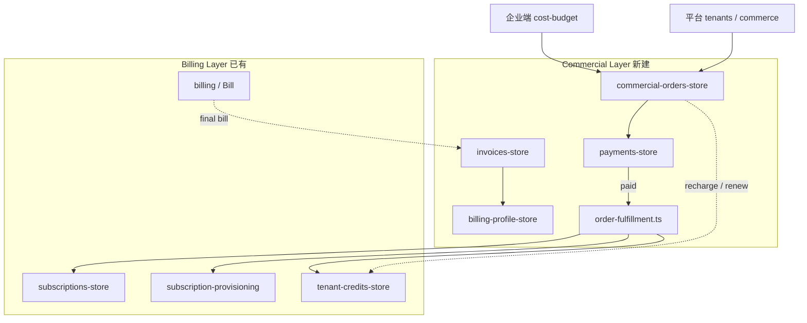

# Design Document

> 中文名：套餐订阅商业闭环（Subscription Commerce）技术设计
>
> 关联需求：`.kiro/specs/subscription-commerce/requirements.md`（9 需求 + 5 属性）
>
> 依赖规格：`.kiro/specs/cost-budget-billing/`（计费内核，本设计 **扩展但不替换**）

## Overview

在既有 **Billing Layer** 之上新增 **Commercial Layer**，实现「订单 → 支付 → 订阅激活 → 发票」闭环。工程约束与 cost-budget-billing 一致：

- **持久化**：`CONFIG_DIR` 下租户键控 JSON + append-only 事件；不引入 DB。
- **RPC**：新增 handler 组注册进 `coreGatewayHandlers`；命名 `commercial-*` / `payments.*` / `invoices.*` / `billing-profile.*`。
- **激活编排**：支付成功后 **唯一** 调用既有 `provisionEnterpriseSubscription` 与订阅 store 迁移函数。
- **UI**：企业端扩展 `cost-budget` 子路由；平台端扩展 `platform/tenants` 与全局商业队列。



## 核心实体

落盘文件（建议）：

| Store 文件                       | 内容                         |
| -------------------------------- | ---------------------------- |
| `openbot-commercial-orders.json` | orders + orderEvents         |
| `openbot-payments.json`          | payments + paymentEvents     |
| `openbot-billing-profiles.json`  | profiles + profileEvents     |
| `openbot-invoice-requests.json`  | requests + invoiceEvents     |
| `openbot-credit-packs.json`      | 平台定义的充值包（ADMIN 写） |

### CommercialOrder

```typescript
type CommercialOrderKind = "subscribe" | "change_plan" | "renew" | "recharge_credits";

type CommercialOrderStatus =
  | "draft"
  | "pending_payment"
  | "paid"
  | "failed"
  | "canceled"
  | "refunded";

type CommercialOrder = {
  id: string;
  enterpriseId: string;
  kind: CommercialOrderKind;
  status: CommercialOrderStatus;
  amountCents: number;
  currency: "CNY" | "USD"; // v1 默认 CNY
  billingCycle?: BillingCycle;
  planId?: string;
  planVersionId?: string;
  targetPlanId?: string; // change_plan
  creditPackId?: string;
  lineItems: Array<{ label: string; amountCents: number }>;
  subscriptionId?: string;
  pendingSubscriptionId?: string;
  salesLeadId?: string; // 平台从线索创建
  paymentMethod?: "online" | "bank_transfer" | "manual";
  expiresAt?: string;
  createdAt: string;
  paidAt?: string;
};
```

### Payment

```typescript
type PaymentProvider = "manual" | "stripe" | "alipay" | "wechat";

type Payment = {
  id: string;
  orderId: string;
  enterpriseId: string;
  provider: PaymentProvider;
  status: "pending" | "paid" | "failed" | "canceled";
  amountCents: number;
  providerRef?: string;
  requestId?: string; // 幂等
  checkoutUrl?: string;
  confirmedByUserId?: string; // manual
  createdAt: string;
  paidAt?: string;
};
```

### TenantBillingProfile / InvoiceRequest

见 requirements R4/R5；Invoice 关联 `orderId` 和/或 `billId`，存金额快照 `amountCents`。

### CreditPack（平台定义）

```typescript
type CreditPack = {
  id: string;
  name: string;
  credits: number;
  priceCents: number;
  status: "active" | "archived";
};
```

## 状态机

### 订单

```
draft → pending_payment → paid
                       ↘ failed / canceled
paid → refunded（仅记录，人工下游处理）
```

### 订阅（扩展）

```
pending_payment → active → suspended / expired / canceled
Trial（0 元）：直接 active（不经 pending_payment）
```

### 支付成功后履约（order-fulfillment.ts）

| kind               | 动作                                                                           |
| ------------------ | ------------------------------------------------------------------------------ |
| `subscribe`        | `createSubscription`（或 activate pending）→ `provisionEnterpriseSubscription` |
| `change_plan`      | `transitionSubscriptionStatus` + 新 subscription 区间 → provision              |
| `renew`            | 延长 `endTime` / 新周期 → `ensureTenantCreditsAllocation`                      |
| `recharge_credits` | `appendRechargeCredits`（tenant-credits-store 扩展）                           |

**幂等键**：`fulfillment:{orderId}` 写入 orderEvents；重复 paid 信号短路。

## 金额计算

### 报价真源（Phase 1.5）

**订单金额 MUST 来自 `PlanVersion.snapshot`，而非 Plan 头字段。**

- `pricing-version-source.ts`：`basePriceCents = version.snapshot.basePriceCents`
- `PlanVersion.snapshot.commercial`：冻结 `purchaseMode` / `slot`（Trial / 联系销售 / 自助）
- 换套餐 Proration：`current` 侧使用订阅锁定的 `planVersionId` 快照，Plan 头后续涨价不影响差价

### 新订阅

```
amountCents = snapshot.basePriceCents × cycleMultiplier(billingCycle)
```

`cycleMultiplier`：`monthly=1`，`semiannual=6×0.95`，`annual=12×0.85`（与 `docs/design/platform-pricing-tiers-2026-06-16.md` 一致，写入 Order lineItems 快照）。

### 立即换套餐（Proration）

```
window = subscription.commercialContract ?? naturalMonthFallback
remainingRatio = remainingInWindow(window, now)
creditOld = lockedVersion.snapshot.basePriceCents × cycleMultiplier × remainingRatio
chargeNew = targetVersion.snapshot.basePriceCents × cycleMultiplier × remainingRatio
amountCents = max(0, chargeNew - creditOld)
```

`semiannual` / `annual` 合同窗在履约时写入 `Subscription.commercialContract`；`monthly` 仍用自然月窗口（显式标记 `fromCommercialContract=false`）。

### Trial

由 `snapshot.commercial.purchaseMode === trial_auto` 判定（**非** `basePriceCents <= 0`）。零元订单自动 `paid` → 直接 provision。

## RPC 接口

新增于 `src/gateway/server-methods/commercial.ts`（可拆分为多文件，注册时 merge）。

| 方法                          | Scope | 主要参数                                                   | 响应                        |
| ----------------------------- | ----- | ---------------------------------------------------------- | --------------------------- |
| `commercial-orders.create`    | WRITE | kind, planId?, billingCycle?, targetPlanId?, creditPackId? | `{ order }`                 |
| `commercial-orders.get`       | READ  | orderId                                                    | `{ order, payments }`       |
| `commercial-orders.list`      | READ  | status?, limit?                                            | `{ orders }`                |
| `commercial-orders.cancel`    | WRITE | orderId                                                    | `{ order }`                 |
| `payments.create`             | WRITE | orderId, provider                                          | `{ payment, checkoutUrl? }` |
| `payments.confirm-manual`     | ADMIN | paymentId, requestId                                       | `{ payment, order }`        |
| `payments.webhook.stripe`     | —     | raw body + signature                                       | 204 / 内部                  |
| `payments.webhook.alipay`     | —     | provider payload                                           | 204 / 内部                  |
| `billing-profile.get`         | READ  | —                                                          | `{ profile }`               |
| `billing-profile.set`         | WRITE | profile fields                                             | `{ profile }`               |
| `invoices.request`            | WRITE | orderId? billId?                                           | `{ request }`               |
| `invoices.list`               | READ  | —                                                          | `{ requests }`              |
| `invoices.list-platform`      | ADMIN | status?, enterpriseId?                                     | `{ requests }`              |
| `invoices.issue`              | ADMIN | requestId, invoiceNo, pdfUrl?                              | `{ request }`               |
| `invoices.reject`             | ADMIN | requestId, reason                                          | `{ request }`               |
| `credit-packs.list`           | READ  | —                                                          | `{ packs }`                 |
| `credit-packs.upsert`         | ADMIN | pack                                                       | `{ pack }`                  |
| `platform-commerce.orders`    | ADMIN | filters                                                    | 跨租户订单                  |
| `platform-commerce.from-lead` | ADMIN | leadId, planId, amountCents?                               | `{ order }`                 |

### 改造既有接口

| 方法                        | 变更                                                                                                                                                                                          |
| --------------------------- | --------------------------------------------------------------------------------------------------------------------------------------------------------------------------------------------- |
| `subscriptions.subscribe`   | **Deprecated 行为**：内部转调 `commercial-orders.create(kind=subscribe)` + 返回 `{ order, checkout }`；不再直接 active（兼容期可通过 config `billing.commerceLegacyBypass` 保留旧行为供测试） |
| `subscriptions.change-plan` | `effective=now` 时转调 `commercial-orders.create(kind=change_plan)`；`effective=next` 保持原逻辑                                                                                              |
| `subscriptions.get`         | 增加 `pendingOrder` / `billingProfile` 摘要                                                                                                                                                   |

## 目录结构

```
src/gateway/commerce/
  types.ts
  append-only.ts              # 复用 billing/append-only-ledger 或 thin re-export
  commercial-orders-store.ts
  payments-store.ts
  billing-profile-store.ts
  invoice-requests-store.ts
  credit-packs-store.ts
  order-pricing.ts            # 纯函数：subscribe/change/renew 金额
  order-fulfillment.ts        # paid → subscription/credits
  payment-providers/
    types.ts
    manual.ts
    stripe.ts                 # Phase 3
    alipay.ts                 # Phase 3
  tenant-billing-projection.ts # enterpriseId → platform billingStatus

src/gateway/server-methods/
  commercial-orders.ts
  commercial-payments.ts
  commercial-invoices.ts
  commercial-billing-profile.ts
  platform-commerce.ts

ui/src/ui/capability/subscription-commerce/
  endpoints.ts
  gateway-client.ts
  index.ts

ui/src/ui/views/cost-budget/
  cost-budget-checkout.ts     # 结账/对公指引
  cost-budget-orders.ts       # 订单历史
  cost-budget-invoices.ts     # 发票

ui/src/ui/ports/platform/commerce/
  page.ts                       # 全局订单/发票队列

ui/src/ui/ports/platform/tenants/
  sections/commercial.ts        # 租户商业 Tab
```

## 平台 billingStatus 投影

扩展 `tenant-billing-projection.ts`，由 Commercial 事件驱动（订单 paid / 订阅 suspended / 续费失败）：

| 条件                     | billingStatus |
| ------------------------ | ------------- |
| 无订阅                   | `none`        |
| active 订阅 + Trial      | `trialing`    |
| active 订阅 + 付费       | `active`      |
| pending_payment 订单存在 | `past_due`    |
| suspended                | `suspended`   |

写入 platform-auth tenant entry（或只读投影，不修改 tenant 主数据时可仅在 UI VM 层合并）。

## 与 sales-leads 集成

```
sales-leads.list → Platform Admin 选 lead
  → platform-commerce.from-lead
  → CommercialOrder (pending_payment, paymentMethod=bank_transfer)
  → 通知企业 Admin 去企业端查看对公指引
  → payments.confirm-manual
  → fulfillment → active
```

## 安全

- Webhook 路由不走常规 client scope；校验 HMAC / provider signature。
- `payments.confirm-manual` 必须 ADMIN + 记录 `confirmedByUserId`。
- 所有金额 server-side 计算；客户端仅传 planId/cycle，不传 amount。

## 测试策略

- **纯函数**：`order-pricing.test.ts`（Proration、cycle 折扣、Property 1）。
- **Store**：订单/支付幂等、append-only（Property 2）。
- **Handler**：`commercial.test.ts` 镜像 `billing.test.ts` 范式。
- **Fulfillment 集成**：mock store，`paid` → subscription active + provision 调用一次。
- **UI**：checkout 空态、pending 订单、发票资料校验 browser test。

## ADR 摘要

| #     | 决策                    | 理由                                                                       |
| ----- | ----------------------- | -------------------------------------------------------------------------- |
| ADR-1 | Commercial 与 Bill 分离 | Bill 是成本核算；Invoice 是对客税务文档                                    |
| ADR-2 | P1 仅 manual provider   | 最快闭环验证运营流程，无 SDK 依赖                                          |
| ADR-3 | subscribe 改走订单      | 根治「未付开通」；兼容期 config bypass                                     |
| ADR-4 | 充值 Credits 分账       | `monthlyCredits`（套餐）与 `rechargeBalance`（充值）分开，避免周期结算覆盖 |
| ADR-5 | PlanVersion 快照锁价    | 订单 / Proration 读 `snapshot.basePriceCents`，Plan 头仅展示               |
| ADR-6 | 商业元数据冻结          | `snapshot.commercial.purchaseMode` 替代 name/零价推断                      |
| ADR-7 | 合同周期模型            | `commercialContract` 承载 semiannual/annual 窗；monthly 自然月             |
| ADR-8 | 履约对账队列            | `paid` + `fulfillmentStatus=failed` 可平台重试，接 webhook 前必备          |

## 非目标（重申）

不修改 `enterprise-usage.*`；不替换 `billing.settle` 语义；Phase 1 不接真实 Stripe/支付宝 SDK。
