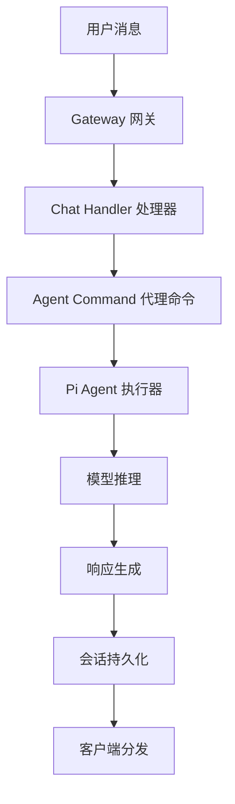

# OpenBot 对话窗提示词机制深度分析

## 概述

本文档深入分析 OpenBot 系统中对话窗的提示词机制，特别是如何实现在回答问题的同时为下一个任务发问的核心功能。通过对源码的详细分析，揭示了 OpenBot 如何通过多层架构设计实现智能对话流程控制。

---

## 📋 目录

1. [核心架构概览](#核心架构概览)
2. [关键组件详解](#关键组件详解)
3. [会话管理机制](#会话管理机制)
4. [提示词构建系统](#提示词构建系统)
5. [连续对话实现](#连续对话实现)
6. [任务引导机制](#任务引导机制)
7. [技术实现细节](#技术实现细节)
8. [最佳实践建议](#最佳实践建议)

---

## 核心架构概览

### 🎯 整体流程架构

OpenBot 的对话机制采用了分层架构设计：



### 🔄 数据流向

```
用户输入 → 消息验证 → 会话加载 → 上下文构建 → 提示词生成 → 模型调用 → 响应处理 → 历史保存 → 结果返回
```

## 关键组件详解

### 1. 消息入口处理

**文件位置**: `src/gateway/server-methods/chat.ts`

```typescript
"chat.send": async ({ params, respond, context, client }) => {
  // 参数验证
  if (!validateChatSendParams(params)) {
    respond(false, undefined, errorShape(
      ErrorCodes.INVALID_REQUEST,
      `invalid chat.send params: ${formatValidationErrors(validateChatSendParams.errors)}`
    ));
    return;
  }

  // 处理消息参数
  const p = params as {
    sessionKey: string;      // 会话标识
    message: string;         // 用户消息内容
    thinking?: string;       // 思考级别
    deliver?: boolean;       // 是否分发到其他客户端
    attachments?: Array<{    // 附件处理
      type?: string;
      mimeType?: string;
      fileName?: string;
      content?: unknown;
    }>;
    timeoutMs?: number;      // 超时设置
    systemInputProvenance?: InputProvenance; // 输入来源
  };
}
```

**核心功能**：

- 消息参数验证和标准化
- 附件处理和格式转换
- 超时控制和错误处理
- 会话路由和分发控制

### 2. 代理命令处理

**文件位置**: `src/commands/agent.ts`

```typescript
async function persistAcpTurnTranscript(params: {
  body: string; // 用户输入内容
  finalText: string; // AI 最终回复
  sessionId: string; // 会话 ID
  sessionKey: string; // 会话密钥
  sessionEntry: SessionEntry | undefined;
  sessionStore?: Record<string, SessionEntry>;
  storePath?: string;
  sessionAgentId: string; // 代理 ID
  threadId?: string | number;
  sessionCwd: string; // 会话工作目录
}): Promise<SessionEntry | undefined>;
```

**处理流程**：

1. 解析会话文件路径
2. 初始化 SessionManager
3. 添加用户消息到历史
4. 添加助手回复到历史
5. 触发会话更新事件

## 会话管理机制

### 🗂️ 会话持久化

**文件位置**: `src/agents/pi-embedded-runner/session-manager-init.ts`

```typescript
export async function prepareSessionManagerForRun(params: {
  sessionManager: unknown;
  sessionFile: string;
  hadSessionFile: boolean;
  sessionId: string;
  cwd: string;
}): Promise<void> {
  const sm = params.sessionManager as {
    sessionId: string;
    flushed: boolean;
    fileEntries: Array<SessionHeaderEntry | SessionMessageEntry | { type: string }>;
    byId?: Map<string, unknown>;
    labelsById?: Map<string, unknown>;
    leafId?: string | null;
  };

  // 处理会话头部信息
  const header = sm.fileEntries.find((e): e is SessionHeaderEntry => e.type === "session");
  const hasAssistant = sm.fileEntries.some(
    (e) => e.type === "message" && (e as SessionMessageEntry).message?.role === "assistant",
  );

  // 确保首次用户提示被正确持久化
  if (params.hadSessionFile && header && !hasAssistant) {
    await fs.writeFile(params.sessionFile, "", "utf-8");
    sm.fileEntries = [header];
    sm.byId?.clear?.();
    sm.labelsById?.clear?.();
    sm.leafId = null;
    sm.flushed = false;
  }
}
```

### 📝 消息格式标准

```typescript
// 用户消息格式
{
  role: "user",
  content: promptText,
  timestamp: Date.now()
}

// 助手回复格式
{
  role: "assistant",
  content: [{ type: "text", text: replyText }],
  api: "openai-responses",
  provider: "openbot",
  model: "acp-runtime",
  usage: ACP_TRANSCRIPT_USAGE,
  stopReason: "stop",
  timestamp: Date.now()
}
```

## 提示词构建系统

### 🏗️ 系统提示词架构

**文件位置**: `src/agents/system-prompt.ts`

```typescript
export function buildSystemPrompt(params: {
  workspaceDir: string;
  config?: OpenBotConfig;
  defaultThinkLevel?: ThinkLevel;
  extraSystemPrompt?: string;
  ownerNumbers?: string[];
  heartbeatPrompt?: string;
  docsPath?: string;
  tools: AgentTool[];
  contextFiles?: EmbeddedContextFile[];
  bootstrapTruncationWarningLines?: string[];
  modelDisplay: string;
  agentId?: string;
}) {
  // 构建完整的系统提示词
  return buildAgentSystemPrompt({
    workspaceDir: params.workspaceDir,
    defaultThinkLevel: params.defaultThinkLevel,
    extraSystemPrompt: params.extraSystemPrompt,
    ownerNumbers: params.ownerNumbers,
    toolNames: params.tools.map((tool) => tool.name),
    // ... 其他参数
  });
}
```

### 🧩 提示词组件模块

#### A. 技能系统集成

```typescript
function buildSkillsSection(params: { skillsPrompt?: string; readToolName: string }) {
  const trimmed = params.skillsPrompt?.trim();
  if (!trimmed) {
    return [];
  }
  return [
    "## Skills (mandatory)",
    "Before replying: scan <available_skills> <description> entries.",
    `- If exactly one skill clearly applies: read its SKILL.md at <location> with \`${params.readToolName}\`, then follow it.`,
    "- If multiple could apply: choose the most specific one, then read/follow it.",
    "- If none clearly apply: do not read any SKILL.md.",
    "Constraints: never read more than one skill up front; only read after selecting.",
    "- When a skill drives external API writes, assume rate limits: prefer fewer larger writes, avoid tight one-item loops, serialize bursts when possible, and respect 429/Retry-After.",
    trimmed,
    "",
  ];
}
```

#### B. 记忆回调机制

```typescript
function buildMemorySection(params: {
  isMinimal: boolean;
  availableTools: Set<string>;
  citationsMode?: MemoryCitationsMode;
}) {
  if (params.isMinimal) {
    return [];
  }
  if (!params.availableTools.has("memory_search") && !params.availableTools.has("memory_get")) {
    return [];
  }
  const lines = [
    "## Memory Recall",
    "Before answering anything about prior work, decisions, dates, people, preferences, or todos: run memory_search on MEMORY.md + memory/*.md; then use memory_get to pull only the needed lines. If low confidence after search, say you checked.",
  ];
  if (params.citationsMode === "off") {
    lines.push(
      "Citations are disabled: do not mention file paths or line numbers in replies unless the user explicitly asks.",
    );
  } else {
    lines.push(
      "Citations: include Source: <path#line> when it helps the user verify memory snippets.",
    );
  }
  lines.push("");
  return lines;
}
```

## 连续对话实现

### 🔄 上下文构建机制

**文件位置**: `src/gateway/agent-prompt.ts`

```typescript
export type ConversationEntry = {
  role: "user" | "assistant" | "tool";
  entry: HistoryEntry;
};

export function buildAgentMessageFromConversationEntries(entries: ConversationEntry[]): string {
  if (entries.length === 0) {
    return "";
  }

  // 优先选择最后的用户/工具条目作为"当前消息"
  // 这样 AI 会响应最新的用户输入或工具输出，而不是助手的上一条消息
  let currentIndex = -1;
  for (let i = entries.length - 1; i >= 0; i -= 1) {
    const role = entries[i]?.role;
    if (role === "user" || role === "tool") {
      currentIndex = i;
      break;
    }
  }
  if (currentIndex < 0) {
    currentIndex = entries.length - 1;
  }

  const currentEntry = entries[currentIndex]?.entry;
  if (!currentEntry) {
    return "";
  }

  const historyEntries = entries.slice(0, currentIndex).map((e) => e.entry);
  if (historyEntries.length === 0) {
    return safeBody(currentEntry.body);
  }

  const formatEntry = (entry: HistoryEntry) => `${entry.sender}: ${safeBody(entry.body)}`;
  return buildHistoryContextFromEntries({
    entries: [...historyEntries, currentEntry],
    currentMessage: formatEntry(currentEntry),
    formatEntry,
  });
}
```

### 📊 消息内容安全处理

```typescript
/**
 * 将 body 强制转换为字符串。处理 body 是内容数组的情况
 * (例如 [{type:"text", text:"hello"}])，如果直接在模板字面量中使用
 * 会序列化为 [object Object]。
 */
function safeBody(body: unknown): string {
  if (typeof body === "string") {
    return body;
  }
  return extractTextFromChatContent(body) ?? "";
}
```

## 任务引导机制

### 🎯 智能任务流程控制

OpenBot 通过以下机制实现任务引导：

#### 1. 状态驱动响应生成

```typescript
// Pi Agent 运行时根据上下文生成包含引导性问题的响应
const attempt = await runEmbeddedAttempt({
  sessionId: params.sessionId,
  model: effectiveModel,
  authStorage,
  // 传入完整的会话历史和系统提示词
  // 模型会基于这些信息生成既回答当前问题又引导下一步的响应
});
```

#### 2. 工具调用协调

```typescript
const CORE_TOOL_DEFINITIONS: CoreToolDefinition[] = [
  { id: "read", sectionId: "fs", profiles: ["coding"] },
  { id: "write", sectionId: "fs", profiles: ["coding"] },
  { id: "edit", sectionId: "fs", profiles: ["coding"] },
  { id: "exec", sectionId: "runtime", profiles: ["coding"] },
  { id: "web_search", sectionId: "web", profiles: [] },
  // ... 更多工具
];
```

#### 3. 上下文感知决策

- **历史分析**: 基于对话历史识别用户意图
- **状态跟踪**: 跟踪当前任务进度和状态
- **智能建议**: 根据上下文生成相关的后续问题
- **工具选择**: 自动选择合适的工具来完成任务

## 技术实现细节

### 🔧 Pi Agent 集成架构

**文件位置**: `src/agents/pi-embedded-runner/run.ts`

```typescript
export async function runEmbeddedPiAgent(
  params: RunEmbeddedPiAgentParams,
): Promise<EmbeddedPiRunResult> {
  // 1. 解析工作区和配置
  const workspaceResolution = resolveRunWorkspaceDir({
    workspaceDir: params.workspaceDir,
    sessionKey: params.sessionKey,
    agentId: params.agentId,
    config: params.config,
  });

  // 2. 加载模型和认证
  const { model, authStorage, modelRegistry } = resolveModel(
    provider,
    modelId,
    agentDir,
    params.config,
  );

  // 3. 执行推理循环
  const attempt = await runEmbeddedAttempt({
    sessionId: params.sessionId,
    model: effectiveModel,
    authStorage,
    // ... 其他参数
  });

  return buildEmbeddedRunPayloads(attempt);
}
```

### 🛡️ 错误处理和故障转移

```typescript
// 故障转移策略
const OVERLOAD_FAILOVER_BACKOFF_POLICY: BackoffPolicy = {
  initialMs: 250,
  maxMs: 1_500,
  factor: 2,
  jitter: 0.2,
};

// Anthropic 拒绝测试令牌处理
const ANTHROPIC_MAGIC_STRING_TRIGGER_REFUSAL = "ANTHROPIC_MAGIC_STRING_TRIGGER_REFUSAL";
const ANTHROPIC_MAGIC_STRING_REPLACEMENT = "ANTHROPIC MAGIC STRING TRIGGER REFUSAL (redacted)";

function scrubAnthropicRefusalMagic(prompt: string): string {
  if (!prompt.includes(ANTHROPIC_MAGIC_STRING_TRIGGER_REFUSAL)) {
    return prompt;
  }
  return prompt.replace(
    new RegExp(ANTHROPIC_MAGIC_STRING_TRIGGER_REFUSAL, "g"),
    ANTHROPIC_MAGIC_STRING_REPLACEMENT,
  );
}
```

### 📈 性能优化机制

#### 1. 上下文窗口管理

```typescript
const CONTEXT_WINDOW_HARD_MIN_TOKENS = 4096;
const CONTEXT_WINDOW_WARN_BELOW_TOKENS = 8192;

function evaluateContextWindowGuard(params: {
  contextTokens: number;
  modelContextWindow: number;
}): ContextWindowGuardResult {
  // 评估上下文窗口使用情况
  // 实现智能截断和压缩策略
}
```

#### 2. 工具结果截断

```typescript
function truncateOversizedToolResultsInSession(
  sessionManager: unknown,
  maxToolResultLength: number,
): boolean {
  // 截断过大的工具结果以节省上下文空间
}
```

## 最佳实践建议

### 🎯 对话设计原则

1. **上下文连续性**
   - 始终保持完整的对话历史
   - 合理管理上下文窗口大小
   - 实现智能的历史压缩策略

2. **任务引导策略**
   - 基于用户意图生成相关问题
   - 提供清晰的下一步操作建议
   - 保持对话的自然流畅性

3. **错误恢复机制**
   - 实现多层故障转移策略
   - 提供有意义的错误信息
   - 支持会话状态恢复

### 🔧 技术实现建议

1. **性能优化**

   ```typescript
   // 使用适当的缓存策略
   const cacheConfig = {
     ttl: 3600, // 1小时
     maxSize: 1000, // 最大缓存条目
     strategy: "lru", // 最近最少使用
   };
   ```

2. **安全考虑**

   ```typescript
   // 输入验证和清理
   function sanitizeUserInput(input: string): string {
     return input
       .replace(/[<>]/g, "") // 移除潜在的 HTML 标签
       .trim()
       .slice(0, MAX_INPUT_LENGTH); // 限制输入长度
   }
   ```

3. **监控和日志**
   ```typescript
   // 记录关键操作
   log.info("Session started", {
     sessionId: params.sessionId,
     userId: params.userId,
     timestamp: Date.now(),
   });
   ```

## 总结

OpenBot 的对话窗提示词机制通过以下核心特性实现了"回答问题同时为下一个任务发问"的功能：

### 🎯 核心优势

1. **智能上下文管理**: 完整保存对话历史，为后续对话提供丰富上下文
2. **动态提示词生成**: 根据当前状态和可用工具动态构建系统提示词
3. **任务连续性保证**: 通过技能系统和记忆机制实现任务的无缝衔接
4. **多层故障恢复**: 提供完善的错误处理和故障转移机制

### 🚀 技术创新点

- **会话状态持久化**: 使用 JSONL 格式高效存储对话历史
- **工具调用协调**: 通过工具系统实现复杂的多步骤任务流程
- **智能模型选择**: 根据任务复杂度自动选择最适合的模型
- **上下文窗口优化**: 实现智能的内容截断和压缩策略

### 🔄 实现机制总结

OpenBot 通过以下方式实现连续对话和任务引导：

1. **持久化会话状态**: 完整保存对话历史，为后续对话提供上下文
2. **动态系统提示词**: 根据当前状态和可用工具动态构建提示词
3. **智能上下文管理**: 优先处理最新用户输入，同时保持历史上下文
4. **技能和记忆集成**: 通过技能系统和记忆机制实现任务连续性
5. **工具调用协调**: 通过工具调用实现复杂的多步骤任务流程

这种设计使得 OpenBot 能够提供自然、连续、智能的对话体验，在回答用户当前问题的同时，基于对话历史和任务状态，自然地引导用户进行下一步操作。

---

_本文档基于 OpenBot 源码分析编写，版本信息：OpenBot v2026.3.9_

_最后更新：2026年3月_
