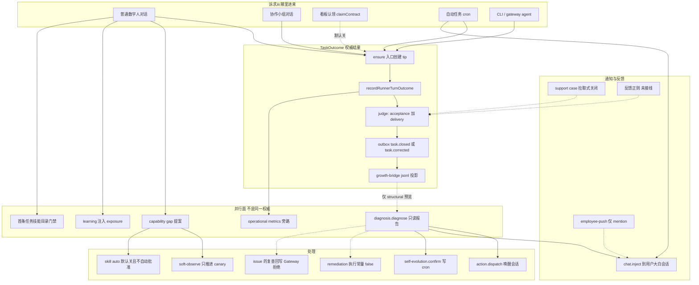

# 用户诉求闭环只读排查（2026-11-01）

- 基线：`origin/main` @ `c9050e4aa64482eab6fb61c8b42cf5270e811f20`（`fix(enterprise-data): align data product actions to the selected source connector`）
- 方法：从入口函数追到 Gateway 启动注册点。设计文档、讨论记录和测试名称不作为生产事实。
- 本报告未改业务代码，未部署，未打开生产开关，未向真实用户发消息，未重放生产任务。
- 证据等级：`代码定义` / `真实调用`（静态调用图，已追到启动或回复链） / `隔离验证` / `生产证据`。
- 本环境没有 `node_modules`，未重跑 Vitest。凡写「隔离验证：未验证」或「生产证据：未验证」，都不能读成「不存在」或「已通过」。既有 `*.test.ts` 只说明仓库里有对应测试，本次未执行。

## 完成标准总览

一次用户未满足的诉求，今天没有单一责任人闭环。普通数字人、CLI、Gateway agent 和 cron 回合会在该 agent 目录的 TaskOutcome 里留下回合记录，协作看板任务默认不进入这条记录，父子任务不会汇总成用户可见结果。成败的唯一任务判定在 `projectTaskJudgement`，但诊断不读这份权威存储，只在结构预览里读已关闭且合格的 evolution 投影。没有失败任务时，新能力只能走首条任务技能目录门禁、模型打出的 capability gap 标记，或人工 RPC，不会自动变成诊断 Issue。诊断结论可以生成报告、把文本写入大白会话，或在确认后写一条 cron；受治理的修复执行保持关闭，Issue 队列的确认、处方、执行、复查、回写在 Gateway 上始终拒绝。学习注入不等于采纳，生产路径没有写入 `adoptedAssetIds`，所以有效性验证基本不发生。大白能按 `platformUserId` 拼出会话键并用 `chat.inject` 写入转写；这表示网关接受了写入，不是用户已读，也不是原场景复验通过。用户说「不对 / 仍未解决」的检测函数没有接到回复链，因此没有人据此重开原任务、复验或关闭。进程重启能重放 TaskOutcome 的 commit 和 outbox；能力缺口去重、学习 pending 和 employee push 没有同等恢复。

## A. 现状机制清单

| 机制                | 入口与调用者                                                                                                                                                                                                    | 权威存储                                                                                                   | 状态与规则                                                                                                                                                                                                                                                                       | 启用条件                                                                                                                                                                                             | 证据与验证等级                                                             |
| ------------------- | --------------------------------------------------------------------------------------------------------------------------------------------------------------------------------------------------------------- | ---------------------------------------------------------------------------------------------------------- | -------------------------------------------------------------------------------------------------------------------------------------------------------------------------------------------------------------------------------------------------------------------------------- | ---------------------------------------------------------------------------------------------------------------------------------------------------------------------------------------------------- | -------------------------------------------------------------------------- |
| Chat 回合身份       | `ensureChatTurnTaskOutcome`，调用点 `src/auto-reply/reply/agent-runner-execution.ts:184-213`                                                                                                                    | `{agentDir}/task-outcomes/`，`src/task-outcome/chat-entry.ts:90-91`                                        | taskId `chat:{agentId}:{sessionKey}:{runId}`，`src/task-outcome/chat-entry.ts:35-45`。有 tenantId 则 enterprise scope，否则 personal，`src/task-outcome/chat-entry.ts:47-65`                                                                                                     | 非 heartbeat 且有 agentId。心跳在 `:184` 与 `:318-320` 跳过                                                                                                                                          | 真实调用。隔离验证：未验证。生产证据：未验证                               |
| Followup 子回合     | `ensureFollowupTurnTaskOutcome`，`src/auto-reply/reply/followup-runner.ts:249-258`                                                                                                                              | 同上，entrypoint 仍是 `chat`                                                                               | 可写 `parentTaskId`，来自队列或 `collaborationTaskId`                                                                                                                                                                                                                            | followup drain                                                                                                                                                                                       | 真实调用。隔离/生产：未验证                                                |
| Cron                | `ensureCronTurnTaskOutcome`，`src/cron/isolated-agent/run.ts:860-878`；fireId `src/cron/service/timer.ts:541-548` 与 `src/task-outcome/cron-fire-id.ts:9-20`                                                    | 同上                                                                                                       | taskId `cron:{jobId}:{fireId}`                                                                                                                                                                                                                                                   | isolated cron 跑完且入口创建成功；失败则跳过 unified closeout（`run.ts` 附近的跳过分支，见场景 7）                                                                                                   | 真实调用。隔离/生产：未验证                                                |
| CLI / Gateway agent | `src/commands/agent.ts:898-973` 调用 `ensureCliTurnTaskOutcome` / `ensureGatewayAgentTurnTaskOutcome`                                                                                                           | 同上                                                                                                       | `cli:{agentId}:{runId}` / `gateway_agent:{agentId}:{runId}`                                                                                                                                                                                                                      | 非 subagent lane；gateway 还需 `governanceEntry === "E2"`                                                                                                                                            | 真实调用。隔离/生产：未验证                                                |
| 协作认领            | `ensureCollabTurnTaskOutcome`，`src/gateway/collaboration-learning/claim-contract-entry.ts:717-743`                                                                                                             | 同上                                                                                                       | taskId `collab:{groupId}:{boardItemId}:{claimId}`                                                                                                                                                                                                                                | `isCollabTaskClaimContractEnabled`：全局 `collaboration.task.claimContract === true` 或灰名单。注释写明平台默认两者都关，`src/gateway/collaboration-dispatch/claim-contract.ts:359-385`              | 真实调用，默认关闭。生产开关值：未验证                                     |
| 小组普通对话        | 与 Chat 同一条 `agent-runner-execution` 路径。`space:` 会话只被排除在「首条任务成长门禁」之外，`src/gateway/server-methods/chat.ts:5958-5962`                                                                   | 每个成员 agent 自己的 TaskOutcome                                                                          | 没有小组级父任务汇总                                                                                                                                                                                                                                                             | 只要该成员实际跑了回复循环                                                                                                                                                                           | 真实调用（对话回合）。小组结果汇总：代码定义缺失                           |
| 统一判定            | `projectTaskJudgement` / `decideTerminal` / `deriveLifecycle`，`src/task-outcome/judge.ts:22-89`                                                                                                                | tip 上的 `lifecycle` + `taskJudgement`                                                                     | 非 `closed` 一律投影 `incomplete`。success 仅当 acceptance 为 passed/not_required 且 delivery 为 delivered/not_required。`delivery_unknown` 必为 failure                                                                                                                         | 每次 `TaskOutcomeResultService.submit`                                                                                                                                                               | 代码定义 + 真实调用（收尾经 `recordRunnerTurnOutcome`）。隔离/生产：未验证 |
| 收尾写入            | `recordRunnerTurnOutcome`，`src/task-outcome/runtime-from-runner.ts:455-778`                                                                                                                                    | `tips/` `versions/` `commits/` `outbox/` `command-log/`，`src/task-outcome/store.ts`                       | run 成功不发明 acceptance/delivery，缺门则保持 incomplete，`runtime-from-runner.ts:661-701`                                                                                                                                                                                      | 必须已有入口 taskId；缺失只打 `chat_entry_task_missing`，`:333-341`                                                                                                                                  | 真实调用                                                                   |
| 通道投递确认        | `registerAwaitingDelivery` 与 `confirmRunnerTurnDelivery`；判定 `src/task-outcome/delivery-confirm.ts:31-42`                                                                                                    | `pending-deliveries/*.json` + tip                                                                          | `enqueue_only` 即使 ok 也是 `delivery_unknown`，不是 delivered                                                                                                                                                                                                                   | chat dispatch 有可见回复时                                                                                                                                                                           | 真实调用。这是通道回执，不是用户确认                                       |
| Outbox 消费者       | `OutcomeConsumerRuntime`，`src/task-outcome/consumers.ts:178-197`；handler 注册 `runtime-from-runner.ts:398-425`                                                                                                | `consumers/` `contributions/`；evolution 投影另写 jsonl                                                    | 只处理 `task.closed` / `task.corrected`。handler 抛错则 deferred，不 mark done，`consumers.ts:148-171`                                                                                                                                                                           | Gateway boot：`src/gateway/server.impl.ts:781-794`，非 `minimalTestGateway`。之后 15s drain，`src/task-outcome/consumer-boot.ts:25-26`、`:108-135`                                                   | 真实调用。生产进程是否在跑：未验证                                         |
| Evolution 投影      | `publishEvolutionFromTaskOutcome`，`src/task-outcome/growth-bridge.ts:206-230`                                                                                                                                  | `evolution-task-outcomes.jsonl`                                                                            | 仅 `lifecycle === closed` 且 eligibility 通过才发布成功/失败样本                                                                                                                                                                                                                 | consumer drain                                                                                                                                                                                       | 真实调用。这是派生投影，不是 TaskOutcome 权威库                            |
| 旁路结果 RPC        | `evolution.task-outcomes.record` 写入 operational metrics，并可能 append 同一 jsonl                                                                                                                             | 内存/文件指标 + jsonl                                                                                      | 若 tip bridge 已写则跳过。不写 unified TaskOutcome                                                                                                                                                                                                                               | Gateway RPC                                                                                                                                                                                          | 真实调用（旁路）。与统一判定不是同一函数                                   |
| 诊断主路径          | `diagnosis.diagnose`，`src/diagnosis/report-query-gateway.ts:205-260`；pack 在 `DIAGNOSIS_REPORT_API_DEPLOYED = true` 时注册，`src/diagnosis/report-query-deploy.ts:7`                                          | 投影快照、专业报告文本、growth/skill/session 元数据                                                        | `diagnose()` 只读。定时 tick 默认开，除非 `OPENBOT_DIAGNOSIS_TICK=0`，`src/diagnosis/diagnose-tick.ts:27-28`                                                                                                                                                                     | 需诊断鉴权。tick 强制 `allowConversationDelivery: false`，`:93-94`                                                                                                                                   | 真实调用。LIVE 是否启用 tick：未验证                                       |
| 诊断证据            | `src/diagnosis/**` 不 import `src/task-outcome`。结构预览读 `readEvolutionTaskOutcomes`，`src/diagnosis/structural-preview-reader.ts:100-107`                                                                   | evolution jsonl + skill 事件 + session JSONL 元数据 + growth 文件                                          | 文件头禁止读 transcript 正文。过滤 `observationEligibility === eligible` 且 `outcome === completed`                                                                                                                                                                              | 仅 structural preview 子路径                                                                                                                                                                         | 代码定义 + 真实调用（读者）。不是权威 TaskOutcome                          |
| 诊断派发            | `diagnosis.action.dispatch` 唤醒目标 agent 并给大白回执；`diagnosis.self-evolution.confirm` 写 cron，`report-query-gateway.ts:334-374`                                                                          | cron 作业所有权                                                                                            | confirm 常量 `DIAGNOSIS_SELF_EVOLUTION_CONFIRM_ENABLED = true`，`src/diagnosis/diagnose-professional-protocol.ts:11-12`。`diagnose()` 本身不写 cron                                                                                                                              | confirm RPC 再检查该常量                                                                                                                                                                             | 真实调用（RPC）。不等于代码修复或原场景复验                                |
| 治理修复            | `src/diagnosis/remediation.ts`                                                                                                                                                                                  | remediation store                                                                                          | `DIAGNOSIS_REMEDIATION_EXECUTION_ENABLED = false`，`src/diagnosis/production-cutover.ts:41`。Doctor/Channel 动作在 blocked 集合                                                                                                                                                  | 常量 false。`production-p24*` 是开闸演练脚本，不是用户诊断运行时                                                                                                                                     | 代码定义。生产镜像常量是否被另包覆盖：未验证                               |
| Issue 队列          | `diagnosis.issues.list/advance`，`src/diagnosis/diagnosis-issue-gateway.ts:36-127`                                                                                                                              | issue 文件队列                                                                                             | `open` / `triage` 可写。`confirm` `prescribe` `apply` `recheck` `writeback` 无条件返回 `confirm_not_enabled`，即使常量 enabled 为 true，`:76-85`                                                                                                                                 | pack 随 report API 注册                                                                                                                                                                              | 真实调用（拒绝路径）。库内测试可传 `enabled: true`，Gateway 不传           |
| 能力缺口            | `recordCapabilityGapEvent`，`src/gateway/evolution-control/capability-gap-ingest.ts:233-276`；聊天侧 `recordHonestCapabilityGap`，`src/auto-reply/reply/agent-runner.ts:666` 与 marker 路径                     | evolution control plane proposal；空回复先只计内存计数                                                     | 显式 marker 阈值 1，其它 2，空回复提升阈值 2，`src/gateway/evolution-control/capability-gap-consumer.ts:44-48`。去重 Map 在进程内存，默认 6h                                                                                                                                     | 回复链 + 治理 tick `src/gateway/evolution-governance/scheduler.ts:100-117`。scheduler 在 `src/gateway/server-methods.ts:126-137` 模块加载时启动                                                      | 真实调用。重启后去重状态丢失：代码定义                                     |
| 首条任务技能门禁    | `analyzeAndStoreGrowthTask`，`src/gateway/server-methods/chat.ts:5971-6001`                                                                                                                                     | robot growth `pendingTaskContext`                                                                          | LLM 只能从已有候选技能目录选 key，`src/gateway/agent-growth/task-requirement-extract.ts:70-80`。有 unmet 则阻断发送                                                                                                                                                              | 仅非 `space:`、非 birth、且该机器人还没有 `firstMissionSentAtMs` 的会话。`growthGateProceed` 可放行                                                                                                  | 真实调用。不是「当前不存在的能力」入口                                     |
| 学习曝光            | `learning-recall` 注入系统提示，并在 chat entry 把 pending 写入 tip `experienceExposure`                                                                                                                        | learning assets + tip                                                                                      | 注入只记 retrieved/injected。注释写明曝光不是 verified，`src/task-outcome/types.ts:140-148`                                                                                                                                                                                      | 非 heartbeat 的 chat 回复路径                                                                                                                                                                        | 真实调用                                                                   |
| 学习采纳            | `attachAdoptedLearningAssetsToTask`，`src/task-outcome/learning-adoption.ts:37`                                                                                                                                 | tip `adoptedAssetIds`                                                                                      | 生产 `src/` 除定义与测试外无调用方（检索仅测试与 index re-export）                                                                                                                                                                                                               | 无生产调用                                                                                                                                                                                           | 代码定义。真实调用：不存在于当前 `src/` 生产路径                           |
| 学习有效性          | `resolveExperienceVerificationPlan`，`src/task-outcome/experience-verified-handler.ts:65-114`                                                                                                                   | `contributions/experience-verified`                                                                        | 必须 closed + success + eligible + 非空 adopted 且与 exposure 相交。否则 `exposure_on_success_not_verified`                                                                                                                                                                      | consumer 已注册，但采纳上游缺失，故多数 no-op                                                                                                                                                        | 真实调用（handler）。有效性计数增加：逻辑上被采纳门挡住                    |
| 入站反馈            | `deriveInboundFeedbackSignals`，`src/gateway/agent-growth/feedback-signal.ts:40-47`；`recordInboundFeedbackSafely`，`src/gateway/agent-growth/record-feedback.ts:27-48`                                         | 若被调用，写入 operational metrics，不写 TaskOutcome                                                       | 「不对 / 重做 / 仍不是我要的」等正则。`src/auto-reply` 无引用                                                                                                                                                                                                                    | 未接入回复链                                                                                                                                                                                         | 代码定义。真实调用：当前 `src/` 无生产调用方                               |
| 自演进控制面        | `ensureEvolutionControlPlaneStarted`，`src/gateway/server-methods.ts:127-132`                                                                                                                                   | evolution control plane                                                                                    | 治理模式默认 `assist`，不改运行时，`src/gateway/evolution-governance/mode.ts:16-32`。`auto` 才允许 tick 变更运行时                                                                                                                                                               | import 副作用启动。kill-switch 可停 tick                                                                                                                                                             | 真实调用。部署环境变量：未验证                                             |
| 技能自动安装        | `isSkillAutoEvolutionEnabled`，`src/gateway/evolution-governance/skill-auto-evolution.ts:5-15`、`:78-95`                                                                                                        | skill auto jobs                                                                                            | 默认 off。即使 on，也要治理模式 `auto`，且永不自动批准                                                                                                                                                                                                                           | 双开关。默认关闭                                                                                                                                                                                     | 代码定义 + tick 会调用 pass，pass 在默认配置下不变更                       |
| Soft-observe        | `isSoftObserveDhEnabled`，`src/gateway/evolution-control/soft-observe-dh-loop.ts:7-14`、`:79-88`                                                                                                                | proposal 状态                                                                                              | 默认 on。范围永远是 canary，不切 active 生产，不代表「学会了」                                                                                                                                                                                                                   | tick 调用。系统/平台域提案不处理                                                                                                                                                                     | 真实调用（canary 环）。生产 active 发布：代码明确排除                      |
| 诊断候选提交        | `submitDiagnosisCandidate`，`src/gateway/evolution-control/submit-diagnosis-candidate.ts:1-8`                                                                                                                   | WAL / ledger                                                                                               | 不调用 registerProposal、startExperiment、Adapter.apply。文件头写明不接 live diagnose 自动提交                                                                                                                                                                                   | RPC + grant                                                                                                                                                                                          | 代码定义 + RPC。不是聊天自动闭环                                           |
| 大白会话定位        | `buildEmployeeBuiltinStewardSessionKey`，`src/agents/builtin-steward/employee-isolation.ts:46-51`                                                                                                               | 会话键 `agent:main:employee:<platformUserId>` 形态（经 `buildAgentMainSessionKey`）                        | 一用户一管家会话，与 `agent:main:main` 分开                                                                                                                                                                                                                                      | 调用方必须已有 platformUserId                                                                                                                                                                        | 代码定义 + 被 cron/诊断复用                                                |
| 大白文本写入        | 诊断：`createDiagnoseConversationInject` → `chat.inject`，`src/diagnosis/diagnose-daibai-inbox-live.ts:81-102`。Cron：`surfaceCronJobResult`，`src/cron/isolated-agent/result-surfacing.ts:79-92`、`:408-429`   | Pi transcript，经 `chat.inject`（实现走 SessionManager append，见 `src/gateway/server-methods/AGENTS.md`） | `conversation_accepted` 表示 inject RPC 被接受，`src/diagnosis/diagnose-daibai-inbox.ts:159-166`。不是用户已读                                                                                                                                                                   | 诊断：请求里 `deliverTo` 有路由、有 tenant、有正文、能解析到 owner。Cron：surface 为 `workbench-agent-main` 且 job 有 `ownerId` 且 agent 是内置管家时才进该用户大白会话；否则进该 agent 的 main 会话 | 真实调用。用户是否看见：未验证                                             |
| 诊断投递语义分裂    | `planDiagnosisDaibaiDelivery` 只要请求了路由就返回 `daibai_delivery_gate_closed`，`src/diagnosis/diagnose-policy.ts:225-248`。真正发送在 `deliverDiagnoseReportToConversation` 里改写成 `conversation_accepted` | 报告 payload.delivery                                                                                      | `DIAGNOSIS_DAIBAI_DELIVERY_ENABLED = true`，`production-cutover.ts:40`，但 Path A 注释写明不依赖这个门，也不调用 `user.daibai.ask`，`diagnose-daibai-inbox.ts:1-7`。部分 live transport 仍限 canary tenant `001` 与会话 `diagnosis:canary:daibai`，`production-cutover.ts:42-44` | 交互 `diagnosis.diagnose` 默认带 conversationSend。tick 不送                                                                                                                                         | 真实调用。两套 reason 并存                                                 |
| Employee APNs       | `enqueueEmployeePushForPlatformUser`，`src/infra/employee-push.ts:600-603`                                                                                                                                      | `push/employee-registrations.json`                                                                         | 按 platformUserId fan-out。无登记或无凭证则跳过，不抛给调用方。默认 APNs environment `sandbox`，`:215-223`                                                                                                                                                                       | `src/` 生产调用点是 `src/organization/mention-delivery.ts` 的人类 @。task-outcome、诊断、cron、evolution 不调用它                                                                                    | 真实调用（仅 mention）。闭环通知：未接入。生产送达：未验证                 |
| 支持单              | `user.daibai.ask` / `user.daibai.execute`；状态机 `src/support-cases/store.ts`                                                                                                                                  | `support-cases/cases.json`                                                                                 | 类别含 `feature_request`，`src/shared/daibai-types.ts:1-21`。`applySupportCaseResolution` 直接把状态写成 `closed`，`store.ts:221-237`，不回写 TaskOutcome，不复验原场景。无 reopen 函数                                                                                          | 用户或操作者调用 RPC。不是系统修复后的主动推送                                                                                                                                                       | 真实调用（RPC）。与任务结果闭环未连接                                      |
| 结果修正            | `SubmitTransition` 类型 `correction`；allowlist 在 `src/task-outcome/result-service.ts:96-103`、`:226`                                                                                                          | 新版本 tip + `task.corrected`                                                                              | closed 之后除 correction 外拒绝。生产代码没有配置 `correctionAllowlist` 的 submit 调用（只在 `*.test.ts`）                                                                                                                                                                       | 未接入                                                                                                                                                                                               | 代码定义。真实调用：无                                                     |

`production-p24` 至 `production-p26` 是交付开闸与演练记录，文件头写明不因此打开生产修复门。它们不是用户点击诊断的运行时，也不构成生产启用证据。

## B. 当前真实链路图

下列实线是静态调用图里已经接到启动或回复链的路径。虚线是类型、RPC 或测试里存在、但当前生产调用缺失或被常量/默认开关挡住的路径。运行时是否在某套部署里被环境变量改写，一律标未验证。

已核实的断点：

1. 协作看板默认不进 TaskOutcome。普通小组对话进的是每个成员自己的 chat task，没有父结果。
2. `parentTaskId` 会写在 followup tip 上，`ParentChildContract` 只有类型，没有 rollup 执行。
3. 诊断主路径不读 TaskOutcome tip。它读的 evolution jsonl 又只发布已关闭且合格的样本，未完成、取消、以及被 eligibility 排除的失败不会成为诊断证据。
4. 工具失败只变成 attempt 上的 `toolsSucceeded/toolsTotal` 观察，`runtime-from-runner.ts:581-585`。回合仍可因 acceptance waived + 消息 delivered 而判 success。
5. 用户否定原结果的函数没有接到回复链，也没有生产 correction 调用。
6. 经验有效性要求 `adoptedAssetIds`，生产没有写入点。
7. 修复执行与 Issue 复查回写在 Gateway 上不发生。soft-observe 与 skill auto 都不等于用户环境里的功能已可用。
8. 定时诊断不通知。交互诊断的 inject 接受不等于用户收到。employee-push 不承载这条闭环。
9. 支持单 `closed` 不回写原任务，也没有 reopen。

人工接管点（代码里明确留人）：诊断 confirm、remediation 批准、skill auto 的 approve、evolution apply 的 grant、支持单 execute、成长门禁的「先做再说」。这些是审批点，不是自动闭环。

## C. 规则冲突与缺口

下表只列已经在两处看到不同谓词，或同一业务事实没有唯一写入点的项。多模块分层校验如果最终调用同一个函数，不算冲突。

| 问题                                                           | 证据                                                                                                                                                                                                                                                                             | 实际影响                                                                                                                                    | 建议唯一归属                                                                                                                         | 处置                                                                                                              |
| -------------------------------------------------------------- | -------------------------------------------------------------------------------------------------------------------------------------------------------------------------------------------------------------------------------------------------------------------------------- | ------------------------------------------------------------------------------------------------------------------------------------------- | ------------------------------------------------------------------------------------------------------------------------------------ | ----------------------------------------------------------------------------------------------------------------- |
| 任务成败有三套观察面                                           | 权威判定 `judge.ts:22-54`。evolution jsonl 只收 closed+eligible，`growth-bridge.ts:211-230`。`evolution.task-outcomes.record` 另写 metrics。工具比率只是 attempt 观察                                                                                                            | 同一回合可以「工具失败、任务成功、诊断看不见」                                                                                              | TaskOutcome tip 的 `taskJudgement`                                                                                                   | 保留 judge。evolution jsonl 与 metrics 降为只读投影，禁止再被当成用户问题已解决                                   |
| 诊断不消费权威结果                                             | `src/diagnosis` 无 task-outcome import。`structural-preview-reader.ts:100-107` 只读 jsonl                                                                                                                                                                                        | 诊断结论不能代表该次用户任务的终态                                                                                                          | 诊断证据适配器只读 TaskOutcome tip；jsonl 继续当投影，不另建 Case 库                                                                 | 补齐读者。不新开需求平台                                                                                          |
| `delivery_unknown` 与 inject `accepted` 被不同文档叫成「送达」 | 通道：`delivery-confirm.ts:40-42` 把 enqueue_only 定为 unknown。大白：`diagnose-daibai-inbox.ts:159-166` 把 inject 接受定成 `delivered: true, reason: conversation_accepted`。规划函数又恒返回 `daibai_delivery_gate_closed`，`diagnose-policy.ts:242-248`                       | 报告上的 delivered 可能只是转写写入被接受。排队、注入、用户看见、用户认可是四件事                                                           | 通道回执继续归 TaskOutcome delivery。大白写入单独用 `transcript_accepted`，不得复用 `delivered`                                      | 补齐 reason 命名。保留两套事实，退役「inject 即 delivered」这个词                                                 |
| 用户验收没有接到任务门                                         | acceptance 门在 judge。反馈正则在 `feedback-signal.ts:40-47`，`record-feedback.ts` 无 auto-reply 调用方。支持单关闭不看 acceptance，`support-cases/store.ts:221-237`                                                                                                             | 「结果不符合要求」「仍未解决」不改变原任务，未回复也不等于认可                                                                              | 显式用户否定走现有 `correction` 或 `set_acceptance(failed)`，写回原 taskId                                                           | 补齐接线。不新建反馈库。支持单关闭不得当作任务验收                                                                |
| 根因分类三套                                                   | 协议域 `src/diagnosis/types.ts` 的 `FINDING_DOMAINS`。Issue 用 evaluation 的 `failureAttribution`，`diagnosis-issue-gateway.ts:148-151`。结构候选用 mechanism 映射，`structural-evolution-candidate.ts`                                                                          | 同一失败可被分成互不等价的原因，派发目标不一致                                                                                              | 用户任务失败的归因以 TaskOutcome `reasonCode` + eligibility attribution 为准。协议图 RCA 只服务只读报告                              | 保留协议报告。派发前必须引用 task reason，禁止另造第三套自动派发                                                  |
| 自动执行授权分裂                                               | 治理默认 assist，`mode.ts:16-32`。skill auto 默认 off 且不自动批准，`skill-auto-evolution.ts:5-15`。remediation 常量 false。Issue 队列无视 confirm 常量，始终拒绝 apply/recheck/writeback，`diagnosis-issue-gateway.ts:1-6` 与 `:76-85` 不一致。soft-observe 默认 on 但只 canary | 「确认开关已打开」不等于 Issue 会复查，也不等于用户环境已变更                                                                               | 运行时变更只走 evolution apply-authorization + 对应 surface adapter。诊断 confirm 只允许写 cron，并在结果里写明未改用户运行时        | 保留现有门。修正 Issue 网关与文件头/常量的漂移。不新增第五套授权器                                                |
| 学习采纳与有效性脱节                                           | 曝光类型注释 `types.ts:140-148`。验证谓词 `experience-verified-handler.ts:94-100`。`attachAdoptedLearningAssetsToTask` 无生产调用                                                                                                                                                | 经验被注入会被误当成已采纳且有效。策展草稿因此基本不从 verified 触发                                                                        | 有效性只认 tip 上的 `adoptedAssetIds` 与后续 closed success。没有独立用户动作就保持未验证                                            | 复用现有 API，接到已有的显式确认动作。不要新做学习账本                                                            |
| 归并键忽略用户、跨 agent 又不合并                              | gap 聚合键是 `tenantId\|agentId\|category\|reason`，`capability-gap-consumer.ts:68-76`。TaskOutcome 按回合 taskId，不按语义合并。同用户跨 agent/小组不会合成一条                                                                                                                 | 同租户同机器人上两个用户的相似缺口会进同一提案；同用户换一个数字人则变成另一条。修复一个提案不等于两个用户的原场景都解决                    | 提案可以按租户聚合供研发，但用户态必须保留 `ownerUserId` 列表，通知与关闭按用户任务逐个写回                                          | 补齐关联，不新建工单系统。公共修复不得批量把所有用户任务标成功                                                    |
| 父子任务只有字段                                               | `types.ts:102-111`、`:157-158`。followup 写 `parentTaskId`。无聚合实现。claimContract 默认关                                                                                                                                                                                     | 小组部分子任务失败时，父结果与用户结果都不会自动变失败                                                                                      | 若要汇总，执行已有 `ParentChildContract`，判定仍调用 `judge.ts`                                                                      | 补齐执行。默认关的看板不要另建第二套任务库                                                                        |
| 幂等与恢复不统一                                               | TaskOutcome：commandId、eventId、hasConsumed、commit replay、boot hydrate、15s drain。gap 去重与空回复计数是进程内 Map。learning pending 是进程内 Map。employee-push 无去重无重试队列                                                                                            | 重启后任务消费者能续跑；缺口提案可能重复；推送失败不重试；用户看不到失败回执                                                                | 任务与诊断事件继续用 TaskOutcome outbox。通知投递若需要重试，复用 pending-delivery 的磁盘注册，而不是新队列                          | 保留 TaskOutcome 恢复。缺口去重迁到已有 control-plane 持久记录。employee-push 维持 mention 专用，不升格为闭环总线 |
| 功能可用与通知资格                                             | 发布/安装技能没有 steward inject。soft-observe 不切 active。cron 只有配置了 owner 且 agent 是管家才进该用户大白。诊断 tick 明确不投递。跨管家调用还有 foreign steward 授权                                                                                                       | 「代码已合并 / 工具已发布 / canary 已推进」不会通知，也不证明该用户有权限或环境已更新。部分路径会把报告送给解析到的 owner，而不是原对话用户 | 通知资格：存在未关闭的用户任务或显式 deliverTo，且收件人是该任务 scope 的 subject。无权限或环境未更新时写 delivery blocked，不标成功 | 复用 `chat.inject` + steward session key。不要用 mention push 代替                                                |
| Issue 开关与常量漂移                                           | 文件头说 flag 为 false 才关闭 confirm/recheck/writeback。实现无条件拒绝，同时把 `enabled: true` 放进响应，`diagnosis-issue-gateway.ts:76-85`                                                                                                                                     | 运维看到 confirm 常量已开，仍无法复查回写                                                                                                   | Issue 网关的关闭原因改成与真实门一致；在门打开前不得写 `enabled: true` 又 `ok: false`                                                | 补齐这一处判断，使它要么真的读常量，要么改注释与 reason。不因此打开执行                                           |

有意分层、不应合并的部分：通道 delivery 与用户验收是两道门，`judge.ts` 已经把它们都要求满足才算 success，这是对的。租户成员身份、TaskOutcome scope、管家会话键是三层隔离，应继续分别校验，但写入用户可见结论时必须带同一个 `tenantId + subjectRef`。协议诊断报告可以继续只读，不必并进 TaskOutcome 状态机。

## D. 推荐的统一链路与契约

不新增存储、状态机、队列、定时任务和判定规则。每类事实只指定一个已有写入点。

| 事实                   | 权威来源                                                                                                                                                                 | 谁维护规则                                                                                     | 合法转换                                                                                                              | 失败恢复                                                                                                        |
| ---------------------- | ------------------------------------------------------------------------------------------------------------------------------------------------------------------------ | ---------------------------------------------------------------------------------------------- | --------------------------------------------------------------------------------------------------------------------- | --------------------------------------------------------------------------------------------------------------- |
| 这次用户任务是谁的     | TaskOutcome `scope` + `taskId`。聊天/cron/cli/gateway/followup 已创建。看板仅在 claimContract 打开时创建                                                                 | `src/task-outcome/entrypoints` 与 `entrypoint-ensure.ts`                                       | create 一次；禁止收尾用 runId 另造任务                                                                                | 入口失败必须留下 `chat_entry_task_missing` 类可见错误，不得静默当成没有诉求                                     |
| 任务是否做完、是否成功 | `judge.ts` 的 lifecycle / taskJudgement                                                                                                                                  | `src/task-outcome/judge.ts`                                                                    | 非 closed = incomplete。closed 后只有 `correction` 能改版本                                                           | 已有 commit replay、outbox、15s drain、boot hydrate                                                             |
| 用户是否认可           | acceptance 门。显式否定才是 failed 或 correction。沉默不是 passed                                                                                                        | 同一 judge。反馈检测只做输入，不做第二套成败                                                   | 否定写回原 taskId，发出 `task.corrected`                                                                              | 与任务消费者相同                                                                                                |
| 消息是否交给通道       | TaskOutcome delivery。enqueue_only = delivery_unknown                                                                                                                    | `delivery-confirm.ts`                                                                          | delivered 仅当每次必达都是 deliver 且 ok                                                                              | pending-delivery 磁盘 + boot hydrate                                                                            |
| 大白是否写入该用户会话 | `chat.inject` 到 `buildEmployeeBuiltinStewardSessionKey(platformUserId)` 的结果                                                                                          | `diagnose-daibai-inbox.ts` 与 cron `result-surfacing.ts` 收敛到同一助手函数，仍调用现有 inject | `transcript_accepted` / `transcript_unavailable` / `not_requested`。禁止把 accepted 写成任务 success 或通道 delivered | inject 失败保持原任务 `awaiting_delivery` 或单独的通知未接受状态，由现有 drain 重试；不新队列                   |
| 用户是否看见、是否确认 | 没有现成回执就不能声称看见。支持单 `proposalSeenByUserVersion` 只代表支持单，不代表原任务                                                                                | 若产品要「用户确认」，复用 acceptance evidence，不复用 support case closed                     | 未回复保持未验收                                                                                                      | 无持久已读回执则保持未验证                                                                                      |
| 诊断发现了什么         | 只读报告。证据引用 taskId / outcomeVersion                                                                                                                               | 诊断模块只读，不拥有成败                                                                       | 报告可重复生成，不改变 tip                                                                                            | 读失败则报告写证据不足，禁止写成系统正常。现有零发现文案已是这个方向，`diagnose-professional-protocol.ts:16-17` |
| 谁来处理               | 已有动作：会话 handoff、confirm 写 cron、人工 grant 下的 evolution apply。remediation 与 issue apply 在门打开前不是处理                                                  | evolution apply-authorization 是运行时变更的授权；诊断 confirm 不是                            | 无 grant 不得 apply。canary 推进不得标成用户可用                                                                      | 沿用 control plane 的 rollback drill。失败不关闭用户任务                                                        |
| 谁验证                 | 验证者必须再次读取原 task 的 acceptance 条件，或对同一 taskId 做 correction 后的新 attempt。experience verified 只验证「被采纳的经验是否伴随成功」，不验证用户问题已解决 | `judge.ts` 与 `experience-verified-handler.ts` 各管各的，禁止混用                              | 原场景未复验则任务保持未关闭或 correction 后重新 judge                                                                | 消费者 deferred 已能重试。验证失败写 failure，不得因「修复已合并」标 success                                    |
| 谁通知                 | 用户自己的大白，经 steward session key。收件人必须等于任务 subject 或该 subject 的 ownership 记录，且租户一致                                                            | 诊断 Path A 与 cron surfacing 已有实现，应抽成一个共享注入函数而不是第三条通道                 | 无未关闭用户事实且用户未订阅时不发。跨用户必须走现有 foreign steward 授权                                             | 失败不标 delivered                                                                                              |
| 谁关闭                 | 只有 judge 在 acceptance 与 delivery 都满足时关闭为 success；用户取消关闭为 cancelled；其余失败原因关闭为 failure。支持单、报告、注入、经验曝光都不能关闭用户任务        | `judge.ts`                                                                                     | 关闭后只有 correction 重开版本。支持单没有 reopen，不要拿它当重开                                                     | correction 发出 `task.corrected`，现有消费者会撤销旧 evolution 样本，`growth-bridge.ts:233-243`                 |

事件责任：任务状态变化只由 `TaskOutcomeResultService` 写 outbox。诊断、学习、演进只消费 `task.closed` 与 `task.corrected`。能力缺口提案可以继续存在，但它是候选，不是任务终态；公共提案关闭时必须逐个用户任务复验。

授权边界：默认保持治理 `assist`、skill auto off、remediation false、Issue apply/recheck/writeback 关闭、claimContract 默认关、soft-observe 仅 canary。本排查不建议为了「把闭环跑通」打开这些开关。

## E. 最小实施计划

每项都是已证实的断点。能复用的不另建。旧机制删除前必须满足：替代路径覆盖原调用者、历史 taskId / proposal id 仍可查、不存在绕过 `judge.ts` 的第二套成功判定。

### P0

**P0-1 把用户否定接回原任务**

- 已证实问题：`deriveInboundFeedbackSignals` 能识别「不对 / 重做」，但 `src/auto-reply` 不调用它。`correction` 与 `correctionAllowlist` 只在测试里使用。影响：场景 3 和场景 10 的「仍未解决」不会重开、不会复验。
- 复用：`recordInboundFeedback` 只做信号；真正写回调用现有 `TaskOutcomeResultService` 的 `set_acceptance` 或 `correction`。消费者已处理 `task.corrected`。
- 必须改的位置：回复入口一处调用；`result-service` 的生产构造处提供 allowlist 来源（已有参数，缺生产配置）。不改 judge 谓词。
- 数据与兼容：同一 taskId 增加版本。旧 tip 保留在 `versions/`。无新目录。
- 验收：合成会话对已 closed 任务发送明确否定后，tip `revisionKind=correction` 或 acceptance failed，evolution jsonl 出现 revoked 旧样本。否定句子不得只增加 metrics。
- 回滚：该调用点可关，tip 历史不删。
- 退役：在这条写回稳定前，不得把 operational metrics 的 satisfaction 或支持单 closed 当作验收。

**P0-2 诊断只读权威任务结果**

- 已证实问题：诊断不读 TaskOutcome；structural 预览只读合格的 closed 投影。影响：失败工具、未完成回合、用户否定都不会成为诊断证据，诊断会从别的存储重新组织结论。
- 复用：`structural-preview-reader.ts` 扩成 tip 读者，或让 growth-bridge 把未发布的失败也标成「不可当作成功」的显式缺席。不新增 Case 库。协议 `DiagnosticCase`、InterventionCase、DiagnosisIssue 继续并存，但自动结论必须引用 taskId。
- 必须改的位置：`src/diagnosis/structural-preview-reader.ts` 与其调用方 `diagnose-live-request` 的证据装配。Issue 的 `failureAttribution` 改为引用 `reasonCode`，停止从客户端 evaluation 自由填写后就开单，`diagnosis-issue-gateway.ts:148-151`。
- 数据与兼容：只读旧 tip。不迁移历史。没有 tip 的旧报告保持「证据不足」。
- 验收：合成的 tool 失败回合出现在诊断证据引用里，且 judgement 与 tip 一致。正文 transcript 仍不可作为证据。
- 回滚：读者开关回到只读 jsonl。
- 退役：jsonl 在所有诊断读者改读 tip 之后仍可作为投影保留，直到证明没有消费者再读它。

**P0-3 校正大白「已送达」语义，并固定收件人**

- 已证实问题：`planDiagnosisDaibaiDelivery` 恒 `daibai_delivery_gate_closed`，发送函数又把 inject 接受写成 `delivered: true`。tick 不送。employee-push 不在这条链上。影响：调用方无法区分「没送、写入被接受、用户已看见」。
- 复用：`createDiagnoseConversationInject`、`buildEmployeeBuiltinStewardSessionKey`、cron `surfaceCronJobResult`。抽一个共享函数，内部仍是 `chat.inject`。
- 必须改的位置：`diagnose-policy.ts:225-248`、`diagnose-daibai-inbox.ts:159-166`。reason 改名，避免 `delivered`。收件人校验：tenant 一致，且 userId 来自任务 subject 或 ownership，禁止用调用者身份覆盖主人。
- 数据与兼容：旧客户端若只看 `delivery.delivered` 会把「写入接受」当成送达。需要在响应里同时保留旧字段一个版本，并在文档标明它的含义是 transcript accept。这是兼容字段，不是新状态机。
- 验收：合成 diagnose 在 deliverTo 打开时 reason 为 transcript_accepted；无 owner 时 conversation_unavailable 且任务不标成功；tick 仍不发送。
- 回滚：恢复旧 reason 字符串。
- 退役：canary 会话 `diagnosis:canary:daibai` 与 tenant `001` 的 live transport 只保留给演练，用户闭环不得走 canary key。employee-push 保持 mention，不退役，也不要接入闭环，除非 P0 注入语义稳定后仍需要离线提醒。

**P0-4 禁止旁路完成**

- 已证实问题：支持单 `applySupportCaseResolution`、经验注入、治理回执、cron 注入接受、代码合并都不经过 judge。
- 复用：不改这些功能的原存储。在它们的完成点禁止写「用户问题已解决」。若要关闭用户任务，必须提交 TaskOutcome transition。
- 必须改的位置：支持单关闭响应文案或返回字段；experience verified 已有正确拒绝原因，保持。文档与 UI 若把 support closed 显示成任务成功，改显示来源。
- 验收：关闭支持单后原 taskJudgement 不变。
- 回滚：仅文案/返回字段。
- 退役：无。支持单保留为人工客服单。

### P1

**P1-1 小组父结果**

- 已证实问题：`parentTaskId` 有写入，`ParentChildContract` 无执行。claimContract 默认关，所以看板失败默认根本没有 collab task。
- 复用：followup 已带 parentTaskId。聚合策略用类型里的 `all_required` / `quorum` / `any_required`，终态仍调用 `decideTerminal`。
- 必须改的位置：一处 rollup，消费子任务 `task.closed`。不要新队列。
- 兼容：没有 parentChild 契约的旧任务保持独立，行为不变。
- 验收：合成两个子任务，一个 failure，父 judgement 按 all_required 为 failure，且不把成功子任务改写成失败。
- 回滚：停止 rollup 消费者，父 tip 停在旧版本。
- 退役：无第二套小组结果库需要删。看板在 flag 关闭时继续不产生 collab task，这是当前产品默认，不要为了排查而打开。

**P1-2 跨用户归并与逐用户关闭**

- 已证实问题：gap 聚合不含 userId。同租户同 agent 的相似问题会合成一个提案；公共提案没有「每个用户原任务复验」的回写。
- 复用：`recordHonestCapabilityGap` 已接收 `ownerUserId`。聚合可以保留，关联列表写入现有 proposal payload。关闭时对每个关联 taskId 走 P0-1 的 correction/复验。
- 验收：两个合成用户、同一 reason，提案只有一条，但两个 taskId 都在；只复验通过其中一个时，另一个保持未关闭。租户 A 的提案不可被租户 B 的诊断鉴权读到（沿用现有 membership tenant）。
- 回滚：停止写关联列表，旧提案仍可读。
- 退役：不要删除 gap ingest。它是「没有失败任务的新能力」入口之一，TaskOutcome 替代不了「用户要一个不存在的能力」。

**P1-3 学习有效性要么接到显式采纳，要么保持休眠**

- 已证实问题：handler 在生产 drain 中运行，但 adopted 列表永远为空，所以 `outcome_verified` 不发生。注入会被误读成有效。
- 复用：`attachAdoptedLearningAssetsToTask`。只在已有的显式用户动作（例如支持单 execute 或诊断确认，且该动作明确指向 asset id）里调用。没有这种动作就不要发明自动采纳。
- 验收：无采纳时 contribution reason 仍是 `exposure_on_success_not_verified`。有合成采纳且任务 success 时才 verified。`task.corrected` 能 revoke。
- 回滚：去掉该调用。
- 退役：在采纳接线之前，不得启用「按 verified 自动安装技能」。skill auto 保持默认 off。

**P1-4 修正 Issue 网关与 confirm 常量的漂移**

- 已证实问题：常量 true，网关仍无条件 `confirm_not_enabled`，响应里同时带 `enabled: true`。
- 复用：现有 `CLOSED_ACTIONS` 集合。让拒绝 reason 反映真实政策（网关拒绝执行，与 confirm 写 cron 不是同一件事）。
- 验收：advance recheck/writeback 仍不执行，reason 不再冒充 confirm 开关关闭。
- 回滚：恢复旧 reason 字符串。
- 打开 writeback 的前提：P0-2 的证据和 P0-1 的复验已经写回原 taskId。在那之前禁止把库测试里的 `enabled: true` 接到 Gateway。

### P2

**P2-1 缺口去重持久化**

- 已证实问题：6h 去重与空回复计数在进程内存，重启可重复提案。
- 复用：control plane 已有 proposal id / WAL。用已有记录做去重，不新建定时任务。
- 验收：重启进程后同一 dedup key 不再第二份 DISCOVERED。
- 回滚：回到内存 Map。
- 退役：内存 Map 在持久去重覆盖同一 key 之后删除。

**P2-2 离线提醒**

- 已证实问题：steward `chat.inject` 没有用户已读回执；employee-push 无重试、默认 sandbox、无凭证即跳过，且只服务 mention。
- 为何现有不够：inject 不能证明离线用户看见。但在 P0-3 的 reason 稳定前，把 push 接进闭环会把「APNs 200」再误当成问题解决。
- 若以后要做：push 只作为 inject 成功后的提醒运输，payload 带 taskId，回执仍不关闭任务。无注册则保持 transcript_accepted + 未读未知。
- 退役：无。

**P2-3 旁路 RPC**

- 已证实问题：`evolution.task-outcomes.record` 与 growth-bridge 写同一 jsonl。
- 退役条件：所有生产调用方改为只写 TaskOutcome，bridge 是唯一投影写入者，且历史 jsonl 行仍能按 taskId 读到。在此之前保留 RPC，避免双写期间丢观测。

不建议新增：独立需求平台、第二套诊断库、第二套通知队列、第二套成功判定、为了闭环而打开 remediation / skill auto / claimContract / 治理 auto。

## 验证场景

全部为静态追踪。本环境无依赖、无 LIVE 网关、无合成运行，故执行结果一律 **未验证**。补验方法写在每行末尾：只用临时目录和合成 id，禁止生产配置与真实用户。

| #   | 场景                                       | 静态路径与关键 ID                                                                                                                                                                                                                                                                    | 预期存储变化 | 结果                                                         | 补验                                                                                           |
| --- | ------------------------------------------ | ------------------------------------------------------------------------------------------------------------------------------------------------------------------------------------------------------------------------------------------------------------------------------------ | ------------ | ------------------------------------------------------------ | ---------------------------------------------------------------------------------------------- |
| 1   | 普通数字人使用已有工具失败，处理后验证成功 | taskId `chat:{agent}:{session}:{run}`。工具失败只进入 attempt `toolObservations`，`runtime-from-runner.ts:581-585`。回合仍可 success。诊断不读 tip。没有「处理后自动复验原 task」的调用                                                                                              | 未验证       | 当前代码不能把「工具失败 → 修复 → 原任务验证成功」连起来     | 临时 agentDir，跑一轮失败工具再跑 correction，断言同一 taskId 的 judgement                     |
| 2   | 小组部分子任务失败                         | 普通小组走 chat tip，无父汇总。看板路径要 claimContract，默认 false，`claim-contract.ts:359-385`。followup 只记录 parentTaskId                                                                                                                                                       | 未验证       | 父任务与用户结果都不会因一个子任务失败而失败                 | flag 仅在临时 cfg 打开，两个子 task 一个 failure，查父 tip                                     |
| 3   | 用户说结果不符合要求                       | 正则可命中 `feedback-signal.ts:41-47`。auto-reply 不调用。correction 无生产 allowlist                                                                                                                                                                                                | 未验证       | 原任务保持原 judgement                                       | 接线前：对回复链发「不对」，确认 metrics 与 tip 都不变。接线后：同一 taskId 出现 correction    |
| 4   | 用户要一个当前不存在的能力                 | 首条任务只能选目录内技能，`task-requirement-extract.ts:76-77`，且 `space:` 与已有 mission 不走此门。无失败任务时，只有模型发出 `[[capability_gap:...]]` 或空回复计数才进 gap，`honest-empty-reply.ts:26-27`、`capability-gap-ingest.ts:252-276`。不会自动 `submitDiagnosisCandidate` | 未验证       | 有合法候选入口，没有「用户一句话 → 诊断 Issue → 任务」的入口 | 合成一句目录外需求，且助手不打 marker、任务不失败。确认没有新 Issue、没有新 tip failure        |
| 5   | 同一用户在不同数字人或小组重复提出         | gap 键含 agentId，不含「跨 agent 合并」。TaskOutcome 每回合一个 taskId                                                                                                                                                                                                               | 未验证       | 不会归成一条用户问题                                         | 两个 agentId、同一 reason、同一 ownerUserId，数提案与 taskId                                   |
| 6   | 两个用户相似问题                           | 聚合键 `tenant\|agent\|category\|reason`，`capability-gap-consumer.ts:68-76`。诊断鉴权用 membership tenant。支持单按 userId 过滤，`support-cases/store.ts:62-78`                                                                                                                     | 未验证       | 缺口提案可能合并；任务与支持单不合并。没有逐用户复验         | 两套合成用户同租户同 agent。断言提案数、以及 A 的 task 对 B 的 principal 不可读                |
| 7   | 重复事件、消费者失败、重启                 | outbox eventId 与 hasConsumed，`consumers.ts:183-188`。handler 失败 deferred。boot `server.impl.ts:781-794`。gap 去重在内存。push 无重试                                                                                                                                             | 未验证       | 任务消费者有恢复。缺口与 push 没有同等恢复                   | 杀进程前后对比 outbox cursor 与 gap proposal 数量。用临时 state dir                            |
| 8   | 修复已交付但验证失败                       | remediation 执行关。Issue recheck/writeback 被拒。没有人把验证失败写回原 task                                                                                                                                                                                                        | 未验证       | 不存在这条自动回写                                           | 临时目录调用 `diagnosis.issues.advance` action=recheck，断言 `confirm_not_enabled` 且 tip 不变 |
| 9   | 功能已发布但用户无权限或环境未更新         | skill auto 默认不安装、不批准。soft-observe 只 canary。没有「环境未更新则抑制成功通知」的统一资格检查；默认是不通知。foreign steward 与 personal workbench ACL 会拒绝错误注入                                                                                                        | 未验证       | 发布不等于该用户可用，也通常不会通知                         | 合成未授权 userId 调用 inject，断言拒绝；任务不标 success                                      |
| 10  | 大白通知失败、重复、用户说仍未解决         | inject 失败返回 `unavailable`，`diagnose-daibai-inbox-live.ts:99-101`。部分路径有 idempotencyKey。employee-push 失败是 per-device `ok:false`，无队列。用户否定见场景 3                                                                                                               | 未验证       | 通知失败不会重试成用户可见回执；「仍未解决」不重开任务       | 让合成 inject 抛错，再发「仍未解决」，断言 task 未 correction、没有第二套成功                  |

## 未验证清单

1. 生产网关是否在跑、`OPENBOT_DIAGNOSIS_TICK`、`OPENBOT_EVOLUTION_GOVERNANCE_MODE`、`OPENBOT_SKILL_AUTO_EVOLUTION`、`OPENBOT_EVOLUTION_SOFT_OBSERVE_DH`、`collaboration.task.claimContract` 的实际值。代码默认不能代替部署配置。
2. 运行镜像里的 `DIAGNOSIS_*` 常量是否与本 commit 一致。需要对照容器内 `/app/dist/build-info.json` 与本 SHA，本次未读 LIVE。
3. 上述 10 个场景的存储变化。本环境无 `node_modules` / vitest，未重跑既有单测。
4. `chat.inject` 之后用户客户端是否在线、离线后能否从历史拉到、用户是否阅读。
5. Employee APNs 在生产凭证下的送达。无凭证时的代码行为是跳过，不是已送达。
6. canary tenant `001` 与会话 `diagnosis:canary:daibai` 在生产是否仍有流量。
7. 多 Gateway 实例下，内存 gap 去重与 learning pending 的实际重复率。

补验顺序：在隔离 worktree 安装依赖后，只跑临时目录测试，覆盖 judge、delivery-confirm、experience-verified、diagnosis issue advance、diagnose delivery reason、claimContract 默认关。不要连生产，不要打开 remediation。

## 任务登记

仓库多 agent 规则要求对已有 spec 执行 `pnpm loom register` 并在 `tasks.md` 签名。本次没有对应 spec / `tasks.md`。交付约束只允许提交本报告，因此未修改 `.loom/registry.yaml`。若维护者要求登记，需要单独建立 spec 后再 register。这是流程阻塞，不是排查结论的证据。

## 维护归属

本文件是只读排查记录，不改变运行时归属。

- 任务成败与投递门：`src/task-outcome/`
- 诊断只读报告与未打开的执行门：`src/diagnosis/`
- 演进授权、缺口、canary 环：`src/gateway/evolution-control/` 与 `src/gateway/evolution-governance/`
- 学习注入：`src/auto-reply/reply/learning-*`；采纳 API 在 `src/task-outcome/learning-adoption.ts`，当前无生产调用
- 大白会话写入：诊断 `src/diagnosis/diagnose-daibai-inbox*.ts`，cron `src/cron/isolated-agent/result-surfacing.ts`
- mention 推送：`src/infra/employee-push.ts`，不属于本闭环
