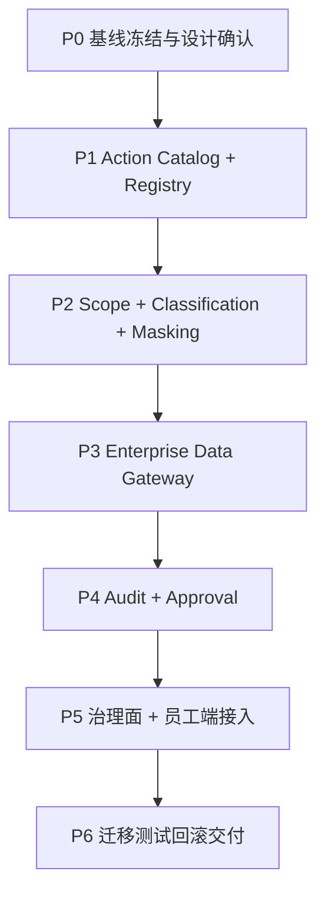

# Enterprise Data Capability Hub P0 实施说明书

> 状态：已被最终总计划替代（2026-06-05）  
> **请使用**：`docs/design/edgsc-master-implementation-plan-2026-06-05.md`  
> **唯一总指令**：`docs/design/openbot-enterprise-data-governance-and-supply-center-final-instruction-2026-06-05.md`

## 1. 项目一句话

在现有 `Seat / Asset / Policy / Audit` 架构之上，建设 **Enterprise Cognitive Supply Platform（企业认知供给平台）**——同时提供可信执行治理与可见知识供给，而非连接器管理页面。

升级后正式名称：**企业数据能力治理与供给中心**（双内核：Execution Governance + Knowledge Supply）。

## 2. 现状与目标映射

### 2.1 现有架构（代码基线）

```text
Enterprise (tenantId)
  └── PositionSeat (seatId)
        ├── SeatBinding (employeeId)
        ├── SeatAssetBinding (agent | space | memory | connector | capability)
        ├── AccessPolicy (subject: seat/employee → resource + action)
        ├── ConnectorCredentialBinding (connectorId + owner)
        └── AssetAuditEvent (治理审计)
```

**已具备：**

| 能力                | 代码锚点                                  | 状态                       |
| ------------------- | ----------------------------------------- | -------------------------- |
| Seat 权限核心       | `enterprise-seat-assets-store.ts`         | 已落地                     |
| Connector 资产绑定  | `assetType: connector`                    | 已落地                     |
| 凭证与重授权        | `ConnectorCredentialBinding`              | 已落地                     |
| 粗粒度 AccessPolicy | `grantEnterpriseAccessPolicy`             | 已落地                     |
| 治理审计            | `enterprise-seat-assets-audit.ts`         | 已落地                     |
| 企业能力中心 UI     | `enterprise-capability-center-surface.ts` | 已落地（无 Data Hub 子面） |
| 员工能力接收        | `employee-capability.ts`                  | 已落地（无数据动作调用）   |

**缺失：**

| 能力                          | 目标阶段 |
| ----------------------------- | -------- |
| 版本化动作目录                | P1       |
| Runtime Registry              | P1       |
| Scope 服务端求值              | P2       |
| 分类与脱敏                    | P2       |
| Data Gateway 统一入口         | P3       |
| 双层数据审计                  | P4       |
| 审批工作流                    | P4       |
| Connector Capabilities 管理面 | P5       |
| 员工端解释性回答              | P5       |

### 2.2 目标架构

```text
Agent
  → Resolve Seat（服务端，不信任客户端 seatId）
  → SeatActionGrant Check（connectorId + actionKey + version）
  → Connector Action Version Check
  → Scope Policy Check（服务端求值）
  → Approval Check（PER_REQUEST 携带 approvalContextId；traceId 仅审计）
  → Connector Runtime（Registry handler）
  → Data Classification + Masking
  → Audit Runtime（Invocation + Data，traceId）
  → DataGatewayResponse
```

### 2.3 领域结构（目标）

```text
Seat
  ├── Agents
  ├── Connectors（资产绑定 + 凭证）
  ├── Capabilities
  ├── Knowledge
  ├── Policies
  │     ├── SeatActionGrant
  │     ├── ScopePolicy
  │     ├── ApprovalPolicy
  │     └── FieldClassification / MaskingPolicy
  └── Audit（治理 + 数据双层）
```

## 3. 五份冻结设计文档

| 文档                        | 路径                                         | 覆盖阶段 |
| --------------------------- | -------------------------------------------- | -------- |
| Connector Action Versioning | `docs/design/connector-action-versioning.md` | P1       |
| Scope Policy Model          | `docs/design/scope-policy-model.md`          | P2       |
| Data Classification Model   | `docs/design/data-classification-model.md`   | P2       |
| Audit Runtime Schema        | `docs/design/audit-runtime-schema.md`        | P4       |
| Approval Workflow Model     | `docs/design/approval-workflow-model.md`     | P4       |

## 4. 阶段拆分与依赖



| 阶段 | 周期建议    | 前置依赖 | 核心交付                                |
| ---- | ----------- | -------- | --------------------------------------- |
| P0   | 第 1-2 周   | —        | 五份设计文档、本说明书、风险清单        |
| P1   | 第 3-4 周   | P0 验收  | Action Store、Registry、Grant、目录 API |
| P2   | 第 5-6 周   | P1 验收  | Scope 引擎、Masking 引擎、分类种子      |
| P3   | 第 7-8 周   | P2 验收  | `enterprise-data.invoke`、首批 handler  |
| P4   | 第 9-10 周  | P3 验收  | 双层审计、审批流程                      |
| P5   | 第 11-12 周 | P4 验收  | Capability Center 子面、员工端接入      |
| P6   | 第 13-14 周 | P5 验收  | 迁移、测试报告、Runbook、UAT            |

## 5. 新增模块规划

```
src/gateway/enterprise-data/
  types.ts
  connector-action-store.ts
  connector-runtime-registry.ts
  seat-action-grant-store.ts
  scope-policy.ts
  classification-store.ts
  masking-engine.ts
  data-gateway.ts              # P3 统一入口
  audit-runtime.ts             # P4
  approval-workflow.ts         # P4
  handlers/
    crm-customer-read-summary-v1.ts
    crm-customer-read-summary-v2.ts
    crm-customer-export-v1.ts
    erp-order-read-status-v1.ts
    knowledge-article-search-v1.ts
  server-methods/
    enterprise-data.ts         # Gateway RPC 注册
```

```
ui/src/ui/ports/enterprise/views/
  enterprise-data-capability-surface.ts   # P5，挂载于 Capability Center
```

## 6. Mock Strategy（第 3 周前必须就绪）

真实 CRM/ERP 联调条件不足时，采用分层 mock：

| 层         | 策略                                                    |
| ---------- | ------------------------------------------------------- |
| Handler    | 返回固定 JSON fixture，结构符合 `outputSchema`          |
| Credential | 使用 `mock-credential` 绑定，不调用外部 API             |
| Scope      | fixture 数据含 `owner_id` / `owner_team` 字段供过滤验证 |
| 切换       | `handlerRef` 后缀 `@live` 切换真实实现，Registry 不变   |

Mock fixtures 目录：`src/gateway/enterprise-data/fixtures/`。

## 7. 系统边界与假设

### 7.1 边界

- **授权主体**：仅 `Seat`，不引入 `DigitalHuman`
- **数据访问**：仅通过 Data Gateway，禁止 Agent 直连数据库
- **首版操作**：只读（`readOnly: true`）
- **导航**：不新增一级导航，挂载 `Enterprise Capability Center`

### 7.2 假设

1. `EnterprisePositionSeat.teamLabel` 可作为 TEAM Scope 的团队标识；**缺失时 fail-closed**
2. `DEPARTMENT` Scope 首版为实验性；稳定 `departmentId` 待 P5+ 组织模型
3. SQLite / JSON 后端均可承载新增 Store 字段
4. 专家团队按阶段验收，通过后进入下一阶段
5. 首版审批人仅 `enterprise-admin`

## 8. 服务端强校验红线

- 不信任前端 `seatId`、`scopeApplied`、`maskedFields`、`approvalContextId` 以外的伪造身份
- 审批申请 API **不接受**客户端 `seatId`；从 session 解析
- 所有分类、范围、审批由服务端计算
- 未知字段 **fail-closed**（`fail_closed_redact` 默认）
- 审计写入：LOW/MEDIUM fail-open；**HIGH/CRITICAL fail-closed**
- 旧 connector execute 迁移：**逐连接器显式映射**，无映射不自动发明动作

## 9. 验收映射（方案 §17 五问）

| 问题                                      | 验收阶段 | 证据                            |
| ----------------------------------------- | -------- | ------------------------------- |
| Seat 是否唯一授权核心                     | P1-P3    | Grant 绑定 seatId；无 Seat 拒绝 |
| ConnectorAction@version 是否落地          | P1       | @v1/@v2 并存测试                |
| Scope/Classification/Masking 服务端强约束 | P2-P3    | 绕过测试失败                    |
| Approval/Audit 闭环                       | P4       | traceId 回溯                    |
| Agent 仅执行授权动作                      | P3-P5    | 无网关路径阻断测试              |
