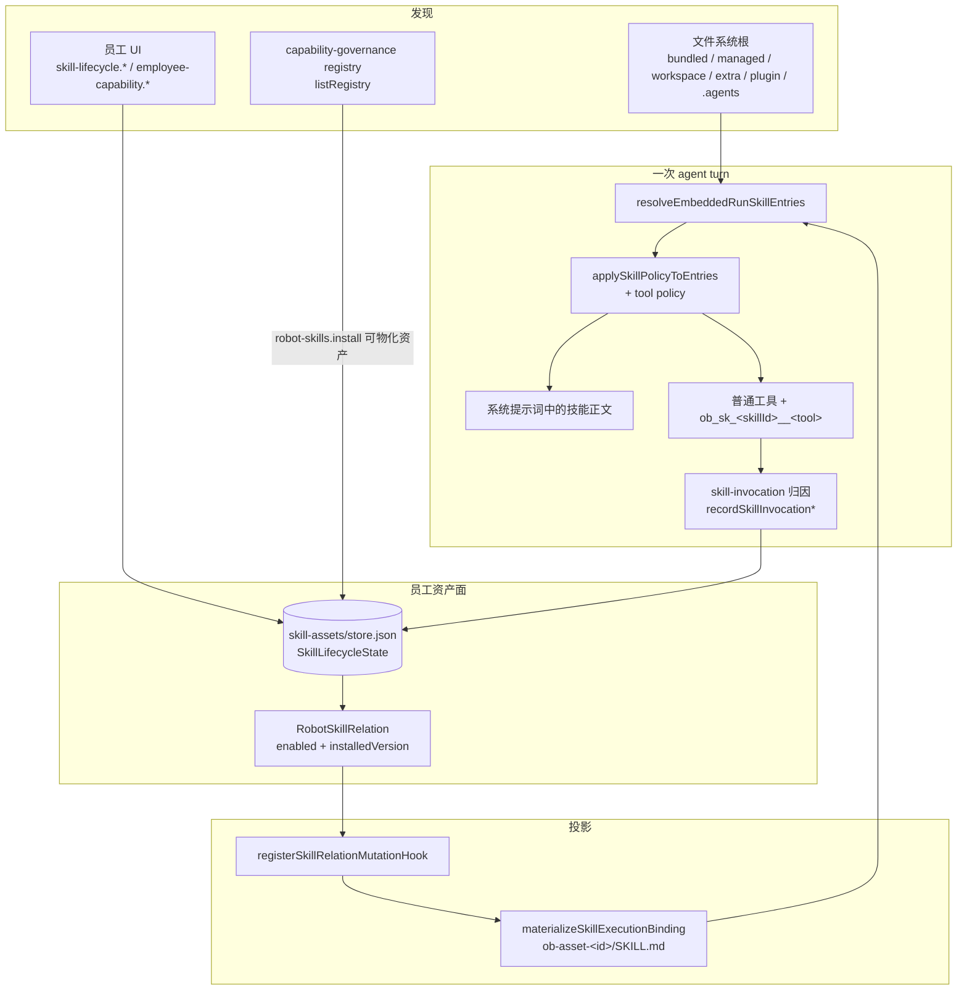
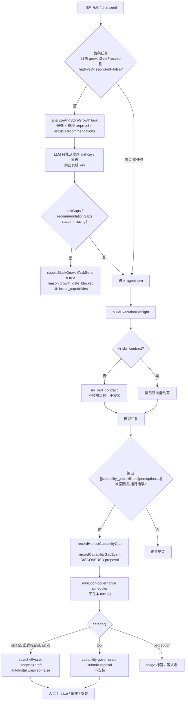
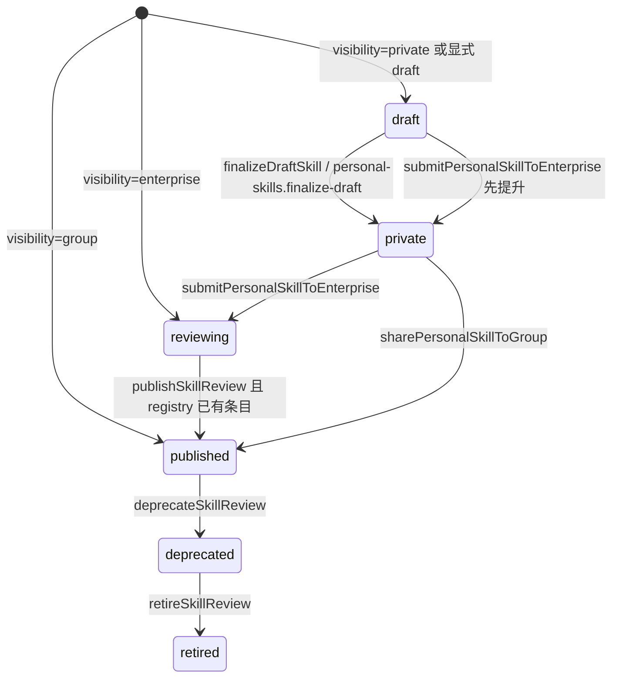

# 员工端技能进化通道：现状分析

> **状态：只读调查** | 日期：2026-10-10 | 范围：OpenBot 产品侧员工技能通道
>
> 本文件只描述代码与文档里已经存在的通道。不改技能实现。仓库中 **未找到** 名为 `runtime-appliance` / `runtimeAppliance` 的包、目录或符号；下文把「员工端」映射到 gateway 技能资产、机器人安装关系、执行投影，以及同一进程里的 AgentSkills 文件系统加载。
>
> 放置位置：仓库没有 `docs/analysis/`。分析与设计对齐文档惯例在 `docs/design/`，文件名带日期。

## 0. 执行摘要

员工技能不是一条管道，而是两条并行栈在 agent turn 上汇合。

1. **文件系统技能（AgentSkills）**：`SKILL.md` 从 bundled / managed / workspace 等目录发现，经策略过滤后写进系统提示词。模型按提示调用普通工具。没有独立的「技能虚拟机」。
2. **员工技能资产**：JSON 存在 `CONFIG_DIR/skill-assets/store.json`。安装到机器人后，hook 把可执行资产生成 `ob-asset-<skillId>/SKILL.md`，再并进同一次 prompt 加载。
3. **缺技能时没有中央决策器**。首条任务可能被成长门控拦住，并指向已有企业候选 key；运行中缺口靠模型打 `[[capability_gap:...]]`，后台再写 **draft**，不自动检索 ClawHub，也不自动发布。
4. **ClawHub 不在 gateway 里**。公开文档把它写成安装通道；系统提示词明确禁止把用户导向第三方 registry。企业安装走 capability governance registry。
5. **孵化是多套状态机叠在一起**（资产 lifecycle、企业 proposal、平台 submission、模式检测、学习策展）。自动进化默认关闭，且注释写明永不自动批准。
6. **失败经常是静默的**：策略拒绝只是从 prompt/工具列表消失；安装向导在运行时同步失败后仍可把请求标成 `installed`。
7. **文档与 CLI 不一致**：`docs/tools/skills.md` 描述 `openbot skills install/update`，`src/cli/skills-cli.ts` 只注册 `list` / `info` / `check`。

读完后的操作含义：要补「缺技能 → 检索或创作」的闭环，应先选定一条决策层（现在分散在 prompt、growth gate、evolution consumer、人工 RPC），再打通 draft → 可执行投影 → 评测。不要假设已经有 runtime-appliance 或 ClawHub 自动安装回路。

## 1. 架构与数据流

### 1.1 两条栈

| 栈           | 发现物                                            | 持久化                                        | 进入 agent 的方式                                                             |
| ------------ | ------------------------------------------------- | --------------------------------------------- | ----------------------------------------------------------------------------- |
| 文件系统技能 | `SKILL.md` 目录                                   | 工作区 / `~/.openbot/skills` / 包内 `skills/` | `loadWorkspaceSkillEntries` → `resolveSkillsPromptForRun`                     |
| 员工技能资产 | `EmployeeSkillProfile` + `SkillRuntimeDefinition` | `CONFIG_DIR/skill-assets/store.json`          | 机器人关系变更 → `syncSkillExecutionBinding` → 物化 `SKILL.md` → 同上一次加载 |

员工资产在物化之前 **不是** Pi loader 的技能目录。`draft` 可以挂上源机器人关系，但执行投影会跳过 `draft` / `rejected` / `retired`（`EXECUTABLE_LIFECYCLES`）。

### 1.2 阶段与模块边界

| 阶段                      | 模块                                                    | 入口                                                                                                                               | 边界                                                                                                |
| ------------------------- | ------------------------------------------------------- | ---------------------------------------------------------------------------------------------------------------------------------- | --------------------------------------------------------------------------------------------------- |
| 文件系统发现              | `src/agents/skills/workspace.ts`                        | `loadWorkspaceSkillEntries`                                                                                                        | 同名覆盖顺序见 §1.3。畸形 frontmatter 被吞掉（`catch { // ignore malformed skills }`）              |
| 资格过滤                  | `src/agents/skills/config.ts`、`skills-status.ts`       | `shouldIncludeSkill`、`buildWorkspaceSkillStatus`                                                                                  | 缺二进制 / env / `enabled: false` / bundled allowlist 时技能不进 prompt                             |
| 依赖安装                  | `src/agents/skills-install.ts`                          | `installSkill`                                                                                                                     | 执行 `SKILL.md` metadata 里的 brew/node/go/uv/download。**不是** registry 拉包                      |
| Gateway 依赖 RPC          | `src/gateway/server-methods/skills.ts`                  | `skills.status` / `skills.install` / `skills.update`                                                                               | 同上，安装器语义                                                                                    |
| CLI 检视                  | `src/cli/skills-cli.ts`                                 | `registerSkillsCli`                                                                                                                | 仅 `list` / `info` / `check`                                                                        |
| 资产抽取/保存             | `src/gateway/skill-lifecycle-store.ts`                  | `extractSkillPreview`、`saveSkillAsset`                                                                                            | 初始 lifecycle 由 visibility 决定                                                                   |
| 资产 RPC                  | `src/gateway/server-methods/skill-lifecycle.ts`         | `skillLifecycleHandlers`                                                                                                           | `personal-skills.*`、`robot-skills.*`、审核别名                                                     |
| 安装门控                  | 同上 + `skill-capability-contract.ts`                   | `assertRobotSkillInstallAllowed`、`assessSkillAvailability`                                                                        | 停用/本机原生/缺密钥会拒绝；draft/reviewing 仍 `installAllowed: true`，文案提示还不能给更多机器人用 |
| 机器人安装/开关/升级/卸载 | store                                                   | `installSkillToRobotAsset`、`toggleRobotSkillAsset`、`upgradeRobotSkillAsset`、`removeRobotSkillAsset`、`deletePersonalSkillAsset` | 变更发 `SkillRelationMutationEvent`                                                                 |
| 执行投影                  | `src/gateway/skill-execution-binding/`                  | `syncSkillExecutionBinding`、`materializeSkillExecutionBinding`、`isExecutableSkillProjectionEligible`                             | 写出 Pi 兼容 `SKILL.md`                                                                             |
| Turn 加载                 | `src/agents/pi-embedded-runner/skills-runtime.ts`       | `resolveEmbeddedRunSkillEntries`                                                                                                   | 工作区条目与 live binding 合并，再套 skill policy                                                   |
| Turn 策略                 | `src/auto-reply/reply/runtime-skill-policy.ts`          | `resolveRuntimeSkillPolicy`                                                                                                        | 与 `composeSkillPolicy` 做交集                                                                      |
| 调用归因                  | `src/gateway/skill-invocation/`                         | `resolveSelectedSkillForToolCall`、`createLifecycleSkillToolAttributionHandler`                                                    | 工具流 start/result。歧义时不计数。handler 异常被吞                                                 |
| 员工安装向导              | `src/gateway/server-methods/employee-install.ts`        | `employeeInstallHandlers`、`executeInstallConfirmation`                                                                            | 文件头仍写 stub。请求落在 `~/.config/openbot/stores/employee-install.json`，与 `CONFIG_DIR` 分裂    |
| 创建机器人时自动装包      | `src/gateway/capability-packs/install-pack-to-robot.ts` | `autoInstallCapabilitiesOnAgentCreate`                                                                                             | 从 registry 物化资产并安装。运行时同步失败被吞                                                      |
| 企业/平台                 | `enterprise-capability.*`、`platform-capability.*`      | `submitSkillToEnterpriseReview` 等                                                                                                 | 见 §3                                                                                               |

### 1.3 文件系统发现顺序

`loadWorkspaceSkillEntries`（`src/agents/skills/workspace.ts`）注释写明：

`extra < bundled < managed < ~/.agents/skills < <workspace>/.agents/skills < workspace`

| `sourceInfo.source`         | 位置                                                       |
| --------------------------- | ---------------------------------------------------------- |
| `openclaw-extra`            | `skills.load.extraDirs`，以及插件 `resolvePluginSkillDirs` |
| `openclaw-bundled`          | `resolveBundledSkillsDir()`                                |
| `openclaw-managed`          | `CONFIG_DIR/skills`（默认 `~/.openbot/skills`）            |
| `agents-skills-personal`    | `~/.agents/skills`                                         |
| `agents-skills-project`     | `<workspace>/.agents/skills`                               |
| `openclaw-workspace`        | `<workspace>/skills`                                       |
| `openbot-lifecycle-binding` | 员工资产投影目录 `skill-execution-bindings/<agentId>/`     |

ClawHub **没有**进入这个 loader。外部 `clawhub` CLI 若把目录写进 workspace `skills/`，下一次会话才会被当成 workspace 技能。gateway TypeScript 中 **未找到** ClawHub HTTP/API 客户端。

### 1.4 一次任务里「调用技能」实际发生什么

技能正文进系统提示词（`resolveSkillsPromptForRun`）。模型随后调用工具。

员工资产生成的身份工具名形如 `ob_sk_<skillId>__<baseTool>`（`src/agents/pi-tools.ts` 的 lifecycle skill identity tools）。归因顺序在 `resolveSelectedSkillForToolCall`：显式 `selectedSkillId` → 参数里的 `openbotSkillId` / `skillId` → 身份工具名 → 已加载技能中的唯一所有者。多个所有者则返回 null，**不计数**。仅出现在 prompt 里不算一次调用（`isPromptOnlySkillNamedInUse`）。

用户斜杠命令若 frontmatter 设 `command-dispatch: tool`，文档称可绕过模型直接打工具。这是文件系统技能的命令分发，不是员工资产状态机。

执行预检 `buildExecutionPreflight` / `resolvePrimary`（`src/agents/execution-preflight/resolve.ts`）只判断消息是否绑上已有 skill contract。没有匹配时 `decisionCode = "no_skill_contract"`，**不触发安装或检索**。

## 2. 缺失技能时的决策

**未找到**单一函数在「检索外部技能源」与「自己创建技能」之间做优先级选择。下面是实际存在的并行路径，按它们在请求路径上出现的顺序排列，不是产品设计过的优先级表。

### 2.1 各层在做什么

| 层               | 函数                                                                                   | 触发                                       | 检索外部源？                                                                           | 创建技能？                                                                           | 回退                                                                                                                               |
| ---------------- | -------------------------------------------------------------------------------------- | ------------------------------------------ | -------------------------------------------------------------------------------------- | ------------------------------------------------------------------------------------ | ---------------------------------------------------------------------------------------------------------------------------------- |
| 系统提示词       | `buildUserVisibleReplySection`（`src/agents/system-prompt.ts`）                        | 模型认为能力不够、拒绝时                   | 否。同文件 `buildDocsSection` 写明不要把用户导向第三方 registry                        | 否。只要求打一次机器标记                                                             | 标记被限流则 `recordHonestCapabilityGap` 的解析返回 null                                                                           |
| 成长门控         | `shouldBlockGrowthTaskSend`、`resolveNextGrowthAction`、`extractTaskSkillRequirements` | **仅首条** mission，且用户未点 proceed     | 否。候选来自模板 + `listSkillRecommendations`（已发布/共享的企业技能）                 | 否。提示词禁止发明目录外 key                                                         | LLM 抽取失败走 `fallbackTaskGapsFromTemplate`；`analyzeAndStoreGrowthTask` 异常时 chat 仍记下 `firstMissionSentAtMs`，避免永久卡住 |
| 能力匹配 API     | `employee-capability.can` → `matchCapabilityIntent`                                    | 查询，不是 turn 内自动补齐                 | 已装 + 企业推荐                                                                        | 否                                                                                   | 未找到实现：不会因此去 ClawHub                                                                                                     |
| 执行预检         | `resolvePrimary`                                                                       | 每轮可跑                                   | 否                                                                                     | 否                                                                                   | `no_skill_contract` 保持普通工具面                                                                                                 |
| 缺口摄入         | `recordHonestCapabilityGap` → `recordCapabilityGapEvent`                               | 标记、空回复、运行错误。注释：用户取消不记 | 否                                                                                     | 本函数只记事件                                                                       | store 抛错被 try/catch 吃掉，**不让回复失败**                                                                                      |
| 缺口消费         | `processDiscoveredProposal` / `actSkill` / `actTool`                                   | scheduler tick，离开回复路径               | 否                                                                                     | skill 类：占位 draft。tool 类：governance proposal                                   | 未达阈值不动；`act` 失败只打 evolution log                                                                                         |
| 诊断             | `buildSkillInstallationPreviewFact`，意图仅 `install_existing_skill`                   | 显式安装意图                               | 只提议安装 **已有 skillId**                                                            | 禁止从缺口发明 spec。文件头写 Path A 候选在 A0 之后恒空；live auto-submit **未接线** | skill-spec surface 的 recheck 为 `unsupported_surface`                                                                             |
| 数字员工创建     | `resolveSkillNeed`                                                                     | 起草员工                                   | registry 的 `catalog.skillKeys`                                                        | 不在目录则 `unresolved`。注释 Never invent a skillKey                                | 安装走 `installRegistrySkillOntoRobot`                                                                                             |
| 学习策展         | `curateLearningSkillDrafts`                                                            | 学习资产被注入 prompt 并记账之后           | 否                                                                                     | draft，`auto` 发布没有                                                               | 无候选返回空；失败 `logVerbose`，不挡回复                                                                                          |
| Bundled 技能正文 | `skills/skill-authoring/SKILL.md`、`skills/openbot-skills`                             | 仅当该技能已被加载，且模型选择遵守         | `skill-authoring` 写明 `skills.install` 不会拉 registry；有 CLI 时才 `clawhub publish` | 教模型写 `SKILL.md`，不是 gateway 自动写                                             | 系统提示词与这条技能对「第三方 registry」的态度相反，见缺口 P0                                                                     |

`surfaceForCategory`（`capability-gap-ingest.ts`）把 **skill → `capability.skill-spec`**，**tool → `capability.skill-installation`**。消费端却是 skill 写 draft、tool 交治理提案。surface 名字和动作容易读反，诊断 recheck 又不支持 `capability.skill-spec`。

成长门控的「安装」目标是 UI：`target.module = "assistant"`、`tab = "skills"`、`recommendedSkillKeys`。它不调用 ClawHub，也不调用 `saveSkillAsset`。用户跳过（`growthGateProceed`）或已经发过首条任务之后，`shouldBlockGrowthTaskSend` 直接返回 false。**后续任务缺技能不会再被这道门挡住。**

### 2.2 检索外表源：实际有哪些源

| 源                                                               | 运行时是否自动搜                                                                                         | 证据                                              |
| ---------------------------------------------------------------- | -------------------------------------------------------------------------------------------------------- | ------------------------------------------------- |
| 企业 registry（`capability-governance-store` 的 `listRegistry`） | 创建机器人装包、数字员工解析、`robot-skills.install`、员工安装向导列出来源时会读。不是「任务中缺了再搜」 | `install-pack-to-robot.ts`、`employee-install.ts` |
| 已发布/小组共享技能                                              | `listSkillRecommendations` 过滤 published / sharedGroups                                                 | `skill-lifecycle-store.ts`                        |
| ClawHub / clawhub.ai                                             | **未找到** gateway 自动 search/install。公开文档与 bundled `openbot-skills` 描述 CLI                     | `docs/tools/skills-cli.md`                        |
| 本地外部包                                                       | `employee-install.scan-external` 后，`external-local` 确认安装才允许。未扫描会 RPC 报错                  | `employee-install.ts`                             |
| `skills.install`                                                 | 只跑已发现技能的依赖安装器                                                                               | `skills-install.ts`                               |

`ui/src/ui/views/public-skills-mcp-document.ts` 写明：团队/企业技能经平台能力中心发布、审核、安装、授权，而不是外部 marketplace。

### 2.3 「自己创建技能」实际产出什么

`actSkill` 调用 `saveSkillAsset`，profile 是「能力缺口草稿：…」，`runtimeDefinition.prompts` 是一句摘要，`tools` 最多放 detail 字符串，`lifecycle: "draft"`，`autoInstallEnabled: false`。这不是 LLM 生成的 `SKILL.md` 目录树，也没有评测。

`draftProfileForGap` 把 `assetType` 写成 `"skill"`。`normalizeAssetType` 不认识这个值，**默认落成 `"capability"`**。因此缺口草稿在类型上变成 capability 资产；只要以后被 finalize 到可执行 lifecycle，就有资格进投影。当前 draft 本身仍不可执行。

学习策展（`DEFAULT_REUSE_THRESHOLD = 3`，`DEFAULT_OCCURRENCE_THRESHOLD = 3`）同样只写 draft，注释写明走既有审核，不发布。

模式检测 `pattern-detection.publish-draft-skill` 注释为人工门控，不自动安装。

`skills/skill-authoring/SKILL.md` 里「同一错误 ≥3 次写入技能」是给模型的写作规范，**未找到** gateway 按错误次数自动改 `SKILL.md` 的实现。

## 3. 孵化与迭代状态机

没有一条 `candidate → published` 总状态机。下面几套同时存在。

### 3.1 员工技能资产 `SkillLifecycleState`

定义：`src/gateway/skill-lifecycle-store.ts`。

`draft | private | reviewing | approved | published | deprecated | rejected | retired`

| 转移               | 谁触发                                       | 备注                                                                      |
| ------------------ | -------------------------------------------- | ------------------------------------------------------------------------- |
| 创建时的默认态     | `resolveInitialLifecycle`                    | private→draft，group→published，enterprise→reviewing                      |
| draft→private      | 用户 RPC `personal-skills.finalize-draft`    | 再对已启用关系重放安装事件                                                |
| 编辑               | `editPersonalSkillAsset`                     | patch 版本 +1，历史进 `versions[]`                                        |
| 分享到组           | `sharePersonalSkillToGroup`                  | 先 `assertContentReadyForIncubation`                                      |
| 提交企业           | `submitPersonalSkillToEnterprise`            | draft 会先变 private 再 reviewing。直接 `submitSkillForReview` 拒绝 draft |
| 企业通过后发布     | `publishSkillReview`                         | `skill-review.publish` 在没有 registry 条目时拒绝                         |
| 弃用/退役          | `deprecateSkillReview` / `retireSkillReview` | gateway RPC                                                               |
| 进化回滚 lifecycle | `restoreSkillLifecycleState`                 | 只回 lifecycle，不改内容                                                  |
| 版本回滚           | `rollbackSkillVersion`                       | 生成新的 head 版本，并同步机器人 `installedVersion`                       |

`approved` 在枚举里。企业主路径是 reviewing →（registry 批准）→ published。`SkillReviewRecord.decision` 使用 `"approved" | "rejected"`。**未找到**企业审核拒绝时把 `skill.lifecycle` 写成 `rejected` 的 store 函数；拒绝主要落在 governance proposal。

可执行投影（`src/gateway/skill-execution-binding/types.ts`）：

- 不可执行：`draft`、`rejected`、`retired`
- 可执行：`private`、`reviewing`、`approved`、`published`
- 资产类型须在 `EXECUTABLE_ASSET_TYPES`（capability、workflow、prompt、template、agent、tool、mcp）。`knowledge` 被明确排除

`reviewing` 可执行是故意的：注释写所有者可以在企业审核期间装到自己的机器人。与之矛盾的是 `saveSkillAsset` 附近注释仍写「execution binding still skips draft/reviewing」。以 `isExecutableSkillProjectionEligible` 为准：reviewing **不会**被跳过。

版本：新建 `"1.0.0"`。编辑、交付物更新、rollback 走 `bumpPatchVersion`。没有独立的评测版本通道。

健康：`recordSkillHealthSample` 用 24h 窗口得到 `healthy | warning | broken`。这是调用统计，不是发布门。

### 3.2 企业治理与平台提交

Proposal（`capability-governance-store.ts`）：`proposed | under_review | approved | rejected | withdrawn`。

Registry `lifecycleState`：`draft | review | approved | active | deprecated | retired`。

员工提交：`submitSkillToEnterpriseReview` → `submitProposal({ status: "proposed" })`。企业审核 `enterprise-capability.review`：通过则 `approveAndRegister`；拒绝/需修改则 proposal 进入 rejected/withdrawn。

平台提交（`capability-install-governance-store.ts`）`EnterpriseSubmissionStatus`：`pending-review | reviewing | published | rejected | returned-for-modification | enterprise-only`。创建点是 `enterprise-capability.submit-to-platform`（脱敏门控之后）。发布/拒绝是 `platform-capability.*`。

`src/gateway/server-methods/capability-lifecycle-path.test.ts` 把期望主路径写成：submit → enterprise review → 复用达标 → incubation pool → sanitization → submit-to-platform → platform publish。这是测试描述的收敛路径，不是每条员工保存都会自动走到平台。

### 3.3 孵化中心（能力级，不是 draft 技能）

`incubation.candidate-pool` 的候选条件（`isCandidateEligible`）：

- 成熟度 ≥ `企业认证`
- `calls30d >= 100`（由 `calls7d * 4` 估算）
- `departmentCount >= 2`（字段名保留，值是 **unique robots**）
- `successRate >= 0.8`

`incubation.score` → `computeScore`：复用广度、效果稳定、业务覆盖的加权分。`employeeSatisfaction` **恒为 null**，不进权重。`employeeCount` 被设成 robot 数，`roleCount = min(robots, 3)`。没有 LLM judge，也不是 eval 框架。

`incubation.decide` 只写决策日志（`recommend_upload | continue_incubation | not_suitable`），注释明确 **不**调用 `submit-to-platform`。

`saveEffectTracking` **仅**在 `src/gateway/__tests__/incubation-store.test.ts` 被调用。**未找到**生产路径写入孵化效果对比。

### 3.4 其它孵化入口

| 机制                  | 状态                                                        | 是否自动                                                                                                                                     | 接入 live turn？                                  |
| --------------------- | ----------------------------------------------------------- | -------------------------------------------------------------------------------------------------------------------------------------------- | ------------------------------------------------- |
| 学习资产策展          | 直接 `lifecycle: "draft"`                                   | 复用或出现次数 ≥ 3                                                                                                                           | 是。`learning-recall-context.ts` 在复用记账后调用 |
| 模式检测              | `candidate → rejected/approved → publish-draft-skill`       | 批准与发布都是用户 RPC                                                                                                                       | 否                                                |
| quick-save 后档案增强 | 仍是 draft，异步 `triggerAssetCuration`                     | LLM 补档案，不发布                                                                                                                           | 保存 RPC 之后，不是每轮聊天                       |
| 资产孵化会话          | 事件 `copy/download/share/submit`；采纳 `share_to_group` 等 | `asset-incubation.review.schedule` 按复发阈值聚类给 UI                                                                                       | RPC / 分享提交时记账                              |
| Skill auto-evolution  | `src/gateway/evolution-governance/skill-auto-evolution.ts`  | 默认关。`OPENBOT_SKILL_AUTO_EVOLUTION=on` 且 governance mode 为 auto 才允许变更。注释：永不自动 approve，只推进带 `autoInstallIntent` 的 job | scheduler，约 15 分钟，不是每轮                   |

员工 UI「我的积累」分段（`ui/src/ui/controllers/my-accumulation.ts`）是 `all | drafts | reviewing | contributed | optimize`，由 `lifecycle === "draft"` 与 `shareVisibility` 映射，和企业 VM 的 `submitted|reviewing|approved|published|...` 不是同一套枚举。

### 3.5 人工确认门（已实现）

- 草稿确认可用：`finalizeDraftSkill`
- 分享/提交企业前：`assertContentReadyForIncubation` → `evaluateAssetContentReadiness`
- 企业审核：`enterprise-capability.review`
- 技能发布对齐 registry：`skill-review.publish`
- 平台上报：脱敏 `canSubmitToPlatform` 之后的 `submit-to-platform`，再由平台 RPC 发布
- 孵化决策：`incubation.decide` 要求 reason，且只记日志
- 模式变技能：先 approve 再 `publish-draft-skill`

**未找到**自动进化回路在默认配置下把草稿推进到 published。

## 4. 关键代码索引

| 符号                                                                                                                 | 路径                                                               |
| -------------------------------------------------------------------------------------------------------------------- | ------------------------------------------------------------------ |
| `SkillLifecycleState`、`saveSkillAsset`、`resolveInitialLifecycle`、`finalizeDraftSkill`、`installSkillToRobotAsset` | `src/gateway/skill-lifecycle-store.ts`                             |
| `normalizeAssetType`（未知类型 → `capability`）                                                                      | 同上                                                               |
| `skillLifecycleHandlers`、`assertRobotSkillInstallAllowed`                                                           | `src/gateway/server-methods/skill-lifecycle.ts`                    |
| `assessSkillAvailability`                                                                                            | `src/gateway/skill-capability-contract.ts`                         |
| `EXECUTABLE_LIFECYCLES`、`NON_EXECUTABLE_LIFECYCLES`                                                                 | `src/gateway/skill-execution-binding/types.ts`                     |
| `isExecutableSkillProjectionEligible`、`renderSkillMarkdown`                                                         | `src/gateway/skill-execution-binding/materialize.ts`               |
| `syncSkillExecutionBinding`                                                                                          | `src/gateway/skill-execution-binding/sync.ts`                      |
| `loadWorkspaceSkillEntries`                                                                                          | `src/agents/skills/workspace.ts`                                   |
| `resolveEmbeddedRunSkillEntries`                                                                                     | `src/agents/pi-embedded-runner/skills-runtime.ts`                  |
| `installSkill`                                                                                                       | `src/agents/skills-install.ts`                                     |
| `registerSkillsCli`                                                                                                  | `src/cli/skills-cli.ts`                                            |
| `resolveRuntimeSkillPolicy`                                                                                          | `src/auto-reply/reply/runtime-skill-policy.ts`                     |
| `resolveSelectedSkillForToolCall`                                                                                    | `src/gateway/skill-invocation/record.ts`                           |
| `createLifecycleSkillToolAttributionHandler`                                                                         | `src/gateway/skill-invocation/lifecycle-tool-attribution.ts`       |
| `shouldBlockGrowthTaskSend`                                                                                          | `src/gateway/agent-growth/growth-task-gate.ts`                     |
| `resolveNextGrowthAction`                                                                                            | `src/gateway/agent-growth/next-action.ts`                          |
| `buildUserVisibleReplySection`（capability_gap 标记）                                                                | `src/agents/system-prompt.ts`                                      |
| `recordHonestCapabilityGap`                                                                                          | `src/auto-reply/reply/honest-empty-reply.ts`                       |
| `surfaceForCategory`、`recordCapabilityGapEvent`                                                                     | `src/gateway/evolution-control/capability-gap-ingest.ts`           |
| `actSkill`、`actTool`、`processDiscoveredProposal`                                                                   | `src/gateway/evolution-control/capability-gap-consumer.ts`         |
| `SKILL_INSTALLATION_INTENTS = install_existing_skill`                                                                | `src/diagnosis/skill-installation-candidate.ts`                    |
| `resolvePrimary`（`no_skill_contract`）                                                                              | `src/agents/execution-preflight/resolve.ts`                        |
| `curateLearningSkillDrafts`                                                                                          | `src/auto-reply/reply/learning-skill-curation.ts`                  |
| `DEFAULT_REUSE_THRESHOLD`                                                                                            | `src/gateway/agent-growth/skill-draft-curation.ts`                 |
| `isSkillAutoEvolutionEnabled`                                                                                        | `src/gateway/evolution-governance/skill-auto-evolution.ts`         |
| `employeeInstallHandlers`、`executeInstallConfirmation`                                                              | `src/gateway/server-methods/employee-install.ts`                   |
| `computeScore`、`isCandidateEligible`、`incubationHandlers`                                                          | `src/gateway/server-methods/incubation.ts`                         |
| `saveEffectTracking`                                                                                                 | `src/gateway/incubation-store.ts`（生产调用未找到）                |
| 技能写作规范                                                                                                         | `skills/skill-authoring/SKILL.md`                                  |
| 孵化运营说明                                                                                                         | `skills/openbot-platform-ops/references/skill-asset-incubation.md` |

## 5. 员工端与平台端的分界

两边都在 **同一个 gateway 进程**里，用不同 RPC 和 store，不是两个部署单元。割裂来自数据面和产品叙事，不是网络边界。

| 面           | RPC / store                                                                           | 员工能直接完成的事                                                               |
| ------------ | ------------------------------------------------------------------------------------- | -------------------------------------------------------------------------------- |
| Host 技能    | `skills.status/install/update`，CLI `openbot skills`                                  | 看本机 `SKILL.md`、装依赖。不能从这里发布企业技能                                |
| 个人资产     | `skill-lifecycle.extract/save`，`employee-capability.quick-save`，`personal-skills.*` | 存 draft、编辑、分享到组、提交企业、装到自己的机器人                             |
| 机器人关系   | `robot-skills.install/toggle/upgrade/remove`                                          | 启用后才投影进该机器人的 turn                                                    |
| 安装向导     | `employee-install.*`                                                                  | 列 registry、扫本地包、确认安装。持久化路径与 skill-assets 不同，文件头仍称 stub |
| 企业         | `enterprise-capability.review/list/submit-to-platform/...`                            | 员工提交后等待审核。审核通过才进 registry                                        |
| 平台         | `platform-capability.publish-enterprise-capability` 等                                | 员工 RPC 到不了发布。`incubation.decide` 也不代发                                |
| 外部 ClawHub | 非 core gateway                                                                       | 仅当本机有 `clawhub` CLI，且模型/用户去跑它                                      |

因此：员工端可以沉淀和自用；「进化到企业/平台可用」依赖人工审核链。SaaS 叙事（能力中心）和主机叙事（ClawHub + `openbot skills install`）在文档里被写成同一条技能通道。

## 6. 文档与代码不一致

| 主题                            | 文档                                                                                           | 代码                                                                                             |
| ------------------------------- | ---------------------------------------------------------------------------------------------- | ------------------------------------------------------------------------------------------------ |
| `openbot skills install/update` | `docs/tools/skills.md` 写安装与 `--all` 更新，并链到 `/tools/skills-cli`                       | `registerSkillsCli` 无这两个子命令。`docs/cli/skills.md` 只列 list/info/check                    |
| `/tools/skills-cli` 页面        | 标题与正文是 ClawHub（`clawhub search/install/update/publish`）                                | 不是 `openbot skills` 的实现说明                                                                 |
| 配置路径                        | `docs/tools/skills.md`、`docs/tools/skills-config.md` 写 `~/.gmood2008/openbot.json`           | `CONFIG_DIR` 为 `~/.openbot`（或遗留 `~/.openclaw`）                                             |
| 加载来源                        | 公开文档写三处：bundled、managed、workspace                                                    | loader 还有 extra、plugin、两级 `.agents/skills`                                                 |
| 系统提示词                      | `buildDocsSection`：技能由本地 `skills/` 与 `openbot skills` CLI 管理，不要导向第三方 registry | 公开技能页把 ClawHub 当作注册表；`skill-authoring` 又允许 `clawhub publish`                      |
| governance 目录注释             | 设计文档写 `~/.openbot/governance/`                                                            | `capability-governance-store.ts` 文件头注释仍写 `~/.openclaw/governance/`，运行时跟 `CONFIG_DIR` |
| reviewing 是否进运行时          | `saveSkillAsset` 注释：跳过 draft/reviewing                                                    | `EXECUTABLE_LIFECYCLES` 包含 reviewing                                                           |
| 员工安装                        | 设计任务拆解把 `employee-install.*` 当安装治理                                                 | 实现文件自称为 Phase 1 stub，且 store 不在 `CONFIG_DIR`                                          |

`docs/zh-CN/**` 由英文生成。上述漂移会被翻译副本放大。本调查不改那棵树。

## 7. 缺口与风险

### P0

1. **缺技能没有决策点。** 检索 registry、检索 ClawHub、生成技能、继续用普通工具，四件事由不同层各自发生，没有优先级函数。后续任务（非首条）缺技能时成长门控不再阻断，执行预检也不补技能。用户会看到模型空拒或空回复，缺口只进 evolution 日志。
2. **「创建技能」停在占位 draft。** `actSkill` 不生成可运行的 `SKILL.md`/脚本，不安装，不评测。`OPENBOT_SKILL_AUTO_EVOLUTION` 默认关，且永不自动批准。产品若期望「越用越强并自动可用」，当前默认配置不成立。
3. **安装成功与运行时可用脱节。** `executeInstallConfirmation` 在 `syncInstallToRuntime` 失败时 `console.warn`，请求仍可变 `installed`。`install-pack-to-robot.ts` 对 runtime sync 同样 best-effort。员工 UI 可能显示已安装，下一轮 prompt 里没有该技能。
4. **公开文档把不存在的 CLI 和 ClawHub 说成主通道。** 模型系统提示词又禁止第三方 registry。员工、文档、模型三者会走向不同安装动作。

### P1

1. **surface 命名与动作相反，且诊断不消费 skill-spec。** skill 类缺口的 surface 是 `capability.skill-spec`，消费端却写 draft；tool 类 surface 是 `capability.skill-installation`，消费端交治理提案。诊断只允许 `install_existing_skill`，live auto-submit 未接线。进化闭环在默认路径上是「记录 + 建议」，不是「安装已有技能」。
2. **两条技能栈的失败语义不同。** 资产 RPC 用 `SkillAssetStoreError` 返回明确文案。文件系统缺依赖、策略拒绝、路径逃逸、frontmatter 读失败则技能从列表消失，没有用户可见错误。归因 handler `catch { // never break tool pipeline }`，调用统计会静默少记。
3. **孵化分数不能当发布依据。** 30 日调用按 7 日乘 4；部门数等于机器人数；满意度恒 null；`incubation.decide` 不提交平台；效果跟踪没有生产写入。
4. **store 分裂。** 技能资产在 `CONFIG_DIR/skill-assets`，安装请求在 `~/.config/openbot/stores/employee-install.json`，registry 在 `CONFIG_DIR/governance`。排障时「装过」可能只存在于其中一个文件。
5. **`approved` / `rejected` 资产态与企业审核态不对齐。** 枚举有 `rejected`，企业拒绝主要改 proposal。UI 的 shareVisibility 与 raw lifecycle 是两套词。
6. **代码注释与投影规则不一致**（reviewing 是否注入）。后续修改的人会按错误注释把门收紧或放开。

### P2

1. **健康度与版本不构成发布门。** 有 24h 成功率和 patch 版本，没有「评测通过才可 published」的状态。
2. **学习策展与 skill-authoring 的「三次」不是同一条规则。** 策展看的是注入 prompt 的复用次数；写作技能说的是同一错误三次。模型若照 SKILL.md 再写一份目录技能，会和 draft 资产各存一份。
3. **`runtime-appliance` 名称未落地。** 若路线图仍用这个词，需要先改成上面的模块边界，否则检索对不上代码。
4. **ClawHub 作为治理 `source.kind` 可以出现在提案类型里，但没有安装执行器。** 半成品容易被 UI 文案当成已接通的市场。
5. **zh-CN 文档会复制英文里的 CLI/路径错误。** 修英文后要走 i18n 管道，不要手改 `docs/zh-CN/**`。

## 8. 建议的下一步（只建议，本轮不实现）

1. **先写一份决策契约，再写代码。** 明确：缺技能时允许的源只有企业 registry，还是也允许本机 workspace / ClawHub；创作只能停在 draft；谁有权把 draft 变成可执行。把这个契约放在 gateway 一个函数里，prompt 标记和成长门控都调用它，避免再长出第三条路径。
2. **把「已安装」定义成「投影已物化且下一轮 load 能看见」。** `employee-install` 与 pack 安装在 sync 失败时保持未安装，并把原因返回给 RPC。store 迁到 `CONFIG_DIR`，或在文档里把 stub 路径标成临时。
3. **修正对外文档，与 `registerSkillsCli` 和系统提示词一致。** `docs/tools/skills.md` 去掉不存在的 install/update；ClawHub 单独成页并标明「非员工通道、非 gateway」；配置路径改为 `~/.openbot`。同步发现顺序（含 `.agents/skills` 与 lifecycle binding）。
4. **把缺口消费的 surface 名改成与动作一致，或让诊断真正消费其中一条。** 在此之前不要把 capability-gap draft 展示成「已进化技能」。draft 需要至少一次人工 finalize，并有内容就绪检查（分享路径已有 `evaluateAssetContentReadiness`，缺口草稿没有同等门槛）。
5. **孵化中心若要当发布建议，先停用失真指标。** `calls30d` 的乘 4、部门=机器人、满意度恒 null，不适合做 P0 运营决策。`saveEffectTracking` 要么接上真实调用，要么在 UI 标明未采集。
6. **不要在默认配置打开 `OPENBOT_SKILL_AUTO_EVOLUTION`。** 现有注释的 fail-closed（不自动批准、不扫历史 draft）应保持。自动回路只应在 draft 内容、评测和投影三条都有断言之后再讨论。

## 9. 调查边界

- 只读当前 `main`（调查时 `HEAD` 与 `origin/main` 均为 `93ce9df262b3666d83f64c559a5e7801e6bde089`）。
- 未跑 gateway，未打开员工 UI。结论来自源码、测试名和文档对照。
- **未找到实现**已在正文标明：`runtime-appliance`、gateway 内 ClawHub 客户端、任务中自动 search-then-install、缺技能时自动写完整技能包、`saveEffectTracking` 的生产调用、诊断 live auto-submit、企业拒绝写入 `skill.lifecycle=rejected`。
