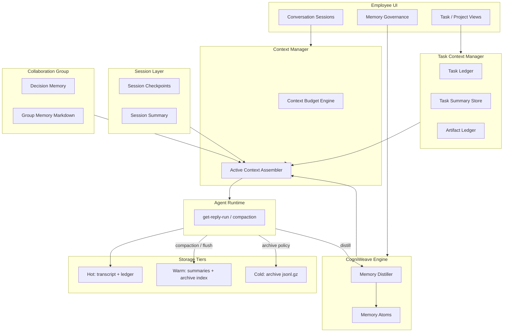

# OpenBot Agent 上下文生命周期架构 v1.1

> **状态：专家评审修订稿 v1.1** | 创建：2026-07-24 | 前序：Conversation Lifecycle Architecture v1.0（对话内草案）  
> **文档类型：** 可执行架构与研发实施方案  
> **定位升级：** 从 **Conversation Management（聊天记录管理）** → **Agent Knowledge Continuity Management（Agent 知识连续性管理）**  
> **对齐基线：** `docs/design/openbot-data-space-model-v1-2026-07-10.md`、`packages/cogniweave-sdk/`、`src/auto-reply/reply/session-continuity.ts`

---

## 0. 文档控制

| 字段           | 内容                                                                           |
| -------------- | ------------------------------------------------------------------------------ |
| 标题           | OpenBot Agent 上下文生命周期架构                                               |
| 版本           | **v1.1**（吸收 2026-07-24 专家组评审意见）                                     |
| 状态           | **Draft — 可进入研发设计**                                                     |
| 专家组综合评分 | 8.5/10（产品/性能/隐私 ★★★★★；多 Agent 协作、企业治理 ★★★☆☆）                  |
| 关联文档       | 数据空间模型、CogniWeave PRD、跨会话用户建模、对话检查点回滚、系统沙盒安全方案 |
| 非目标         | 替代 Pi 运行时 compaction 实现细节；不重新定义 CogniWeave canonical schema     |

### 0.1 v1.0 → v1.1 修订摘要（专家组 6 项吸收）

| #   | 专家组建议                                             | v1.1 处置                                                     | 优先级 |
| --- | ------------------------------------------------------ | ------------------------------------------------------------- | ------ |
| 1   | 增加 **Task / Project Context** 层，Session 非最高抽象 | **采纳**；与现有 `TaskLedgerEntry` 对齐并产品化               | **P0** |
| 2   | **Summary 分三级**（Session / Task / Memory Atom）     | **采纳**；映射到 checkpoint + CogniWeave distillation         | **P0** |
| 3   | **Group Decision Memory**                              | **采纳**；复用 collaboration-learning `Decision` + 新增注入层 | **P1** |
| 4   | **Context Budget Policy** 替代固定轮数                 | **采纳**；基于现有 compaction token 预算扩展                  | **P0** |
| 5   | 企业 **Retention Policy**                              | **采纳**；扩展 data-space §6 + tenant policies                | **P1** |
| 6   | **Memory Governance UI**（用户主动控制）               | **采纳**；收敛到员工端对话/记忆管理，非文件路径               | **P1** |

**冻结原则（专家组认可，v1.1 不变）：**

> **历史（History）≠ 上下文（Active Context）≠ 记忆（Memory）**

与 CogniWeave 管线一致：

```text
.jsonl transcript  →  CogniWeave Distiller  →  atoms / evidence  →  Memory
```

**禁止**把全部聊天原文当作 Memory 热层输入 — 此原则 **冻结**。

---

## 1. 执行摘要

OpenBot 不是「聊天工具」，而是 **长期执行任务的数字员工操作系统**。销售机器人跟进客户半年、HR Agent 持续处理入离职、产品协作组跨 Session 推进版本 — 这些场景要求 **跨 Session 的任务连续性**，而非每次新聊天从零开始。

v1.1 在 v1.0 的「历史存储 + 上下文控制」之上，升级为 **五层 Agent 上下文生命周期模型**，并与仓库已有实现 **对齐而非重写**：

| 已有能力（main）                                          | v1.1 角色                                      |
| --------------------------------------------------------- | ---------------------------------------------- |
| `session-continuity.ts`（Task Ledger、Checkpoint）        | Layer 2 Task Context + Layer 1 Session Summary |
| `agents.defaults.compaction.*`（token 预算、memoryFlush） | Layer 3 Active Context Engine                  |
| CogniWeave + `cogniweave-manager.ts`                      | Layer 5 Memory Atom                            |
| `collaboration-learning`（Decision、group memory）        | Group Decision Memory                          |
| `cross-session-user-modeling`                             | 用户级长期偏好（personal memory 子集）         |
| Data Space 模型（runtime vs archive）                     | Hot/Warm/Cold 存储分层                         |
| Session store pruning + archive                           | Layer 4 Archive 自动化                         |

**研发入口：** P0 三项（Task Context 产品化、三级 Summary 管线、Context Budget Policy）可在 **6–8 周**内基于现有模块交付 MVP；P1 三项（Group Decision 注入、企业 Retention、Memory Governance UI）紧随其后。

---

## 2. 问题陈述与产品定位

### 2.1 v1.0 已解决的问题 ✅

- 历史无限增长 → compaction + archive + pruning
- Context 成本 → token 预算 compaction + pre-compaction memory flush
- Transcript 与 Memory 分离 → CogniWeave distillation
- 本地/云端隐私边界 → State Dir vs Data Space 分离（已冻结）

### 2.2 v1.0 未充分覆盖的场景 ⚠️

| 场景           | 典型失败模式                                 |
| -------------- | -------------------------------------------- |
| 长期运营机器人 | 新 Session 丢失客户/项目状态                 |
| 协作小组       | 1000 条讨论后 Agent 不记得「团队已决定什么」 |
| 企业合规       | 无法按租户配置保留/删除周期                  |
| 员工自助       | 只能删文件，无法在 UI 管理 Session/Memory    |

### 2.3 与 ChatGPT 类产品的差异

```text
ChatGPT 模型：User → Conversation Session → Messages

OpenBot v1.1 模型：
User → Agent → Task/Project Context → Conversation Session → Messages
                      ↓
              Active Context（预算化组装）
                      ↓
              Archive / CogniWeave Memory
```

---

## 3. 五层上下文模型（v1.1 冻结）

### 3.1 层次定义

```text
Layer 1  Conversation Session     短期交流单元（「帮我写这封邮件」）
    ↓
Layer 2  Task / Project Context   任务连续性（「华为项目跟进」）
    ↓
Layer 3  Active Context           当前模型输入（预算化组装）
    ↓
Layer 4  Conversation Archive    历史 transcript（Warm/Cold）
    ↓
Layer 5  CogniWeave Memory        用户/团队长期智能（atoms/evidence）
```

### 3.2 各层职责与存储

| 层                | 职责                           | 热存储（State Dir）                       | 用户可见（Data Space）                                | 是否进入模型                |
| ----------------- | ------------------------------ | ----------------------------------------- | ----------------------------------------------------- | --------------------------- |
| L1 Session        | 单次对话消息流                 | `~/.openbot/agents/<id>/sessions/*.jsonl` | 归档后 → `conversations/archive/`                     | 近期消息 + Session Summary  |
| L2 Task           | 项目目标、状态、决策、文件引用 | `task_ledger.json`（workspace memory 下） | `agents/<id>/memory/workspace/tasks/`（Phase 2 镜像） | Task Summary + 活跃任务列表 |
| L3 Active Context | 预算内组装                     | 内存 / 当轮 prompt                        | 否                                                    | **是（唯一入口）**          |
| L4 Archive        | 完整历史备查                   | pruning 前 stub                           | `conversations/archive/` + `index.json`               | 默认 **否**（按需检索）     |
| L5 Memory         | 可复用认知                     | CogniWeave metadata（可 PG）              | `memory/agent/`、`memory/personal/`                   | 检索命中片段                |

### 3.3 抽象层级（User → Agent → Task → Session）

```text
User（员工 / 租户用户）
 └── Agent（sales-agent、hr-agent、main…）
      └── Task / Project Context（task_id，跨 Session 共享）
           └── Conversation Session（sessionKey，短期）
                └── Messages（jsonl 行）
```

**示例 — 销售 Agent：**

```text
客户 A 项目（Task Context: task_cust_a）
├── Session: 第一次需求沟通
├── Session: 报价讨论
├── Session: 合同修改
└── Session: 售后跟进

共享状态：Customer Context、Deal Status、Important Decisions
```

---

## 4. 目标架构（v1.1）



---

## 5. 与现有代码映射（As-Is → To-Be）

### 5.1 模块对照表

| v1.1 概念          | 现有实现                                                   | 文件锚点                                            | 差距                                              |
| ------------------ | ---------------------------------------------------------- | --------------------------------------------------- | ------------------------------------------------- |
| L1 Session         | jsonl transcript + checkpoint                              | `src/config/sessions/*`, `session-continuity.ts`    | Session Summary 未独立持久化字段                  |
| L2 Task Context    | `TaskLedgerEntry`                                          | `session-continuity.ts:19-34`                       | 无 UI；无显式 task↔session 绑定 API；未进企业治理 |
| L3 Active Context  | compaction + continuity prompt                             | `get-reply-run.ts`, `buildSessionContinuityPrompt`  | 无统一 Budget Policy schema                       |
| L3 Context Budget  | `reserveTokens`, `keepRecentTokens`, `recentTurnsPreserve` | `src/config/types.agent-defaults.ts`                | 无 priority 列表；无 per-agent-type 模板          |
| L1 Session Summary | `MemoryCheckpoint.summary`                                 | `session-continuity.ts:53-80`                       | 与 Task Summary 未分层命名                        |
| L2 Task Summary    | `task.context.key_points[]`                                | `session-continuity.ts:27-30`                       | 无自动 rollup；无结构化字段（负责人/状态）        |
| L5 Memory Atom     | CogniWeave distiller                                       | `packages/cogniweave-sdk/`, `cogniweave-manager.ts` | Session→Atom 链路需 productized trigger           |
| Group Decision     | `Decision` object                                          | `collaboration-learning/state-machine.ts`           | 未注入 Active Context                             |
| Group Memory       | group `memory/` markdown                                   | `collaboration-learning/memory-index-paths.ts`      | 与 Decision 未统一「Group Memory 面板」           |
| User Profile       | cross-session user modeling                                | `src/gateway/user-modeling/*`                       | 已落地 Phase 0–6                                  |
| L4 Archive         | session pruning + archive                                  | `store.pruning.integration.test.ts`                 | Data Space archive 路径 **未完全接线**            |
| Retention          | `session.maintenance`, cron reaper                         | `src/config/sessions/store.js`, `session-reaper.ts` | 无 tenant 级策略 UI                               |

### 5.2 数据目录边界（专家组认可 — 冻结）

```text
系统运行态（不可迁移）                    用户资产（可迁移、可导出）
~/.openbot/                                ~/OpenBot/  （data.root）
├── agents/<id>/sessions/  ← L1 Hot       ├── agents/<id>/
├── credentials/                          │   ├── workspace/
├── identity/                             │   ├── memory/
└── sandboxes/                            │   ├── artifacts/
                                          │   ├── conversations/archive/  ← L4
                                          │   └── memory/workspace/tasks/  ← L2 镜像（P0 新增）
                                          ├── shared/knowledge/
                                          ├── memory/personal/             ← L5 用户级
                                          └── cache/
```

**产品规则：** 员工端提供 Session/Memory **管理能力**，**不提供** transcript 文件路径、数据库、jsonl 直接编辑 — 与 Data Space 产品规格一致。

---

## 6. 核心机制设计

### 6.1 Context Budget Policy（P0 — 替代固定 20 轮）

**问题：** 固定轮数对不同 Agent 类型不适用（写作 vs 编程 vs 销售）。

**方案：** 在现有 compaction token 预算上，增加 **Context Budget Policy** 配置层。

```json5
{
  agents: {
    defaults: {
      contextBudget: {
        maxTokens: 8000, // Active Context 总预算（不含 system 固定段）
        priority: [
          "current_task", // L2 活跃 Task Summary + 状态
          "group_decisions", // 协作组已决事项（P1）
          "constraints", // 用户/企业约束
          "session_summary", // L1 Session Summary
          "recent_messages", // 原始消息（token 剩余填充）
          "memory_retrieval", // L5 CogniWeave 检索结果
          "user_profile", // cross-session 用户偏好
        ],
        minRecentMessages: 4, // 对齐 recentTurnsPreserve 语义
        maxRecentMessages: 40, // 硬上限
      },
      compaction: {
        mode: "safeguard",
        reserveTokens: 9000,
        keepRecentTokens: 12000,
        recentTurnsPreserve: 4,
        memoryFlush: { enabled: true },
      },
    },
    list: [
      {
        id: "sales-agent",
        contextBudget: {
          maxTokens: 12000,
          priority: ["current_task", "memory_retrieval", "recent_messages", "session_summary"],
        },
      },
      {
        id: "coding-agent",
        contextBudget: {
          maxTokens: 16000,
          priority: ["recent_messages", "constraints", "current_task", "memory_retrieval"],
        },
      },
    ],
  },
}
```

**实现路径：**

1. **Phase A（配置 schema）** — 扩展 `AgentDefaultsConfig`，新增 `contextBudget` 类型；默认从现有 `compaction` 派生（向后兼容）。
2. **Phase B（Assembler）** — 新建 `src/agents/context-budget-assembler.ts`：
   - 输入：session messages、task ledger、checkpoints、memory search results、user profile
   - 输出：按 priority 填充至 `maxTokens` 的结构化 prompt 段
   - 调用点：`get-reply-run.ts` 注入链（紧邻 `buildSessionContinuityPrompt`）
3. **Phase C（观测）** — usage 面板展示各段 token 占比（可选 P1）

**验收：** 销售 agent fixture 在相同 `maxTokens` 下，Task Summary 优先于旧消息；编程 agent fixture 相反。

### 6.2 三级 Summary 管线（P0）

```text
Message（原始）
    ↓  compaction / turn-end
Level 1  Session Summary     MemoryCheckpoint.summary（已有）
    ↓  task 关联 + periodic rollup
Level 2  Task Summary         TaskLedgerEntry.context.key_points + 结构化 state
    ↓  CogniWeave distiller（非摘要，抽认知）
Level 3  Memory Atom          CogniWeave MemoryAtom（trigger/claim/applicability）
```

| 级别       | 触发                                       | 存储                                                  | 生命周期                           |
| ---------- | ------------------------------------------ | ----------------------------------------------------- | ---------------------------------- |
| L1 Session | 每 N 轮 / compaction 前 / checkpoint       | `checkpoints/<id>.json`                               | Session 级；archive 后保留 summary |
| L2 Task    | Task 状态变更 / Session 结束 / 每日 rollup | `task_ledger.json` + 可选 `tasks/<taskId>/summary.md` | Task 存续期                        |
| L3 Atom    | memoryFlush / 显式 distill / 高价值决策    | CogniWeave metadata                                   | 长期；用户可删                     |

**与 CogniWeave 对齐：** L3 **不是**对话摘要 — 遵循 `memory-distiller-v1.md`「抽取认知，不做摘要」。L1/L2 允许摘要；L3 必须产出可复用 atom。

**实现任务：**

- [ ] **P0-S1** 规范 L1 字段：`MemoryCheckpoint` 增加 `level: "session"`（可选，默认兼容）
- [ ] **P0-S2** L2 rollup job：`rollupTaskSummaryFromCheckpoint(taskId, checkpoint)` — 追加 `key_points`、更新 `status`
- [ ] **P0-S3** L3 触发：在 `memory-flush.ts` 成功后将 flush 产物送 CogniWeave ingest（已有 hook 点）
- [ ] **P0-S4** 测试：Message → L1 → L2 → L3 链路 integration test（mock LLM）

### 6.3 Task / Project Context 层（P0）

**现有基础：** `TaskLedgerEntry` 已含 `scope`、`owner_id`、`title`、`status`、`context.key_points`、`artifacts`、`last_session_id`。

**v1.1 增强：**

```typescript
// 目标 schema 扩展（向后兼容）
type TaskContextRecord = {
  id: string;
  scope: "agent" | "group";
  owner_id: string;
  title: string;
  description: string;
  status: "active" | "paused" | "done" | "archived";
  // 结构化项目状态（L2 Summary 源）
  project?: {
    customer?: string;
    deal_stage?: string;
    owner_human?: string;
    goals?: string[];
  };
  decisions: Array<{ id: string; text: string; at: string; by?: string }>;
  context: { key_points: string[]; constraints?: string[] };
  artifacts: string[];
  session_ids: string[]; // 新增：关联 Session 列表
  last_session_id: string;
  updated_at: string;
};
```

**Session ↔ Task 绑定规则：**

1. 员工在 UI 选择/创建 Task → 新 Session 继承 `task_id`
2. 无显式 Task 时：启发式匹配（同 group、标题相似）→ 建议绑定，**不自动绑定**（防误合并）
3. `buildSessionContinuityPrompt` 已注入 active tasks — 扩展为 **按 task_id 过滤**

**RPC（Gateway）：**

| 方法                            | 说明                        |
| ------------------------------- | --------------------------- |
| `tasks.list`                    | 按 agent/group/user 列 Task |
| `tasks.create` / `tasks.update` | CRUD                        |
| `tasks.bindSession`             | `{ taskId, sessionKey }`    |
| `tasks.getSummary`              | 返回 L2 Task Summary        |

**UI（员工端）：**

- Task 侧边栏 / 项目切换器（非文件管理）
- Session 列表按 Task 分组

### 6.4 Group Decision Memory（P1）

**现有基础：** `collaboration-learning` 已有 `Decision` 状态机、`decisions.json`、group `memory/` markdown index。

**v1.1 Group Memory 结构：**

```text
Group Memory（协作空间）
├── Decisions      ← Decision 对象（status=approved/final）
├── Rules          ← group profile / operating policy
├── Shared Knowledge ← memory markdown + knowledge 链接
└── Task Status    ← group-scoped Task Ledger
```

**Active Context 注入（P1）：**

```typescript
// 伪代码 — context-budget-assembler 段
async function loadGroupDecisionCapsule(groupId: string): Promise<string> {
  const decisions = await listFinalDecisions(groupId, { limit: 10 });
  return formatDecisionCapsule(decisions); // 「团队已决定：…」
}
```

**格式示例（注入文本，非 UI）：**

```text
Group decisions (do not contradict):
- [2026-07-24] V2 不支持移动端 — 原因：资源限制 — 负责人：产品经理
- [2026-07-20] API 版本锁定 v3 — 负责人：架构组
```

**与 1000 条聊天对比：** 注入 **Decision Memory**（~10 条），而非历史消息。

### 6.5 企业 Retention Policy（P1）

**配置层级：**

```text
Platform default  →  Tenant policy  →  Agent override（可选）
```

```json5
{
  gateway: {
    tenantPolicies: {
      "<tenantId>": {
        retention: {
          conversation: {
            activeDays: 30, // Hot runtime 保留
            archiveDays: 180, // Warm archive
            deleteAfterDays: 365, // Cold 永久删除
          },
          memory: {
            deleteAfterDays: null, // null = 永久，直至用户删除
          },
          task: {
            archiveAfterDays: 90,
            deleteAfterDays: 730,
          },
          complianceProfile: "standard", // standard | financial | custom
        },
      },
    },
  },
}
```

**执行器：**

| 组件                       | 动作                                            |
| -------------------------- | ----------------------------------------------- |
| `session.maintenance`      | 已有 prune — 改为读 tenant retention            |
| 新 `retention-enforcer.ts` | 定时：archive → delete 两阶段                   |
| Data Space archive         | `conversations/archive/` 超期删除 + audit log   |
| CogniWeave                 | 按 policy 软删 scope（已有 disposal mode 雏形） |

**治理面：** **企业端**配置 Retention；**员工端**仅查看「本企业数据保留规则」摘要，不可绕过。

**与安全方案交叉引用：** Retention 属于 `docs/design/openbot-system-sandbox-security-implementation-plan-2026-07-24.md` L1 Tenant 数据治理；DLP 不替代 retention。

### 6.6 Memory Governance UI（P1）

**员工端能力（用户主动控制，非文件管理）：**

| 对象             | 操作                                  | 禁止                     |
| ---------------- | ------------------------------------- | ------------------------ |
| **Session**      | 重命名、收藏、删除、导出（PDF/MD）    | 编辑 jsonl、显示文件路径 |
| **Task**         | 归档、合并、编辑摘要                  | 直接改 ledger 文件       |
| **Memory**       | 查看、编辑、删除单条                  | 访问 CogniWeave DB       |
| **User Profile** | 查看/清除（已有 `user-modeling` RPC） | —                        |

**Gateway RPC 扩展：**

- `conversations.export` — 合并 runtime + archive
- `memory.list` / `memory.forget` — 已有 `forgetMemoryEntry`；需 UI 包装
- `sessions.pin` / `sessions.rename` — session store 元数据

---

## 7. Active Context 组装算法（P0 核心）

```text
输入：
  - budget: ContextBudgetPolicy
  - session: 当前 Session messages
  - task: 绑定 TaskContextRecord | null
  - group: groupId | null
  - agentId, userKey

算法：
  1. remaining = budget.maxTokens
  2. segments = []
  3. for each key in budget.priority:
       chunk = loadSegment(key)           // 见下表
       tokens = estimateTokens(chunk)
       if tokens <= remaining:
         segments.push(chunk)
         remaining -= tokens
       else:
         segments.push(truncate(chunk, remaining))
         remaining = 0
         break
  4. if remaining > 0 && recent_messages not yet filled:
       fill recent_messages up to remaining
  5. return join(segments)

Segment loaders:
  current_task      → Task Summary + active tasks（buildSessionContinuityPrompt 扩展）
  group_decisions   → loadGroupDecisionCapsule（P1）
  constraints       → AGENTS.md 节选 + tenant policy 摘要
  session_summary   → latest MemoryCheckpoint.summary
  recent_messages   → tail of jsonl（ respect minRecentMessages ）
  memory_retrieval  → CogniWeave search(session query)
  user_profile      → renderUserProfileInstructions
```

**与 compaction 关系：**

- **Compaction** = 写回前压缩 **Session 内** history（Pi 运行时）
- **Context Budget Assembler** = **读入前** 跨层组装 Active Context
- 二者互补：compaction 减少 jsonl 体积；assembler 决定「进模型的到底是什么」

---

## 8. 存储分层（Hot / Warm / Cold）

| 层级     | 内容                                  | 位置                                    | 延迟 | 进入模型           |
| -------- | ------------------------------------- | --------------------------------------- | ---- | ------------------ |
| **Hot**  | 活跃 jsonl、task_ledger、checkpoints  | State Dir + workspace memory            | ms   | 是（经 assembler） |
| **Warm** | Session/Task summary、archive index   | Data Space memory + conversations/index | ms–s | 是（摘要段）       |
| **Cold** | archive jsonl[.gz]、CogniWeave 冷数据 | Data Space archive / PG                 | s    | 检索后             |

**归档触发（与 data-space §5.2 对齐）：**

1. Session 无活动 > `activeDays` → 移至 archive，runtime 留 stub
2. Archive > `archiveDays` → 压缩 .gz
3. Archive > `deleteAfterDays` → 删除 + audit（企业策略）

---

## 9. 分阶段实施路线图

### Phase P0 — 知识连续性 MVP（T+8 周）

| ID   | 任务                              | 交付物                                 | 验收                                 |
| ---- | --------------------------------- | -------------------------------------- | ------------------------------------ |
| P0-1 | Context Budget schema + assembler | `context-budget-assembler.ts` + config | TC: 不同 agent priority 行为差异     |
| P0-2 | Task Context RPC + session 绑定   | `tasks.*` server-methods               | TC: 跨 Session 注入同一 Task Summary |
| P0-3 | 三级 Summary 规范 + L2 rollup     | checkpoint/task 字段扩展               | TC: L1→L2 自动 rollup                |
| P0-4 | get-reply-run 接线                | 替换/增强 continuity 注入              | TC: 新 Session 携带 Task 状态        |
| P0-5 | Agent 类型默认 budget 模板        | sales/coding/writing 三模板            | 文档 + 单测                          |

**P0 不做的：** Group Decision 注入、企业 Retention UI、完整 Task UI（可 CLI/RPC 验证）

### Phase P1 — 协作与企业治理（T+12 周）

| ID   | 任务                       | 交付物                                     | 验收                                 |
| ---- | -------------------------- | ------------------------------------------ | ------------------------------------ |
| P1-1 | Group Decision Memory 注入 | assembler 段 + capsule formatter           | ✅ TC: group session 含已决事项      |
| P1-2 | Retention Policy 引擎      | `retention-enforcer.ts` + tenant config    | ✅ TC: 超期 archive 自动删除         |
| P1-3 | Memory Governance UI       | 员工端 Session/Memory 管理页               | ✅ TC: 用户删 memory 不暴露路径      |
| P1-4 | Data Space archive 接线    | runtime → `conversations/archive` + export | ✅ TC: 导出含 archive                |
| P1-5 | 企业端 Retention 配置      | admin UI + audit                           | ✅ TC: 租户策略覆盖 platform default |

### Phase P2 — 深化与观测（T+16 周）

- CogniWeave L3 自动 ingest 覆盖率提升
- Context Budget usage 可视化
- Task UI 完整体验（项目视图、决策时间线）
- 与安全方案 P1 RPC 租户过滤联测（跨 tenant task/memory 不可见）

---

## 10. 测试用例总表

| ID       | 场景                                    | 期望                                     | Phase |
| -------- | --------------------------------------- | ---------------------------------------- | ----- |
| TC-CL-01 | 销售 Agent 新 Session，绑定已有 Task    | Active Context 含客户/阶段摘要           | P0    |
| TC-CL-02 | Context budget 8000，priority task 优先 | Task 段完整，旧消息被截断                | P0    |
| TC-CL-03 | compaction 后                           | L1 Session Summary 写入 checkpoint       | P0    |
| TC-CL-04 | Task 完成                               | L2 key_points 更新，L3 distill 触发      | P0    |
| TC-CL-05 | Group 已批准 Decision                   | Active Context 含决策胶囊                | P1    |
| TC-CL-06 | Retention 365d                          | 超期 archive 删除 + audit                | P1    |
| TC-CL-07 | 用户删除 Memory                         | UI 成功，atom 不可检索                   | P1    |
| TC-CL-08 | 导出 OpenBot 数据                       | 含 conversations archive，无 credentials | P1    |
| TC-CL-09 | 跨 tenant                               | 用户 A 不可见用户 B Task/Memory          | P2    |

---

## 11. 与关联系统的关系

| 系统                            | 关系                                                                            |
| ------------------------------- | ------------------------------------------------------------------------------- |
| **CogniWeave**                  | L5 唯一长期认知层；L3 必须走 distiller，禁止原文入 atom                         |
| **cross-session-user-modeling** | `user_profile` 段来源；已落地，assembler 直接调用                               |
| **chat-checkpoint-rollback**    | L1 checkpoint 扩展；文件快照与 Task 独立                                        |
| **collaboration-learning**      | Group Decision + group memory 来源                                              |
| **Data Space v1**               | 物理目录冻结；P1 完成 archive 接线                                              |
| **系统沙盒安全方案**            | Retention/DLP/租户 RPC 互补；安全方案管「能不能读」，本方案管「读什么进上下文」 |
| **compaction / memoryFlush**    | Session 内压缩；pre-compaction flush → CogniWeave                               |

---

## 12. 风险与开放问题

### 12.1 风险

| 风险                      | 缓解                                    |
| ------------------------- | --------------------------------------- |
| Task 自动绑定误合并       | 默认手动绑定 + 建议 UI                  |
| Budget 估算不准           | 使用现有 token 估算器 + 10% headroom    |
| L3 distiller 成本         | 异步 ingest；高价值触发 only            |
| 与 Pi compaction 双写冲突 | Assembler 只读；compaction 只写 Session |

### 12.2 开放问题（下次评审）

1. **Task 是否一等公民资源？** 是否进入 CO Flow / TaskCard 与员工工作台导航？
2. **SaaS 多租户 Task 存储：** `{tenant}/users/{user}/OpenBot/...` 还是 Gateway 侧 DB？
3. **Group Decision 谁可写？** 仅人类批准 vs Agent 提议 + 人工 confirm？
4. **Browser 工具上线后** Context Budget 是否增加 `browser_snapshot` 段？

---

## 13. 专家组意见对照（闭环）

| 专家组原文要点                        | v1.1 章节    | 状态          |
| ------------------------------------- | ------------ | ------------- |
| Session 非最高抽象                    | §3.3 Task 层 | ✅ 采纳       |
| 五层模型                              | §3.1         | ✅ 采纳       |
| Context Budget 替代固定轮数           | §6.1         | ✅ 采纳       |
| Multi-level Summary                   | §6.2         | ✅ 采纳       |
| Group Decision Memory                 | §6.4         | ✅ 采纳（P1） |
| state dir vs Data Space               | §5.2         | ✅ 冻结不变   |
| Retention Policy 企业端               | §6.5         | ✅ 采纳（P1） |
| 用户主动控制 UI                       | §6.6         | ✅ 采纳（P1） |
| Agent Knowledge Continuity Management | §1 定位升级  | ✅ 采纳       |

---

## 14. 参考索引

| 主题                   | 路径                                                                            |
| ---------------------- | ------------------------------------------------------------------------------- |
| Data Space 模型        | `docs/design/openbot-data-space-model-v1-2026-07-10.md`                         |
| Session Continuity     | `src/auto-reply/reply/session-continuity.ts`                                    |
| Compaction 配置        | `src/config/types.agent-defaults.ts`                                            |
| Memory Flush           | `src/auto-reply/reply/memory-flush.ts`                                          |
| CogniWeave Manager     | `src/memory/cogniweave-manager.ts`                                              |
| Memory Distiller       | `packages/cogniweave-sdk/docs/memory-distiller-v1.md`                           |
| 跨会话用户建模         | `.kiro/specs/cross-session-user-modeling/tasks.md`                              |
| 对话检查点回滚         | `.kiro/specs/chat-checkpoint-rollback/design.md`                                |
| Collaboration Decision | `src/gateway/collaboration-learning/state-machine.ts`                           |
| 系统沙盒安全           | `docs/design/openbot-system-sandbox-security-implementation-plan-2026-07-24.md` |

---

## 15. 修订历史

| 版本     | 日期           | 变更                                                                                                                   |
| -------- | -------------- | ---------------------------------------------------------------------------------------------------------------------- |
| v1.0     | （对话内草案） | 四层模型：History / Active Context / Archive / Memory                                                                  |
| **v1.1** | 2026-07-24     | 专家组修订：五层模型、Task Context、三级 Summary、Context Budget、Group Decision、Retention、Memory UI；与现有代码映射 |

---

**评审后下一步：**

1. 架构/产品签字确认 §0.1 三项决策（Task 一等公民、SaaS 存储、Decision 写入策略）
2. 创建 `.kiro/specs/agent-context-lifecycle/`（requirements + design + tasks）
3. ~~启动 **P0-1 Context Budget Assembler** spike（1 周）~~ → **已落地（2026-07-24）**，见 §16

---

## 16. 实现状态（2026-07-24 落地）

| 组件                       | 路径                                                                  | 状态         |
| -------------------------- | --------------------------------------------------------------------- | ------------ |
| Context Budget 配置        | `src/config/types.agent-defaults.ts`                                  | ✅           |
| Budget 解析 + Agent 预设   | `src/agents/resolve-context-budget.ts`                                | ✅           |
| Active Context 组装器      | `src/auto-reply/reply/context-budget-assembler.ts`                    | ✅           |
| Task Context 存储/RPC      | `task-context-store.ts` + `server-methods/task-context.ts`            | ✅           |
| get-reply-run 接线         | `get-reply-run.ts`, `runtime-context-assembly.ts`                     | ✅           |
| L2 Summary rollup          | `session-continuity.ts` checkpoint 提交时                             | ✅           |
| Session↔Task 绑定          | `SessionEntry.taskContextId` + `tasks.bindSession`                    | ✅           |
| SaaS 配置模板              | `docs/design/templates/saas-employee-security-context.template.json5` | ✅           |
| Group Decision 注入        | `group-decision-capsule.ts` + assembler `group_decisions` 段          | ✅ P1        |
| Retention 引擎             | `src/conversations/retention-*.ts` + `conversations.retention.scan`   | ✅ P1        |
| Memory Governance UI       | `memory-center-page.ts` + `data.memory.list` / `forget`               | ✅ P1        |
| Data Space archive 接线    | `conversation-archive.ts` + sessions/reset + `conversations.export`   | ✅ P1        |
| 企业 Memory Governance RPC | `enterprise-memory-governance.ts`                                     | ✅ P1        |
| 企业 Retention Admin UI    | `enterprise-retention-policy-card` + retention RPC                    | ✅ P1        |
| constraints 段             | `context-constraints-capsule.ts`                                      | ✅ P1        |
| conversations.export       | `conversation-export.ts`                                              | ✅ P1        |
| 响应 DLP                   | `response-dlp.ts` + agent reply pipeline                              | ✅ 安全 P1.3 |
| 员工保留规则摘要           | `employee-data-retention-summary-card` + `data.retention.summary`     | ✅ P1        |
| CogniWeave atom DTO        | `memory-center-atoms.ts` + `listMemoryCenterAtoms`                    | ✅ P1        |
| 完整 Conversation Catalog  | 除 export/retention.scan 外仍为 stub                                  | P2           |

**启用方式：** 在 `agents.defaults.contextBudget` 中设置任意字段即启用预算组装；未配置时行为与旧版 `buildSessionContinuityPrompt` 完全一致（向后兼容）。

| **单测（2026-07-24）：** 11 文件 / 24+ 测试（含 actor-scope、memory-center-atoms、DLP audit）。
