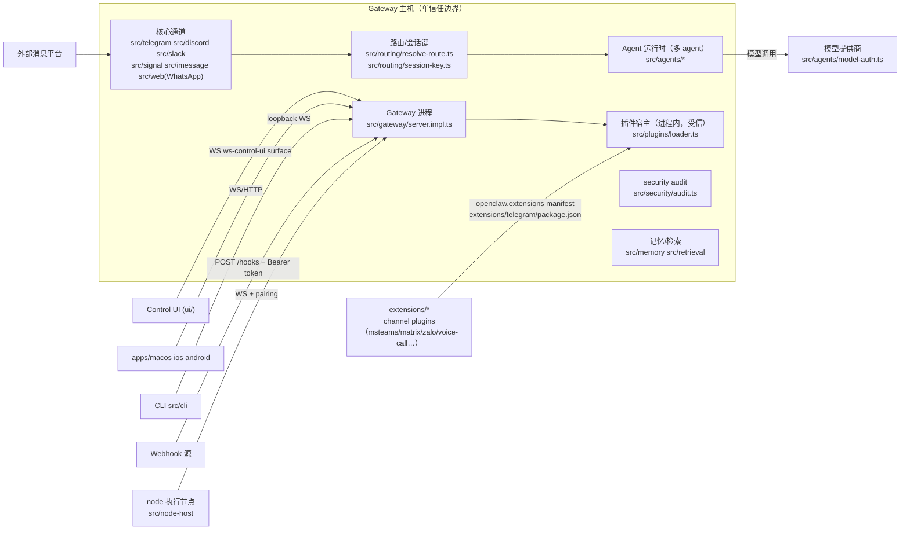
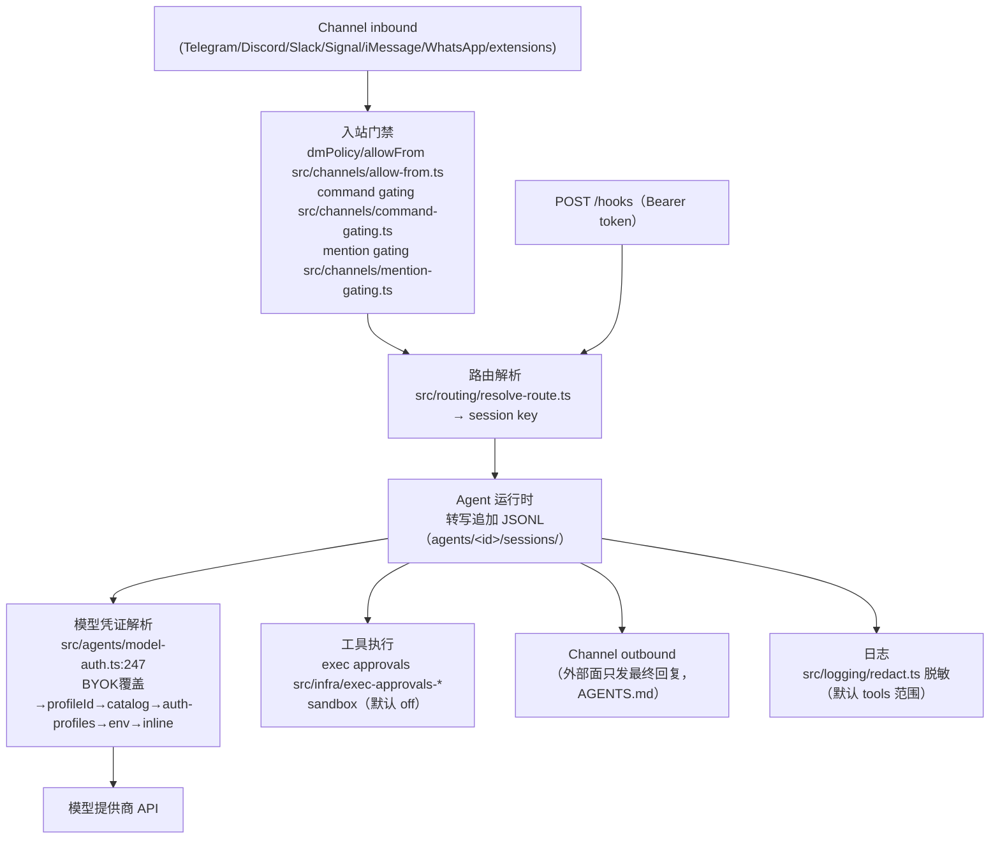

# OpenBot 架构 / 数据 / 云部署 / 安全 设计审查（2026-08）

> 状态：REVIEW（独立审查报告，不改变任何生产代码与交付不变量）
> 任务：`architecture-security-review`
> 基线：`origin/main`（审查时 tip `49f59c337`）
> 审查前置：已通读 `SECURITY.md`、`AGENTS.md` 交付不变量（I1/I2/I3）、`docs/design/openbot-dev-delivery-pipeline-standard-2026-07-20.md`、`deploy/production/` 全目录，并按模块阅读源码。文中所有「事实」均给出仓库根相对路径证据；「建议」单独标注，不与事实混写。

---

## 1. 摘要与范围

本审查覆盖四个维度：

1. **项目 / 运行时架构**：Gateway 单进程控制面、channels、routing、plugins/extensions、多 agent 模型。
2. **数据架构**：`~/.openbot` 状态根、`~/OpenBot` Data Space、会话/凭证/配置的落盘格式、多租户寻址与隔离边界。
3. **云端部署**：`deploy/production/` 生产包、L0–L3 交付链路、forward-only 门禁、provenance tag、发布账本。
4. **安全**：双 security profile（`personal_local` / `managed_enterprise`）、Gateway 鉴权面、插件供应链、通道入站门禁、密钥解析与遮蔽问题。

**总体判断（高置信）**：

- OpenBot 的核心是**单进程、文件态、单信任边界**的个人助理架构；这一点在 `SECURITY.md` 与代码（loopback 默认绑定、文件态 session、进程内插件）中高度自洽。
- Managed Enterprise（SaaS）方向已有**启动期 fail-closed 门禁**（Gate 0，`src/gateway/security-profile.ts`）与**租户寻址 fail-closed**（`src/gateway/tenant-store-paths.ts`），但共享网关的租户上下文传播尚未收口（`deploy/production/README.md` R7/B4 自认），当前不应放开 `OPENBOT_MULTITENANT`。
- 交付流水线的最大现实风险不在设计而在**执行偏差**：发布账本中已出现「未记账 overlay」与「imageTag 与运行代码脱钩」的记录（`https://github.com/flykingvip-cloud/harness-Benchmark-Engine/blob/main/deploy/production/releases.jsonl` seq 40/41 notes），这直接削弱 L2==L3 一致性定义。
- 最重要的 5 条发现见 §6（F-1 至 F-5）。

**不在范围内**：具体漏洞挖掘 / PoC、`docs/zh-CN/**`、版本号与发布操作、依赖 patch。

---

## 2. 系统架构现状

### 2.1 进程与控制面

**事实**：

- Gateway 是单个长驻进程，独占 channel 连接与 WebSocket 控制面；canvas host 与 Gateway HTTP 共用同一端口（默认 `18789`）。证据：`docs/gateway/network-model.md`（Core rules）、`src/config/paths.ts:257`（`DEFAULT_GATEWAY_PORT = 18789`）。
- 绑定模式 `auto | lan | loopback | custom | tailnet`，默认 loopback。证据：`src/config/types.gateway.ts:3`、`src/config/types.gateway.ts:592`（模式注释）、`src/gateway/net.ts:210`（fallback 解析）。
- 启动序列（生产 CLI 路径）：配置校验 → **Gate 0 security profile fail-closed**（`src/gateway/server.impl.ts:319`）→ 鉴权引导（token 缺失时自动生成并可持久化，`src/gateway/server.impl.ts:324-342`）→ 运行时 secrets 激活（`src/gateway/server.impl.ts:343-348`）→ 监听（EADDRINUSE 重试预算可调，容器重启场景专门注释，`src/gateway/server/http-listen.ts:14-41`）。
- Gateway HTTP 面包括：健康探针 `/health(z)` `/ready(z)`（`src/gateway/server-http.ts:93-98`）、hooks 入口（默认 `/hooks`，`src/gateway/hooks.ts:12`）、OpenAI 兼容 API（`src/gateway/openai-http.ts`、`src/gateway/openresponses-http.ts`）、tools-invoke HTTP（`src/gateway/tools-invoke-http.ts`）、canvas/a2ui 兼容路由（`/__openclaw__/canvas/`，见 `SECURITY.md` Web Interface Safety 段）、插件注册 HTTP 路由（`src/gateway/server/plugins-http.ts`、`src/plugins/http-registry.ts`）。
- 客户端形态：Mac/iOS/Android app（`apps/*`）、Control UI（`ui/`，Vite 前端）、CLI、外部 messaging channels、node（执行扩展，配对后获得 operator 级远程能力，见 `SECURITY.md` Gateway and Node trust concept 段）。

### 2.2 模块拓扑

### 2.3 扩展点

**事实**：

- **Channel plugins**：`extensions/*` 为 workspace 包，manifest 用 `openclaw.extensions` 键指向入口（`extensions/telegram/package.json`）。加载走 `src/plugins/loader/load-orchestration.js`（facade：`src/plugins/loader.ts:1-11`），**进程内执行**。
- **插件即 TCB**：`SECURITY.md`（Plugin Trust Boundary 段）明确插件与 Gateway 同 OS 权限；`plugins.allow` 可 pin 受信 id。Managed Enterprise 下 `OPENBOT_PLUGIN_TENANT_ACCESS=unrestricted` 会被启动期拒绝（`src/gateway/security-profile.ts:246-259`）。
- **Hooks**：需 `hooks.enabled=true` 且强制 `hooks.token`（`src/gateway/hooks.ts:40-43`）；token 只接受 Authorization/Header，query 参数直接 400（`src/gateway/server-http.ts:388-395`）；带失败限流（`src/gateway/server-http.ts:407-424`）；body 上限默认 256KB（`src/gateway/hooks.ts:13`）；支持 `allowedAgentIds` / session key 前缀白名单（`src/gateway/hooks.ts:24-34`）。
- **Skills**：仓库 `skills/` + 状态目录 skills 路径，有 skill 扫描器（`src/security/skill-scanner.ts`）。
- **进程内 vs 远程**：插件/hooks/skills 均进程内；node 与 Mac/移动 app 为远程 WS 客户端；ACP（`src/acp`）与 extensions 中的 `acpx` 提供 agent 协议接入。

### 2.4 多 agent / session / 路由模型

**事实**：

- 默认 agent id `main`；session key 形如 `agent:<agentId>:<rest>`，有正规化与解析工具（`src/routing/session-key.ts:19-27`、`src/sessions/session-key-utils.ts`）。
- 路由解析集中在 `src/routing/resolve-route.ts`（channel/account/peer → agent 绑定），账户抽象在 `src/routing/account-id.ts`。
- **Session 标识是路由控制而非授权边界**——这是 `SECURITY.md`（Deployment Assumptions 段）明确写死的 trust model，审查发现不得以「session 可互看」为漏洞。

### 2.5 与现有设计文档 / 交付不变量的对齐

**事实**：

- `AGENTS.md`（Trunk and Deployment Baseline 段）钉死：`main` 是唯一 trunk 与唯一 cutover 源；I1 forward-only（`deploy/production/scripts/verify-forward-only.sh`，exit 20/21 fail-closed）；I2 anchoring（`is-ancestor(LIVE, origin/main)`）；I3 retirement。
- LIVE 判据只读运行制品 `/app/dist/build-info.json`，不读账本或分支名（`docs/design/openbot-dev-delivery-pipeline-standard-2026-07-20.md` §判据来源）。
- `release/baseline-recovery-20260725` 冻结；`provenance/sha-*` annotated tag 是发布身份；`https://github.com/flykingvip-cloud/harness-Benchmark-Engine/blob/main/deploy/production/releases.jsonl` 是机器可读账本，`RELEASE_RECORD.md` 仅是人读视图。

---

## 3. 数据架构现状

### 3.1 存储位置表（均为文件态，无外部数据库服务）

| 数据               | 位置                                                                                              | 格式                                       | 证据                                                                                   |
| ------------------ | ------------------------------------------------------------------------------------------------- | ------------------------------------------ | -------------------------------------------------------------------------------------- |
| 系统状态根         | `~/.openbot`（legacy 回退 `.openclaw`/`.clawdbot`/`.moldbot`/`.moltbot`）                         | 目录                                       | `src/config/paths.ts:21-29`、`src/config/paths.ts:75-108`                              |
| 主配置             | `~/.openbot/openbot.json`（legacy 文件名兼容）                                                    | JSON5                                      | `src/config/paths.ts:23-29`、`src/config/paths.ts:137-150`                             |
| OAuth 凭证         | `~/.openbot/credentials/oauth.json`                                                               | JSON 明文                                  | `src/config/paths.ts:270-295`                                                          |
| 模型 auth profiles | `~/.openbot/agents/<id>/agent/auth-profiles.json`                                                 | JSON                                       | `src/agents/auth-profiles/`、`AGENTS.md` Troubleshooting 段                            |
| 会话索引           | `~/.openbot/agents/<agentId>/sessions/sessions.json`                                              | JSON                                       | `src/config/sessions/paths.ts:33-35`                                                   |
| 会话转写           | `~/.openbot/agents/<agentId>/sessions/<sessionId>.jsonl`（topic 后缀变体）                        | JSONL                                      | `src/config/sessions/paths.ts:240-257`                                                 |
| 用户 Data Space    | `~/OpenBot`（`data.root`，与状态根刻意分离、可迁移导出）                                          | 目录树（agents/shared/memory/cache/.meta） | `src/config/data-space.ts:18-27`、`src/config/data-space.ts:164-177`                   |
| CogniWeave 记忆库  | `{dataRoot}/.meta/cogniweave/canonical.sqlite`（由 `~/.openbot/cogniweave/` 迁移，带 FSM/校验和） | SQLite                                     | `src/config/data-space.ts:39-42`、`src/config/data-space.ts:189-201`                   |
| 租户数据（SaaS）   | `<OPENBOT_TENANTS_ROOT>/<tid>/{control-plane,users/<uid>/{OpenBot,state}}`                        | JSON/目录                                  | `src/gateway/tenant-store-paths.ts:31-33`、`src/gateway/tenant-store-paths.ts:137-153` |
| Gateway 锁         | `os.tmpdir()/openbot-<uid>`                                                                       | 锁文件                                     | `src/config/paths.ts:263-268`                                                          |
| 媒体临时区         | OpenBot 管理的 temp root（兼容路径 `/tmp/openclaw`，多用户主机带 uid 后缀）                       | 文件                                       | `SECURITY.md` Temp Folder Boundary 段                                                  |

### 3.2 数据流

### 3.3 数据分类与流转

**事实基础**：企业连接器方向已有字段级分类模型设计（`docs/design/data-classification-model.md`：`PUBLIC/INTERNAL/CONFIDENTIAL/RESTRICTED`，未知字段 fail-closed），但那是企业数据能力中心（connector 动作版本级）的模型，**并非**对下表本地数据面的实现承诺。下表分类为本审查的归纳：

| 类别               | 数据                                                               | 敏感度 | 现有保护                                                                                                                                                                                                                                       |
| ------------------ | ------------------------------------------------------------------ | ------ | ---------------------------------------------------------------------------------------------------------------------------------------------------------------------------------------------------------------------------------------------- |
| 密钥               | gateway token/password、provider API key、OAuth token、hooks token | 最高   | 常量时间比较（`src/security/secret-equal.ts`）；SecretRef 引用体系（`src/config/types.secrets.ts`）；日志脱敏 pattern（`src/logging/redact.ts`）；CI detect-secrets（`SECURITY.md` Security Scanning 段）；落盘明文 + 目录权限                 |
| 会话内容（含 PII） | JSONL 转写、sessions.json、记忆 SQLite                             | 高     | 目录权限、session id 白名单正则 + 路径穿越防护（`src/config/sessions/paths.ts:60`、`:176-238`）；维护策略（见 §3.4）                                                                                                                           |
| 配置               | openbot.json（可内嵌密钥）                                         | 高     | 备份轮换（`src/config/backup-rotation.ts`）；「能写 `~/.openbot` 即是受信 operator」是明文 trust model（`SECURITY.md` Deployment Assumptions 段）                                                                                              |
| 遥测/诊断          | 日志文件、diagnostic events                                        | 中     | 日志大小上限（`src/config/types.base.ts:171`）；`redactSensitive` 默认仅 `"tools"` 范围（`src/config/types.base.ts:175-178`）                                                                                                                  |
| 企业只读属性       | `enterprise.customer-attributes.get` 投影                          | 中高   | 平台鉴权会话上下文（`src/gateway/server-methods/enterprise-customer-attributes.ts:5`、`src/gateway/platform-auth/session-context.ts`）；运营侧 skill 明文约定「客户租户数据面只读不写」（`.grok/skills/trial-sales-conversion/SKILL.md` 描述） |

### 3.4 生命周期：备份 / 迁移 / retention / 删除

**事实**：

- **Session 维护**存在且可配：`session.maintenance`（`pruneAfter` 默认 30d、`maxEntries` 默认 500、`rotateBytes` 默认 10MB、reset 归档 retention、磁盘预算高水位），但 **默认 `mode: "warn"` 仅告警不执行**（`src/config/types.base.ts:138-166`）。
- **配置备份轮换**：`src/config/backup-rotation.ts`。
- **记忆库迁移**：stateDir → Data Space 的 SQLite 迁移带 durable FSM、freeze_writes、崩溃回滚与校验和（`src/config/data-space.ts:219-238`），legacy 文件不删除、可切回。
- **多租户隔离**（managed + `OPENBOT_MULTITENANT=1` 时）：缺租户上下文 fail-closed（`src/gateway/tenant-store-paths.ts:105-120`）；user 段防穿越（`:82-93`）；`assertWithinTenantRoot` 逃逸即抛（`:213-223`）。agent→tenant 归属经 ownerId→membership 解析，多 membership 二义时拒绝按 store 顺序猜（`src/gateway/agent-tenant.ts:45-53`）。
- **没有的东西**（确认为「不存在」而非遗漏调查）：无集中数据库服务、无对象存储抽象、无统一的跨数据面 tombstone/「被遗忘权」删除管道——删除以文件级操作与各 store API 为准。

---

## 4. 云端部署现状与约束

### 4.1 生产包与红线

**事实**（`deploy/production/README.md:12-24` 红线 R1–R8）：

- 生产禁 `--allow-unconfigured`（R1）；必须真实配置 + `gateway.mode: "local"`（R2）；公网只经反向代理、Gateway 保持 loopback（R3）；auth 必配（R4）；`controlUi.allowedOrigins` 必须显式 HTTPS origin（R5）；密钥只走 env/secret manager 不烧镜像（R6）；共享多租户流量需 tenant-context P1+P2+P4 门禁全绿（R7）；不把宿主 `memory/`、`.openclaw` 拷进镜像（R8）。
- compose 生产文件强制 `OPENBOT_GATEWAY_TOKEN`、不发布端口（靠宿主反代）、`/healthz` 健康检查、`no-new-privileges` + `cap_drop`（`deploy/production/docker-compose.prod.yml:16`、`:25-27`、`:32-48`）。
- 环境变量权威表：生产只写 `OPENBOT_*` primary，`OPENCLAW_*/CLAWDBOT_*` 仅运行时兼容（`deploy/production/env-authority-matrix.md` §1）。
- 多环境：stable（tag `vYYYY.M.D`）/ beta（`-beta.N`）/ dev（`main` head），见 `AGENTS.md` Release Channels 段。
- 对外入口：`https://www.openbot.love/` 是 canonical public web；`https://gw.openbot.love/` 仅为兼容员工/网关子域（`AGENTS.md` 首段）。

### 4.2 交付流水线

**事实**：

- 四层 SoT：L0 本地脏文件 → L1 本地 git tip → L2 GitHub（唯一发布输入）→ L3 云端运行镜像；一致性定义为 L3 build-info SHA == L2 annotated tag commit == 决策单 SHA（`docs/design/openbot-dev-delivery-pipeline-standard-2026-07-20.md` §1）。
- Gate 1 forward-only：`deploy/production/scripts/verify-forward-only.sh`（LIVE 从运行制品读取；exit 20 候选倒退、21 LIVE 未知即 fail-closed）；sibling `verify-delivery-alignment.sh` 校验 tag/origin/镜像/账本对齐。
- 账本：`https://github.com/flykingvip-cloud/harness-Benchmark-Engine/blob/main/deploy/production/releases.jsonl`（每行含 gatewaySha/uiSha/imageDigest/provenance tag/evidence/rollback 路径）。
- 生产运行形态（从账本证据可确证）：单机 podman 容器 `openbot-gateway-rc`，`--network host` 语义下的端口占用问题在 bind 重试注释中被显式处理（`src/gateway/server/http-listen.ts:14-26`）。

### 4.3 云部署托管样例

**事实**：

- `fly.toml`：`gateway --port 3000 --bind lan` + Fly proxy `force_https` + `/readyz` 检查 + `/data` 卷做状态根；注释明确「production intentionally fails closed until /data 配好 auth 与 origin」（`fly.toml:17-35`）。
- `render.yaml`：自述为「starting point, not a full SaaS topology」，1GB 盘仅演示（`render.yaml:1-3`）。

### 4.4 水平扩展约束（重要架构判断）

**事实推导**（每条有依据）：

- 状态全部在本地文件系统（§3.1），无共享存储层；WhatsApp Web 会话要求单进程独占（`docs/gateway/network-model.md` Core rules）；gateway 锁按 uid 落在本机 tmp（`src/config/paths.ts:263-268`）。
- 因此**同一状态根不可能跑多副本**；扩展模型只能是「按信任边界 / 按租户拆 Gateway 实例」，这与 `SECURITY.md`（一个 VPS/host 一个用户一网关）以及 Managed Enterprise 的 dedicated tenant execution boundary 完全一致。当前不存在、也不应假设存在无状态水平扩展路径。

---

## 5. 安全现状与信任边界

### 5.1 Trust model（对齐 `SECURITY.md`）

- **Profile A `personal_local`**（默认）：一网关一受信 operator；通过 Gateway auth 的调用者即 operator；session key 是路由不是授权；exec 默认 host-first（`sandbox.mode` 默认 `off`）。
- **Profile B `managed_enterprise`**：租户互不信任；身份只来自认证的 membership 上下文；缺上下文 fail-closed；共享进程执行在 I3 证明前**启动即拒**；profile 由服务端选择（env/config），客户端 hint 直接判错（`src/gateway/security-profile.ts:130-135`）。
- 模型/agent **不是**受信主体；prompt injection 本身不算漏洞，边界来自 auth/tool policy/sandbox/exec approvals（`SECURITY.md` Agent and Model Assumptions 段）。

### 5.2 鉴权面盘点

| 面              | 机制                                                                                                                   | 证据                                                            |
| --------------- | ---------------------------------------------------------------------------------------------------------------------- | --------------------------------------------------------------- |
| Gateway WS/HTTP | `none`/`token`/`password`/`trusted-proxy` + Tailscale（仅 ws-control-ui surface 启用 header auth 且经 whois 双向校验） | `src/gateway/auth.ts:25`、`:458-460`、`:245-276`                |
| 凭证比较        | 常量时间 `safeEqualSecret` + 按 IP 失败限流（缺凭证不计失败，防误锁）                                                  | `src/gateway/auth.ts:697-708`、`src/gateway/auth-rate-limit.ts` |
| token 缺省      | 启动自动生成 token 并尽量持久化（不能持久化时明确 warn 重启会变）                                                      | `src/gateway/server.impl.ts:332-341`                            |
| trusted-proxy   | 校验代理源 IP + 必需 header + user 白名单 + role/scope/tenant header；平台会话（HMAC 签名 cookie）可作浏览器路径       | `src/gateway/auth.ts:399-456`、`:478-508`                       |
| loopback 特例   | trusted-proxy 模式下 localDirect 且未配 token 时返回 `ok(method=none,user=local)`——host-local operator 便利通道        | `src/gateway/auth.ts:593-609`                                   |
| hooks           | 独立静态 token（仅 header）、失败限流、body 上限、agent/session 白名单                                                 | §2.3                                                            |
| 模型凭证        | 解析优先级：企业 BYOK override → 显式 profileId → catalog（平台单一权威）→ auth-profiles → env → 自定义 inline key     | `src/agents/model-auth.ts:247-350`                              |

### 5.3 通道入站与命令面

**事实**：dm/group allowlist 合并语义与通配符（`src/channels/allow-from.ts`）、命令门禁在 access-groups 关闭时默认 `allow` 模式（`src/channels/command-gating.ts:15-31`）、mention gating、设备配对（`src/pairing/`、`src/infra/device-pairing.ts`）。`openbot security audit --deep/--fix` 覆盖危险配置、暴露面、文件权限（`src/security/audit.ts`、`docs/gateway/security/index.md`）。

### 5.4 已知历史陷阱（流程层）

- auth-profiles 遮蔽 inline key 导致 401（`AGENTS.md` Troubleshooting 段）——代码中 catalog 模式即为此类故障的平台侧修复（`src/agents/model-auth.ts:290-296` 注释直述 DeepSeek 三套 key 互相覆盖事故）。
- GHSA 流程要求（`AGENTS.md` GHSA 段、`SECURITY.md` 报告门槛）已流程化，本文不重复。

---

## 6. 发现（按严重度）

> 严重度口径：P0=正在破坏既定不变量或可直接跨边界；P1=高风险偏差/边界即将承压；P2=需计划性加固；P3=卫生项。每条含证据、影响、利用/发生前提。**注意：多条发现属于「操作纪律/一致性」而非可利用漏洞**——按 `SECURITY.md` 口径，operator 自选的破窗配置不构成漏洞。

### F-1（P1·交付）生产 overlay 热覆盖破坏镜像不可变性，且出现过未记账的 LIVE 窗口

- **证据**：`https://github.com/flykingvip-cloud/harness-Benchmark-Engine/blob/main/deploy/production/releases.jsonl` seq 37–40 连续以「full-dist overlay」方式将新 SHA 的 dist 覆盖进**同一运行容器**（`imageTag remains the base image`，即 OCI revision 与 build-info commit 脱钩）；seq 40/41 notes 明确记录 `Unledgered overlay 47d6934c34 ran 2026-08-23T13:55:05Z–22:37:47Z … without its own ledger row`（约 8.7 小时无账本身份的 LIVE）。
- **影响**：直接违反流水线标准的一致性定义「L3 镜像 OCI label 中 SHA == L2 tag commit」（`docs/design/openbot-dev-delivery-pipeline-standard-2026-07-20.md` §1）；`verify-delivery-alignment.sh` 的「镜像 pin SHA」检查在 overlay 期间形同虚设；回滚身份与审计链断裂。
- **发生前提**：无需攻击者——是维护者操作模式本身。seq 41 已回到「container recreated (not overlay)」的正确形态，但 overlay 路径未被制度性关闭。

### F-2（P1·部署/安全一致性）生产包锁定「共享网关多租户优先」，与安全 profile 的「dedicated 边界强制」存在方向性张力

- **证据**：`deploy/production/README.md:4`（Topology locked: multi-tenant **shared Gateway** first）与同文件 R7/B4（共享多租户隔离未完成，tenant-context P1–P2–P4 未收口即为 pre-prod）；而 `SECURITY.md` Profile B 与 `src/gateway/security-profile.ts:189-195` 在共享进程执行上启动即拒（`SECURITY_PROFILE_MISSING_EXECUTION_BOUNDARY`）。
- **影响**：文档承诺的目标拓扑（共享网关）在当前代码下无法合法启动生产 Managed 流量；若运维为了「让它跑起来」把 profile 降级为 `personal_local` 或不设 `OPENBOT_DATA_MODE=managed`，等于把多租户流量放进单信任边界——这正是 `SECURITY.md` 定义的 P0 级跨租户事件的温床。
- **发生前提**：运维在 profile/env 上做出「绕门禁」选择；Gate 0 本身无被绕过的代码路径（env/config 均服务端控制）。

### F-3（P1·数据面）Session 维护默认 `warn` 不执行，云端长跑实例存在无界增长与「转写永存」问题

- **证据**：`src/config/types.base.ts:141-142`（`mode` 默认 `"warn"`）；转写为 append-only JSONL（`src/config/sessions/paths.ts:240-257`）；无跨数据面统一删除/tombstone 管道（§3.4「没有的东西」）。
- **影响**：托管/长驻部署中，会话内容（含 PII）默认无限期留存并持续占盘；`fly.toml`/`render.yaml` 的小容量卷（1–数 GB）会先于任何告警被打满，触发的是可用性事故而非治理动作；对企业租户而言，「删除请求无统一执行点」是合规缺口。
- **发生前提**：默认配置 + 长期运行即可，无需攻击者。

### F-4（P2·安全）插件供应链缺少完整性钉扎：进程内全权执行 + 安装期无签名/哈希校验

- **证据**：插件与 Gateway 同权进程内执行是**明文 trust model**（`SECURITY.md` Plugin Trust Boundary 段），不算漏洞；但安装链路为 `npm install --omit=dev`（`AGENTS.md` Plugins 段），仓库内未见对第三方插件的签名或内容哈希校验机制（`src/plugins/installs.ts`、`src/plugins/path-safety.ts` 做路径与清单安全，不做内容完整性钉扎）；防线目前是 `plugins.allow` id 白名单 + skill 扫描器。
- **影响**：受信 operator 安装「同名被劫持/投毒版本」的插件时，id 白名单不拦截版本替换；一旦装入即获 Gateway 全权（含读 `~/.openbot` 全部密钥）。这是 trust model 内的**供应链放大面**，不是边界绕过。
- **利用前提**：npm 供应链投毒或依赖混淆 + operator 安装动作。

### F-5（P2·部署）Fly 样例公网直绑 LAN 端口，且 CI 必需检查尚未启用，形成「样例引导 + 门禁空窗」叠加

- **证据**：`fly.toml:19-21`（`--bind lan --port 3000`，经 Fly proxy 公网可达）与 `SECURITY.md` Web Interface Safety 段「Do not expose it to the public internet … not hardened for public exposure」的方向性冲突（样例有 fail-closed 注释缓解，但它仍是公网暴露拓扑的官方样例）；`AGENTS.md` Trunk 段自述 required status checks 未启用（27/32 job 在第三方 blacksmith runner、队列 stalled）。
- **影响**：用户照抄 fly 样例即得到公网 Gateway（仅 token/password 一层）；同时主干合并期无强制 CI，回归靠 reviewer 自觉——两者叠加放大「带病发布到公网实例」概率。
- **发生前提**：用户采用 fly 样例；或 PR 合并期恰逢无 CI 覆盖。

### F-6（P2·安全）trusted-proxy 模式的 loopback 免鉴权通道在容器多进程/边车场景收窄了「本机即受信」假设

- **证据**：`src/gateway/auth.ts:593-609`——trusted-proxy 模式下 localDirect 且 gateway 未配 token 时直接 `ok(method=none,user=local)`；注释明确这是给 loopback CLI / 进程内工具的通道。
- **影响**：在「一容器一网关」的推荐形态里无风险（容器即信任边界）。但若生产容器内并置了其他可发起 loopback 请求的组件（边车、反代进容器、诊断进程），它们全部升格为 operator。属于 trust model 内的部署约束，不是绕过。
- **利用前提**：容器/主机内已存在攻击者可控进程——此时按 `SECURITY.md` 本就视为边界已失守；列为 P2 是因为它约束了**合法**的部署拓扑选择。

### F-7（P3·数据）Legacy 状态目录静默回退链拉长了云端排障路径

- **证据**：`src/config/paths.ts:92-107`——新目录不存在而任一 legacy 目录存在时静默选用 legacy；compose 里 OPENBOT/OPENCLAW 两套 env 必须镜像（`deploy/production/docker-compose.prod.yml:18-19`）。
- **影响**：卷挂载名与 env 不一致时（例如卷挂到 `/home/node/.openclaw` 而 env 指 `.openbot`），可能出现「配置改了不生效/凭证找不到」的排障黑洞；`openbot doctor` 可诊断，但云端无人值守实例发现更慢。
- **发生前提**：迁移期混挂新旧目录。

### F-8（P3·日志）日志脱敏默认范围仅 `"tools"`，channel/gateway 主日志依赖开发纪律

- **证据**：`src/config/types.base.ts:175-178`（`redactSensitive` 默认 `"tools"`）；`src/logging/redact.ts` pattern 引擎健全（含 PEM 块折叠、自定义 pattern 有 ReDoS 防护口径见 `SECURITY.md` 误报清单）。
- **影响**：工具摘要之外的日志路径若打印含密钥的 URL/headers，默认不脱敏；托管环境日志集中化后放大暴露面。
- **发生前提**：某调用点打印敏感值 + 日志被聚合外送。

---

## 7. 专业建议

> 每条：问题 → 建议动作 → 权衡 → 是否破坏现有 trust model。

### 7.1 架构演进

1. **把「每租户专属 Gateway」正式确立为唯一的 SaaS 扩展单元**（对应 F-2、§4.4）。
   - 动作：将 `deploy/production/README.md` 首行的「shared Gateway first」改写为与 Gate 0 一致的表述（dedicated-per-tenant 为生产形态；shared 仅限 tenant-context P1–P4 收口后的灰度），并在 `docs/design/` 增补一份「租户编排层」设计：编排器负责按租户拉起/回收 Gateway 容器（每租户独立 `OPENBOT_TENANTS_ROOT` 子卷 + 独立 token），而不是在单 Gateway 内做逻辑多租。
   - 权衡：资源成本上升（每租户一进程），但换来的隔离正是 `security-profile.ts` 已经强制的东西——顺势而为比逆门禁而行便宜。
   - trust model：完全一致（强化 Profile B 的 dedicated 边界）。
2. **Gateway HTTP 面收敛清单化**：`server-http.ts` 已聚合 hooks/openai/openresponses/tools-invoke/canvas/插件路由，建议增加一个启动期「暴露面清单」日志（route → auth 要求 → bind 面），供 `security audit --deep` 与运维核对。权衡：纯可观测性，改动小。trust model：不变。

### 7.2 数据面

3. **托管/长驻部署将 session 维护默认切到 `enforce`**（对应 F-3）。
   - 动作：`deploy/production/openbot.production.example.json5` 与 fly/render 样例显式写入 `session.maintenance.mode: "enforce"` + `maxDiskBytes`；本地个人档保持 `warn` 默认不动。
   - 权衡：enforce 会真的删旧转写——需要与备份策略（`src/config/backup-rotation.ts` 只覆盖配置）配套；先在样例/文档层收口，不改代码默认值，避免惊吓自托管用户。
   - trust model：不变。
4. **建立统一删除执行点（tombstone 管道）**：为「删除某会话/某租户全部数据」提供单一入口（覆盖 sessions.json、JSONL、CogniWeave SQLite 行、媒体临时区、租户 control-plane store），并写入操作审计。权衡：跨 store 的一致性工作量大；可先做「枚举 + 逐 store 删除 + 校验报告」的 CLI（`openbot data forget <scope>`），不追求事务性。trust model：不变（operator 发起）。
5. **密钥静息加密评估**：`credentials/oauth.json` 与 auth-profiles 为明文 JSON（目录权限保护）。建议评估 OS keychain（mac 已有生态）/ age 加密 + 启动期解锁的可选层，Managed 侧优先。权衡：无人值守解锁是老大难，可仅对 Managed dedicated 容器用外部 secret manager 注入替代落盘（红线 R6 已有此方向）。trust model：不变。

### 7.3 云部署

6. **制度性关闭 overlay 热覆盖**（对应 F-1，最高优先）。
   - 动作：a) 在 `deploy/production/README.md` 红线表新增 R9「禁止对运行容器覆写 `/app/dist`；一切 cutover 必须 recreate 自 provenance tag 构建的镜像」；b) 给 `verify-delivery-alignment.sh` 增加「build-info.commit 必须 == 容器镜像 OCI revision」硬断言（当前 overlay 会让二者不等，正好可机器检出）；c) 账本审计 `pnpm delivery:ledger:audit` 增加「LIVE 时间轴无空洞」检查，杜绝再现 47d6934c34 型未记账窗口。
   - 权衡：失去 overlay 的分钟级热修能力；但该能力正是身份断裂的来源。紧急场景保留 `--intentional-revert` 式的显式破窗 + RELEASE_RECORD 登记，而不是默认路径。
   - trust model：不涉及；强化 I1/I2 不变量。
7. **修复 CI runner 并按既定顺序启用 required checks**（对应 F-5 后半）：`AGENTS.md` 已写明顺序（修 runner → main 上跑通一次 → 设 required）。建议把「runner 恢复」当作 P1 运维项限期推进，期间以 `prek` 本地钩子作为最低门槛并在 PR 模板中强调。权衡：无新增机制，纯执行。
8. **fly/render 样例改为 loopback + 前置代理形态**（对应 F-5 前半）：fly 用 `--bind loopback` + Fly 内网 proxy/`flycast`（或至少在 `[env]` 强制 `OPENBOT_SECURITY_PROFILE` 与 trusted-proxy 配置），render 样例加同样注释。权衡：样例复杂度上升；但当前样例与 `SECURITY.md`「不要公网直曝」的口径不一致，文档一致性优先。trust model：更贴合。
9. **可观测性补位**：现有 `/healthz` `/readyz` + channel 健康监视（`src/gateway/channel-health-monitor.ts`）之外，建议在 Managed 形态引入 `extensions/diagnostics-otel` 的标准化接线文档（该扩展已存在），把 security-profile 启动审计（`toSecurityProfileStartupAudit` 输出）纳入必采集指标。权衡：低成本，复用现有扩展。

### 7.4 安全加固

10. **插件完整性钉扎**（对应 F-4）：`plugins.allow` 从「id 白名单」升级为可选的「id + 版本/内容哈希」钉扎；安装期记录 lock 信息，运行期启动校验不匹配即拒载（Managed 默认开启，Personal 可选）。权衡：插件升级流程多一步确认；与「插件即 TCB」的模型不冲突——钉扎保护的是「operator 当初信任的那份代码」。trust model：强化，不改变。
11. **hooks 增加可选 per-mapping secret / HMAC 签名验证**：当前单一静态 bearer token 对所有 mapping 生效（`src/gateway/hooks.ts:40-43`）；对接多个外部系统时一处泄露全面失守。建议 mapping 级 token 覆盖 + 常见 provider 的签名校验（Slack 式 signing secret 已有先例，见 `SECURITY.md` 误报清单对 Slack 签名的表述）。权衡：配置面变复杂；保持全局 token 为默认、mapping 级为可选即可。trust model：不变。
12. **托管形态日志脱敏升档**：为 Managed profile 提供 `redactSensitive` 的更宽范围档位（或在 Gate 0 审计输出中提示当前档位），并把「日志聚合外送前经 redact」写进 staging runbook（`deploy/production/staging-runbook.md`）。对应 F-8。权衡：过度脱敏影响排障，档位化解决。
13. **文档化 F-6 的容器内进程共置约束**：在 `docs/gateway/trusted-proxy-deployment-examples.md` 加一条「Gateway 容器内不得共置任何非 OpenBot 进程；反代必须在容器外」的硬性 checklist 项。权衡：无。trust model：把隐含假设显式化。

---

## 8. 不建议做的事

1. **不要为了「共享网关多租户」目标绕开 Gate 0**：任何以 `personal_local` profile 或 `data.mode=local` 承载多租户流量的做法都违反 `SECURITY.md` Profile B 契约，属自造 P0。
2. **不要在单 Gateway 内追求无状态水平扩展**（多副本共享一个状态根）：文件态 session/锁/WhatsApp 单进程独占（§4.4）决定了这条路需要重写存储层，且与「每租户专属边界」的既定方向相悖。
3. **不要把 session key / allowlist 当授权边界去「加固」**：`SECURITY.md` 明确它们是路由与误用防护；往上叠 per-user 授权语义只会制造虚假安全承诺。
4. **不要恢复 overlay 热覆盖作为常规发布手段**、不要 force-push `main`/`release/*`/`backup/*`、不要从冻结分支 `release/baseline-recovery-20260725` 派生或 cutover——I1/I2/I3 与 pre-push 钩子（`git-hooks/`）已是共识。
5. **不要在文档/样例中把 `https://gw.openbot.love/` 写成主入口**（canonical 是 `https://www.openbot.love/`）。
6. **不要以「插件能干坏事」为由给进程内插件加壳式沙箱**：那改变的是 `SECURITY.md` 明文 trust model；正确方向是 §7.4-10 的完整性钉扎与 Managed 侧 `pluginTenantAccess=restricted`（已存在）。
7. **不要顺手迁移 `~/.openbot` legacy 回退链**：兼容链（`src/config/paths.ts:21`）承载真实旧装机；收敛应走 doctor 引导迁移，不是删代码。

---

## 9. 参考文件清单

**安全与信任模型**：`SECURITY.md` · `docs/gateway/security/index.md` · `src/gateway/security-profile.ts` · `src/gateway/auth.ts` · `src/gateway/auth-rate-limit.ts` · `src/security/audit.ts` · `src/security/secret-equal.ts` · `src/logging/redact.ts`

**运行时架构**：`docs/gateway/network-model.md` · `src/gateway/server.impl.ts` · `src/gateway/server-http.ts` · `src/gateway/server/http-listen.ts` · `src/gateway/net.ts` · `src/gateway/hooks.ts` · `src/gateway/tools-invoke-http.ts` · `src/gateway/openai-http.ts` · `src/routing/resolve-route.ts` · `src/routing/session-key.ts` · `src/channels/allow-from.ts` · `src/channels/command-gating.ts` · `src/plugins/loader.ts` · `extensions/telegram/package.json`

**数据架构**：`src/config/paths.ts` · `src/config/data-space.ts` · `src/config/sessions/paths.ts` · `src/config/types.base.ts` · `src/config/backup-rotation.ts` · `src/gateway/tenant-store-paths.ts` · `src/gateway/agent-tenant.ts` · `src/agents/model-auth.ts` · `docs/design/data-classification-model.md`

**云部署与交付**：`deploy/production/README.md` · `deploy/production/docker-compose.prod.yml` · `deploy/production/env-authority-matrix.md` · `https://github.com/flykingvip-cloud/harness-Benchmark-Engine/blob/main/deploy/production/releases.jsonl` · `deploy/production/RELEASE_RECORD.md` · `deploy/production/scripts/verify-forward-only.sh` · `docs/design/openbot-dev-delivery-pipeline-standard-2026-07-20.md` · `fly.toml` · `render.yaml` · `Dockerfile` · `AGENTS.md`
