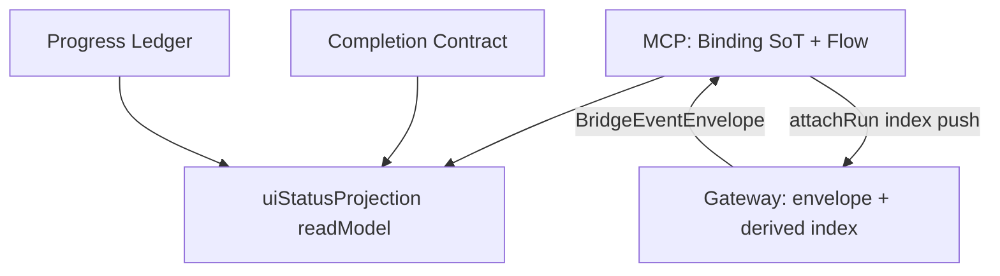

# OpenBot CO-Chat 反馈环状态机审阅报告（rev2.1）

**版本**：2026-09-15 rev2.1  
**状态**：**P0 = ACCEPTED**；Completion Contract / Event Mapping / Bridge MVP specification = **ACCEPTED**；**B1/B2 runtime coding = NOT APPROVED**  
**受众**：架构 / 协议 / Gateway / CO-Chat MCP 维护者

> **治理说明**：「专家反馈已吸收」≠「独立 reviewer 已签署 PASS」。签署记录见 [审阅与签署](/design/openbot-co-chat-feedback-loop-expert-review-2026-09-15)。

**关联 spec**：

- [Completion Contract rev2.1](/design/completion-contract)
- [Event Mapping rev2](/design/event-mapping)
- [Bridge MVP rev2.1](/design/bridge-mvp)
- [uiStatusProjection](/design/ui-status-projection)

---

## 1. 当前评级（R3，2026-09-15）

| 项                                          | 结果                                                                |
| ------------------------------------------- | ------------------------------------------------------------------- |
| 架构方向 / 反模式 / 三 FSM / 阶段划分       | **PASS**                                                            |
| Completion Contract / tenant / B2 / B1 边界 | **PASS**（设计层）                                                  |
| JSON Schema + ≥20 测试向量 + CI 同步        | **PASS** — 46 向量 + schema 5/5 + 干净 archive 75/75 @ `da79ee8774` |
| uiStatusProjection 展示规则                 | **CONDITIONAL** — spec 已写；**不受本次 P0 收官变更影响**           |
| 独立安全/运行时评审                         | **PASS @ `da79ee8774`**（R14 原文）                                 |
| **P0 规范收官**                             | **ACCEPTED**（≠ B1/B2 编码授权）                                    |
| **B1/B2 编码准入**                          | **NOT APPROVED**                                                    |

**判断**：P0 规范已收官。B1/B2 **仍不可直接编码**，须另开编码准入。

**禁止**：在单独发布的 B1/B2 编码准入 PASS 前，修改 Gateway、CO-Chat MCP、ConversationTask、Progress Ledger **运行时代码**。P0 ACCEPTED 不改变 `projection` / `authorization`，也不宣称统一 force-off 已实现。

---

## 2. rev2 → rev2.1 补齐（第三轮整改）

| 阻断项                  | rev2.1 响应                                                                                                                                                     |
| ----------------------- | --------------------------------------------------------------------------------------------------------------------------------------------------------------- |
| Schema + ≥20 向量无证据 | 24 vectors + 5 schemas + `completion-contract-p0-schema.test.ts`（11 tests PASS）                                                                               |
| B2 存储位置未决         | **冻结**：MCP Primary SoT + Gateway derived index（[bridge-mvp §4.5](/design/bridge-mvp#45-p0-冻结绑定存储-sot不可推迟到编码阶段)）                             |
| uiStatusProjection 边界 | [ui-status-projection.md](/design/ui-status-projection)                                                                                                         |
| B1 envelope 可验证      | `bridge-event-envelope.schema.json`：`serverAttribution` 前缀、`group_tenant` 强制 `tenantId`、`bindingId`/`bindingVersion` 成对、`additionalProperties: false` |
| 独立签署                | [签署记录](/design/openbot-co-chat-feedback-loop-expert-review-2026-09-15) — **PASS @ `da79ee8774`**                                                            |

---

## 3. P0 完成清单（诚实状态）

| #   | 交付物                                | 状态                                             |
| --- | ------------------------------------- | ------------------------------------------------ |
| 1   | completion-contract.md                | done                                             |
| 2   | event-mapping.md                      | done                                             |
| 3   | bridge-mvp.md                         | done                                             |
| 4   | 状态迁移 + reason code                | done（contract 内）                              |
| 5   | tenant/ACL 合同                       | done（event-mapping §10）                        |
| 6   | ≥20 测试向量                          | **done**（46 条，含 TC025–TC046）                |
| 7   | JSON Schema + CI 同步                 | **done**                                         |
| 8   | uiStatusProjection 规则               | **done**（展示规则不受本次收官变更影响）         |
| 9   | B2 SoT 冻结                           | **done**                                         |
| 10  | `evaluateCandidate` 纯函数 + 向量测试 | **done**（`docs/design/scripts/`，未接入运行时） |
| 11  | 独立安全 reviewer 签署                | **PASS @ `da79ee8774`**                          |
| 12  | 独立运行时 reviewer 签署              | **PASS @ `da79ee8774`**                          |
| 13  | B1/B2 编码准入发布                    | **NOT APPROVED**                                 |

---

## 4. 核心方向（不变）

- 不做全局 30s 轮询；`FLOW_STEP_DONE` ≠ 任务完成
- Leader / round / **Completion Contract** 职责分离
- P0 规范 → P1 B1/B2 → **P2a B4** → **P2b B5** → P3 B3
- Autopilot 仅 `completion_candidate`；force-off 为**目标合同**（非现有能力）

---

## 5. 阶段划分

### P0（ACCEPTED）

规范 + schema + fixtures + CI + 签署。**不写运行时。** P0 ACCEPTED ≠ B1/B2 编码授权。

### P1（NOT APPROVED）

B1 envelope emit；B2 MCP SoT；uiStatusProjection read API；MCP Flow 更新 flag 默认 off。

### P2a / P2b

B4 evidence 硬门 **先于** B5 唤醒统一。

### P3（DEFERRED）

B3 Leader/round 双写 — 需漂移观测数据。

---

## 6. 架构衔接（rev2.1）

---

## 7. 主干合入回执（#1144 + #1145，非收官）

| 项                                              | 值                                                                                                      |
| ----------------------------------------------- | ------------------------------------------------------------------------------------------------------- |
| #1144 merge                                     | `5d23e99db93e8d375cbcc22445dfc9b4e3c94791`                                                              |
| #1145 merge                                     | `540f868505a988752a001a0f017bb913fddd50bf`（2026-09-15T19:56:26Z）                                      |
| 祖先 `cbb8a285cada5ffff44a8c5d8d15835fae192ea0` | YES                                                                                                     |
| 祖先 `aefda338fed539f0a9e5b4f45f1efd68c8f2a862` | YES                                                                                                     |
| 主干文件                                        | `evaluate-candidate.ts`、`evaluate-candidate-vectors.test.ts`、TC001–TC025 均在 `origin/main`           |
| 干净主干复测                                    | `git archive origin/main` @ `540f868`：schema 5/5；vitest **40/40**（schema 11 + evaluateCandidate 29） |
| P0 收官                                         | 当时 **NOT YET**；现行有效签署见 R14 @ `da79ee8774` → **ACCEPTED**                                      |
| 独立签署 A/B                                    | **PASS @ `da79ee8774`**                                                                                 |
| B1/B2 编码                                      | **NOT APPROVED**                                                                                        |

## 8. 下一步（B1/B2 编码准入，不得直接编码）

P0 收尾后停止编码。另开 B1/B2 准入必须写明：

1. owner 与允许路径
2. feature flags 默认 OFF
3. 仅单租户 / 离线或 shadow
4. 不改 `chat.send`；不改 CT activation；不写 Ledger
5. Gateway 不写 MCP SoT
6. tenant/ACL、重放、stale、cancel、恢复测试
7. 回滚与 force-off 边界（统一 force-off 控制面仍未实现）

---

## 附录 B. 文档变更记录

| 日期              | 变更                                                                                       |
| ----------------- | ------------------------------------------------------------------------------------------ |
| 2026-09-15        | 初稿 / rev1                                                                                |
| 2026-09-15 rev2   | 可执行 Contract、tenant、B2、B1                                                            |
| 2026-09-15 rev2.1 | R3：schema CI、24 vectors、B2 SoT 冻结、uiStatusProjection、签署诚实化、**P0 未收官**      |
| 2026-09-16        | #1144 合入回执 + `evaluateCandidate` 规范侧实现；**仍未 ACCEPTED / 未代签 / 未批准 B1/B2** |
| 2026-09-16        | 未知 evidence fail-closed + TC025；#1145 未合入前 **不算主干证据**                         |
| 2026-09-16        | #1145 合入 `540f868`；干净主干 40/40；**仍未 ACCEPTED / 未代签 / 未批准 B1/B2**            |
| 2026-09-16        | R14 授权代理双 PASS @ `da79ee8774`；P0 **ACCEPTED**；B1/B2 **NOT APPROVED**                |
