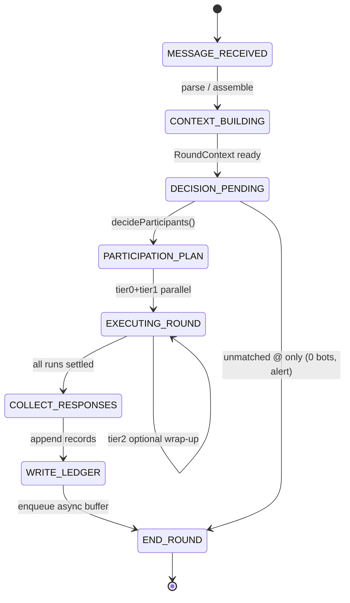
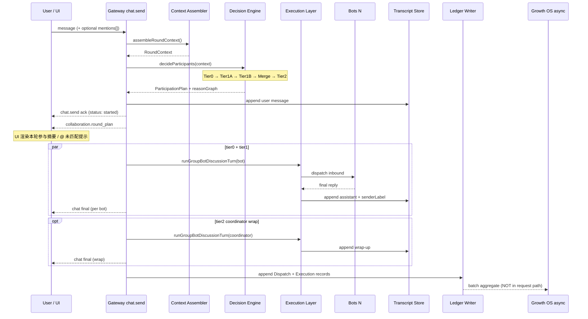
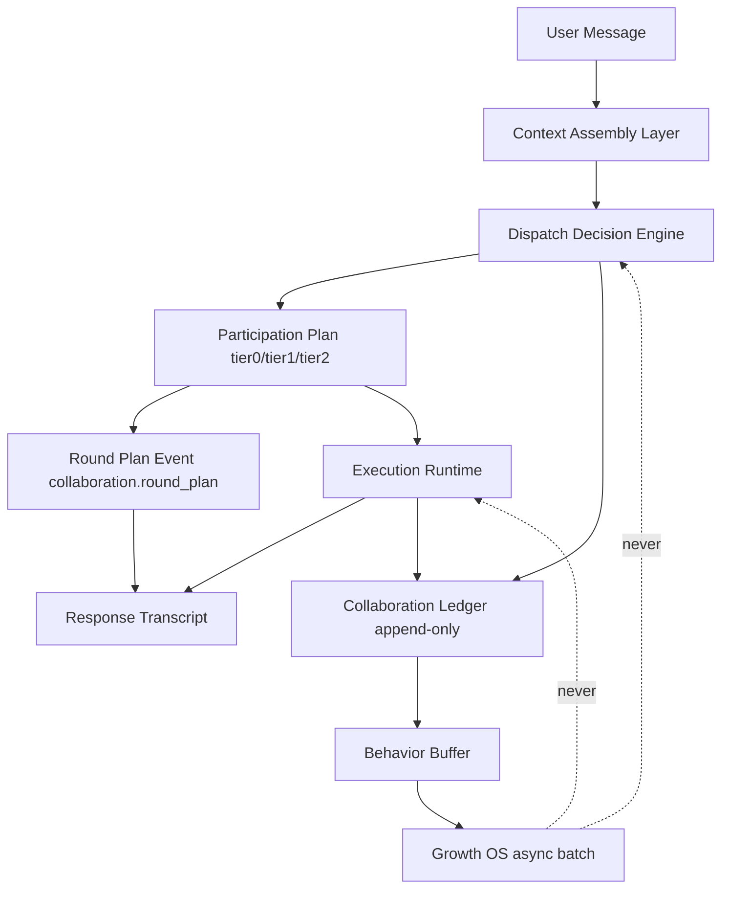

# OpenBot 协作群组对话机制优化方案

Date: 2026-06-18

Status: **v0.4.1 — 锁版前时序统一（后端调度内核重构 + 员工端解释性补齐）**

Audience: 产品架构、协作/runtime 工程、Agent Growth OS、员工端 UI/UX

**项目定义（v0.4 定名）：**

> 这不是「算法优化文档」，而是 **「后端调度内核重构 + 员工端解释性补齐」** 的联合交付项目。  
> 目标：在已有群聊执行能力之上，形成 **对人可解释、对系统可治理、对绩效可延迟学习** 的统一协作决策层，并把协作群从 **「聊天容器」** 升级为 **「协作编排产品」**。

---

> **架构定义（封面）**
>
> OpenBot 群聊调度系统是一个基于 **Policy-Driven Contextual Dispatch** 的多 Agent 协作运行时。其核心由唯一 **Dispatch Decision Engine** 驱动，将角色职责（Duty）与语义相关性（Relevance）解耦后进行分层决策，并通过 **append-only Collaboration Ledger** 形成可追踪、可学习、不可逆的协作行为闭环。

---

## 文档目的

本文档基于 OpenBot 协作群组**现状已实现能力**与「数字人战队」等真实场景的分析，提出从**任务驱动**升级为**任务 + 绩效双驱动**的协作群对话机制方案。

| 版本     | 定位                                                                                           |
| -------- | ---------------------------------------------------------------------------------------------- |
| v0.1     | 机制优化建议                                                                                   |
| v0.2     | 吸收专家反馈：五层分离、Decision Engine、Behavior Buffer                                       |
| v0.3     | 生产级重写：六层栈、Round 状态机、时序/数据流                                                  |
| **v0.4** | **专家二次审阅：产品/UX 闭环、事件协议、MemberRegistry 优先级、三入口分离、P0 前后端最小闭环** |

**三层产品模型（全文对齐）：**

| 层         | 对象                  | 职责                                            |
| ---------- | --------------------- | ----------------------------------------------- |
| **治理层** | 协作群组（Group）     | 使命、成员、策略、阶段、任务/交付物             |
| **能力层** | 机器人（Bot / Agent） | 能力边界、职责角色、兴趣边界、个体执行          |
| **绩效层** | Growth OS + Ledger    | 跨 session 观察、聚合、评分；**不参与实时调度** |

---

## Related Docs

- Agent Growth OS 设计：`.kiro/specs/agent-growth-lifecycle/design.md`
- 协作学习治理：[/design/openbot-collaboration-learning-governance-implementation-plan-2026-04-03](/design/openbot-collaboration-learning-governance-implementation-plan-2026-04-03)
- 群聊现状实现：`src/gateway/server-methods/chat.ts`
- Operating State：`src/gateway/collaboration-learning/operating-state-types.ts`

---

## 0. 执行摘要

| 维度            | v0.3              | **v0.4（专家二次审阅后）**                                    |
| --------------- | ----------------- | ------------------------------------------------------------- |
| **项目性质**    | 运行时架构方案    | **调度内核重构 + 员工端解释性补齐**（联合上线）               |
| **产品定位**    | 多 Agent 调度     | **协作编排**：该谁说、为什么说、何时沉默                      |
| **P0 范围**     | 仅 Gateway 1–2 周 | Gateway **+ 最小 UI 闭环**（轮次摘要、@ 未匹配、Tier-2 标识） |
| **reasonGraph** | 可含数值分数      | **员工可见：自然语言原因**；分数仅 Ledger/开发态              |
| **聊天 UX**     | 未强调            | **Round 容器 + 事件协议**（先 plan 后 reply）                 |

**专家一句话结论：** 架构方向成熟、产品定位正确；若按「纯运行时重构」推进会**低估员工端解释成本**。真正能落地的版本 = **决策层重构** 与 **轮次可感知 UX** 一起最小闭环上线。

**四个「不允许」** 与 **必须改的 8 件事**（见 §3.0、§10）。

**现状可行性（修正表述，详见 §2）：**

- **执行层 ~60% 可复用**：`runGroupBotDiscussionTurn`、双 Queue、transcript（`chat.ts:1712-1879`、`2243-2263`）。
- **决策编排不可保留**，但 **`scoreGroupDiscussionBot` 等 duty/phase/role 评分资产可迁移** 为 Tier-1A（`chat.ts:553-662`）——并非从零发明算法。
- **员工端 ~40% 可承接**：成员胶囊、在线态、rulesSummary、群治理 Tab 已存在；缺 Round 容器与 plan 事件协议。
- **P0 工期**：Gateway 单独 1–2 周基本成立；**含员工端最小闭环建议 2–3 周**。

**试点：** 「数字人战队」（`grp-daniel-hhd-gmail-com-upbeyond`）

---

## 1. 专家二次审阅摘要（v0.4）

### 1.1 与现状吻合、可立住的部分

| 判断                                        | 代码锚点                                                                                                            |
| ------------------------------------------- | ------------------------------------------------------------------------------------------------------------------- |
| Context / Decision / Execution 拆分时机成熟 | 上下文、选人、执行堆在 `chat.ts:350-795`、`2128-2275`                                                               |
| coordinator 不应垄断决策                    | 无 @ 时 `return [coordinatorBot]`，`751-756`，与 `openDiscussionWithoutMention` 冲突                                |
| 执行层可复用                                | 群串行 + Bot 并行 + transcript，`1712-1879`、`2243-2263`                                                            |
| 员工端有协作态骨架                          | 成员胶囊与工具区 `workbench-stage.ts:335-357`；在线态/任务 `workbench-stage-collaboration.ts:15-25、57-82、159-166` |
| 群治理非空白                                | 能力/任务/交付物/决策 `group-profile-governance.ts:252-277、338-380` — reasonGraph、贡献、契约可复用入口            |

### 1.2 文档修正与补强（v0.4 已吸收）

| 原表述 / 缺口                | v0.4 修正                                                                    |
| ---------------------------- | ---------------------------------------------------------------------------- |
| 「0% 决策层可保留」过猛      | → **决策编排不可保留；duty/phase/role 评分资产可迁移**（Tier-1A 雏形已存在） |
| P0「1–2 周」偏乐观（含 UI）  | → Gateway 1–2 周；**+ UI 最小闭环 2–3 周**                                   |
| 无「先 plan 后 reply」协议   | → 新增 **`collaboration.round_plan` 事件**（§4.3）                           |
| 多条 assistant final 像抢答  | → **Round 视觉分组** + 胶囊 `selectedThisRound`（§7）                        |
| reasonGraph 暴露 duty=82     | → **员工侧仅展示参与原因文案**；分数进 Ledger                                |
| GroupMemberRegistry 无优先级 | → **§3.11 冲突处理规则**                                                     |
| Charter 放 member governance | → **三入口分离**（§4.4）：治理 / 契约 / 调度透明                             |

### 1.3 产品与设计原则（PM + UXO）

**产品（PM）：**

- 核心价值不是 relevance 本身，而是 **「该谁说 · 为什么说 · 何时该沉默」** 产品化；**silent contribution** 保留且写入员工可见规则。
- 新策略先收敛到 **`rulesSummary` 人话摘要**（已有 `render-model.ts:762-800`），再扩展评分与治理面板。
- 绩效展示：**聚合后解释**，不与 Growth Badge 混为「即时 KPI 排名」。

**体验（UXO）：**

- 关键在 **「轮次感」**：本轮谁参与、谁收口、@ 是否匹配成功。
- 协作页头部轻量摘要即可：_「本轮参与 2 人 · 市场助手已点名 · 大白将收口」_ — 不做大而全调试台。
- **@ 未匹配** 必须即时前台提示（非仅 Ledger）。
- **低信号限流**（「收到」→ ≤1 Bot）需配产品文案，避免用户以为漏答。

---

## 2. 现状可行性评估（v0.3 新增）

> 本节对照「生产级六层栈」与仓库**当前已落地代码**，给出迁移可行性，避免架构与工程脱节。

### 2.1 分层映射：目标 vs 现状

| 目标层                   | 职责                             | 现状落点                                                                                                  | 复用度           | 迁移动作                                                                    |
| ------------------------ | -------------------------------- | --------------------------------------------------------------------------------------------------------- | ---------------- | --------------------------------------------------------------------------- |
| **1. Policy**            | 规则/阈值/开关，不参与决策       | `syncGroupOperatingState` → `collaborationPolicy`（`shared.ts`）                                          | **高**           | 扩展字段；删除 code 内 hardcode                                             |
| **2. Context Assembly**  | @ 解析、phase、mission、成员快照 | `resolveGroupDiscussionScope`、`collectMentionTokens`、`loadGatewayCollaborationSpaces`（均在 `chat.ts`） | **中**           | **抽取**至 `collaboration-dispatch/context-assembler.ts`                    |
| **3. Dispatch Decision** | 唯一决策入口                     | `selectGroupDiscussionBotsForScope` + coordinator 硬编码（`chat.ts`）                                     | **编排不可保留** | **新建** `decision-engine.ts`；**迁移** `scoreGroupDiscussionBot` → Tier-1A |
| **4. Execution**         | 并行 Bot 回合、transcript        | `runGroupBotDiscussionTurn`、`groupBotQueue`、`groupDiscussionQueue`                                      | **高**           | 保留；入参改为 Participation Plan                                           |
| **5. Observation**       | append-only Ledger               | **未实现**                                                                                                | **无**           | 新建 `collaboration-ledger/`                                                |
| **6. Learning (async)**  | Buffer → Growth                  | `operational-score.ts`、`recomputeGrowthStatus`（`agent-growth.ts`）；**未接群聊**                        | **低**           | P2 接 Ledger 聚合；**禁止**挂 chat 热路径                                   |

### 2.2 可复用资产清单

**直接保留（Execution + 基础设施）：**

- `runGroupBotDiscussionTurn` — Bot 级 dispatch、transcript 回写、`senderLabel`
- `ensureGroupSessionEntry` / 群 transcript 路径解析
- `KeyedAsyncQueue`（`groupDiscussionQueue` / `groupBotQueue`）— 回合串行 + Bot 并行
- `scoreGroupDiscussionBot` — **迁入 Tier-1A Duty Engine**（逻辑成熟，有单测场景）
- `operating-state-types.ts` — `collaborationPolicy`、`memberRoleMap`、phase
- `members.json` / `profile.json` — 治理层成员真相
- `chat-scheduling.test.ts` — 改写为 Decision Engine 单测（phase × role 用例可保留）

**必须删除或封禁：**

```typescript
// chat.ts — 禁止继续存在
if (mentionTokens.size === 0) {
  const coordinatorBot = findGroupDiscussionCoordinatorBot(...);
  if (coordinatorBot) return [coordinatorBot];  // ❌
}
```

**尚不存在、P0 必建：**

- `src/gateway/collaboration-dispatch/` 模块目录（当前 **0 文件**）
- `ParticipationPlan` / `reasonGraph` 类型
- Round 状态持久化（可选 P0：内存态 + Ledger；P1：debug UI）

### 2.3 风险与可行性判断

| 项                 | 判断       | 说明                                                       |
| ------------------ | ---------- | ---------------------------------------------------------- |
| 六层拆分           | **可行**   | 主要是 `chat.ts` 内 ~400 行调度逻辑外提；执行层不动        |
| Context 独立层     | **可行**   | `resolveGroupDiscussionScope` 已是 async 聚合，抽函数即可  |
| reasonGraph        | **可行**   | P0：`round_plan` 人话 summary；P1：抽屉；分数仅 Ledger/dev |
| Round 状态机       | **可行**   | 单进程 Gateway 内同步状态机即可；无需分布式                |
| Ledger append-only | **可行**   | JSONL 与现有 `spaces/{id}/` 存储风格一致                   |
| Growth 完全 async  | **可行**   | 今日 `recomputeGrowthStatus` 已不在 chat 路径；保持即可    |
| Tier-1B semantic   | **P1**     | P0 仅 duty；relevance 先 keyword/skill，LLM 放 P3          |
| 多 Agent 共仓冲突  | **需注意** | 新目录 `collaboration-dispatch/` 单 owner 落地             |

### 2.4 推荐模块结构（与现状对齐）

```text
src/gateway/collaboration-dispatch/
  types.ts                 # ParticipationPlan, ReasonNode, RoundContext
  context-assembler.ts     # ← resolveGroupDiscussionScope + mention parse
  tier0-mention-resolver.ts
  tier1a-duty-engine.ts    # ← scoreGroupDiscussionBot
  tier1b-relevance-engine.ts # P1
  tier2-coordinator-planner.ts
  decision-engine.ts       # decideParticipants() 唯一入口
  round-lifecycle.ts       # 状态机 enum + transitions
  decision-engine.test.ts  # ← chat-scheduling.test 迁移

src/gateway/collaboration-ledger/
  writer.ts                # append Dispatch / Execution / Value records
  types.ts

src/gateway/server-methods/chat.ts
  # 仅：收消息 → assembleContext → decide → execute → writeLedger → return
```

---

## 附录 C：专家首轮审阅（v0.2 归档）

> v0.4 专家二次审阅见 **§1**。本节保留首轮结论供对照。

### 1.1 已确认正确的方向

| #   | 结论                                                                  |
| --- | --------------------------------------------------------------------- |
| ✔   | 从 coordinator 独占 → **Tier-0（@ 强制）+ Tier-1（主动参与）** 双调度 |
| ✔   | 用 **相关性** 替代纯规则 dispatch，支撑自治协作                       |
| ✔   | 用 **Ledger** 把参与行为接入 Growth OS                                |
| ✔   | **Participation Charter**（成员契约：做什么 / 怎么做 / 绩效影响）     |
| ✔   | **coordinator 去垄断**：从 centralized agent → distributed cognition  |

本质目标：**把群聊从「指令执行系统」升级为「自治协作系统」**——专家认可，本文档保留并强化。

### 1.2 必须修正的结构性风险

#### 风险 R1：缺少统一真相源（System Split）

**现状：** 三套调度逻辑并行，无 single source of truth。

| 路径           | 来源                                               | 行为示例                  |
| -------------- | -------------------------------------------------- | ------------------------- |
| ① Policy       | `collaborationPolicy.openDiscussionWithoutMention` | 「允许开放讨论」          |
| ② 硬编码       | `selectGroupDiscussionBotsForScope`                | 无 @ → **仅 coordinator** |
| ③ 评分（拟议） | TopicRelevanceEngine                               | 「应 3 个 Bot 回答」      |

**后果：** policy、engine、code 结论可互相矛盾——这是**系统分裂**，不是参数调优问题。

**v0.2 修正：** 引入 **Dispatch Decision Engine** 作为**唯一决策入口**；Policy 只声明参数，不参与分支判断；删除 `chat.ts` 内一切调度硬编码。

```
Policy（声明） → Context → Dispatch Decision Engine → Execution
```

---

#### 风险 R2：Tier-1 职责语义混杂

**v0.1 问题：** 单一 `relevanceScore` 混合三种不同语义：

- 能力匹配（capability）
- 任务责任（role / duty / phase）
- 信息补充价值（informational gain）

**后果：** 「能说的人」≠「该说的人」；「相关的人」≠「有用的人」→ Bot 退化为**相关性刷屏机器**。

**v0.2 修正：** Tier-1 拆为双层：

| 子层        | 名称                 | 驱动                                 | 权重建议 |
| ----------- | -------------------- | ------------------------------------ | -------- |
| **Tier-1A** | Responsibility Match | role、duty、phase、mission 强约束    | **70%**  |
| **Tier-1B** | Relevance Boost      | capability、interest、semantic match | **30%**  |

```text
proactiveScore(bot) = dutyScore × 0.7 + relevanceScore × 0.3
```

仅当 `proactiveScore ≥ proactiveReplyThreshold` 且 `dutyScore ≥ dutyFloor`（职责下限，默认 25）时进入 Tier-1 队列。

---

#### 风险 R3：绩效闭环过强、缺少行为缓冲

**v0.1 问题：** `dispatch → ledger → operationalScore → habits` 构成**强实时反馈控制回路**。

**后果：**

- Bot「迎合评分算法」
- 主动性退化为「讨好 relevance engine」
- 抢答 ↔ 沉默 **振荡（oscillation）**

**v0.2 修正：** 插入 **Behavior Buffer Layer**：

```text
raw behavior → interpreted signal → scoring signal → (跨 session) → Growth OS
```

| 行为      | 单轮是否直接改 Growth | 进入缓冲池 |
| --------- | --------------------- | ---------- |
| 未参与    | ❌                    | ✔          |
| 主动参与  | ❌                    | ✔          |
| 被 @ 响应 | ❌                    | ✔          |
| 过度抢答  | ❌                    | ✔          |

**Learning Layer 仅做跨 session / 跨 round 聚合后更新** `habits`、`alignment`、`operationalScore`；**不参与实时调度**。

---

#### 风险 R4：群聊调度被当作「推荐系统」

|      | 推荐系统 | 群聊调度（Multi-agent Runtime Scheduler） |
| ---- | -------- | ----------------------------------------- |
| 时态 | 离线排序 | **实时决策**                              |
| 容错 | 可以错   | **必须稳定、可解释**                      |
| 输出 | 单向列表 | **多 Agent 互动、并发、队列**             |

**v0.2 原则：** Relevance Engine 是 Decision Engine 的**输入信号之一**，不是执行层；决策必须输出**可审计的 tier + reason**，而非仅一个分数排序。

---

## 3. 生产级稳定调度架构（v0.3 六层栈）

### 3.0 四个「不允许」与三态系统

| 不允许                      | 现状违规点                                           | v0.3 收敛                              |
| --------------------------- | ---------------------------------------------------- | -------------------------------------- |
| Policy 与 Code 冲突         | `openDiscussionWithoutMention` vs coordinator 硬编码 | Decision Engine 只读 Policy            |
| Coordinator 垄断决策        | `return [coordinatorBot]`                            | coordinator **仅** Tier-2 optional     |
| relevanceScore 直接决定执行 | （拟议风险）                                         | 须经 **dutyFloor** + merge 后才进 Plan |
| Growth 参与实时调度         | （拟议风险）                                         | Learning Layer **完全 async**          |

**三态系统（唯一允许的运行时路径）：**

```text
Policy（定义） → Decision（决策） → Execution（执行）
                                      ↓
                              Observation（Ledger）
                                      ↓
                              Learning（async，不回写 Decision）
```

---

### 3.1 六层栈（Stable Multi-Agent Dispatch Stack）

```text
┌────────────────────────────────────────────┐
│  1. Policy Layer                           │
│     collaborationPolicy — 规则/权重/阈值    │
│     ❌ 不参与 if/else                       │
└────────────────────────────────────────────┘
                     ↓
┌────────────────────────────────────────────┐
│  2. Context Assembly Layer  ★ v0.3 独立    │
│     message parsing · @ extraction          │
│     phase detection · mission context       │
│     member capability snapshot              │
└────────────────────────────────────────────┘
                     ↓
┌────────────────────────────────────────────┐
│  3. Dispatch Decision Engine ★ 唯一大脑   │
│     Tier-0: Mention Resolver (hard)         │
│     Tier-1A: Duty Matcher (role/phase)      │
│     Tier-1B: Relevance Scorer (soft)        │
│     Tier-2: Coordinator Optional Planner    │
│     → ParticipationPlan + reasonGraph       │
└────────────────────────────────────────────┘
                     ↓
┌────────────────────────────────────────────┐
│  4. Execution Layer                        │
│     runGroupBotDiscussionTurn · parallel    │
│     transcript aggregation                  │
└────────────────────────────────────────────┘
                     ↓
┌────────────────────────────────────────────┐
│  5. Observation Layer                      │
│     Collaboration Ledger (append-only)      │
└────────────────────────────────────────────┘
                     ↓
┌────────────────────────────────────────────┐
│  6. Learning Layer (async)                 │
│     Behavior Buffer → Growth OS             │
│     ❌ NOT in runtime loop                  │
└────────────────────────────────────────────┘
```

**v0.3 相对 v0.2 的关键增量：** 将 Context 从 Decision 前内联逻辑**升格为独立层**（`context-assembler.ts`），保证 Decision Engine 输入稳定、可单测、可 replay。

---

### 3.2 Context Assembly Layer

**输入：** `rawSessionKey`、`message`、`mentions[]`、`client`

**输出：** `RoundContext`

```typescript
type RoundContext = {
  roundId: string;
  groupId: string;
  message: { text: string; attachments?: unknown[] };
  mentions: ResolvedMention[]; // 结构化优先，文本解析兜底
  policy: CollaborationPolicy;
  phase: OperatingPhase;
  mission: { purpose?: string; currentMission?: string };
  members: MemberCapabilitySnapshot[]; // 来自 members.json + capability context
  recentHistory: { recentAssistantBotIds: string[] };
  signals: { isLowSignal: boolean; isSummarizeIntent: boolean };
};
```

**现状抽取来源：** `resolveGroupDiscussionScope`、`collectMentionTokens`、`isLowSignalOpenDiscussionMessage`（均在 `chat.ts`）。

---

### 3.3 Dispatch Decision Engine（唯一入口）

**输入：**

```typescript
{
  context: RoundContext;
} // 仅依赖 Assembly 输出 + Policy，不读 chat.ts 全局态
```

**输出：Participation Plan（v0.3 定名）**

```typescript
type ParticipationPlan = {
  roundId: string;
  tier0: BotParticipant[]; // @ 强制
  tier1: BotParticipant[]; // 主动参与（duty 门控 + relevance 加权）
  tier2: BotParticipant | null; // coordinator 可选收口
  skipped: SkippedParticipant[];
  reasonGraph: ReasonNode[]; // ★ 可解释性：审计与 UI 共用
  policySnapshot: CollaborationPolicy;
};

type ReasonNode = {
  agentId: string;
  step: "tier0" | "tier1a" | "tier1b" | "merge" | "limit" | "tier2";
  decision: "selected" | "skipped";
  reason: string; // e.g. "dutyScore=82>=floor", "maxVisible=3"
  dutyScore?: number;
  relevanceScore?: number;
  proactiveScore?: number;
};
```

**决策流程（严格顺序，不可跳步）：**

```text
Step 1  Mention Resolver (硬约束)
        → mentions[] + 文本 @ → tier0
        → mentionBotMustRespond: tier0 为空且检测到 @ → 告警 unmatched

Step 2  Duty Engine (强约束 / Tier-1A)
        → role × phase × mission → dutyScore
        → dutyScore < dutyFloor → 不得进入 tier1（即使 relevance 高）

Step 3  Relevance Engine (软信号 / Tier-1B)
        → capability + interest + semantic (P1+)
        → 仅对 duty 达标者加分

Step 4  Merge & Deduplicate
        → proactiveScore = duty×0.7 + relevance×0.3
        → 去重 tier0/tier1；recentSpeaker 降权
        → 截断 maxVisibleBotRepliesPerRound

Step 5  Coordinator Planner (Tier-2，可选)
        → summarizeIntent / policy.coordinatorSummarizeAfterRound
        → coordinator ∈ tier2；❌ 禁止独占 tier1

Step 6  Emit ParticipationPlan + reasonGraph
```

**关键修正（写进 CI lint 注释）：**

```typescript
// ❌ 永久禁止
if (noMention) return [coordinator];

// ✔ 唯一合法
coordinator ∈ plan.tier2 ?? null;  // optional wrap-up only
```

---

### 3.4 Round Lifecycle 状态机

每一轮用户消息对应一个 **Round** 实例；Gateway 单进程内同步推进（`groupDiscussionQueue` 保证同群串行）。



| 状态                 | 责任层           | 现状                                           |
| -------------------- | ---------------- | ---------------------------------------------- |
| MESSAGE_RECEIVED     | chat handler     | ✔ `chat.send` space 分支                       |
| CONTEXT_BUILDING     | Context Assembly | ⚠ 内联于 `resolveGroupDiscussionScope`         |
| DECISION_PENDING     | Decision Engine  | ❌ 被 `selectGroupDiscussionBotsForScope` 替代 |
| EXECUTING_ROUND      | Execution        | ✔ `runGroupBotDiscussionTurn`                  |
| WRITE_LEDGER         | Observation      | ❌ 未实现                                      |
| END_ROUND → Learning | async            | ✔ Growth 不在热路径（保持）                    |

---

### 3.5 时序图（一次群聊请求）

> **锁版时序（与 §4.3 一致）：**  
> `decide` → `append user transcript` → **`chat.send ack`** → **`collaboration.round_plan`** → `(parallel) chat final × N` → `write Ledger` → `round complete`（可选）



**说明：**

- `chat.send ack` 与 `round_plan` 均在 **user transcript 写入后、Bot 执行前**；ack 不等待 Bot 完成。
- `round_plan` 必须在首个 Bot `final` 之前到达 UI，否则用户仍会感知为「抢答」。
- Ledger 写入在 Execution 完成后、Growth 聚合走 async 路径（与 §3.6 铁律一致）。

---

### 3.6 数据流图



**铁律：** Growth OS 对 Decision / Execution **零回流**（虚线禁止）。`round_plan` 在 Execution 之前广播（见 §3.5、§4.3）。

---

### 3.7 Policy Layer（声明层）

```typescript
collaborationPolicy: {
  humanStartsNewRound: boolean;
  mentionBotMustRespond: boolean;
  mentionHumanNotifiesOnly: boolean;
  openDiscussionWithoutMention: boolean;
  maxVisibleBotRepliesPerRound: number;
  botMaySelfAdvanceWithoutHuman: boolean;
  entersWaitingForHumanAfterVisibleTurnsExhausted: boolean;

  proactiveReplyThreshold?: number;       // 默认 40
  dutyFloor?: number;                     // 默认 25
  dutyWeight?: number;                    // 默认 0.7
  relevanceWeight?: number;               // 默认 0.3
  coordinatorSummarizeAfterRound?: boolean;
  coordinatorUsesSeparateQuota?: boolean; // 默认 true
  mentionParseStrict?: boolean;
  behaviorBufferWindowRounds?: number;
  behaviorBufferMinSamples?: number;
}
```

---

### 3.8 Execution Layer

保持 `runGroupBotDiscussionTurn`；`chat.ts` 群聊路径收敛为：

```text
context = assembleRoundContext(...)
plan = decideParticipants({ context })
appendUserTranscript(...)
respondChatSendAck({ status: "started" })         // chat.send ack
emitRoundPlan(plan, context)                      // collaboration.round_plan → UI（§4.3）
await executePlanTier(plan.tier0 + plan.tier1)      // parallel → chat final × N
await executePlanTier(plan.tier2)                   // optional sequential wrap
writeLedger(plan, outcomes)
enqueueBehaviorBuffer(plan, outcomes)               // async path only
```

---

### 3.9 Observation Layer — Ledger 三类事实

系统稳定性取决于 **Ledger 作为唯一事实源**，而非 runtime 内存态。

| 类别                   | 记录内容                                                  | 用途                      |
| ---------------------- | --------------------------------------------------------- | ------------------------- |
| **1. Dispatch Truth**  | 谁被选中 / 谁未选 / reasonGraph 快照                      | 调度审计、replay、UI 透明 |
| **2. Execution Truth** | 是否回复、latency、跑题、silent token                     | 执行质量                  |
| **3. Value Signal**    | human feedback、follow-up relevance、contribution quality | Growth 聚合输入           |

**路径：** `~/.openbot/spaces/{groupId}/collaboration-ledger.jsonl`（append-only，不可 update/delete）

**评分铁律：** 所有 Growth / operationalScore **只读 Ledger 聚合**，不读 Decision 中间变量。

---

### 3.10 Learning Layer（async）

```text
Ledger (append-only)
  → Behavior Buffer（滚动窗口，per agentId + groupId）
  → ScoringSignal（跨 session 聚合，minSamples 门槛）
  → recomputeGrowthStatus（batch job / 定时 / 回合结束后 fire-and-forget）
```

单轮 `chat.send` **不得**调用 `recomputeGrowthStatus`。

---

### 3.11 GroupMemberRegistry（单一真相源 + 冲突优先级）

成员数据当前分散在多处（`resolveGroupDiscussionScope` 路径，`chat.ts:368-463`）：

| 优先级 | 来源                                                      | 用途                                   |
| ------ | --------------------------------------------------------- | -------------------------------------- |
| **1**  | `~/.openbot/spaces/{groupId}/members.json`                | 治理层成员名单、角色、status           |
| **2**  | `listGatewayCollaborationSpaces` → `managedSpace.members` | activeBotIds 过滤、displayName         |
| **3**  | Session store（`collaborationParticipationOverlay`）      | 执行层 sessionKey 绑定                 |
| **4**  | `runtimeOrganizationContext`                              | 组织/席位扩展（仅 enrich，不覆盖 1–2） |

**冲突规则：**

- **调度候选集** = members.json 中 `status=active` 的 bot ∩ managedSpace active ∩ 存在 agent-scoped group session。
- displayName：**managedSpace.name > members.json.name > agentId**。
- coordinatorBotId（v0.4 Registry 收敛顺序；**刻意**将 `managedSpace.coordinatorBotId` 置于 operatingState 之后，避免索引层覆盖治理态）：
  1. `~/.openbot/spaces/{groupId}/profile.json` → **`profile.coordinatorBotId`**（RoundContext 中映射为 `groupProfile.coordinatorBotId`）
  2. **`operatingState.governance.coordinatorBotId`**（learning snapshot 或 managedSpace operating state）
  3. **`managedSpace.coordinatorBotId`**（gateway 索引字段，非主真相源）
  4. **`runtimeOrganizationContext.coordinator.agentId`**（组织 enrich fallback，不得反向覆盖 1–3）
- Context Assembler **只读 Registry 输出**，Decision Engine **不得**再直读 session store 拼成员。

Registry 快照写入每轮 `RoundContext.members` 与 Ledger DispatchRecord，便于 replay 与审计。

---

## 4. 成员契约、事件协议与三入口（v0.4）

### 4.1 Participation Charter（保留并增强）

在 v0.1 契约基础上，**必须增加**：

```markdown
**沉默也是协作行为（Silent Contribution）**

- 话题与职责无关时，不发言是正确选择，不会被单轮惩罚
- 系统通过 dutyScore 判断「该说没说」；仅跨多轮聚合后影响 habits
- 抢答低 duty 话题会被 overParticipation 记录
```

避免 **强发言偏置**：绩效体系同时奖励「适时发言」与「适时沉默」。

**员工可见规则（v0.4）：** silent contribution 须出现在 **rulesSummary / 契约文案** 中，而非仅 Agent system prompt。

### 4.2 GroupMemberRegistry

见 §3.11。Decision Engine 与 Charter **共用同一 Registry 快照**。

### 4.3 协作 Round 事件协议（v0.4 必补）

**现状缺口：** `chat.send` 仅 `ack started`，随后各 Bot 的 `final` 直接 append 到聊天流（`chat.ts:2223-2225`、`1869-1874`；UI `chat.ts:762-768` foreign run final）。用户**无法感知** T0/T1/T2 编排，易误解为「多人抢答」。

**P0 最小协议（Gateway broadcast + UI 订阅）：**

```typescript
// 在 user transcript 写入后、Bot 执行前推送
event: "collaboration.round_plan"
payload: {
  roundId: string;
  sessionKey: string;
  summaryText: string;           // 人话："本轮参与 2 人 · 市场助手已点名 · 大白将收口"
  participants: Array<{
    agentId: string;
    displayName: string;
    tier: "mention" | "duty" | "relevance" | "wrap";
    reasonText: string;          // 人话，非分数
  }>;
  alerts?: Array<{
    kind: "mention_unmatched" | "low_signal_limited";
    message: string;             // 即时前台可展示
  }>;
  // reasonGraph 全量仅 dev/Ledger；不下发 dutyScore/relevanceScore 给员工端默认 UI
}
```

**时序（与 §3.5 锁版一致）：**

```text
decide → append user transcript → chat.send ack → collaboration.round_plan → (parallel) chat final × N → write Ledger → round complete (optional)
```

### 4.4 三入口产品模型（勿混用）

| 入口         | 职责                               | 现状                                         | v0.4 落点                                                        |
| ------------ | ---------------------------------- | -------------------------------------------- | ---------------------------------------------------------------- |
| **成员治理** | 增删邀请、审批                     | `group-member-governance-panel.ts`（邀请器） | **不放** Charter / 调度调试                                      |
| **协作契约** | 使命、职责、沉默规则、rulesSummary | `rulesSummary` `render-model.ts:762-800`     | **群治理页** Tab 或协作页头部 **「规则说明」抽屉**               |
| **调度透明** | 本轮参与、@ 匹配、Tier-2 收口      | 无                                           | **协作页头部轻量摘要** + P1 **reasonGraph 抽屉**（人话，无分数） |

Participation Charter 正文放 **§4.4 契约入口**；member governance 抽屉保持「成员增删」单一职责。

### 4.5 rulesSummary 扩展（人话策略先行）

在现有 `buildSettingsRulesSummary` 基础上扩展 v0.4 策略字段的人话版，例如：

- 「未点名时，职责相关成员可主动参与（每轮最多 N 人）」
- 「@ 机器人后必须回应；点名失败会即时提示」
- 「简短确认类消息通常只需 1 位成员回应」
- 「适时保持沉默也是协作的一部分」

**原则：** 先让人读懂规则，再上线 duty/relevance 引擎与 Ledger 聚合面板。

---

## 5. Tier 模型（v0.2 定稿）

| Tier   | 名称              | 触发                               | 语义         | 配额                            |
| ------ | ----------------- | ---------------------------------- | ------------ | ------------------------------- |
| **0**  | Mandatory Mention | @ / mentions[]                     | 强制应答     | 不占 proactive 名额；优先执行   |
| **1A** | Responsibility    | openDiscussion + dutyScore ≥ floor | **该说**     | 计入 maxVisible                 |
| **1B** | Relevance Boost   | 1A 通过 + relevance 加权           | **补充价值** | 与 1A 合并为 Tier-1 分数        |
| **2**  | Coordinator Wrap  | summarizeAfterRound / 显式总结意图 | **收口**     | **独立配额**（默认不占 Tier-1） |

**低信号消息**（「OK」「收到」）：Decision Engine 内 `isLowSignal` → 最多 1 个 Bot，且仅 Tier-1A duty 最高者；不触发 Tier-1B 扩召。

---

## 6. @ 点名（P0 必做，不变）

| 问题     | 方案                                                                  |
| -------- | --------------------------------------------------------------------- |
| 中文粘连 | CJK 边界 + `mentions[]` 优先                                          |
| 静默失败 | Decision Engine 输出 `tier0=[]` 且检测到 @ → `mention_unmatched` 告警 |

---

## 7. 员工端解释性 UX（v0.4 重点）

> 方案能否被用户接受，关键在 **轮次感**，不在调度分数。

### 7.1 P0 最小闭环（与 Gateway 同步上线）

| 能力                       | 实现                                                        | 代码落点                                        |
| -------------------------- | ----------------------------------------------------------- | ----------------------------------------------- |
| **本轮参与摘要**           | 头部一行人话：`本轮参与 2 人 · 市场助手已点名 · 大白将收口` | `workbench-stage-collaboration.ts` 头部工具区旁 |
| **@ 未匹配即时提示**       | `round_plan.alerts` → toast / inline notice                 | `chat.ts` controller + composer 上方            |
| **Tier-2 总结标识**        | wrap 消息带 `senderLabel` + 可选「协调总结」badge           | transcript metadata                             |
| **低信号文案**             | 「收到」类消息：`已按协作规则精简回应（1 位成员）」         | `round_plan.alerts.low_signal_limited`          |
| **胶囊 selectedThisRound** | 现有胶囊 + `selectedThisRound` / tier 高亮                  | `workbench-stage-collaboration.ts:57-82`        |

**禁止 P0：** 在主聊天流展示 `duty=82 / rel=65`；禁止与 Growth Badge 混排单轮分。

### 7.2 P1：Round 容器 + reasonGraph 抽屉

| 能力                 | 说明                                                                                         |
| -------------------- | -------------------------------------------------------------------------------------------- |
| **Round 视觉分组**   | 同一 `roundId` 下 user + 多条 assistant 消息折叠为「一轮协作」容器，避免「抢答感」           |
| **reasonGraph 抽屉** | 从头部摘要点击展开：**为什么这些 Bot 参与**（条目化 reasonText）；开发态可选「查看技术详情」 |
| **成员三分**         | 已配置 / **本轮选中** / 在线 — 胶囊态，非新大面板                                            |

### 7.3 P2：绩效与 Growth（聚合后解释）

| 能力             | 说明                                                                        |
| ---------------- | --------------------------------------------------------------------------- |
| **协作贡献**     | 群治理 Tab 或 KPI 子视图：7 日趋势、mention 响应率、主动命中 — **跨轮聚合** |
| **Growth Badge** | 保持现有 `workbench-stage.ts` 成长徽章；**不**叠加单轮协作分                |
| **false-ready**  | 高 activation + 低协作参与（Buffer 信号）                                   |

### 7.4 与现有 UI 资产对齐

- 成员胶囊、在线态、openTask：`workbench-stage-collaboration.ts`
- 群治理（能力/任务/交付/决策）：`group-profile-governance.ts` — 承接 P2 贡献视图
- rulesSummary：`render-model.ts:2468-2483` — 承接契约与策略人话

---

## 8. 分阶段实施路线（v0.4 修订）

> **原则：** 决策层重构与轮次可感知 UX **同批最小闭环**；不把复杂调度做完再指望用户自然理解。

### P0 — 调度内核 + 最小 UI 闭环（建议 2–3 周）

**Gateway（~1–2 周）：**

| #     | 任务                                                           | 产出                                           |
| ----- | -------------------------------------------------------------- | ---------------------------------------------- |
| P0-G1 | `collaboration-dispatch/`：Context Assembler + Decision Engine | Tier0 + Tier1A（迁移 scoreGroupDiscussionBot） |
| P0-G2 | 删除 coordinator 独占；GroupMemberRegistry §3.11               | Policy/Code 一致                               |
| P0-G3 | @ 修复 + mentions[] 优先                                       |                                                |
| P0-G4 | `collaboration.round_plan` 事件                                | 人话 summary + alerts                          |
| P0-G5 | Ledger Dispatch Truth 骨架                                     | append-only                                    |
| P0-G6 | Charter + 成员表注入（Agent 侧）                               |                                                |

**员工端（~1 周，与 G4 对齐）：**

| #     | 任务                                  | 产出            |
| ----- | ------------------------------------- | --------------- |
| P0-U1 | 订阅 `collaboration.round_plan`       | 头部本轮摘要    |
| P0-U2 | @ unmatched / low_signal **即时提示** |                 |
| P0-U3 | 胶囊 `selectedThisRound` 高亮         |                 |
| P0-U4 | rulesSummary 扩展（§4.5）             | 群设置/契约抽屉 |

**P0 验收：**

- [ ] 无 @ 开放讨论 → duty 选 Bot，非 coordinator 独占
- [ ] 用户发消息后 **先看到** 本轮参与摘要，再收到 Bot 回复
- [ ] `@Skill孵化你在吗` → 前台 unmatched 提示（不仅 Ledger）
- [ ] 发「收到」→ ≤1 Bot + 低信号文案说明
- [ ] UI **不展示** duty/relevance raw 分数

---

### P1 — Round 容器 + Tier-1B + reasonGraph 抽屉（2–3 周）

| #    | 任务                                                        |
| ---- | ----------------------------------------------------------- |
| P1-1 | Tier-1B Relevance；duty×0.7 + rel×0.3                       |
| P1-2 | **Round 视觉分组**（roundId 容器）                          |
| P1-3 | reasonGraph **抽屉**（人话原因列表；分数仅 dev）            |
| P1-4 | Ledger Execution Truth（outcome、missed/overParticipation） |
| P1-5 | 协作页「规则说明」抽屉 — Participation Charter 员工可见版   |

---

### P2 — Ledger 聚合 + Growth 延迟生效（3–4 周）

| #    | 任务                                                 |
| ---- | ---------------------------------------------------- |
| P2-1 | Behavior Buffer + 跨轮 ScoringSignal                 |
| P2-2 | 异步 `recomputeGrowthStatus`（仅读 Ledger）          |
| P2-3 | 群治理 Tab：**协作贡献趋势**（聚合解释，非单轮 KPI） |
| P2-4 | false-ready：高 activation + 低协作参与              |

**验收：** 单轮行为 **不** 改变 Growth Badge；仅跨轮趋势可见。

---

### P3 — 智能化与治理（后续）

- LLM Router 仅 Tier-1B 灰区
- Supervisor / TaskBoard ↔ Ledger taskId
- 企业贡献绩效与 Ledger 打通

---

## 9. 试点验收（数字人战队）

| #   | 输入                 | Decision 期望                                  | Ledger               |
| --- | -------------------- | ---------------------------------------------- | -------------------- |
| T1  | 各位介绍一下         | tier0=∅；tier1 含 2–3 contributor（duty 驱动） | selected + responded |
| T2  | @市场助手 分析第三章 | tier0=市场助手；tier1 可选高密度（duty+rel）   | mention 100%         |
| T3  | @Skill孵化你在吗     | tier0=∅ + unmatched 告警                       | unmatched 事件       |
| T4  | 大白分配任务         | tier2=coordinator；被点名入 tier0              | 分派质量             |
| T5  | OK 收到              | 总 Bot≤1；`low_signal_limited` 前台文案        | 不触发 Buffer 惩罚   |

---

## 10. 必须改的 8 件事（v0.4 实施 Checklist）

| #     | 改动                                          | 落点                                        | 阶段        |
| ----- | --------------------------------------------- | ------------------------------------------- | ----------- |
| **1** | 唯一 Decision Engine                          | `collaboration-dispatch/decision-engine.ts` | P0-G        |
| **2** | coordinator 不独占，仅 Tier-2                 | `tier2-coordinator-planner.ts`              | P0-G        |
| **3** | Tier-1A duty（迁移 scoreGroupDiscussionBot）  | `tier1a-duty-engine.ts`                     | P0-G        |
| **4** | Tier-1B relevance                             | `tier1b-relevance-engine.ts`                | P1          |
| **5** | **`collaboration.round_plan` 事件**           | Gateway broadcast + UI 订阅                 | **P0 联合** |
| **6** | **轮次可感知 UX**（摘要 / @ 提示 / 胶囊高亮） | `workbench-stage-collaboration.ts` 等       | **P0-U**    |
| **7** | Ledger append-only 骨架                       | `collaboration-ledger/`                     | P0-G        |
| **8** | Growth 完全异步（只读 Ledger 聚合）           | Buffer → batch job                          | P2          |

---

## 11. 开放问题（专家待决 / 已建议）

| #   | 问题                         | v0.2 建议                    | 状态     |
| --- | ---------------------------- | ---------------------------- | -------- |
| Q1  | maxVisibleBotRepliesPerRound | 维持 3                       | 建议采纳 |
| Q2  | coordinator 配额             | **独立 Tier-2，不占 Tier-1** | 专家已决 |
| Q3  | duty : relevance 权重        | **0.7 : 0.3**                | 建议采纳 |
| Q4  | 单轮是否写 Growth            | **否**，仅 Buffer            | 专家已决 |
| Q5  | dutyFloor 默认值             | 25                           | 待确认   |
| Q6  | Buffer 窗口                  | 20 轮 / 5 样本               | 待确认   |
| Q7  | LLM Router 阶段              | P3，且仅 Tier-1B 灰区        | 建议采纳 |

---

## 12. 审阅决策清单

- [ ] **批准项目定义**：调度内核重构 + 员工端解释性补齐（非纯算法文档）
- [ ] **批准 v0.4 六层栈 + Round 状态机 + 三态铁律**
- [ ] **批准 P0 前后端联合最小闭环**（含 `collaboration.round_plan` 事件）
- [ ] **批准 reasonGraph 人话优先、分数仅 Ledger/dev**
- [ ] **批准 GroupMemberRegistry 冲突优先级（§3.11）**
- [ ] **批准三入口分离**（成员治理 / 契约 / 调度透明）
- [ ] **确认 P0 工期**：Gateway 1–2 周 + UI 1 周 ≈ **2–3 周**
- [ ] **指定 owner**：Decision \***\*\_\_\*\*** / Events+UI \***\*\_\_\*\*** / Ledger \***\*\_\_\*\***

---

## 附录 A：代码锚点与迁移

| 现状                                          | v0.4 迁移                                      |
| --------------------------------------------- | ---------------------------------------------- |
| `resolveGroupDiscussionScope` + mention parse | → `context-assembler.ts`                       |
| `selectGroupDiscussionBotsForScope`           | → `decideParticipants()` → `ParticipationPlan` |
| `scoreGroupDiscussionBot`                     | → `tier1a-duty-engine.ts`                      |
| （无）                                        | `tier1b-relevance-engine.ts`（P1）             |
| `runGroupBotDiscussionTurn`                   | 保留，Execution Layer                          |
| `syncGroupOperatingState`                     | Policy 字段扩展                                |
| `computeOperationalScore`                     | 仅 Learning Layer，**只读 Ledger**             |

**建议新目录：** `src/gateway/collaboration-dispatch/`

- `context-assembler.ts`
- `decision-engine.ts`
- `tier0-mention-resolver.ts`
- `tier1a-duty-engine.ts`
- `tier1b-relevance-engine.ts`
- `tier2-coordinator-planner.ts`
- `round-lifecycle.ts`
- `types.ts`（ParticipationPlan, ReasonNode, RoundContext）
- `decision-engine.test.ts`

**建议新目录：** `src/gateway/collaboration-ledger/`

- `writer.ts`
- `types.ts`（Dispatch / Execution / Value Signal）

---

## 附录 B：数字人战队快照

groupId: `grp-daniel-hhd-gmail-com-upbeyond` · purpose: 战略研究和咨询 · coordinator: main（大白管家）· 6 contributors — 详见 v0.1 附录 B。

---

## 变更记录

| 日期       | 版本      | 说明                                                                                                     |
| ---------- | --------- | -------------------------------------------------------------------------------------------------------- |
| 2026-06-18 | 0.1 Draft | 初稿：机制 + Tier + Ledger + P0–P3                                                                       |
| 2026-06-18 | 0.2       | 专家反馈：五层分离、Decision Engine、Tier-1A/1B、Behavior Buffer                                         |
| 2026-06-18 | **0.3**   | 生产级重写：六层栈、Context Assembly、Round 状态机、时序/数据流、reasonGraph、Ledger 三类事实、§2 可行性 |
| 2026-06-18 | **0.4**   | 专家二次审阅：项目定名、§3.11 Registry、§4 事件协议与三入口、§7 UX 轮次感、§8 P0 前后端联合闭环          |
| 2026-06-18 | **0.4.1** | 锁版前修正：§3.5/§3.8/§4.3 时序统一；§10 八件事与 §0 对齐；coordinatorBotId 对象名精确化                 |
