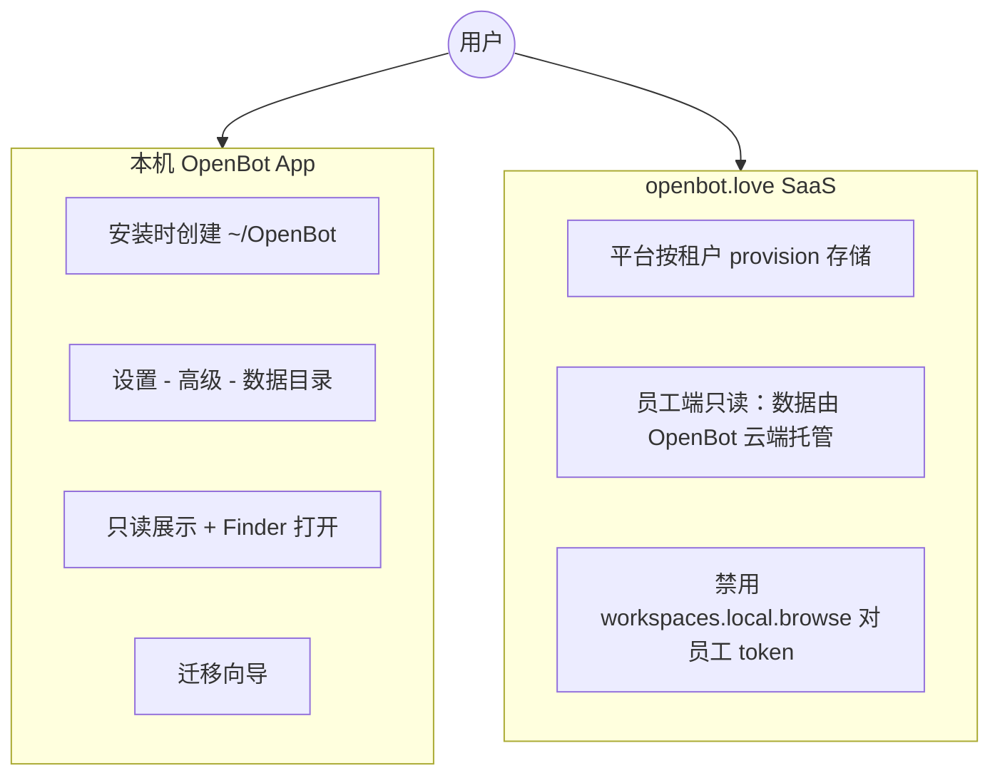

# OpenBot 数据目录产品规格（草稿）

> **状态：产品规格草稿 v0.2** | 创建：2026-07-10 | 适用范围：本机 OpenBot（Mac App / 本机 Gateway）与 SaaS（openbot.love）的数据存储体验统一  
> **关联文档**：[Agent Workspace](/concepts/agent-workspace)、[Gateway Security](/gateway/security/index)、**[Data Space 数据模型 v1.0](/design/openbot-data-space-model-v1-2026-07-10)**（Phase 1 前必读）、**[Kiro 实施验收清单](/design/openbot-data-directory-kiro-acceptance-checklist-2026-07-10)**（Kiro 交付 / Cursor 验收）  
> **取代范围**：员工端「系统设置 → OpenBot 工作空间根目录 → 更改 / 云端 / 文件浏览器」

---

## 0. 专家组评审结论（2026-07-10）

**总评：8.5/10 — 可进入研发，但 Phase 1 前须冻结 Data Space 模型。**

| 决策                                 | 状态                                                                            |
| ------------------------------------ | ------------------------------------------------------------------------------- |
| 移除用户配置 workspace               | ✅ **批准**                                                                     |
| 自动 `~/OpenBot` + `~/.openbot` 隔离 | ✅ **批准**                                                                     |
| SaaS 不暴露磁盘                      | ✅ **批准**                                                                     |
| 迁移向导替代路径选择                 | ✅ **批准**                                                                     |
| Workspace / Data Root 关系           | ⚠️ **已纳入** [Data Space 模型](/design/openbot-data-space-model-v1-2026-07-10) |
| Memory 结构与生命周期                | ⚠️ **已纳入** 同上 §4                                                           |
| Conversation 归属（archive 可迁移）  | ⚠️ **已修订** — 见 §7.1、§11                                                    |
| SaaS Tenant 边界                     | ⚠️ **已纳入** 同上 §6                                                           |
| Phase 2 增加导出/恢复                | ⚠️ **已修订** — 见 §12                                                          |
| §14 五项架构决策（Q1–Q5）            | ✅ **已冻结** — 见 §14                                                          |

---

## 1. 结论先行

1. **普通用户不应配置数据路径**。安装 OpenBot 时自动创建默认数据树，零交互可用。
2. **用户可见的「数据目录」与系统状态目录分离**。凭证、会话索引、设备身份留在受保护的 `~/.openbot/`；可迁移的用户数据归入统一的「OpenBot 数据根」。
3. **路径定制从「文件浏览器选文件夹」改为「迁移向导」**，入口下沉至 `设置 → 高级 → 数据目录`，不在首页或系统设置主流程暴露。
4. **SaaS 与本地 App 交互分叉**：云端只展示「数据由 OpenBot 托管」；Gateway **强拒绝** `local.browse`，UI **不展示**任何目录浏览；本机 App 才提供数据位置查看与迁移。
5. **NAS 默认定位为备份/归档目标**，不作为日常主数据目录的推荐选项（可进阶支持，需强警告）。

---

## 2. 背景与问题

### 2.1 现状（2026-07-10）

| 层级       | 当前实现                                                  | 问题                                          |
| ---------- | --------------------------------------------------------- | --------------------------------------------- |
| 技术默认   | `~/.openbot/workspace`（`agents.defaults.workspace`）     | 有默认值，但 UI 仍将「未配置」标为风险        |
| 状态目录   | `~/.openbot/`（config、credentials、sessions、sandboxes） | 与 workspace 概念在用户心智中混淆             |
| 员工端设置 | 「工作空间根目录」+ Web 文件浏览器 + 云端配置入口         | SaaS 下浏览的是**服务器** `/root`，非用户本机 |
| 云端备份   | `agents.defaults.workspaceCloud`（UI 写入，能力零散）     | 半完成配置，员工自助入口不合理                |

### 2.2 用户真实需求（经专家组与产品复盘）

| 用户类型      | 真实需求                       | 不需要                          |
| ------------- | ------------------------------ | ------------------------------- |
| 普通个人用户  | 安装即用，数据在熟悉位置       | 自选 Linux 路径、浏览服务器目录 |
| 进阶 Mac 用户 | 偶尔迁到外置 SSD               | 每次创建机器人时选工作区        |
| 企业用户      | 平台默认存储 + IT 统一备份策略 | 员工自助配 OSS / 浏览运维目录   |
| 自托管管理员  | CLI/部署文档指定路径           | 员工端 Web 文件树               |

### 2.3 设计原则

- **默认优于配置**（Convention over Configuration）
- **迁移优于浏览**（Migration over File Picker）
- **托管优于暴露**（Managed over Exposed）— 尤其 SaaS
- **凭证与数据分离**（Secrets stay in state dir）

---

## 3. 目标与非目标

### 3.1 目标（Must）

- G1：首次安装自动初始化完整数据树，无需用户选择路径
- G2：系统设置主流程移除「工作区选择 / 文件浏览器 / 工作区未配置阻断」
- G3：本机 App 提供只读「数据位置」展示 + 高级迁移向导
- G4：SaaS 展示托管说明，不暴露 Gateway 主机文件 API 给员工端
- G5：迁移过程可暂停、可回滚、可校验，不进入半迁移状态
- G6：`openbot doctor` 可检测路径漂移、残留旧目录、权限问题

### 3.2 非目标（Won't / Later）

- W1：不在 v1 实现「实时双写」或「外置盘热插拔自动跟随」
- W2：不在员工端实现企业级备份策略配置（归企业端）
- W3：不将 `credentials/`、`auth-profiles` 纳入用户可迁移数据包
- W4：不要求 v1 支持跨平台（Mac → Windows）迁移向导（文档 + CLI 即可）
- W5：不重构全部 Gateway 存储为单一物理根（v1 用配置映射 + UI 抽象）

---

## 4. 用户可见数据模型

> **权威定义**见 [OpenBot Data Space 数据模型 v1.0](/design/openbot-data-space-model-v1-2026-07-10)。本节为产品规格摘要。

### 4.1 默认目录树（OpenBot Data Space）

安装完成后，用户可见的数据空间（Finder 中「OpenBot 数据」）：

```text
~/OpenBot/                          # Data Root（data.root）
├── agents/
│   └── <agentId>/                  # Agent Space（每机器人隔离）
│       ├── workspace/              # cwd：AGENTS.md、skills、项目文件
│       ├── memory/
│       │   ├── agent/              # Agent 经验
│       │   └── workspace/          # 项目/任务沉淀
│       ├── artifacts/              # 产出物
│       └── conversations/          # 归档对话（可迁移、可导出）
│           ├── archive/
│           └── index.json
├── shared/
│   ├── knowledge/                  # 跨 Agent 个人知识
│   └── templates/
├── memory/
│   └── personal/                   # 用户级跨 Agent 偏好
└── cache/                          # 可重建缓存
```

**UI 展示名**：**「OpenBot 数据」** / **「数据空间」**（不再强调「工作空间路径」）。

**系统状态**（不可见、不可迁移）：`~/.openbot/` — credentials、identity、**runtime session**（热 transcript）。详见 Data Space 模型 §5。

### 4.2 与配置键的映射（v1）

| 用户概念                    | 配置键                 | 说明                                     |
| --------------------------- | ---------------------- | ---------------------------------------- |
| Data Root                   | `data.root`            | 一等公民；默认 `~/OpenBot`               |
| Agent Workspace             | _派生_                 | `{data.root}/agents/<agentId>/workspace` |
| `agents.defaults.workspace` | **deprecated**         | 仅兼容旧安装；新装由 `data.root` 派生    |
| SaaS 托管                   | `data.mode: "managed"` | 员工端不展示物理路径                     |

### 4.3 系统状态目录（不可迁移、不对用户开放浏览）

始终位于 `~/.openbot/`（或 `$OPENBOT_STATE_DIR`）：

```text
~/.openbot/
├── openbot.json           # 主配置（含 data.root）
├── credentials/           # 渠道凭证、OAuth、配对白名单
├── agents/<id>/sessions/  # **Runtime** 会话（热数据）；归档后副本在 Data Space
├── identity/              # 设备身份
├── sandboxes/             # 沙箱运行态
├── extensions/            # 插件安装目录
└── secrets.json           # 可选文件型密钥
```

**产品规则**：设置页「数据目录」**不得**提供进入 `~/.openbot/credentials` 的入口；迁移向导**不得**复制 credentials。  
**Conversation**：用户迁移/导出时包含 `agents/*/conversations/archive`（见 Data Space §5），避免「机器人失忆」体验。

---

## 5. 平台分叉：本机 App vs SaaS



| 能力             | 本机 App          | SaaS 员工端           |
| ---------------- | ----------------- | --------------------- |
| 查看数据位置     | ✅ 只读           | ✅ 托管说明（无路径） |
| 更改路径         | ✅ 仅通过迁移向导 | ❌                    |
| 文件浏览器       | ❌ 移除           | ❌ 禁止               |
| 云端自助备份配置 | ❌ 移出员工设置   | ❌ 归企业端 / 平台    |
| 打开 Finder      | ✅                | ❌                    |

---

## 6. 信息架构与页面规格

### 6.1 移除（Deprecation）

从 **员工端 → 系统设置 → 安全 / 工作区** 移除：

- 「OpenBot 工作空间根目录」卡片中的 **更改**、**云端** 按钮
- 全屏 **工作区选择** 面板（含文件浏览器、`workspaces.local.browse` UI）
- 「工作区未配置」风险计数与 **去配置工作区** 阻断 CTA
- 「手动输入路径」及任意 Gateway 目录浏览入口（SaaS）

保留（机器人维度）：

- 单机器人 **运行目录** 可在机器人详情中以只读展示（高级），默认「继承 OpenBot 数据目录」

### 6.2 本机 App：设置 → 高级 → 数据目录

#### 6.2.1 默认页（只读）

```text
数据位置

当前磁盘
Macintosh HD

~/OpenBot
已用 28 GB · 上次迁移：—

[在 Finder 中显示]   [迁移数据位置…]
```

- **当前磁盘**：解析卷名（`/Volumes/*` 或系统盘）
- **路径**：用户可见根 `~/OpenBot`（展开 `~` 为完整路径）
- **已用空间**：扫描可迁移数据包大小（见 §7.1）
- **不展示** `~/.openbot/credentials` 等系统路径

#### 6.2.2 迁移向导（Modal / 独立页）

**标题**：迁移 OpenBot 数据

**步骤 1 — 选择目标类型**

```text
○ 当前磁盘上的其他文件夹
○ 外置硬盘
○ 网络存储（NAS，已挂载卷）
```

- 外置硬盘：列出当前已挂载的 `/Volumes/*`（排除系统卷）
- NAS：仅列出已挂载网络卷；未挂载则提示「请先在 Finder 挂载」
- 不推荐 copy：「将主数据存放在 NAS」— 需二次确认 + 风险说明

**步骤 2 — 选择目标路径**

- 外置/NAS：在已选卷下提供**一级文件夹建议**（`OpenBot`），可改名
- 禁止选择系统目录、只读卷、根目录 `/`

**步骤 3 — 确认**

```text
预计迁移：28 GB
目标可用空间：512 GB
预计用时：约 15–40 分钟

将迁移：
  workspace、bots、knowledge、memory
可选跳过：
  ☑ cache（可重建，约 2 GB）

迁移期间 OpenBot 将暂停运行。
```

**步骤 4 — 执行与结果**

- 进度：准备 → 复制 → 校验 → 切换配置 → 重启 Gateway
- 成功：「数据已迁移至 /Volumes/SSD/OpenBot」+ 旧数据保留 7 天说明
- 失败：自动回滚 + 错误码 + 导出日志

---

## 7. 迁移引擎规格

### 7.1 可迁移数据包（Migration Bundle）

| 包 ID           | 包含                                                                     | 默认                           |
| --------------- | ------------------------------------------------------------------------ | ------------------------------ |
| `core`          | `agents/`（workspace、memory、artifacts）、`shared/`、`memory/personal/` | 必迁                           |
| `conversations` | `agents/*/conversations/archive`                                         | 必迁（专家组：避免备份后失忆） |
| `cache`         | `cache/`                                                                 | 可选跳过                       |

**不含**：`~/.openbot/credentials`、`identity`、`secrets`、runtime session 热文件（可选 Phase 2 附带）。

**大小估算**：遍历 bundle 内目录求和；symlink 计目标大小；显示 ±10% 误差提示。

### 7.2 迁移状态机

```text
idle
  → preflight_check     # 空间、权限、Gateway 空闲、无 in-flight agent
  → quiesce_gateway     # 停止 gateway / 等待会话落盘
  → copy_bundle         # rsync 风格复制到 <dest>/.openbot-migrate-staging
  → verify_bundle       # 文件数 + 总大小；可选抽样 hash
  → switch_config       # 原子更新 openbot.json 路径 + agents.defaults.workspace
  → restart_gateway
  → postflight_doctor
  → done | rollback

任何步骤失败 → rollback → failed（保留 staging 与旧路径有效）
```

### 7.3 配置切换（原子性要求）

迁移成功后单次 `config.set` 更新（同一 `baseHash`）：

```json5
{
  agents: {
    defaults: {
      workspace: "/Volumes/SSD/OpenBot/workspace",
    },
  },
  data: {
    root: "/Volumes/SSD/OpenBot", // 新键：用户可见数据根
    cacheDir: "/Volumes/SSD/OpenBot/cache", // 可选
  },
}
```

- 旧路径写入 `data.previousRoot` + `data.previousRootExpiresAt`（7 天后可清理）
- Gateway 重启后 `doctor` 验证所有引用路径存在且可读写

### 7.4 回滚策略

| 失败点                 | 行为                                         |
| ---------------------- | -------------------------------------------- |
| copy 中断              | 删除 staging，保持原配置                     |
| verify 失败            | 删除 staging，保持原配置                     |
| switch_config 失败     | 不重启，保持原配置                           |
| restart 后 doctor 失败 | 尝试自动回滚配置并重启；失败则阻断并提示支持 |

### 7.5 外置盘 / NAS 附加规则

- 外置盘拔出后：Gateway 启动时 `doctor` **blocking** 报错，UI 提示「请重新连接磁盘或迁回内置盘」
- NAS 断连：同上，并建议「改回本地盘」或「仅将 NAS 用作备份」
- 不在 v1 实现后台自动重连后的热恢复

---

## 8. 安装与首次启动

### 8.1 本机安装（Mac App / `openbot onboard`）

触发点：首次启动、onboard、setup（无现有 `data.root`）

1. 若 `~/OpenBot` 不存在 → 创建 §4.1 目录树
2. 写入默认配置（`agents.defaults.workspace` = `~/OpenBot/workspace`）
3. 执行 workspace bootstrap（`AGENTS.md` 等），与现有 `openbot setup` 行为一致
4. **不弹出**路径选择 UI

### 8.2 从旧版升级（`~/.openbot/workspace`）

检测逻辑（`openbot doctor` + 首次启动迁移助手）：

| 条件                                        | 行为                                                     |
| ------------------------------------------- | -------------------------------------------------------- |
| 仅有 `~/.openbot/workspace`，无 `~/OpenBot` | 提示「是否将数据整理到 ~/OpenBot」（一键迁移或保持现状） |
| 两者并存                                    | 以 `openbot.json` 中 `data.root` 为准；doctor 警告冗余   |
| SaaS Gateway                                | 跳过本地目录创建；使用租户 provision 路径（见 §9）       |

### 8.3 移除「工作区未配置」概念

- `workspaceRiskCount`、机器人 `workspaceState: unconfigured` 在存在平台默认 `data.root` 时视为 **configured**
- 新建机器人自动继承默认 workspace，无需用户确认路径

---

## 9. SaaS 租户存储（概要）

> 完整边界见 [Data Space 模型 §6](/design/openbot-data-space-model-v1-2026-07-10#6-saas-租户数据边界)。

```text
/data/tenants/<tenantId>/
├── users/<userId>/OpenBot/    # 与用户本机 ~/OpenBot 同构
└── shared/                    # 企业共享 knowledge / 共享 Agent
```

- 员工端文案：「您的数据存储在 OpenBot 云端，由平台加密托管。」
- **禁止**员工 token 调用 `workspaces.local.browse` / `choose`（Gateway 硬拒绝）
- 企业共享机器人：Agent Space 位于 `tenant/shared/agents/<id>/`
- 企业备份与保留策略：**企业端 → 数据与备份**（Phase 3）

---

## 10. API 与配置变更（草案）

### 10.1 新增配置键

| 键                           | 类型     | 默认                | 说明           |
| ---------------------------- | -------- | ------------------- | -------------- |
| `data.root`                  | string   | `~/OpenBot`         | 用户可见数据根 |
| `data.cacheDir`              | string   | `{data.root}/cache` | 可重建缓存     |
| `data.previousRoot`          | string?  | —                   | 迁移回滚用     |
| `data.previousRootExpiresAt` | ISO8601? | —                   | 旧目录清理提示 |

现有 `agents.defaults.workspace` 保持兼容；`data.root` 为 UI 与迁移的一等公民。

### 10.2 新增 Gateway 方法（本机 only）

| 方法                       | 说明                           | SaaS         |
| -------------------------- | ------------------------------ | ------------ |
| `data.root.get`            | 返回用户可见根、卷名、已用大小 | 返回托管模式 |
| `data.migration.preflight` | 目标路径校验 + 空间估算        | 403          |
| `data.migration.start`     | 启动状态机                     | 403          |
| `data.migration.status`    | 轮询进度                       | 403          |
| `data.migration.cancel`    | 取消并清理 staging             | 403          |

### 10.3 废弃

| 项                                          | 处置                             |
| ------------------------------------------- | -------------------------------- |
| `workspaces.local.browse` 员工端 UI         | 移除；方法保留给本机 CLI/doctor  |
| `workspaces.local.choose` 员工端 UI         | 移除                             |
| `agents.defaults.workspaceCloud` 员工端写入 | 移除；企业端重设计               |
| 员工端 workspace selector 全套状态          | 删除 UI 与相关 render-model 分支 |

---

## 11. 安全与权限

- `~/OpenBot` 目录 ACL：仅当前用户可读写（等价 `chmod 700` 语义）
- 迁移目标必须通过对目标路径的 write + 父目录 execute 检测
- 禁止迁移到：系统目录、其他用户 home、world-writable 目录
- 日志脱敏：不打印 credentials 路径、不打印 session 内容
- SaaS：租户路径 chroot 或严格 `isPathWithinRoot`（已有 session-utils 模式可复用）

### 11.1 AI 数据安全（专家组补充，详设见 Data Space §8）

| 能力                      | 说明                                                               | Phase   |
| ------------------------- | ------------------------------------------------------------------ | ------- |
| **数据授权记录**          | Agent 访问 knowledge/路径的可审计 grants                           | Phase 2 |
| **Memory 生命周期**       | Forget / Delete agent memory / Export subset                       | Phase 2 |
| **导出我的 OpenBot 数据** | zip：knowledge、memory、conversations、workflows；不含 credentials | Phase 2 |

---

## 12. 分阶段交付

### Phase 0 — 模型冻结（本周）

- [x] [Data Space 数据模型 v1.0](/design/openbot-data-space-model-v1-2026-07-10)
- [ ] 产品 / 安全 / Gateway 三方评审签字
- [x] 产品规格 v0.2 对齐专家组反馈

### Phase 1 — 止损与默认化（1–2 周）

- [ ] 移除员工端工作区选择 UI 与相关测试
- [ ] 安装/onboard 自动创建 `data.root` + 最小目录树（`data.schemaVersion: 1`）
- [ ] 取消「工作区未配置」阻断
- [ ] SaaS：员工端托管说明；Gateway **硬拒绝**员工 `workspaces.local.browse`
- [ ] `doctor` 增加 `data.root` 检查
- [ ] **不改动** `resolveAgentWorkspaceDir` 核心逻辑（避免大爆炸；见 Data Space §3.2）

### Phase 2 — 数据目录 + 导出/恢复（2–4 周）

- [ ] 设置 → 高级 → 数据目录（只读 + Finder）
- [ ] **迁移向导** MVP（本盘 ↔ 外置盘）
- [ ] **导出我的 OpenBot 数据** + **从导出恢复**（专家组：用户真正需要的是搬家/恢复）
- [ ] Conversation 归档管线（runtime → archive）
- [ ] `data.migration.*` / `data.export.*` API
- [ ] Memory 隐私控制基础版；Access grants 基础版

### Phase 3 — 企业与存储策略（后续）

- [ ] Enterprise Data Policy（保留周期、删除策略、审计、备份）
- [ ] Tenant `shared/` 与企业共享 Agent
- [ ] NAS/Cloud **备份**调度（非 Primary）
- [ ] `resolveDataSpacePaths` 全面替换旧 workspace 解析

---

## 13. 验收标准

### 13.1 普通用户（本机）

- 安装后无需进入设置即可创建机器人并产生文件沉淀
- 系统设置中**看不到**文件浏览器、路径输入、「工作区未配置」警告

### 13.2 进阶用户（本机）

- 可在高级设置发起迁移，迁移后 Gateway 正常启动，机器人历史可访问
- 迁移失败时原路径数据完整、服务可恢复

### 13.3 SaaS 用户

- 系统设置不展示服务器路径、不提供目录浏览
- 无法通过 UI 将 workspace 指到 `/root` 等运维目录

### 13.4 工程

- `openbot doctor` 对数据根缺失、外置盘未挂载给出明确修复建议
- 相关 vitest 覆盖：默认创建、SaaS 禁用 browse、迁移状态机（单元 + 集成）

---

## 14. 架构决策（已冻结）

| 编号 | 最终决策                                                                                  |
| ---- | ----------------------------------------------------------------------------------------- |
| Q1   | 采用 `~/OpenBot`，作为用户资产根目录                                                      |
| Q2   | 废弃 `bots/` 一级概念，引入 **Agent Space**（`agents/<id>/`）                             |
| Q3   | **Runtime transcript** 不迁移；**Conversation Archive** 属于用户数据（迁移/导出必含）     |
| Q4   | CLI / Mac App 共用 **Migration Engine**（`openbot data migrate` 与 App 迁移向导同一引擎） |
| Q5   | SaaS Gateway **强拒绝** `workspaces.local.browse`；同时 UI **不展示**任何目录浏览入口     |

> 详设见 [Data Space 数据模型 v1.0](/design/openbot-data-space-model-v1-2026-07-10)。

---

## 15. 附录：与专家组方案对照

| 专家组建议                   | 本规格采纳 | 补充                                        |
| ---------------------------- | ---------- | ------------------------------------------- |
| 安装自动创建 `~/OpenBot/...` | ✅         | 增加与 `~/.openbot` 状态目录映射表          |
| 用户无需配置                 | ✅         | 移除未配置阻断                              |
| 高级 → 数据目录              | ✅         | 明确不在系统设置主流程                      |
| 迁移向导（本盘/外置/NAS）    | ✅         | 增加状态机、回滚、NAS 非推荐主存储          |
| 预计大小 28GB                | ✅         | 定义为 Migration Bundle 扫描                |
| —                            | ➕         | SaaS 分叉、凭证不迁移、API 草案、分阶段交付 |

---

## 16. 文档修订记录

| 版本 | 日期       | 说明                                                   |
| ---- | ---------- | ------------------------------------------------------ |
| v0.1 | 2026-07-10 | 初稿：产品规格草稿                                     |
| v0.2 | 2026-07-10 | 纳入专家组评审；对齐 Data Space v1.0；§14 架构决策冻结 |
