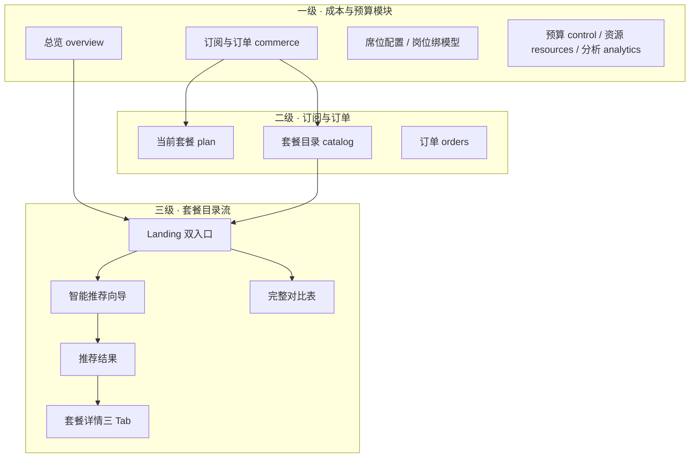
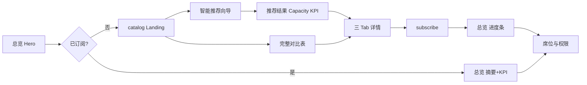
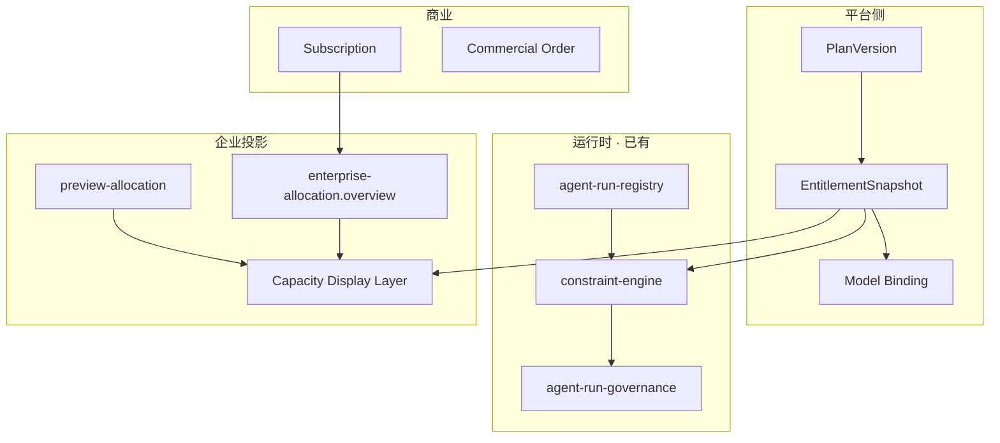
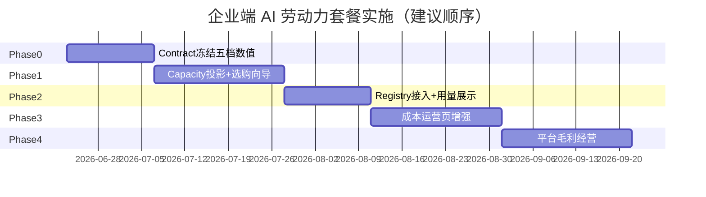

# OpenBot 企业端「AI 劳动力套餐与定价」主实施计划

Date: 2026-06-21

Status: **Draft — 待专家团队评审（评审通过后方可执行）**

Revision: v1.0（整合 V1.0 商业方案 + 需求引导选购 v0.2 + 代码现状对齐）

Audience: 产品、平台运营、企业端 UI、Gateway/Billing、Entitlement、QA、架构

---

## Related Docs

| 文档                                                                                                                                                           | 关系                                            |
| -------------------------------------------------------------------------------------------------------------------------------------------------------------- | ----------------------------------------------- |
| [openbot-enterprise-ai-workforce-pricing-execution-breakdown-2026-06-22.md](/design/openbot-enterprise-ai-workforce-pricing-execution-breakdown-2026-06-22.md) | **执行拆解（Phase 0–4 任务与首批 PR 范围）**    |
| [openbot-plan-requirements-guided-selection-2026-06-21.md](/design/openbot-plan-requirements-guided-selection-2026-06-21.md)                                   | 选购向导、总览 Hub、三 Tab 权益 — **UX 子方案** |
| [openbot-enterprise-cost-budget-ia-consolidation-2026-06-19.md](/design/openbot-enterprise-cost-budget-ia-consolidation-2026-06-19.md)                         | Frozen 4 Tab IA — **不可推翻**                  |
| [platform-plan-entitlement-architecture-2026-06-20.md](/design/platform-plan-entitlement-architecture-2026-06-20.md)                                           | 权益 contract 四类分级                          |
| [platform-pricing-tiers-2026-06-16.md](/design/platform-pricing-tiers-2026-06-16.md)                                                                           | Tier / Policy 定义                              |
| `.kiro/specs/package-entitlement-v2/`                                                                                                                          | Seat / Bot / Concurrency / Credits 约束         |
| `.kiro/specs/model-entitlement-chain/`                                                                                                                         | Package → Entitlement → Tier → Model            |

---

## 0. 执行摘要

### 0.1 目标

在 **不推翻** 现有 `Plan / PlanVersion / EntitlementSnapshot / Commerce` 架构上，完成：

1. **用户侧**：从「模型平台」升级为 **「AI 劳动力平台」** 的套餐体验
2. **平台侧**：五档 Capacity 数值 **单一真源**、可 enforce、可经营
3. **商业闭环**：订阅 → 席位/Bot 配置 → 并发/Credits 约束 → 成本/毛利可视

### 0.2 核心结论（相对外部 V1.0 方案）

| 外部 V1.0 表述                | 代码现状                                                    | 本计划调整                                          |
| ----------------------------- | ----------------------------------------------------------- | --------------------------------------------------- |
| 必须新增 `agent-run-registry` | **已有** `src/gateway/billing/agent-run-registry.ts`        | Phase 2 改为 **接入验收 + UI 暴露**，非新建         |
| 必须新增 `constraint-engine`  | **已有** `src/gateway/billing/constraint-engine.ts`         | 同上                                                |
| EntitlementSnapshot 扩展字段  | **已有** maxSeats/maxBots/maxConcurrentRuns/monthlyCredits… | Phase 0 对齐 **五档数值**                           |
| 用户页重构                    | 对比表偏 Tier/Credits                                       | Phase 1 **Capacity 投影层** + 选购向导              |
| 不应按用户数收费              | 仍有 SeatRole 单价                                          | **保留计费能力**，用户卡片 **主展示 Capacity 总数** |

### 0.3 评审请求

请专家对 **§2 原则、§4 五档 contract、§6 页面布局、§7 五阶段路线、§9 开放问题** 逐项 ✅ / ⚠️ / ❌。  
**评审通过前不进入开发。**

---

## 1. 统一设计原则（冻结）

### 1.1 套餐 ≠ 模型

```text
Package（Plan/PlanVersion）
  → EntitlementSnapshot（Capacity 天花板）
    → Policy / allowedTiers（路由策略）
      → Model Pool（roleProfiles / model binding）
        → Model（provider/model）
```

禁止：`Professional = Claude Sonnet`  
允许：Professional = 120 AI 员工 + 40 并发 + Tier A/B 池

### 1.2 商业本体：Enterprise AI Operating Capacity

| 维度                | 含义                             | 用户话术             | 后端字段                           |
| ------------------- | -------------------------------- | -------------------- | ---------------------------------- |
| **Seats**           | 企业 **人类成员** 登录与治理边界 | 团队成员             | `EntitlementSnapshot.maxSeats`     |
| **Bots**            | **AI 员工资产**（Agent 实例）    | AI 员工              | `maxBots`                          |
| **Concurrent Runs** | **同时运行** 的任务（成本主因）  | 同时运行任务         | `maxConcurrentRuns`                |
| **Credits**         | 月度 AI 使用额度                 | 任务额度（折叠展示） | `monthlyCredits`                   |
| **Policy / Tier**   | 智能等级与路由                   | 高级模型（折叠）     | `allowedPolicies` / `allowedTiers` |

### 1.3 Seat ≠ Bot（术语强制）

| 概念     | 定义                         | 示例                       |
| -------- | ---------------------------- | -------------------------- |
| **Seat** | 真人账号                     | 张三、产品经理             |
| **Bot**  | 员工创建的 AI Agent **资产** | 销售助理 Bot、数据分析 Bot |
| **Run**  | 一次运行时任务               | 占用并发槽 + 扣 Credits    |

成本优先级：**Concurrent Runs ≈ Credits >> Bot 数量 >> Seat 数量**

### 1.4 用户页 vs 平台页分离

| 视角         | 展示重点                             | 页面                           |
| ------------ | ------------------------------------ | ------------------------------ |
| **企业用户** | 业务价值、Capacity、扩展边界         | 成本与预算 · 总览 / 订阅与订单 |
| **平台运营** | 成本、毛利、Tier 路由、contract 编辑 | 平台 · 套餐与定价 / 经营分析   |

---

## 2. 五档套餐 Contract（建议冻结数值）

> `maxSeats` 在代码中为 `Partial<Record<SeatRole, number>>`；下表 **总数** 为各 role 之和或运营配置目标，落地时需在 Phase 0 拆到 role 或改为 aggregate 展示规则。

### 2.1 档位一览

| 套餐             | 定位     | 团队成员 | AI 员工 | 并发   | Credits/月 | Tier      | Policy           | 月费（参考） |
| ---------------- | -------- | -------- | ------- | ------ | ---------- | --------- | ---------------- | ------------ |
| **Trial**        | 获客试用 | 3        | 5       | 2      | 500        | A         | Balanced         | 免费 14 天   |
| **Starter**      | SMB      | 10       | 30      | 10     | 5,000      | A+B       | Balanced         | ¥199         |
| **Professional** | **主推** | 30       | 120     | 40     | 30,000     | A+B       | Balanced/Quality | ¥899         |
| **Business**     | 规模化   | 100      | 500     | 150    | 150,000    | 全 Tier   | Quality/Bandit   | ¥1,999       |
| **Enterprise**   | 定制     | 自定义   | 自定义  | 自定义 | Budget 制  | 全 + BYOM | 定制             | 联系销售     |

### 2.2 硬权益 vs 营销权益（P0 卡片规则）

| 类型          | 示例                                          | P0 卡片                          |
| ------------- | --------------------------------------------- | -------------------------------- |
| **硬边界**    | Seats/Bots/Concurrent/Credits                 | ✅ 第一层 KPI                    |
| **能力**      | 多工作流、知识库、审计（`features.auditLog`） | ✅ 第二层 bullet（仅已 enforce） |
| **治理/部署** | MFA、隔离、VPC                                | ⚠️ P1 进 contract；P0 不写或折叠 |
| **服务条款**  | SLA、CSM                                      | 联系销售 / FAQ                   |

### 2.3 Credits 扣点（维持现状，不切换 token×weight）

| Tier   | Credits/次 |
| ------ | ---------- |
| Tier A | 1          |
| Tier B | 5          |
| Tier C | 20         |

---

## 3. 信息架构（Frozen 4 Tab + 页面层级）



| 外部 V1.0「一级/二级」 | OpenBot 落地                                           |
| ---------------------- | ------------------------------------------------------ |
| 套餐与订阅             | Tab **订阅与订单**                                     |
| 当前套餐详情           | panel **当前套餐** + P1 用量块                         |
| 用量分析               | **总览** + settings **analytics** + seats **岗位汇报** |
| 预算与告警             | settings **control** + 总览 forecast                   |

---

## 4. 页面布局图

### 4.1 总览 Tab — 未订阅（主 Landing）

```text
┌──────────────────────────────────────────────────────────────────────────┐
│ 成本与预算                                                                │
│ [总览 ●] [订阅与订单] [席位与权限] [用量与设置]                              │
├──────────────────────────────────────────────────────────────────────────┤
│                                                                          │
│   让 AI 员工成为企业的第二生产力                                            │
│   为团队配置 AI 员工、自动化流程与企业知识能力                               │
│                                                                          │
│   ┌─────────────────────────────┐  ┌─────────────────────────────┐       │
│   │  ★ 开始智能推荐              │  │  查看全部套餐                │       │
│   │  约 5 分钟 · 按需求匹配       │  │  完整权益对比 · 灵活升级      │       │
│   │  [ 开始推荐 → ]              │  │  [ 查看对比 → ]              │       │
│   └─────────────────────────────┘  └─────────────────────────────┘       │
│                                                                          │
│   三步路径：  ① 选套餐  ──→  ② 分配席位  ──→  ③ 开始用量                  │
│                                                                          │
├──────────────────────────────────────────────────────────────────────────┤
│ 待办                                                                      │
│ · 尚未订阅 —— [开始推荐]                                                   │
├──────────────────────────────────────────────────────────────────────────┤
│ （未订阅隐藏 KPI/归因/账单区）                                             │
└──────────────────────────────────────────────────────────────────────────┘
```

**行为**：移除 `maybeUnsubscribedLandingRedirect` 静默跳转；CTA → commerce · catalog。

---

### 4.2 总览 Tab — 已订阅（任务中枢）

```text
┌──────────────────────────────────────────────────────────────────────────┐
│ 生命周期  ● 已订阅专业版  ──→  ○ 分配席位  ──→  ○ 验证模型授权              │
├──────────────────────────────────────────────────────────────────────────┤
│ 当前套餐摘要                                                              │
│ ┌──────────┬──────────┬──────────┬──────────┐                            │
│ │ 专业版    │ 8 模型    │ Credits  │ 席位     │                            │
│ │          │ 天花板    │ 12k/30k  │ 5/30     │                            │
│ └──────────┴──────────┴──────────┴──────────┘                            │
│ ┌─ 套餐内可调 ─────────────────┐ ┌─ 超出需扩展 ────────────────┐          │
│ │ · 成员席位档 · 岗位绑模型      │ │ · 积分包 · 换套餐 · 联系销售  │          │
│ │ [ 去席位与权限 ]              │ │ [ 去订阅与订单 ]              │          │
│ └──────────────────────────────┘ └─────────────────────────────┘          │
├──────────────────────────────────────────────────────────────────────────┤
│ 待办（待支付 / 分配席位 / 预算预警）                                       │
├──────────────────────────────────────────────────────────────────────────┤
│ KPI：累计费用 · Seat · Usage · 预算 · 预测 · 并发占用                     │
│ 成本归因三卡 · 周期账单摘要 · 预测告警                                     │
└──────────────────────────────────────────────────────────────────────────┘
```

---

### 4.3 订阅与订单 · 套餐目录 — Landing

```text
┌──────────────────────────────────────────────────────────────────────────┐
│ [当前套餐] [套餐目录 ●] [订单]                                              │
├──────────────────────────────────────────────────────────────────────────┤
│                                                                          │
│              为您的企业匹配最合适的 AI 劳动力方案                             │
│                                                                          │
│   ┌─────────────────────────────┐  ┌─────────────────────────────┐       │
│   │  开始智能推荐                │  │  查看全部套餐对比            │       │
│   │  [ 开始 → ]                  │  │  [ 对比 → ]                  │       │
│   └─────────────────────────────┘  └─────────────────────────────┘       │
│                                                                          │
│   周期：[ 月度 ] [ 半年度 省5% ] [ 年度 省15% ]                             │
│                                                                          │
└──────────────────────────────────────────────────────────────────────────┘
```

---

### 4.4 智能推荐向导（4 步 + 结果屏）

```text
┌──────────────────────────────────────────────────────────────────────────┐
│ 智能推荐   ●━━━○━━━○━━━○━━━○   1/4                                       │
├──────────────────────────────────────────────────────────────────────────┤
│ 您的团队大约多少人需要使用 OpenBot？                                       │
│                                                                          │
│   ┌─────────┐ ┌─────────┐ ┌─────────┐ ┌─────────┐                      │
│   │ 1-5人   │ │ 6-20人  │ │21-100人 │ │ 100+人  │                      │
│   │ 小团队   │ │ 成长团队 │ │ 中型企业 │ │ 大型企业 │                      │
│   └─────────┘ └─────────┘ └─────────┘ └─────────┘                      │
│                                                                          │
│                              [ 上一步 ]  [ 下一步 → ]                       │
└──────────────────────────────────────────────────────────────────────────┘

步骤映射：
  1 团队规模 (teamSize)
  2 使用场景 + 自动化 (primaryUse + agentNeed)
  3 预期 AI 员工与并发强度 (bots + concurrent)
  4 月消耗强度 (monthlyIntensity)
  5 推荐结果屏（见 4.5）
```

---

### 4.5 推荐结果页（Capacity 主视觉）

```text
┌──────────────────────────────────────────────────────────────────────────┐
│  🏆 最匹配：专业版                                    [ 查看全部对比 ]      │
├───────────────────────────────────────────────┬──────────────────────────┤
│ 第一层 · AI 运行能力（来自 EntitlementSnapshot） │  其他可选                │
│ ┌──────────┬──────────┬──────────┐            │  ┌ 基础版 ¥199 ┐         │
│ │ 30       │ 120      │ 40       │            │  └─────────────┘         │
│ │ 团队成员  │ AI 员工   │ 同时运行  │            │  ┌ 旗舰版 ¥1999┐         │
│ └──────────┴──────────┴──────────┘            │  └─────────────┘         │
│ ¥899/月 · 年度省 15%                           │                          │
│                                                │                          │
│ 推荐理由：                                      │                          │
│ · 满足 6–20 人团队规模                          │                          │
│ · 120 AI 员工满足多 Agent 自动化                │                          │
│ · 40 并发覆盖高峰同时运行                        │                          │
│                                                │                          │
│ [ 查看详情 ]              [ 选择专业版 → ]       │                          │
└───────────────────────────────────────────────┴──────────────────────────┘
```

---

### 4.6 套餐详情 — 三 Tab（购前 / 购后共用组件）

```text
┌──────────────────────────────────────────────────────────────────────────┐
│ ← 返回    专业版   ¥899/月   [ 推荐 ]              [ 选择此套餐 ] [ 联系销售] │
├──────────────────────────────────────────────────────────────────────────┤
│ [ 套餐包含 ● ] [ 套餐内扩展 ] [ 套餐外扩展 ]                                │
├──────────────────────────────────────────────────────────────────────────┤
│ ■ Tab A · 套餐包含                                                        │
│   第一层 KPI（同上 30 / 120 / 40）+ Credits 30,000（折叠区可展开）         │
│   第二层能力 ✓ 多工作流 ✓ 知识库 ✓ 审计日志（仅 features 为 true）          │
│   第三层技术 ▶ 高级模型与 Tier（折叠）                                     │
│                                                                          │
│ ■ Tab B · 套餐内扩展（不换套餐）                                           │
│   · 给成员分 Viewer/Creator/Admin 席位 → [席位与权限]                      │
│   · 岗位默认档 / 岗位绑模型 → [席位与权限]                                 │
│   · 同步全部岗位授权                                                       │
│                                                                          │
│ ■ Tab C · 套餐外扩展                                                       │
│   · 需更多 AI 员工/并发/Credits → 升级套餐 / 积分包                          │
│   · BYOM / VPC / 定制 → 联系销售                                           │
├──────────────────────────────────────────────────────────────────────────┤
│ FAQ ▶ AI 员工和团队成员有什么区别？ ▶ 月中如何升级？                        │
└──────────────────────────────────────────────────────────────────────────┘
```

---

### 4.7 完整对比表（次级入口）

```text
┌──────────────────────────────────────────────────────────────────────────┐
│ 套餐对比          周期：[月度] [半年度] [年度 省15%]                         │
├──────────┬──────────┬──────────────┬──────────┬──────────┬──────────────┤
│          │ 试用     │ 基础版       │ 专业版 ★ │ 旗舰版   │ 卓越版       │
│          │ 免费     │ ¥199        │ ¥899    │ ¥1999   │ 联系销售     │
├──────────┼──────────┼──────────────┼──────────┼──────────┼──────────────┤
│ 团队成员  │ 3        │ 10          │ 30       │ 100      │ 定制         │
│ AI 员工   │ 5        │ 30          │ 120      │ 500      │ 定制         │
│ 同时运行  │ 2        │ 10          │ 40       │ 150      │ 定制         │
│ 任务额度  │ 500      │ 5,000       │ 30,000   │ 150,000  │ Budget       │
│ ...      │          │             │          │          │              │
├──────────┴──────────┴──────────────┴──────────┴──────────┴──────────────┤
│ 复用 pricing-comparison-view + Capacity 投影层（plan-capacity-display）    │
└──────────────────────────────────────────────────────────────────────────┘
```

---

### 4.8 当前套餐 · 已订阅（P1 增强）

```text
┌──────────────────────────────────────────────────────────────────────────┐
│ [当前套餐 ●] [套餐目录] [订单]                                              │
├──────────────────────────────────────────────────────────────────────────┤
│ 生命周期进度条（精简）                                                      │
│ 专业版 · v3 active · 合同期 2026-01-01 — 2026-12-31                        │
├──────────────────────────────────────────────────────────────────────────┤
│ 用量 vs 天花板（Phase 2）                                                   │
│ 团队成员 5/30 ████░░░░  AI员工 18/120 ██░░░░  并发 3/40 █░░░  Credits …   │
├──────────────────────────────────────────────────────────────────────────┤
│ 三 Tab（只读，同 4.6）· 续费 · 换套餐 · 升级向导                            │
└──────────────────────────────────────────────────────────────────────────┘
```

---

### 4.9 用户旅程总览



---

## 5. 技术架构对齐（不重建）



### 5.1 新增 UI 层（Phase 1，纯前端）

| 模块                          | 职责                                      |
| ----------------------------- | ----------------------------------------- |
| `plan-capacity-display.ts`    | EntitlementSnapshot → 三 KPI + 折叠技术层 |
| `cost-budget-plan-selector/*` | 向导 / 匹配 / Landing / buyer-detail      |
| `cost-budget-overview-*.ts`   | 总览 Hero / 进度条 / 摘要                 |

**禁止**：手写卡片数字；必须 RPC/ snapshot 驱动。

---

## 6. 五阶段实施路线（修订版）



### Phase 0 — Contract 冻结（阻塞 UI）

| 交付                                                        | 验收                          |
| ----------------------------------------------------------- | ----------------------------- |
| 五档 EntitlementSnapshot 与 §2.1 对齐（至少 Starter + Pro） | platform bundle upsert + 单测 |
| 硬/软权益分级表签字                                         | 无 P0 卡片展示未 enforce 项   |
| SeatRole 计费与 Capacity 展示规则文档化                     | Q12 裁决落地                  |

### Phase 1 — 用户侧体验（V1.0 Phase1 + 选购 v0.2）

| 交付                           | 验收                          |
| ------------------------------ | ----------------------------- |
| 总览 §4.1 / §4.2               | 未订阅不静默跳转              |
| catalog §4.3–§4.7              | 向导 + Capacity 结果 + 三 Tab |
| `plan-capacity-display.ts`     | 对比表第一层为 Capacity       |
| 匹配引擎：Bots/Concurrent 优先 | 见选购子方案 §6               |

### Phase 2 — 运行时闭环（修正 V1.0 Phase2）

| 交付                            | 验收                     |
| ------------------------------- | ------------------------ |
| agent-run-registry 全路径 audit | R4 运行时清单            |
| 触顶 UX 统一                    | constraint reason → i18n |
| 当前套餐用量条 §4.8             | resources + active runs  |

### Phase 3 — 成本与预算运营（V1.0 Phase3）

| 交付                               | 验收               |
| ---------------------------------- | ------------------ |
| Bot 活跃 / 部门 / 模型消耗         | analytics 已有接缝 |
| 预算告警与 Concurrent/Credits 联动 | forecast panel     |
| 与总览 drilldown 统一              | 同一 href 体系     |

### Phase 4 — 平台毛利（V1.0 Phase4）

| 交付                       | 验收               |
| -------------------------- | ------------------ |
| Tier 成本 / 套餐利润率     | platform economics |
| Enterprise budget 经营视图 | billingMode 分支   |

### Phase 5 — 运营可配置（选购 v0.2 P1+）

- `targetPersonas`、换套餐 diff、平台 Preview 模拟企业所见

---

## 7. 模块与文件预估

| 路径                                                          | Phase |
| ------------------------------------------------------------- | ----- |
| `ui/src/ui/views/cost-budget/plan-capacity-display.ts`        | 1     |
| `ui/src/ui/views/cost-budget/cost-budget-plan-selector/*`     | 1     |
| `ui/src/ui/views/cost-budget/cost-budget-overview-*.ts`       | 1     |
| `ui/src/ui/views/cost-budget/cost-budget-page.ts`             | 1     |
| `ui/src/ui/ports/platform/pricing/pricing-comparison-view.ts` | 1     |
| `src/gateway/billing/agent-run-governance.ts`（audit）        | 2     |
| `src/gateway/package-entitlement/*`（五档 seed）              | 0     |

---

## 8. 成功指标

| 指标                        | P1 目标                     |
| --------------------------- | --------------------------- |
| 订阅漏斗完成率              | +15%                        |
| 购后 7 天换套餐率           | -20%                        |
| 未订阅总览 → 向导进入率     | ≥50%                        |
| 卡片 KPI 与 snapshot 一致率 | 100%                        |
| 并发触顶可理解率（可用性）  | ≥80% 用户能解释「同时运行」 |

---

## 9. 开放问题（专家裁决）

| ID  | 问题                                  | 建议                                   |
| --- | ------------------------------------- | -------------------------------------- |
| Q12 | SeatRole 单价计费是否保留？           | **保留**；用户卡片只展示 Capacity 总数 |
| Q13 | Trial 14 天机制？                     | 用 `commercialContract.contractEnd`    |
| Q14 | maxSeats 总数 vs role 拆分如何展示？  | 卡片总数；分配页 role                  |
| Q15 | Enterprise Budget 与 Credits 页互斥？ | **是**                                 |
| Q16 | Phase 0 是否阻塞 Phase 1？            | **是**（至少 Pro/Starter snapshot）    |
| Q17 | registry Phase 2 验收标准？           | 列出 acquire/release 调用点 100%       |

（选购向导 Q1–Q11 见 [选购子方案 §12](/design/openbot-plan-requirements-guided-selection-2026-06-21.md)）

---

## 10. 专家团队评审清单

| #   | 评审项                                      |
| --- | ------------------------------------------- |
| M1  | §1 AI Operating Capacity 原则是否批准       |
| M2  | §2 五档数值表是否批准为 Phase 0 contract    |
| M3  | §4 页面布局是否批准为 P1 线框基准           |
| M4  | §6 五阶段顺序与范围                         |
| M5  | agent-run-registry 改为「验收」而非「新建」 |
| M6  | 与 Frozen 4 Tab IA 无冲突                   |
| M7  | 与选购子方案 v0.2 合并方式                  |
| M8  | §9 Q12–Q17 + 子方案 Q1–Q11                  |
| M9  | **评审通过前不开发**                        |

---

## 11. 评审通过后执行前置条件

1. Status → **Approved** + 评审纪要
2. Phase 0 五档 snapshot 至少 2 档已在 staging 可验证
3. `.kiro/specs/` 或 `tasks.md` 登记 owner 与 path
4. 基线指标采集 2 周
5. 单一 lander 负责 Phase 1

---

## 变更记录

| 版本 | 日期       | 说明                                                            |
| ---- | ---------- | --------------------------------------------------------------- |
| v1.0 | 2026-06-21 | 整合 V1.0 商业方案、选购 v0.2、代码对齐、页面布局图、五阶段路线 |
