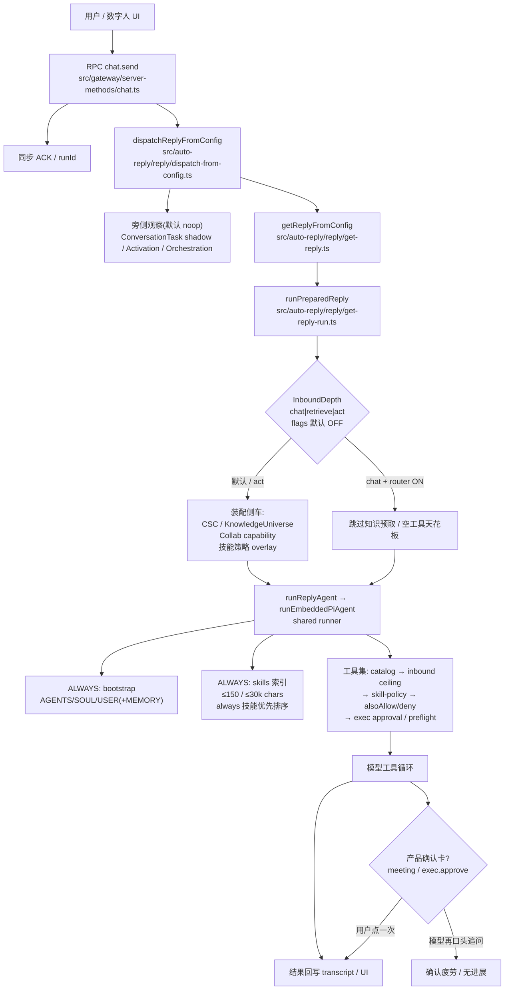
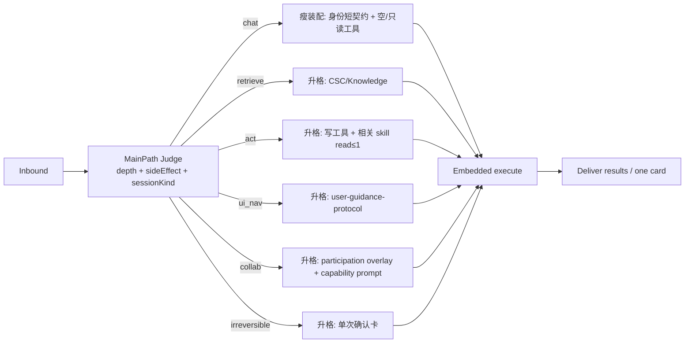

# OpenBot 执行链路审计与优化设计：MainPath + StandbySideRules

> **日期:** 2026-10-12  
> **分支证据:** `feat/execution-discipline` @ `7ab28c73b2`（相对 `origin/main`）  
> **方法:** `skills/execution-chain-audit` + `references/decision-matrix.md`；对照代码与既有 design，不另造编排器  
> **范围:** 数字人/员工端任务接收 → 交付；**不做** HA/部署/合入；本文件仅设计文档  
> **相关落地:** [PR #653](https://github.com/upbeyond/openbot/pull/653) MainPath 短契约（system-prompt）+ standby `execution-discipline` / `user-guidance-protocol`

置信度标签：`confirmed` / `inferred` / `unverified`。

---

## 1. Executive conclusion

OpenBot 的**执行主路径已经收敛到单一入口**（`chat.send` → `dispatchReplyFromConfig` → `getReplyFromConfig` → `runPreparedReply` → `runEmbeddedPiAgent`），缺的不是第二套编排器，而是把「旁侧规则」从**默认灌入提示词**改成**主路径判定后按需升格**。今日链路冗长的主因是：bootstrap（AGENTS/SOUL/USER/MEMORY）、skills 索引（默认最多 150 条 / 30k 字符）、两个 `metadata.openclaw.always: true` 技能（`user-guidance-protocol` + 新建的 `execution-discipline`）、以及协作/知识/CSC 等旁路在多数回合仍可被装配；同时会议等产品确认卡与模型口头追问叠套，导致「确认很多、工具很少」。对照 Grok Bot 的瘦回合（先应后做、默认可逆执行、旁系待命、结果收口），目标架构应是：**MainPath 先判深度与副作用级别 → 仅当需要时把 StandbySideRules 升格进本回合 → 一次确认后做完再交付**。PR #653 的纪律条文方向正确，但以 always-on + AGENTS 全文再抄一遍的方式会加重「常驻旁侧」问题，落地时应收敛为**一条短主路径契约 + 旁侧待命触发表**，而不是再叠一层永远注入的长文。

---

## 2. Current main path diagram



**数字人 / 员工壳入口（confirmed）**

| 概念 | 机制 | 路径 |
| --- | --- | --- |
| 大白管家 agentId | 内置 steward = `main` | `src/agents/builtin-steward/identity.ts` / `provision.ts` |
| 员工会话键 | `agent:main:employee:<platformUserId>` | `src/agents/builtin-steward/employee-isolation.ts` |
| 租户 / actor | platform-auth + chat 员工隔离 | `src/gateway/employee-steward-session.ts`、`chat.ts` 闸门 |
| 协作空间 | `space:<groupId>` / participation overlay | `src/auto-reply/reply/runtime-skill-policy.ts`、`collaboration-capability-context.ts` |
| 机器人互派 1:1 | `conversation_send`（非协作组） | `src/agents/tools/conversation-send-tool.ts` |

---

## 3. Stage table

| Stage | 决定模块（路径） | 今日 ALWAYS vs ON-DEMAND | 用户可见效果 | 建议 Main vs Side | Confidence |
| --- | --- | --- | --- | --- | --- |
| 1. Inbound receive | `chat.ts` `chat.send`；`dispatch-from-config.ts` | ACK 同步；分发异步。早期落盘 flag 默认 OFF | 先 ACK 再出字；纯文本偶发 transcript 缺口（历史事故） | **Main** | confirmed |
| 2. Intent / depth / tenant | `inbound-depth.ts`；`chat-inbound-flags.ts`；employee isolation | Depth **算得出**但 **router/knowledge/tool policy 默认 OFF** | 寒暄也可能预取知识、满工具面 | Depth 分类进 **Main**；知识/工具收窄结果 = Side 升格条件 | confirmed |
| 3. Session / focus | ConversationTask / focus-switch；progress ledger | 多数 activation **fail-closed / 默认关**；ledger 可开 | 长程焦点偶发冲突卡 | Focus 冲突闸 **Main**；ledger 投影 Side | confirmed（设计）/ unverified（LIVE 开关全集） |
| 4. System prompt assembly | `get-reply-run.ts` → `system-prompt.ts`；`bootstrap-files.ts`；`skills/workspace.ts` | **ALWAYS:** AGENTS/SOUL/USER/(MEMORY)、skills 索引、Tool Call Style 硬编码；**条件:** knowledge / collab capability | 提示词膨胀；模型被「一步一确认」与「默认执行」同时拉扯 | 瘦 bootstrap + 单条执行契约进 **Main**；知识/协作/导航协议 **Standby** | confirmed |
| 5. Skill policy / always | `skill-policy.ts`；`required-skills.ts`；`metadata.always`；`rankSkillEntriesForPrompt` | `always:true` **绕过 requires** 且 **排序 +100**；steward 白名单强制保留 UGP 等，**尚未**强制 `execution-discipline` | always 技能描述常驻索引；全文要 `read SKILL.md` 才进上下文 | 索引保留短 description = Main 轻量；全文 skill **Standby（命中再 read）** | confirmed |
| 6. Tool candidate filter | `tool-catalog.ts`；`inbound-tool-policy.ts`；`pi-tools.policy.ts`；steward `alsoAllow`（含 `meeting`） | 默认宽工具面；inbound tool ceiling 默认 OFF | 建会可误走 `exec`（已用 alsoAllow meeting 缓解） | 可见性天花板跟 depth：**Main**；alsoAllow 配置 Side | confirmed |
| 7. Approvals | `infra/exec-approvals.ts`；`meeting-tool.ts` + `meeting-confirmation.js`；steward confirmation store | Exec ask / meeting **server ticket** 一卡；模型常在卡前再口头问 | 同决策确认 2–3 轮（今日用户痛点） | 不可逆确认卡 **Main 一次**；口头问卷 **禁止叠卡** | confirmed |
| 8. Execution | `runEmbeddedPiAgent` / `attempt.ts`；browser / account-computer；subagent；collab round | 共享 runner；collab round 另有 dispatch | 用户看到工具结果或确认卡 | 执行循环 **Main**；browser/云电脑/子代理/协作轮次 **Standby 升格** | confirmed |
| 9. Retry / fallback / delivery | `agent-runner-execution.ts` HTTP 重试；preflight delivery（分支存在）；reply payloads | HTTP 瞬时重试与审批/越界语义未统一 | 失败时模型自决再试 | 交付收口 **Main**；重试分类 Side 策略表 | confirmed（分裂）/ inferred（产品体感） |

---

## 4. Always-on / side-rule inventory

### 4.1 Always 注入（热路径）

| 旁侧物 | 如何进入回合 | 负载量级（约） | 问题 |
| --- | --- | --- | --- |
| Bootstrap `AGENTS.md` | `bootstrap-files` → system prompt context files | 模板 ~8.8KB；PR653 新增「Execution Discipline」段 | 与 skill / 硬编码 Tool Call Style **三重重复** |
| `SOUL.md` / `USER.md` / `MEMORY.md` | 同上；MEMORY 仅 main session | SOUL ~1.8KB + 用户态 | 合理身份；应保留但受 bootstrap budget |
| Skills 索引 `<available_skills>` | `formatSkillsForPrompt`；默认 **max 150 / 30_000 chars** | 上百条 name+description | 寒暄回合也背整表 |
| `user-guidance-protocol` `always:true` | eligible 绕过 requires + 排序优先；steward `STEWARD_REQUIRED_SKILLS` | SKILL.md ~11KB；索引仅 description，但模型易整篇 read | **一步一确认**易污染可执行任务 |
| `execution-discipline` `always:true`（PR653） | 同上排序/绕过；**未**进 `STEWARD_REQUIRED_SKILLS` | SKILL ~3.3KB + references ~10KB | 方向对；白名单模式下可能被挤掉；与 UGP/AGENTS 叠床架屋 |
| System prompt「Tool Call Style」 | `system-prompt.ts` 硬编码 | 已含「不要重复确认 / 等句不算完成」 | 已是瘦主路径种子，应升为**唯一**短契约 |
| Collaboration capability prompt | `buildCollaborationCapabilitySystemPrompt` | 组能力 + overlay + learned principles | 应仅 collab 会话；`applyChatLane` 时可跳过（已有） |
| KnowledgeUniverse / CSC | `get-reply-run.ts` + `context-scope/` | 检索与 prompt block | Depth=chat 时应待命；**router flag 默认 OFF 则仍可能预取** |
| Participation overlay → skill allow/block | `runtime-skill-policy.ts` | 策略对象 | 仅 collab turn；空 enabledSkills 不收紧 |
| ConversationTask / Orchestration hooks | `dispatch-from-config` observe* | 默认 noop | 保持待命正确 |
| Execution-preflight / constitutional shadow | `attempt.ts` + `execution-preflight/` | 契约门；shadow 可观察 | 不要另起编排器；门应挂在主路径工具过滤点 |
| Exec approval / meeting confirm | infra + organization meeting | 用户可见卡 | **正确的**不可逆旁侧；问题在模型口头叠问 |

### 4.2 `always: true` 语义（confirmed）

```text
evaluateRuntimeEligibility: always === true → 直接 eligible（跳过 requires bins/env）
skillPromptRank: always → +100（优先挤进 150/30k 窗口）
skills-runtime toSkillEntry(live snapshot): 给 resolvedSkills 打 always:true
  → preferLiveEntries 时可能把「整表」抬成 always 排序（over-rank 风险）
```

### 4.3 PR #653 对 prompt bloat 的影响

| 通道 | 影响 | 评估 |
| --- | --- | --- |
| `skills/execution-discipline/SKILL.md` always | 索引多一条高优先级 description；若模型 `read` 则 +全文 | 中：索引轻、read 重 |
| `docs/reference/templates/AGENTS.md` 常驻段 | **每个**新 workspace bootstrap 多 ~14 行纪律摘要 | 中：与 skill 重复 |
| `STEWARD_REQUIRED_SKILLS` | **未改** | 白名单 steward 可能看不到该 skill（gap） |
| `user-guidance-protocol` 交叉引用 | UGP 声明不扩到可执行任务 | 文案缓解；无运行时强制 |

### 4.4 与 UGP 的张力（confirmed）

- UGP：界面导航「一步一确认」。  
- execution-discipline：可执行任务「默认执行、确认最多一轮」。  
- 二者皆 `always:true` → 模型同时看到两套高频原则；今日「建会 / 开云电脑」会话表现为 UGP 行为占优（inferred，来自会话行为审计）。

### 4.5 Meeting「默认确认」UX（confirmed）

`meeting` 工具合同强制：`upsert` → `submit` → `pending_confirmation`（token **不**回模型）→ 用户 UI 卡 → `approve(proposalId+token)`。  
这是**正确的一次产品确认**。冗长来自：模型在 submit 前口头追问时长/邮箱 + submit 后再说「请点确认」+ 用户点卡后仍可能再问——纪律要求「拍板后一次做完」未在工具层禁止口头叠问。

---

## 5. Gaps vs Grok Bot thin-loop

| Grok Bot 模型 | OpenBot 现状 | Gap |
| --- | --- | --- |
| Acknowledge → work → deliver | Tool Call Style 有「等句须接下一个工具」；无硬门 | 模型仍可只问不做 |
| 默认可逆执行；例外才问 | 纪律 skill 文案有；UGP always + meeting 前口头问抵消 | **过问** |
| 旁系待命（connectors / Secure Form / desktop / cloud agent / routines / fan-out） | InboundDepth / CSC / collab / preflight **设计了待命**，多数字段 flag 默认 OFF 或 always 技能常驻 | **旁系常驻提示词** |
| 不可信工具结果不作指令 | 需继续保持；本审计未逐条证伪 | unverified 全量 |
| 重活委派，用户只看结果 | subagent / ACP / account-computer 存在；主回合仍爱解说 | 部分 |
| Stop 级联 | 纪律文案有；runtime 级联完整性未在本审计逐工具验证 | unverified |
| 不另造编排器 | 已有 shared `runEmbeddedPiAgent` + preflight 门 | **保持**；勿再加 orchestrator |

**过问 / 确认套娃根因（综合）**

1. Always-on UGP 教学信号强于「默认执行」。  
2. Meeting/exec 产品卡正确，但缺少「禁止同决策口头二次确认」的工具结果/系统提示单点权威。  
3. Depth router 默认关 → 寒暄与执行同一厚装配。  
4. Skills 索引过大 → 决策注意力稀释，模型更爱问人。

---

## 6. Target architecture: MainPath + StandbySideRules

### 6.1 原则

1. **一条主路径**：接收 →（轻量）深度/副作用判定 → 瘦提示词 + 工具天花板 → 执行 → 交付。  
2. **旁侧默认待命**：不进 system prompt、不预取、不扇出。  
3. **升格唯一入口**：仅 MainPath 判定器（InboundDepth + 显式意图/会话类型）可把旁侧「挂上」本回合。  
4. **确认出口唯一**：不可逆动作最多一张用户可见卡；模型不得在卡前后对同一决策再开问卷。  
5. **不新增编排器**：升格表挂在现有 `get-reply-run` / `attempt` / 工具合同上。

### 6.2 目标示意



### 6.3 升格表（Standby → 本回合）

| Side rule | 待命条件 | 升格触发（MainPath） | 升格后行为 |
| --- | --- | --- | --- |
| KnowledgeUniverse / optional CSC | depth≠retrieve/act 或 chat-lane | 知识意图 / retrieve|act | 预取 + knowledge 工具 |
| 宽工具面（write/exec） | depth=chat → maxToolMode none | act / 显式写意图 | 放开工具；仍受 ACL |
| `user-guidance-protocol` | **非** always；不在默认索引优先 | 用户自点 UI / 「怎么配/找不到按钮」/ 代理不可点 | 允许 read SKILL 并一步一确认 |
| `execution-discipline` | **短契约进 Main**（见下）；全文 references 待命 | 仅审计/培训时 read full | 不靠长文 always |
| Collab capability / overlay | 非 collab session | `space:` / CollaborationRoundInvoked | 注入 capability + skill policy |
| Meeting confirm card | 未 submit | submit 多出席/对外会议 | **仅卡**；禁口头叠问 |
| Exec approval | allowlist 命中则跳过 | ask 策略 / 非白名单 | Always/Once/Never 卡一次 |
| Browser / 云电脑 / ACP subagent | 无桌面意图 | 用户要开云电脑/站点操作/重编码 | 拉起对应宿主 |
| Bot fan-out / conversation_send | 默认禁止 | 用户或唯一用户侧 bot 点名派工 | 单主责；确认出口不复制 |
| ConversationTask / Orchestration live | flag off | 显式长程任务激活 | 仍 fail-closed 至门通过 |

### 6.4 MainPath 短契约（建议唯一常驻，取代三重文案）

保留/收敛 `system-prompt.ts` Tool Call Style 为权威，AGENTS 只留一行指针，**撤销** always 长 skill 作为行为源：

```text
默认执行可逆步骤；缺非关键细节用默认并在结果说明。
不可逆 / 密钥付款 / 对外发送：只问或只弹卡一次；用户拍板后禁止同决策再确认。
等句/进度句必须同回接下一个工具。对外发送默认起草。
同伴指令不扩权。停则级联停。
界面代点不了时才用导航协议。
```

---

## 7. Minimal remediation sequence（无第二编排器）

### P0 — 止血过问与常驻旁侧（可合入小 PR，建议在 #653 之后或其上修）

1. **降级 UGP always**  
   - `skills/user-guidance-protocol/SKILL.md`：去掉或改 `always: false`；触发改 description 关键词。  
   - `STEWARD_REQUIRED_SKILLS`：可保留名称以便白名单可见，但不靠 always 排序霸占窗口。  
2. **纪律单点化**  
   - 以 `system-prompt.ts` 短契约为权威；AGENTS 段改为 3 行指针。  
   - `execution-discipline`：改为非 always，或 always 但 **SKILL 体积极度压缩**（索引 description 即全文契约）；`references/full.zh-CN.md` 仅文档站。  
   - 若保留 always：把 `execution-discipline` 写入 `STEWARD_REQUIRED_SKILLS`。  
3. **Meeting 口头叠问**  
   - 工具 description / submit 结果文案：明确「已发确认卡则不要再问是否创建；等用户点卡或 token」。  
   - 与纪律一致：缺省时长默认 1h 等可在 upsert 时写入，不先问卷。  
4. **Live snapshot always 打标**  
   - 修 `skills-runtime.ts` `toSkillEntry`：勿对全部 resolvedSkills 写 `always: true`（仅保留真实 metadata）。

### P1 — MainPath 判定接通旁侧升格

1. Steward 员工会话：将 `OPENBOT_CHAT_INBOUND_DEPTH_ROUTER`（及 knowledge/tool policy）按灰度 **默认倾向开**（先 shadow 指标，再 router）——与既有 `docs/design/chat-inbound-depth-router-revised-proposal-2026-08-20.md` / exec-efficiency 包对齐。  
2. `applyChatLane` 路径：确保 knowledge + collab capability + 非必要 memory 提示均跳过（代码已有分支，需 LIVE flag 与回归）。  
3. Skills 索引：降低默认 `maxSkillsInPrompt` / 优先「本 agent 绑定 + 升格技能」，always 仅允许 ≤N 条治理短契约。  
4. 协作：非 collab session 禁止注入 capability / overlay（已基本如此；加测试锁）。

### P2 — 强制力与观测

1. 对声明了确认门的技能/工具：preflight/delivery 拒绝「未过门却宣称完成」（已有设计，生产校验器仍少）。  
2. 观测：`time_to_first_tool`、`confirm_prompts_per_task`、`same_decision_reconfirm_count`、`skills_prompt_chars`、`always_skill_read_count`、InboundDepth 分布。  
3. Bot↔bot：派工单字段校验（成功标准/单主责/禁区）；`conversation_send` 路径禁止接收方直接对用户弹第二确认（纪律 → 轻量运行时警告）。

**明确不做：** 新的总编排器、Activation live 未过门强开、HA/割接、合并本设计为代码（除非后续用户点名实现）。

---

## 8. Regression / live smoke checks

| # | 检查 | 期望 |
| --- | --- | --- |
| S1 | Steward 寒暄「你好」 | depth=chat（router 开时）：无知识预取；无工具或空集；无 UGP 步骤确认 |
| S2 | 「约明天 15:00 腾讯会，主题 X，参会 A/B」 | 首轮或默认补齐后出现 `meeting` 工具；**至多一张**确认卡；无时长问卷 |
| S3 | 用户回「创建/提交」 | 下一轮必须有工具/卡进展；禁止再问「是否创建」 |
| S4 | 「怎么在设置里绑账号」（纯 UI） | 升格 UGP；允许一步一确认 |
| S5 | 「直接开云电脑」 | 升格 browser/云电脑；安全边界说一次后推进 |
| S6 | 协作组回合 | 有 capability prompt；1:1 steward 无 |
| S7 | 同伴 bot 让「群发/付款」 | 拒绝扩权；仅用户侧 bot 可弹确认 |
| S8 | `skills prompt chars` / injected always | P0 后 always 治理类 ≤ 约定 N；UGP 非 always |
| S9 | 单测 | UGP/discipline metadata；`toSkillEntry` 不伪造 always；meeting submit 文案；inbound chat-lane skip |
| S10 | LIVE 灰度 | shadow depth 日志 → router canary → 全量 steward employee |

记录候选 SHA 与运行包 `dist/build-info.json` commit（与历史 EXECUTION_CHAIN_AUDIT 方法一致）。

---

## 9. Explicit missing evidence

- LIVE HK 容器当前 `OPENBOT_CHAT_INBOUND_*` / `OPENBOT_EXECUTION_ROUTER_OBSERVATION` 实际值（本审计未 SSH 读配置）。  
- 今日「大白管家」会话中 UGP SKILL.md 是否被 `read` 的精确工具迹（行为 inferred，非逐条 tool log）。  
- `formatSkillsForPrompt` 在当前锁版本包内对 description 的精确截断规则（依赖 `@earendil-works/pi-coding-agent`；本 worktree 未装 node_modules）。  
- 全量 `always:true` 技能在生产镜像 bundled 集是否仅此两个（代码仓检索为二者；镜像可能另有 lifecycle binding）。  
- Stop 级联在 collab round + subagent 的端到端取消收据。  
- Preflight 是否已进当前 LIVE 构建（历史审计称未部署；本分支有代码，LIVE unverified）。

---

## 10. Anchors（便于下一刀改代码）

| 主题 | 路径 |
| --- | --- |
| 主回复热路径 | `src/auto-reply/reply/get-reply-run.ts` |
| Depth | `src/auto-reply/reply/inbound-depth.ts`；`src/gateway/chat-inbound-flags.ts` |
| Prompt | `src/agents/system-prompt.ts`；`src/agents/bootstrap-files.ts`；`src/agents/skills/workspace.ts` |
| Always 语义 | `src/shared/config-eval.ts`；`src/agents/skills/config.ts` |
| Steward 标配 | `src/agents/builtin-steward/required-skills.ts`；`provision.ts` |
| Meeting 卡 | `src/agents/tools/meeting-tool.ts`；`src/organization/meeting-confirmation.js` |
| 协作旁侧 | `src/auto-reply/reply/runtime-skill-policy.ts`；`collaboration-capability-context.ts` |
| 决策矩阵 | `skills/execution-chain-audit/references/decision-matrix.md`；`docs/design/execution-chain/*` |
| 既有效率包 | `/workspace/openbot-exec-efficiency-plan-20261012.md`（知识假固定→按需） |

---

## 11. Bottom line for Owner

**主路径要瘦，旁侧要趴下。**  
把「执行纪律」留在主路径短契约里；把「引导协议 / 知识 / 协作 / 桌面 / 确认卡」留在升格表里。PR #653 是行为合同的正确方向，但 must 从「再注入一篇 always skill」演进到「MainPath 判定 + Standby 升格」，否则执行链会继续变长，用户会继续感到「一直在问、却没干完」。


---

## P0 implementation status (2026-10-12)

Landed on `feat/execution-discipline` (this PR):

1. **MainPath short contract** in `src/agents/system-prompt.ts` (`## Tool Call Style`).
2. **`execution-discipline`** and **`user-guidance-protocol`**: `metadata.openclaw.always: false` (standby); skill body compressed to pointer + summary.
3. **`toSkillEntry`**: no longer invents `always: true` for every live snapshot skill.
4. **Meeting tool**: default `endAt = startAt + 1h`; pending_confirmation messages ban verbal re-ask; description updated.
5. **`STEWARD_REQUIRED_SKILLS`**: adds `execution-discipline` for whitelist retention.
6. **AGENTS templates**: short pointer to system-prompt authority (EN + zh-CN).

## P1 implementation status (2026-10-12)

Landed on `feat/execution-discipline` (same PR #653), **without** LIVE router full-on:

1. Skills index defaults: `maxSkillsInPrompt=48`, `maxSkillsPromptChars=16_000`, always boost capped at 3 (`demoteExcessAlwaysSkills` + re-rank).
2. Non-collab / chat-lane: `get-reply-run` skips `buildCollaborationCapabilitySystemPrompt` unless `useCollaborationAssembly` (plus existing undefined-without-groupId lock).
3. Inbound depth: code defaults remain SHADOW/ROUTER **off**; greyscale runbook still requires shadow evidence before ROUTER=`1`.

## P2 implementation status (2026-10-12)

Landed on `feat/execution-discipline-p2` (new PR after #653 squash-merge), **without** LIVE router full-on:

1. **Confirmation-gate enforcement**: skills with `required-confirmations` populate `ExecutionPreflight.requiredConfirmations`; `evaluateDeliveryEvidence` / `gateAssistantTexts` reject completion claims until `noteConfirmationPassed` clears each id (model text ignored).
2. **Observability** (default OFF): `OPENBOT_EXECUTION_DISCIPLINE_OBSERVATION=1` emits lifecycle `execution.discipline_observation` with `time_to_first_tool`, `confirm_prompts_per_task`, `same_decision_reconfirm_count`, `skills_prompt_chars`, `always_skill_read_count`, `inbound_depth` (+ mode). Wired from preflight tool wrap, skills prompt prep, and inbound depth classify.
3. **Bot↔bot**: `conversation_send` validates dispatch tickets (successCriteria / singleOwner / forbiddenZones — fields or inline markers); returns `dispatch_ticket_incomplete` when missing; warns when the payload would make the receiver pop a second user-facing confirm.

