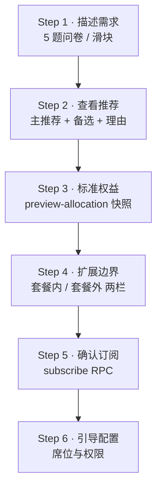
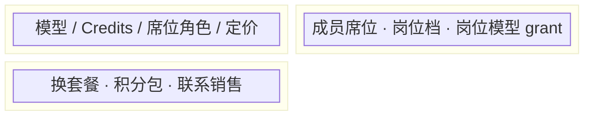

# OpenBot 套餐选购 — 需求引导式匹配方案

Date: 2026-06-21

Status: **Draft — 待专家团队评审（评审通过后方可执行）**

Revision: v0.3

Audience: 产品、平台运营、企业端 UI、Gateway/Billing、Entitlement、QA、架构

---

## Related Docs

| 文档                                                                                                                                                                     | 关系                                                    |
| ------------------------------------------------------------------------------------------------------------------------------------------------------------------------ | ------------------------------------------------------- |
| **[openbot-enterprise-ai-workforce-pricing-master-plan-2026-06-21.md](/design/openbot-enterprise-ai-workforce-pricing-master-plan-2026-06-21.md)**                       | **主实施计划（V1.0 商业 + 布局图 + 五阶段）— 评审入口** |
| 企业成本与预算 IA（已 Frozen）：[/design/openbot-enterprise-cost-budget-ia-consolidation-2026-06-19](/design/openbot-enterprise-cost-budget-ia-consolidation-2026-06-19) |                                                         |

- 平台套餐权益架构：[/design/platform-plan-entitlement-architecture-2026-06-20](/design/platform-plan-entitlement-architecture-2026-06-20)
- 平台定价 Tier 设计：[/design/platform-pricing-tiers-2026-06-16](/design/platform-pricing-tiers-2026-06-16)
- Model Entitlement Chain：`.kiro/specs/model-entitlement-chain/`
- Package Entitlement v2：`.kiro/specs/package-entitlement-v2/`
- 代码锚点：
  - 企业成本与预算总外框：`ui/src/ui/views/cost-budget/cost-budget-page.ts`
  - 4 Tab IA 导航：`ui/src/ui/views/cost-budget/cost-budget-nav.ts`
  - 总览待办推导：`ui/src/ui/views/cost-budget/cost-budget-todos.ts`
  - 未订阅自动跳转（拟取消）：`maybeUnsubscribedLandingRedirect` in `cost-budget-page.ts`
  - 企业订阅选套餐（现状）：`renderSubscriptionCatalog` → `renderPricingComparison`
  - Commerce 三 panel：`plan` / `catalog` / `orders`（`COMMERCE_PANELS`）
  - 套餐对比组件：`ui/src/ui/ports/platform/pricing/pricing-comparison-view.ts`
  - 分配预览 RPC：`platform-plan-bundle.preview-allocation`
  - 企业 allocation 总览：`enterprise-allocation.overview`
  - 席位与岗位模型绑定（套餐内扩展）：`ui/src/ui/views/cost-budget/cost-budget-seats-panel.ts`
  - 平台套餐编辑（Preview 模拟，P0 不改 Edit）：`ui/src/ui/ports/platform/pricing/page.ts`

---

## 0. 执行摘要

### 0.1 问题

当前企业选购套餐的主路径是：**并排展示套餐卡片 → 用户自行理解差异 → 点击订阅**。

这对运营侧简单，但对买方存在三类摩擦：

1. **套餐名是产品语言，不是业务语言**（「专业版」vs「20 人团队、以 Creator 为主、需 5+ 模型」）
2. **标准权益与可扩展边界不透明**（用户不知道选完后还能在套餐内调什么、何时必须升级）
3. **选错套餐的补救成本高**（换套餐、补购、岗位 grant 的路径未在购买前讲清）

### 0.2 提案

将主路径改为 **需求引导式匹配（Requirements-Guided Plan Selection）**：

```text
描述需求 → 系统匹配套餐 → 展示标准权益 → 说明套餐内扩展空间 → 说明超出套餐的升级路径 → 确认订阅
```

核心原则：

> **套餐是默认答案，不是唯一答案。**  
> 先帮用户找到「够用的天花板」，再明确「在天花板内能个性化什么、超出后怎么走」。

### 0.3 与 Azure Stack / 传统 SaaS 定价页的差异

| 模式                   | 适用对象                | OpenBot 选择                                |
| ---------------------- | ----------------------- | ------------------------------------------- |
| 直接选 Offer/Plan 卡片 | 熟悉产品线的买家        | 保留为 **次级入口**（「查看全部套餐对比」） |
| 需求问卷 + 推荐        | 首次购买、非技术采购    | **主路径**                                  |
| 销售定制               | 大客户 / 超 entitlement | **第三条路径**（联系销售，已有）            |

本方案 **不推翻** 现有 `Plan / PlanVersion / EntitlementSnapshot / RoleGrantProfile / enterprise-model-grant` 架构，仅 **重组选购 UX** 与 **补齐平台侧「目标画像」元数据**。

### 0.4 评审请求

请专家团队对本文 **§5 需求维度**、**§6 匹配规则**、**§7 三层权益呈现**、**§9 分期范围**、**§19 企业端总览优化**、**§20 UX 参考稿映射** 与 **§12 开放问题** 给出 **批准 / 修改 / 驳回** 意见。  
**评审通过前不进入开发执行。**

### 0.5 v0.3 相对 v0.2 的增量

1. **主文档拆分**：商业本体、五档 contract、**完整页面布局图**、五阶段路线 → [主实施计划](/design/openbot-enterprise-ai-workforce-pricing-master-plan-2026-06-21.md)
2. 本子方案定位：**选购向导 + 总览 Hub + 三 Tab 权益** 的 UX 与匹配引擎细节
3. Phase 1 依赖 **Phase 0 Contract 冻结**（见主计划 §6）

### 0.6 v0.2 相对 v0.1 的增量

1. **明确双落地页分工**：总览 Tab = 任务中枢；订阅与订单 · 套餐目录 = 设计稿完整选购流。
2. **取消未订阅静默跳转**（`maybeUnsubscribedLandingRedirect`），改为总览显式双入口导流。
3. **P0 范围扩大**：总览 Hero / 生命周期进度条 / 套餐摘要卡，与 catalog 向导 **同一迭代**。
4. **附录 UX 参考稿**（2026-06-21 设计稿）与 OpenBot 字段映射表。

---

## 1. 背景与现状

### 1.1 当前企业端订阅流


特征：

- 套餐列表来自 `subscriptions.get` → `availablePlans`
- 对比视图含周期切换、推荐标签（`marketingTags: recommended`）、联系销售
- 订阅成功后引导至「席位与权限」Tab

### 1.2 当前平台端创建流

- 路径：`/platform/pricing/new`（预览 | 编辑 Tab）
- 编辑：基本信息 → Entitlement → 模型库多选 → 高级项 → 创建草稿
- **缺少**：「这份套餐服务哪类需求画像」的结构化描述

### 1.3 已有、可复用的后端能力

| 能力             | RPC / 模块                                       | 用途                                         |
| ---------------- | ------------------------------------------------ | -------------------------------------------- |
| 套餐版本权益快照 | `platform-plan-bundle.*` + `EntitlementSnapshot` | 标准权益数据源                               |
| 分配预览         | `platform-plan-bundle.preview-allocation`        | 推荐后展示 roleProfiles / entitledModelCount |
| 企业天花板       | `enterprise-allocation.overview`                 | 订阅后 entitlement + grants                  |
| 席位角色档案     | `role-grant-profiles`                            | Viewer/Creator/Admin 模型投影                |
| 岗位级模型 grant | `enterprise-model-grant.*`                       | 套餐内个性化                                 |
| 积分包加购       | `credit-packs.list` + 商业订单                   | 套餐外扩展                                   |
| 容量建议         | `consumption-forecast.*`                         | 可选：匹配后用量提示                         |

### 1.4 当前企业端「成本与预算 · 总览」问题（v0.2 新增）

模块默认 landing 为 **总览 Tab**（`overview` subRoute），与 Frozen 4 Tab IA 一致，但存在体验断层：

| 现象           | 代码行为                                                 | 用户感受                             |
| -------------- | -------------------------------------------------------- | ------------------------------------ |
| 未订阅进总览   | `maybeUnsubscribedLandingRedirect` 静默跳 `subscription` | 总览像空页，模块价值不可见           |
| 未订阅总览内容 | 仅 todos + `emptyNoSubscription`                         | 无选购路径、无价值主张               |
| 选购入口过深   | 设计稿能力藏在 commerce · **套餐目录** 内                | 需理解 IA 才能订阅                   |
| 已订阅总览     | KPI + 归因 + 账单为主                                    | 弱「套餐天花板 / 扩展边界 / 下一步」 |
| 购后引导       | `seat-bootstrap-guide` 主要在 commerce · 当前套餐        | 总览看不到配置进度                   |

**v0.2 结论**：不新增第 5 Tab；**升级总览为主页面任务中枢**，**套餐目录承接 UX 参考稿完整流**（§19、§20）。

---

## 2. 目标与非目标

### 2.1 目标（Goals）

| ID  | 目标                                                    | 验收口径                                                        |
| --- | ------------------------------------------------------- | --------------------------------------------------------------- |
| G1  | 首次订阅用户 **无需先理解套餐产品线** 即可完成选型      | 可用性测试：≥80% 被试在 5 分钟内完成「描述需求 → 确认推荐方案」 |
| G2  | 推荐结果 **可解释**（为何是该套餐）                     | 每条推荐含 ≥3 条匹配理由                                        |
| G3  | 购买前用户理解 **三层边界**：标准 / 套餐内扩展 / 需升级 | 问卷：购前展示后 ≥70% 能正确回答「岗位加模型是否需换套餐」      |
| G4  | 与 entitlement 架构 **零冲突**                          | 不推荐 entitlement 外的模型；扩展路径指向已有 RPC               |
| G5  | 平台运营可维护匹配规则 **无需发版**（P1 起）            | 套餐画像字段可配置                                              |

### 2.2 非目标（Non-Goals）

| ID  | 非目标                                                        | 说明                                                           |
| --- | ------------------------------------------------------------- | -------------------------------------------------------------- |
| NG1 | 不新建并行 entitlement 存储                                   | 继续 `plan-version-model-binding` + projection                 |
| NG2 | 不在 P0 引入 LLM 选型                                         | P0 用确定性规则引擎                                            |
| NG3 | 不替换平台侧套餐 CRUD                                         | 仅增加画像字段与创建向导语义                                   |
| NG4 | 不改变 `subscribe` / `changePlan` 商业 RPC 语义               | 仅改前端选购路径                                               |
| NG5 | 不在本方案内解决「静态营销权益文案 vs 后端 contract」全量对齐 | 见 `platform-plan-entitlement-architecture-2026-06-20`，可并行 |

---

## 3. 设计原则

1. **需求语言优先**：问卷用「团队规模、使用场景、模型数量、月消耗」等业务词，不用 planId / tier 内部名。
2. **一个主推荐 + 一个备选**：降低选择瘫痪；完整对比表折叠为次级入口。
3. **标准与扩展分栏**：左栏「套餐已包含」，右栏「套餐内可调」+「超出需升级」— 禁止混在一屏 bullet list。
4. **先选后确认**：模型绑定、订阅确认均 **草稿态 + 显式确认**（与平台端模型绑定改造一致）。
5. **可降级**：用户可随时跳过向导，进入现有 `renderPricingComparison`。
6. **购买与配置分离**：本方案只解决 **选哪个天花板**；席位分配、岗位绑模型仍在「席位与权限」完成。

---

## 4. 用户旅程（目标态）

### 4.1 主路径 — 首次订阅



### 4.2 次级路径

| 入口                   | 行为                               |
| ---------------------- | ---------------------------------- |
| 「查看全部套餐对比」   | 展开现有 `renderPricingComparison` |
| 「联系销售定制」       | 现有 `renderPricingContactSales`   |
| 「我已知道要什么套餐」 | 跳过向导，直接对比表               |

### 4.3 已订阅用户 — 换套餐 / 加购

| 场景         | 路径                                                              |
| ------------ | ----------------------------------------------------------------- |
| 换套餐       | 向导可缩短为 2 步（需求变更点 + 新推荐 vs 当前 entitlement diff） |
| 仅加 Credits | 跳过套餐向导，直达积分包（用量与设置 / 订阅与订单内 panel）       |
| 仅岗位加模型 | 不经过套餐向导，直达席位与权限（已在 entitlement 内）             |

---

## 5. 需求维度（专家需评审）

### 5.1 P0 问卷字段（建议 5 题）

| 维度 ID            | 用户问题（zh）               | 输入类型                                            | 映射到匹配信号                            |
| ------------------ | ---------------------------- | --------------------------------------------------- | ----------------------------------------- |
| `teamSize`         | 预计使用 AI 的团队成员规模？ | 单选：1–5 / 6–20 / 21–100 / 100+                    | → `maxSeats` 下限                         |
| `primaryUse`       | 主要使用场景？               | 多选：只读查询 / 内容生产 / 管理编排 / 自动化 Agent | → 主导 `SeatRole`（viewer/creator/admin） |
| `modelBreadth`     | 需要同时使用多少模型？       | 单选：1–2 / 3–5 / 6–10 / 10+                        | → `entitledModelCount` / `allowedTiers`   |
| `monthlyIntensity` | 预期月消耗强度？             | 单选：轻 / 中 / 重 / 不确定                         | → `monthlyCredits` 下限                   |
| `agentNeed`        | 是否需要多 Bot / 自动化？    | 是 / 否 / 不确定                                    | → `maxBots`、工作流相关 entitlement       |

**开放问题 Q1（见 §12）**：是否增加「合规 / 私有化」维度？当前 entitlement contract 对该项 enforce 不完整。

### 5.2 需求画像（Persona）输出

问卷提交后生成 **结构化 Persona**（JSON，仅前端 + 可选 URL 持久化）：

```json
{
  "teamSize": "6-20",
  "primaryUse": ["content", "orchestration"],
  "modelBreadth": "3-5",
  "monthlyIntensity": "medium",
  "agentNeed": "yes",
  "derived": {
    "dominantSeatRole": "creator",
    "minSeats": 6,
    "minModels": 3,
    "minMonthlyCredits": 5000
  }
}
```

Persona **不写入后端**（P0）；P1 可选写入 `subscription.metadata` 或 analytics event。

---

## 6. 匹配引擎（专家需评审）

### 6.1 P0：确定性规则引擎（纯前端）

对每个 `availablePlan` 的 **当前 active PlanVersion**：

1. **硬过滤**：`EntitlementSnapshot` / `preview-allocation` 是否满足 Persona 的 `minSeats`、`minModels`、`minMonthlyCredits`
2. **软打分**（加权）：
   - 满足度 margin（每项 entitlement 超出需求的幅度，越小越「贴合」避免过度售卖）
   - 价格（同满足度下较低优先）
   - 运营标签（`marketingTags: recommended` + canonical slot = professional）
3. **输出**：
   - `primaryRecommendation`: 最高分 plan
   - `alternativeRecommendation`: 次高分且价格更低或高一级
   - `reasons[]`: 人类可读理由（模板填充）

**示例理由模板**：

- 「满足您「3–5 个模型」需求：该套餐 entitlement 含 {n} 个模型」
- 「适合以内容生产为主：Creator 席位档案含 {m} 个生产向模型」
- 「月 Credits {c}，覆盖您选择的「中等用量」档位」

### 6.2 P1：平台可配置规则

在 Plan 上增加可选字段 `targetPersonas: string[]` 与 `matchingHints`（见 §8.2），运营可微调权重，仍 **不走 LLM**。

### 6.3 P2（可选）：LLM 辅助解释

仅用于 **自然语言总结推荐理由**，不参与 planId 决策；决策仍由规则引擎产出（可审计）。

**开放问题 Q2**：匹配失败（无 plan 满足硬过滤）时，默认推荐「联系销售」还是「最高档套餐 + 警告」？

---

## 7. 三层权益呈现（核心 UX）

匹配完成后，**单页分三区**（非三个 Tab，同一滚动页内三个 section）：

### 7.1 Section A — 标准权益（套餐已包含）

**数据源**：`platform-plan-bundle.preview-allocation`（推荐 plan 的 active version）

展示项（仅展示 **后端有 contract 的项**，P0）：

| 展示项                     | 来源                                         |
| -------------------------- | -------------------------------------------- |
| 可用模型数 + 列表摘要      | `roleProfiles[].modelIds` 并集               |
| 席位角色档案               | viewer / creator / admin 各含模型数、Tier    |
| 月 Credits                 | `EntitlementSnapshot.monthlyCredits`         |
| 席位数 / Bot 数 / 并发上限 | `maxSeats` / `maxBots` / `maxConcurrentRuns` |
| 月费（按周期）             | PlanVersion pricing                          |

**文案基调**：「订阅后 **默认拥有** 以下能力，无需额外配置即可开始。」

### 7.2 Section B — 套餐内扩展（个性化空间，无需换套餐）

**不调用新 RPC**；以 **能力说明 + 深链** 为主：

| 扩展项           | 用户动作                             | 深链                  |
| ---------------- | ------------------------------------ | --------------------- |
| 成员席位档位分配 | 给成员分 Viewer/Creator/Admin        | 席位与权限 · 分配席位 |
| 岗位默认档位     | 空岗预设 Creator 等                  | 岗位默认档位模板      |
| 岗位级模型微调   | 某岗位多绑/少绑模型（⊆ entitlement） | 岗位绑模型（已实现）  |
| 同步岗位授权     | 批量应用角色档案                     | 同步全部岗位授权      |

**文案基调**：「多数企业 **不换套餐**，在此完成岗位与成员级配置。」

### 7.3 Section C — 超出套餐边界（需升级或加购）

| 边界                 | 用户信号                 | 路径                |
| -------------------- | ------------------------ | ------------------- |
| 模型不在 entitlement | 岗位需要未包含的 modelId | 升级套餐 · 联系销售 |
| Credits 用尽         | 预测/账单告警            | 积分包 · 升级套餐   |
| 席位 / Bot 超限      | 容量建议                 | 加购 · 升级套餐     |
| 私有化 / SLA         | 问卷选择高合规           | 联系销售            |

**文案基调**：「以下需求 **超出当前套餐天花板**，可按路径扩展。」



---

## 8. 平台侧对称改造（创建套餐）

为使 **选购端匹配** 与 **运营端创建** 语言一致，平台侧增加 **轻量元数据**（P1，可与企业端 P0 解耦）：

### 8.1 创建向导语义调整（建议，非 P0 阻塞项）

将 `/platform/pricing/new` 编辑流对齐为四步语义（可与现有 preview/edit Tab 并存）：

1. **基本信息 + 目标画像**（服务谁）
2. **能力范围**（模型 / Tier / 席位角色 — 对应 Azure Services）
3. **配额与定价**（Credits / 席位数 / 单价 — 对应 Azure Quotas）
4. **预览 + 验证 + 创建**

### 8.2 Plan 元数据扩展（P1）

| 字段                     | 类型       | 用途                            |
| ------------------------ | ---------- | ------------------------------- |
| `targetPersonas`         | `string[]` | 如 `team-6-20`, `creator-heavy` |
| `matchingPriority`       | `number`   | 同分 tie-break                  |
| `inPlanFlexibilityNotes` | `string`   | 运营编辑的「套餐内扩展」说明    |
| `beyondPlanNotes`        | `string`   | 「超出边界」说明                |

存储位置候选：`Plan.marketingTags` 扩展 vs `EntitlementSnapshot` 新字段 — **开放问题 Q3**。

---

## 9. 分期实施计划（专家需评审范围）

### Phase 0 — 企业选购 + 总览主页面（建议 1 个迭代）

| 项               | 内容                                                                                          |
| ---------------- | --------------------------------------------------------------------------------------------- |
| 范围             | **未订阅 + 已订阅** 企业管理员；成本与预算模块                                                |
| 总览交付         | Hero 双入口（轻量）· 生命周期进度条 · 套餐天花板摘要卡 · 扩展两栏 · 保留 KPI/待办             |
| Catalog 交付     | Landing · 5 步向导 · 推荐结果 · 三 Tab 购前详情 · 完整对比表（次级）· 确认订阅                |
| 行为变更         | **移除** `maybeUnsubscribedLandingRedirect` 强制跳转；保留 `?start=subscribe` 可选 deep link  |
| 复用             | `preview-allocation`、`pricing-comparison-view`、`pricing-contact-sales`、`cost-budget-todos` |
| 不做             | 平台元数据、LLM、换套餐 diff 向导、新增顶级 Tab、新增 P0 RPC                                  |
| 新建模块（预估） | `cost-budget-plan-selector/*`（wizard / matching / landing / buyer-detail）                   |
| 新建模块（预估） | `cost-budget-overview-plan-summary.ts`、`cost-budget-onboarding-progress.ts`                  |
| 改动模块（预估） | `cost-budget-page.ts`、`cost-budget-todos.ts`、i18n、`cost-budget.css`                        |

**退出标准**：P0 可用性测试通过 G1–G3；未订阅用户可在总览理解模块价值并进入向导；无新增 P0 级 RPC。

### Phase 1 — 运营可配置 + 已订阅换套餐

- Plan `targetPersonas` 字段与平台编辑 UI
- 已订阅用户「需求变更 → 套餐 diff 推荐」
- Persona 写入 analytics / URL `?persona=`

### Phase 2 — 与容量预测联动

- `consumption-forecast` / `capacity-recommendations` 在 Section C 展示「您可能 30 天内需要加购 Credits」

### Phase 3 — 可选 LLM 解释层

- 理由文案润色；**不参与** planId 决策

---

## 10. 信息架构与路由

### 10.1 企业端

**Frozen 约束**：保持 4 Tab（总览 · 订阅与订单 · 席位与权限 · 用量与设置），不新增顶级 Tab。

| 区域                       | 现状                                     | 目标（v0.2）                                           |
| -------------------------- | ---------------------------------------- | ------------------------------------------------------ |
| **总览 Tab（主 landing）** | 未订阅空态 + 静默 redirect；已订阅纯 KPI | 任务中枢：Hero 双入口 / 进度条 / 套餐摘要 / 待办 / KPI |
| **订阅与订单 · 套餐目录**  | 直接 `renderPricingComparison`           | UX 参考稿完整流（§20）                                 |
| **订阅与订单 · 当前套餐**  | 订阅摘要 + ceiling guide                 | P1 增加三 Tab 权益（只读 + 换套餐入口）                |
| **席位与权限**             | 分配 + 岗位绑模型（已部分落地）          | Section B 深链目标                                     |

URL 建议（P0 可选）：

- 总览 deep link：`?start=subscribe` → commerce/catalog wizard
- Catalog wizard：`subscription` panel + 模块状态 `wizardStep=needs|…|recommendation`
- 可选 query：`?persona=...`（结果页回访）
- 保留现有 `subscription` / `orders` / `invoices` subRoute

### 10.2 平台端

- P0：无强制改动
- P1：`/platform/pricing/new?step=persona` 与画像字段

---

## 11. 成功指标

| 指标                                            | 基线（需先采集 2 周） | P0 目标                    |
| ----------------------------------------------- | --------------------- | -------------------------- |
| 订阅漏斗完成率（进入订阅 Tab → subscribe 成功） | TBD                   | +15%                       |
| 购后 7 天内换套餐率                             | TBD                   | -20%（减少选错）           |
| 联系销售点击率                                  | TBD                   | 不显著上升（说明推荐可信） |
| 购后席位配置完成率（7 天内）                    | TBD                   | +10%（Section B 深链有效） |
| 向导跳过率                                      | —                     | <40%（说明非强制骚扰）     |
| 未订阅总览跳出率（未点任何 CTA 即离开模块）     | TBD                   | -25%                       |
| 总览 → catalog 向导进入率                       | TBD                   | ≥50%（未订阅 cohort）      |

---

## 12. 开放问题（请专家逐项裁决）

| ID  | 问题                                                      | 选项                                                     | 建议                               |
| --- | --------------------------------------------------------- | -------------------------------------------------------- | ---------------------------------- |
| Q1  | 问卷是否包含合规/私有化维度？                             | A 包含 / B P0 不含                                       | **B** — contract 未 ready          |
| Q2  | 无 plan 满足硬过滤时？                                    | A 联系销售 / B 推最高档+警告 / C 两者并列                | **C**                              |
| Q3  | `targetPersonas` 存储位置？                               | A Plan 表 / B EntitlementSnapshot / C marketingTags 编码 | 待架构                             |
| Q4  | 未订阅默认 landing？                                      | A 总览 / B 直接 catalog                                  | **A** — 总览 Hero 导流，不静默跳转 |
| Q5  | 向导在 catalog 内是否 **可跳过**？                        | A 唯一 / B 默认可跳过 / C 与对比表并列                   | **B**                              |
| Q6  | 换套餐是否强制重走向导？                                  | A 强制 / B 可选 / C 仅显示 diff                          | **C**（P1）                        |
| Q7  | Section B 扩展说明是 **静态文案** 还是 **按 plan 配置**？ | A 全局静态 / B per-plan                                  | P0 **A**，P1 **B**                 |
| Q8  | 匹配引擎是否需 **后端 RPC**？                             | A 纯前端 / B 新 `plans.recommend`                        | P0 **A**，P1 评估 **B**            |
| Q9  | 总览 Hero 是否展示客户 Logo 墙？                          | A 展示 / B P0 不含                                       | **B** — P2 品牌运营                |
| Q10 | 生命周期进度条是否在 commerce/plan **重复展示**？         | A 仅总览 / B 总览+commerce 顶部                          | **B**（commerce 仅精简条）         |
| Q11 | 参考稿 5 步向导与 Persona 字段是否 1:1？                  | A 5 步 1:1 / B 4 步+结果屏                               | **B**（P0）                        |

---

## 13. 风险与缓解

| 风险                             | 影响        | 缓解                                                   |
| -------------------------------- | ----------- | ------------------------------------------------------ |
| 推荐与 entitlement 实际不一致    | 信任崩塌    | 仅展示 `preview-allocation` 返回值，不前端拼装         |
| 规则引擎过度推荐高档             | 客诉 / 浪费 | margin 打分偏好「最小满足」                            |
| 与静态营销文案冲突               | 用户困惑    | Section A 只展示 contract 项；营销 bullet 降级到折叠区 |
| 向导增加步骤                     | 漏斗变长    | 可跳过 + 5 题上限 + 进度条                             |
| 平台未配 persona 导致匹配退化    | 推荐趋同    | 回退到 `recommended` 标签 + 价格排序                   |
| 多 Agent 并行改 cost-budget-page | 冲突        | wizard/overview 独立模块；`tasks.md` 签 path           |
| 未订阅总览信息过载               | 忽略 KPI 区 | 未订阅隐藏 KPI/归因，仅 Hero+待办                      |

---

## 14. 测试策略

| 层     | 内容                                                          |
| ------ | ------------------------------------------------------------- |
| 单元   | `plan-matching-engine.ts`：Persona × mock plans → 推荐与理由  |
| 浏览器 | 向导完整流；跳过；订阅 mock；Section B 深链；总览 Hero/进度条 |
| 集成   | `preview-allocation` 与展示字段一致                           |
| 可用性 | 5 名非内部用户走 P0 主路径（G1–G3）                           |

---

## 15. 专家团队评审清单

请评审人在每项后标注 **✅ 批准 / ⚠️ 修改 / ❌ 驳回** 及备注。

| #   | 评审项                                                                  |
| --- | ----------------------------------------------------------------------- |
| R1  | 主路径从「直接选套餐」改为「需求引导匹配」                              |
| R2  | §5 五条需求维度是否足够、是否需增删                                     |
| R3  | §6 P0 纯前端规则引擎是否可接受                                          |
| R4  | §7 三层权益（标准 / 套餐内 / 套餐外）划分是否正确                       |
| R5  | §9 Phase 0 范围（含总览 + catalog 同迭代）是否合理                      |
| R6  | §12 开放问题 Q1–Q11 裁决                                                |
| R7  | §19 企业端总览优化（Hero / 进度条 / 取消 redirect）是否批准             |
| R8  | §20 UX 参考稿映射与 KPI 字段对齐是否批准                                |
| R9  | 与 `platform-plan-entitlement-architecture` 的边界（NG5）是否同意       |
| R10 | 与 Frozen IA `openbot-enterprise-cost-budget-ia-consolidation` 是否冲突 |
| R11 | 是否同意 **评审通过前不执行开发**                                       |

---

## 16. 评审通过后的执行前置条件

1. 本文 Status 更新为 **Approved**（含评审纪要链接或日期）
2. `.kiro/specs/` 或 `tasks.md` 登记 agent 与路径归属
3. 采集 §11 基线指标（至少订阅漏斗当前值）
4. UX 稿确认：§20 参考稿 Secondary 1–4 为 P0 线框基准；Section A/B/C 与总览线框（§19.4）
5. P0 排入迭代并指定 **单一 owner lander**

---

## 17. 附录 A — 与现有「岗位绑模型」方案的关系

近期已在「席位与权限 · 分配席位」落地 **岗位 → 多选模型 → 确认保存**（`enterprise-model-grant.grant`）。

本方案 Section B **明确将此项列为「套餐内扩展」**，购买前即告知用户：

> 选套餐后，可在不升级的情况下为岗位微调模型（限于套餐 entitlement）。

避免用户误以为必须选「含某模型的套餐名」，而实际上 **岗位 grant 在订阅后亦可配置**。

---

## 18. 附录 B — 术语对照

| 用户语言     | OpenBot 技术对象                                      |
| ------------ | ----------------------------------------------------- |
| 套餐         | Plan（含 active PlanVersion）                         |
| 标准权益     | EntitlementSnapshot + roleProfiles + model binding    |
| 套餐天花板   | EnterpriseModelEntitlement.allowedModelIds            |
| 席位档位     | SeatRole + RoleGrantProfile                           |
| 岗位绑模型   | enterprise-model-grant（subjectType=seat, orgSeatId） |
| 加购 Credits | Credit pack commercial order                          |
| 扩展包       | 未来：Add-on Plan（Azure 语义，P2+ 产品化）           |

---

## 19. 企业端「成本与预算 · 总览」主页面优化（v0.2）

> 与 Frozen 4 Tab IA 兼容；**不新增 Tab**；设计稿完整流落在 commerce · **套餐目录**（§20）。

### 19.1 设计原则

1. **总览 = 任务中枢**：回答「用什么套餐、花多少钱、下一步做什么」。
2. **Catalog = 选购引擎**：承接 UX 参考稿（智能推荐 + 三 Tab 详情 + 对比表次级）。
3. **首屏 30% 治理 / 70% 财务**：套餐与扩展信息 **上浮**，KPI/归因/账单 **保留下方**。
4. **未订阅不静默跳转**：用户从总览 **主动** 进入选购；`maybeUnsubscribedLandingRedirect` **移除**。

### 19.2 按用户状态的总览内容

#### A. 未订阅

| 区块            | 内容                                                      | 跳转               |
| --------------- | --------------------------------------------------------- | ------------------ |
| 价值一句话      | 为团队匹配最合适的 AI 协作方案                            | —                  |
| **Hero 双入口** | 主：开始智能推荐（约 5 分钟） / 次：查看全部套餐          | commerce · catalog |
| 三步路径预览    | 选套餐 → 分配席位 → 开始用量                              | 图示，无 RPC       |
| 待办            | `buildCostBudgetTodos` → kind=subscribe，CTA=「开始推荐」 | catalog wizard     |

#### B. 已订阅 · 配置未完成（bootstrap）

| 区块               | 内容                                             |
| ------------------ | ------------------------------------------------ |
| **生命周期进度条** | 已订阅 → 分配席位 → 验证模型授权                 |
| 数据来源           | `allocation` + `seat-bootstrap-guide` 现有逻辑   |
| 展示位置           | 总览首屏 + commerce · 当前套餐 顶部精简条（Q10） |

#### C. 已订阅 · 稳定运营

| 区块                   | 内容                                                                                      | 数据源                                                                |
| ---------------------- | ----------------------------------------------------------------------------------------- | --------------------------------------------------------------------- |
| **套餐摘要 KPI 条**    | 套餐名 · 模型数 · Credits 剩余 · 已分配席位                                               | `allocation.ceiling` / `dashboard.creditsStatus` / `allocation.seats` |
| **扩展两栏**           | 左：套餐内可调（岗位绑模型、成员席位、同步授权） / 右：套餐外（积分包、换套餐、联系销售） | 静态 + 深链 §7.2/7.3                                                  |
| 待办                   | 待支付 / 分配席位 / 预算预警                                                              | `cost-budget-todos.ts`                                                |
| 成本 KPI + 归因 + 账单 | 保持现有 `renderOverview` 主体                                                            | `billing.dashboard` 等                                                |

### 19.3 Commerce Tab 与 Catalog 分工

现有 `COMMERCE_PANELS` 不变：

| Panel                 | P0 改造                                                           |
| --------------------- | ----------------------------------------------------------------- |
| `catalog`（套餐目录） | §20 完整选购流：Landing → Wizard → 结果 → 三 Tab 详情 → subscribe |
| `plan`（当前套餐）    | 保持续费/换套餐；P1 增三 Tab 只读权益                             |
| `orders`（订单）      | 不变                                                              |

未订阅进入 commerce Tab 时，`defaultCommercePanel(false) === "catalog"`（已有），无需改默认逻辑。

### 19.4 总览线框（ASCII）

```text
┌─────────────────────────────────────────────────────────┐
│ [总览] [订阅与订单] [席位与权限] [用量与设置]              │
├─────────────────────────────────────────────────────────┤
│ ● 已订阅 → ○ 分配席位 → ○ 验证模型     （bootstrap 时）   │
├─────────────────────────────────────────────────────────┤
│ [未订阅] Hero: 智能推荐 | 查看全部套餐                     │
│ [已订阅] 专业版 · 8模型 · Credits 12k/30k · 席位 5/30    │
│          [套餐内可调 …]  |  [超出可扩展 …]                 │
├─────────────────────────────────────────────────────────┤
│ 待办列表                                                 │
├─────────────────────────────────────────────────────────┤
│ KPI 网格 · 成本归因 · 周期账单 · 预测告警                  │
└─────────────────────────────────────────────────────────┘
```

### 19.5 P0 实现清单（总览相关）

| #   | 任务                                    | 模块                                         |
| --- | --------------------------------------- | -------------------------------------------- |
| O1  | 移除 `maybeUnsubscribedLandingRedirect` | `cost-budget-page.ts`                        |
| O2  | 未订阅 Hero 双入口                      | `cost-budget-overview-landing.ts`（新）      |
| O3  | 生命周期进度条                          | `cost-budget-onboarding-progress.ts`（新）   |
| O4  | 套餐摘要 + 扩展两栏                     | `cost-budget-overview-plan-summary.ts`（新） |
| O5  | todos CTA 与 wizard 对齐                | `cost-budget-todos.ts`                       |
| O6  | 样式                                    | `cost-budget.css`                            |
| O7  | 浏览器测试                              | `cost-budget-page.browser.test.ts`           |

### 19.6 明确不做（总览范围）

- 不在总览嵌入完整 5 步向导（仅在 catalog）
- 不合并 4 Tab
- 不在 P0 展示客户 Logo 墙（Q9）
- 不新增 `loadAll` RPC

---

## 20. UX 参考稿映射（2026-06-21 设计稿）

> 参考稿：**企业端定价与套餐选购**（双入口 Hero、5 步向导、推荐结果、三 Tab 详情、完整对比表、FAQ）。  
> **落地位置**：commerce · `catalog` panel + 购前详情；总览仅 **轻量 Hero 入口**（§19）。

### 20.1 页面映射表

| 参考稿页面                   | OpenBot 落地                                          | P0  |
| ---------------------------- | ----------------------------------------------------- | --- |
| Secondary 0 · Landing 双入口 | 总览 Hero（轻量）+ catalog Landing（完整）            | ✅  |
| Secondary 1 · 5 步向导       | `cost-budget-plan-selector/wizard.ts`                 | ✅  |
| Secondary 2 · 推荐结果       | `plan-recommendation-result.ts`                       | ✅  |
| Secondary 3 · 套餐详情三 Tab | `plan-buyer-detail.ts`（包含/内扩展/外扩展）          | ✅  |
| Secondary 4 · 完整对比表     | 现有 `pricing-comparison-view.ts`（catalog 次级入口） | ✅  |
| FAQ / 扩展双栏               | `plan-expansion-faq.ts`（可并入 buyer-detail 底部）   | P1  |
| 客户 Logo 墙                 | 不在 P0                                               | ❌  |

### 20.2 向导步骤与 §5 问卷对齐

| 参考稿步骤    | 本方案 `Persona` 字段                                           |
| ------------- | --------------------------------------------------------------- |
| 1. 团队规模   | `teamSize`                                                      |
| 2. 使用频率   | 并入 `monthlyIntensity` 或独立 `usageFrequency`（**Q11 待决**） |
| 3. 自动化需求 | `agentNeed` + `primaryUse` 含 automation                        |
| 4. 偏好       | P0 可合并为 `primaryUse` 多选                                   |
| 5. 推荐结果   | 匹配引擎输出 + `preview-allocation`                             |

### 20.3 KPI 字段映射（设计稿 ↔ 后端）

| 参考稿展示   | OpenBot 字段                | 备注                                 |
| ------------ | --------------------------- | ------------------------------------ |
| AI 员工数    | `maxBots` / `plan.botQuota` | 文案统一为「Bot 配额」或产品定稿用语 |
| 并发能力     | `maxConcurrentRuns`         | EntitlementSnapshot                  |
| 月度任务配额 | `monthlyCredits`            | 文案可称 Credits/任务配额            |
| 团队成员数   | `maxSeats` / seatQuota 合计 | 与席位分配区分说明（FAQ）            |

**硬约束**：三 Tab「套餐包含」**仅展示有 contract 的字段**（`platform-plan-entitlement-architecture`）；SLA/审计等营销项放 FAQ 折叠区。

### 20.4 共享组件策略

```text
pricing-comparison-view.ts     ← 企业 catalog + 平台 Preview（只读）
plan-buyer-detail.ts           ← 企业购前 + P1 企业购后只读
plan-matching-engine.ts        ← 纯函数，单元测试
cost-budget-onboarding-progress.ts ← 总览 + commerce/plan 精简条
```

平台端 `/platform/pricing` **Preview Tab**（P1）：嵌入 buyer-detail + comparison **只读模拟**，Edit Tab 不变。

### 20.5 开放问题 Q11（参考稿专用）

| ID  | 问题                                     | 建议                                                  |
| --- | ---------------------------------------- | ----------------------------------------------------- |
| Q11 | 参考稿 5 步 vs 方案 5 题是否逐步骤 1:1？ | P0 **4 步**（合并偏好进 primaryUse），结果页为第 5 屏 |

---

## 变更记录

| 版本 | 日期       | 说明                                                                                                                                              |
| ---- | ---------- | ------------------------------------------------------------------------------------------------------------------------------------------------- |
| v0.1 | 2026-06-21 | 初稿，待专家审评                                                                                                                                  |
| v0.2 | 2026-06-21 | 增补 §19 企业总览优化、§20 UX 参考稿映射                                                                                                          |
| v0.3 | 2026-06-21 | 链至主实施计划；Phase 0 依赖说明                                                                                                                  |
| v1.0 | 2026-06-21 | 见 [openbot-enterprise-ai-workforce-pricing-master-plan-2026-06-21.md](/design/openbot-enterprise-ai-workforce-pricing-master-plan-2026-06-21.md) |
