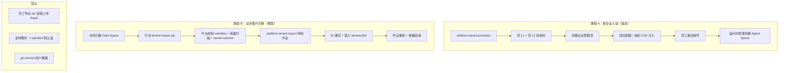

# OpenBot SaaS 租户数据架构 v1.1

> **状态：架构冻结（P0 默认签署）** | 创建：2026-07-11 | 修订：2026-07-11 | 冻结：2026-07-11 | 适用范围：**openbot.love SaaS** 多租户数据分层、入驻注入、试点迁移  
> **前置文档**（须一并阅读，冲突时以本文 SaaS 边界为准，Data Space 物理布局以 Data Space 模型为准）：
>
> - [Data Space 数据模型 v1.0](/design/openbot-data-space-model-v1-2026-07-10)
> - [数据目录产品规格 v0.2](/design/openbot-data-directory-product-spec-2026-07-10)
> - [数据目录 Kiro 验收清单](/design/openbot-data-directory-kiro-acceptance-checklist-2026-07-10)
> - [SECURITY.md](https://github.com/upbeyond/openbot/blob/main/SECURITY.md)（信任边界与密钥处置）
> - cost-budget-billing（`.kiro/specs/cost-budget-billing/`）— Usage_Record / Bill 归因
> - operational-identity-governance（`.kiro/specs/operational-identity-governance/`）— 运营身份与凭证边界
> - **tenant-context-propagation**（`.kiro/specs/tenant-context-propagation/`）— **运行时**租户上下文传播：本文定义 L0–L3 静态归属与 `tenant-import` 迁移；该 spec 定义共享 Gateway **请求期**按租户解析 L1/L2 的寻址层（`resolveTenantContext` + context-aware `tenant-store-paths`，**P0 已合入**）。两文的 Phase 编号相互独立（见 §13 注）。
> - [租户上下文传播实施计划（短期共享 Gateway）](/design/tenant-context-propagation-plan-2026-07-11) 与 [混合 Gateway 隔离未来计划（dedicated / VIP，云端稳定后启动）](/design/hybrid-gateway-isolation-future-plan-2026-07-11)
>
> **读者**：产品、平台架构、Gateway、安全评审、运维（openbot.love）、企业端  
> **验收目标**：专家组 **P0 阻断项已默认签署**（§0、§0.1）→ **P1 已启动实施**（§8.2 `verify-migration-readiness`）；P3 `tenant-import` 编码仍以 §12 验收清单为门禁

---

## 0. 专家组评审结论

**总评：8.5/10 — 架构清晰、边界明确；v1.1 已补充实施细节、可测性与关联 specs 集成路径。**  
**签署结论（2026-07-11）：P0 全部默认签署通过，进入 P1 实施。**

| 决策                       | 状态                          | 评审人   | 日期       |
| -------------------------- | ----------------------------- | -------- | ---------- |
| 四层数据模型（L0–L3）      | ✅ 通过                       | 默认签署 | 2026-07-11 |
| SaaS 物理目录规范          | ✅ 通过                       | 默认签署 | 2026-07-11 |
| 员工「导出」≠ 租户全量迁移 | ✅ 通过                       | 默认签署 | 2026-07-11 |
| `tenant-import` 包格式 v1  | ✅ 通过（v1.1 补充计费/身份） | 默认签署 | 2026-07-11 |
| ID 重写与密钥不重放规则    | ✅ 通过                       | 默认签署 | 2026-07-11 |
| 分阶段交付范围（§13）      | ✅ 通过                       | 默认签署 | 2026-07-11 |
| 可测性条款（§12.4）        | ✅ 通过                       | 默认签署 | 2026-07-11 |

### 0.1 P0 阻断决策（已裁决）

| #        | 问题                          | 裁决结果（2026-07-11）                                                                                                                               | 状态        |
| -------- | ----------------------------- | ---------------------------------------------------------------------------------------------------------------------------------------------------- | ----------- |
| **OQ-1** | L1 控制面存储：JSON vs SQLite | **采纳 A：P3 前 JSON 分片**；新租户量大后再迁 B。引擎全表与 12 个月路线见附录 [持久化引擎矩阵](/design/openbot-persistence-engine-matrix-2026-07-13) | ✅ 默认签署 |
| **OQ-3** | 导入时 email 已存在           | **采纳 A：merge L2**（控制面绑定已有 userId）；冲突写审计                                                                                            | ✅ 默认签署 |

### 0.2 P1 非阻断（实施中迭代）

| #    | 问题                                                 | 决策时限                                  |
| ---- | ---------------------------------------------------- | ----------------------------------------- |
| OQ-2 | 协作组内容落 L2 / tenant/shared / 按 visibility 拆分 | P3 实施期                                 |
| OQ-4 | 热会话 L3 是否导入                                   | P4 优化期；默认 **B：仅 archive 后进 L2** |
| OQ-5 | 多区域 tenant 数据驻留                               | P5 全球化阶段                             |

---

## 1. 结论先行

1. **Git 仓库只承载代码与配置模板**；企业客户数据、员工数据、知识资产 **不得** 进入代码库或镜像层。
2. **openbot.love SaaS** 采用 **四层分离**：平台（L0）→ 企业控制面（L1）→ 用户 Data Space（L2）→ 运行时（L3）。
3. **员工端「导出我的 OpenBot 数据」** 仅覆盖 **L2 用户 Data Space** 子集；**不能** 作为本地试点迁入 SaaS 的唯一手段。
4. **新企业拓展** 走 **Provision（空租户）+ 控制面注入 + 按需 L2 注入**；**试点迁移** 走平台特权 **`tenant-import`** 管线（运维 / 平台 RPC，非员工自助）。
5. **SaaS 下 `data.mode = "managed"`**：员工 RPC 拒绝 `data.export.*`、`workspaces.local.browse`（已实现）；租户导入 **仅** 平台特权主体可调用。
6. **凭证与设备身份永不进导入/导出包**；导入后由租户管理员在 SaaS 密钥库 **重新授权**。
7. **路径解析单一入口**：`resolveDataSpacePaths(cfg, agentId, { tenantId, userId })` 为长期目标；禁止新增 `agents.list[].workspace` 绝对路径依赖。

---

## 2. 背景与问题

### 2.1 现状

| 现象                                                            | 根因                                                                                    |
| --------------------------------------------------------------- | --------------------------------------------------------------------------------------- |
| 本地「导出」zip 仅数十 KB，不含 bot-2、协作组、知识库、企业席位 | 导出只扫 `data.root`（`~/OpenBot`）；大量资产仍在 `~/.openbot/workspace-*` 与 state dir |
| SaaS 新部署后「用户数据全丢」                                   | 空库 Provision 为预期；**未执行** `tenant-import`                                       |
| 本地 `~/.openbot` 单目录混合平台、企业、用户、运行时数据        | 开发机单租户形态，未按 SaaS 多层隔离                                                    |
| 员工期望「导出 = 全量备份可上云」                               | 产品与实现范围不一致，需架构级澄清                                                      |

### 2.2 目标（Must）

- G1：冻结 SaaS 多租户 **数据归属表**（每个业务对象对应 L0–L3 一层）
- G2：定义 **新企业入驻** 与 **试点迁移** 两条注入路径，互不混淆
- G3：定义 **`tenant-import` v1** 包格式、manifest、ID 重写、安全红线
- G4：与现有 Data Space 模型 **同构**：SaaS 上 `users/<uid>/OpenBot/` ≡ 本机 `~/OpenBot/`
- G5：专家组可依据 **§12** 做签字验收，再排期研发

### 2.3 非目标（Won't / Later）

- W1：不在 v1 实现跨云厂商实时双写（Primary 仅单区域 SSD/块存储）
- W2：不在 v1 让员工自助上传 `tenant-import` 包（防跨租户投毒）
- W3：不在 v1 迁移本机 **渠道凭证**（WhatsApp / Telegram 等配对态）；导入后重新配对
- W4：不在 v1 保证 Mac → SaaS **热会话** 无缝续聊（L3 runtime 可丢弃，依赖 archive + 可选 stub）
- W5：不在本文定义计费账本全量迁移（商用 runtime 账单归 L0，单独 runbook）

---

## 3. 四层数据模型

```text
┌──────────────────────────────────────────────────────────────────┐
│ L0 平台层 Platform Plane                                          │
│ 全局租户目录、套餐/计费策略、平台超管、模型平台策略、跨租户审计   │
│ 存储：平台 Gateway state（不按企业客户暴露路径）                  │
│ 隔离键：platform（单实例）或 platformShardId（分片扩展）          │
└────────────────────────────┬─────────────────────────────────────┘
                             │ 1 : N
┌────────────────────────────▼─────────────────────────────────────┐
│ L1 企业层 Tenant Control Plane                                    │
│ 企业元数据、席位、组织、企业知识治理、共享 Agent 策略、seat 绑定  │
│ 存储：逻辑归属 tenantId；物理可为 tenant 分片 JSON/SQLite         │
│ 隔离键：tenantId（强制）                                          │
└────────────────────────────┬─────────────────────────────────────┘
                             │ 1 : N users
┌────────────────────────────▼─────────────────────────────────────┐
│ L2 用户层 User Data Space（员工可感知的「我的 OpenBot 数据」）     │
│ agents/*、shared/knowledge、memory/personal、conversations/archive│
│ 存储：/data/tenants/<tenantId>/users/<userId>/OpenBot/          │
│ 配置：data.mode=managed，data.root 由 Gateway 按会话解析        │
│ 隔离键：tenantId + userId（默认）；跨用户共享仅经 L1 显式授权     │
└────────────────────────────┬─────────────────────────────────────┘
                             │ per agentId
┌────────────────────────────▼─────────────────────────────────────┐
│ L3 运行时层 Runtime Ephemeral                                     │
│ 热会话 sessions/*.jsonl、可重建 cache、embedding 热索引、沙箱态   │
│ 存储：state dir 下按 tenant/user/agent 分区（实现可集中）         │
│ 规则：不导出、不 tenant-import；故障可重建                        │
└──────────────────────────────────────────────────────────────────┘
```

### 3.1 术语对照

| 术语                 | 层级           | SaaS 员工可见                        |
| -------------------- | -------------- | ------------------------------------ |
| Platform State       | L0             | 否                                   |
| Tenant Control Plane | L1             | 企业端可见元数据；员工端只见业务对象 |
| User Data Space      | L2             | 是（托管说明，无物理路径）           |
| Runtime Session      | L3             | 否                                   |
| Secrets Vault        | 密钥层（横切） | 否；永不进 import/export 包          |
| Loom worktree 元数据 | L3             | 否；可丢弃，由编排器在 SaaS 上重建   |
| IDE Agent 会话 WIP   | L3             | 否；不属于用户可迁移资产             |

### 3.2 Loom / 多 Agent 编排边界

- **Loom registry**（`.loom/registry.yaml`）与 **git worktree** 状态属于 **开发编排元数据**，归 **L3 可丢弃** 或留在代码仓库侧，**不** 进入 `tenant-import`。
- SaaS 员工工作台不暴露 worktree 路径；若未来在云端运行 Loom，仅持久化 **任务规格 / tasks.md**（若在 L2 workspace 内则随 L2 迁移）。

### 3.3 与 Data Space 模型的关系

- Data Space 模型定义 **L2 内部结构**（`agents/`、`shared/`、`memory/`、`.meta/`）。
- 本文扩展 **SaaS 多租户外壳**（`tenants/<tid>/users/<uid>/` + `tenants/<tid>/shared/`）及 **L0/L1 控制面** 归属。
- 本机 `~/OpenBot` **同构于** SaaS `users/<uid>/OpenBot/`；**不同构于** 整个 `~/.openbot`。

---

## 4. SaaS 物理目录规范（冻结草案）

```text
/data/                                    # 平台数据卷根（示例挂载点）
├── platform/                             # L0（可选集中；亦可仅在 state dir）
│   ├── billing/
│   └── audit/
└── tenants/
    └── <tenantId>/
        ├── control-plane/                # L1（本租户控制面快照）
        │   ├── seat-assets.json        # 默认 JSON；可选 sqlite 分片（OQ-1，见 openbot-enterprise-seat-assets-storage-2026-07-13）
        │   ├── enterprise-data.json
        │   ├── organization/
        │   ├── collaboration-registry.json   # 小组元数据索引（非全文）
        │   ├── billing-usage.json          # 可选；§11.2 按租户拆分
        │   └── billing-ledger.json         # 可选；§11.2
        ├── shared/                       # L1 企业共享 Data Space
        │   ├── knowledge/
        │   ├── agents/                   # 企业共享机器人 Agent Space（可选）
        │   └── policies/                 # 保留策略指针（非用户文件）
        └── users/
            └── <userId>/
                └── OpenBot/              # L2 — 与 Data Space §3 同构
                    ├── agents/
                    │   └── <agentId>/
                    │       ├── workspace/
                    │       ├── memory/
                    │       ├── artifacts/
                    │       └── conversations/
                    │           ├── archive/
                    │           └── index.json
                    ├── shared/
                    ├── memory/
                    │   └── personal/
                    ├── cache/
                    └── .meta/
                        ├── manifest.json
                        └── access-grants.jsonl
```

### 4.1 隔离 enforcement（红线）

| 边界                         | 机制                                                                                                                                                                                   | 违反后果           |
| ---------------------------- | -------------------------------------------------------------------------------------------------------------------------------------------------------------------------------------- | ------------------ |
| tenant A ↔ tenant B          | 路径前缀 + `isPathWithinRoot`；API 必带 `tenantId`                                                                                                                                     | **P0 安全事件**    |
| user A ↔ user B（同 tenant） | 默认 L2 隔离；读他户数据须 L1 授权记录                                                                                                                                                 | 数据泄露           |
| 员工 token ↔ `/data` 浏览    | Gateway **拒绝** `workspaces.local.browse` 等                                                                                                                                          | 运维面暴露         |
| import 包 ↔ 错误 tenant      | manifest `targetTenantId` 与作业 tenant 必须一致                                                                                                                                       | 作业失败，审计告警 |
| managed 模式 + 缺租户上下文  | **fail-closed**：`resolveDataRootForContext` 在 managed 下必须有已解析 `TenantContext`；缺 ctx 即抛错，**绝不**回退全局 `data.root`（`src/gateway/tenant-store-paths.ts`，评审 高危1） | 跨租户串数据       |
| 会话租户归属来源             | **membership-only 权威**：tenant/user 仅由平台备案 membership 派生（`resolveTenantContext`）；client `sessionTenantId` 仅交叉校验、不作权威（评审 高危2）                              | 冒充租户           |

> 上两条为 `tenant-context-propagation` spec P0 已落地的安全属性（专家评审两处高危项的修复结论）；寻址层实现见 §17 与该 spec。

### 4.2 Gateway 内部配置（每请求解析，非员工配置）

> **现状标注**：本节描述**目标态**。请求期租户上下文**解析器已落地**（`resolveTenantContext` + `resolveDataRootForContext`，`tenant-context-propagation` P0）；但把它**接入全部 handler**（L1/L2 寻址）仍是进行中工作（该 spec 的 P1–P4，未开始）。在接线完成前，运行时仍按单实例单租户解析 `data.root`。

员工会话建立后，Gateway 解析出（目标态）：

```json5
{
  data: {
    mode: "managed",
    schemaVersion: 1,
    tenantId: "acme",
    userId: "u-001",
    root: "/data/tenants/acme/users/u-001/OpenBot",
  },
}
```

`data.root` **不得** 由员工端 Web UI 写入；仅 Provision / Import / 平台运维可改。

> **实现注**：per-tenant 数据卷基路径（`root` 前缀里的 `/data/tenants`）在代码中由 `OPENBOT_TENANTS_ROOT` 配置，本地缺省回退 `CONFIG_DIR/tenants`（见 `resolveTenantsRoot`，`src/gateway/tenant-store-paths.ts`）。文中 `/data/tenants/...` 为 SaaS 示例挂载点。

---

## 5. 业务对象归属表（验收必查）

| 业务对象                                    | 层级   | 存储位置（SaaS）                                                                                                                                 | 隔离键                                                     | 可 export                        | 可 tenant-import            |
| ------------------------------------------- | ------ | ------------------------------------------------------------------------------------------------------------------------------------------------ | ---------------------------------------------------------- | -------------------------------- | --------------------------- |
| 企业 / 租户                                 | L0/L1  | `platform-auth.enterprises` + `tenants/<tid>/control-plane/`                                                                                     | `tenantId`                                                 | 否（平台）                       | 是（L1 切片）               |
| 员工账号                                    | L0/L1  | `platform-auth.users` + `memberships`                                                                                                            | `userId`, `tenantId`                                       | 否                               | 是（须 ID 重写）            |
| 席位 / 编制                                 | L1     | `seat-assets` store                                                                                                                              | `tenantId`, `seatId`                                       | 否                               | 是                          |
| 员工机器人（绑定）                          | L1→L2  | seat binding → `agentId`；实体在 L2                                                                                                              | `seatId`, `agentId`                                        | 间接                             | 是                          |
| Agent workspace 文件                        | L2     | `users/<uid>/OpenBot/agents/<id>/workspace/`                                                                                                     | `userId`, `agentId`                                        | 是                               | 是                          |
| 协作小组（企业级）                          | L1/L2  | 元数据 L1；内容 `workspace/.openbot/collaboration/` 或 `tenant/shared/`                                                                          | `groupId`                                                  | 部分                             | 是                          |
| 个人知识库                                  | L2     | `users/.../shared/knowledge/` + index                                                                                                            | `userId`, `ownerId`                                        | 是                               | 是                          |
| 企业知识库                                  | L1     | `tenants/<tid>/shared/knowledge/`                                                                                                                | `tenantId`                                                 | 企业备份                         | 是                          |
| 知识索引 SQLite                             | L3/L2  | 热索引宜 `cache/`；冷索引 `shared/knowledge/.index/`                                                                                             | `ownerId`                                                  | 可选                             | 可重建则跳过                |
| 对话归档                                    | L2     | `conversations/archive/`                                                                                                                         | `userId`, `agentId`                                        | 是                               | 是                          |
| 热对话 transcript                           | L3     | `state/.../sessions/*.jsonl`                                                                                                                     | session                                                    | 否                               | 否（可选异步归档后导入 L2） |
| CogniWeave / memory sqlite                  | L2/L3  | 逐步迁入 `agents/<id>/memory/`                                                                                                                   | `agentId`                                                  | 子集                             | 是（若属用户资产）          |
| 企业数据治理目录                            | L1     | `enterprise-data.json`                                                                                                                           | `tenantId`                                                 | 企业备份                         | 是                          |
| 运营身份（user-owned 个人，无 secret）      | L2     | 本机 `openbot-user-operational-identity.json`（identities/grants/credentialHandles）→ SaaS `users/<uid>/OpenBot/.meta/operational-identity.json` | `ownerId`(=userId)；grant 带 `agentId`/`seatId`/`tenantId` | 是（脱敏，仅 handle 不含 token） | 是（ID 重写 + 重新授权）    |
| 运营身份（tenant-owned 企业，无 secret）    | L1     | 本机 `openbot-enterprise-seat-assets.json` 内 `identities`/`credentialBindings`/`usagePolicies`/`enrollments` → `control-plane/seat-assets.json` | `tenantId`                                                 | 企业备份                         | 是（ID 重写 + 重新授权）    |
| 运营身份凭证 secret（access/refresh token） | 密钥层 | user：`openbot-user-operational-identity-secrets.json`；tenant：credential vault（`credentialBindingId` 指向）                                   | `ownerId` / `tenantId`                                     | **永不**                         | **永不**                    |
| Agent 孵化 / 成长记录                       | L2     | `users/.../agents/<id>/incubation/` 或 `asset-incubation` 落盘副本                                                                               | `userId`, `agentId`                                        | 可选                             | 可选（试点客户常需）        |
| Usage_Record（用量明细）                    | L0→L1  | 平台 `openbot-billing-usage.json` **按 `enterprise_id` 拆分** → `control-plane/billing-usage/`                                                   | `tenantId`                                                 | 企业报表                         | 单独 runbook（§11.2）       |
| Bill / Cost_Snapshot                        | L0→L1  | 平台 `openbot-billing-ledger.json` **按租户拆分** → `control-plane/billing-ledger/`                                                              | `tenantId`                                                 | 企业报表                         | 单独 runbook（§11.2）       |
| API Key / OAuth（凭证体）                   | 密钥层 | `credentials/`, `encrypted-secrets`                                                                                                              | `tenantId`                                                 | **永不**                         | **永不**                    |
| 设备身份                                    | L3     | `identity/device.json`                                                                                                                           | device                                                     | 否                               | 否                          |
| 平台全局计费策略                            | L0     | `openbot-billing-plans.json` 等                                                                                                                  | platform                                                   | 否                               | 否（SaaS 侧重配套餐）       |

**运营身份说明**（对齐 operational-identity-governance R2/D2，经代码核验）：

- **元数据/绑定与凭证 secret 物理分离**（两套 store）：
  - user-owned 元数据 `openbot-user-operational-identity.json`（`identities` 仅存 `credentialHandleId` 引用、`grants`、`credentialHandles`），secret 在 `openbot-user-operational-identity-secrets.json`（`accessToken`/`refreshToken`）。
  - tenant-owned 元数据在 `openbot-enterprise-seat-assets.json`（`EnterpriseIdentity` 仅存 `credentialBindingId` 引用、`IdentityUsagePolicy`、`EmployeeEnterpriseIdentityEnrollment`），secret 在凭证 vault。
- **可迁移的是元数据/绑定**（provider、subject、scope、grant）；**secret store 永不进包**（§9.2/§10.2），导入后重新授权（OAuth 重新绑定）。
- **归属由平台备案解析**（R2：`ownerId` = `PlatformAuthUser.id`，与 `auth.mode` 解耦）；**user-owned 与 tenant-owned 不做模型合并**（D2），故本表分列两行。

**平台账号 / 租户目录权威说明**（对齐 `tenant-context-propagation` Q-A 裁决）：

- 本表「企业 / 租户」「员工账号」行里 `platform-auth` 对应的 `control-plane/platform-auth-slice.json`（L1）**仅为 `tenant-import` 导入期迁移物**（按 OQ-3 email `merge` 进目标环境），**不是**运行时按租户的权威读路径。
- **运行时权威仍是全局 `platform-auth` store（不按租户分片）**：会话的 tenant/user 由平台备案 membership 派生（若把 `platform-auth` 也做成 per-tenant，会陷入「先知 tenant 才能查 membership、查 membership 又是为得出 tenant」的鸡生蛋）。
- 因此 **per-tenant L1 运行时切片 = `seat-assets` + `enterprise-data`**；`organization` 由「全局 `platform-auth` + per-tenant `seat-assets`」派生，无独立 store。详见 `tenant-context-propagation` spec 的 Q-A 与 §L1 范围。

---

## 6. 两条数据注入路径（不可混淆）



### 6.1 路径 A：新企业入驻（推荐默认）

| 步骤                 | 执行主体            | 写入层                        |
| -------------------- | ------------------- | ----------------------------- |
| 创建 tenant 记录     | 平台超管 / 自助开通 | L0/L1                         |
| Provision 存储       | 平台作业            | L1 `shared/` + 每用户空 L2    |
| 导入组织架构         | 企业管理员          | L1                            |
| 分配席位与机器人配额 | 企业管理员          | L1                            |
| 员工首次登录         | 员工                | L2 懒创建 `agents/<agentId>/` |
| 知识库导入           | 员工 / 企业管理员   | L2 或 L1 `shared/knowledge`   |

### 6.2 路径 B：试点迁移（本地 → openbot.love）

**前置条件**：本机已完成 **Data Space 归集**（见 §8.1）；否则 import 包不完整。

| 步骤           | 执行主体                 | 说明                                   |
| -------------- | ------------------------ | -------------------------------------- |
| 生成 import 包 | 运维 / 迁移 CLI          | 含 L1 切片 + 每用户 L2                 |
| 预检           | 平台                     | 目标 tenant 存在、配额足够、包签名有效 |
| 导入           | `platform.tenant.import` | 幂等键 `importJobId`                   |
| 后处理         | 平台 + 租户管理员        | 重配密钥、重绑渠道、doctor 冒烟        |

---

## 7. 员工「导出」与「租户导入」对比

| 维度                 | `data.export.create`（员工端）                         | `tenant-import`（平台）         |
| -------------------- | ------------------------------------------------------ | ------------------------------- |
| 调用方               | 本机员工 token                                         | 平台运维 / 特权 service account |
| 数据范围             | L2：`agents/`, `shared/`, `memory/personal/`, `.meta/` | L1 控制面 + 多用户 L2           |
| SaaS 可用            | **否**（`LOCAL_ONLY`）                                 | **是**                          |
| 含 credentials       | **否**                                                 | **否**                          |
| 含 platform 全局计费 | 否                                                     | 否                              |
| 用途                 | 本机搬家、GDPR 子集                                    | 试点上云、灾备恢复              |
| 现状                 | 已实现（`src/data/data-export.ts`）                    | **待实施**（本文定义格式）      |

---

## 8. 本机归集要求（迁移前置）

开发机 / 试点环境常见 **遗留布局**，须在打包 `tenant-import` **之前** 完成归集：

### 8.1 遗留路径（须消除或映射）

| 遗留位置                                                     | 目标位置（L2/L1）                                                                | 层级说明               |
| ------------------------------------------------------------ | -------------------------------------------------------------------------------- | ---------------------- |
| `~/.openbot/workspace-<agentId>/`                            | `~/OpenBot/agents/<agentId>/workspace/`                                          | L2                     |
| `agents.list[].workspace` 绝对路径                           | 废弃；由 `data.root` 派生                                                        | 配置                   |
| `~/.openbot/knowledge/` 用户文档                             | `~/OpenBot/shared/knowledge/` 或 `tenant-shared/knowledge/`                      | L2/L1                  |
| `*/.openbot/collaboration/groups/<groupId>/` **内容与章程**  | 对应 agent `workspace/.openbot/collaboration/` 或 `tenant/shared/collaboration/` | **L2 或 L1**（可迁移） |
| `*/.openbot/collaboration/` 下 **热会话索引 / runtime stub** | 不迁移；导入后由 Gateway 重建                                                    | **L3**（不打包）       |
| `~/.openbot/agents/<id>/sessions/*.jsonl`                    | 先 `data.conversations.archive` → 再随 L2 `conversations/archive/`               | L3→L2                  |

**`agents.list[].workspace` 绝对路径时限**：

| 阶段                        | 规则                                                                     |
| --------------------------- | ------------------------------------------------------------------------ |
| Phase 1（当前）             | 允许 **只读** 遗留路径；`doctor` / `verify-migration-readiness` **警告** |
| Phase 2                     | 禁止 **新增** 绝对路径写入                                               |
| **打包 `tenant-import` 前** | 必须为 **0** 条绝对路径；否则 preflight **失败**                         |

### 8.2 归集验收

**已交付（P1）**：CLI `openbot data verify-migration-readiness`（`src/cli/program/register.data.ts`）+ 只读 RPC `data.migration.verifyReadiness`（`src/gateway/server-methods/data.ts`，managed 模式拒绝），共用纯引擎 `src/data/migration-readiness.ts`（`evaluateMigrationReadiness`）。

```bash
# 打包 tenant-import 前的强制门禁：遗留 workspace 存在则退出码 1（SAAS-T-05）
openbot data verify-migration-readiness --fail-on-legacy-workspace

# 缩小检查范围（默认全开）：
#   --no-check-paths           跳过 Data Space 文件系统检查
#   --no-check-agents-config   跳过 agents.list[].workspace 配置检查
#   --json                     输出机读报告

# 预期输出示例：
# ✓ data.root 已设置
# ✓ Data Space 树完整（agents/, .meta/）
# ✓ 无 agents.list[].workspace 绝对路径
# ✗ 发现 N 处遗留 workspace 目录 —
#     ~/.openbot/workspace-bot-2 → ~/OpenBot/agents/bot-2/workspace
# Migration readiness: NOT READY
```

**检查项与退出码**（引擎语义）：

| 检查                             | checkId                    | 无 `--fail-on-legacy-workspace` | 有 `--fail-on-legacy-workspace` |
| -------------------------------- | -------------------------- | ------------------------------- | ------------------------------- |
| data.root 已配置                 | `data-root-configured`     | warn（默认根）                  | warn                            |
| Data Space 树（agents/, .meta/） | `data-space-tree`          | warn（缺失）                    | warn                            |
| 无绝对 `agents.list[].workspace` | `no-absolute-workspace`    | warn                            | **fail → 退出 1**               |
| 无遗留 `workspace-<id>` 目录     | `no-legacy-workspace-dirs` | warn                            | **fail → 退出 1**               |
| 无遗留 `knowledge/` 目录         | `no-legacy-knowledge-dir`  | warn                            | warn                            |

> `ready = 无 fail 级发现`；`--fail-on-legacy-workspace` 把遗留 workspace 发现提级为 fail（退出码 1），对应 §8.1「打包前须为 0」。knowledge 目录始终为 warn，不单独拦截打包。

**临时手工检查**（等价快照）：

```bash
openbot config get data.root
rg '"workspace":\s*"/' ~/.openbot/openbot.json   # import 前须无匹配
test -d ~/OpenBot/agents && test -d ~/OpenBot/.meta
```

---

## 9. `tenant-import` 包格式 v1

### 9.1 包命名

```text
tenant-import-<sourceEnv>-<sourceTenantHint>-<timestamp>.zip
```

示例：`tenant-import-local-dev-acme-20260711143000.zip`

### 9.2 包内结构

```text
tenant-import.zip
├── tenant-import-manifest.json      # 必需；见 §9.3
├── CHECKSUMS.sha256                 # 可选；推荐
├── control-plane/                   # L1 切片（单租户）
│   ├── platform-auth-slice.json     # enterprises/users/memberships 子集
│   ├── seat-assets.json
│   ├── enterprise-data.json
│   └── organization/                # 可选
├── users/
│   └── <sourceUserId>/
│       └── OpenBot/                 # L2；结构与 data.export 一致
│           ├── agents/
│           ├── shared/
│           ├── memory/
│           └── .meta/
└── tenant-shared/                   # 可选 L1 企业共享
    ├── knowledge/
    └── agents/
```

**禁止出现的路径片段**（scanner 命中即拒收）：

- `credentials/`
- `identity/`
- `auth-profiles`
- `*.pem`, `*.key`
- `openbot-encrypted-secrets.json`（整文件）
- `openbot-user-operational-identity-secrets.json`（运营身份 token store，整文件）
- 企业运营身份凭证 vault（`credentialBindingId` 指向的 secret）
- 明文 `apiKey`, `botToken`, `passwordHash`, `accessToken`, `refreshToken` 字段（platform-auth-slice / operational-identity 元数据须脱敏或哈希保留策略见 §10.2）

### 9.3 `tenant-import-manifest.json` Schema

```json
{
  "schemaVersion": 1,
  "packageKind": "tenant-import",
  "exportedAt": "2026-07-11T06:10:35.756Z",
  "source": {
    "environment": "local-dev",
    "openbotVersion": "1.0.1",
    "sourceTenantId": "tenant-acme-local",
    "sourceStateDirHint": "~/.openbot",
    "sourceDataRootHint": "~/OpenBot"
  },
  "target": {
    "targetTenantId": "acme",
    "targetRegion": "ap-southeast-1",
    "idRemapPolicy": "deterministic-v1"
  },
  "contents": {
    "controlPlane": true,
    "userDataSpaces": ["u-local-001", "u-local-002"],
    "tenantShared": true,
    "includedPaths": ["control-plane/", "users/", "tenant-shared/"],
    "excludedCategories": [
      "credentials",
      "identity",
      "runtime-sessions",
      "auth-profiles",
      "platform-global-billing"
    ]
  },
  "stats": {
    "fileCount": 1204,
    "bytes": 52428800,
    "userCount": 2,
    "agentCount": 7
  },
  "checksums": {
    "algorithm": "sha256",
    "manifestSha256": "<hex>"
  }
}
```

| 字段                      | 必填 | 说明                                    |
| ------------------------- | ---- | --------------------------------------- |
| `schemaVersion`           | 是   | 当前 `1`                                |
| `packageKind`             | 是   | 固定 `tenant-import`                    |
| `target.targetTenantId`   | 是   | 须与导入作业参数一致                    |
| `contents.userDataSpaces` | 是   | 源 userId 列表；导入时映射为目标 userId |
| `source.sourceTenantId`   | 是   | 审计用；不假定与目标相同                |

### 9.4 与现有 `openbot-export-manifest.json` 的关系

| 项目   | `openbot-export-manifest`     | `tenant-import-manifest`         |
| ------ | ----------------------------- | -------------------------------- |
| 范围   | 单用户 L2                     | 租户级 L1 + 多用户 L2            |
| 生成方 | `data.export.create`          | 迁移 CLI / 运维工具              |
| 恢复   | `data.export.restore`（本机） | `platform.tenant.import`（SaaS） |

---

## 10. ID 重写与引用修复

### 10.1 必须重写的 ID 类

| ID 类型                                                       | 源                                   | 目标策略                                                                    |
| ------------------------------------------------------------- | ------------------------------------ | --------------------------------------------------------------------------- |
| `userId`                                                      | `platform-auth-slice.users[].id`     | **OQ-3（P0）**：默认按 email **merge** L2 到已有账号；拒绝/子账号为可选策略 |
| `tenantId`                                                    | 源企业 id                            | **强制** 使用 manifest `target.targetTenantId`                              |
| `seatId`                                                      | seat-assets                          | 新 uuid；维护 `legacySeatId` 映射表（导入作业内）                           |
| `agentId`                                                     | agents.list / seat binding           | 优先保留语义 id（如 `main`）；冲突则后缀 `-imported`                        |
| `groupId`                                                     | collaboration                        | 新 uuid；更新 workspace 内引用                                              |
| `knowledgeBaseId`                                             | knowledge bases                      | 新 uuid；更新 index 与绑定                                                  |
| 运营身份 `identityId`（user/tenant）                          | user/enterprise 运营身份 store       | 新 uuid；同步重写 grants/usagePolicies/enrollments/handles 内引用           |
| `credentialHandleId`（user）/ `credentialBindingId`（tenant） | handle/binding                       | 新 uuid；**secret 不迁移**，导入后重新授权时重建句柄                        |
| `grantId` / `policyId` / `enrollmentId`                       | grants / usagePolicies / enrollments | 新 uuid；重指向重写后的 `identityId` + `seatId`/`agentId`                   |

### 10.2 凭证与用户密码

| 数据                          | 策略                                                                                                                            |
| ----------------------------- | ------------------------------------------------------------------------------------------------------------------------------- |
| `passwordHash`                | **不导入**；目标用户走「首次激活 / 重置密码」                                                                                   |
| OAuth refresh token           | **不导入**                                                                                                                      |
| 模型 API Key                  | **不导入**；企业端重新配置密钥库                                                                                                |
| Gateway token                 | 目标环境重新生成                                                                                                                |
| MFA secret                    | **不导入**；用户重新绑定 MFA                                                                                                    |
| 运营身份 access/refresh token | **不导入**；user `openbot-user-operational-identity-secrets.json` 与 tenant 凭证 vault 均排除，导入后由 owner 走 OAuth 重新绑定 |

### 10.3 绝对路径消除（源头归集，而非导入期重指向）

不变量：导入后的 tenant 数据卷内 **零源机绝对路径**（`/Users/`、`/home/<u>/`、`C:\Users\`）。managed 模式一律由 `data.root` 派生路径（§1.7/§8.1），因此绝对路径**不是**「重指向到 `/data/tenants/...`」——重指向本身会重新引入 §1.7 禁止的绝对依赖，且需猜测源机 home、有改坏非 OpenBot 路径之险。管线以 **检测 + 拒绝**（非改写）保证该不变量，两端各一道闸门：

- **preflight（早、只读）**：扫描包内 `.json/.jsonl/.json5/.yaml/.yml`，命中源机绝对路径即失败，作业在任何 staging I/O 之前中止（`src/data/tenant-import/path-scan.ts` + `preflight.ts`）。
- **verify（提交前兜底）**：对 staged 树再查一次，失败则丢弃 staging、零提交（`commit.ts`，§16 #8）。

**前置**：打包前须由 `verify-migration-readiness`（§8.2）完成归集，在源头消除 `agents.list[].workspace` 等绝对路径。**验收**：导入后 `rg '/Users/'` 在 tenant 数据卷内 0 命中（配置与内容文件均适用）。

### 10.4 幂等性

| 键                                        | 行为                                                   |
| ----------------------------------------- | ------------------------------------------------------ |
| `importJobId`                             | 同一作业重复提交 → 返回原结果                          |
| `targetTenantId` + `source.packageSha256` | 已成功导入的包 → 默认拒绝重复（可运维 `--force`）      |
| 已存在 `userId`（email 命中）             | 默认 **merge** L2（文件级 newer-wins 或 dry-run 报告） |

---

## 11. 控制面存储映射（本地 → SaaS）

开发机常见文件与 SaaS L1 目标（单租户切片）：

| 本地文件（`~/.openbot/`）                                                                                 | SaaS 目标                                                | 层级   |
| --------------------------------------------------------------------------------------------------------- | -------------------------------------------------------- | ------ |
| `openbot-platform-auth.json`                                                                              | `control-plane/platform-auth-slice.json`                 | L1     |
| `openbot-enterprise-seat-assets.json`（含 tenant-owned 运营身份 identities/bindings/policies，无 secret） | `control-plane/seat-assets.json`                         | L1     |
| `openbot-enterprise-data.json`                                                                            | `control-plane/enterprise-data.json`                     | L1     |
| `organization/*`                                                                                          | `control-plane/organization/`                            | L1     |
| `knowledge/bases.json`（企业可见）                                                                        | `tenant-shared/knowledge/` 或 L1 索引                    | L1/L2  |
| `collaboration/collaboration.sqlite`                                                                      | 拆为 L1 元数据 + L2 内容（**不**整库盲拷）               | L1+L2  |
| `openclaw.json` `agents.list`                                                                             | 不整文件导入；提取 agent 定义写入 L1 binding + L2        | L1+L2  |
| `openbot-user-operational-identity.json`（user-owned，无 secret）                                         | L2 `users/<uid>/OpenBot/.meta/operational-identity.json` | L2     |
| `openbot-user-operational-identity-secrets.json`（access/refresh token）                                  | **不迁移**（§9.2/§10.2）；导入后 OAuth 重新绑定          | 密钥层 |
| `asset-incubation/`（可选）                                                                               | `users/.../agents/<id>/incubation/`                      | L2     |

> **`platform-auth-slice.json` 是迁移物、非运行时权威**（对齐 §5 权威说明 + `tenant-context-propagation` Q-A）：上表把 `openbot-platform-auth.json` 映射到 `control-plane/platform-auth-slice.json` **仅指导入期切片**（merge 进目标全局 store）；**运行时**共享 Gateway 仍读**全局** `platform-auth` store 并由 membership 派生租户，不从 per-tenant 切片解析权威。per-tenant L1 运行时只含 `seat-assets` + `enterprise-data`。

**平台全局文件（禁止整文件打入单租户包）**：

- `openbot-billing-plans.json` — SaaS 侧套餐真源，不随 tenant 迁移
- `openbot-billing-ledger.json` — 见 §11.2 **按租户拆分**，非整文件拷贝
- `openbot-billing-usage.json` — 见 §11.2
- 其他跨租户商用账本 / 平台策略

### 11.1 与现有 specs 集成（how）

| 关联规格                              | 集成方式                                                                                                                                          | 本文落点               |
| ------------------------------------- | ------------------------------------------------------------------------------------------------------------------------------------------------- | ---------------------- |
| **cost-budget-billing**               | Usage_Record / Bill 以 `enterprise_id` 归因；**不复用** `tenant-import` 主包，走 **billing-import runbook**                                       | §11.2                  |
| **operational-identity-governance**   | 迁移 user/tenant **元数据绑定**（`identities`/`grants`/`policies`）；secret 两套 store 均排除、导入后重新授权（R2）；user/tenant 不合并模型（D2） | §5、§9.2、§10.1、§10.2 |
| **enterprise-data-capability-center** | `enterprise-data.json` 整切片进 L1 `control-plane/`                                                                                               | §11 表                 |
| **loom-workspace-orchestrator**       | worktree/registry 归 L3，不进包                                                                                                                   | §3.2                   |

### 11.2 计费数据迁移 runbook（单独管线，非 tenant-import 主包）

商用 runtime 账本与 cost-budget-billing 对齐：

| 源（本地 L0）                           | 拆分键                               | SaaS 目标                                         | 说明                                           |
| --------------------------------------- | ------------------------------------ | ------------------------------------------------- | ---------------------------------------------- |
| `openbot-billing-usage.json`            | `enterprise_id` === `targetTenantId` | `tenants/<tid>/control-plane/billing-usage.json`  | Usage_Record append-only；保留 `event_id` 幂等 |
| `openbot-billing-ledger.json`           | Bill / Snapshot 的 `enterprise_id`   | `tenants/<tid>/control-plane/billing-ledger.json` | 纯追加语义不变                                 |
| `openbot-billing-subscriptions.json` 等 | 单租户切片                           | `control-plane/billing-subscription.json`         | 须映射到新 `plan_id`（SaaS 套餐）              |

**实施要点**：

1. **复用**现有 `src/gateway/billing/usage-records-store.ts` 读写契约；迁移工具输出 **符合 store schema 的 JSON 切片**，而非改 store 实现。
2. `enterprise-data` 下若有 usage 投影，仅作 **只读校验**，不以之为迁移真源。
3. 计费迁移 **可选**：试点客户若不需要历史账单，可跳过；Cost Dashboard 从导入日起算。
4. 运维命令（草案）：`openbot platform billing-import --tenant <tid> --from-usage <path> --from-ledger <path> --dry-run`

---

## 12. 专家验收清单（签字前必过）

> 专家组对 **本文档** 验收，通过后再对实施 PR 按 Phase 验收。

### 12.1 架构红线（任一项否 → 驳回）

| ID        | 检查项                 | 通过标准                                         |
| --------- | ---------------------- | ------------------------------------------------ |
| SAAS-D-01 | 四层模型清晰           | 每个 §5 业务对象唯一对应一层                     |
| SAAS-D-02 | 员工导出 ≠ 租户迁移    | 文档明确两条路径（§6、§7）                       |
| SAAS-D-03 | 凭证永不 import/export | §9.2 禁止列表 + §10.2 一致                       |
| SAAS-D-04 | tenant 隔离            | §4.1 enforcement 可实施                          |
| SAAS-D-05 | L2 与 Data Space 同构  | SaaS `users/.../OpenBot` = 本机 `~/OpenBot`      |
| SAAS-D-06 | managed 模式边界       | 员工不能 browse/import；与现有 `LOCAL_ONLY` 一致 |
| SAAS-D-07 | ID 重写规则完整        | §10 覆盖 user/seat/agent/group/kb                |
| SAAS-D-08 | 平台全局计费隔离       | §11 禁止打入 tenant 包                           |

### 12.2 manifest 与包格式

| ID        | 检查项                          | 通过标准                           |
| --------- | ------------------------------- | ---------------------------------- |
| SAAS-P-01 | `tenant-import-manifest` schema | §9.3 字段足以驱动导入作业          |
| SAAS-P-02 | 与 export manifest 区分         | `packageKind` 不同；范围不重叠混淆 |
| SAAS-P-03 | secret scanner 规则             | §9.2 可转为自动化拒绝列表          |

> **P3 本地管线已合入**（`src/data/tenant-import/`，12 模块 + colocated 单测全绿，全新目录零共享热文件风险）。端到端本地作业 `runLocalTenantImport`：**preflight → stage → content-rewrite → verify → commit** 全绿：
>
> - `secret-scanner.ts`（§9.2 路径+内容红线，**SAAS-P-03 / SAAS-T-04**）
> - `id-remap.ts`（§10.1，**SAAS-D-07**：user/seat/agent/group/kb/identity；OQ-3 email 合并；agent 语义 id 保留/`-imported`）
> - `manifest.ts`（§9.3 build/validate + §4.1 `assertManifestTargetsTenant` 跨租户拦截，**SAAS-P-01/P-02**）
> - `preflight.ts`（§14 校验管线 + §15 zip-slip `isUnsafeEntryName` + §10.3 源机绝对路径早拒）
> - `path-scan.ts`（§10.3 源机绝对路径探测器，preflight 早拒与 verify 兜底共用）
> - `package.ts`（§9 打包器：control-plane + 每用户 L2 核心路径 + tenant-shared → manifest 盖章 zip；命中密钥红线即中止；符号链接跳过）
> - `stage.ts`（§12.6 copy→staging：§10.3 用户/agent 路径级 ID 重写 + 双层 zip-slip）
> - `content-rewrite.ts`（§10 引用修复：JSON 内 id 引用精确值/键重写，仅重写实际变更的 id，manifest 不改）
> - `commit.ts`（§12.6 verify + commit：§10.3 残留源机绝对路径核验（§16 #8）；合并入 `tenants/<tid>/`，重提交幂等）
> - `import-job.ts`（§6.2/§12.6 本地作业引擎 `runLocalTenantImport`，phase 感知；preflight/stage/rewrite/verify 只碰 staging，仅 commit 写生产树）
> - `import-job-store.ts`（§10.4/§14：importJobId 幂等 + `(targetTenantId, packageSha256)` 重复包守卫；持久化作业账本）
> - `plan-from-package.ts`（§10/K-07：从包内 manifest/platform-auth-slice/seat-assets 解析源 id 建 plan，含 OQ-3 email 合并）
>
> **平台 RPC 已交付**（`src/gateway/server-methods/platform-tenant.ts`，7 RPC 级单测）：`platform.tenant.provision` / `import.preflight` / `import.start` / `import.status`，包装 `runLocalTenantImport` + 作业账本；双闸门鉴权——operator scope（`method-scopes.ts`：preflight/status→READ、provision/start→ADMIN）+ `session-domain.ts` 的 `"platform"` 域（员工 token 403）。
>
> **SAAS-T RPC 级覆盖**：T-01 隔离（跨租户 preflight 拒绝 + zip-slip）、T-02 幂等（同 importJobId 重放不重复 commit）、T-03 回滚安全（verify 失败零提交）、T-04 secret 拒绝 —— 均有 RPC 级测试。
>
> **per-tenant store-reader 已交付**（K-07，`src/gateway/tenant-store-paths.ts`）：`resolveTenantControlPlaneStorePath` + `loadTenantSeatAssetsStore` 按 `tenants/<tid>/control-plane/` 经真实 store API 加载 + 归一化租户 store（含租户隔离单测）。
>
> **请求期租户上下文传播已立项 + 落地 P0**（spec `.kiro/specs/tenant-context-propagation/`，接续上面「全 handler 传播」这项独立 SaaS-infra 重构）：新增 `src/gateway/tenant-context.ts`（`resolveTenantContext`/`requireTenantContext`，**membership-only 权威 + fail-closed**）并扩展 `tenant-store-paths.ts`（`resolveDataRootForContext` / `resolveControlPlaneStorePathForContext` / `assertWithinTenantRoot`）；P0 契约层对 local 零行为变化，21 单测绿。把它**接入全部 L1/L2 handler** 仍是该 spec 的 P1–P4（进行中，见 §4.2 现状标注）。
>
> **设计澄清（§10.3）**：**不做**绝对路径内容改写/重指向——以「源头归集 + preflight 早拒 + verify 兜底」保证零源机绝对路径（重指向会违反 §1.7/§8.1）。§16 冒烟的**数据层子集已自动化**（`pilot-smoke.test.ts`：席位数 / 每员工机器人 / 对话归档 / 零绝对路径 / 无凭证文件）。
>
> **尚未交付**：全 handler tenant-context 传播的**接线**（`tenant-context-propagation` spec P1–P4，动共享面；P0 契约层已合入）、§16 中需活网关的项（管理员登录 / doctor / 模型调用）的 **staging 实跑留档**（ops runbook）。

### 12.3 运维与产品

| ID        | 检查项                  | 通过标准                                                 |
| --------- | ----------------------- | -------------------------------------------------------- |
| SAAS-O-01 | 新企业路径不依赖 import | §6.1 可独立闭环                                          |
| SAAS-O-02 | 试点迁移前置归集        | §8 可执行、可验证                                        |
| SAAS-O-03 | 导入后凭证策略          | §10.2 用户可接受（重置密码/MFA）                         |
| SAAS-O-04 | 回滚策略                | 导入失败不破坏目标 tenant 已有数据；见 §12.5 / SAAS-T-03 |

### 12.4 可测性（Testability）

| ID        | 检查项         | 通过标准                                                                                    |
| --------- | -------------- | ------------------------------------------------------------------------------------------- |
| SAAS-T-01 | 租户隔离自动化 | `tenant-import` 测试套件含跨租户路径穿越模拟；全部被 `isPathWithinRoot` 或 API 租户门禁拦截 |
| SAAS-T-02 | 幂等性验证     | 同一 `importJobId` 重复 `import.start` 返回原作业结果；不产生重复 seat/agent **降级**       |
| SAAS-T-03 | 回滚验证       | 覆盖 copy / verify / switch_config 失败点；失败后目标 tenant **原数据完整**、Gateway 可启动 |
| SAAS-T-04 | secret scanner | 含凭证样本的包 100% 被 preflight 拒绝                                                       |
| SAAS-T-05 | 归集就绪       | `verify-migration-readiness` 对遗留 workspace 返回退出码 1 且列出路径                       |

### 12.5 开放问题（专家需裁决）

| #        | 问题              | 选项                                             | 状态 / 决策时限     |
| -------- | ----------------- | ------------------------------------------------ | ------------------- |
| **OQ-1** | L1 控制面存储     | A: JSON / B: SQLite                              | ✅ 已裁决 A（§0.1） |
| OQ-2     | 协作组内容位置    | A: L2 / B: tenant/shared / C: 按 visibility 拆分 | P1 — P3 实施中      |
| **OQ-3** | 导入时 email 冲突 | A: merge L2 / B: 拒绝 / C: 子账号                | ✅ 已裁决 A（§0.1） |
| OQ-4     | 热会话导入        | A: 永不 / B: archive 后 L2 / C: 可选开关         | P1 — P4 优化期      |
| OQ-5     | 多区域驻留        | A: 单区域 / B: tenant.region 字段                | P2 — 全球化阶段     |

### 12.6 导入作业回滚细则（落实 SAAS-O-04 / SAAS-T-03）

| 阶段                 | 失败时行为                                                                 |
| -------------------- | -------------------------------------------------------------------------- |
| preflight            | 无写入；返回错误清单                                                       |
| copy → staging       | 仅写 `tenants/<tid>/.import-staging/<jobId>/`                              |
| verify               | 失败则删除 staging；**不** touch 生产树                                    |
| switch / commit      | 原子 rename；失败则保留 staging + 生产不变，运维手动清理                   |
| 已成功 commit 的 job | 默认不可自动回滚；须 `platform.tenant.import.rollback`（Phase 3+）显式作业 |

---

## 13. 分阶段实施（专家签字后）

| Phase   | 范围                          | 交付物                                                                                                                                                                                                                                                                                                                                                                                                                                            | 依赖                   |
| ------- | ----------------------------- | ------------------------------------------------------------------------------------------------------------------------------------------------------------------------------------------------------------------------------------------------------------------------------------------------------------------------------------------------------------------------------------------------------------------------------------------------- | ---------------------- |
| **P0**  | 文档冻结 + **OQ-1/OQ-3 裁决** | ✅ 本文 v1.1 →「架构冻结」；§0 默认签署；OQ-1/OQ-3 已裁决                                                                                                                                                                                                                                                                                                                                                                                         | 专家组                 |
| **P1**  | 本机归集与 doctor             | ✅ `openbot data verify-migration-readiness`（CLI + RPC + 引擎，见 §8.2/§17）已交付；⏳ 与 operational-identity 对齐绑定迁移                                                                                                                                                                                                                                                                                                                      | Data Space Phase 1     |
| **P2**  | 员工 export/restore 完善      | ✅ export 含 `conversations/archive`（manifest 已 attestation，P2-EXP-02）；✅ restore 加固（zip-slip 防护 + schemaVersion 校验）；✅ CLI `openbot data export` / `data restore`；⏸️ UI「从导出恢复」阻塞（共享 UI 文件被他 agent WIP 占用 + 无文件选择 RPC，见 §13.2）                                                                                                                                                                           | `data.export.*`        |
| **P3**  | `tenant-import` MVP           | ✅ 本地作业引擎（`src/data/tenant-import/` 12 模块）+ `platform.tenant.*` RPC（importJobId 幂等，双闸门鉴权）+ 运维 CLI `openbot platform tenant-import`（package/preflight/run，K-08）+ 从包解析源 id 建 plan（K-07）已交付；单测全绿，SAAS-T-01/02/03/04 RPC 级已覆盖（见 §12.2 注 / §14 / §17）；⏳ 待做：全 L1/L2 handler 上下文寻址接线（`tenant-context-propagation` spec P1–P4；绝对路径按 §10.3 检测+拒绝，非内容改写）、§16 试点冒烟留档 | P0 + P1                |
| **P3b** | 计费切片迁移（可选）          | `billing-import` runbook + dry-run（§11.2）                                                                                                                                                                                                                                                                                                                                                                                                       | cost-budget-billing    |
| **P4**  | 新企业注入产品化              | Provision API、组织 CSV、知识批量导入、模板租户                                                                                                                                                                                                                                                                                                                                                                                                   | P3                     |
| **P5**  | 企业合规备份 + 多区域         | `platform.tenant.export`；OQ-5                                                                                                                                                                                                                                                                                                                                                                                                                    | Enterprise Data Policy |

> **Phase 编号与 `tenant-context-propagation` spec 不对应**：本文 P0–P5 描述**数据架构 + `tenant-import` 迁移管线**的交付阶段（本文 **P1 = `verify-migration-readiness` 归集**，已交付）。运行时上下文传播另有**独立编号**的 P0–P4（其 **P1 = L1 控制面 per-tenant 接线**，未开始）。两套编号互不对应，引用时请带 spec 名以免混淆。

**禁止跳阶**：

- 未通过 **P0**（含 OQ-1、OQ-3）→ 不启动 P3 编码
- 未通过 **SAAS-T-01～03** 自动化 → 不对外提供试点导入

### 13.1 近期执行建议（专家组 v1.1）

| 时间盒           | 动作                                                                                |
| ---------------- | ----------------------------------------------------------------------------------- |
| **本周（P0）**   | 填写 §0 签字栏；裁决 OQ-1、OQ-3                                                     |
| **已交付（P1）** | `verify-migration-readiness`（CLI+RPC+引擎）；运营身份绑定边界对齐（§5/§9/§10/§11） |
| **已交付（P2）** | export 加 conversations attestation；restore zip-slip 加固；CLI export/restore      |
| **P2 收尾**      | UI「从导出恢复」（待共享 UI 文件 WIP 落地后接线，见 §13.2）                         |
| **P3 期**        | tenant-import CLI + §12.4 自动化测试                                                |
| **P4 期**        | 裁决 OQ-2、OQ-4；企业模板租户                                                       |

### 13.2 P2 UI「从导出恢复」接线待办（未完成原因与方案）

**现状**：后端 restore 能力已就绪（`data.export.restore` RPC + `openbot data restore` CLI，均已加固）。员工端 UI 目前**只有导出**（`onExportOpenBotData`），**无恢复按钮**。

**未在本轮接线的原因**：

1. **共享热文件冲突**：接线需改 `render-model-data-directory.ts`、`views/data-directory-page.ts`、`views/workbench-stage-contracts.ts`，三者当前均被**其他 agent 的 forget-memory WIP 占用**（未提交）。按多 agent 安全规则不动他人 WIP。
2. **缺文件选择 RPC**：`workspaces.local.choose` 仅目录选择（`canChooseFiles=false`），恢复需选 `.zip`；UI 需改用**路径输入框**（参考迁移向导的 `migrationTargetDraft` 文本框），或新增文件选择 RPC。

**接线方案（待 UI WIP 落地后执行）**：

- `AppPortState`：加 `workbenchDataRestoreOpen/Busy/Message/ArchiveDraft` 字段。
- `SettingsContract` + `render-model-data-directory.ts`：加 `onRestoreOpenBotData`（读 `archiveDraft` → `data.export.restore`）+ 恢复面板开关/输入处理。
- `data-directory-page.ts`：在导出按钮旁加「从导出恢复…」面板（路径输入 + 确认；恢复为合并写入，需二次确认文案）。
- 恢复前后刷新 `loadWorkbenchDataDirectoryPanel`；成功后提示重启网关。

---

## 14. 平台 RPC（`src/gateway/server-methods/platform-tenant.ts`）

| 方法                               | 权限（scope + 域）    | 状态 | 说明                                                          |
| ---------------------------------- | --------------------- | ---- | ------------------------------------------------------------- |
| `platform.tenant.provision`        | ADMIN + `platform` 域 | ✅   | 创建 `tenants/<tid>/{control-plane,shared,users}` 空树        |
| `platform.tenant.import.preflight` | READ + `platform` 域  | ✅   | 校验 manifest/目标租户/secret/zip-slip（只读，不写）          |
| `platform.tenant.import.start`     | ADMIN + `platform` 域 | ✅   | 运行 `runLocalTenantImport`；`importJobId` 幂等；返回作业记录 |
| `platform.tenant.import.status`    | READ + `platform` 域  | ✅   | 查询作业账本（phase/status/committedFiles/errors）            |
| `platform.tenant.export`           | 平台运维 / 企业合规   | ⏳   | Phase 5；tenant 级备份                                        |

员工 token **不得** 调用以上 `platform.tenant.*` 方法——由 `session-domain.ts` 的 `"platform"` 域闸门在 dispatch 层拦截（返回域不匹配错误），与 operator scope（`method-scopes.ts`）双闸门。作业当前 **inline** 执行（包小），可后续移入后台 worker 而不改 RPC 契约（`status` 从账本读）。

---

## 15. 安全与合规

- 对齐 [SECURITY.md](https://github.com/upbeyond/openbot/blob/main/SECURITY.md)：导入包须经 **secret scanner**（路径 + 内容启发式）。
- 导入作业全程 **审计日志**：`importJobId`, `operatorId`, `sourceTenantId`, `targetTenantId`, `packageSha256`, 结果。
- **GDPR / 可携带性**：员工请求仅导出 **其 L2**；企业请求走租户级导出（Phase 5）。
- **渗透测试关注点**：跨 tenant 路径穿越、import 包 zip slip、符号链接、硬链接。

---

## 16. 附录 A：试点迁移冒烟清单（导入后）

| #   | 检查                                         |
| --- | -------------------------------------------- |
| 1   | 企业管理员可登录目标 tenant                  |
| 2   | 席位数量与导入 manifest `stats` 一致         |
| 3   | 每名员工的机器人列表可见                     |
| 4   | 抽样打开协作小组会话                         |
| 5   | 抽样知识库文档可检索                         |
| 6   | 抽样对话归档可打开                           |
| 7   | `openbot doctor` 无 critical（目标 Gateway） |
| 8   | tenant 数据卷内无源机绝对路径残留            |
| 9   | 凭证已重新配置，模型调用成功                 |

---

## 17. 附录 B：相关代码索引（现状）

| 能力                                                               | 代码位置                                                                                                                                                                                                                                                                                                                                                                                                                                                                                                                                                          |
| ------------------------------------------------------------------ | ----------------------------------------------------------------------------------------------------------------------------------------------------------------------------------------------------------------------------------------------------------------------------------------------------------------------------------------------------------------------------------------------------------------------------------------------------------------------------------------------------------------------------------------------------------------- |
| Data Space 解析                                                    | `src/config/data-space.ts`                                                                                                                                                                                                                                                                                                                                                                                                                                                                                                                                        |
| 员工 export / restore（P2）                                        | `src/data/data-export.ts`（`createDataExportArchive` 含 conversations attestation；`restoreDataExportArchive` zip-slip 加固 + schemaVersion 校验；`isWithinRoot` 守卫）, `src/data/migration-bundle.ts`                                                                                                                                                                                                                                                                                                                                                           |
| export/restore CLI（P2）                                           | `src/cli/program/register.data.ts`（`data export` / `data restore`）                                                                                                                                                                                                                                                                                                                                                                                                                                                                                              |
| 迁移就绪检查（P1，本文 §8.2）                                      | 引擎 `src/data/migration-readiness.ts`；CLI `src/cli/program/register.data.ts`；RPC `data.migration.verifyReadiness`（`src/gateway/server-methods/data.ts`）                                                                                                                                                                                                                                                                                                                                                                                                      |
| tenant-import 本地作业（P3，§6.2/§9/§10/§12.6/§14/§15）            | `src/data/tenant-import/`：`secret-scanner.ts`（§9.2）、`id-remap.ts`（§10.1）、`manifest.ts`（§9.3 + §4.1）、`preflight.ts`（§14 + §15）、`path-scan.ts`（§10.3 源机绝对路径探测器，preflight 早拒 + verify 兜底共用）、`package.ts`（§9 打包）、`stage.ts`（§12.6 copy→staging + §10.3 `rewritePackagePath`）、`content-rewrite.ts`（§10 引用修复 `rewriteJsonIdReferences`）、`commit.ts`（§12.6 verify+commit）、`import-job.ts`（`runLocalTenantImport` 编排）、`import-job-store.ts`（§10.4 幂等账本）、`plan-from-package.ts`（K-07 从包建 plan）；12 模块 |
| tenant-import 平台 RPC（P3，§14）                                  | `src/gateway/server-methods/platform-tenant.ts`（`platform.tenant.provision`/`import.preflight`/`import.start`/`import.status`）；注册于 `server-methods.ts` + `server-methods-list.ts` + `method-scopes.ts` + `platform-auth/session-domain.ts`（`platform` 域）。tenant-import 全套 79 单测                                                                                                                                                                                                                                                                     |
| tenant-import 运维 CLI（P3，K-08）                                 | `src/cli/program/register.platform.ts`（`openbot platform tenant-provision` + `platform tenant-import package/preflight/run`）；共用 tenant-import 核心；注册于 `command-registry.ts`                                                                                                                                                                                                                                                                                                                                                                             |
| per-tenant store-reader（P3，K-07，§4/§11）                        | `src/gateway/tenant-store-paths.ts`（`resolveTenantControlPlaneStorePath` + `loadTenantSeatAssetsStore` 经真实 store API 归一化）                                                                                                                                                                                                                                                                                                                                                                                                                                 |
| 请求期租户上下文传播（`tenant-context-propagation` P0，§4.1/§4.2） | `src/gateway/tenant-context.ts`（`resolveTenantContext`/`requireTenantContext`，**membership-only 权威 + fail-closed**，`TenantContextError`）；`tenant-store-paths.ts` 扩 `resolveDataRootForContext` / `resolveControlPlaneStorePathForContext` / `assertWithinTenantRoot`（21 单测：含 managed+无 ctx fail-closed、伪造 hint 仍抛）；全 handler 接线见该 spec P1–P4                                                                                                                                                                                            |
| managed 模式拒绝 export                                            | `src/gateway/server-methods/data.ts`                                                                                                                                                                                                                                                                                                                                                                                                                                                                                                                              |
| Platform auth store                                                | `src/gateway/platform-auth/store.ts`                                                                                                                                                                                                                                                                                                                                                                                                                                                                                                                              |
| Seat assets                                                        | `src/gateway/enterprise-seat-assets-store.ts`                                                                                                                                                                                                                                                                                                                                                                                                                                                                                                                     |
| Enterprise data                                                    | `src/gateway/enterprise-data/store.ts`                                                                                                                                                                                                                                                                                                                                                                                                                                                                                                                            |
| Knowledge index 路径                                               | `src/gateway/knowledge/kb-index.ts`                                                                                                                                                                                                                                                                                                                                                                                                                                                                                                                               |
| Usage_Record store                                                 | `src/gateway/billing/usage-records-store.ts`                                                                                                                                                                                                                                                                                                                                                                                                                                                                                                                      |
| Billing ledger                                                     | `src/gateway/billing/ledger-store.ts`                                                                                                                                                                                                                                                                                                                                                                                                                                                                                                                             |
| 运营身份类型（user-owned / tenant-owned）                          | `src/gateway/user-operational-identity-types.ts`, `src/gateway/enterprise-operational-identity-types.ts`                                                                                                                                                                                                                                                                                                                                                                                                                                                          |
| 运营身份持久化（元数据 vs secret 分离）                            | user 元数据 `src/gateway/user-operational-identity-persistence.ts`（`openbot-user-operational-identity.json`）；user secret `user-operational-identity-secrets-persistence.ts`（`openbot-user-operational-identity-secrets.json`）；tenant 在 `enterprise-operational-identity-store.ts`（seat-assets 内 `credentialBindings`）                                                                                                                                                                                                                                   |

---

## 18. 附录 C：持久化分层与落地阶段（引擎选型）

> 定调：OpenBot 的持久化**不是**「全站 SQL」或「永远 JSON」二选一，而是**按数据类选引擎、隔离键优先于引擎**。本节把三层**命名与落地阶段**固定在本文；逐 store 全表、决策树与 12 个月路线见附录 [持久化引擎矩阵](/design/openbot-persistence-engine-matrix-2026-07-13)（与本节同源，冲突时以矩阵全表为准）。

### 18.1 三类数据（命名冻结）

| 类    | 名称       | 诉求                                   | 默认引擎                                                             | 隔离/分片键                            |
| ----- | ---------- | -------------------------------------- | -------------------------------------------------------------------- | -------------------------------------- |
| **D** | 控制面文档 | 整图读写、import/export、低频更新      | **JSON 文件**（原子写 + 锁），可升级 per-tenant **SQLite 文件**      | `tenantId` / `userId` / `agentId` 路径 |
| **Q** | 索引与流水 | FTS/向量、高基数 append、条件过滤/聚合 | **嵌入式 `node:sqlite`**（per-agent/kb/tenant 文件，+ `sqlite-vec`） | 同上                                   |
| **E** | 运行时     | 热会话、可重建 cache                   | **文件**（json/jsonl），可丢弃                                       | session / agent                        |

> 引擎服从隔离键：换引擎（JSON→SQLite）是**按租户/agent 文件**升级，不是切中心库。中心 SQL（如 `pg`）仅**远期 L0** 跨租户分析/合规按需引入，不吃 L1/L2/L3。

### 18.2 落地阶段（与 OQ-1 对齐）

- **现在（P3 前）**：L1 控制面 = **JSON 分片**（OQ-1 采纳 A）；检索/流水域 = 已在用的 **SQLite**；中心 SQL **未启用**。
- **量大后**：L1 热点域（seat-assets 已具备后端开关，见 [seat-assets 存储](/design/openbot-enterprise-seat-assets-storage-2026-07-13)）按**租户文件**迁 SQLite；`ai_runs`/`ai_metrics_daily` 等治理流水按需接 SQLite 投影。
- **远期/按需**：仅 L0 平台报表/合规审计评估托管 SQL。
- 触发条件与季度路线见矩阵 §1.2/§5；新增 store 落地门禁（PR 须声明 `class`/`engine`/`shard-key`）见矩阵 §1.4 与 `.github/pull_request_template.md`。

### 18.3 现状核验（代码级，2026-07-11）

| 层/类              | 已落地（运行时真相）                                                                                                                                                                             | 目标态/未接线                                                                                                                                                                                        |
| ------------------ | ------------------------------------------------------------------------------------------------------------------------------------------------------------------------------------------------ | ---------------------------------------------------------------------------------------------------------------------------------------------------------------------------------------------------- |
| D（JSON 控制面）   | `agent-growth/*`（`growth-status.json` / `operational-metrics.json`）、seat-assets、enterprise-data、platform-auth、billing；`src/gateway` 内 54 个文件用 `writeJsonAtomic`                      | seat-assets 的 per-tenant SQLite 后端（可选，量大启用）                                                                                                                                              |
| Q（嵌入式 SQLite） | **已真实在用** `node:sqlite`（+`sqlite-vec`）：memory/RAG（`src/memory/*`）、knowledge index/queue（`src/gateway/knowledge/*`）、mention 流水日志（`src/organization/mention-state-journal.ts`） | AI workforce governance（`src/gateway/ai-workforce-governance/*`）：`db-schema.ts` 为 **Q 类目标 schema**，当前是内存 Map + **未接线**（`runtime-status: aspirational`）；接线时复用上列 SQLite 模式 |
| 中心 SQL（L0）     | —                                                                                                                                                                                                | `pg` 在依赖中但 `src/` **零导入**，预留给远期 L0 分析，未启用                                                                                                                                        |

> 澄清「`db-schema.ts` 与 agent-growth JSON 并存」：两者**不同层、不同阶段**——growth 是 **D 类控制面**（JSON，运行时真相）；`db-schema.ts` 是 **Q 类治理分析**（SQLite，逻辑契约，未接线）。二者并存是分层结果，不是需要二选一的矛盾。详见矩阵 §3。

---

## 19. 修订记录

| 版本            | 日期       | 说明                                                                                                                                                                                                                                                                                                                                                                                                                                                                                                                     |
| --------------- | ---------- | ------------------------------------------------------------------------------------------------------------------------------------------------------------------------------------------------------------------------------------------------------------------------------------------------------------------------------------------------------------------------------------------------------------------------------------------------------------------------------------------------------------------------ |
| v1.0 草案       | 2026-07-11 | 初稿，供专家验收                                                                                                                                                                                                                                                                                                                                                                                                                                                                                                         |
| v1.1 修订       | 2026-07-11 | 专家组 8.5/10 反馈：§11 计费 runbook、§5 运营身份/孵化、§8 归集 CLI、§12 可测性、§12.5 OQ 时限、§3.2 Loom 边界                                                                                                                                                                                                                                                                                                                                                                                                           |
| v1.1 代码核验   | 2026-07-11 | 逐一核验 §17 代码索引与 §7/§11 引用：`data.ts` 的 `rejectWhenManaged`→`LOCAL_ONLY`、`billing/{usage-records,ledger}-store.ts`、运营身份类型均存在；§17 补全 user-owned 运营身份类型引用                                                                                                                                                                                                                                                                                                                                  |
| P0 签署 + 冻结  | 2026-07-11 | P0 阻断项默认签署通过（OQ-1→A JSON 分片、OQ-3→A merge L2）；状态转为「架构冻结」；启动 P1 实施（§8.2 `verify-migration-readiness`）                                                                                                                                                                                                                                                                                                                                                                                      |
| P1 交付         | 2026-07-11 | 落地 `openbot data verify-migration-readiness`：引擎 `src/data/migration-readiness.ts` + CLI（`register.data.ts`）+ 只读 RPC `data.migration.verifyReadiness`（managed 拒绝）；11 引擎单测 + 2 RPC 单测全绿；`--fail-on-legacy-workspace` 退出码 1 已验证（SAAS-T-05）；§8.2/§13/§17 同步                                                                                                                                                                                                                                |
| P1 运营身份对齐 | 2026-07-11 | 经代码核验对齐运营身份绑定迁移边界：§5 拆为 user-owned(L2)/tenant-owned(L1)/secret(密钥层) 三行；§9.2 排除 `openbot-user-operational-identity-secrets.json` + 凭证 vault；§10.1 补 `identityId`/`credentialHandleId`/`credentialBindingId`/`grantId`/`policyId`/`enrollmentId` 重写；§10.2 补运营身份 token 不导入；§11 映射真实 store 文件；§17 补持久化引用。对齐 R2（ownerId=PlatformAuthUser.id）/D2（不合并模型）                                                                                                   |
| P2 交付         | 2026-07-11 | （P2 交付详情见本表末尾「P2 交付」条目；此为早期摘要行）                                                                                                                                                                                                                                                                                                                                                                                                                                                                 |
| P3 基础交付     | 2026-07-11 | `tenant-import` 本地作业引擎（新目录 `src/data/tenant-import/`，9 模块 51 单测）：secret-scanner、id-remap、manifest、preflight、package、stage、content-rewrite（§10 引用修复）、commit、import-job（`runLocalTenantImport` 编排）。全链 preflight→stage→content-rewrite→verify→commit 全绿；T-04 完整，T-01/02/03 本地层已覆盖（zip-slip 拒绝 / commit 幂等 / verify 失败零提交）；lint/format/tsgo 干净。待做：`platform.tenant.*` RPC（+ importJobId 幂等）、控制面 store 集成、SAAS-T-01/02/03 RPC 级 e2e、冒烟清单 |
| P2 交付         | 2026-07-11 | export 加固：manifest 增 `conversations` attestation（P2-EXP-02）；restore 加固：zip-slip 守卫（`isWithinRoot`）+ schemaVersion 校验（对齐 §15 / SECURITY.md）；新增 CLI `data export` / `data restore`。9 单测全绿（6 export + 3 CLI 注册）。UI「从导出恢复」阻塞于共享 UI 文件他 agent WIP + 无文件选择 RPC，接线待办见 §13.2                                                                                                                                                                                          |

| P3 平台 RPC 交付 | 2026-07-11 | `platform.tenant.*` RPC（provision/import.preflight/start/status）落地：新增 `server-methods/platform-tenant.ts` + `import-job-store.ts`（importJobId 幂等 + 重复包守卫）+ `plan-from-package.ts`（从包解析源 id 建 plan，OQ-3 email 合并）；注册于 server-methods/list/scopes + session-domain（`platform` 域=员工 403）。7 RPC 级单测（provision / 跨租户拒绝=T-01 / 幂等=T-02 / verify 失败零提交=T-03 / secret=T-04 / status / 域闸门）；tenant-import 全套 79 单测绿、本模块 tsgo 0 错。注：`pnpm build` 因他 agent 的 enterprise-operational-identity/knowledge WIP 报错，与本模块无关 |
| 现状审阅同步 | 2026-07-11 | 结合代码现状审阅并同步（六项）：① 交叉引用 `tenant-context-propagation` spec + 短期/未来两份计划文档（前置文档 / §4.2 / §12.2 / §13 / §17）；② §5/§11 澄清 `platform-auth-slice.json` 为**导入期迁移物**、运行时权威仍是**全局** `platform-auth`（对齐 Q-A）；③ §4.1 补 **fail-closed** + **membership-only 权威**两条红线（评审高危项修复）；④ §4.2 标注为**目标态**（解析器 P0 已落、handler 未接线）+ `OPENBOT_TENANTS_ROOT` 实现注；⑤ §17 补 `tenant-context.ts` 行、`path-scan.ts`，模块数订正 11→12（§13/§17）；⑥ §13 补两套 Phase 编号不对应说明 |
| 持久化分层入册 | 2026-07-11 | 新增 §18 附录 C「持久化分层与落地阶段」：把 D（JSON 控制面）/ Q（嵌入式 `node:sqlite` 索引流水）/ E（运行时文件）三类命名与落地阶段固定在本文（与 OQ-1 对齐），并补代码级现状核验（memory/knowledge/mention 已用 `node:sqlite`+`sqlite-vec`；agent-growth 为 JSON；`ai-workforce-governance/db-schema.ts` 为 Q 类目标但未接线；`pg` 依赖存在但 `src/` 零导入）；全表/路线仍以 [持久化引擎矩阵](/design/openbot-persistence-engine-matrix-2026-07-13) 为准。修订记录顺延为 §19 |

---

**专家组签字栏**（P0 默认签署）

| 角色                 | 姓名     | 结论    | 日期       |
| -------------------- | -------- | ------- | ---------- |
| 产品                 | 默认签署 | ✅ 通过 | 2026-07-11 |
| 架构                 | 默认签署 | ✅ 通过 | 2026-07-11 |
| Gateway              | 默认签署 | ✅ 通过 | 2026-07-11 |
| 安全                 | 默认签署 | ✅ 通过 | 2026-07-11 |
| 运维（openbot.love） | 默认签署 | ✅ 通过 | 2026-07-11 |
