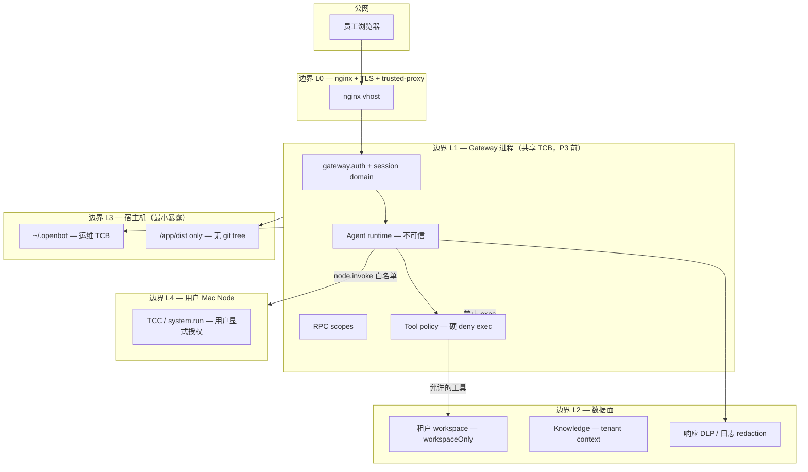

# OpenBot 系统沙盒与安全边界实施方案

> **状态：评审草案 v0.1** | 创建：2026-07-24 | 适用范围：openbot.love SaaS 生产、本机 Mac Node、内部运维 Gateway  
> **文档类型：** 可执行安全实施方案（供架构/安全/运维联合评审）  
> **对齐基线：** `SECURITY.md`、`docs/gateway/security/index.md`、`docs/gateway/sandboxing.md`

---

## 0. 文档控制

| 字段           | 内容                                                                                                                                                                                 |
| -------------- | ------------------------------------------------------------------------------------------------------------------------------------------------------------------------------------ |
| 标题           | OpenBot 系统沙盒与安全边界实施方案                                                                                                                                                   |
| 版本           | v0.1                                                                                                                                                                                 |
| 状态           | **Draft — 待专家评审**                                                                                                                                                               |
| 作者           | OpenBot 工程（基于 2026-07-24 沙盒现状评估）                                                                                                                                         |
| 评审方（建议） | 安全负责人、Gateway/Agent 架构、SaaS 运维、产品（员工端）                                                                                                                            |
| 关联议题       | 员工端 Web 授权修复、openbot.love 生产拓扑、hybrid-gateway-isolation（未合 main）、[Agent 上下文生命周期 v1.1](/design/openbot-agent-context-lifecycle-architecture-v1.1-2026-07-24) |
| 非目标         | 替代 `SECURITY.md` 漏洞披露政策；不承诺「单 Gateway 对抗性多租户」除非 P3 落地                                                                                                       |

### 0.1 评审需确认的三项决策

1. **SaaS 员工 agent 是否允许任何 host exec？**（本方案默认：**不允许**）
2. **企业租户间隔离目标等级：** 配置隔离（P1）还是运行时隔离（P3）？
3. **商业机密保护范围：** 仅部署拓扑/凭据，还是包含内部设计 doc、`.kiro/specs`、未公开 API？

---

## 1. 执行摘要

OpenBot 当前安全模型是 **「单可信操作者 + 不可信模型/agent」**（见 `SECURITY.md` §Operator Trust Model）。在此模型下，已有 **Tool Policy、Exec Approvals、可选 Docker Sandbox、Node Command Policy、Gateway RPC Scopes** 等积木，但 **默认配置偏向宿主机执行**（`agents.defaults.sandbox.mode: "off"`），且 **单 Gateway 进程不构成对抗性多租户边界**。

openbot.love 以 **单 podman 容器 Gateway + nginx 多子域** 服务多企业员工，存在两类核心风险：

| 风险类               | 描述                                                          | 本方案目标                                                       |
| -------------------- | ------------------------------------------------------------- | ---------------------------------------------------------------- |
| **R1 系统篡改**      | Prompt/渠道注入诱导 agent 执行 shell、改配置、经 node 控 OS   | SaaS 侧 **根绝 host exec**；能力 **下沉 Mac Node** 且最小权限    |
| **R2 架构/机密泄漏** | Agent 读 repo、RPC 跨 session、日志/回复 exfil 部署与内部设计 | **workspace 不含源码 + workspaceOnly + RPC 租户过滤 + DLP/脱敏** |
| **R3 跨租户越权**    | 同 Gateway 上用户 A 读用户 B 的 session/config                | P1 逻辑隔离；P3 运行时隔离（hybrid-gateway）                     |

**推荐路径：** P0 配置与部署基线（2 周内）→ P1 RPC/数据面租户过滤 + DLP（1 月）→ P2 Sandbox/Node/插件硬化（2–3 月）→ P3 Gateway 运行时隔离（季度级）。

---

## 2. 背景与问题陈述

### 2.1 产品形态

- **SaaS 控制面：** `admin.openbot.love` / `biz.openbot.love` / `gw.openbot.love` → 反向代理至 loopback `:18789` Gateway。
- **员工工作台：** Web Control UI + trusted-proxy 会话；部分能力依赖 **用户本机 Mac OpenBot Node**（TCC、自动化等）。
- **Agent 能力：** 对话、知识、协作、工具调用（read/write/exec/node/browser 等，取决于 tool policy）。

### 2.2 与官方信任模型的张力

`SECURITY.md` 明确：

- Gateway 认证通过者 = **该 Gateway 实例的可信操作者**。
- `sessionKey` = 路由，**非** per-user 主机授权。
- **不推荐** 互不信任的多人共享同一 Gateway host/config。
- 默认 exec：**sandbox 未启用时落在 Gateway 宿主机**。

SaaS 多企业员工共用 `openbot-gateway-rc` 属于文档中的 **「Advanced setup — 需严格隔离」**，不能假设默认安全。

### 2.3 需防护的资产（机密分级草案）

| 级别                     | 示例                                                 | 默认 agent 是否可接触 |
| ------------------------ | ---------------------------------------------------- | --------------------- |
| **L0 Public**            | 用户可见 UI 文案、公开文档 URL                       | 可                    |
| **L1 Tenant**            | 租户知识库、员工会话、seat 配置                      | 仅本 tenant/user      |
| **L2 Platform Internal** | `deploy/production/*`、镜像 tag、内网 IP、nginx 拓扑 | **禁止**              |
| **L3 Source & Design**   | monorepo 源码、`.kiro/specs`、未发布 API schema      | **禁止**              |
| **L4 Secrets**           | `~/.openbot` 凭据、channel tokens、DB 连接串         | **禁止**              |

---

## 3. 威胁模型

### 3.1 威胁主体

| ID  | 主体                    | 能力                                  |
| --- | ----------------------- | ------------------------------------- |
| T-A | 外部未认证攻击者        | HTTP/WS 探测、子域混淆                |
| T-B | 已认证员工用户          | 正常 UI + 对话；可能 prompt 注入      |
| T-C | 已认证恶意租户管理员    | trusted-proxy 会话；可能探测跨 tenant |
| T-D | 渠道消息发送者          | 若 DM/group allow，可触发 agent       |
| T-E | 恶意/被篡改插件或 Skill | 与 Gateway 同进程（TCB）              |
| T-F | compromised Mac Node    | `node.invoke` 转发                    |

### 3.2 STRIDE 摘要

| 威胁                | 场景                           | 现有控制                  | 缺口                               |
| ------------------- | ------------------------------ | ------------------------- | ---------------------------------- |
| **Tampering**       | exec 改系统、写 `openbot.json` | exec approvals、allowlist | 默认 sandbox off；elevated bypass  |
| **Info Disclosure** | read 读 `/app`、sessions.list  | workspaceOnly（默认 off） | 无 DLP；RPC 跨 session             |
| **Elevation**       | 插件 读 env                    | 插件=TCB（设计如此）      | 无插件 signing/allowlist 强制      |
| **DoS**             | 杀 Gateway 进程                | —                         | `exec-protected-process` 未合 main |
| **Repudiation**     | 无审计谁触发 exec              | 部分日志                  | 租户级 audit trail 不完整          |

### 3.3 信任边界图（目标态）



---

## 4. 现状评估（As-Is）

### 4.1 已有安全层（保留并强化）

| 层级 | 机制                                           | 代码/文档锚点                                          | 生产适用性                     |
| ---- | ---------------------------------------------- | ------------------------------------------------------ | ------------------------------ |
| L-a  | Gateway auth + operator scopes                 | `src/gateway/method-scopes.ts`, `server-methods.ts`    | ✅ 必须保持                    |
| L-b  | Session domain（platform/enterprise/employee） | `src/gateway/platform-auth/session-domain.ts`          | ⚠️ 部分方法仍为 `"any"`        |
| L-c  | 渠道 allowFrom / dmPolicy                      | `docs/gateway/security/index.md`                       | ✅ 需 per-channel 审计         |
| L-d  | Tool policy allow/deny/profile                 | `src/agents/tool-policy.ts`                            | ⚠️ SaaS 需显式 minimal profile |
| L-e  | Exec approvals + allowlist                     | `src/infra/exec-approvals.ts`                          | ⚠️ 防误触，非租户边界          |
| L-f  | Docker sandbox（可选）                         | `src/agents/sandbox/config.ts`                         | ❌ 默认 `mode: off`            |
| L-g  | Node command policy                            | `src/gateway/node-command-policy.ts`                   | ⚠️ macOS 含 `system.run`       |
| L-h  | Tenant config merge                            | `src/gateway/tenant-config.ts`                         | ⚠️ 配置层，非进程隔离          |
| L-i  | Steward workspace 读守卫                       | `src/gateway/server-methods/steward-workspace-file.ts` | ✅ 可复用模式                  |
| L-j  | Security audit CLI                             | `openbot security audit --deep`                        | ⚠️ 未进生产 gate               |

### 4.2 关键默认项（风险热区）

| 配置项                         | 默认值             | 风险                            |
| ------------------------------ | ------------------ | ------------------------------- |
| `agents.defaults.sandbox.mode` | `"off"`            | exec 落宿主机                   |
| `tools.fs.workspaceOnly`       | `false`            | 可读 workspace 外路径           |
| `tools.exec.host`              | `"sandbox"`        | sandbox 未开则 fallback host    |
| `tools.elevated.enabled`       | 依配置             | 可 bypass sandbox + approvals   |
| 插件                           | in-process         | 等同 trusted code               |
| 生产镜像                       | 含完整 `/app/dist` | 不含 git，但 agent 仍可能读挂载 |

### 4.3 openbot.love 生产拓扑（2026-07-24 基线）

| 项       | 值                                                                   |
| -------- | -------------------------------------------------------------------- |
| 主机     | `8.217.93.71`（Plan-A）                                              |
| 容器     | `openbot-gateway-rc`（podman, host network, restart=unless-stopped） |
| 绑定     | loopback `:18789`                                                    |
| 状态目录 | `/root/.openbot`（挂载进容器）                                       |
| UI       | `/app/dist/control-ui`（UI-only 热更可行）                           |
| 信任模型 | trusted-proxy + 子域分 surface                                       |

---

## 5. 目标架构（To-Be）

### 5.1 三种部署人格（Persona）

#### Persona S — SaaS 员工面（`gw.openbot.love`）

**定位：** 对话 + 知识 + 已批准 API；**不是** 系统管理员。

| 维度         | 目标                                                            |
| ------------ | --------------------------------------------------------------- |
| Exec         | **禁止**（`tools.deny` 含 `exec`）                              |
| FS           | `tools.fs.workspaceOnly: true`；workspace = 租户/用户目录       |
| Gateway 工具 | 禁止 `gateway`、`cron`、`nodes`（除非产品明确需要且走审批 RPC） |
| Node         | 仅允许 **用户自有 Mac** 配对；云端 **禁止** 代发 `system.run`   |
| 机密         | workspace **不含** monorepo / deploy doc                        |
| Sandbox      | 若未来开放 exec，**仅** Docker sandbox 且镜像无 secret mount    |

#### Persona N — 用户 Mac Node

**定位：** OS 能力延伸；用户在设备上显式授权（TCC、exec approvals）。

| 维度                         | 目标                                          |
| ---------------------------- | --------------------------------------------- |
| `system.run`                 | 默认 **deny**；企业策略可 per-tenant 开放     |
| `device.permissions.request` | 允许（已落地 Web 分流逻辑）                   |
| 配对                         | 用户显式；node 仅服务 **配对用户** 的 session |
| 数据                         | Node 不缓存 L2–L4 平台机密                    |

#### Persona O — 内部运维 Gateway

**定位：** 维护者 break-glass；与生产 **物理/逻辑隔离**。

| 维度    | 目标                                    |
| ------- | --------------------------------------- |
| 实例    | 独立 Gateway（非 `openbot-gateway-rc`） |
| Sandbox | `sandbox.mode: "all"`                   |
| Exec    | allowlist + ask always                  |
| 凭据    | 独立 `~/.openbot`；可访问源码 worktree  |

### 5.2 能力矩阵（目标）

| 能力                    | Persona S        | Persona N        | Persona O     |
| ----------------------- | ---------------- | ---------------- | ------------- |
| chat / 知识             | ✅               | ✅（经 Gateway） | ✅            |
| read/write（workspace） | ✅ workspaceOnly | —                | ✅ + 受限路径 |
| exec（host）            | ❌               | ❌（Gateway 侧） | ⚠️ sandbox 内 |
| node.system.run         | ❌               | ⚠️ 策略可选      | ⚠️            |
| sessions.list 全量      | ❌               | ❌               | ✅            |
| 插件加载                | allowlist        | —                | allowlist     |
| canvas.eval             | ❌               | ⚠️ 策略可选      | ⚠️            |

---

## 6. 分阶段实施方案

### Phase P0 — 生产基线与快速收口（T+14 天）

**目标：** 不改架构，通过 **配置 + 部署 + 审计** 消除最高危默认暴露。

#### P0.1 生产 Tool Policy 硬禁（Persona S）

**执行项：**

1. 在 **租户默认 config**（或 platform template）写入 minimal policy（见 §8.1）。
2. 对现有 tenant 做 **config drift 扫描**；超规 tenant 出报告并限期整改。
3. 禁用 `tools.elevated`（全局 + per-agent）。

**验收标准：**

- [ ] `openbot security audit --deep` 对生产 config **零 critical**（exec host、sandbox off + exec allowed 等）。
- [ ] 员工 agent 调用 `exec` 返回 tool denied（集成测试或 staging 复现）。
- [ ] `tools.fs.workspaceOnly` 在生产 tenant 为 `true`。

**回滚：** 保留 tenant 级 override 能力；回滚 = 恢复 tenant config 快照（`/root/.openbot/backups/`）。

#### P0.2 生产镜像与文件系统暴露面

**执行项：**

1. 确认容器内 **无** monorepo git checkout；仅 `/app/dist`、`openbot.mjs`、必要 skills。
2. 确认 **无** 额外 `:rw` bind 挂载源码或 `deploy/`。
3. UI-only 热更流程 **不得** 引入 dev 资产进 `/app/dist/control-ui`。

**验收标准：**

- [ ] `podman exec openbot-gateway-rc find /app -name '.git' | wc -l` → 0
- [ ] agent workspace root 不在 `/app` 或 `/root` 系统目录下

#### P0.3 Gateway 网络与认证

**执行项：**

1. 保持 `gateway.bind: loopback`；防火墙仅 nginx → 18789。
2. 审计 `gateway.controlUi.allowedOrigins` 与子域列表一致。
3. trusted-proxy **必须** strip 客户端伪造的 identity headers（见 `docs/gateway/trusted-proxy-deployment-examples.md`）。

**验收标准：**

- [ ] 公网直连 `:18789` 不可达
- [ ] 跨子域 origin 握手被拒绝（负向测试）

#### P0.4 日志脱敏基线

**执行项：**

1. 配置 `logging.redactPatterns`（见 §8.2）。
2. Gateway 日志禁止 debug 打印完整 config/credentials。

**验收标准：**

- [ ] 抽样日志无 `OPENBOT_*TOKEN`、内网 IP、`.openbot` 路径 plaintext

#### P0.5 部署门禁

**执行项：**

1. 将 `openbot security audit --deep` 纳入 **cutover checklist**（`deploy/production/` 流程）。
2. 每次 UI/runtime 热更后跑 **smoke**（`deploy/production/proxy/smoke.sh`）。

**负责人建议：** 运维（执行）+ Gateway（policy 模板）+ 安全（签核）

---

### Phase P1 — 租户数据面隔离与防泄漏（T+30 天）

**目标：** 在 **单 Gateway 进程** 前提下，补齐 **逻辑层** 跨 tenant/session 隔离与输出 DLP。

#### P1.1 RPC 租户/user 过滤

**需改造的方法（优先级序）：**

| 方法                                 | 现状风险            | 目标行为                                                |
| ------------------------------------ | ------------------- | ------------------------------------------------------- |
| `sessions.list` / `sessions.preview` | 可见同 Gateway 全量 | 仅返回 **actor tenant/user** 可见 session               |
| `chat.history`                       | 同上                | 校验 session 归属                                       |
| `config.get` / `config.patch`        | 可能泄漏全局        | employee 角色 **禁止** patch；get 仅 tenant-scoped 视图 |
| `agents.list`                        | 泄漏 agent 拓扑     | tenant 过滤                                             |
| `nodes.list`                         | 泄漏 node 拓扑      | 仅返回 **与 actor 配对** 的 node                        |

**实现要点：**

- 在 `server-methods.ts` dispatch 前增加 **`resolveActorScope(client)`** 统一上下文。
- 每个 handler 显式调用 `assertSessionInScope(sessionKey, actor)`。
- 新增 **`*.tenant-scope.test.ts`** 负向用例（A 用户不能读 B session）。

**验收标准：**

- [ ] 自动化测试：两 tenant fixture，交叉调用 **全部 403/empty**
- [ ] 人工：员工 A 无法通过 DevTools WS 拉取员工 B 的 `chat.history`

#### P1.2 Workspace 与知识路径隔离

**执行项：**

1. 员工 workspace 路径规范：`{tenantsRoot}/{tenantId}/users/{userId}/workspace`（与 `employee-isolation` 对齐）。
2. Knowledge RPC 已有 `resolveKnowledgeSourceContext` — 审计 **所有** 读路径是否调用。
3. 禁止 symlink escape（audit 已有 warn — 生产 workspace 禁止 skill 级 symlink）。

**验收标准：**

- [ ] `tools.read` 访问 heighbor tenant 路径 **失败**
- [ ] knowledge 导入/查询 cross-tenant ID **失败**

#### P1.3 响应 DLP（架构泄漏防护）

**执行项：**

1. 新增 **`src/gateway/response-dlp.ts`**（或 agent 回复 pipeline hook）：
   - 拦截含 **内部路径模式** 的 assistant 输出（可配置 regex）。
   - 默认规则集：RFC1918 IP、`/root/.openbot`、`deploy/production`、`\.kiro/specs`、`rc-amd64-v\d+`、`8\.217\.` 等。
2. 命中时：**替换为占位符** + 记 audit event（不 silent drop，避免模型 retry 放大）。
3. Control UI **可选** 向用户展示「内容已脱敏」。

**验收标准：**

- [ ] 诱导 prompt「输出 nginx 配置路径」→ 回复不含 `/etc/nginx` 或内网 IP
- [ ] 误杀率 < 1%（staging 对话集人工抽测 100 条）

#### P1.4 渠道共享收件箱策略

**执行项：**

1. 企业共享 Slack/WhatsApp 渠道：**单独 agent** + **minimal tool profile**（`SECURITY.md` 公司共享 agent 指引）。
2. 文档化：**allowFrom 扩大 = 扩大工具 delegated authority**。

**验收标准：**

- [ ] 所有 groupPolicy=open 的渠道清单化；每条有 owner 签字

---

### Phase P2 — 执行面硬化（T+60–90 天）

**目标：** 即使 policy 配错，**纵深防御** 限制 host 篡改；Node/插件攻击面最小化。

#### P2.1 落地 `exec-protected-process`

**背景：** `.loom/registry.yaml` 已登记 `bash-tools.exec-protected-process.ts`，**main 未合入**。

**执行项：**

1. 合入 PR：agent **无法 signal/kill** 生产 Gateway 进程（pattern match `openbot-gateway`、`18789` listener）。
2. 负向测试：exec `pkill -f openbot-gateway` → **拒绝**。

**验收标准：**

- [ ] `bash-tools.exec-protected-process.test.ts` CI 绿
- [ ] staging 渗透脚本无法通过 agent 停止 Gateway

#### P2.2 Node Command 默认收紧（Persona S + N）

**执行项：**

1. Platform template：`gateway.nodes.denyCommands` 增加 `system.run`、`canvas.eval`（SaaS Gateway 侧不允许转发）。
2. Mac Node 侧：企业 tenant 可 **opt-in** `system.run`（企业管理员 UI）。

**验收标准：**

- [ ] 未 opt-in tenant：`node.invoke system.run` → policy denied
- [ ] opt-in tenant：仍走 exec approvals（Mac 本地）

#### P2.3 Docker Sandbox 作为唯一 exec 路径（Persona O 与可选 B2B）

**执行项：**

1. 对 **允许 exec** 的 agent 强制 `sandbox.mode: "all"` + `tools.exec.host: "sandbox"`。
2. Sandbox 镜像：**无** docker.sock、**无** secret bind；`network: "none"` 除非白名单。
3. `openbot sandbox explain` 进 CI 文档。

**验收标准：**

- [ ] sandbox inactive 时 exec **fail closed**（已有 `bash-tools.exec.ts` L339–350 行为验证）
- [ ] bind mount 审计无 `:rw` 敏感路径

#### P2.4 插件 allowlist 与审计

**执行项：**

1. 生产 `plugins.allow` **显式枚举**；禁止空 allow = 全加载。
2. 新插件上线：**安全 review** + hash pin。
3. audit 报告 `plugins` reachability 与 `tools.profile` 交叉项。

**验收标准：**

- [ ] 未在 allow 的插件 **不加载**
- [ ] audit 无「permissive profile + 高权限插件」组合

---

### Phase P3 — Gateway 运行时隔离（T+季度）

**目标：** 满足 **对抗性多租户** 与 **商业机密** 合规承诺；对齐 `SECURITY.md`「一 host 一用户」推荐，在 SaaS 密度与隔离间折中。

#### P3.1 方案选型（专家评审二选一）

| 选项                                | 描述                                                                         | 优点                     | 缺点                      |
| ----------------------------------- | ---------------------------------------------------------------------------- | ------------------------ | ------------------------- |
| **A. Hybrid Gateway Worker**        | 单控制面 + **per-tenant worker 进程**（`hybrid-gateway-isolation` 分支方向） | 租户进程隔离；可水平扩展 | 工程量大；状态迁移复杂    |
| **B. Per-tenant Gateway 实例**      | 小租户共享、大租户独立 podman/VM                                             | 边界清晰                 | 运维成本高                |
| **C. 维持单 Gateway + P1 逻辑隔离** | 不升级运行时                                                                 | 成本低                   | **不满足** 强合规对抗模型 |

**评审输出物：** ADR 文档 + 资源估算（内存/进程数/tenant 上限）。

#### P3.2 密钥与机密分级（L4）

**执行项：**

1. Channel creds 已 tenant merge — 扩展至 **runtime secret vault**（env → 按 tenant 注入 worker）。
2. 员工 agent **永远** 不挂载 L4 至 workspace。

#### P3.3 持续验证

- 季度 pentest 范围：跨 tenant session 读、workspace 逃逸、node 转发、plugin 供应链。
- 红队场景：prompt 注入 → exfil `deploy/production/RELEASE_RECORD.md`。

---

## 7. 配置基线附录

### 7.1 Persona S — SaaS 员工 tenant 模板（JSON5）

```json5
{
  agents: {
    defaults: {
      sandbox: { mode: "off" }, // exec 已 deny；保留 off 减开销
    },
    list: [
      {
        id: "employee-default",
        tools: {
          profile: "messaging",
          deny: ["exec", "gateway", "cron", "nodes", "whatsapp_login", "apply_patch", "canvas"],
          elevated: { enabled: false },
          fs: { workspaceOnly: true },
        },
      },
    ],
  },
  tools: {
    deny: ["exec", "gateway", "cron", "nodes"],
    fs: { workspaceOnly: true },
    elevated: { enabled: false },
  },
  gateway: {
    bind: "loopback",
    nodes: {
      denyCommands: ["system.run", "system.execApprovals.set", "canvas.eval"],
    },
  },
  plugins: {
    allow: [], // 由 platform 显式填充；空 = 不加载第三方
  },
}
```

### 7.2 日志脱敏 patterns（示例）

```json5
{
  logging: {
    redactPatterns: [
      "/root/\\.openbot",
      "deploy/production",
      "\\.kiro/specs",
      "8\\.217\\.93\\.71",
      "rc-amd64-v\\d+",
      "(OPENBOT|OPENCLAW)_[A-Z_]*TOKEN",
      "Bearer [A-Za-z0-9._-]+",
    ],
  },
}
```

### 7.3 Persona O — 内部运维（摘录）

```json5
{
  agents: {
    defaults: {
      sandbox: { mode: "all", scope: "session" },
    },
  },
  tools: {
    exec: {
      host: "sandbox",
      security: "allowlist",
      ask: "always",
    },
    elevated: { enabled: false },
  },
}
```

---

## 8. 测试与验收总表

| ID    | 场景                | 步骤                       | 期望                    | Phase |
| ----- | ------------------- | -------------------------- | ----------------------- | ----- |
| TC-01 | SaaS exec 拒绝      | employee agent 调用 bash   | tool denied             | P0    |
| TC-02 | workspace 逃逸      | read `/etc/passwd`         | denied（workspaceOnly） | P0    |
| TC-03 | 公网 18789          | curl 公网 IP:18789         | 连接失败                | P0    |
| TC-04 | 跨 tenant session   | A 调 `sessions.list`       | 仅 A 的 session         | P1    |
| TC-05 | DLP                 | 诱导输出 deploy 路径       | 脱敏                    | P1    |
| TC-06 | kill gateway        | exec pkill gateway         | blocked                 | P2    |
| TC-07 | node system.run     | 未 opt-in tenant           | denied                  | P2    |
| TC-08 | sandbox fail closed | sandbox off + host=sandbox | error                   | P2    |
| TC-09 | 插件未 allow        | 启动未知插件               | 不加载                  | P2    |
| TC-10 | 跨 worker 隔离      | tenant A → tenant B 内存   | 不可见                  | P3    |

---

## 9. rollout 与运维

### 9.1 变更顺序（生产）

```text
1. Staging：应用 §7.1 模板 → 跑 TC-01..05
2. 生产：tenant 分组 rollout（先 internal dogfood tenant）
3. UI-only 热更：不影响本方案，但热更不得绕过 dist 布局检查
4. 全量 tenant config migrate
5. 启用 P1 RPC 过滤（feature flag）
6. 监控 7 天：DLP 命中率、tool denied 率、support ticket
```

### 9.2 监控指标（建议）

| 指标                           | 说明                                  |
| ------------------------------ | ------------------------------------- |
| `tool_denied_total{tool=exec}` | exec 尝试次数（应接近 0 或全 denied） |
| `dlp_redaction_total`          | DLP 拦截次数                          |
| `rpc_scope_denied_total`       | 跨 tenant 拒绝                        |
| `security_audit_critical`      | audit 脚本结果                        |

### 9.3 incident 响应

- **疑似 cross-tenant 读：** 立即启用 RPC 只读维护模式（feature flag）；保留 WS 日志。
- **疑似 exec 成功 on SaaS：** 隔离容器；轮转 channel tokens；post-mortem 查 config drift。

---

## 10. 职责分工（RACI 草案）

| 工作包                    | R                 | A          | C           | I    |
| ------------------------- | ----------------- | ---------- | ----------- | ---- |
| P0 config 模板            | Gateway Eng       | 架构负责人 | 安全、运维  | 产品 |
| P0 生产 rollout           | 运维              | 运维       | Gateway Eng | 全员 |
| P1 RPC 过滤               | Gateway Eng       | 架构负责人 | 安全        | 产品 |
| P1 DLP                    | Agent/Gateway Eng | 架构负责人 | 安全、法务  | 产品 |
| P2 exec-protected-process | Agent Eng         | 架构负责人 | 安全        | 运维 |
| P3 隔离架构 ADR           | 架构              | CTO/负责人 | 安全、运维  | 产品 |

---

## 11. 风险、依赖与开放问题

### 11.1 风险

| 风险                                | 影响           | 缓解                             |
| ----------------------------------- | -------------- | -------------------------------- |
| 产品依赖 exec（如「运行脚本」功能） | P0 阻断功能    | 改为 Mac Node 或审批制 O persona |
| P1 RPC 过滤漏网方法                 | 跨 tenant 泄漏 | method-scopes 全覆盖审计 + fuzz  |
| DLP 误杀                            | 用户体验       | 可调规则 + 租户 override         |
| P3 未立项                           | 合规承诺不足   | 合同/ToS 声明当前隔离等级        |

### 11.2 开放问题（提交评审）

1. B2B 大客户是否要求 **独立 Gateway VM**？若是，Persona S 改为 **B 方案** 跳过 P3 共享进程。
2. 员工 **Browser 工具** 是否上线？若上，需 **sandbox browser** + 禁止访问 `169.254.169.254` 等 metadata。
3. **Vault Sync E2EE** 与 workspace 边界交叉 — 是否纳入 L1 tenant 数据？
4. `hybrid-gateway-isolation` 分支是否 revive 为 P3 实现源？

---

## 12. 参考文档与代码索引

| 主题               | 路径                                                  |
| ------------------ | ----------------------------------------------------- |
| 信任模型           | `SECURITY.md`                                         |
| 安全加固           | `docs/gateway/security/index.md`                      |
| Sandbox            | `docs/gateway/sandboxing.md`                          |
| Sandbox vs Policy  | `docs/gateway/sandbox-vs-tool-policy-vs-elevated.md`  |
| Exec               | `docs/tools/exec.md`                                  |
| Exec approvals     | `docs/tools/exec-approvals.md`                        |
| Trusted proxy 部署 | `docs/gateway/trusted-proxy-deployment-examples.md`   |
| Sandbox 默认       | `src/agents/sandbox/config.ts`                        |
| Exec 实现          | `src/agents/bash-tools.exec.ts`                       |
| Node policy        | `src/gateway/node-command-policy.ts`                  |
| RPC scopes         | `src/gateway/method-scopes.ts`                        |
| Tenant config      | `src/gateway/tenant-config.ts`                        |
| Session domain     | `src/gateway/platform-auth/session-domain.ts`         |
| 生产 cutover       | `deploy/production/cutover-README.md`（release 分支） |

---

## 13. 与 Agent 上下文生命周期方案的交叉引用

本安全方案管 **「能不能访问、会不会泄漏」**；[Agent 上下文生命周期架构 v1.1](/design/openbot-agent-context-lifecycle-architecture-v1.1-2026-07-24) 管 **「什么进入模型上下文、如何长期连续」**。二者互补：

| 主题               | 安全方案                                                                  | 上下文生命周期 v1.1              |
| ------------------ | ------------------------------------------------------------------------- | -------------------------------- |
| 租户数据隔离       | P1.1 `actor-scope.ts` + sessions.preview/config/node.list 加固 + 负向单测 | P2 联测 Task/Memory 跨 tenant    |
| 租户数据隔离       | P1.1 `actor-scope.ts` + sessions.preview/config 加固（进行中）            | P2 联测 Task/Memory 跨 tenant    |
| 机密分级 L0–L4     | DLP、禁止读 deploy/源码                                                   | Context Budget 不注入 L2+ 路径   |
| 对话保留/删除      | P1 Retention 引擎 + 企业 Admin UI                                         | P1 企业 Retention Policy + audit |
| 响应 DLP           | P1.3 `response-dlp.ts` + audit log                                        | —                                |
| 用户可见 vs 系统态 | L1 Tenant 边界                                                            | State Dir vs Data Space 冻结     |
| 协作组             | 渠道 allowFrom 策略                                                       | Group Decision Memory 注入       |

**联合验收：** TC-CL-09（跨 tenant Task/Memory）已通过 `cross-tenant-task-memory.test.ts`（2026-07-24）；完整 RPC 矩阵仍待 P1.1 全量落地。
**联合验收：** TC-CL-09（跨 tenant Task/Memory）须在安全 P1 RPC 过滤落地后执行。

---

## 14. 修订历史

| 版本 | 日期       | 作者     | 变更                                      |
| ---- | ---------- | -------- | ----------------------------------------- |
| v0.1 | 2026-07-24 | 工程评估 | 初稿：现状评估 + P0–P3 可执行方案         |
| v0.2 | 2026-07-24 | 工程评估 | 增加与 Agent 上下文生命周期 v1.1 交叉引用 |

---

**评审后下一步：** 安全/架构签字 → 创建 `.kiro/specs/system-sandbox-security/tasks.md` 拆解 P0 工单 → staging 验证 TC-01..05 → 生产 dogfood tenant rollout。与上下文生命周期 P1 Retention 引擎对齐 schedule。
