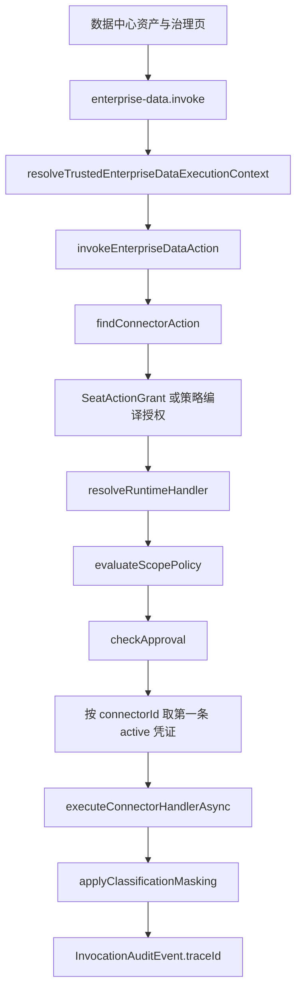
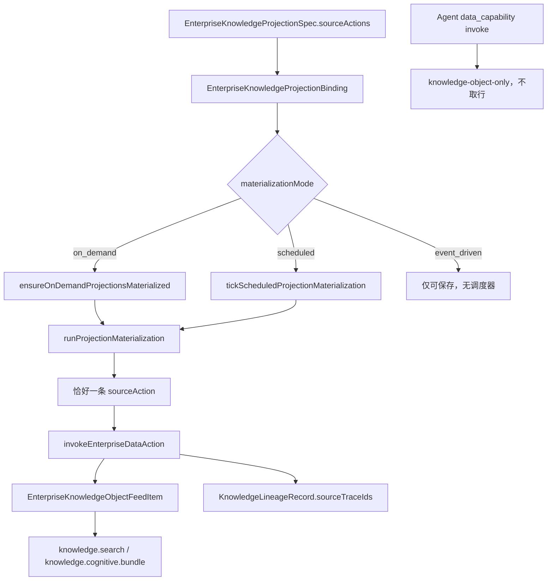
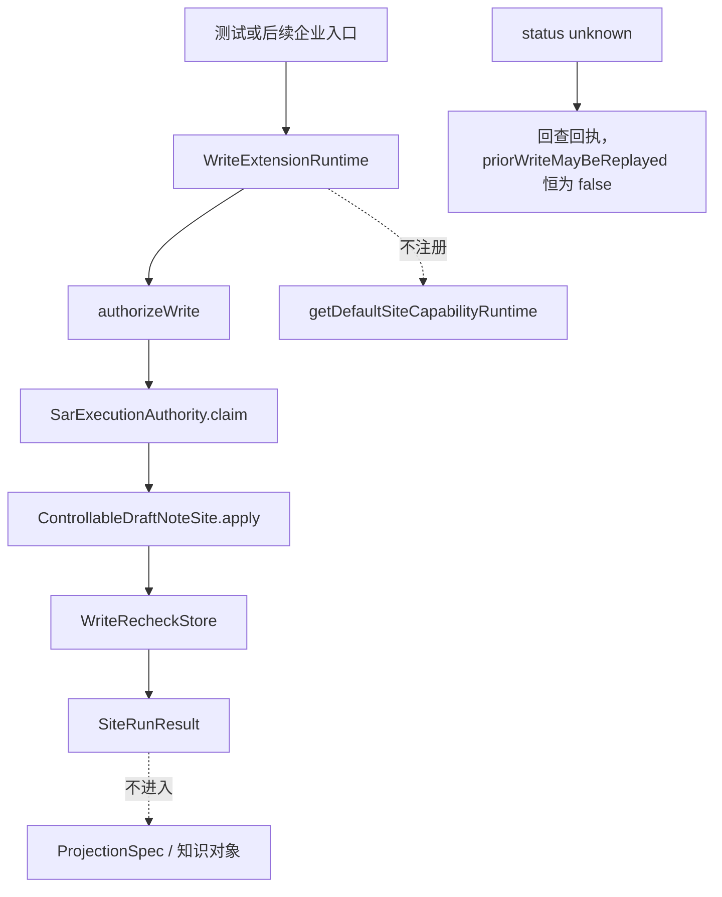

# SAR E0 企业双中心基线与契约对齐

- 状态：设计对齐。本文不是 E1–E5 实现，也不是生产能力声明。
- 日期：2026-10-17
- 盘点基线：SAR 代码以 `671b38abb61041909d78d8324b9498145349bc1f` 为准。提交前 `origin/main` 又前进到 `e2de40140`（协作 Todolist 与账户电脑开关，未改 `src/site-capability`）。本分支已变基到该尖端。
- 路径：Path C。复用既有账户浏览器、企业数据治理网关和企业能力中心。不建 Bridge，不导出 Cookie，不分叉 OpenCLI，不新建第三中心。
- 范围：只记录已存在的提交、路径和契约。不改 P0–P4 代码。不实现网站接入、向导、安装或投影改造。

## 0. 结论标签

每条拟复用入口使用下面三个标签。三者独立，不能互相替代。

| 标签         | 含义                                                                                     |
| ------------ | ---------------------------------------------------------------------------------------- |
| code-present | 符号在盘点基线的源码里存在                                                               |
| tested       | 仓库里有对应测试，或 P0–P4 验收记录写明当时的本地 vitest 通过。本文件没有重跑那些测试    |
| production   | 有已记录的外站真会话或生产 handler 成功。缺会话、缺 handler 时，mock 成功不算 production |

成熟度、使用次数、`registered` 动作数、`handlerCount`、`verifiedInProduction` 都不能代替能力版本的验证记录。

## 1. 盘点事实

任务书起草时本地 HEAD 记为 `28ffa8f73cb5210c474ba8bb3681a8c477f67d43`，协调状态写 P4 待合入。本阶段先 `git fetch origin main` 与 `origin/feat/sar-p4-write-extension`。fetch 之后的事实如下。

| 阶段     | PR                                           | 合入方式         | 盘点时的提交                               |
| -------- | -------------------------------------------- | ---------------- | ------------------------------------------ |
| P0       | https://github.com/upbeyond/openbot/pull/795 | squash 已在 main | `595a0d9097a60e0ab460eab99cc8933824dcf63c` |
| P1       | https://github.com/upbeyond/openbot/pull/797 | squash 已在 main | `ff81f60167cc9115d1e5e5319be963ecfdcfe42d` |
| P2       | https://github.com/upbeyond/openbot/pull/798 | squash 已在 main | `851e493a86316a2946b77fda5b75dae6edc87ccc` |
| P3       | https://github.com/upbeyond/openbot/pull/800 | squash 已在 main | `9aa713944018d088256a2d49df7125676006d5f3` |
| 无关穿插 | https://github.com/upbeyond/openbot/pull/802 | squash 已在 main | `9ea92d728bb85b997818b0adb647ce263471aa8e` |
| P4       | https://github.com/upbeyond/openbot/pull/803 | squash 已在 main | `671b38abb61041909d78d8324b9498145349bc1f` |

P4 分支 `feat/sar-p4-write-extension` 的 HEAD 仍是 `11b3be1c0305759fa7600d1188ad33b4945c4b90`。`git diff 11b3be1c03 origin/main -- src/site-capability docs/design` 为空，说明合入树与该分支上的 SAR 设计、实现一致。本 PR 不修改该分支，也不修改 P4 文件。

P4 阶段验收是夹具级 PASS。合入 main 不等于外站写已生产可用。默认目录仍然不装写能力。

任务归属记在 Loom：`sar-e0-dual-center-baseline:cursor-sar-e0`，只声明本文件。`.loom/registry.yaml` 的落地流第一匹配仍是 `SAR_P4_WRITE_EXTENSION`。本任务的落地流用 `parallel`，这样登记可以和该热文件一起提交，而不改 P4 的路径列表，也不把本文件算进 P4。

### 1.1 SAR 目录（code-present）

只读运行时与学习闭环在 `src/site-capability/`：`codes.ts`、`contract.ts`、`session-handle.ts`、`operations.ts`、`execution-authority.ts`、`coordinator.ts`、`navigation.ts`、`desk.ts`、`runtime.ts`、`result.ts`、`fixture-runtime.ts`、`test-site.ts`、`draft-store.ts`、`learning-loop.ts`、`validation-record.ts`、`approval.ts`、`failure-class.ts`、`readonly-pilot.ts`、`pilot-comparison.ts`。

写扩展（P4，本 PR 只读）：`write-authorize.ts`、`write-effect.ts`、`write-fixture.ts`、`write-recheck-store.ts`、`write-repair.ts`、`write-runtime.ts`，以及 `sar-p4-write-extension.test.ts`。

工具面：`src/agents/tools/site-capability-tools.ts`，由 `src/agents/openclaw-tools.ts` 装配。产品工具名是 `site_list`、`site_describe`、`site_invoke`（`SAR_P1_PRODUCT_TOOLS`）。

设计记录：`docs/design/sar-p0-controlled-execution-boundary-2026-10-17.md`、`docs/design/sar-p1-min-runtime-2026-10-17.md`、`docs/design/sar-p2-learning-loop-2026-10-17.md`、`docs/design/sar-p3-readonly-pilot-2026-10-17.md`、`docs/design/sar-p4-write-extension-2026-10-17.md`。

测试文件与验收记录对应：`sar-p0-boundary.test.ts`、`sar-p1-runtime.test.ts`、`sar-p2-learning-loop.test.ts`、`sar-p3-readonly-pilot.test.ts`、`sar-p4-write-extension.test.ts`。标签是 tested（以各阶段验收记录为准）。本文件没有重跑。标签不是 production。

### 1.2 企业双中心路径（与任务书对照后的现网路径）

数据中心前端：

- `ui/src/ui/ports/enterprise/views/enterprise-data-governance-center-surface.ts`
- `ui/src/ui/ports/enterprise/views/enterprise-data-capability/assets-page.ts`
- `products-page.ts`、`product-wizard.ts`、`product-create-transaction.ts`
- `outputs-page.ts`、`governance-page.ts`、`audit-lineage-panel.ts`
- `mcp-mapping-wizard.ts`、`overview-page.ts`、`overview-action-queue.ts`

数据中心后端入口：`src/gateway/server-methods/enterprise-data.ts` 组合 M1–M6。执行入口在 `src/gateway/server-methods/enterprise-data-m1.ts` 的 `enterprise-data.invoke`。物化入口在 `src/gateway/server-methods/enterprise-data-m4.ts` 的 `enterprise-data.projection-materializer.run`。

能力中心前端：

- `ui/src/ui/ports/enterprise/views/enterprise-capability-center-surface.ts`
- `ui/src/ui/views/enterprise-asset-library/enterprise-capability-center-page.ts`

能力中心后端：`src/gateway/server-methods/enterprise-capability.ts`。安装到机器人走 `enterprise-capability.install-to-robots`。技能执行绑定是另一套对象，见 `src/gateway/skill-execution-binding/types.ts` 的 `SkillExecutionBindingRecord`，同步函数是 `syncSkillExecutionBinding`。

这些路径均为 code-present。多数带同名 `*.test.ts`，因此相关网关与存储逻辑标 tested（测试存在，本阶段未重跑）。没有任何一条被标 production。

## 2. 三条真实调用链

三条链今天并不汇合。E0 把它们画在同一张契约上，是为了后续桥接时不把它们接错。图中实线是盘点基线上已有的调用。没有 SAR 节点接到治理网关或知识投影上。

### 2.1 企业读取

员工执行走治理网关，返回脱敏后的动作结果。Agent 目录调用不走这条链，见 2.2。

对应文件：

- RPC：`src/gateway/server-methods/enterprise-data-m1.ts`
- 网关：`src/gateway/enterprise-data/data-gateway.ts` 的 `invokeEnterpriseDataAction`
- 可信上下文：`src/gateway/enterprise-data/enterprise-data-seat-context.ts`
- Handler：`src/gateway/enterprise-data/connector-handler-runtime.ts`
- 探测：`src/gateway/enterprise-data/source-connection-probe.ts` 的 `probeDataSourceConnection`

`ConnectorActionRef` 只有 `connectorId`、`actionKey`、`version`。网关选凭证时按 `connectorId` 取第一条 `status === "active"` 的 `DataConnectorCredential`，不读 `DataSource.sourceId`。多个数据源共用一个 `connectorId` 时，现网读取不能按 source 分开账户。这是 E1 必须补上的解析，不是现在已经具备的行为。

Handler 分流（code-present，适配器有测试，本盘点未做带真实凭证的 production 调用）：

- `handlerRef` 以 `enterprise-data/adapters/` 开头：抛出 `Production adapter not implemented`，不回落 mock。
- `crm-salesforce`、`notion`、`http-rest`、`db-postgres`、`db-mysql`、`erp-sap` 且带上对应 secret：进入各自适配器。
- 其余情况：`executeMockHandler`。

探测在没有 live secret 时，对已注册的只读 handler 走 `mock_smoke_ok`。`mock_smoke_ok` 与 `handlerCount > 0` 只说明注册表能跑通演示，不是生产验证。

目录分层在 `src/gateway/enterprise-data/connector-catalog.ts`：`crm-salesforce` 与 `erp-sap` 的 `integrationTier` 是 `demo`；`notion`、`http-rest`、`db-postgres`、`db-mysql` 是 `production`。`production` 这里是目录分级，不是本文件的 production 标签。

### 2.2 知识供给

物化必须先过同一条治理网关，再写成知识对象。Agent 只消费知识对象。

对应文件：

- 规格与绑定类型：`src/gateway/enterprise-data/types.ts`
- 物化：`src/gateway/enterprise-data/projection-materializer.ts` 的 `runProjectionMaterialization`
- 按需：`src/gateway/enterprise-data/on-demand-projection-materializer.ts`
- 定时：`src/gateway/enterprise-data/scheduled-projection-materializer.ts`
- RPC：`enterprise-data.projection-specs.upsert`、`enterprise-data.projection-bindings.upsert`、`enterprise-data.projection-materializer.run`
- Agent 闸门：`src/gateway/enterprise-data/capability-agent-invoke-runtime.ts`
- 消费：`src/gateway/server-methods/knowledge.ts` 的 `knowledge.search`、`knowledge.cognitive.bundle`
- 边界测试：`src/gateway/knowledge/knowledge-consumption-boundary.test.ts`（tested，本阶段未重跑）

`event_driven` 出现在类型和 `MATERIALIZATION_MODES` 里，可以被 upsert 保存。仓库里没有 `materializationMode === "event_driven"` 的调度实现。E4 若复用调度，只能复用已有的 on-demand 与 scheduled，不能把这个枚举值说成已有调度器。

物化要求投影 `lifecycle === "active"`、绑定 `enabled`，且 `sourceActions.length === 1`。网关拒绝时抛 `PROJECTION_GATEWAY_DENIED`，并写 `materialization_failure`。失败结果不会变成完整知识对象。

`invokeDataCapabilityWithContext` 在席位、授权和配额检查之后返回 `reason: "knowledge-object-only"`，模块禁止 import 数据网关。知识平面测试禁止出现 `invokeEnterpriseDataAction`。

### 2.3 业务写入

写入停在 P4 扩展运行时。它不进入只读投影，也不经过 `enterprise-data.invoke`。

P4 实际对象：

- 运行时：`WriteExtensionRuntime`（`src/site-capability/write-runtime.ts`）
- 授权：`authorizeWrite`，grant key 含 effect（`writeGrantKey`）
- 效果：`SAR_WRITE_EFFECTS = ["create", "update"]`
- 夹具原点：`https://fixture.sar-write.test`（`SAR_WRITE_FIXTURE_ORIGIN`）
- 样例能力：`fixture.sar.draft-note.create`、`fixture.sar.draft-note.update`，版本 `2026.10.17`
- 账本：`WriteLedgerEntry`，确认回执 `replayed: false`
- 未知：`RESULT_UNKNOWN` / `TIMEOUT` 得到 `status: "unknown"`、`retry: "not_ordinary"`、`repair: "none"`

`register` 拒绝非夹具 origin，拒绝 `published`。读效果不能给写授权。`proposeWriteRepair` 的 `autoPublished`、`writeEnabled`、`fixtureRelaxed`、`grantsExpanded` 恒为 false。

`site_invoke` 仍只接受 `SiteCapabilityManifest.effect === "read"`。`src/agents/tool-catalog.ts` 把工具槽 `site_invoke` 标成 `toolMode: "write"`，那是入站工具分类，不是 SAR 写效果，也不能据此把 P4 写操作接进默认 `site_invoke`。

## 3. ID 映射

不同系统的 capability id 不能互相冒用。下表复用盘点基线上已经存在的字段名。仓库里没有 `AccountBindingRef` 这个类型；账户绑定复用 SAR 的 `AccountBinding`。不新建同义对象。

| 概念           | 复用的现网字段                                                    | 所在类型                                          | 不复用为               |
| -------------- | ----------------------------------------------------------------- | ------------------------------------------------- | ---------------------- |
| 租户           | `tenantId`                                                        | `DataSource`、`ServerPrincipal`、`AccountBinding` | 模型参数里的 tenant    |
| 数据源实例     | `sourceId`                                                        | `DataSource`                                      | `connectorId`          |
| 连接器种类     | `connectorId`                                                     | `DataSource`、`ConnectorActionRef`                | 账户                   |
| 动作引用       | `connectorId` + `actionKey` + `version`                           | `ConnectorActionRef`                              | SAR capability id      |
| 动作键         | `buildConnectorActionRefKey`                                      | `connectorId::actionKey::version`                 | 显示名                 |
| 数据产品       | `DataCapability.capabilityId`                                     | 分组 `sourceIds` 与 `actionRefs`                  | SAR id                 |
| 凭证元数据     | `DataConnectorCredential.credentialId`                            | `kind: "api_key" \| "oauth2"`                     | 浏览器账户绑定         |
| SAR 账户绑定   | `AccountBinding.bindingId`                                        | 另含 `tenantId`、`userId`                         | OI grant、credentialId |
| SAR 只读能力   | `manifest.id` + `manifest.version` + `artifactDigest`             | `SiteCapabilityRecord`                            | 数据产品 id            |
| SAR 只读授权   | `SiteCapabilityGrant`                                             | key 为 tenant、user、capability、version          | 写授权                 |
| SAR 写能力     | `WriteCapabilityManifest.id` + `version` + `writeArtifactDigest`  | 独立解析器                                        | 只读 manifest          |
| SAR 写授权     | `WriteCapabilityGrant`                                            | key 再加 `effect`                                 | 读 grant               |
| 企业技能资产   | `EmployeeSkillProfile.id` / `SkillExecutionBindingRecord.skillId` | 生命周期技能                                      | SAR capability id      |
| 能力中心注册项 | `GovernanceRegistryEntry.manifest.id` 或 `skillKey`               | 企业能力 RPC                                      | SAR capability id      |
| 企业审计       | `traceId`                                                         | `InvocationAuditEvent`                            | SAR `runId`            |
| SAR 执行       | `runId` + `evidenceRef`                                           | `SiteRunResult`                                   | 企业 trace 全文        |

后续映射记录（E1 才落存储，本阶段不建表）必须同时记下：

`tenantId`、`sourceId`、`ConnectorActionRef`、SAR `capabilityId`、`version`、`artifactDigest`、可选 `skillId`、`AccountBinding.bindingId`。

多实例规则：解析目标和账户时以 `sourceId` 为键。同一 `connectorId` 的两个 `DataSource` 不得共用一条绑定或第一条 active 凭证。现网 `resolveLiveConnectorCredentialSecret` 还不满足这条规则，所以 E1 不能直接沿用「按 connector 取第一条」。

`DataCapability.capabilityId`、企业能力中心 `manifest.id`、SAR `manifest.id` 是三套标识。映射记录保存引用，不把其中一个写进另一个的 id 字段。

## 4. 错误与证据协议

SAR 与治理网关今天各有自己的结果，中间没有转换器。E1 穿过网关时必须按下表保留，禁止折叠。

| 事实     | SAR 现网                                            | 治理网关现网                              | 穿过网关时                                     |
| -------- | --------------------------------------------------- | ----------------------------------------- | ---------------------------------------------- |
| 成功     | `status: "succeeded"`                               | `ok: true`，审计 `SUCCESS`                | 两者都留。SAR 成功不等于网关已投影             |
| 已知失败 | `status: "failed"` 且 `ordinaryFailure: true`       | `ok: false` 或审计 `FAILED` / `DENIED`    | 保留 SAR `error.code` 与网关 `code`            |
| 未知     | `status: "unknown"`，`retry: "not_ordinary"`        | 无 unknown 状态                           | 禁止改写成 `SUCCESS`、普通失败或可重试         |
| 业务核验 | `verification: passed \| failed \| not_performed`   | 无此字段                                  | `not_performed` 禁止改成 `passed`              |
| 完整性   | `completeness: complete \| partial`                 | 无此字段；有 `recordCount`                | `partial` 禁止改成 `complete`                  |
| 执行 id  | `runId`                                             | `traceId`                                 | 关联，不合并成一个 id，不复制敏感 trace 全文   |
| 证据     | `evidenceRef`，`SiteEvidence` 另含 `artifactDigest` | `DataAuditEvent` 只留对象引用与脱敏字段名 | 证据引用可进入血缘；原始页面与凭证不进入 Agent |
| 修复     | `repair: "none"`                                    | 无                                        | 网关不得把一次调用标成已发布或已撤回副作用     |
| 空成功   | `isEmptySuccess`                                    | 空数据仍可 `ok: true`                     | 空集合保持成功，不触发修复，也不当成未同步     |

SAR 失败分类（`SAR_FAILURE_CLASSES`）是 `auth`、`infrastructure`、`params`、`policy`、`risk-control`、`structure-change`、`validation-failed`、`unknown`。网关拒绝码是 `InvocationDenialReason`，例如 `NO_ACTION_GRANT`、`SCOPE_DENIED`、`APPROVAL_REQUIRED`、`HANDLER_ERROR`、`UNTRUSTED_EXECUTION_CONTEXT`。转换时保留两边的码，不互相覆盖。

薄验证记录 `ValidationRecord` 已经保存 `capabilityId`、`version`、`artifactDigest`、是否参与草稿生成、依据、`runId`、`evidenceRef`、输出、`completeness`、结论、审核者、时间和原因。知识血缘 `KnowledgeLineageRecord` 今天保存 `sourceActions` 与 `sourceTraceIds`，还没有 SAR version / runId / evidenceRef。E4 再补血缘字段。E0 只规定：缺这些字段的旧记录保持原语义，不默认成已验证网站能力。

`priorWriteMayBeReplayed` 对任何 `SiteRunResult` 都返回 false。未知写只允许回查已有回执。回查不是再执行。

## 5. ADR 与接口表

### ADR-1 不新建第三中心

网站能力的账户、范围和供给归数据中心；审核、启用、安装和岗位分配归能力中心；固定版本与证据归 SAR。UI 只聚合这些事实。

### ADR-2 标识空间保持分离

见第 3 节。已有同义对象直接复用：`AccountBinding`、`ConnectorActionRef`、`DataSource`、`SiteCapabilityRecord.artifactDigest`、`SkillExecutionBindingRecord.skillId`。

### ADR-3 读取不能借 site_invoke 绕过网关

`site_invoke` 的服务端主体、固定版本和账户绑定检查只证明 SAR 自身授权。它不是 `DataAccessPolicy`，也不是脱敏后的知识对象。Agent 读取企业数据仍然只走知识对象。`capability-agent-invoke-runtime.ts` 保持 knowledge-object-only，且不 import 数据网关。

### ADR-4 写入保持 P4，不进只读投影

写操作继续使用 `authorizeWrite` 与 `WriteRecheckStore`。`ProjectionSpec.sourceActions` 只引用读取动作。写 manifest 不能被 `parseSiteCapabilityManifest` 接受，因为它的 effect 不是 `read`，解析器也是分开的。

### ADR-5 缺会话或缺 handler 时失败关闭

默认 `getDefaultSiteCapabilityRuntime` 的目录为空，端口是 `BROWSER_UNAVAILABLE`。P4 `WriteExtensionRuntime` 不装进这个默认目录。企业 handler 在无匹配 live 适配器时会 `executeMockHandler`。后续网站生产路径禁止进入这个 mock 回退，也禁止把 `mock_smoke_ok` 记成生产成功。缺绑定、缺 handler、缺验证记录时拒绝执行。

### ADR-6 私人账户不因管理员身份共享

SAR 主体来自服务端租户和用户（`resolveSiteToolPrincipal`）。模型参数里的 `tenantId`、`userId` 等身份键被丢掉。`selectBinding` 只接受该 grant 的 `accountBindingIds`。跨账户拒绝码是 `CROSS_ACCOUNT_REJECTED`。企业管理员 RPC 使用 `requireResolvedEnterpriseAdminTenantId` 做管理面解析，不能据此取得另一个用户的 `AccountBinding`。

### 拟复用入口

| 入口           | 实际路径                                                                          | code-present      | tested                                                                           | production                   |
| -------------- | --------------------------------------------------------------------------------- | ----------------- | -------------------------------------------------------------------------------- | ---------------------------- |
| 受控会话       | `src/site-capability/session-handle.ts` `AccountBinding`、`SessionHandle`         | 是                | 是，P0 验收                                                                      | 否                           |
| 只读契约       | `src/site-capability/contract.ts` `parseSiteCapabilityManifest`                   | 是                | 是，P0/P1                                                                        | 否                           |
| 只读运行时     | `src/site-capability/runtime.ts` `SiteCapabilityRuntime`                          | 是                | 是，P1                                                                           | 否。默认目录空，端口不可用   |
| 产品工具       | `src/agents/tools/site-capability-tools.ts`                                       | 是                | 是，P1                                                                           | 否                           |
| 结果           | `src/site-capability/result.ts` `SiteRunResult`                                   | 是                | 是，P1–P4                                                                        | 否                           |
| 学习与验证     | `validation-record.ts`、`learning-loop.ts`、`approval.ts`                         | 是                | 是，P2 夹具                                                                      | 否                           |
| 只读试点       | `readonly-pilot.ts` `pilot.bulletin.read`、`pilot.inbox.summary`                  | 是                | 是，P3 夹具                                                                      | 否。外站真会话仍缺           |
| 写授权与回查   | `write-authorize.ts`、`write-recheck-store.ts`、`write-runtime.ts`                | 是                | 是，P4 夹具验收                                                                  | 否。不进默认目录             |
| 员工读取       | `enterprise-data.invoke` → `invokeEnterpriseDataAction`                           | 是                | 是，`data-gateway.test.ts` 存在；本阶段未跑                                      | 否                           |
| 凭证与 handler | `connector-handler-runtime.ts`、`connector-catalog.ts`                            | 是                | 适配器测试存在；本阶段未跑                                                       | 否。无 secret 时 mock        |
| 连通性探测     | `probeDataSourceConnection`                                                       | 是                | 是，`connector-catalog.test.ts`、`connector-oauth.test.ts` 调用它；本阶段未跑    | 否。`mock_smoke_ok` 不是生产 |
| 数据源         | `DataSource`，`enterprise-data.sources.list` / `get`                              | 是                | 存储与 RPC 测试存在；本阶段未跑                                                  | 否                           |
| 策略与席位授权 | `DataAccessPolicy`、`SeatActionGrant`                                             | 是                | 是，网关测试存在；本阶段未跑                                                     | 否                           |
| 投影规格       | `EnterpriseKnowledgeProjectionSpec.sourceActions`                                 | 是                | 是，物化测试存在；本阶段未跑                                                     | 否                           |
| 按需物化       | `ensureOnDemandProjectionsMaterialized`                                           | 是                | 是，测试文件存在；本阶段未跑                                                     | 否                           |
| 定时物化       | `tickScheduledProjectionMaterialization`                                          | 是                | 是，测试文件存在；本阶段未跑                                                     | 否                           |
| 事件物化       | 类型 `event_driven`                                                               | 枚举 code-present | 无调度测试可称已实现                                                             | 否。无调度器                 |
| 知识消费       | `knowledge.search`、`knowledge.cognitive.bundle`                                  | 是                | 边界测试存在；本阶段未跑                                                         | 否                           |
| Agent 能力闸门 | `capability-agent-invoke-runtime.ts`                                              | 是                | 是，`capability-agent-invoke-runtime.test.ts` 与知识消费边界测试存在；本阶段未跑 | 否                           |
| 技能资产       | `EmployeeSkillProfile.id`，`src/gateway/skill-lifecycle-store.ts`                 | 是                | 生命周期测试存在；本阶段未跑                                                     | 否                           |
| 执行绑定       | `SkillExecutionBindingRecord`，`syncSkillExecutionBinding`                        | 是                | `skill-execution-binding` 测试存在；本阶段未跑                                   | 否                           |
| 能力中心安装   | `enterprise-capability.install-to-robots`                                         | 是                | `enterprise-capability.test.ts` 存在；本阶段未跑                                 | 否                           |
| 能力中心页面   | `enterprise-capability-center-surface.ts`、`enterprise-capability-center-page.ts` | 是                | 页面测试存在；本阶段未做浏览器验收                                               | 否                           |
| 数据中心页面   | `enterprise-data-governance-center-surface.ts` 及 `enterprise-data-capability/*`  | 是                | 部分页面有 node 测试；本阶段未做浏览器验收                                       | 否                           |

资产页表格时间使用 `source.updatedAt`。该字段只表示记录被改过，不是 `lastCheckedAt`、`lastSucceededAt` 或 `lastMaterializedAt`。这三个时刻今天没有独立字段。E2 再分开，E0 不假装它们已经存在。

## 6. 硬边界备忘

1. 企业数据读取不得借 `site_invoke` 绕过治理网关，把原始行交给 Agent。Agent 侧关闭在 `knowledge-object-only`。员工侧原始执行只经过 `enterprise-data.invoke` 的授权、范围、审批、脱敏和审计。
2. 业务写保持 P4：先 `authorizeWrite`，再在账户浏览器串行边界执行；结果未知时回查，不重放。写结果不进入 `ProjectionSpec`，也不写成只读知识对象。
3. 私人 `AccountBinding` 不因调用者是企业管理员而自动共享。授权列表以外的 `accountBindingId` 返回 `POLICY_DENIED`。
4. 生产路径缺账户浏览器会话或缺 handler 时失败关闭。禁止落入 `executeMockHandler`，禁止把 `mock_smoke_ok`、演示包 `seedOrigin: "demo"` 或目录分级 `integrationTier: "production"` 写成生产验证成功。
5. `partial` 与 `unknown` 在 SAR 结果、日后的网关桥、执行绑定和 UI 中保持原值。本阶段还没有这层桥，所以不存在已经接通的端到端保留。

## 7. 已知残余

- P3 外站真会话未做。试点仍是夹具站 `pilot.bulletin.read` 与 `pilot.inbox.summary`，不进默认进程目录。成本数字来自夹具步进钟。
- P4 已 squash 到盘点基线，阶段验收是夹具 PASS。写能力仍只接受 `https://fixture.sar-write.test`。外站写与生产写开关不在本阶段。
- 协调状态稿若仍写「P4 待大白」，以本次 fetch 的 `671b38abb` 为准：代码已在 main，生产能力并未因此出现。
- 企业读取按 `connectorId` 取第一条 active 凭证，尚未按 `sourceId` 解析账户。
- `event_driven` 只能保存，不能调度。
- 默认 SAR 目录为空。空目录上的失败是 `BROWSER_UNAVAILABLE` 或未授权，不是成功。
- 本阶段未运行 vitest、未做浏览器验收、未访问生产会话。tested 标签只转述仓库里的测试文件和既有验收记录。

## 8. 本阶段明确不做

不实现 E1 的 provider/handler 桥，不实现 E2 接入向导，不实现 E3 安装绑定改造，不实现 E4 投影与血缘字段，不实现 E5 迁移和端到端验收。不修改 PR 803 的分支和 P4 源码。不新建第三中心，不导出 Cookie，不分叉 OpenCLI，不建 Bridge。
