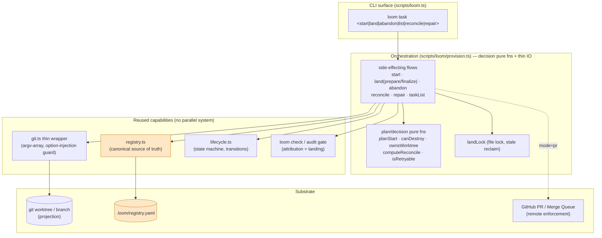
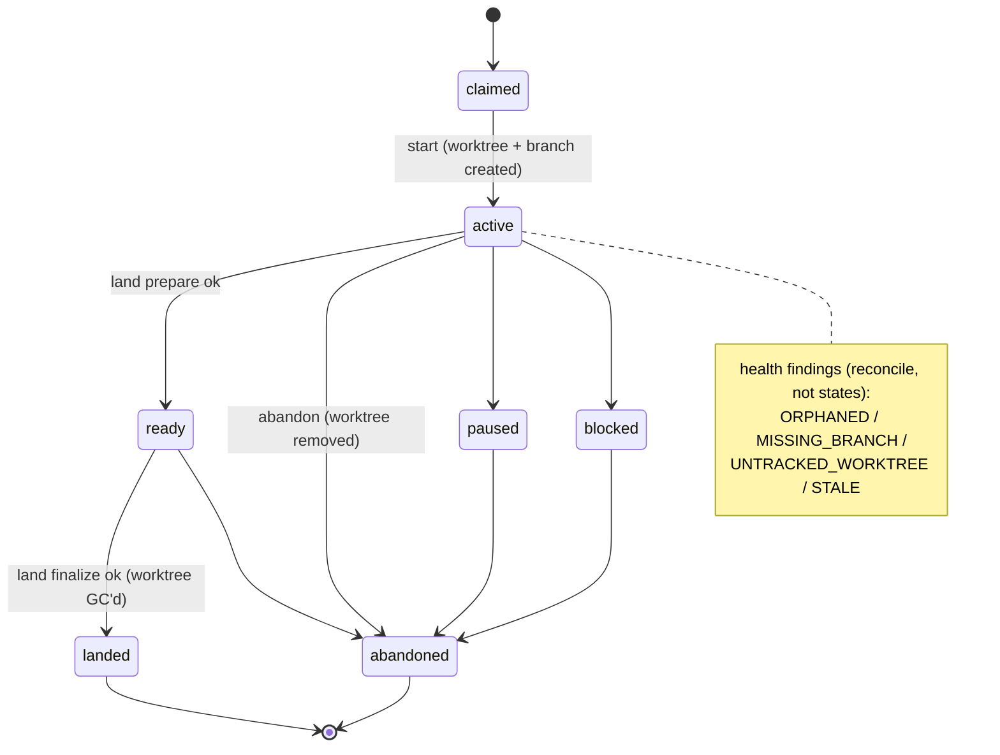
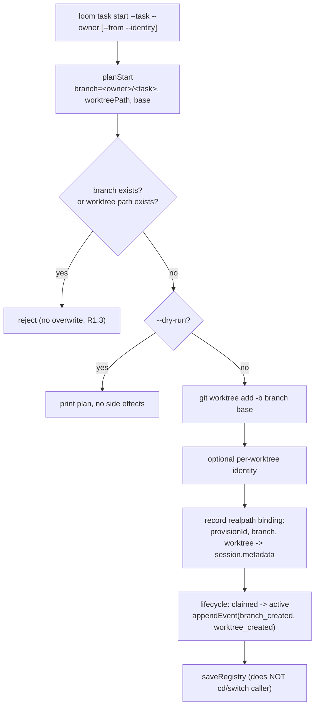
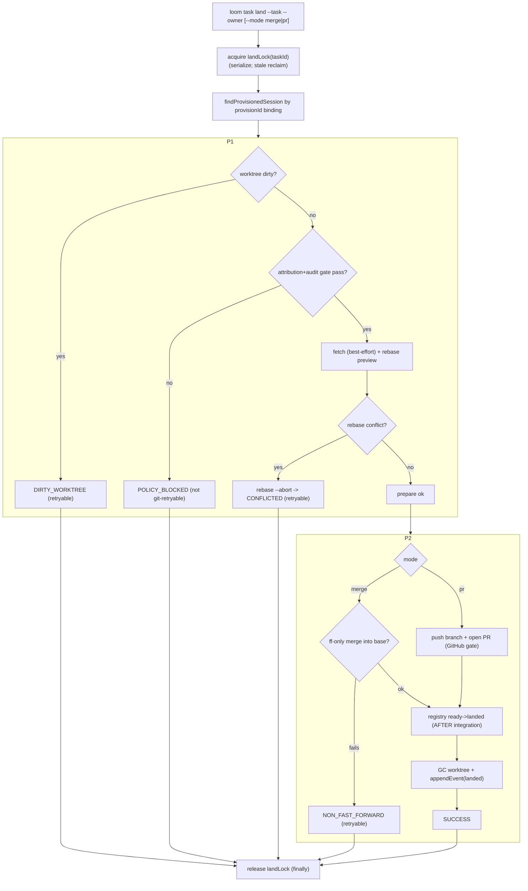
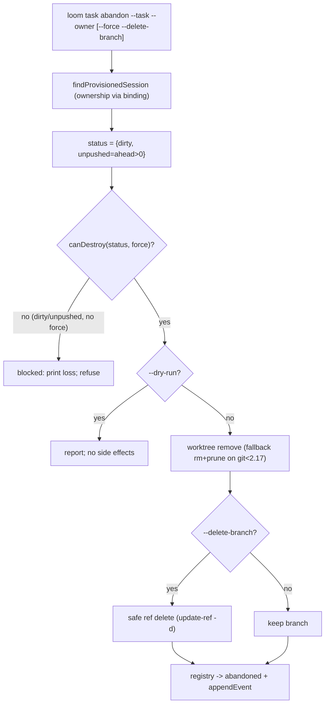
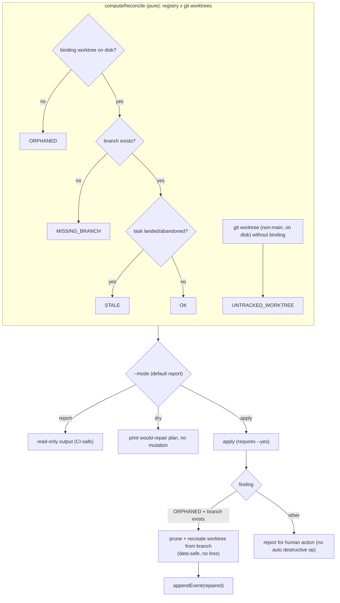
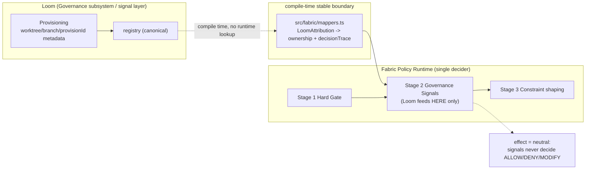

# Loom Provisioning Architecture (2026-06-16)

> Scope: business-logic architecture of Loom Provisioning (Phase 2 isolation
> lifecycle) for review. Spec: `.kiro/specs/loom-provisioning/`. Code:
> `scripts/loom/git.ts`, `scripts/loom/provision.ts`, `scripts/loom.ts`.
>
> Invariants under review: orchestration-only (no new engine), data-safety-first,
> registry as canonical source of truth, reconcile report-only by default, Loom
> stays a Fabric signal layer (compile-time, no runtime lookup).

## 1. Layered architecture

Key: Registry (yellow) is the canonical source of truth; `git worktree/branch`
is a projection reconciled against it. Provisioning never re-implements git,
auth, audit, or merge governance; it orchestrates existing pieces.

## 2. Task lifecycle plus provisioning actions

The lifecycle state machine (`lifecycle.ts`) is unchanged from the MVP; Provisioning
only attaches git side-effects to its transitions. ORPHANED and friends are
reconcile-derived health findings, NOT persisted states.

## 3. start flow

## 4. land two-phase flow (returns LandResult)

Atomicity (R9.4): the `landed` registry write happens only AFTER successful
irreversible integration, so the system never rests in a "landed but not
integrated" inconsistency. The lock is released in a `finally`.

## 5. abandon flow

## 6. reconcile decision and modes (Recovery Plane)

reconcile is never a silent mutation engine: default is read-only `report`,
mutation requires explicit `--mode apply` plus `--yes`, and only the loss-free
repair (recreate an orphaned worktree from its still-existing branch) is
automated.

## 7. Positioning within Fabric (signal only)

## 8. Review checklist (where each invariant lives)

| Invariant                                    | Enforced by                                                                      |
| -------------------------------------------- | -------------------------------------------------------------------------------- |
| Orchestration only, no new engine            | provision.ts calls git/registry/lifecycle/check; no scheduler/auth/merge engine  |
| Registry = source of truth, git = projection | computeReconcile; ORPHANED keyed on disk existence                               |
| Data safety (no silent loss)                 | canDestroy + dirty/unpushed guards + --force confirmation (start/land/abandon)   |
| No cross-agent worktree ops                  | ownsWorktree via provisionId binding (not path inference)                        |
| Land atomicity                               | two-phase; registry landed only after integration; landLock serialization        |
| Standardized land outcomes                   | LandResult + isRetryable (retryable vs hard-fail)                                |
| Recovery without surprise                    | reconcile default report-only; apply needs --yes; loss-free repair only          |
| Bounded metadata                             | events[] capped at N=50                                                          |
| Fabric signal-only                           | LoomAttribution boundary, compile-time, effect=neutral, Stage 2 only             |
| Zero regression                              | feature-gated; MVP/shared-tree unchanged when `loom task` unused; parity 0 diffs |
