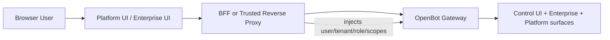

# Trusted proxy migration

Use this page when you want to converge browser-facing authentication onto one model:

- platform sign-in
- enterprise sign-in
- Control UI browser access
- tenant, role, and scope propagation

This checklist is for enterprise and SaaS-style deployments where multiple users, multiple devices, and multiple tenants must share one consistent identity model.

## Recommended target

For enterprise, multi-terminal, multi-user deployments, prefer:

- `gateway.auth.mode: "trusted-proxy"`
- a single identity-aware entry layer in front of OpenBot
- platform/BFF session as the only browser auth source
- proxy-issued tenant, role, and scopes as the authority for browser sessions

Keep shared `gateway.auth.token` or `gateway.auth.password` only for:

- local development
- CLI and machine-to-machine calls
- emergency break-glass operations
- non-browser node/client scenarios that are intentionally outside platform login

Why:

- Shared secrets scale poorly for multi-user browser access.
- Browser login and Gateway login drift apart when both exist.
- Tenant/role/scope attribution is cleaner when the proxy/BFF is authoritative.
- SSO, MFA, audit, logout, and membership changes become one system instead of two.

The repository already describes this as the intended platform/BFF pattern.
See [Trusted Proxy Auth](/gateway/trusted-proxy-auth) and [Dashboard](/web/dashboard).

## Decision rule

Use this migration if all are true:

1. Users access OpenBot from a browser.
2. The platform already owns account login, tenant membership, and MFA.
3. You want one sign-in flow across platform and enterprise surfaces.
4. You can guarantee all browser traffic reaches OpenBot only through a trusted proxy/BFF.

Do not use this migration if either is true:

1. You still need direct browser access to the Gateway without a proxy.
2. Your reverse proxy is only a TLS terminator and does not authenticate users.

## Current state audit

Before changing anything, record the current answers:

1. What is `gateway.auth.mode` today: `token`, `password`, or `trusted-proxy`?
2. Can browsers reach the Gateway directly, or only through a proxy/BFF?
3. Does the platform already issue a stable session cookie?
4. Who is authoritative for tenant selection: platform, BFF, or OpenBot itself?
5. Which browser surfaces still require pasting a token?
6. Which non-browser clients still depend on `gateway.auth.token`?

Current repo behavior to keep in mind:

- Browser Control UI token auth is enforced at the WebSocket handshake in token/password mode. See [Dashboard](/web/dashboard).
- `trusted-proxy` mode accepts proxy-authenticated browser traffic and can use proxy-declared role/scope headers. See [Trusted Proxy Auth](/gateway/trusted-proxy-auth).
- In `token` mode, platform login and browser Gateway auth are still separate concerns unless you explicitly bridge them.

## Target architecture

The target request path should look like this:



Principles:

- The browser never becomes the source of authority for tenant, role, or scopes.
- The proxy/BFF authenticates the user once.
- OpenBot trusts only authenticated requests from configured proxy IPs.
- Direct browser token prompts disappear from enterprise product flows.

## Required headers

For the unified browser model, configure all of these:

- `userHeader`
- `displayNameHeader`
- `tenantHeader`
- `roleHeader`
- `scopesHeader`

Recommended semantics:

- `userHeader`: immutable login identity, usually email
- `displayNameHeader`: human display label
- `tenantHeader`: current tenant or enterprise id
- `roleHeader`: effective Gateway role for the session
- `scopesHeader`: effective scopes for WS and RPC authorization

If you omit `roleHeader` and `scopesHeader`, trusted-proxy mode falls back to legacy behavior and leaves more ambiguity in browser authority.

## Migration phases

### Phase 1: Freeze the auth boundary

Goal:

- Ensure browser traffic has exactly one legal ingress path.

Checklist:

1. Put OpenBot behind a BFF or identity-aware reverse proxy.
2. Restrict Gateway ingress to proxy IPs only.
3. Set `gateway.trustedProxies` to the exact proxy IPs.
4. Remove or firewall any browser-reachable direct Gateway port exposure.
5. Decide whether OpenBot binds `loopback` or an internal-only network address.

Exit criteria:

- Browsers cannot reach the Gateway except through the proxy/BFF.

### Phase 2: Make platform auth authoritative

Goal:

- Platform/BFF session becomes the source of truth for browser identity.

Checklist:

1. Ensure platform login sets a stable authenticated session cookie.
2. Ensure tenant switching is represented in the BFF session context.
3. Ensure role and scopes are derived server-side, not by browser input.
4. Ensure the proxy strips any client-supplied forwarded identity headers before adding its own.
5. Decide canonical role mapping:
   - platform super admin
   - platform admin
   - enterprise admin
   - member/employee

Exit criteria:

- For any browser request, the BFF can answer: who is the user, what tenant is active, what role/scopes apply.

### Phase 3: Switch Gateway auth mode

Goal:

- Browser auth stops depending on shared token/password.

Checklist:

1. Change:

```json5
{
  gateway: {
    auth: {
      mode: "trusted-proxy",
      trustedProxy: {
        userHeader: "x-forwarded-user",
        displayNameHeader: "x-forwarded-name",
        tenantHeader: "x-tenant-id",
        roleHeader: "x-gateway-role",
        scopesHeader: "x-gateway-scopes",
        requiredHeaders: ["x-forwarded-proto", "x-forwarded-host"],
      },
    },
  },
}
```

2. Keep `gateway.trustedProxies` populated.
3. Keep `gateway.controlUi.allowedOrigins` explicit for non-loopback/browser deployments.
4. Validate that platform-auth bootstrap config reports `authMode: "trusted-proxy"`.

Exit criteria:

- Browser Control UI no longer prompts for a shared Gateway token in normal product flows.

### Phase 4: Remove browser token UX from product flows

Goal:

- End users see one login model only.

Checklist:

1. Remove “paste token into Control UI settings” from platform and enterprise login journeys.
2. Keep token-based docs only in local-dev and operator runbooks.
3. Ensure enterprise pages classify auth failures as platform/proxy session issues, not “enterprise data not configured”.
4. Make platform login success route directly into platform surfaces without any second auth mental model.
5. Make enterprise login success route directly into enterprise surfaces without token recovery steps.

Exit criteria:

- Product-facing browser users never need to know `gateway.auth.token` exists.

### Phase 5: Keep machine auth separate

Goal:

- Preserve secure auth for non-browser automation without reintroducing browser dual-mode confusion.

Checklist:

1. Decide whether CLI/node/API auth remains:
   - token
   - password
   - separate internal network trust
2. Document that this is operator/machine auth, not end-user browser auth.
3. Avoid reusing end-user browser flows for machine credentials.

Recommended pattern:

- Browser: `trusted-proxy`
- CLI/nodes/internal automation: token or password, scoped to operator workflows

Exit criteria:

- Human browser auth and machine auth are intentionally separated, not accidentally mixed.

## UI and product checklist

### Platform login

- Login success must imply immediate access to platform pages.
- MFA prompts must belong to platform login only, not Control UI token recovery.
- No fallback prompt should ask for a shared Gateway token after successful platform login.

### Enterprise login

- Enterprise login success must imply access to enterprise pages for the active tenant.
- Tenant resolution must come from platform/BFF session state.
- Errors should distinguish:
  - no enterprise permission
  - no tenant selected
  - Gateway/proxy auth failure
  - real enterprise data empty state

### Control UI settings

- Token/password fields may still exist for local dev/operator cases.
- They should not be the primary onboarding path for enterprise product users.

## Infrastructure checklist

### Reverse proxy / BFF

- Authenticate every browser request before forwarding.
- Overwrite forwarded identity headers unconditionally.
- Strip any client-supplied versions of those headers.
- Pass WebSocket upgrade traffic with the same authenticated context.
- Keep TLS and HSTS at the public edge.

### Gateway

- `gateway.auth.mode = "trusted-proxy"`
- `gateway.trustedProxies` explicitly configured
- `gateway.controlUi.allowedOrigins` explicitly configured for non-loopback access
- No public path bypassing the proxy

### Platform auth store

- Session cookie domain/path aligned with public hostname
- Session invalidation and logout semantics verified
- Tenant switch reflected in forwarded headers immediately

## Rollout plan

Use a staged rollout instead of a hard switch.

### Stage A: Shadow validation

- Keep current production auth path.
- Add proxy header generation in a non-authoritative way.
- Log resolved proxy user/tenant/role/scopes.
- Compare with current platform session state.

Success signal:

- Header-derived identity always matches platform session expectations.

### Stage B: Internal-only trusted-proxy

- Enable `trusted-proxy` in a staging or internal environment.
- Test:
  - platform login
  - enterprise login
  - tenant switch
  - MFA
  - WebSocket reconnect
  - page refresh
  - logout
  - expired session

Success signal:

- No browser token prompt appears during normal internal use.

### Stage C: Canary tenants

- Roll out to one or a few tenants.
- Monitor:
  - 401/1008 rates
  - login success to landing-page success conversion
  - tenant mismatch incidents
  - scope/role mismatches

Success signal:

- Browser auth incidents drop instead of shift.

### Stage D: Full cutover

- Remove browser token-based product instructions.
- Update onboarding and support playbooks.
- Keep break-glass operator procedures documented but out of end-user flows.

## Rollback plan

Before cutover, prepare rollback explicitly.

Rollback must include:

1. Previous `gateway.auth.mode`
2. Previous proxy routing config
3. Previous browser login entry behavior
4. How to re-enable token-based browser access for operators if trusted-proxy breaks

Rollback trigger examples:

- widespread 401/1008 after sign-in
- tenant header drift
- missing WebSocket auth context on upgrade requests
- unauthorized cross-tenant visibility

## Acceptance criteria

You are done only when all are true:

1. A platform admin signs in once and reaches platform pages without any second auth step.
2. An enterprise admin signs in once and reaches enterprise pages without any token prompt.
3. Browser refresh and reconnect preserve authenticated access through platform session.
4. Tenant, role, and scopes come from proxy/BFF state, not browser guesses.
5. Direct browser access to the Gateway without the proxy is blocked.
6. End-user docs no longer teach shared token pasting as the normal enterprise flow.
7. Operator docs still preserve a break-glass path for local/dev cases.

## What to change in this repo

Use this as a practical repo-level checklist:

- Gateway config defaults and examples:
  - `/gateway/configuration`
  - `/gateway/trusted-proxy-auth`
- Dashboard and Control UI docs:
  - `/web/dashboard`
  - `/web/control-ui`
- Login UX:
  - platform login success path
  - enterprise login success path
  - auth error copy classification
- Support docs:
  - `/help/faq`
  - `/gateway/troubleshooting`
- Deployment manifests and proxy config templates:
  - [Trusted Proxy Deployment Examples](/gateway/trusted-proxy-deployment-examples)
  - header injection
  - trusted proxy IPs
  - origin allowlist

## Non-goals

This migration does not require:

- removing token auth for CLI or node workflows
- exposing OpenBot directly to the public internet
- making browser sessions authoritative without a server-side BFF/proxy

## Final recommendation

If you want one unified browser auth model for enterprise OpenBot, converge on:

- browser auth: `trusted-proxy`
- platform session: authoritative
- token/password: operator and machine auth only

That is the cleanest model for:

- multi-user browser access
- multi-tenant control
- SSO and MFA
- consistent authorization
- enterprise support and operations

## Related pages

- [Trusted Proxy Auth](/gateway/trusted-proxy-auth)
- [Dashboard](/web/dashboard)
- [Control UI](/web/control-ui)
- [Gateway Runbook](/gateway)
