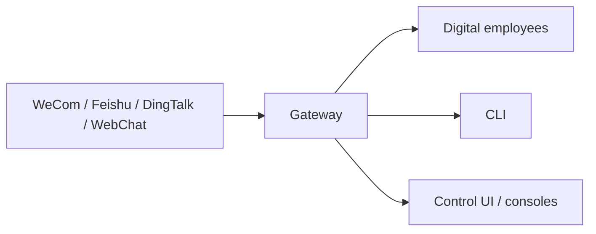

# OpenBot 🐲

<p align="center">
    
    
</p>

<p align="center">
  <strong>Enterprise Agent OS for digital employees. Package: <code>@upbeyond/openbot</code>.</strong><br />
  Primary workplace IM: WeCom, Feishu, and DingTalk. In-product chat: WebChat / Control UI.
</p>

<Columns>
  <Card title="Get Started" href="/start/getting-started" icon="rocket">
    Install OpenBot and bring up the Gateway in minutes.
  </Card>
  <Card title="Run the Wizard" href="/start/wizard" icon="sparkles">
    Guided setup with `openbot onboard` and pairing flows.
  </Card>
  <Card title="Open the Control UI" href="/web/control-ui" icon="layout-dashboard">
    Launch the browser dashboard for chat, config, and sessions.
  </Card>
</Columns>

## What is OpenBot?

OpenBot (`@upbeyond/openbot`) is an **enterprise Agent OS**. Digital employees are managed assets — with lifecycle, memory, skills, knowledge, and audit — not a personal coding assistant you message from WhatsApp.

You run a **Gateway** as the control plane. Operators use the **employee and enterprise consoles** (Control UI). Workplace chat is **WeCom, Feishu, and DingTalk** from Enterprise console → Message channels (long-connection first), plus **WebChat**.

**Who is it for?** Teams that need governable digital employees at work, not a 20-channel consumer inbox.

**What makes it different?**

- **Digital employees**: isolated agents with workspace, skills, and inheritance — not disposable chats
- **Enterprise IM first**: WeCom / Feishu / DingTalk, not a leftover OpenClaw channel wall
- **Consoles**: employee roster, collaboration groups, knowledge, capability center
- **Self-hosted control plane**: Gateway + Control UI on your infrastructure

**What do you need?** Node 22+, `@upbeyond/openbot`, and credentials for the workplace IM you actually enable. Use the strongest latest-generation model available.

## How it works



The Gateway is the control plane for sessions, routing, and the consoles. Other inherited channel plugins are not the product headline.

## Key capabilities

<Columns>
  <Card title="Enterprise IM" icon="building-2">
    WeCom, Feishu, and DingTalk from the enterprise console, long-connection first.
  </Card>
  <Card title="Digital employees" icon="bot">
    Isolated agents with workspace, memory, skills, and audit.
  </Card>
  <Card title="Consoles" icon="layout-dashboard">
    Employee and enterprise Control UI for roster, groups, and knowledge.
  </Card>
  <Card title="WebChat" icon="message-square">
    In-product chat over the Gateway WebSocket.
  </Card>
  <Card title="Skills and knowledge" icon="sparkles">
    Bundled and workspace skills; capability center governance.
  </Card>
  <Card title="Optional nodes" icon="smartphone">
    macOS / iOS / Android companion nodes for local device actions.
  </Card>
</Columns>

## Quick start

<Steps>
  <Step title="Install OpenBot">
    ```bash
    npm install -g @upbeyond/openbot@latest
    ```
  </Step>
  <Step title="Onboard and install the service">
    ```bash
    openbot onboard --install-daemon
    ```
  </Step>
  <Step title="Start the Gateway and open Control UI">
    ```bash
    openbot gateway --port 18789
    ```
    Then connect WeCom / Feishu / DingTalk from Enterprise console → Message channels. See [Enterprise IM](/channels/enterprise-im).
  </Step>
</Steps>

Need the full install and dev setup? See [Quick start](/start/quickstart).

## Dashboard

Open the browser Control UI after the Gateway starts.

- Local default: [http://127.0.0.1:18789/](http://127.0.0.1:18789/)
- Remote access: [Web surfaces](/web) and [Tailscale](/gateway/tailscale)

## Configuration (optional)

Config currently lives at `~/.gmood2008/openbot.json` for compatibility during the OpenBot cutover.

- If you **do nothing**, OpenBot uses the bundled Pi binary in RPC mode.
- Product workplace IM is **not** `channels.whatsapp`. Connect **WeCom / Feishu / DingTalk** from Enterprise console → Message channels. See [Enterprise IM](/channels/enterprise-im).
- In-product chat is [WebChat](/web/webchat) / Control UI.

## Start here

<Columns>
  <Card title="Docs hubs" href="/start/hubs" icon="book-open">
    All docs and guides, organized by use case.
  </Card>
  <Card title="Configuration" href="/gateway/configuration" icon="settings">
    Core Gateway settings, tokens, and provider config.
  </Card>
  <Card title="Remote access" href="/gateway/remote" icon="globe">
    SSH and tailnet access patterns.
  </Card>
  <Card title="Channels" href="/channels" icon="message-square">
    Product IM (WeCom / Feishu / DingTalk) plus inherited adapter catalog.
  </Card>
  <Card title="Enterprise IM" href="/channels/enterprise-im" icon="building-2">
    WeCom, Feishu, and DingTalk setup for the enterprise console.
  </Card>
  <Card title="Nodes" href="/nodes" icon="smartphone">
    iOS and Android nodes with pairing, Canvas, camera, and device actions.
  </Card>
  <Card title="Help" href="/help" icon="life-buoy">
    Common fixes, enterprise IM guides, and troubleshooting entry point.
  </Card>
</Columns>

## Learn more

<Columns>
  <Card title="Full feature list" href="/concepts/features" icon="list">
    Digital employees, enterprise IM, consoles, and tools.
  </Card>
  <Card title="Multi-agent routing" href="/concepts/multi-agent" icon="route">
    Workspace isolation and per-agent sessions.
  </Card>
  <Card title="Security" href="/gateway/security" icon="shield">
    Tokens, allowlists, and safety controls.
  </Card>
  <Card title="Troubleshooting" href="/gateway/troubleshooting" icon="wrench">
    Gateway diagnostics and common errors.
  </Card>
  <Card title="About and credits" href="/reference/credits" icon="info">
    Project origins, contributors, and license.
  </Card>
</Columns>

## Compatibility

OpenBot inherits some OpenClaw identifiers for migration only.
See [OpenBot ↔ OpenClaw 兼容层](/OPENBOT_OPENCLAW_COMPAT) — **仅兼容，非主品牌**.
