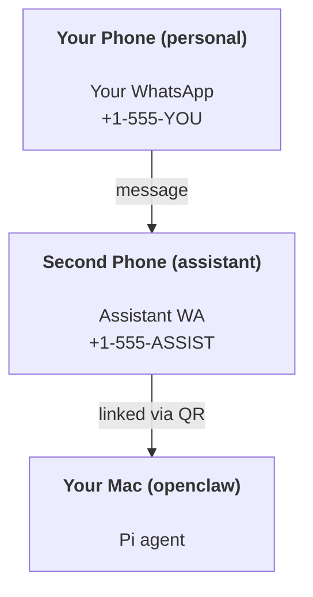

# Building a personal assistant with OpenBot

<Warning>
This page is an **inherited OpenClaw leftover**. Current OpenBot is an enterprise Agent OS.
Product workplace IM is WeCom / Feishu / DingTalk from the [enterprise console](/channels/enterprise-im),
plus [WebChat](/web/webchat). Do not treat the WhatsApp two-phone setup below as the product default.
</Warning>

This guide is the leftover personal-inbox path: a dedicated WhatsApp number that behaves like an always-on agent. Plugins from the previous project may still add Telegram / Discord / Mattermost.

## ⚠️ Safety first

You’re putting an agent in a position to:

- run commands on your machine (depending on your Pi tool setup)
- read/write files in your workspace
- send messages back out via WhatsApp/Telegram/Discord/Mattermost (plugin)

Start conservative:

- Always set `channels.whatsapp.allowFrom` (never run open-to-the-world on your personal Mac).
- Use a dedicated WhatsApp number for the assistant.
- Heartbeat interval defaults to off (`0m`). Cron, exec completions, hooks, and manual wakes still run. Do not turn on a polling interval until you have due follow-ups that need coalescing.

## Prerequisites

- OpenBot installed and onboarded — see [Getting Started](/start/getting-started) if you haven't done this yet
- A second phone number (SIM/eSIM/prepaid) for the assistant

## The two-phone setup (recommended)

You want this:



If you link your personal WhatsApp to OpenBot, every message to you becomes “agent input”. That’s rarely what you want.

## 5-minute quick start

1. Pair WhatsApp Web (shows QR; scan with the assistant phone):

```bash
openbot channels login
```

2. Start the Gateway (leave it running):

```bash
openbot gateway --port 18789
```

3. Put a minimal config in `~/.gmood2008/openbot.json`:

```json5
{
  channels: { whatsapp: { allowFrom: ["+15555550123"] } },
}
```

Now message the assistant number from your allowlisted phone.

When onboarding finishes, we auto-open the dashboard and print a clean (non-tokenized) link. If it prompts for auth, paste the token from `gateway.auth.token` into Control UI settings. To reopen later: `openbot dashboard`.

## Give the agent a workspace (AGENTS)

OpenBot reads operating instructions and “memory” from its workspace directory.

By default, OpenBot uses `~/.openbot/workspace` as the agent workspace, and will create it (plus starter `AGENTS.md`, `SOUL.md`, `TOOLS.md`, `IDENTITY.md`, `USER.md`, `HEARTBEAT.md`) automatically on setup/first agent run. `BOOTSTRAP.md` is only created when the workspace is brand new (it should not come back after you delete it). `MEMORY.md` is optional (not auto-created); when present, it is loaded for normal sessions. Subagent sessions only inject `AGENTS.md` and `TOOLS.md`.

Tip: treat this folder like OpenBot’s “memory” and make it a git repo (ideally private) so your `AGENTS.md` + memory files are backed up. If git is installed, brand-new workspaces are auto-initialized.

```bash
openbot setup
```

Full workspace layout + backup guide: [Agent workspace](/concepts/agent-workspace)
Memory workflow: [Memory](/concepts/memory)

Optional: choose a different workspace with `agents.defaults.workspace` (supports `~`).

```json5
{
  agent: {
    workspace: "~/.openbot/workspace",
  },
}
```

If you already ship your own workspace files from a repo, you can disable bootstrap file creation entirely:

```json5
{
  agent: {
    skipBootstrap: true,
  },
}
```

## The config that turns it into “an assistant”

OpenBot defaults to a good assistant setup, but you’ll usually want to tune:

- persona/instructions in `SOUL.md`
- thinking defaults (if desired)
- heartbeats (once you trust it)

Example:

```json5
{
  logging: { level: "info" },
  agent: {
    model: "anthropic/claude-opus-4-6",
    workspace: "~/.openbot/workspace",
    thinkingDefault: "high",
    timeoutSeconds: 1800,
    // Start with 0; enable later.
    heartbeat: { every: "0m" },
  },
  channels: {
    whatsapp: {
      allowFrom: ["+15555550123"],
      groups: {
        "*": { requireMention: true },
      },
    },
  },
  routing: {
    groupChat: {
      mentionPatterns: ["@openclaw", "openclaw"],
    },
  },
  session: {
    scope: "per-sender",
    resetTriggers: ["/new", "/reset"],
    reset: {
      mode: "daily",
      atHour: 4,
      idleMinutes: 10080,
    },
  },
}
```

## Sessions and memory

- Session files: `~/.openbot/agents/<agentId>/sessions/{{SessionId}}.jsonl`
- Session metadata (token usage, last route, etc): `~/.openbot/agents/<agentId>/sessions/sessions.json` (legacy: `~/.openbot/sessions/sessions.json`)
- `/new` or `/reset` starts a fresh session for that chat (configurable via `resetTriggers`). If sent alone, the agent replies with a short hello to confirm the reset.
- `/compact [instructions]` compacts the session context and reports the remaining context budget.

## Heartbeats (proactive mode)

By default, OpenBot heartbeat interval is off (`0m`). Cron, exec completions, hooks, and manual wakes still run a main-session turn. The default prompt is:
`A real trigger woke this turn. Read HEARTBEAT.md if it exists (workspace context) and only act on due items. Do not infer or repeat old tasks from prior chats. Do not check in on the user just to prove you are alive. If nothing needs attention, reply HEARTBEAT_OK.`

- Interval ticks with nothing pending do not call the model.
- If `HEARTBEAT.md` is missing or effectively empty, interval ticks are skipped. Event/manual wakes still run.
- If the agent replies with `HEARTBEAT_OK` (optionally with short padding; see `agents.defaults.heartbeat.ackMaxChars`), OpenBot suppresses that turn.
- Heartbeat stays on the OpenBot main session. Leftover outbound targets such as Telegram or WhatsApp are no longer delivered.

```json5
{
  agents: {
    defaults: {
      heartbeat: { every: "0m" },
    },
  },
}
```

## Media in and out

Inbound attachments (images/audio/docs) can be surfaced to your command via templates:

- `{{MediaPath}}` (local temp file path)
- `{{MediaUrl}}` (pseudo-URL)
- `{{Transcript}}` (if audio transcription is enabled)

Outbound attachments from the agent: include `MEDIA:<path-or-url>` on its own line (no spaces). Example:

```
Here’s the screenshot.
MEDIA:https://example.com/screenshot.png
```

OpenBot extracts these and sends them as media alongside the text.

## Operations checklist

```bash
openbot status          # local status (creds, sessions, queued events)
openbot status --all    # full diagnosis (read-only, pasteable)
openbot status --deep   # adds gateway health probes (Telegram + Discord)
openbot health --json   # gateway health snapshot (WS)
```

Logs live under `/tmp/openclaw/` (default: `openclaw-YYYY-MM-DD.log`).

## Next steps

- WebChat: [WebChat](/web/webchat)
- Gateway ops: [Gateway runbook](/gateway)
- Cron + wakeups: [Cron jobs](/automation/cron-jobs)
- macOS menu bar companion: [OpenBot macOS app](/platforms/macos)
- iOS node app: [iOS app](/platforms/ios)
- Android node app: [Android app](/platforms/android)
- Windows status: [Windows (WSL2)](/platforms/windows)
- Linux status: [Linux app](/platforms/linux)
- Security: [Security](/gateway/security)
