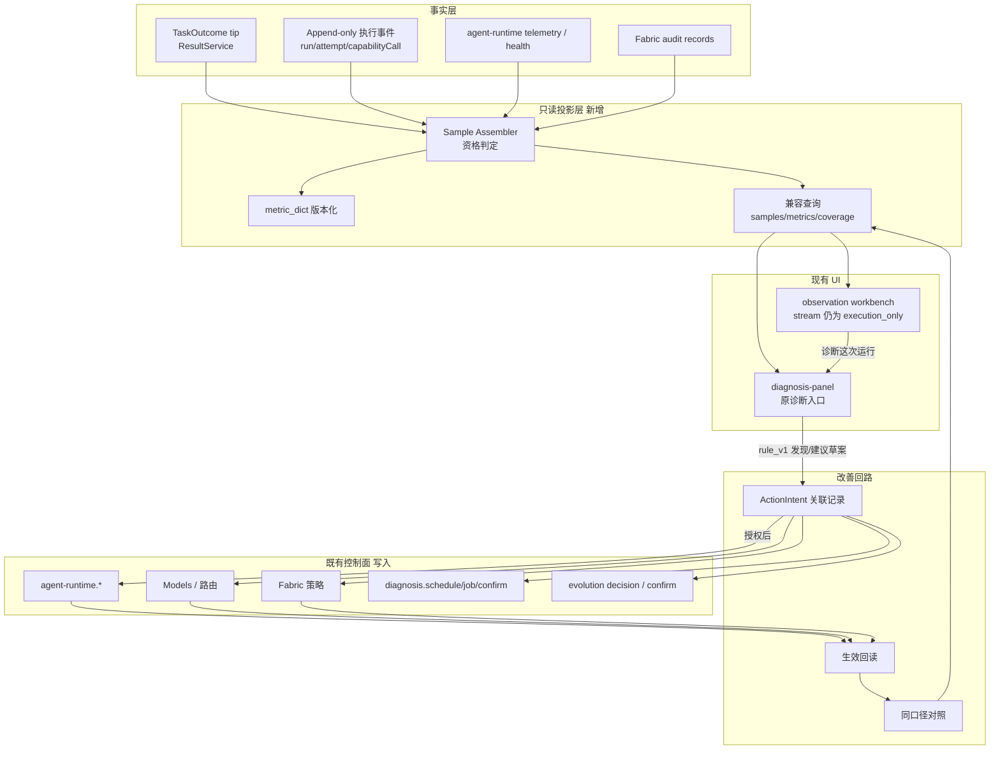

# Agent Runtime 可观测与改善闭环 · 优化方案

状态：只读审计后的实现计划（非上线说明，非 PR）  
工作树：`/Users/daniel/.codex/worktrees/runtime-convergence/openbot`  
机器：`5374ace8-b4f4-487d-b47c-a77c8edec1ca`  
审计时 HEAD（已核验）：`a5b9c926a9ab2860c9c2fd5eb946db488f231968`  
观测 UI 相关提交（历史，已核验存在于当前树上）：`6bdc251d64283a28925cf042cbe854201c551a8d`  
文档日期：2026-11-06（Asia/Shanghai）

> 本文件只新增规划文档，不代表已实现、已部署或已打通生产业务闭环。任何“已完成”仅指代码或上一轮组件验收中的事实。

---

## 1. 摘要与决策

### 1.1 一句话决策

**先把“样本资格与证据链”做成只读投影与查询，再让现有观测 UI 消费它；改善动作一律走既有控制面，不另建裁决器，不自动 apply。**

### 1.2 关键决策（必须遵守）

| 决策 | 内容 |
|---|---|
| D1 | `TaskOutcome`（`TaskOutcomeResultService`）仍是业务结果唯一真源；观测/诊断不得改写 `taskJudgement`。 |
| D2 | 当前 UI `stream.ts` 是**连接窗口派生指标**，标签已是 `execution_only`；不得私自把其语义抬升为 `fully_linked` 或持久历史。 |
| D3 | 规格中的 `platform.execution.*` / `agent-eval.*` **当前仓库不存在**；优先兼容复用 `diagnosis.*`、`agent-runtime.*`、`fabric.audit.query`、`evolution.perception.*`，新 RPC 以薄投影层挂载，不照搬命名强推。 |
| D4 | 诊断现状是 `scoringMethod: "rule_v1"`；强推理是后续可选层，不得冒充已确诊。 |
| D5 | `DIAGNOSIS_SELF_EVOLUTION_CONFIRM_ENABLED = true` 是 Path B 确认例外，不等于观测页可自动改善；UI 默认仍只发申请/预览。 |
| D6 | 缺失数据展示 `未知/partial`，禁止用 0、健康分、binding 成功率或 lifecycle 完成率冒充任务成功。 |
| D7 | 本方案分 P0–P4 小步落地；每步可回退；不在本文件范围内做 commit/push/PR/部署。 |

### 1.3 不在本次优化范围内

- 生产部署、跨租户真实业务回验宣称
- 自动配置变更 / 自动进化 apply
- 另起第二套 TaskOutcome 或平行 runtime 配置库
- 先做六张静态大屏再反推数据
- 把 session 成本平摊到任务、把 enqueue_only 当 delivered

---

## 2. 证据来源与当前基线

### 2.1 材料（参考，非已实现证明）

| 材料 | 用途 |
|---|---|
| 实现规格 `524ec…` | 四层数据、样本资格、ActionIntent、P0–P4 主约束 |
| 评价体系 `a7ffc…` | RuntimeEvalSample 维度、五目标、模块触发 |
| IA `a051…` | 接口清单与 UI 信息架构（命名可兼容，不强绑） |
| 强推理 `a327…` | 规则 vs reasoning-max 边界；`rule_v1` 现状 |

其余执行治理/验收材料：用作反例库与边界提醒，不逐篇复述。

### 2.2 代码基线（已核验 · 本轮读取）

| 区域 | 路径 / 事实 |
|---|---|
| 观测 UI 流 | `ui/src/ui/observation/stream.ts`：`buildObservationStream` 纯函数；`OBSERVATION_STREAM_SOURCE_LIVE = "RuntimeObservationSnapshot · execution_only"`；同输入不累积历史 |
| 观测模型 | `ui/src/ui/observation/model.ts`：明确 **never claims `fully_linked`**；live `outcomeState: "unavailable"` |
| 工作台 | `ui/src/ui/observation/workbench.ts`：overview/analysis/governance；暂停/继续；「诊断这次运行」回调 |
| 浏览器测试 | `ui/src/ui/observation/workbench.browser.test.ts`（上一轮组件验收；**本轮未复跑**） |
| 宿主投影 | `ui/src/ui/runtime-observation.ts`：WeakMap 会话事件，最多 200 条；`coverage: "execution_only"`；无持久回放 |
| 事件接入 | `ui/src/ui/gateway-subscriptions/chat.ts` → `recordRuntimeObservation` |
| 诊断面板 | `ui/src/ui/ports/diagnosis/diagnosis-panel.ts`：嵌入 workbench；`onDiagnoseRun` 设 `focusedRunId` 后调原诊断 |
| TaskOutcome | `src/task-outcome/types.ts`、`result-service.ts`：`taskJudgement` 仅 ResultService 写 |
| Runtime store | `src/gateway/agent-runtime-store.ts`：`listTelemetry` **接受 window 但不按窗口过滤**（源码注释）；无 provenance 字段 |
| Telemetry RPC | `src/gateway/server-methods/agent-runtime.ts`：`agent-runtime.list-telemetry` |
| 执行观察 | `src/gateway/execution-router-observation.ts` + `packages/toolkit/.../ChatRunObservation`；旗标 `OPENBOT_EXECUTION_ROUTER_OBSERVATION`，默认关闭 |
| Fabric 审计 | `src/fabric/audit-store.ts` + `fabric.audit.query`：内存环形缓冲，非耐久库 |
| 诊断 | `src/diagnosis/diagnose.ts`：`scoringMethod: "rule_v1"`；`diagnosis.diagnose` / `diagnosis.reports.*` / `diagnosis.schedule.apply` / `diagnosis.job.*` |
| 进化感知 | `evolution.perception.query` / `evolution.perception.project` |
| 缺失 API | **无** `platform.execution.*`、**无** `agent-eval.*`、**无** `ActionIntent` 类型、**无** `src/gateway/platform-execution.ts` |

### 2.3 上一轮已验证（引用，本轮未复跑）

- 提交 `6bdc251d6`：live observation、窗口短趋势、运行下钻、暂停/继续、同源诊断入口
- 摘要称：相关 node/browser 测试、lint、fmt、UI build 曾通过；样例截图曾验收
- **本轮不得声称“测试刚跑过 / 全仓已绿”**

### 2.4 建议（未核验生产）

- 生产是否开启 execution-router observation、是否有真实跨租户事件写入：待环境证据
- seed/telemetry 是否混入运营视图：待 provenance 字段落地后核验

---

## 3. 范围与边界

### 3.1 优化目标

1. 让一次任务能回答：业务结果？（tip）/ 执行过程？（run/attempt）/ 覆盖率与断链？/ 能否进入改善合格集？
2. 观测页继续只读；改善进入既有 Models / agent-runtime / Fabric / diagnosis / evolution 控制面。
3. 指标、诊断、进化共用版本化 `metric_dict` 与样本资格，避免各页各算。

### 3.2 硬边界

```text
事实层（TaskOutcome + 不可变执行事件）
    ≠ 诊断层（rule_v1 / 后续 reasoning 假设）
    ≠ 授权层（审批 / 控制面 command）
    ≠ 生效层（配置回读 / 实例覆盖）
    ≠ 验证层（同口径对照 / 晋升或回滚）
```

控制回执 ≠ 生产生效 ≠ 改善已验证。

### 3.3 对当前 stream 的语义冻结

| 允许 | 禁止 |
|---|---|
| 继续作为连接窗口 `execution_only` 派生视图 | 改写成持久历史或任务级证据断言 |
| 显示 `未知`、断链 reason、样例标识 | 把 lifecycle 完成率改名为任务成功率 |
| 下钻到本连接内的 runIds | 跨会话猜测关联或填零 |
| 跳转原诊断并带 run/session | 在 stream 内合成 `fully_linked` |

新的任务级证据应通过**新的只读投影/查询**进入 UI，而不是修改 `buildObservationStream` 的资格语义。

---

## 4. 现状矩阵（有效事实 vs 待生产证据）

| 能力 | 现状判定 | 证据 | 缺口 |
|---|---|---|---|
| 连接内执行事件投影 | **部分支撑（UI）** | `runtime-observation.ts` / `model.ts` / `stream.ts` | 无耐久、无 tip 关联、无租户映射 |
| 业务结果权威 | **直接复用（代码）** | `TaskOutcomeRecord` + `TaskOutcomeResultService.submit` | UI live 路径未 join tip |
| 样本资格枚举 | **规格有 / 代码无统一实现** | 规格 §3；UI 仅硬编码 `execution_only` | 需 `fully_linked\|outcome_only\|execution_only\|invalid` |
| `platform.execution.*` | **不存在** | rg 无命中 | 用兼容别名或薄封装，见 §7 |
| `agent-eval.*` | **不存在** | rg 无命中 | 同左；优先挂现有 diagnosis/evolution |
| binding 成功率 | **修正后可用** | `BindingInvocationMetrics.successRate7d`；`listTelemetry` 不按 window 滤 | 窗口过滤 + provenance |
| ChatRunObservation | **部分支撑（可选旗标）** | `execution-router-observation.ts` 默认 off | 与 tip/run 关联后才能进共同证据 |
| Fabric 决策审计 | **直接/关联待丰富** | `fabric.audit.query` 内存环 | 缺 durable；缺 run/attempt 强关联字段验证 |
| 诊断 rule_v1 | **已核验** | `diagnose.ts:124` | 非强推理；不得当根因确诊 |
| 进化感知只读 | **已核验 RPC** | `evolution.perception.*` | 切流仍须既有授权门 |
| ActionIntent 回读状态机 | **规格有 / 代码无** | rg 无 `ActionIntent` | P2 新建关联记录，写仍走原控制面 |
| 成本归属 task | **待权威源** | live `attributedCost: null` | usage→taskOutcomeKey 归属与 coverage |
| 心跳/配额权威时序 | **待 P4** | health summary 为 store 快照 | 连续探测与配额分母 |

图例：代码存在 ≠ 生产已写入；组件验收 ≠ 生产覆盖实证。

---

## 5. 目标架构



原则：**统一投影，不第二权威**；投影错误可重建；业务状态只在 ResultService。

---

## 6. 四层观测与样本资格

### 6.1 四层（不可互相冒充）

| 层 | 回答 | 当前可用碎片 | 合格展示条件 |
|---|---|---|---|
| L1 资源与链路 | 能否稳定跑 | `agent-runtime-store` health、get-health-summary | 有 `lastSampleAt`/探测时序；否则标登记快照/未知 |
| L2 技术调用 | 依赖是否正常 | binding metrics、list-telemetry、toolkit receipt 摘要 | 标明 binding/model 成功，不叫任务成功 |
| L3 任务执行 | 为何慢/错/贵 | UI lifecycle 片段、ChatRunObservation（旗标） | 成对阶段才算耗时；断链显式 |
| L4 业务结果 | 是否完成 | TaskOutcome tip | 仅 tip；无 tip 显示未知 |

### 6.2 样本资格

| 资格 | 条件 | 可用于 |
|---|---|---|
| `fully_linked` | `taskId@outcomeVersion` + 一致 run/attempt + 必要调用/阶段键同位 | 强归因、改善合格集、进化对照 |
| `outcome_only` | tip/验收/投递可读，缺执行事实 | 业务聚合 |
| `execution_only` | 见运行过程，无/无法匹配 tip | 技术分析；**当前 live UI 仅此** |
| `invalid/mismatch` | 缺时戳、冲突键、跨版本硬配对 | 不计成功率/进化 |

关联链：

```text
tenant/agent → taskId@outcomeVersion → runId → attemptId → capabilityCallId? → deliveryId?
```

旁路回复：可并排展示，必须保留来源身份，禁止误去重为同源。

### 6.3 覆盖率必出字段

- `coverage.events` / `coverage.link` / `coverage.fields`
- `sourceWatermark` / `projectedAt`
- `provenance`: `seed | injected | live | sample_ui`
- `grant`（正文授权；默认无正文）

---

## 7. 指标契约（最少实例）

### 7.1 字典字段

每条指标：`metricId`、`version`、单位、公式、时间归属、分母、维度、事实源、`coverageGate`、`showGate`。

### 7.2 YAML 示例（建议契约，非已实现文件）

```yaml
# 例 1：生命周期完成率（技术层，非任务成功）
metricId: runtime.lifecycle_completion_rate
version: 1
unit: ratio
formula: completed_runs_with_paired_start_end / runs_in_window
timeAttribution: run.end.occurredAt
denominator: runs with observed start or end in window
dimensions: [tenantId, agentId, sessionKeyHash]
sources: [RuntimeObservationSnapshot.events]
coverageGate: execution_only_ok
showGate: completed_runs >= 1
notes: "不得改名为任务完成率；当前 UI stream 已近此语义"
```

```yaml
# 例 2：业务闭环率（仅 tip）
metricId: business.task_closed_success_rate
version: 1
unit: ratio
formula: count(taskJudgement==success && lifecycle==closed) / count(eligible_tips)
timeAttribution: TaskOutcome.decidedAt
denominator: tips in window with required scope
dimensions: [tenantId, agentId, taskContract.kind, entrypoint]
sources: [TaskOutcomeRecord]
coverageGate: requires outcome_only_or_better
showGate: tip_count >= N AND provenance!=seed_mixed_unmarked
notes: "decisiveRun 不等于验收 provenance；enqueue_only 不计 delivered"
```

```yaml
# 例 3：关联覆盖率（元指标）
metricId: eval.link_coverage
version: 1
unit: ratio
formula: fully_linked_samples / samples_attempted
timeAttribution: projectedAt
denominator: assembler inputs in window
dimensions: [tenantId, agentId]
sources: [SampleAssembler]
coverageGate: always
showGate: samples_attempted >= 1
notes: "覆盖率门禁；断链尖峰触发补证而非确诊"
```

### 7.3 与当前 UI 指标键的映射（兼容，不改语义）

| UI `ObservationStreamMetricKey` | 映射建议 | 说明 |
|---|---|---|
| `active_runs` / `event_receive_rate` / `run_completion_rate` / `latency_*` / `tool_calls` / `sequence_or_link_gaps` | 保留为 connection-window 技术指标 | 继续标 `execution_only` |
| `business_acceptance` | 将来接 tip 后才可有值；现为未知 | 禁止用工具 end 填充 |
| `attributed_cost` | 需 usage→run/task 归属 | 现为未知 |

---

## 8. 查询 / API 兼容路径（κbridge）

规格名是目标语义；**落地优先复用现网 RPC**，再用兼容别名或薄 facade。

| 规格意图 | 当前真实能力 | 推荐承接 |
|---|---|---|
| samples 列表/详情 | 无统一样本 API；UI 本地 groupRuns | **新增**只读 assembler + `diagnosis` 旁路查询或 `platform.observation.samples`（若需新名）；过渡期 UI 可先调内部模块 |
| metrics / coverage | stream 本地算；health/telemetry 分离 | 新投影聚合；telemetry 先修 window |
| version-diff | runtime lifecycle history、配置版本散落 | 先读既有 version/lifecycle RPC，再统一 diff DTO |
| `agent-eval.sample.*` | 不存在 | **不要先注册空壳名**；等 assembler 稳定后以别名挂载，或文档声明等价于 `platform.observation.*` |
| `agent-eval.diagnose.run` | `diagnosis.diagnose` + `readTaskOutcomeEvidence` | 薄封装强制 tip 三元组；复用 `diagnosis-panel` |
| `agent-eval.suggest.list` | rule_v1 finding / evolution projection | 只读；标 `source: rule` |
| 进化预览/感知 | `evolution.perception.query/project` | 直接复用；晋升走既有 confirm/decision |
| Fabric 策略聚合 | `fabric.audit.query` | 直接复用；注明非耐久 |

**兼容原则：** 新客户端可发现能力用 feature flag / method list；旧 UI 不因缺新 RPC 而伪造数据。

---

## 9. UI 改动（相对现状的增量）

### 9.1 保持

- `openbot-observation-workbench` 三 Tab + 分析四级
- 暂停/继续、样例源标识、`execution_only` 文案
- 「诊断这次运行」→ `diagnosis-panel` `focusedRunId` 路径
- `/platform/diagnosis` 原路由，不另建第二诊断 UI

### 9.2 P0–P1 UI 增量（有数据才显示）

1. **资格徽章**：每条运行/样本显示 `execution_only|outcome_only|fully_linked|invalid`（来自投影，不由 stream 臆造）。
2. **四层证据条**：资源 / 调用 / 执行 / 业务；缺层灰显 + reason。
3. **覆盖率条**：link coverage、字段覆盖、provenance、projectedAt。
4. **任务下钻**：当 tip 三元组可用时展示 judgement/lifecycle/delivery；否则未知。
5. **治理页**：ActionIntent 状态只读机（P2）；申请按钮跳转既有实验/治理，不本地假成功。

### 9.3 明确不做（本阶段）

- 把 NEBULA 用量屏主叙事替换任务泳道前，先有 tip+run 投影
- 在 live stream 内做 A/B 进化对照
- 展示 prompt / 工具正文

---

## 10. 改善回读状态机

```text
draft → needs_evidence → previewed → authorized
  → submitted/executing → partially_effective/effective
  → verified/promoted
旁路：rejected | failed | conflict | blocked | rolled_back
```

| 状态 | 证据要求 | UI 文案要点 |
|---|---|---|
| draft | finding + evidenceIds | 草案 |
| needs_evidence | coverage 不足 | 仅可补证 |
| previewed | current/target diff + 影响面 | 可审查 |
| authorized | 审批记录 + scope | 已授权≠已执行 |
| submitted/executing | commandId + 控制面 receipt | 已受理/执行中 |
| effective | 配置回读版本 + 覆盖实例 | 已生效 |
| verified | 同 metric_dict / cohort 对照通过 | 已验证 |
| rolled_back | 回滚 receipt + 回读 | 保留失败证据 |

ActionIntent 最小字段（新建关联记录，不替代控制面）：

- ids：`actionIntentId`、`commandId`、`idempotencyKey`、`requestId`
- 证据：`findingId`、样本版本、coverage、metric_dict version
- 目标：`targetType/Id`、`tenantScope`、`expectedConfigVersion`、diff
- 验证：指标、门限、观察窗、回滚点
- 回读：实际版本、覆盖、生效时刻、验证结论

动作域继续映射到既有 RPC（Models、agent-runtime bindings/policy/lifecycle、Fabric、diagnosis.schedule/job、evolution confirm）；缺 receipt/回读的控制面先补 adapter，UI 不得合成成功。

---

## 11. 隐私 / 性能 / 保留

| 主题 | 要求 |
|---|---|
| 隐私 | 默认不存 prompt、成果正文、工具参数/返回；平台默认元数据；正文需显式 grant + 审计，撤回使缓存失效 |
| 观察旗标 | `OPENBOT_EXECUTION_ROUTER_OBSERVATION` 默认 off；开启前测副作用与性能 |
| UI 保留 | 每会话最多 200 事件（已有）；持久投影另定 TTL/容量 |
| Fabric | 内存 capacity 默认 1000；耐久化另立项 |
| Telemetry | 现 5000 条截断；需 window 过滤与 provenance 后再用于运营 |
| 成本 | 诊断/进化 reasoning token 单列，不计入任务成败 |
| 时区 | 存储 UTC/epoch；展示转 Asia/Shanghai 并标注 |

---

## 12. 分阶段任务清单（P0–P4）

每项格式：目标 · owner 文件 · 入参/出参 · 验收 · 回退

### P0 正确性（先修口径，少加功能）

| ID | 任务 | Owner（建议） | 入参 → 出参 | 验收 | 回退 |
|---|---|---|---|---|---|
| P0-1 | 指标字典草案落地（代码常量或 YAML） | `src/observation/metric-dict.ts`（新，薄） | metricId → 定义 | 三例指标可被单测加载；与 UI 键映射表存在 | 删除字典模块，UI 仍用本地键 |
| P0-2 | 修 `listTelemetry` 按 window 过滤 | `agent-runtime-store.ts`、`agent-runtime.ts` | window → 过滤 samples | 单测：窗外样本不返回 | 恢复“提示参数”并标 deprecated |
| P0-3 | telemetry `provenance` | `RuntimeTelemetry` 类型 + seed/record 路径 | sample → 带 provenance | seed 与 live 可区分；UI/治理不混标 | 字段可选，缺省 `unknown` |
| P0-4 | 文案/测试锁：禁止 fully_linked 与任务成功率误名 | `model.ts`/`stream.ts` 测试已有基础 | — | 保持现有断言；新增错误文案用例 | 仅测试回滚 |
| P0-5 | 现状矩阵进入仓库 docs/out（本文件） | `out/…optimization-plan.md` | — | 路径存在且与源码一致 | 删除本文件 |

### P1 执行事实与样本投影

| ID | 任务 | Owner | 入参 → 出参 | 验收 | 回退 |
|---|---|---|---|---|---|
| P1-1 | Sample Assembler（只读 join tip + 执行事件） | `src/observation/sample-assembler.ts`（新） | tip 三元组/时间窗 → Sample + eligibility | 同时产出 fully_linked 与 partial；冲突键 → invalid | 关闭入口，UI 仍只用 execution_only |
| P1-2 | 事件挂点：把 ChatRunObservation 与 task/run 关联（仍默认旗标） | `execution-router-observation.ts`、runner 挂点 | run 结束 → 脱敏事件 | 开旗标可查 stages/latencies；关旗标无写入 | 关环境变量 |
| P1-3 | 只读查询（兼容名二选一，实现一份） | gateway server-methods 新文件 | filters → samples/metrics/coverage | 缺数据返回 unknown/partial 非 0 | 方法从 method list 移除 |
| P1-4 | UI 消费投影：资格徽章 + tip 区 | `workbench.ts`、diagnosis-panel | sample DTO → 渲染 | live 无 tip 时仍未知；有 tip 不改 stream 语义 | UI 开关回退到纯 stream |
| P1-5 | 成本归属最小路径 | usage/billing 适配 | request usage → run/task + coverage | 无归属则未知 | 不展示成本卡 |

### P2 动作承接

| ID | 任务 | Owner | 入参 → 出参 | 验收 | 回退 |
|---|---|---|---|---|---|
| P2-1 | ActionIntent 存储（关联，非权威配置） | `src/observation/action-intent-store.ts`（新） | finding → intent draft | 状态机单测；无授权不调用写 RPC | 禁用治理写入口 |
| P2-2 | 控制面 adapter：commandId/幂等/receipt/回读 | 各既有 RPC 包装 | intent → receipt + readback | 测试环境 finding→授权→回读通一路 | adapter feature off |
| P2-3 | UI 治理页状态机文案 | workbench governance | intent 状态 → 文案 | accepted/executed/effective/verified 逐字区分 | 隐藏治理写按钮 |

### P3 回验与进化

| ID | 任务 | Owner | 入参 → 出参 | 验收 | 回退 |
|---|---|---|---|---|---|
| P3-1 | 同口径对照（baseline/candidate） | metrics.compare 投影 | 两方案 + 窗 → Δ + 门禁 | 资格不足阻断 | 仅展示数值不晋升 |
| P3-2 | 复用 evolution.perception + confirm 门 | evolution / diagnosis confirm | preview → 申请 | 默认不自动 apply；Path B confirm 仍需显式 | 关掉 UI 申请 |
| P3-3 | 可选强推理层 | `diagnose.ts` 旁路 ReasoningPass | sample+rule findings → hypothesis(source=reasoning) | schema 失败回退 rule_v1；不写 tip | 关闭角色模型配置 |

### P4 容量完善

| ID | 任务 | Owner | 验收 | 回退 |
|---|---|---|---|---|
| P4-1 | 权威心跳时序与 stale/missing | health collect/store | 无心跳不显示“正常” | 回退登记快照文案 |
| P4-2 | 配额/并发分母 | quota 控制面核验后 | 不用 session/binding 数冒充分母 | 隐藏余量卡 |
| P4-3 | Fabric/telemetry 耐久化评估 | ops 设计 | 有保留策略与容量报告 | 继续内存环 |

---

## 13. 测试反例库（必须覆盖）

来自材料与当前实现缺口，优先写成契约/单测名：

1. 重复事件 / 乱序 sequence → `sequence_gap_or_reorder`，不强拼因果
2. 只有 tool end、无 tip → 业务验收未知
3. seed telemetry 混入 live 窗口 → 无 provenance 不得标生产
4. `listTelemetry` 窗外样本 → 过滤后不可见（P0-2）
5. 跨 `outcomeVersion` 硬配对 → `invalid`
6. enqueue_only / 无 deliveryId → 非 delivered
7. session 成本不可平摊 → attributed_cost 未知
8. 关闭 observation 旗标 → 无敏感字段、主链无抛错
9. 正文 grant 撤回 → 缓存失效
10. rule_v1 假设不得改 tip；reasoning schema 失败整单作废
11. 控制回执成功但回读版本不符 → 非 effective
12. 旁路回复与主 run 不同源 → 禁止误去重
13. 租户过滤 + live 无映射 → 空态说明（现 workbench 已有方向）
14. UI 样例源 → 文案含“非生产”
15. Path B confirm 开启 ≠ 观测页自动 apply

---

## 14. 阶段性 DoD 与交付格式

### 14.1 阶段 DoD

| 阶段 | Done 当且仅当 |
|---|---|
| P0 | telemetry 窗口真实过滤；provenance 可区分；指标字典与错误口径测试锁住；**无生产宣称** |
| P1 | 开发/测试环境可查 sample 资格；一次 run 能看断链原因；UI 在无 tip 时保持未知 |
| P2 | 至少一条改善路径：finding → 授权 → 原控制面 → 版本回读（测试环境） |
| P3 | 同口径对照可阻断不合格晋升；进化申请有预览 |
| P4 | 在线率/余量仅来自连续真实数据，否则未知 |

### 14.2 每阶段交付报告模板

```text
1. 变更文件与 owner
2. 已接通 / 未接通事实（含生产写入是否验证）
3. 查询/RPC 兼容说明
4. 测试：单测/契约/是否实机；列出未跑项
5. 未知与 partial 行为截图或夹具
6. 回退方式
7. 残留缺口（禁止写“全流程已支持”）
```

### 14.3 本轮交付（本文件）

- 路径：`out/agent-runtime-observability-optimization-plan.md`
- 动作：仅新增该文档；无代码改动；无 commit/push/PR/部署
- 审计结论见文首与 §2、§4

---

## 15. 推荐落地次序（执行时抄此顺序）

1. P0-2 / P0-3 修 telemetry 正确性（低风险、高杠杆）
2. P0-1 指标字典 + P0-4 口径测试锁
3. P1-1 assembler（tip 只读 join）→ P1-3 查询
4. P1-4 UI 徽章与 tip 区（**不动 stream 资格语义**）
5. P1-2 在旗标后接通 ChatRunObservation 关联
6. P2 ActionIntent 一路打通再扩动作域
7. P3 对照与进化门禁；强推理可选
8. P4 心跳/配额

---

## 16. 复核声明

经对照当前 worktree 源码撰写，本文：

- **不声称**已线上部署或生产业务闭环
- **不声称**自动改善授权已对观测页开放
- **不声称** `platform.execution.*` / `agent-eval.*` 已存在
- **不声称**本轮复跑了 18 项测试或全仓 CI
- **确认**当前 live 观测为连接窗口 `execution_only` 派生，且 UI 未宣称 `fully_linked`
- **确认**诊断主路径仍为 `rule_v1`；强推理仅为后续方案
- **确认** `DIAGNOSIS_SELF_EVOLUTION_CONFIRM_ENABLED=true` 是既有 Path B 例外，改善仍须显式授权与控制面回读

完整性来自证据范围，不来自指标数量。
